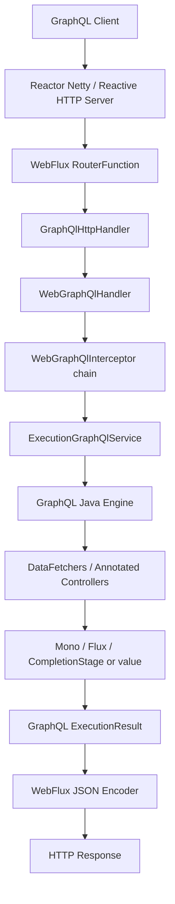

# Spring WebFlux transport

Spring for GraphQL is not tied to a specific web server. The GraphQL engine handles schemas, operations, and DataFetchers; the transport layer receives HTTP or WebSocket requests, converts payloads into GraphQL requests, and sends results back to the client. When running on Spring WebFlux, the application uses the HTTP handler and reactive web stack to read requests, execute an asynchronous pipeline, and write responses with non-blocking I/O.

With Spring Boot, you only need to combine `spring-boot-starter-graphql` and `spring-boot-starter-webflux` to expose a GraphQL HTTP endpoint on WebFlux. The default endpoint is `POST /graphql`. Boot auto-configures `GraphQlHttpHandler` and a `RouterFunction`; most applications do not need to write routes manually. When standalone configuration is required, you can wire `WebGraphQlHandler`, `GraphQlHttpHandler`, and WebFlux functional routing directly.

This lesson walks through dependencies and auto-configuration, HTTP requests/responses, JSON codecs, reactive interceptors, non-blocking DataFetchers, SSE/WebSocket, security, testing with `WebTestClient`, and common operational issues.

## 1. Where does WebFlux transport fit in the architecture?

A GraphQL request over HTTP on WebFlux passes through these main layers:



Role of each layer:

| Component | Responsibility |
| --- | --- |
| WebFlux server | Accepts HTTP connections and provides reactive request/response APIs |
| `RouterFunction` | Selects the handler for a URL and HTTP method |
| `GraphQlHttpHandler` | Reads the GraphQL payload, invokes the Web GraphQL handler, and writes the response |
| `WebGraphQlHandler` | Runs the interceptor chain before and after GraphQL execution |
| `ExecutionGraphQlService` | Passes the GraphQL request to the GraphQL Java engine |
| GraphQL Java | Validates operations, executes fields, and produces `ExecutionResult` |
| DataFetcher/controller | Loads data and returns field values |

The transport and DataFetchers have different responsibilities. WebFlux handles non-blocking HTTP I/O. DataFetchers decide how to access databases or services. Simply adding the WebFlux starter does not turn blocking JDBC/JPA calls into reactive ones.

## 2. Choosing dependencies for Spring WebFlux

With Spring Boot, the minimal dependencies for GraphQL over HTTP on WebFlux are:

```kotlin
dependencies {
    implementation("org.springframework.boot:spring-boot-starter-graphql")
    implementation("org.springframework.boot:spring-boot-starter-webflux")
}
```

Or Maven:

```xml
<dependency>
    <groupId>org.springframework.boot</groupId>
    <artifactId>spring-boot-starter-graphql</artifactId>
</dependency>

<dependency>
    <groupId>org.springframework.boot</groupId>
    <artifactId>spring-boot-starter-webflux</artifactId>
</dependency>
```

Spring Boot selects the web stack based on the dependencies and application configuration. If an application includes both `spring-boot-starter-web` and `spring-boot-starter-webflux`, Boot typically chooses Spring MVC when starting a servlet application. If your target is WebFlux, verify the dependency graph and application type to avoid accidentally running on MVC.

Spring WebFlux can run on Reactor Netty or another supported reactive server. The starter brings in Reactor Netty by default if no other compatible server is configured.

GraphQL schemas are still placed in `src/main/resources/graphql/**` with the `.graphqls` or `.gqls` extension. The transport does not change how schemas or controllers are declared:

```graphql
type Query {
  greeting(name: String!): String!
}
```

```java
@Controller
public class GreetingController {

    @QueryMapping
    public Mono<String> greeting(@Argument String name) {
        return Mono.just("Hello, " + name + "!");
    }
}
```

Controllers can return reactive types. The WebFlux HTTP handler consumes the execution result along the asynchronous pipeline and writes the response once the GraphQL operation completes.

## 3. Boot auto-configuration creates the HTTP endpoint

When both the GraphQL starter and WebFlux starter are present, Spring Boot auto-configures:

- `GraphQlSource` from schemas and runtime wiring.
- `ExecutionGraphQlService` to execute GraphQL requests.
- `WebGraphQlHandler` to run the interceptor chain.
- WebFlux `GraphQlHttpHandler` to handle GraphQL HTTP requests.
- `RouterFunction` mapping HTTP requests to the handler.

The default endpoint is:

```text
POST /graphql
```

In Spring Boot 3.4 and earlier, the property is:

```yaml
spring:
  graphql:
    path: /api/graphql
```

Starting in Spring Boot 3.5 and in Spring Boot 4.x, the property is grouped under `spring.graphql.http.path`:

```yaml
spring:
  graphql:
    http:
      path: /api/graphql
```

Property names can change across Spring Boot major versions; check the configuration metadata for the exact dependency version in use. The rest of this lesson does not depend on a specific path.

Boot exposes the HTTP endpoint as a `RouterFunction` with a default order of `0`. If your application declares additional `RouterFunction` beans, coordinate their order so application-specific routes do not accidentally shadow the GraphQL route or vice versa.

With the default configuration, applications do not need to declare a custom `GraphQlHttpHandler` or `RouterFunction`. Only create manual routes when you need explicit control over the URL, predicates, handler, or integration into a standalone WebFlux functional application.

## 4. HTTP request and response

GraphQL HTTP accepts requests via HTTP POST by default. Basic headers and body:

```http
POST /graphql HTTP/1.1
Content-Type: application/json
Accept: application/graphql-response+json
```

The body is a JSON object containing the GraphQL request:

```json
{
  "query": "query BookById($id: ID!) { bookById(id: $id) { id title } }",
  "operationName": "BookById",
  "variables": {
    "id": "book-1"
  }
}
```

Common properties:

| Property | Purpose |
| --- | --- |
| `query` | GraphQL document as a string |
| `operationName` | Name of the operation to run when the document contains multiple operations |
| `variables` | Map of input variables for the operation |
| `extensions` | Extension metadata agreed upon between client and server |

Successful response:

```http
HTTP/1.1 200 OK
Content-Type: application/graphql-response+json
```

```json
{
  "data": {
    "bookById": {
      "id": "book-1",
      "title": "Spring GraphQL"
    }
  }
}
```

If the client does not request the newer media type, the server still supports legacy `application/json`. The response media type should be negotiated via the `Accept` header; standard request bodies continue to use `Content-Type: application/json`.

### HTTP status and GraphQL errors

Do not assume every GraphQL error changes the HTTP status away from 200:

| Scenario | Typical HTTP status |
| --- | --- |
| Server unavailable or transport error | 5xx |
| Missing authentication or rejected by web security | 4xx |
| Body is not valid JSON | 4xx |
| Invalid document parse/validation, client accepts `application/graphql-response+json` | 4xx |
| Invalid document parse/validation, client uses legacy `application/json` | 200 per legacy behavior |
| Request validated, but a DataFetcher raised an execution error | 200; details are in `errors` |

Once a GraphQL operation has passed validation, errors occurring during field execution are represented in the response body via `errors`; the HTTP status remains 200. Clients must inspect both `data` and `errors`, because a response can contain partial data.

### HTTP GET

`GraphQlHttpHandler` can support GET if explicitly enabled. GET does not send a JSON body; the query and operation name go in the query string, while variables/extensions must be encoded as JSON strings. Because GET is a safe method, a GraphQL server rejects Mutation operations over GET.

GET is disabled by default. Before enabling it, note that the query string may appear in access logs, browser history, `Referer` headers, proxies, and caches. Do not use GET if variables contain sensitive data. For most applications, POST is the simpler and safer choice.

## 5. WebFlux handler and JSON codecs

The WebFlux `GraphQlHttpHandler` uses Spring WebFlux reactive codecs to read and write payloads:

- `DecoderHttpMessageReader` reads and decodes the JSON request body.
- `EncoderHttpMessageWriter` encodes the GraphQL response into JSON.
- The WebFlux server writes the response without blocking a thread while waiting for I/O.

Default codecs are taken from the application's WebFlux configuration. If the application customizes Jackson, `CodecConfigurer`, or buffer limits, verify that GraphQL payloads still deserialize into the request map and serialize to the proper response format.

Example configuring the in-memory data buffer limit:

```yaml
spring:
  codec:
    max-in-memory-size: 2MB
```

The actual value depends on operation sizes, variables, and the deployment environment. Setting the limit too low can cause large requests to be rejected; setting it too high increases memory consumption risks under high concurrency.

If the JSON codec dedicated to GraphQL differs from the application-wide codec, you can configure custom codecs on the GraphQL HTTP handler in a manual setup. Avoid replacing all default codecs if you only need to add a serializer or module; prefer extending the existing configuration.

## 6. Declaring a WebFlux route manually without the Boot endpoint

In a self-configured WebFlux application, you can create routes with functional endpoints. The example below assumes the application already has a `WebGraphQlHandler` configured with `ExecutionGraphQlService` and an interceptor chain:

```java
@Configuration
public class GraphQlWebFluxRouteConfiguration {

    @Bean
    RouterFunction<ServerResponse> graphQlRouterFunction(
            WebGraphQlHandler webGraphQlHandler) {

        GraphQlHttpHandler graphQlHttpHandler =
                new GraphQlHttpHandler(webGraphQlHandler);

        RequestPredicate predicate =
                GraphQlRequestPredicates.graphQlHttp("/graphql");

        return RouterFunctions.route(
                predicate,
                graphQlHttpHandler::handleRequest);
    }
}
```

The types in the example belong to the Spring GraphQL WebFlux transport and Spring WebFlux functional API:

- `GraphQlHttpHandler`: `org.springframework.graphql.server.webflux`.
- `GraphQlRequestPredicates`: `org.springframework.graphql.server.webflux`.
- `RouterFunction`, `RouterFunctions`, and `ServerResponse`: `org.springframework.web.reactive.function.server`.

If using Spring Boot auto-configuration, do not declare a duplicate route like the example above. Two routes matching `/graphql` can cause conflicts or route requests to an unintended handler.

A standalone setup also requires creating `GraphQlSource`, `ExecutionGraphQlService`, and `WebGraphQlHandler`. Use the Boot starter unless you have a clear reason to assemble these components yourself.

## 7. WebGraphQlInterceptor in WebFlux

`WebGraphQlInterceptor` runs before and after the GraphQL engine. With WebFlux, the `intercept` method returns `Mono<WebGraphQlResponse>` so the entire request/response continues through the reactive pipeline.

Interceptors are commonly used to:

- Read HTTP headers and pass necessary information into `GraphQLContext`.
- Record correlation IDs or tracing information.
- Add response headers.
- Validate request metadata before execution.
- Observe or transform the execution result.

Example extracting a tenant ID from an HTTP header:

```java
@Component
public class TenantHeaderInterceptor implements WebGraphQlInterceptor {

    @Override
    public Mono<WebGraphQlResponse> intercept(
            WebGraphQlRequest request,
            Chain chain) {

        String tenantId = request.getHeaders().getFirst("X-Tenant-Id");
        if (tenantId != null && !tenantId.isBlank()) {
            request.configureExecutionInput((input, builder) ->
                    builder.graphQLContext(Map.of("tenantId", tenantId)).build());
        }

        return chain.next(request);
    }
}
```

An annotated controller can read that value:

```java
@QueryMapping
public Mono<List<Book>> books(
        @ContextValue("tenantId") String tenantId) {
    return bookService.findVisibleBooks(tenantId);
}
```

Headers are simply client-supplied data. Do not treat a tenant ID in a header as an authenticated identity. Obtain the principal from Spring Security or verify the header via a trusted mechanism before using it to partition data.

### Adding response headers

An interceptor can also observe the response after GraphQL execution completes:

```java
@Component
public class CorrelationIdInterceptor implements WebGraphQlInterceptor {

    @Override
    public Mono<WebGraphQlResponse> intercept(
            WebGraphQlRequest request,
            Chain chain) {

        String correlationId = request.getHeaders().getFirst("X-Correlation-Id");

        return chain.next(request).doOnNext(response -> {
            if (correlationId != null) {
                response.getResponseHeaders()
                        .set("X-Correlation-Id", correlationId);
            }
        });
    }
}
```

`doOnNext` only performs synchronous side effects once the response is available. If you need to call an asynchronous service before or after execution, use operators such as `flatMap` instead of calling `block()`.

With Spring Boot, declaring a `WebGraphQlInterceptor` bean is enough for Boot to register it with the web transport. In a standalone setup, pass the interceptors when configuring `WebGraphQlHandler`. Multiple interceptors can be ordered with `@Order` to control execution sequence.

## 8. Reactive DataFetchers and non-blocking I/O

WebFlux does not force every DataFetcher to return a Reactor type. Spring for GraphQL still supports plain values, `CompletionStage`, `Mono`, and compatible reactive types. What matters is whether the work inside the resolver blocks the event loop.

Example using a reactive repository:

```java
@Controller
public class BookQueryController {

    private final ReactiveBookRepository repository;

    public BookQueryController(ReactiveBookRepository repository) {
        this.repository = repository;
    }

    @QueryMapping
    public Mono<Book> bookById(@Argument String id) {
        return repository.findById(id);
    }
}
```

`Mono<Book>` represents a result of at most one `Book`. When the repository uses a reactive driver such as R2DBC, I/O can execute non-blockingly and the result flows directly into the GraphQL execution pipeline.

For blocking dependencies such as JDBC or synchronous SDKs, do not invoke them directly on the event loop:

```java
@QueryMapping
public Mono<Book> bookById(@Argument String id) {
    return Mono.fromCallable(() -> blockingBookRepository.findById(id))
            .subscribeOn(Schedulers.boundedElastic());
}
```

The example above offloads the blocking call onto the bounded elastic scheduler so the event loop is not held while waiting on I/O. This is a compatible isolation technique when blocking dependencies cannot yet be replaced; long term, using a reactive driver or appropriate service design makes load management easier.

Key principles:

- Never call `block()` inside a WebFlux controller, interceptor, or DataFetcher.
- Never call `subscribe()` manually to detach work from the GraphQL lifecycle; return a `Publisher` for the framework to manage.
- Never run blocking JDBC or file/network I/O on the event loop.
- Use `Schedulers.boundedElastic()` only to isolate bounded blocking calls, not to mask concurrency problems.
- Keep request state properly scoped in `GraphQLContext` or Reactor Context; do not store it in mutable fields of a singleton controller.
- Use timeouts, connection pools, and concurrency limits for external dependencies.

### Reactive transport does not mean reactive persistence

An application can run WebFlux and still call JDBC. The HTTP server remains non-blocking when reading and writing sockets, yet request-handling threads can become occupied if DataFetchers wait on JDBC. This reduces the capacity to serve high concurrency and can exhaust the event loop.

Choose persistence according to your requirements:

| Data access layer | Characteristics |
| --- | --- |
| R2DBC / reactive driver | Returns `Publisher`, fits reactive pipelines |
| Synchronous JDBC / JPA | Blocking; must be isolated from the event loop |
| Reactive HTTP client | Can return `Mono`/`Flux` and compose with resolvers |
| Synchronous SDK | Blocking; needs an adapter or appropriate executor |

Do not wrap a blocking call with `Mono.just(repository.call())` and treat it as non-blocking. The expression `repository.call()` executes eagerly before the `Mono` is even created. Use `Mono.fromCallable` with an appropriate scheduler if you must integrate a blocking library.

## 9. Subscriptions via SSE and WebSocket on WebFlux

Standard HTTP JSON suits Queries and Mutations because each operation returns a single response. Subscriptions need to emit multiple results over time; Spring for GraphQL supports two common web transports:

| Transport | Handler | Characteristics |
| --- | --- | --- |
| Server-Sent Events (SSE) | `GraphQlSseHandler` | HTTP response as an event stream; server pushes data one-way |
| WebSocket | `GraphQlWebSocketHandler` | Bidirectional connection; clients can send operations and cancel subscriptions |

### SSE

Clients send a GraphQL request via HTTP POST with `Content-Type: application/json` while requesting a stream response:

```http
POST /graphql HTTP/1.1
Content-Type: application/json
Accept: text/event-stream
```

The body contains the Subscription operation:

```json
{
  "query": "subscription { bookUpdated { id title } }"
}
```

The server emits one or more Server-Sent Events. SSE in Spring for GraphQL is intended for Subscriptions; Queries and Mutations continue to use standard HTTP JSON. The transport supports a distinct-connections mode, so consider concurrent connection counts, timeouts, proxy buffering, and the benefits of HTTP/2 when deploying at scale.

`GraphQlSseHandler` can be configured on a WebFlux route in a standalone setup. In Spring Boot, the GraphQL HTTP endpoint supports `text/event-stream` for Subscriptions according to the transport configuration of the version in use.

### WebSocket

`GraphQlWebSocketHandler` uses the `graphql-ws` protocol. It can run single-shot Queries/Mutations and is especially useful for Subscription streams.

With Spring Boot:

- The WebSocket GraphQL endpoint is disabled by default.
- WebFlux does not need `spring-boot-starter-websocket` like a Servlet application does.
- A path must be configured to enable the endpoint.

Example:

```yaml
spring:
  graphql:
    websocket:
      path: /graphql-ws
```

The WebFlux WebSocket handler uses non-blocking I/O and backpressure when sending stream messages. Applications still need to limit connections, subscriptions per session, and message sizes based on expected load.

Subscription publishers can emit `onNext`, `onError`, or `onComplete`. Client cancellation stops the operation; ensure publishers and downstream resources respond properly to cancellation.

## 10. CORS, security, and request context

The WebFlux GraphQL endpoint still passes through WebFlux security and CORS configuration. If browsers call the API from a different origin, configure explicit CORS settings:

```yaml
spring:
  graphql:
    cors:
      allowed-origins: "https://app.example.com"
      allowed-methods: GET,POST
      allowed-headers: Authorization,Content-Type,X-Correlation-Id
      max-age: 1800s
```

Allow only origins and headers that are genuinely needed. Never use wildcard origins with credentials in production configurations.

Spring Security WebFlux uses `SecurityWebFilterChain` to protect the endpoint:

```java
@Bean
SecurityWebFilterChain securityWebFilterChain(ServerHttpSecurity http) {
    return http
            .authorizeExchange(exchanges -> exchanges
                    .pathMatchers("/graphql").authenticated()
                    .anyExchange().permitAll())
            .oauth2ResourceServer(oauth2 -> oauth2.jwt(Customizer.withDefaults()))
            .build();
}
```

This snippet illustrates an application using a JWT resource server. Adjust authorization rules to match your real authentication model. If using cookie/session authentication in browsers, consider CSRF protection for POST mutations; do not disable CSRF globally just to make it easier for GraphQL clients to send requests.

Transport interceptors can put correlation IDs or authenticated metadata into `GraphQLContext`. Authorization must still be enforced in resolvers/services or via method security; an HTTP header by itself does not prove the caller has permission.

## 11. Resource limits and scalability

Non-blocking I/O allows the server to hold fewer threads while waiting on the network, but it does not eliminate CPU, memory, database connection, or GraphQL processing-time limits.

When deploying, consider:

- Request body limits and codec in-memory buffer limits.
- Timeouts for HTTP requests, resolvers, and dependency calls.
- Concurrency limits when calling databases or external services.
- DataLoader and `@BatchMapping` to reduce N+1 queries.
- Query depth/cost limits to prevent overly expensive operations.
- Connection pools sized appropriately for databases and downstream services.
- Rate limits per user, client, or tenant.
- For SSE/WebSocket, limits on concurrent connections and subscriptions.
- Monitoring latency, error rate, memory, event-loop utilization, and connection counts.

Do not increase the number of event-loop threads to compensate for blocking DataFetchers. Identify blocking calls and move them to a reactive driver or dedicated scheduler.

## 12. Testing the WebFlux transport with WebTestClient

`GraphQlTester` tests GraphQL execution conveniently, but does not verify HTTP routes, WebFlux codecs, CORS, or security filters by itself. Use `WebTestClient` to test through the actual endpoint.

Example integration test:

```java
@SpringBootTest(webEnvironment = SpringBootTest.WebEnvironment.RANDOM_PORT)
@AutoConfigureWebTestClient
class GraphQlWebFluxTransportTests {

    @Autowired
    WebTestClient webTestClient;

    @Test
    void executesGraphQlQueryOverHttp() {
        webTestClient.post()
                .uri("/graphql")
                .contentType(MediaType.APPLICATION_JSON)
                .accept(MediaType.APPLICATION_JSON)
                .bodyValue(Map.of("query", "{ greeting }"))
                .exchange()
                .expectStatus().isOk()
                .expectBody()
                .jsonPath("$.data.greeting").isEqualTo("Hello");
    }
}
```

The example assumes the schema has a `Query.greeting` field returning the string `"Hello"` and the endpoint uses the default path. If the application requires authentication, add a token or set up corresponding test security.

### Test layers to include

| Test type | Tool | What to verify |
| --- | --- | --- |
| Resolver/controller logic | `@GraphQlTest`, `GraphQlTester` | Mapping, arguments, data, and errors |
| HTTP transport | `WebTestClient` | Route, method, media type, codecs, and response |
| Security | `WebTestClient` with security test support | Unauthorized, forbidden, CSRF, and CORS |
| Reactive publisher | `StepVerifier` | Emission, error, completion, and cancellation |
| Subscription transport | `WebTestClient` or WebSocket client | Event stream, protocol, and client cancellation |

Test both valid and invalid requests: wrong `Content-Type`, malformed JSON body, invalid queries, DataFetcher errors, unauthenticated requests, and operations with variables. For SSE/WebSocket, verify that client disconnection releases resources.

## 13. Common issues

| Symptom | Cause | How to handle |
| --- | --- | --- |
| `/graphql` returns 404 | Missing GraphQL/WebFlux starter, wrong path, or route not registered | Check dependencies and `spring.graphql.*.path` |
| Application runs MVC instead of WebFlux | Both MVC and WebFlux starters present; Boot selected servlet stack | Check dependency tree and startup application type |
| HTTP 405 | Request uses a method not allowed by the endpoint | Use POST or intentionally configure method support |
| HTTP 415 | Unsupported `Content-Type` | Send `application/json` |
| HTTP 406 | `Accept` header does not match any supported response media type | Use `application/graphql-response+json` or `application/json` |
| Large requests rejected | Codec buffer limit too low | Review `spring.codec.max-in-memory-size` and body limits |
| Slow responses despite using WebFlux | DataFetcher calls blocking JDBC/SDK on the event loop | Use a reactive client or offload blocking calls |
| Threads held for a long time | Calling `block()` or synchronously waiting on a future | Return `Mono`/`CompletionStage` and compose the pipeline |
| Request runs twice or routes incorrectly | Duplicate `RouterFunction` path or improper order | Use a single GraphQL route and check `@Order` |
| SSE does not emit events | Wrong `Accept` header or operation is not a Subscription | Use `Accept: text/event-stream` with a Subscription |
| WebSocket endpoint fails to connect | `spring.graphql.websocket.path` not enabled or wrong protocol | Check the path and use `graphql-ws` |
| Browser hits CORS errors | Origin, method, or headers not allowed | Configure explicit CORS for the GraphQL endpoint |
| Request context lost | Manual thread management or state outside reactive context | Use `GraphQLContext`/Reactor Context and interceptors |

## 14. Principles for implementing Spring WebFlux transport

- Use `spring-boot-starter-graphql` with `spring-boot-starter-webflux` when GraphQL HTTP on WebFlux is needed.
- Verify the application actually boots on the reactive web stack.
- Let Boot create the HTTP handler and `RouterFunction` unless custom routes are needed.
- Use POST JSON for standard Queries and Mutations.
- Negotiate response media types and read both `data` and `errors`.
- Keep codec and request size limits aligned with real payloads.
- Use `WebGraphQlInterceptor` for cross-cutting request/response logic.
- Do not block the event loop; do not call `block()` or `subscribe()` manually.
- Use reactive drivers for non-blocking I/O; isolate blocking dependencies if they cannot yet be replaced.
- Use SSE or WebSocket for Subscription streaming.
- Protect the endpoint with Spring Security and configure CORS using an allowlist.
- Test both GraphQL execution and the HTTP transport.
- Measure connections, memory, event loop, database pools, and query cost in operation.

## 15. Hands-on exercise

Build a library GraphQL API running on Spring WebFlux:

1. Add the GraphQL starter and WebFlux starter.
2. Create a schema with `Query.greeting` and `Query.bookById`.
3. Write an annotated controller returning `Mono<String>` and `Mono<Book>`.
4. Run the application and send POST JSON to `/graphql`.
5. Change the HTTP path using the property matching your Spring Boot version.
6. Write a `WebGraphQlInterceptor` that reads a correlation ID and adds it back to the response header.
7. Create a resolver using a reactive repository; compare it with a blocking JDBC call.
8. Write `WebTestClient` integration tests for successful responses and GraphQL errors.
9. Configure CORS and security for the endpoint.
10. Enable SSE or WebSocket and create a Subscription emitting book update events.
11. Verify cancellation when the client closes the connection.
12. Explain why WebFlux transport does not automatically make blocking DataFetchers non-blocking.

After this exercise, you should be able to describe how requests flow through the WebFlux router and GraphQL handler, configure the endpoint, distinguish transport from DataFetchers, and choose between HTTP/SSE/WebSocket depending on the operation type.

## 16. References

- [Spring for GraphQL — Server Transports](https://docs.spring.io/spring-graphql/reference/transports.html)
- [Spring Boot 3.5 — Spring for GraphQL](https://docs.spring.io/spring-boot/3.5/reference/web/spring-graphql.html)
- [Spring Boot 4.2 — Spring for GraphQL](https://docs.spring.io/spring-boot/reference/web/spring-graphql.html)
- [Spring Framework — WebFlux](https://docs.spring.io/spring-framework/reference/web/webflux.html)
- [Spring for GraphQL — Standalone Setup](https://docs.spring.io/spring-graphql/reference/standalone-setup.html)

Property names and APIs may vary across Spring Boot/Spring for GraphQL major versions. Always consult the reference documentation and Javadoc matching the dependency version managed by your project.
