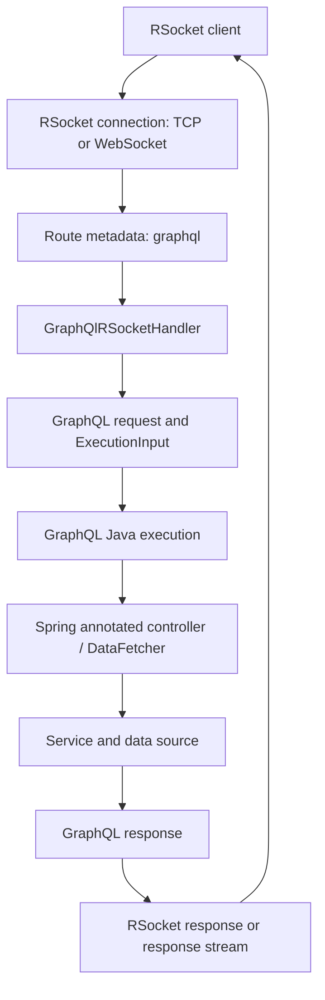

# RSocket transport

Spring for GraphQL does not tie GraphQL to a single transport protocol. Besides HTTP and WebSocket, an application can receive GraphQL requests over RSocket. RSocket is a message-based communication protocol that supports multiple interaction models and can run over TCP or WebSocket.

When using RSocket, Spring for GraphQL maps GraphQL queries and mutations to the `request-response` interaction model; subscriptions are mapped to `request-stream`. As a result, the same SDL schema, controllers, and resolvers can serve clients over RSocket without rewriting business logic against a separate API.

## 1. What is RSocket?

RSocket is an application protocol for asynchronous communication between two endpoints. It defines standard interaction models:

| Interaction model | How it works | Example |
| --- | --- | --- |
| Fire-and-forget | Sends a message without waiting for a response | Sending telemetry that needs no acknowledgment |
| Request-response | Sends one request and receives one response | Fetching a single resource |
| Request-stream | Sends one request and receives a stream of responses | Tracking prices or order status |
| Request-channel | Both sides exchange streams of messages | Continuous bidirectional data exchange |

Spring for GraphQL uses two interaction models suited to GraphQL:

- Queries and mutations use `request-response` because one operation returns one GraphQL response.
- Subscriptions use `request-stream` because one operation can emit multiple GraphQL responses over time.

RSocket provides built-in flow control and multiplexing. One connection can serve many independent requests/streams; subscribers can throttle how much data they receive according to their consumption capacity. This is useful for applications with multiple event streams or service-to-service communication.

## 2. When should you choose RSocket for GraphQL?

RSocket fits when an application needs message-based communication between services, requires event streaming, or wants to use one protocol for both request-response and request-stream.

Scenarios worth considering:

- A backend service calling a GraphQL service over TCP on an internal network.
- Applications needing queries/mutations and subscriptions over a single RSocket session.
- Multiple concurrent event streams needing to be multiplexed over one connection.
- Systems wanting to leverage a reactive stack and backpressure.
- Client and server are under your control so both can implement RSocket.

RSocket does not automatically replace HTTP for every application. Browsers and public API ecosystems are usually more convenient with HTTP or standard GraphQL WebSocket. RSocket is typically better suited for service-to-service communication or clients with explicit RSocket support.

## 3. Preparing dependencies in Spring Boot

The application needs Spring for GraphQL and RSocket server support. With Maven, add these starters:

```xml
<dependencies>
    <dependency>
        <groupId>org.springframework.boot</groupId>
        <artifactId>spring-boot-starter-graphql</artifactId>
    </dependency>

    <dependency>
        <groupId>org.springframework.boot</groupId>
        <artifactId>spring-boot-starter-rsocket</artifactId>
    </dependency>
</dependencies>
```

`spring-boot-starter-graphql` provides auto-configuration for schemas, the GraphQL runtime, and annotated controllers. `spring-boot-starter-rsocket` provides the RSocket server transport on Reactor Netty. If the application also needs an HTTP endpoint, add the appropriate web starter; RSocket does not require enabling the HTTP GraphQL endpoint.

The RSocket server must be configured before Spring Boot can attach the GraphQL handler to a route. Choose TCP or WebSocket based on the deployment environment and client capabilities.

## 4. Configuring the RSocket server and GraphQL route

Example running an RSocket server on TCP port `7000` and mounting the GraphQL handler at route `graphql`:

```yaml
spring:
  rsocket:
    server:
      transport: tcp
      port: 7000
  graphql:
    rsocket:
      mapping: graphql
```

In this configuration:

- `spring.rsocket.server.transport` selects the RSocket transport, such as `tcp` or `websocket`.
- `spring.rsocket.server.port` is the port the RSocket server listens on when using TCP.
- `spring.graphql.rsocket.mapping` specifies the route at which the GraphQL handler accepts requests.

The `graphql` route is RSocket route metadata, not an HTTP URL path. Clients must send requests to the exact configured route. When using RSocket over WebSocket, the server must also configure the WebSocket endpoint via the corresponding RSocket server properties; do not confuse the GraphQL route with the WebSocket handshake mapping path.

Spring Boot can auto-configure the GraphQL RSocket handler when an RSocket server and `spring.graphql.rsocket.mapping` are present. Check the documentation for your Spring Boot version, as property names and conditions can change across major versions.

## 5. Sharing the schema and annotated controllers

RSocket is a transport, not a different GraphQL schema. SDL files are still loaded just like in a normal GraphQL configuration:

```graphql
type Query {
    book(id: ID!): Book
}

type Subscription {
    priceUpdates(symbol: String!): PriceUpdate!
}

type Book {
    id: ID!
    title: String!
}

type PriceUpdate {
    symbol: String!
    price: Float!
}
```

Resolvers continue using the familiar annotations:

```java
@Controller
public class BookController {

    private final BookService bookService;

    public BookController(BookService bookService) {
        this.bookService = bookService;
    }

    @QueryMapping
    public Book book(@Argument("id") String id) {
        return bookService.findById(id);
    }
}
```

The RSocket handler passes the request payload to the GraphQL execution service. The GraphQL runtime then invokes `@QueryMapping`, `@MutationMapping`, `@SchemaMapping`, `@BatchMapping`, or `@SubscriptionMapping` according to the operation and selection set. Business services do not need to know whether a request arrived via HTTP or RSocket unless transport-specific behavior is required.

## 6. How does GraphQlRSocketHandler process requests?

`GraphQlRSocketHandler` is the server component in Spring for GraphQL that handles GraphQL requests over RSocket. The handler receives the decoded payload, converts it into a GraphQL request, and delegates execution to the GraphQL engine.

High-level processing flow:



For queries and mutations, the handler produces a single response for a request-response interaction. For subscriptions, the handler returns a `Flux` of responses to serve a request-stream interaction.

## 7. Auto-configuration with Spring Boot

In a Spring Boot application, the simplest approach is configuring the route with `spring.graphql.rsocket.mapping` and letting auto-configuration connect the RSocket server to the GraphQL handler.

Example configuration:

```yaml
spring:
  rsocket:
    server:
      transport: tcp
      port: 7000
  graphql:
    rsocket:
      mapping: graphql
```

Once the application starts, the GraphQL handler accepts requests on route `graphql`. There is no need to write an extra controller just to forward payloads if auto-configuration in your Boot version already creates this route.

When debugging an endpoint that does not respond, check:

- Whether the RSocket server is enabled and listening on the expected transport/port.
- Whether `spring.graphql.rsocket.mapping` matches the route sent by the client.
- Whether `spring-boot-starter-rsocket` is on the runtime classpath.
- Whether the Spring Boot version supports the corresponding GraphQL RSocket auto-configuration.
- Whether security or a firewall is blocking TCP/WebSocket connections.

## 8. Manual integration with @MessageMapping

If you configure RSocket routes manually or do not use auto-configuration, you can use `GraphQlRSocketHandler` as a delegate inside a controller mapped with `@MessageMapping`.

```java
package com.example.graphql.transport;

import java.util.Map;

import org.springframework.graphql.server.GraphQlRSocketHandler;
import org.springframework.messaging.handler.annotation.MessageMapping;
import org.springframework.stereotype.Controller;
import reactor.core.publisher.Flux;
import reactor.core.publisher.Mono;

@Controller
public class GraphQlRSocketController {

    private final GraphQlRSocketHandler handler;

    public GraphQlRSocketController(GraphQlRSocketHandler handler) {
        this.handler = handler;
    }

    @MessageMapping("graphql")
    public Mono<Map<String, Object>> handle(Map<String, Object> payload) {
        return handler.handle(payload);
    }

    @MessageMapping("graphql")
    public Flux<Map<String, Object>> handleSubscription(
            Map<String, Object> payload) {
        return handler.handleSubscription(payload);
    }
}
```

Both methods map to the same `graphql` route, but serve two different interaction models:

- `Mono<Map<String, Object>>` handles `request-response` for queries and mutations.
- `Flux<Map<String, Object>>` handles `request-stream` for subscriptions.

This is a manual delegation setup. Do not create this controller alongside an auto-configured route for the same route name unintentionally, as it can cause duplicate mappings or handler conflicts.

## 9. GraphQL payload structure over RSocket

The payload carries the GraphQL request content as a JSON map, typically including these keys:

```json
{
  "query": "query BookById($id: ID!) { book(id: $id) { id title } }",
  "operationName": "BookById",
  "variables": {
    "id": "book-42"
  }
}
```

The fields correspond to a GraphQL request:

- `query`: GraphQL document to execute.
- `operationName`: operation name if the document has multiple operations or the client wants to specify it explicitly.
- `variables`: map of variable values for the operation.
- `extensions`: extension metadata if used by the application or client.

An RSocket payload has both data and metadata sections. The route is passed via routing metadata; the GraphQL request resides in the data payload. Do not embed the route inside the GraphQL query string or treat the route as an SDL field.

`RSocketGraphQlClient` configures the `application/graphql+json` data MIME type along with JSON codecs by default when created with the standard builder. If you configure `RSocketRequester` or codecs manually, ensure both server and client agree on the MIME type and payload serialization.

## 10. Calling queries and mutations from RSocketGraphQlClient

Spring for GraphQL provides `RSocketGraphQlClient`, which uses `RSocketRequester` to send GraphQL requests over RSocket. In Spring Boot, you can inject the auto-configured `RSocketGraphQlClient.Builder<?>`.

Example creating a TCP client:

```java
import org.springframework.graphql.client.RSocketGraphQlClient;
import org.springframework.stereotype.Component;

@Component
public class BookRemoteClient {

    private final RSocketGraphQlClient graphQlClient;

    public BookRemoteClient(RSocketGraphQlClient.Builder<?> builder) {
        this.graphQlClient = builder
            .tcp("localhost", 7000)
            .route("graphql")
            .build();
    }
}
```

Client sending a query:

```java
public Mono<BookView> findBook(String id) {
    return graphQlClient.document("""
            query BookById($id: ID!) {
                book(id: $id) {
                    id
                    title
                }
            }
            """)
        .variable("id", id)
        .retrieve("book")
        .toEntity(BookView.class);
}
```

Mutations follow the same workflow:

```java
public Mono<BookView> renameBook(String id, String title) {
    return graphQlClient.document("""
            mutation RenameBook($id: ID!, $title: String!) {
                renameBook(id: $id, title: $title) {
                    id
                    title
                }
            }
            """)
        .variable("id", id)
        .variable("title", title)
        .retrieve("renameBook")
        .toEntity(BookView.class);
}
```

The `GraphQlClient` API is shared across transports. The difference lies in how the builder establishes the connection and route; writing documents, passing variables, and reading responses are similar to HTTP/WebSocket clients.

## 11. Session connection and multiplexing

`RSocketGraphQlClient` is a connection-oriented client. It needs an RSocket session before exchanging requests, though establishing the connection can happen automatically when the first request is sent. To open the session proactively, call `start()`.

The client can be reused so multiple requests share a single session. RSocket clients support multiplexing, allowing many requests and streams to run over the same connection. When a session drops, the client can re-establish it on the next request or when `start()` is called.

Lifecycle example:

```java
graphQlClient.start()
    .then(findBook("book-42"))
    .doFinally(signal -> {
        // Do not call stop after each request if the client will be reused.
    });
```

In long-running applications, manage one client instance per server and close the session when the component or application shuts down. `stop()` cancels in-flight requests, closes the session, and rejects new requests on that client; therefore, do not call `stop()` after every query if other requests still need the session.

## 12. Executing subscriptions over RSocket

Because RSocket supports `request-stream`, `RSocketGraphQlClient` can receive GraphQL subscriptions. Example:

```java
public Flux<PriceUpdate> watchPrice(String symbol) {
    return graphQlClient.document("""
            subscription WatchPrice($symbol: String!) {
                priceUpdates(symbol: $symbol) {
                    symbol
                    price
                }
            }
            """)
        .variable("symbol", symbol)
        .retrieveSubscription("priceUpdates")
        .toEntity(PriceUpdate.class);
}
```

The client receives a `Flux<PriceUpdate>`. When downstream cancels the `Flux`, cancellation propagates to the RSocket `request-stream` so the server stops the corresponding subscription if the publisher and data source support cancellation.

There is no need to open a new RSocket session for each event. One session can multiplex many `request-stream` operations. When the client is no longer used at all, call `stop()` to close the session and cancel active requests.

## 13. Securing the RSocket transport

The RSocket transport must be protected just like other APIs. An obscure route name or running on an internal network does not replace authentication and authorization.

Protection layers to consider:

- **TLS:** use encrypted connections, such as RSocket over secure WebSocket or TCP with appropriate TLS configuration.
- **Authentication:** verify peer identity using Spring Security/RSocket Security or an authentication mechanism fitting the system.
- **Authorization:** enforce permissions on each operation and resource in services/resolvers.
- **Metadata:** pass credentials only through properly designed metadata mechanisms; never embed secrets in GraphQL queries or log payloads.
- **Validation:** validate routes, payload sizes, inputs, and query depth/complexity.
- **Rate limiting:** limit requests and long-lived subscriptions per identity or tenant.

Spring for GraphQL provides `RSocketQlInterceptor` to intercept requests before and after GraphQL execution, for example to add data to `ExecutionInput` or customize `ExecutionResult`. Interceptors do not replace Spring Security; authentication and authorization must still be designed at the appropriate transport and business layers.

For long-lived subscriptions, define a policy for when permissions are revoked while a stream is running. You can filter events or terminate the stream based on security requirements.

## 14. Error handling over RSocket

Distinguish errors at the RSocket layer from GraphQL execution errors:

| Error group | Example | How to handle |
| --- | --- | --- |
| Connection/session | Server port closed, timeout, session terminated | Check transport, perform bounded retries, and reconnect |
| Route/protocol | Mismatched route, wrong MIME type or codec | Align route, data MIME type, and codecs on both sides |
| GraphQL request | Invalid document, invalid variables | Read GraphQL response errors and fix the operation |
| Resolver execution | Service throws an exception, field fails | Use GraphQL exception handling and an error contract |
| Subscription stream | Publisher emits an error or completes | Handle error/complete on the client and decide whether to resubscribe |

Do not blindly retry every mutation when a connection drops. The client may not know whether the server executed the mutation before the session disconnected. For commands with side effects, design idempotency keys or status-check mechanisms before resending.

For subscriptions, retrying can open a new stream, but it does not automatically recover missed events. If zero event loss is required, design event IDs, cursors/offsets, and a resume mechanism at the business layer.

## 15. Testing RSocket GraphQL

Test server routes, GraphQL execution, and stream lifecycles. Key test areas:

- Connecting via TCP/WebSocket to the right port and route.
- Queries using `request-response` returning expected data.
- Mutations using `request-response` performing side effects and returning payloads.
- Subscriptions using `request-stream` emitting multiple events.
- Client stream cancellation causing the server to stop the publisher and clean up resources.
- Distinguishing wrong routes, invalid payloads, and GraphQL errors.
- Authentication and authorization enforced over the transport.
- Concurrent requests sharing a session without mixing up responses.
- Disconnect and reconnect without causing duplicate side effects.

You can use `RSocketGraphQlClient` as the client in integration tests to execute queries/mutations and `retrieveSubscription` to verify streams. For subscription cancellation, use `StepVerifier.thenCancel()` and verify that the server received cancellation and released resources. A unit test on a service publisher cannot replace an integration test verifying the RSocket transport.

## 16. Comparing RSocket with HTTP, WebSocket, and SSE

| Criterion | HTTP | WebSocket GraphQL | SSE | RSocket |
| --- | --- | --- | --- | --- |
| Primary interaction model | Request-response | Bidirectional connection, multiple operations | One-way HTTP response stream | Request-response, request-stream, and other interactions |
| Query/mutation | Yes | Supported | Not the purpose of the SSE GraphQL handler | Yes, request-response |
| Subscription | No for standard HTTP response | Yes | Yes | Yes, request-stream |
| Multiplexing | Per HTTP request | Multiple operations on one connection | Each stream is one HTTP request | Multiple requests/streams on one session |
| Flow control | Per HTTP stack | Per WebSocket/reactive stack | Per HTTP stream | Reactive Streams backpressure |
| Common clients | Browser, mobile, service | Browser/app supporting `graphql-ws` | Browser/app supporting SSE | Services or clients with RSocket support |

RSocket over WebSocket is still the RSocket protocol transported over WebSocket; it does not automatically become the GraphQL over WebSocket protocol (`graphql-ws`). Clients must use an RSocket client and RSocket route, not a WebSocket GraphQL client.

## 17. Common errors when configuring RSocket transport

| Symptom | Possible cause | How to handle |
| --- | --- | --- |
| Client cannot connect | Wrong TCP port, transport, or WebSocket path | Check RSocket server configuration and firewall |
| Route not found | `spring.graphql.rsocket.mapping` differs from client route | Align server/client routes |
| Payload cannot be decoded | Incompatible data MIME type or JSON codec | Use the standard builder or matching codecs on both sides |
| Queries work, but subscriptions fail | Using `request-response` instead of `request-stream`, or server handler lacks subscription mapping | Check `handleSubscription` and `@SubscriptionMapping` |
| Two controllers claim the same route | Both auto-configuration and a manual delegate controller are registered | Choose a single way to configure the route |
| Client keeps sessions open too long | Not calling `stop()` when the component shuts down | Manage client lifecycle and close the session on shutdown |
| Every request opens a new connection | Repeatedly creating new client instances | Reuse one `RSocketGraphQlClient` per server |
| Mutation executes twice after reconnect | Retrying a non-idempotent request | Use an idempotency key and verify command state |
| Subscription does not clean up | Publisher does not propagate cancellation to the source | Tie cleanup to reactive lifecycle and test cancellation |

## 18. Implementation checklist

- Was RSocket chosen due to genuine `request-response`/`request-stream` or service communication needs?
- Are `spring-boot-starter-graphql` and `spring-boot-starter-rsocket` on the runtime classpath?
- Is the RSocket server configured for TCP or WebSocket?
- Does `spring.graphql.rsocket.mapping` match the client route?
- Are GraphQL schemas and annotated controllers loaded normally?
- Do queries/mutations use `request-response` and subscriptions use `request-stream`?
- Do client and server agree on route, MIME type, and JSON codec?
- Is `RSocketGraphQlClient` reused per server and the session closed at the proper time?
- Are authentication, authorization, TLS, validation, and rate limiting designed?
- Are mutation retries idempotent, and do subscriptions have a resume strategy if needed?
- Do integration tests cover queries, mutations, subscriptions, cancellation, and transport errors?

RSocket transport enables Spring for GraphQL to accept queries and mutations over `request-response`, while streaming subscriptions over `request-stream`. Spring Boot can configure the route via `spring.graphql.rsocket.mapping`; `GraphQlRSocketHandler` processes requests, and `RSocketGraphQlClient` provides a client API consistent with other transports. By selecting the right interaction model, reusing sessions, aligning routes/codecs, and protecting the transport with authentication, authorization, and TLS, RSocket can be an effective choice for GraphQL communication between services or systems requiring data streaming.
