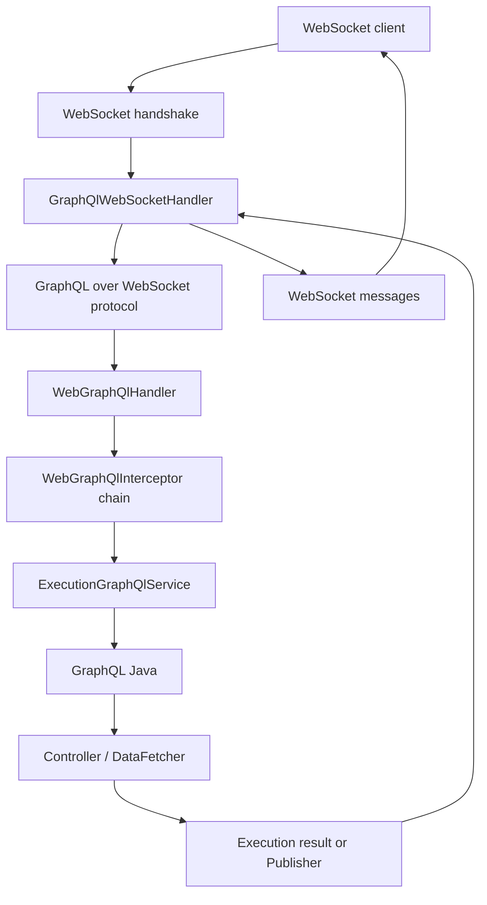
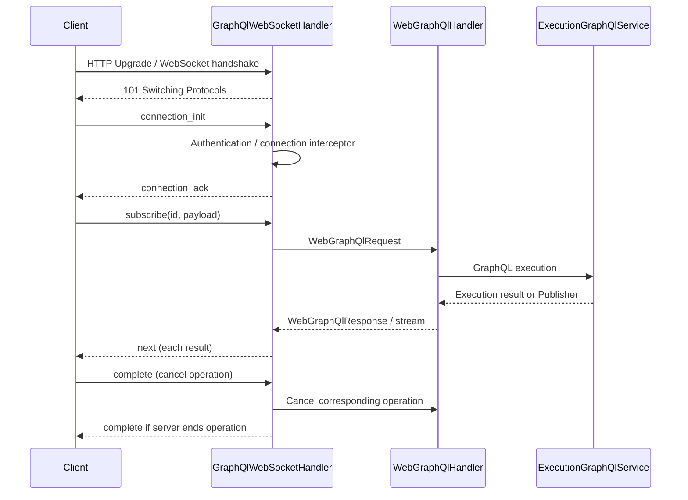

# WebSocketGraphQlHandler

> **API name note:** Spring for GraphQL names the actual class `GraphQlWebSocketHandler`, not `WebSocketGraphQlHandler`. This lesson keeps the menu topic title while using the exact class names and packages in code examples. There are two implementations: one for Spring MVC and one for Spring WebFlux.

## 1. What is the WebSocket handler in Spring for GraphQL?

GraphQL is typically invoked via HTTP request-response: the client sends an operation, the server returns one response, and the request ends. This works well for ordinary Queries and Mutations. For Subscriptions, clients need to receive multiple results over time over an open connection.

WebSocket provides a bidirectional connection that outlives a single HTTP request. Clients can send new operations, cancel running operations, and receive multiple results from the server over the same connection. Spring for GraphQL provides `GraphQlWebSocketHandler` to handle GraphQL over WebSocket according to the GraphQL over WebSocket protocol.

This handler can serve Subscriptions while also supporting Queries or Mutations that expect a single result. Each GraphQL request received over WebSocket is forwarded into Spring's GraphQL processing chain to parse, validate, invoke resolvers, and produce responses.

`GraphQlWebSocketHandler` is a transport-layer component. It handles WebSocket sessions, the message protocol, and sending results back to the client. It does not replace the application's schema, controllers, `@SubscriptionMapping`, or resolvers.

## 2. Distinguishing `WebGraphQlHandler` and `GraphQlWebSocketHandler`

The two classes have different responsibilities:

| Component | Responsibility |
| --- | --- |
| `WebGraphQlHandler` | Shared GraphQL processing chain for web transports; runs interceptors and forwards requests to `ExecutionGraphQlService` |
| `GraphQlWebSocketHandler` | WebSocket adapter; reads/writes messages, manages sessions, and implements the GraphQL over WebSocket protocol |
| `WebGraphQlInterceptor` | Intercepts GraphQL requests/responses before and after execution |
| `WebSocketGraphQlInterceptor` | Extends the web interceptor with callbacks for WebSocket connection lifecycle and client subscription cancellation |
| `@SubscriptionMapping` | Maps a GraphQL `Subscription` root field to a method returning a `Publisher` |

Processing relationship:



The WebSocket handler does not decide field business logic. `WebGraphQlHandler` and the execution service continue handling the GraphQL processing shared with HTTP.

## 3. Two implementations: Spring MVC and Spring WebFlux

Spring for GraphQL has two classes both named `GraphQlWebSocketHandler` in two different packages:

| Stack | Fully qualified class | WebSocket integration |
| --- | --- | --- |
| Spring MVC / Servlet | `org.springframework.graphql.server.webmvc.GraphQlWebSocketHandler` | Based on `spring-websocket`, extends `TextWebSocketHandler`, and supports `SubProtocolCapable` |
| Spring WebFlux | `org.springframework.graphql.server.webflux.GraphQlWebSocketHandler` | Implements reactive `WebSocketHandler`, uses `CodecConfigurer`, and returns `Mono<Void>` from `handle` |

Both implementations serve the same purpose and handle the same GraphQL over WebSocket protocol, but depend on different web stacks:

- MVC uses `HttpMessageConverter` to encode/decode JSON and integrates with the Servlet WebSocket API.
- WebFlux uses `CodecConfigurer`, reactive I/O, and backpressure when reading/writing messages.

Example import for WebFlux:

```java
import org.springframework.graphql.server.webflux.GraphQlWebSocketHandler;
```

Example import for MVC:

```java
import org.springframework.graphql.server.webmvc.GraphQlWebSocketHandler;
```

Do not accidentally import the same-named class from the wrong stack. If the project uses Spring Boot auto-configuration, you usually do not need to instantiate this class manually; Boot chooses the implementation based on application type and classpath dependencies.

## 4. Enabling the WebSocket endpoint in Spring Boot

Spring Boot requires `spring-boot-starter-graphql` and a web stack. The GraphQL WebSocket endpoint is disabled by default. Applications must configure a path for the endpoint.

With Spring MVC, dependencies typically include:

```kotlin
dependencies {
    implementation("org.springframework.boot:spring-boot-starter-graphql")
    implementation("org.springframework.boot:spring-boot-starter-web")
    implementation("org.springframework.boot:spring-boot-starter-websocket")
}
```

With Spring WebFlux:

```kotlin
dependencies {
    implementation("org.springframework.boot:spring-boot-starter-graphql")
    implementation("org.springframework.boot:spring-boot-starter-webflux")
}
```

WebFlux does not require a separate WebSocket starter. Servlet applications require `spring-boot-starter-websocket` to provide WebSocket integration.

Endpoint configuration:

```yaml
spring:
  graphql:
    websocket:
      path: /graphql
```

Once enabled, clients can connect to `ws://localhost:8080/graphql` locally. In HTTPS deployments, the corresponding WebSocket URL typically uses `wss://`.

`spring.graphql.http.path` and `spring.graphql.websocket.path` are two separate properties. Both can use `/graphql`, yet HTTP and WebSocket remain two distinct transports.

## 5. Configuring connection-init timeout and keep-alive

After the WebSocket handshake succeeds, the client must send a `connection_init` message per the protocol. The server waits for this initialization message within a bounded duration. Spring Boot provides the `connection-init-timeout` property:

```yaml
spring:
  graphql:
    websocket:
      path: /graphql
      connection-init-timeout: 60s
      keep-alive: 30s
```

Meaning:

- `path`: URL path exposing the GraphQL WebSocket endpoint.
- `connection-init-timeout`: maximum time the server waits for `connection_init` after the connection is established. The default value in current Spring Boot is `60s`.
- `keep-alive`: maximum idle interval before the server sends a keep-alive ping to the client. If not configured, the server does not necessarily send periodic pings.

Too short a timeout can close connections for clients slow to authenticate. Too long a timeout holds uninitialized sessions open unnecessarily. Choose based on system latency and how clients supply credentials.

Keep-alive helps detect dead connections or keep connections open through proxies with idle timeouts. Values must align with load balancer, ingress, and reverse proxy timeouts. Keep-alive does not replace network infrastructure heartbeats or timeouts.

## 6. GraphQL over WebSocket protocol

Spring for GraphQL uses the GraphQL over WebSocket protocol implemented by the `graphql-ws` project, with the `graphql-transport-ws` subprotocol. Do not confuse this protocol with the legacy `subscriptions-transport-ws`; the two protocols use different message formats and are not directly compatible.

Main messages:

| Message | Direction | Meaning |
| --- | --- | --- |
| `connection_init` | Client → Server | Starts the GraphQL connection; payload may contain authentication credentials |
| `connection_ack` | Server → Client | Server confirms connection initialization succeeded |
| `subscribe` | Client → Server | Sends a GraphQL operation with an operation ID and payload |
| `next` | Server → Client | Sends a GraphQL execution result |
| `error` | Server → Client | Reports an operation error per the protocol |
| `complete` | Client → Server or Server → Client | Client cancels an operation or server signals operation completion |
| `ping` / `pong` | Bidirectional | Checks status and keeps the connection alive |

One WebSocket connection can carry multiple concurrent operations. Each operation has a distinct ID so the server distinguishes result streams and cancellations. For example, a client can open two Subscriptions on the same connection, cancel one Subscription, and keep the other active.

## 7. Lifecycle from handshake to operation

WebSocket GraphQL has two distinct initialization phases:

1. **WebSocket handshake:** the client sends an HTTP Upgrade request; the server accepts and creates a WebSocket session.
2. **GraphQL connection initialization:** the client sends `connection_init`; the server inspects the payload or authenticates via interceptors and replies with `connection_ack`.

Once the connection is acknowledged, the client can send `subscribe` to run operations. Although the message name is `subscribe`, the payload can be a Query, Mutation, or Subscription depending on handler support. Subscriptions produce a stream of multiple results; standard Queries and Mutations produce a single result.



If the client does not send `connection_init` within the configured timeout, the server may close the connection. If the connection is acknowledged but an operation is invalid, errors are handled at the operation level per the protocol.

## 8. Handler processing for Query, Mutation, and Subscription

WebSocket is primarily useful for Subscriptions, though GraphQL over WebSocket is not limited to Subscriptions. The handler can forward standard Queries and Mutations through the same execution chain.

| Operation | Behavior over WebSocket |
| --- | --- |
| Query | Server sends one execution result and ends the operation |
| Mutation | Server sends one execution result for the write operation and ends the operation |
| Subscription | Server sends multiple execution results as the `Publisher` emits events; the operation ends when the `Publisher` completes, errors, or is cancelled |

Example payload inside a `subscribe` message:

```json
{
  "id": "op-1",
  "type": "subscribe",
  "payload": {
    "operationName": "BookAdded",
    "query": "subscription BookAdded { bookAdded { id title } }",
    "variables": {}
  }
}
```

The server processes the document as a normal GraphQL operation. The difference lies in how the transport delivers results: a Subscription can emit many `next` messages under the same operation ID.

## 9. Integrating `WebGraphQlInterceptor`

WebSocket requests are routed through `WebGraphQlHandler`, so the `WebGraphQlInterceptor` chain still applies to each GraphQL request. Interceptors can:

- Read request information and context.
- Add data to `ExecutionInput` or `GraphQLContext`.
- Write response headers when supported by the transport.
- Transform GraphQL responses or errors.
- Record logs and tracing per operation.

Example interceptor placing a correlation ID into context:

```java
import java.util.UUID;
import org.springframework.graphql.server.WebGraphQlInterceptor;
import org.springframework.graphql.server.WebGraphQlRequest;
import org.springframework.graphql.server.WebGraphQlResponse;
import org.springframework.stereotype.Component;
import reactor.core.publisher.Mono;

@Component
public class CorrelationInterceptor implements WebGraphQlInterceptor {

    @Override
    public Mono<WebGraphQlResponse> intercept(
            WebGraphQlRequest request, Chain chain) {

        String correlationId = UUID.randomUUID().toString();

        request.configureExecutionInput((input, builder) ->
            builder.graphQLContext(context ->
                context.put("correlationId", correlationId)
            ).build()
        );

        return chain.next(request);
    }
}
```

Interceptors apply to GraphQL requests passing through the web handler. If you need to observe the full WebSocket connection lifecycle, `WebGraphQlInterceptor` alone is insufficient; see `WebSocketGraphQlInterceptor` in the next section.

## 10. `WebSocketGraphQlInterceptor` and connection lifecycle

`WebSocketGraphQlInterceptor` extends `WebGraphQlInterceptor` with callbacks related to the WebSocket connection:

- Connection is established.
- Connection is closed.
- Client cancels a Subscription operation.
- Every GraphQL request on the connection still passes through the interceptor chain.

This is useful when you need to store per-connection metadata, track sessions, log client disconnections, or clean up resources tied to cancelled operations.

Spring for GraphQL allows at most one `WebSocketGraphQlInterceptor` in an interceptor chain. You can combine that dedicated WebSocket interceptor with ordinary `WebGraphQlInterceptor` beans, but do not register multiple specialized WebSocket interceptors in the same chain.

In Spring Boot, declaring an interceptor bean registers it in the web GraphQL configuration. Keep connection- or operation-scoped state using appropriate mechanisms; never store mutable user data in shared fields of a singleton interceptor without synchronized map structures and explicit lifecycle cleanup.

## 11. Authentication from `connection_init`

Clients often need to send an access token when initiating a WebSocket connection. The GraphQL over WebSocket protocol allows `connection_init` to carry a payload, for example:

```json
{
  "type": "connection_init",
  "payload": {
    "Authorization": "Bearer eyJ..."
  }
}
```

The server must verify the token, checking signature, expiration, issuer, audience, and required permissions before accepting the connection or operations. Never trust a payload simply because it arrived in `connection_init`.

Spring for GraphQL provides `AuthenticationWebSocketInterceptor` implementations for both Spring MVC and Spring WebFlux. These interceptors extract credentials from the `connection_init` payload, authenticate them, and propagate `SecurityContext` to subsequent requests on the WebSocket connection.

The two implementations live in different packages by web stack. Choose the exact class for MVC or WebFlux and check your application's Spring Security configuration. If using a custom authentication mechanism, implement `WebSocketGraphQlInterceptor` to process the payload and set up context.

Authenticating the connection does not mean every subsequent operation is automatically authorized. Resolvers or method security must still enforce authorization per operation and per target data.

## 12. CORS, Origin, and protecting the WebSocket endpoint

WebSocket starts with an HTTP handshake, so the server must validate the connection origin and apply appropriate security policies. Key points:

- Allow only trusted frontend origins in production environments.
- Never use wildcard origins when credentials are allowed.
- Authenticate tokens or sessions; verify permissions for each operation.
- Do not treat `Origin` as user authentication. `Origin` only restricts which websites can initiate a connection from a browser.
- Limit connections and operations to reduce the risk of a single client exhausting resources.
- Never log access tokens from `connection_init`.

Spring Boot supports CORS configuration via `spring.graphql.cors.*`. Example:

```yaml
spring:
  graphql:
    cors:
      allowed-origins:
        - https://app.example.com
      allowed-methods:
        - GET
        - POST
      allowed-headers:
        - Authorization
        - Content-Type
      allow-credentials: true
```

When credentials are enabled, do not set `allowed-origins: "*"`; declare explicit origins or use appropriate origin patterns. Verify CORS/Origin behavior on your exact server stack and Spring version, especially when creating the WebSocket handler manually instead of using Boot auto-configuration.

## 13. Resource management of a WebSocket session

HTTP requests typically finish after sending a response. A WebSocket connection can stay open for hours and carry many Subscriptions simultaneously. Therefore, resources must be managed at both the connection level and the operation level.

Limits to consider:

| Resource | Where to configure or control |
| --- | --- |
| Concurrent WebSocket connections | Web server, connector, reverse proxy, or load balancer |
| Buffered message size | Jakarta WebSocket `ServerContainer` for MVC; corresponding reactive server config for WebFlux |
| Concurrent Subscriptions per session | `maxSubscriptionsPerSession` in `GraphQlWebSocketHandler` builder options in supported versions |
| Wait time for `connection_init` | `spring.graphql.websocket.connection-init-timeout` |
| Ping when connection is idle | `spring.graphql.websocket.keep-alive` |
| Per-Subscription resources | `Publisher`, DataLoader, listeners, and cleanup on cancel/complete/error |

Per current Spring for GraphQL documentation, concurrent Subscriptions per session are unlimited by default. When `maxSubscriptionsPerSession` is configured and reached, the session may be closed. Check the API of your Spring for GraphQL version before calling builder options, as constructors and builder APIs can evolve across versions.

Do not limit only the number of connections. A single client could open very few connections yet launch many Subscriptions on one connection. Combine session limits, operation limits, timeouts, and rate limiting.

## 14. Operational differences between MVC and WebFlux

Both implementations handle the same protocol, though their I/O models differ:

| Aspect | Spring MVC | Spring WebFlux |
| --- | --- | --- |
| I/O | Servlet WebSocket, MVC-style message handling | Reactive WebSocket, non-blocking I/O |
| JSON codec | `HttpMessageConverter<?>` | `CodecConfigurer` |
| Handler class | `server.webmvc.GraphQlWebSocketHandler` | `server.webflux.GraphQlWebSocketHandler` |
| Handler execution style | Spring Messaging WebSocket handler | `Mono<Void>` for `handle(WebSocketSession)` |
| Best suited for | Servlet apps and existing imperative libraries | Reactive apps needing end-to-end streaming and backpressure |

Choosing WebFlux does not automatically make every resolver non-blocking. If a resolver calls JDBC/JPA or a blocking library, those calls still require an appropriate thread model. Conversely, an MVC application can still use reactive publishers for Subscriptions; the MVC transport only differs in how I/O is managed.

Do not mix both handler implementations on the same endpoint. Let Spring Boot pick based on application type, or manually configure the exact matching class if there is a specific reason.

## 15. When do you need to create the handler manually?

In a typical Spring Boot application, enable the WebSocket endpoint using `spring.graphql.websocket.path` and let auto-configuration create the handler, WebSocket mapping, and supporting components.

Only create the handler manually when you need fine-grained control over transport, codecs, timeouts, keep-alive, CORS, or URL registration. In that case, instantiate the implementation matching your web stack:

```java
// Spring WebFlux: typical constructor signature
new org.springframework.graphql.server.webflux.GraphQlWebSocketHandler(
    webGraphQlHandler,
    codecConfigurer,
    connectionInitTimeout
);
```

```java
// Spring MVC: typical constructor signature
new org.springframework.graphql.server.webmvc.GraphQlWebSocketHandler(
    webGraphQlHandler,
    httpMessageConverter,
    connectionInitTimeout
);
```

`webGraphQlHandler` is the web GraphQL processing chain configured with the execution service and interceptors. MVC takes an `HttpMessageConverter`; WebFlux takes a `CodecConfigurer`.

The handler must be exposed via a WebSocket URL mapping. With MVC, `initWebSocketHttpRequestHandler(HandshakeHandler)` also creates a `WebSocketHttpRequestHandler` and adds a handshake interceptor so context propagates properly. With WebFlux, the handler is registered in WebFlux's WebSocket handler mapping.

Do not create a brand-new `WebGraphQlHandler` if your only goal is adding a WebSocket endpoint. Reuse the already configured execution service, interceptor chain, and `GraphQlSource` so HTTP and WebSocket share the same schema, resolvers, error handling, and security policy.

## 16. Testing the endpoint with `WebSocketGraphQlTester`

Spring for GraphQL provides `WebSocketGraphQlTester` in the `spring-graphql-test` module. The tester uses a shared WebSocket connection across operations, making it suitable for testing both Queries and Subscriptions over the real transport.

Add test dependency:

```kotlin
dependencies {
    testImplementation("org.springframework.graphql:spring-graphql-test")
}
```

Create the tester:

```java
import java.net.URI;
import java.time.Duration;
import org.springframework.graphql.test.tester.WebSocketGraphQlTester;
import org.springframework.web.reactive.socket.client.ReactorNettyWebSocketClient;
import org.springframework.web.reactive.socket.client.WebSocketClient;
import reactor.core.publisher.Flux;
import reactor.test.StepVerifier;

URI url = URI.create("ws://localhost:8080/graphql");
WebSocketClient client = new ReactorNettyWebSocketClient();

WebSocketGraphQlTester tester =
    WebSocketGraphQlTester.builder(url, client).build();
```

Test a Query over WebSocket:

```java
tester.document("""
    query {
        book(id: "book-42") {
            id
            title
        }
    }
    """)
    .execute()
    .path("book.id")
    .entity(String.class)
    .isEqualTo("book-42");
```

Test a Subscription:

```java
Flux<String> titles = tester.document("""
    subscription {
        bookAdded {
            title
        }
    }
    """)
    .executeSubscription()
    .toFlux("bookAdded.title", String.class);

StepVerifier.create(titles)
    .expectNext("Spring for GraphQL")
    .thenCancel()
    .verify(Duration.ofSeconds(5));
```

The test fixture must emit events after the Subscription is registered. `thenCancel()` verifies client stream cancellation. After the test completes, call `tester.stop()` to close the shared WebSocket connection and release resources.

Additional scenarios to test:

- Client sends a valid `connection_init` and receives `connection_ack`.
- Client fails to send `connection_init` within timeout and the connection is closed.
- Invalid or expired tokens are rejected.
- Multiple operations run concurrently on the same connection.
- Cancelling one Subscription does not cancel other operations.
- Publisher completion/errors are reflected accurately.
- Client disconnect cleans up Publishers/listeners.
- Disallowed `Origin` is rejected.
- Per-session Subscription limits work as expected.

## 17. Common errors when configuring the WebSocket handler

| Symptom | Possible cause | How to handle |
| --- | --- | --- |
| HTTP GraphQL works, but WebSocket fails to connect | WebSocket endpoint not enabled | Set `spring.graphql.websocket.path` |
| Servlet app lacks a WebSocket endpoint | Missing `spring-boot-starter-websocket` | Add the WebSocket starter for MVC apps |
| Import cannot find class | Wrong package or confused `WebSocketGraphQlHandler` name | Use `GraphQlWebSocketHandler` in the matching MVC/WebFlux package |
| Client gets subprotocol error | Client and server use different protocols | Use `graphql-transport-ws`, not legacy `subscriptions-transport-ws` |
| Connection closes before operations | Client does not send `connection_init` in time | Check client initialization and timeout |
| No `connection_ack` received | Invalid auth payload or interceptor rejected connection | Check server logs and `WebSocketGraphQlInterceptor` |
| Query works, but Subscription gets no events | Publisher emits no data or event source not subscribed | Check `@SubscriptionMapping`, publisher, and fixtures |
| Subscription drops when idle | Proxy timeout or misconfigured keep-alive | Configure `keep-alive` and proxy timeouts |
| Client disconnected when opening many Subscriptions | Reached per-session or server resource limits | Check `maxSubscriptionsPerSession` and capacity |
| MVC/WebFlux codec errors | Instantiated handler from the other stack or incompatible codecs | Use the implementation and codecs matching your stack |
| Authentication does not reach resolvers | Connection payload not processed or `SecurityContext` not propagated | Configure the right `AuthenticationWebSocketInterceptor` or custom interceptor |
| Connection retains resources after cancel | Publisher does not clean up on cancellation | Use `doFinally`/resource cleanup and test cancellation |

## 18. WebSocket GraphQL deployment checklist

- [ ] Use the exact class `GraphQlWebSocketHandler`, avoiding name or package confusion.
- [ ] Choose the implementation matching Spring MVC or Spring WebFlux.
- [ ] Include `spring-boot-starter-graphql` and the corresponding web stack.
- [ ] For MVC, add `spring-boot-starter-websocket`.
- [ ] Configure `spring.graphql.websocket.path` to enable the endpoint.
- [ ] Configure `connection-init-timeout` based on realistic initialization time.
- [ ] Configure keep-alive to align with proxy/load balancer timeouts.
- [ ] Use the `graphql-transport-ws` GraphQL over WebSocket protocol.
- [ ] Understand the difference between the HTTP handshake and GraphQL `connection_init`.
- [ ] Register interceptors and authenticate connection payloads securely.
- [ ] Enforce authorization per operation and per resource.
- [ ] Limit connections, message sizes, and Subscriptions per session.
- [ ] Ensure cancel/disconnect releases Publishers and resources.
- [ ] Test with `WebSocketGraphQlTester` and stop the tester after tests.

## Conclusion

Spring for GraphQL uses `GraphQlWebSocketHandler` to handle GraphQL over WebSocket. Separate implementations exist for Spring MVC and Spring WebFlux; both process WebSocket messages according to the protocol, forward GraphQL requests to `WebGraphQlHandler`, and send execution results back to the client. The topic title `WebSocketGraphQlHandler` swaps the word order compared to the actual class name in the framework.

In Spring Boot, the standard configuration adds the appropriate WebSocket dependency and sets `spring.graphql.websocket.path`. After the handshake, the client sends `connection_init`, receives `connection_ack`, and sends operations via `subscribe`. The handler supports single-result Queries/Mutations and multi-result Subscriptions. In production, manage authentication, `Origin`, connection timeouts, keep-alive, Subscription counts, message sizes, and cancellation. Use `WebSocketGraphQlTester` to test the real transport and stop the tester when finished.

## References

- [Spring for GraphQL — Server Transports: WebSocket](https://docs.spring.io/spring-graphql/reference/transports.html)
- [Spring for GraphQL — `GraphQlWebSocketHandler` for WebFlux](https://docs.spring.io/spring-graphql/docs/current/api/org/springframework/graphql/server/webflux/GraphQlWebSocketHandler.html)
- [Spring for GraphQL — `GraphQlWebSocketHandler` for MVC](https://docs.spring.io/spring-graphql/docs/current/api/org/springframework/graphql/server/webmvc/GraphQlWebSocketHandler.html)
- [Spring Boot — Spring for GraphQL and WebSocket endpoint](https://docs.spring.io/spring-boot/reference/web/spring-graphql.html)
- [Spring Boot — Application properties](https://docs.spring.io/spring-boot/appendix/application-properties/index.html)
- [Spring for GraphQL — Testing with `WebSocketGraphQlTester`](https://docs.spring.io/spring-graphql/reference/testing.html)
- [GraphQL over WebSocket Protocol](https://github.com/enisdenjo/graphql-ws/blob/master/PROTOCOL.md)
