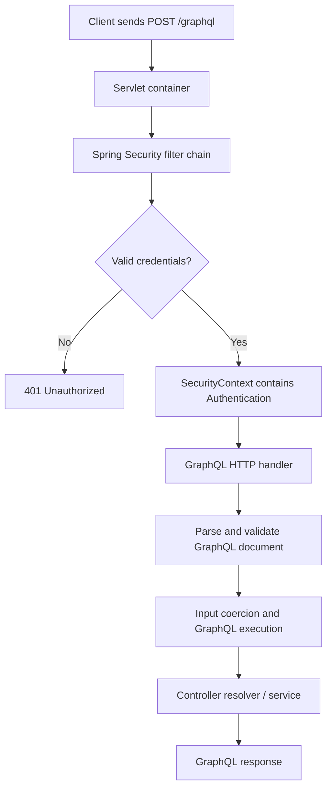

# Authentication before execution

In Spring for GraphQL, authentication should take place before the GraphQL engine starts executing an operation. With HTTP transport, the Spring Security filter chain authenticates the request before it reaches the GraphQL HTTP handler. If credentials are missing or invalid, the request is rejected at the security layer; the GraphQL parser, resolvers, and services are never invoked.

This organization creates a clear boundary: the transport determines the caller's identity, while GraphQL and the business layer use that identity to decide which data or actions are permitted. Authentication answers "who is calling?", whereas authorization answers "what is that caller allowed to do?".

## 1. Authentication precedes GraphQL execution

An HTTP request to the GraphQL endpoint typically goes through the following flow:



With the default HTTP endpoint `/graphql`, Spring Security can protect all requests with a single authentication rule. When a token is invalid or missing, the filter chain terminates the request before GraphQL execution. This is why authentication should be placed at the transport security layer rather than manually checking tokens inside each `@QueryMapping`.

A GraphQL request can contain multiple fields and multiple operation types. A single endpoint typically serves queries, mutations, and potentially subscriptions via the appropriate transport. Protecting the endpoint at the security layer ensures all operations pass through the same authentication gate.

## 2. Adding Spring Security dependencies

For a Spring Boot application using HTTP and the servlet stack, add the Spring Security starter:

```xml
<dependency>
    <groupId>org.springframework.boot</groupId>
    <artifactId>spring-boot-starter-security</artifactId>
</dependency>
```

If the API uses OAuth 2.0 Bearer JWTs and the application acts as a resource server, add the resource server starter:

```xml
<dependency>
    <groupId>org.springframework.boot</groupId>
    <artifactId>spring-boot-starter-oauth2-resource-server</artifactId>
</dependency>
```

`spring-boot-starter-security` provides the filter chain and authentication mechanisms. Resource server support verifies JWT bearer tokens, validating the signature and claims according to the issuer/JWK configuration. Do not manually Base64-decode a JWT and trust its claims; the token must have its signature and conditions such as issuer and expiration verified.

## 3. Protecting the GraphQL endpoint with SecurityFilterChain

The following example uses JWT bearer tokens and requires every request to `/graphql` to be authenticated:

```java
package com.example.graphql.security;

import static org.springframework.security.config.Customizer.withDefaults;

import org.springframework.context.annotation.Bean;
import org.springframework.context.annotation.Configuration;
import org.springframework.security.config.annotation.web.builders.HttpSecurity;
import org.springframework.security.config.http.SessionCreationPolicy;
import org.springframework.security.web.SecurityFilterChain;

@Configuration
public class SecurityConfiguration {

    @Bean
    SecurityFilterChain securityFilterChain(HttpSecurity http) throws Exception {
        return http
            .authorizeHttpRequests(authorize -> authorize
                .requestMatchers("/graphql").authenticated()
                .anyRequest().permitAll()
            )
            .oauth2ResourceServer(oauth2 -> oauth2.jwt(withDefaults()))
            .sessionManagement(session -> session
                .sessionCreationPolicy(SessionCreationPolicy.STATELESS)
            )
            .csrf(csrf -> csrf.disable())
            .build();
    }
}
```

This is a configuration for a stateless API using a Bearer token in the `Authorization` header without using cookies as credentials. For applications authenticating via session cookies or cookies automatically sent by browsers, do not mechanically disable CSRF; keep and configure appropriate CSRF protection, especially because GraphQL mutations are usually sent via HTTP POST.

The `authenticated()` rule only requires the request to have a valid identity. It does not yet check whether the user is allowed to read books, edit books, or view a specific tenant's data. Those decisions belong to authorization.

## 4. Configuring the issuer for the JWT resource server

Spring Security needs to know how to verify tokens. You can configure the issuer URI in `application.yml`:

```yaml
spring:
  security:
    oauth2:
      resourceserver:
        jwt:
          issuer-uri: https://identity.example.com/issuer
```

Replace the example URL with your Identity Provider's actual issuer. The resource server uses the issuer's metadata/JWK to verify the JWT and check standard claims. Do not hardcode private keys or secrets in source code.

If the system uses opaque tokens instead of JWTs, you can configure an introspection endpoint with the appropriate client credentials. How authentication is performed depends on the identity provider; the principle remains that Spring Security verifies credentials before the request reaches the GraphQL handler.

## 5. What happens when a request is unauthenticated?

The client sends a request without a bearer token:

```http
POST /graphql HTTP/1.1
Content-Type: application/json

{"query":"{ books { id title } }"}
```

With the `.requestMatchers("/graphql").authenticated()` rule, Spring Security rejects the request and returns `401 Unauthorized` according to the entry point configuration. The GraphQL engine does not need to parse the document; controller resolvers and services are not called.

When a token has an invalid signature, is expired, or has an invalid issuer, the request is likewise rejected before execution. Do not return `200 OK` with GraphQL `errors` for authentication errors occurring in the filter chain if the transport contract defines these as HTTP authentication errors.

If the user is authenticated but lacks permission to perform an action, that is a different case: the request has passed authentication and may enter GraphQL execution before authorization denies the field or service method.

## 6. Reading Principal in a GraphQL controller

Once the request is authenticated, the controller can receive `Principal` to identify the current caller:

```java
package com.example.graphql.account;

import java.security.Principal;

import org.springframework.graphql.data.method.annotation.QueryMapping;
import org.springframework.stereotype.Controller;

@Controller
public class AccountController {

    private final AccountService accountService;

    public AccountController(AccountService accountService) {
        this.accountService = accountService;
    }

    @QueryMapping
    public AccountView me(Principal principal) {
        return accountService.findByUsername(principal.getName());
    }
}
```

Spring for GraphQL supports resolving `Principal` as a handler method parameter. `principal.getName()` retrieves the principal identifier provided by the authentication mechanism. In real-world applications, you can inject `Authentication` when you need authorities or normalized authentication details.

Do not accept a `userId` from a GraphQL argument to determine the current user in a field like `me`. If clients can choose any ID, they can attempt to access another account's data. Always obtain the identity from `Principal`/security context and have the service verify permissions on the target resource.

## 7. Distinguishing Authentication and Authorization

These two concepts are related but not interchangeable:

| Concept | Question | Example |
| --- | --- | --- |
| Authentication | Who is sending the request? | A valid Bearer JWT representing user `alice` |
| Authorization | What is that user allowed to do? | `alice` has authority to read books but not delete books |

Authentication typically occurs before GraphQL execution at the transport layer. Authorization can be checked across multiple layers:

- Endpoint-level: only allow authenticated users to access `/graphql`.
- Operation/controller-level: only appropriate roles may invoke a group of mutations.
- Field-level: check permissions when resolving a specific field.
- Service/domain-level: protect business logic regardless of whether the service is called from GraphQL, REST, or background jobs.
- Data access-level: restrict queries by owner, tenant, or data scope.

Do not protect only buttons or fields on the client. Clients can send arbitrary GraphQL documents; all authorization decisions must be enforced on the server.

## 8. Combining method security for GraphQL resolvers

You can enable method security and apply `@PreAuthorize` to resolvers or service methods:

```java
import org.springframework.security.access.prepost.PreAuthorize;
import org.springframework.stereotype.Service;

@Service
public class BookService {

    private final BookRepository repository;

    public BookService(BookRepository repository) {
        this.repository = repository;
    }

    @PreAuthorize("hasAuthority('SCOPE_books.read')")
    public BookView findById(String id) {
        return repository.findViewById(id).orElseThrow();
    }
}
```

In the example, `BookRepository.findViewById` is a repository method returning `Optional<BookView>`; the repository declaration is omitted to focus on method security.

Method security configuration:

```java
import org.springframework.context.annotation.Configuration;
import org.springframework.security.config.annotation.method.configuration.EnableMethodSecurity;

@Configuration
@EnableMethodSecurity
public class MethodSecurityConfiguration {
}
```

With a JWT resource server, the `scope` claim is typically mapped to authorities prefixed with `SCOPE_`, for example the `books.read` scope becomes `SCOPE_books.read` under the default converter. If your identity provider uses a different claim or convention, configure `JwtAuthenticationConverter` accordingly.

Placing authorization in services helps protect business logic across multiple entry points. You can use `@PreAuthorize` on a resolver to reject a field early, but the service still needs to enforce critical rules if it can be called from elsewhere.

## 9. Authentication for WebFlux

If the application runs reactive WebFlux instead of Servlet MVC, security configuration uses `SecurityWebFilterChain` and `ServerHttpSecurity`:

```java
import static org.springframework.security.config.Customizer.withDefaults;

import org.springframework.context.annotation.Bean;
import org.springframework.context.annotation.Configuration;
import org.springframework.security.config.web.server.ServerHttpSecurity;
import org.springframework.security.web.server.SecurityWebFilterChain;

@Configuration
public class ReactiveSecurityConfiguration {

    @Bean
    SecurityWebFilterChain springSecurityFilterChain(ServerHttpSecurity http) {
        return http
            .authorizeExchange(exchange -> exchange
                .pathMatchers("/graphql").authenticated()
                .anyExchange().permitAll()
            )
            .oauth2ResourceServer(oauth2 -> oauth2.jwt(withDefaults()))
            .csrf(ServerHttpSecurity.CsrfSpec::disable)
            .build();
    }
}
```

This example also assumes a stateless API using bearer token headers. If authenticating with cookies/sessions, keep CSRF protection and configure the appropriate token handling. Do not mix Servlet `SecurityFilterChain` with WebFlux `SecurityWebFilterChain`; choose the security chain type matching your web application stack.

In WebFlux, the security context is propagated via the Reactor context. Avoid storing `Authentication` in static variables or self-managed `ThreadLocal`s because reactive execution can switch threads. Use the context propagation mechanisms provided by Spring and receive `Principal` via handler methods when appropriate.

## 10. WebSocket and RSocket have separate authentication boundaries

The `requestMatchers("/graphql")` rule protects HTTP requests passing through the Servlet Security filter chain. Other transports must be protected at their respective layers:

- **WebSocket:** the handshake starts over HTTP and can be protected at handshake time with Spring Security. Clearly define how clients provide credentials and how the principal is attached to the WebSocket session/GraphQL request. Do not assume arbitrary headers can be sent in all browser WebSocket APIs.
- **RSocket:** use RSocket connection authentication or appropriate setup/metadata authentication. The Servlet `SecurityFilterChain` does not automatically protect TCP RSocket listeners.
- **SSE:** the stream-opening request goes through the HTTP security chain; authentication is performed before the server begins emitting events.

If the application supports multiple transports, establish dedicated authentication policies for each transport and share a consistent principal/authority model at the business layer. Do not let an RSocket or WebSocket endpoint accidentally bypass protection rules just because HTTP `/graphql` is locked down.

## 11. GraphQlInterceptor does not replace an authentication filter

`WebGraphQlInterceptor` allows intercepting GraphQL requests/responses at the GraphQL web transport layer. It is useful for adding metadata, correlation IDs, tenant context, or observing execution.

However, an interceptor is typically invoked once the request has already passed through the web security layer and reached the GraphQL handler. If you need to reject an unauthenticated request before GraphQL execution, configure the Spring Security filter chain. Use interceptors to inspect or forward authenticated principal information—do not write a custom token signature verification system to replace Spring Security.

Conceptual example of reading the authenticated principal:

```java
import java.security.Principal;

import org.slf4j.Logger;
import org.slf4j.LoggerFactory;
import org.springframework.graphql.server.WebGraphQlInterceptor;
import org.springframework.graphql.server.WebGraphQlRequest;
import org.springframework.graphql.server.WebGraphQlResponse;
import org.springframework.stereotype.Component;
import reactor.core.publisher.Mono;

@Component
public class RequestAuditInterceptor implements WebGraphQlInterceptor {

    private static final Logger log =
        LoggerFactory.getLogger(RequestAuditInterceptor.class);

    @Override
    public Mono<WebGraphQlResponse> intercept(
            WebGraphQlRequest request,
            Chain chain) {

        Principal principal = request.getPrincipal().orElse(null);
        String username = principal != null ? principal.getName() : "anonymous";

        return chain.next(request)
            .doOnSubscribe(subscription ->
                log.debug("GraphQL request started for {}", username)
            );
    }
}
```

If the endpoint already requires authentication, the anonymous case should not be treated as a normal flow for protected operations. An interceptor is not a replacement for the filter chain to return HTTP 401 before execution.

## 12. Authentication errors and GraphQL execution errors

Distinguish responses depending on the stage where the error originates:

| Stage | Example | Typical outcome |
| --- | --- | --- |
| Authentication at transport | Missing token, invalid signature, or expired token | HTTP `401` before GraphQL execution |
| Authorization at endpoint | Authenticated but lacks permission to access endpoint | HTTP `403` |
| Authorization in resolver/service | Passed endpoint but lacks permission for field/resource | GraphQL `errors`, possibly with partial `data` |
| Business error in resolver | Resource does not exist or invalid state | GraphQL `errors` or business payload per contract |

The exact HTTP status also depends on the entry point, access denied handler, and transport. However, the design principle is: credential errors at the security layer are handled before GraphQL; errors during field execution are represented in the GraphQL response format.

Do not route all authentication errors into `@GraphQlExceptionHandler`. If the filter chain rejects a request, controller resolvers have not run, so the GraphQL exception handler has no opportunity to handle it.

## 13. Testing authentication before execution

You should verify that requests missing a token are rejected and services are not called. Example using MockMvc with a JWT request post-processor:

```java
import static org.mockito.Mockito.verifyNoInteractions;
import static org.springframework.test.web.servlet.request.MockMvcRequestBuilders.post;
import static org.springframework.test.web.servlet.result.MockMvcResultMatchers.status;

import org.junit.jupiter.api.Test;
import org.springframework.beans.factory.annotation.Autowired;
import org.springframework.boot.test.autoconfigure.web.servlet.AutoConfigureMockMvc;
import org.springframework.boot.test.context.SpringBootTest;
import org.springframework.boot.test.mock.mockito.MockBean;
import org.springframework.http.MediaType;
import org.springframework.test.web.servlet.MockMvc;
import com.example.graphql.book.BookService;

@SpringBootTest
@AutoConfigureMockMvc
class GraphQlAuthenticationTest {

    @Autowired
    MockMvc mockMvc;

    @MockBean
    BookService bookService;

    @Test
    void rejectsUnauthenticatedRequestBeforeGraphQlExecution() throws Exception {
        mockMvc.perform(post("/graphql")
                .contentType(MediaType.APPLICATION_JSON)
                .content("""{"query":"{ books { id } }"}"""))
            .andExpect(status().isUnauthorized());

        verifyNoInteractions(bookService);
    }
}
```

The test uses `@MockBean` to provide a service mock and verify no interactions occurred with the service. With newer Spring Boot versions, you can use `@MockitoBean` accordingly if the project has migrated to that API. The test configuration must actually load the security filter chain and resource server; do not use a test slice that only loads controllers and skips security.

To test requests with a valid token, you can use `SecurityMockMvcRequestPostProcessors.jwt()` from `spring-security-test`:

```java
import static org.springframework.security.test.web.servlet.request.SecurityMockMvcRequestPostProcessors.jwt;
import static org.springframework.test.web.servlet.request.MockMvcRequestBuilders.post;
import static org.springframework.test.web.servlet.result.MockMvcResultMatchers.status;

import org.springframework.security.core.authority.SimpleGrantedAuthority;

mockMvc.perform(post("/graphql")
        .with(jwt().authorities(
            new SimpleGrantedAuthority("SCOPE_books.read")))
        .contentType(MediaType.APPLICATION_JSON)
        .content("""{"query":"{ books { id } }"}"""))
    .andExpect(status().isOk());
```

This snippet assumes the `books` operation is valid and the resolver returns a successful response. Add tests for expired/invalid tokens, missing scopes, endpoint permit rules, and method-level authorization to verify both authentication and authorization.

## 14. Common issues

| Symptom | Possible cause | Solution |
| --- | --- | --- |
| GraphQL endpoint is still accessible without a token | `/graphql` is not covered by an authenticated rule or the filter chain is not applied | Check matchers, chain order, and application stack |
| Controller manually checks tokens in every method | Authentication placed at the wrong layer | Move authentication to the Spring Security filter chain or transport security |
| `Principal` is null | Request is unauthenticated or context is not propagated properly | Check transport, security chain, and context propagation |
| Valid JWT yet `@PreAuthorize` denies access | Authority mapping differs from expected scope/role name | Check `JwtAuthenticationConverter` and authority prefix |
| HTTP returns 401 instead of GraphQL errors | Authentication was rejected before the GraphQL handler | This is the expected behavior for transport authentication |
| WebSocket/RSocket is unprotected even though HTTP is locked down | Other transports do not go through the same filter chain | Configure security separately for handshake or RSocket |
| Mutation is blocked by CSRF | CSRF token missing in session/cookie setup | Configure CSRF matching the credential mechanism; do not disable it when using cookies |
| Reactive request loses security context | Using ThreadLocal or switching threads improperly | Use Reactor context and Spring Security-supported mechanisms |

## 15. Checklist for implementing authentication before execution

- Is the GraphQL endpoint protected at the transport security layer?
- Does the Spring Security filter chain run before the GraphQL HTTP handler?
- Are bearer tokens verified for signature, issuer, and expiration?
- Is the CSRF configuration appropriate for bearer tokens vs. cookies/sessions?
- Are requests with missing or invalid credentials rejected before resolvers/services run?
- Do controllers obtain identity from `Principal` or the security context instead of trusting a client-sent user ID?
- Is authorization checked separately at field, service, and data access layers when needed?
- Do WebSocket, SSE, and RSocket have transport-appropriate authentication policies?
- Does the reactive stack propagate the security context via Reactor context?
- Do tests verify 401/403, valid tokens, and that services are not called when authentication fails?
- Do logs avoid recording raw bearer tokens, cookies, or credential data?

Authentication before execution enables Spring for GraphQL to reject requests without a valid identity before a GraphQL operation is parsed and executed. For HTTP, the Spring Security filter chain protects `/graphql`, verifies credentials, and places `Authentication` into the security context; resolvers can receive `Principal` when they need to know the caller. Authorization remains a separate verification layer that can be applied at method, field, service, and data access levels. When each transport has appropriate security configuration and tests prove services do not run for unauthenticated requests, the GraphQL API gains a clear and maintainable access boundary.
