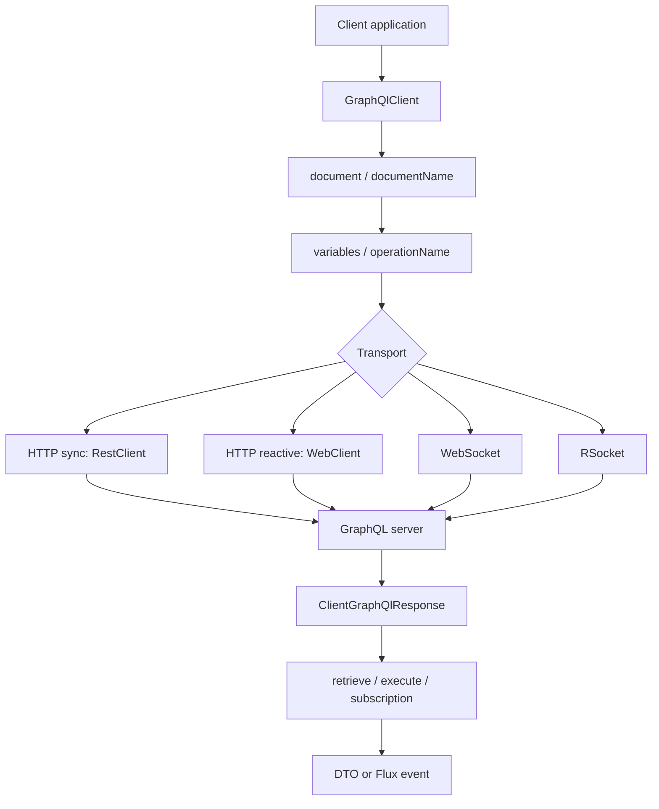

# `GraphQlClient` in Spring for GraphQL

`GraphQlClient` is the client-side API of Spring for GraphQL, used to send Queries, Mutations, and Subscriptions to a GraphQL server. The API provides a consistent way to build requests and read responses, while the underlying transport can be synchronous HTTP, reactive HTTP, WebSocket, or RSocket.

The key point is separating **how a GraphQL operation is described** from **how the operation is transmitted over the network**. The client builds a request with a document, variables, and an operation name; then chooses how to retrieve a field, handle the full response, or receive a Subscription stream. As a result, the GraphQL invocation code can stay largely the same when an application switches from HTTP to WebSocket or RSocket.

## `GraphQlClient` in client architecture

On the client side, the processing flow typically consists of:

1. Creating a transport client and configuring the endpoint, headers, authentication, timeouts, or codecs.
2. Creating a `GraphQlClient` implementation appropriate for the transport.
3. Creating a request using `document(...)` or `documentName(...)`.
4. Passing variables and required request attributes.
5. Choosing `retrieve` to extract a single field or `execute` to handle the entire GraphQL response.
6. Decoding the data into a DTO, record, or collection.



`GraphQlClient` is the client for calling a server in a real application. `GraphQlTester` is intended for testing GraphQL endpoints and is typically used in tests rather than as the application's business client.

## Implementations and transports

Spring for GraphQL provides the following main implementations:

| Client | Underlying transport | Characteristics |
| --- | --- | --- |
| `HttpSyncGraphQlClient` | Spring `RestClient` | Blocking; invokes and waits for the response on the current thread. |
| `HttpGraphQlClient` | Spring `WebClient` | Non-blocking; request and response are represented by Reactor `Mono`. |
| `WebSocketGraphQlClient` | Spring `WebSocketClient` | Long-lived connection, multiplexing multiple operations over a single connection; supports Subscriptions. |
| `RSocketGraphQlClient` | Spring `RSocketRequester` | Long-lived session, multiplexing requests over RSocket; supports streaming interactions. |

With an HTTP server supporting Server-Sent Events (SSE), `HttpGraphQlClient` can also receive Subscription streams. Subscriptions require a streaming transport; a standard HTTP JSON request-response cannot emit multiple continuous results on its own.

Choose a client based on the web stack and application requirements:

- Use `HttpSyncGraphQlClient` when the code follows a synchronous model and needs to integrate with `RestClient`.
- Use `HttpGraphQlClient` when non-blocking I/O is needed or the application uses WebFlux/Reactor.
- Use `WebSocketGraphQlClient` when a shared connection, multiple concurrent operations, or Subscriptions over WebSocket are needed.
- Use `RSocketGraphQlClient` when the system already deploys RSocket and needs requests/streams over a session.

Do not choose WebSocket just to invoke Queries. For standard request-response operations, HTTP is usually simpler. Do not choose a reactive client and then call `.block()` everywhere; doing so loses the benefits of non-blocking I/O.

## Required dependencies

The client classes belong to Spring for GraphQL. A Spring Boot application already using `spring-boot-starter-graphql` typically already has Spring GraphQL on the classpath. If writing a standalone client, you need the `org.springframework.graphql:spring-graphql` dependency along with the appropriate transport.

Gradle example using the HTTP reactive client:

```kotlin
dependencies {
    implementation("org.springframework.graphql:spring-graphql")
    implementation("org.springframework:spring-webflux")
}
```

For the HTTP sync client using `RestClient`, Spring Web is required. For WebSocket, the corresponding WebSocket client implementation is required; for RSocket, an RSocket client transport and compatible Spring Messaging/RSocket dependencies are required.

In a Spring Boot application, prefer starters and dependency management from the same Boot release line so that Spring Framework, Spring GraphQL, Reactor, and transport versions are compatible with one another.

## Creating `HttpGraphQlClient` with WebClient

`HttpGraphQlClient` uses `WebClient` to send GraphQL requests over HTTP in a non-blocking manner. Example configuring a base URL and bearer token:

```java
import org.springframework.graphql.client.HttpGraphQlClient;
import org.springframework.web.reactive.function.client.WebClient;

WebClient webClient = WebClient.builder()
        .baseUrl("https://api.example.com/graphql")
        .build();

HttpGraphQlClient graphQlClient = HttpGraphQlClient.builder(webClient)
        .headers(headers -> headers.setBearerAuth(accessToken))
        .build();
```

`baseUrl` is the server's GraphQL endpoint. `headers(...)` configures shared HTTP headers for requests, such as `Authorization`, `Accept`, or a correlation ID header. Do not hardcode access tokens in source code; retrieve tokens from a credential/configuration mechanism appropriate for the application.

You can quickly create a client when no customization is needed:

```java
HttpGraphQlClient graphQlClient = HttpGraphQlClient.create(
        WebClient.create("https://api.example.com/graphql"));
```

For applications needing custom connection pools, TLS, proxies, timeouts, or codecs, configure `WebClient.Builder` and pass the created WebClient into the GraphQL client.

## Creating `HttpSyncGraphQlClient` with RestClient

`HttpSyncGraphQlClient` uses Spring `RestClient` and has a blocking contract. Example:

```java
import org.springframework.graphql.client.HttpSyncGraphQlClient;
import org.springframework.web.client.RestClient;

RestClient restClient = RestClient.builder()
        .baseUrl("https://api.example.com/graphql")
        .build();

HttpSyncGraphQlClient graphQlClient =
        HttpSyncGraphQlClient.builder(restClient)
                .headers(headers -> headers.setBearerAuth(accessToken))
                .build();
```

When calling `retrieveSync(...)` or `executeSync()`, the current thread waits for the HTTP response. This approach suits synchronous applications, but should not be called on a WebFlux event-loop thread or in flows requiring non-blocking I/O.

## Request document, variables, and operation name

GraphQL operations are typically passed as a document string. Prefer using variables to pass input data rather than concatenating values into the query:

```java
String document = """
        query BookById($id: ID!) {
          book(id: $id) {
            id
            title
            author {
              id
              name
            }
          }
        }
        """;

Mono<Book> bookMono = graphQlClient.document(document)
        .variable("id", "book-10")
        .retrieve("book")
        .toEntity(Book.class);
```

`document(...)` starts the request. `variable("id", ...)` assigns a value to the GraphQL variable `$id`. `retrieve("book")` selects the `book` path inside the `data` section of the response. `toEntity(Book.class)` converts the object at that path into a `Book` DTO.

You can specify an operation name in the document for easier tracking:

```graphql
query BookById($id: ID!) {
  book(id: $id) {
    id
    title
  }
}
```

Operation names are especially useful when a document contains multiple operations, or when the server/APM records the operation name for tracing and metrics. If a document has multiple operations, you must specify the operation name so the server knows which operation to execute.

You can specify the selected operation using `operationName(...)`:

```java
Mono<Book> bookMono = graphQlClient.document(multiOperationDocument)
        .operationName("BookById")
        .variable("id", "book-10")
        .retrieve("book")
        .toEntity(Book.class);
```

Variables can also be passed together as a map:

```java
Map<String, Object> variables = Map.of(
        "id", "book-10",
        "includeReviews", true);

String searchDocument = """
        query BookById($id: ID!, $includeReviews: Boolean!) {
          book(id: $id) {
            id
            title
            reviews @include(if: $includeReviews) {
              id
              rating
            }
          }
        }
        """;

Mono<Book> result = graphQlClient.document(searchDocument)
        .variables(variables)
        .retrieve("book")
        .toEntity(Book.class);
```

Do not concatenate user data into a GraphQL document using string concatenation. Variables allow the GraphQL engine to type-check inputs, avoid escaping bugs, and make operations reusable.

## Retrieving a single field with `retrieve`

`retrieve(path)` is a concise way when you only need to decode one field in the response. The path is evaluated relative to the `data` key and supports nested paths:

```java
Mono<String> title = graphQlClient.document(document)
        .variable("id", "book-10")
        .retrieve("book.title")
        .toEntity(String.class);
```

For lists, the path can use element indices:

```java
Mono<String> firstAuthorName = graphQlClient.document(document)
        .variable("id", "book-10")
        .retrieve("book.authors[0].name")
        .toEntity(String.class);
```

The path is not full JSONPath; it is a simple notation consisting of field names, dots, and list indices. Use the exact field path matching the selection set in the document.

For a response with a single object field, use `toEntity`. For a list field, use `toEntityList`:

```java
Mono<List<Book>> books = graphQlClient.document("""
        query {
          books {
            id
            title
          }
        }
        """)
        .retrieve("books")
        .toEntityList(Book.class);
```

In the HTTP reactive client, the result is a `Mono`; the request is only executed when the publisher is subscribed to. In a WebFlux controller, you can return the `Mono` directly to the framework. In imperative code, only block at a controlled boundary, never arbitrarily on the event-loop.

## Retrieving the full response with `execute`

`retrieve` is a shortcut for cases where you only care about a single path. When you need to inspect multiple fields, partial data, `errors`, or `extensions`, use `execute()` to obtain a `ClientGraphQlResponse`:

```java
Mono<ClientGraphQlResponse> responseMono = graphQlClient.document(document)
        .variable("id", "book-10")
        .execute();

Mono<Book> bookMono = responseMono.flatMap(response -> {
    if (!response.isValid()) {
        return Mono.error(new IllegalStateException(
                "GraphQL request has no valid data"));
    }

    ClientResponseField field = response.field("book");
    if (field.getValue() == null) {
        if (!field.getErrors().isEmpty()) {
            return Mono.error(new IllegalStateException("Field book failed"));
        }
        return Mono.empty();
    }

    return Mono.just(field.toEntity(Book.class));
});
```

This is an illustrative example of branching on the response; in real applications, use custom exceptions or return domain result types instead of a generic `IllegalStateException`. It is important to distinguish between:

- A request that has no valid data and returns only operation-level errors.
- A field whose value is `null` with no errors, which may be a nullable field genuinely having no data.
- A field whose value is `null` accompanied by errors, meaning the field resolver failed.
- A field that has data but cannot be decoded into the desired Java type, in which case `GraphQlClientException` may be thrown.

`ClientGraphQlResponse` allows reading `field(...)`, `getErrors()`, `getExtensions()`, and other response details. Use `execute()` when you need to preserve full error context or handle partial data.

## Handling errors from `retrieve`

When the requested path does not exist or a field has a null value accompanied by a GraphQL error, `retrieve` may throw `FieldAccessException`. This exception provides the response and the failing field:

```java
Mono<Book> bookMono = graphQlClient.document(document)
        .variable("id", "missing-book")
        .retrieve("book")
        .toEntity(Book.class)
        .onErrorResume(FieldAccessException.class, ex -> {
            ClientGraphQlResponse response = ex.getResponse();
            ClientResponseField field = ex.getField();

            log.warn("GraphQL field book failed: {}", field.getErrors());
            return Mono.empty();
        });
```

Only use a `Mono.empty()` fallback if the business logic genuinely treats that case as having no result. If the error is authorization, server unavailable, or validation, translate it into an appropriate error instead of silently treating it as missing data.

With `HttpSyncGraphQlClient`, use `retrieveSync(...)` and catch `FieldAccessException` with a corresponding try/catch block. Transport errors such as timeouts, closed connections, or invalid HTTP responses are a different category from GraphQL field errors; apply appropriate retry/timeout policies for each type.

## Sending Mutations

Mutations are sent using the same request API; the difference lies in the document and the field path to extract:

```java
String mutation = """
        mutation CreateBook($input: CreateBookInput!) {
          createBook(input: $input) {
            id
            title
          }
        }
        """;

Mono<Book> createdBook = graphQlClient.document(mutation)
        .variable("input", new CreateBookInput(
                "Spring GraphQL in Action", "9781234567890"))
        .retrieve("createBook")
        .toEntity(Book.class);
```

The `CreateBookInput` DTO must have properties matching the input type in the SDL. When sending a mutation with side effects, avoid automatically retrying all transport errors without considering idempotency: the server may have committed the operation while the response was lost in transit. If safe retries are needed, design an idempotency key or deduplication mechanism in the API.

## Using documents in `.graphql` or `.gql` files

You do not have to place every GraphQL document inside a Java string. Spring for GraphQL provides `DocumentSource` to load operations from the classpath. By default, you can place files in the `graphql-documents/` directory with the `.graphql` or `.gql` extension.

Example structure:

```text
src/main/resources/
└── graphql-documents/
    ├── bookById.graphql
    └── createBook.graphql
```

Contents of `bookById.graphql`:

```graphql
query BookById($id: ID!) {
  book(id: $id) {
    id
    title
    author {
      id
      name
    }
  }
}
```

Invoke the document by filename, omitting the extension:

```java
Mono<Book> bookMono = graphQlClient.documentName("bookById")
        .variable("id", "book-10")
        .retrieve("book")
        .toEntity(Book.class);
```

`documentName("bookById")` looks up `bookById.graphql` in `graphql-documents/`. This approach enables queries to get autocomplete, syntax highlighting, and inspection support from the IntelliJ GraphQL plugin. If your file layout differs from the default, you can customize `DocumentSource` via the builder.

Placing operations in files also makes selection set changes clearer during code review, facilitates operation reuse, and reduces syntax errors from long text blocks.

## Customizing headers and transport configuration

Client builders allow both common and transport-specific configuration. For HTTP, you typically need a base URL, default headers, authentication, timeouts, and codecs.

For example, using dynamic tokens via an interceptor can be appropriate when the token changes per request. Do not create a singleton client with one user's bearer token and share it across many other users.

For clients needing distinct configuration, you can call `mutate()` on an existing client to obtain a builder initialized from its current configuration and build another instance:

```java
HttpGraphQlClient anotherClient = graphQlClient.mutate()
        .headers(headers -> headers.setBearerAuth(anotherAccessToken))
        .build();
```

`mutate()` is useful when creating a client with a different configuration while retaining most of the original setup. With WebSocket, each client instance creates its own connection; do not create a new client for each operation if the goal is to use a shared connection.

## Interceptors for requests and responses

`GraphQlClientInterceptor` allows intercepting requests and responses of a non-blocking client. It can be used to add correlation metadata, sanitized logging, timing, or common error handling:

```java
import org.springframework.graphql.client.ClientGraphQlRequest;
import org.springframework.graphql.client.ClientGraphQlResponse;
import org.springframework.graphql.client.GraphQlClientInterceptor;
import org.slf4j.Logger;
import org.slf4j.LoggerFactory;
import reactor.core.publisher.Flux;
import reactor.core.publisher.Mono;

public class LoggingGraphQlClientInterceptor implements GraphQlClientInterceptor {

    private static final Logger log =
            LoggerFactory.getLogger(LoggingGraphQlClientInterceptor.class);

    @Override
    public Mono<ClientGraphQlResponse> intercept(
            ClientGraphQlRequest request, Chain chain) {
        return chain.next(request)
                .doOnNext(response ->
                        log.debug("GraphQL response received, valid={}",
                                response.isValid()));
    }

    @Override
    public Flux<ClientGraphQlResponse> interceptSubscription(
            ClientGraphQlRequest request, SubscriptionChain chain) {
        return chain.next(request);
    }
}
```

Register the interceptor via the builder:

```java
HttpGraphQlClient graphQlClient = HttpGraphQlClient.builder(webClient)
        .interceptor(new LoggingGraphQlClientInterceptor())
        .build();
```

For a blocking transport like `HttpSyncGraphQlClient`, use `SyncGraphQlClientInterceptor`, which has a synchronous method returning `ClientGraphQlResponse`. Do not use a blocking interceptor for a non-blocking client or vice versa.

Interceptors should avoid logging full variables, headers, or response data if they contain tokens, personal information, or sensitive data. Log the operation name, correlation ID, duration, and sanitized error codes instead.

## Subscriptions with `retrieveSubscription`

To receive multiple results from a Subscription, the client needs a streaming transport such as HTTP SSE, WebSocket, or RSocket. The `retrieveSubscription(path)` API returns a `Flux<T>` stream after decoding the selected field:

```java
String subscription = """
        subscription WatchOrder($orderId: ID!) {
          orderStatusChanged(orderId: $orderId) {
            eventId
            orderId
            status
            changedAt
          }
        }
        """;

Flux<OrderStatusChanged> events = graphQlClient.document(subscription)
        .variable("orderId", "ORD-1001")
        .retrieveSubscription("orderStatusChanged")
        .toEntity(OrderStatusChanged.class);
```

The `Flux` emits one `OrderStatusChanged` for each execution result received. When the client no longer needs data, cancel the subscription or use operators like `take` and `timeout` as appropriate. With WebSocket, cancellation causes the transport to send a `complete` message for the corresponding operation.

### WebSocket client

Example creating a client using WebSocket:

```java
import java.time.Duration;
import org.springframework.graphql.client.WebSocketGraphQlClient;
import org.springframework.web.reactive.socket.client.ReactorNettyWebSocketClient;
import org.springframework.web.reactive.socket.client.WebSocketClient;

String url = "wss://api.example.com/graphql";
WebSocketClient transport = new ReactorNettyWebSocketClient();

WebSocketGraphQlClient graphQlClient = WebSocketGraphQlClient
        .builder(url, transport)
        .keepAlive(Duration.ofSeconds(30))
        .build();
```

The connection is established implicitly when the first request is sent; you can call `start()` to connect explicitly beforehand. `WebSocketGraphQlClient` multiplexes multiple operations on the same connection and can reconnect when the connection drops and a new request arrives or `start()` is called again. `stop()` cancels running operations, closes the connection, and rejects new requests.

Typically, use one `WebSocketGraphQlClient` per server and appropriate authentication scope, rather than creating an instance per subscription. If the client acts on behalf of different identities, connections and credentials must be managed strictly along user boundaries; do not share an authenticated connection of one user with another user.

### Subscription error handling and reconnection

A Subscription stream can terminate with `SubscriptionErrorException` if the server sends a GraphQL error message. Transport errors such as `WebSocketDisconnectedException` indicate the connection was closed or lost. You can use Reactor `retry` for transient transport errors, but resume semantics must be designed carefully:

- Without a cursor or event ID, reconnecting may miss events during the disconnection window.
- If the server replays events, the client may receive duplicates and need to deduplicate by event ID.
- Do not retry indefinitely on authorization or business errors.
- When cancelling a stream, release the subscription and associated resources.

Not every `GraphQlClient` supports Subscriptions. `HttpGraphQlClient` only works when the HTTP server supports SSE; WebSocket and RSocket require the corresponding server endpoint/transport.

## WebSocket connection initialization and authentication

GraphQL over WebSocket has a connection initialization message. If the server requires credentials in the connection init payload, you can implement `WebSocketGraphQlClientInterceptor` to supply the payload and handle the acknowledgement:

```java
import java.util.Map;
import org.springframework.graphql.client.WebSocketGraphQlClientInterceptor;
import reactor.core.publisher.Mono;

public class AuthWebSocketInterceptor implements WebSocketGraphQlClientInterceptor {

    private final String accessToken;

    public AuthWebSocketInterceptor(String accessToken) {
        this.accessToken = accessToken;
    }

    @Override
    public Mono<Object> connectionInitPayload() {
        return Mono.just(Map.of(
                "Authorization", "Bearer " + accessToken));
    }

    @Override
    public Mono<Void> handleConnectionAck(Map<String, Object> payload) {
        return Mono.empty();
    }
}
```

Register the interceptor as a GraphQL client interceptor in the builder. There can be at most one `WebSocketGraphQlClientInterceptor` on a WebSocket client. The exact payload depends on the protocol and how the server authenticates; some servers accept tokens in `connection_init`, while others require HTTP handshake headers.

Do not send the access token in both headers and payload if the server does not require it. Use `wss://` over untrusted networks and protect tokens as sensitive credentials.

## Using `executeSubscription` when full response is needed

`retrieveSubscription` only decodes a single field from each response. When you need to check errors or multiple fields per event, use `executeSubscription()` to receive `Flux<ClientGraphQlResponse>`:

```java
Flux<ClientGraphQlResponse> responses = graphQlClient.document(subscription)
        .variable("orderId", "ORD-1001")
        .executeSubscription();

Flux<OrderStatusChanged> events = responses.map(response -> {
    if (!response.isValid()) {
        throw new IllegalStateException("Invalid subscription response");
    }
    return response.field("orderStatusChanged")
            .toEntity(OrderStatusChanged.class);
});
```

This is useful when you want to read full response metadata for each event or handle field errors yourself. In production, distinguish `SubscriptionErrorException`, field errors, and transport errors instead of turning them all into the same exception.

## RSocket GraphQL client

`RSocketGraphQlClient` uses `RSocketRequester` and has a connection-oriented session similar to WebSocket. You can create a client with websocket or TCP transport:

```java
import java.net.URI;
import org.springframework.graphql.client.RSocketGraphQlClient;
import org.springframework.messaging.rsocket.WebsocketClientTransport;

URI uri = URI.create("wss://api.example.com/rsocket");
WebsocketClientTransport transport = WebsocketClientTransport.create(uri);

RSocketGraphQlClient graphQlClient = RSocketGraphQlClient.builder()
        .clientTransport(transport)
        .build();
```

The RSocket client establishes a session when the first request is sent or when `start()` is called. A session can multiplex multiple requests; `stop()` closes the session and cancels in-flight requests. Reuse a client per server rather than creating a new session for every operation.

With Spring Boot, you can inject an auto-configured `RSocketGraphQlClient.Builder<?>` and configure the desired TCP/route or transport. The server must have RSocket and the corresponding GraphQL route configured; merely creating the client does not enable RSocket on the server.

## Optional input: distinguishing omitted and null

For update Mutations, it may be necessary to distinguish between a field that is not sent (retaining the old value) and a field explicitly sent as `null` (clearing the value). Standard JSON can represent `null`, but a simple Java DTO does not always preserve the distinction between omitted and null.

Spring for GraphQL supports `ArgumentValue<T>` in input objects. Clients can also use `ArgumentValue<T>` for input fields when configuring the `GraphQlJacksonModule` Jackson module for proper serialization. Check the Spring for GraphQL version in use, as client-side optional input support depends on the version:

```java
import org.springframework.graphql.data.ArgumentValue;

public record UpdateProjectInput(
        String id,
        ArgumentValue<String> description) {
}
```

When you want to send a value:

```java
UpdateProjectInput input = new UpdateProjectInput(
        "project-10",
        ArgumentValue.ofNullable("New description"));
```

When you want to omit the field:

```java
UpdateProjectInput input = new UpdateProjectInput(
        "project-10",
        ArgumentValue.omitted());
```

For serialization to work, register `GraphQlJacksonModule` with the Jackson mapper/encoder used by the underlying HTTP client. For Jackson 2, Spring for GraphQL provides `GraphQlJackson2Module`. Do not merely add the module to a separate mapper not used by WebClient; ensure the transport's encoder is properly configured.

## DGS Codegen client API

Beyond writing GraphQL documents as text, you can use DGS Codegen to generate request/projection classes from the schema. Spring for GraphQL's `DgsGraphQlClient` can wrap any `GraphQlClient` and supports building operations with the generated API.

This is a useful option when an application has many operations, wants a type-safe request builder, or wants selection sets checked at compile time. In exchange, the project needs to configure code generation and manage generated sources. For a small number of operations, `.graphql` documents on the classpath are usually simpler.

## Testing and observing GraphQlClient

You can test a service layer that calls GraphQL by mocking `GraphQlClient` or using a mock HTTP server/transport to verify the document, variables, headers, and response mapping. For integration tests, run a real GraphQL server or test endpoints via `HttpGraphQlTester`; production clients and testers have different APIs and purposes.

Scenarios worth testing:

- Queries send the correct document, variables, and operation name.
- Mutations serialize input objects in compliance with the SDL.
- Nested paths and list indices are decoded properly.
- Nullable fields returning null are not confused with field errors.
- Partial data alongside GraphQL errors is handled properly.
- Parse/validation errors and transport errors are distinguished.
- Authentication headers or WebSocket connection init payloads are sent properly.
- Document source locates the right `.graphql`/`.gql` file on the classpath.
- Subscriptions emit multiple events, cancel, and reconnect according to policy.
- Timeouts, retries, and logging do not leak tokens or sensitive data.

You can add metrics/tracing in an interceptor to record operation name, transport, duration, validity status, and error count. Avoid logging full GraphQL variables or response payloads if they contain sensitive information.

## Common issues

| Symptom | Cause | Resolution |
| --- | --- | --- |
| Cannot connect to server | Wrong endpoint URL, TLS, proxy, or incompatible transport. | Check base URL, `https`/`wss` scheme, network, and server transport. |
| `retrieve("book")` throws `FieldAccessException` | Field path does not exist or field is null with GraphQL errors. | Check selection set, response errors, and path. |
| DTO decoded with missing fields | Document does not select that field or DTO field names/types do not match response. | Check selection set and JSON mapping. |
| Variable not recognized | Variable name in document differs from name passed via `.variable(...)`. | Cross-check `$id`, arguments, and key names. |
| Query has partial data but code treats it as total failure | Using `retrieve` without inspecting field-level errors or response semantics. | Use `execute()` when handling partial data and errors. |
| Reactive client does not execute request | `Mono` was not subscribed to or returned to the framework. | Subscribe at an appropriate boundary or return the publisher to WebFlux. |
| WebSocket opens multiple connections | Creating a new client for every request/subscription. | Reuse a single client instance per server and credential scope. |
| Subscription loses events after reconnect | No cursor/replay or retry does not handle duplicates. | Use event ID/sequence and a resume contract. |
| Subscription does not stop | Flux is not cancelled or client does not manage lifecycle. | Retain the Disposable/Subscription or use stream-terminating operators. |
| Token not received by server on WebSocket | Server expects credentials in `connection_init` while client only sends HTTP headers, or vice versa. | Check the server's authentication contract and configure the interceptor/handshake accordingly. |

## Key takeaways

`GraphQlClient` provides a unified API for building GraphQL requests and reading responses. `HttpSyncGraphQlClient` uses blocking `RestClient`; `HttpGraphQlClient` uses non-blocking `WebClient`; `WebSocketGraphQlClient` and `RSocketGraphQlClient` use long-lived connections/sessions and can support Subscriptions. Choose the transport based on the application's I/O model and streaming requirements.

`document(...)` or `documentName(...)` defines the operation; `variable(...)`/`variables(...)` pass data; `retrieve(path)` decodes a single field; `execute()` lets you handle the full `ClientGraphQlResponse`. For Subscriptions, use `retrieveSubscription` or `executeSubscription` over a streaming transport. Explicitly manage partial data, field errors, transport failures, authentication, cancellation, and client lifecycle to keep GraphQL calls reliable.

## References

- [Spring for GraphQL — Client](https://docs.spring.io/spring-graphql/reference/client.html)
- [Spring for GraphQL — `GraphQlClient` API](https://docs.spring.io/spring-graphql/docs/current/api/org/springframework/graphql/client/GraphQlClient.html)
- [Spring Boot — Spring for GraphQL transports](https://docs.spring.io/spring-boot/reference/web/spring-graphql.html)
