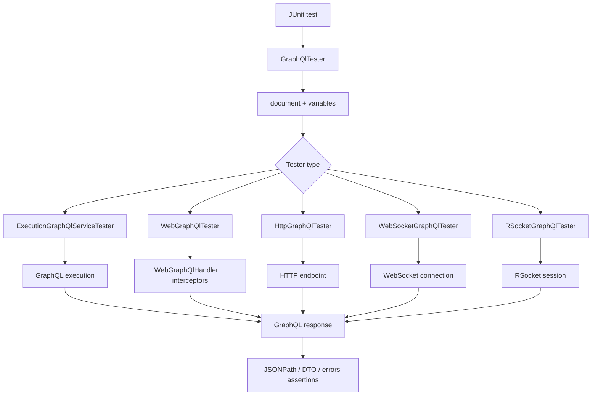

# `GraphQlTester` in Spring for GraphQL

`GraphQlTester` is the GraphQL testing API of Spring for GraphQL. It allows creating requests with a GraphQL document, passing variables, executing operations, reading data via JSONPath, and verifying GraphQL errors. The same fluent API can be used to test the GraphQL engine directly or send requests over HTTP, WebSocket, and RSocket.

The key point is that `GraphQlTester` decouples how tests are written from the transport. Tests can keep the same document and assertions when moving from testing a controller without a web server to testing a real HTTP endpoint. Each tester type differs only in how it connects and is configured during initialization.

## What Does `GraphQlTester` Test?

A GraphQL request is not just a method call. It goes through the schema, coercion, argument binding, resolvers, DataLoaders, error handling, and serialization. `GraphQlTester` helps verify results from a GraphQL client's perspective:

- Sending a Query, Mutation, or Subscription using a GraphQL document.
- Passing variables and an operation name.
- Verifying data in the `data` section using JSONPath.
- Converting fields into DTOs or collections for comparison.
- Checking errors, error paths, and metadata in the response.
- Testing Subscription event streams using Reactor `StepVerifier`.



`GraphQlTester` is intended for tests. When an application needs to call another GraphQL server in business flows, use `GraphQlClient`; do not use a tester as a production client.

## Adding Testing Dependencies

Spring for GraphQL provides the `spring-graphql-test` module. Add it to the test scope to use `GraphQlTester` and its implementations:

```kotlin
dependencies {
    testImplementation("org.springframework.graphql:spring-graphql-test")
    testImplementation("org.springframework.boot:spring-boot-starter-test")
}
```

With Maven:

```xml
<dependency>
    <groupId>org.springframework.graphql</groupId>
    <artifactId>spring-graphql-test</artifactId>
    <scope>test</scope>
</dependency>
<dependency>
    <groupId>org.springframework.boot</groupId>
    <artifactId>spring-boot-starter-test</artifactId>
    <scope>test</scope>
</dependency>
```

When testing HTTP with `WebTestClient`, you need the Spring WebFlux test client on the test classpath. For MVC applications, you can use `MockMvcWebTestClient`; for WebFlux applications, use `WebTestClient` directly. Let Spring Boot dependency management select compatible versions, and avoid mixing Spring GraphQL, Spring Framework, and Reactor versions manually.

If testing Subscriptions with `StepVerifier`, add `reactor-test` in test scope. For MVC applications using `MockMvcWebTestClient`, the WebFlux test client is required on the test classpath according to Spring Boot's dependency guide.

## Five Implementations of GraphQlTester

Spring for GraphQL provides five common tester types:

| Tester | Testing Scope | Goes Through Transport? |
| --- | --- | --- |
| `ExecutionGraphQlServiceTester` | GraphQL execution service and schema execution components. | No; calls the service directly. |
| `WebGraphQlTester` | `WebGraphQlHandler` and the `WebGraphQlInterceptor` chain. | No real HTTP/WebSocket; uses a simulated web request. |
| `HttpGraphQlTester` | HTTP GraphQL endpoint. | Yes; uses `WebTestClient`, which can target a real or mock server. |
| `WebSocketGraphQlTester` | GraphQL requests and Subscriptions over WebSocket. | Yes; uses a shared WebSocket connection. |
| `RSocketGraphQlTester` | GraphQL requests over RSocket. | Yes; uses a shared RSocket session. |

Choose the tester type based on the boundary you need to verify:

- Fast verification of resolvers, schema, and mapping: `ExecutionGraphQlServiceTester` or `@GraphQlTest`.
- Verifying interceptors and web context: `WebGraphQlTester`.
- Verifying endpoints, HTTP headers, security filters, and status: `HttpGraphQlTester`.
- Verifying WebSocket protocol, connection, and Subscriptions: `WebSocketGraphQlTester`.
- Verifying RSocket route/session: `RSocketGraphQlTester`.

You do not need to use an HTTP tester for every test. Lower-layer tests provide fast feedback; a smaller number of integration tests over a real transport verify routing, headers, authentication, and protocol.

## Basic Fluent API

Most tests start with `document(...)` or `documentName(...)`, then assign variables and call `execute()`:

```java
graphQlTester.document("""
        query BookById($id: ID!) {
          book(id: $id) {
            id
            title
          }
        }
        """)
        .variable("id", "book-10")
        .execute()
        .path("book.id")
        .entity(String.class)
        .isEqualTo("book-10");
```

The flow above performs these steps:

1. `document(...)` provides the GraphQL document.
2. `variable(...)` assigns a value to the `$id` variable.
3. `execute()` sends the operation to the configured tester.
4. `path("book.id")` selects the field from the `data` section of the response.
5. `entity(String.class)` converts the value to a Java type.
6. `isEqualTo(...)` verifies the expected result.

`GraphQlTester` uses JSONPath for `path(...)`. Paths are evaluated relative to the `data` section, so there is no need to write the `data.` prefix. You can use nested paths, array indices, and wildcards such as `books[0].title` or `books[*].id`.

## Passing Variables and Operation Name

Test data should be passed using GraphQL variables to properly test coercion and binding:

```java
graphQlTester.document("""
        query SearchBooks($keyword: String!, $first: Int!) {
          searchBooks(keyword: $keyword, first: $first) {
            id
            title
          }
        }
        """)
        .variable("keyword", "Spring")
        .variable("first", 10)
        .execute()
        .path("searchBooks")
        .entityList(BookSummary.class)
        .hasSize(2);
```

You can pass multiple variables using a `Map`:

```java
Map<String, Object> variables = Map.of(
        "keyword", "Spring",
        "first", 10);

graphQlTester.document(searchDocument)
        .variables(variables)
        .execute()
        .path("searchBooks")
        .entityList(BookSummary.class)
        .hasSize(2);
```

When a document contains multiple operations, specify which operation to run using `operationName(...)`:

```java
graphQlTester.document(multiOperationDocument)
        .operationName("BookById")
        .variable("id", "book-10")
        .execute()
        .path("book.id")
        .entity(String.class)
        .isEqualTo("book-10");
```

Using an operation name also makes logs, tracing, and test reports clearly identify the operation under test.

## Verifying Scalars, Objects, and Collections

For scalars, use `entity(...)` to verify the type and value:

```java
graphQlTester.document("{ version }")
        .execute()
        .path("version")
        .entity(String.class)
        .isEqualTo("1.0");
```

For objects, decode into a DTO or record:

```java
graphQlTester.document("""
        query {
          book(id: "book-10") {
            id
            title
          }
        }
        """)
        .execute()
        .path("book")
        .entity(BookSummary.class)
        .satisfies(book -> {
            assertThat(book.id()).isEqualTo("book-10");
            assertThat(book.title()).contains("Spring");
        });
```

For collections, use `entityList(...)` along with assertions on size, order, or elements:

```java
graphQlTester.document("{ books { id title } }")
        .execute()
        .path("books")
        .entityList(BookSummary.class)
        .hasSize(2)
        .contains(new BookSummary("book-10", "Spring GraphQL"));
```

The examples above assume the DTO has an appropriate constructor/record and `equals` implementation. If you only want to verify part of the data, you can use multiple separate `path(...)` calls instead of decoding the entire object.

### JSONPath with Wildcards and Nested Paths

When you need to check an attribute across all elements, use a wildcard:

```java
graphQlTester.document("{ books { id title } }")
        .execute()
        .path("books[*].id")
        .entityList(String.class)
        .contains("book-10", "book-20");
```

You can drill down into an object and perform multiple assertions relative to that object:

```java
graphQlTester.document("{ project(slug: \"spring-framework\") { name releases { version } } }")
        .execute()
        .path("project", project -> project
                .path("name")
                .entity(String.class)
                .isEqualTo("spring-framework")
                .path("releases[*].version")
                .entityList(String.class)
                .hasSizeGreaterThan(1));
```

Nested paths help group assertions related to the same object. JSONPath only reads data present in the selection set; if the document does not select a field, the response will not contain that field to assert against.

## Verifying Mutations Without Response Data

A Mutation may return only a scalar or be designed without a payload to read. If the goal is to verify that the operation runs without GraphQL errors, use `executeAndVerify()`:

```java
graphQlTester.document("""
        mutation DeleteDraft($id: ID!) {
          deleteDraft(id: $id)
        }
        """)
        .variable("id", "draft-10")
        .executeAndVerify();
```

`executeAndVerify()` executes the request and verifies that the response has no unhandled errors. If you need to verify the value returned by a Mutation, use `execute()` and read fields with `path(...)` just like a Query.

For Mutations with side effects, tests should verify both the GraphQL result and the changed state in the service/repository or via a subsequent Query. Merely checking that there are no errors does not prove the data was persisted correctly.

## Verifying GraphQL Errors

A GraphQL response can contain partial `data` alongside `errors`. `GraphQlTester` lets you assert expected errors or filter errors that are accepted in the test.

### Expecting a Specific Error

`expect(...)` requires at least one error matching the predicate; if none is found, the test fails. `verify()` ensures no unhandled errors remain:

```java
graphQlTester.document("""
        query {
          book(id: "missing-book") {
            id
          }
        }
        """)
        .execute()
        .errors()
        .expect(error -> error.getMessage().contains("Book not found"))
        .verify();
```

### Filtering Known Errors

`filter(...)` marks matching errors as handled so the test can continue checking the `data` section. Other errors will still cause `verify()` to fail:

```java
graphQlTester.document(query)
        .execute()
        .errors()
        .filter(error -> error.getMessage().contains("Optional recommendation unavailable"))
        .verify()
        .path("book.title")
        .entity(String.class)
        .isEqualTo("Spring GraphQL");
```

Only filter errors that are expected and have a clear business reason. Do not use a predicate that always returns `true` just to make a test pass, as that ignores all GraphQL errors.

### Inspecting the Entire Error List

`satisfy(...)` allows assertions on the full list of errors. Once the callback runs, the errors are considered handled, so you can continue checking data if needed:

```java
graphQlTester.document(query)
        .execute()
        .errors()
        .satisfy(errors -> assertThat(errors)
                .anyMatch(error -> error.getMessage().contains("Access denied")));
```

You can configure `errorFilter(...)` on the tester builder to ignore a common group of errors across multiple tests. Use global configuration cautiously; filtering in a specific test is usually easier to read and less likely to hide regressions.

## Verifying Error Extensions and Paths

When an API returns `extensions` with error codes or custom metadata, inspect them via `ResponseError` inside `expect(...)` or `satisfy(...)`. `ResponseError` also provides `getPath()` and `getParsedPath()` to identify the field that caused the error:

```java
graphQlTester.document(query)
        .execute()
        .errors()
        .expect(error -> "FORBIDDEN".equals(error.getExtensions().get("code"))
                && "book.internalNotes".equals(error.getPath()))
        .verify();
```

For error paths, retrieve the information from `ResponseError` in `expect` or `satisfy` and verify the failing field. This is useful when securing nested fields: the error must point to `book.internalNotes`, while public fields can still return data. Error `extensions` live on `ResponseError`; they are not part of the `data` JSONPath.

Do not assert the exact full error message if the wording or localization may change. Prefer stable error codes in `extensions`, paths, and public error categories committed to by the API.

## Using Documents from `.graphql` Files

To avoid embedding long queries in Java tests, place test documents in the `graphql-test/` directory on the classpath:

```text
src/test/resources/
└── graphql-test/
    ├── bookById.graphql
    ├── searchBooks.graphql
    └── bookSummary.graphql
```

Example `bookById.graphql`:

```graphql
query BookById($id: ID!) {
  book(id: $id) {
    id
    title
  }
}
```

Reference the document by filename without the extension:

```java
graphQlTester.documentName("bookById")
        .variable("id", "book-10")
        .execute()
        .path("book.id")
        .entity(String.class)
        .isEqualTo("book-10");
```

`documentName(...)` and `fragmentName(...)` share the configured `DocumentSource`. By default, `GraphQlTester` uses `ResourceDocumentSource` with the `graphql-test/` classpath location and `.graphql`/`.gql` extensions. Fragments can be loaded from separate files using `fragmentName(...)`:

```java
graphQlTester.documentName("searchBooks")
        .fragmentName("bookSummary")
        .variable("keyword", "Spring")
        .execute()
        .path("searchBooks[*].title")
        .entityList(String.class)
        .hasSizeGreaterThan(0);
```

Fragments are appended to the document by filename. Ensure the fragment is declared with the proper name and type condition matching the schema. When a project uses a different directory, configure a custom `DocumentSource` on the builder.

## Common Tester Configuration Options

`GraphQlTester` builders share several options:

| Option | Purpose |
| --- | --- |
| `documentSource(...)` | Specifies where to load documents and fragments from. |
| `errorFilter(...)` | Marks matching errors as handled. |
| `responseTimeout(...)` | Limits the wait time for results. |

Example configuring a timeout and error filter:

```java
WebTestClient.Builder webTestClientBuilder = WebTestClient.bindToServer()
        .baseUrl("http://localhost:8080/graphql");

HttpGraphQlTester tester = HttpGraphQlTester.builder(webTestClientBuilder)
        .responseTimeout(Duration.ofSeconds(5))
        .errorFilter(error -> error.getMessage().contains("Known optional warning"))
        .build();
```

`responseTimeout` prevents tests from hanging indefinitely when a resolver or transport stalls. The default is 5 seconds. For Subscriptions, timeouts should be considered alongside stream verification; `StepVerifier` is usually more appropriate for setting time limits on event streams.

Do not use an arbitrarily short timeout if tests depend on slow-starting databases or containers. Choose a value based on normal test execution time while keeping it low enough to catch hanging bugs.

## Testing `ExecutionGraphQlService` Directly

`ExecutionGraphQlServiceTester` tests the server side without a client or transport. It is a lightweight choice for tests focused on GraphQL execution:

```java
ExecutionGraphQlServiceTester tester =
        ExecutionGraphQlServiceTester.create(executionGraphQlService);

tester.document("{ book(id: \"book-10\") { id title } }")
        .execute()
        .path("book.title")
        .entity(String.class)
        .isEqualTo("Spring GraphQL");
```

This tester invokes `ExecutionGraphQlService` directly. It tests the schema, DataFetchers, argument binding, DataLoaders, and execution behavior, but does not test HTTP routing, servlet filters, WebSocket protocol, or the `WebGraphQlInterceptor` chain.

The builder also allows customizing `ExecutionInput`, for example attaching an execution ID or GraphQL context for testing:

```java
ExecutionId executionId = ExecutionId.generate();

ExecutionGraphQlServiceTester tester =
        ExecutionGraphQlServiceTester.builder(executionGraphQlService)
                .configureExecutionInput((input, builder) ->
                        builder.executionId(executionId).build())
                .build();
```

Use this approach when tests need to control execution metadata without setting up a web transport.

## Testing `WebGraphQlHandler` and Interceptors

`WebGraphQlTester` executes requests through `WebGraphQlHandler`, thus passing through the `WebGraphQlInterceptor` chain before reaching `ExecutionGraphQlService`. It is well suited for testing request headers, GraphQL context, and interceptor response transformations without starting an HTTP server:

```java
WebGraphQlTester tester = WebGraphQlTester.builder(webGraphQlHandler)
        .headers(headers -> headers.set("X-Tenant-Id", "tenant-a"))
        .build();

tester.document("{ currentTenant { id } }")
        .execute()
        .path("currentTenant.id")
        .entity(String.class)
        .isEqualTo("tenant-a");
```

The builder lets you add HTTP-like request headers to the simulated `WebGraphQlRequest`. This does not test CORS, servlet filters, or HTTP status codes; if you need to verify those, use `HttpGraphQlTester`.

## Testing Controllers with `@GraphQlTest`

Spring Boot provides `@GraphQlTest` to create a test slice focused on GraphQL. This annotation configures the schema and GraphQL infrastructure, discovers GraphQL controllers and related components, and skips loading all services and repositories as `@SpringBootTest` does.

The example below assumes the schema is in `src/main/resources/graphql/schema.graphqls`:

```graphql
type Book {
  id: ID!
  title: String!
}

type Query {
  book(id: ID!): Book
}
```

Example controller:

```java
@Controller
public class BookController {

    private final BookService bookService;

    public BookController(BookService bookService) {
        this.bookService = bookService;
    }

    @QueryMapping
    public Book book(@Argument("id") String id) {
        return bookService.findById(id);
    }
}
```

The test slice can mock service dependencies:

```java
// Spring Boot 4.x:
import org.springframework.boot.graphql.test.autoconfigure.GraphQlTest;
// Spring Boot 3.x uses:
// import org.springframework.boot.test.autoconfigure.graphql.GraphQlTest;

import static org.mockito.BDDMockito.given;
import static org.mockito.BDDMockito.then;

import org.junit.jupiter.api.Test;
import org.springframework.beans.factory.annotation.Autowired;
import org.springframework.graphql.test.tester.GraphQlTester;
import org.springframework.test.context.bean.override.mockito.MockitoBean;

@GraphQlTest(BookController.class)
class BookControllerTests {

    @Autowired
    GraphQlTester graphQlTester;

    @MockitoBean
    BookService bookService;

    @Test
    void returnsBookById() {
        given(bookService.findById("book-10"))
                .willReturn(new Book("book-10", "Spring GraphQL"));

        graphQlTester.document("""
                query BookById($id: ID!) {
                  book(id: $id) {
                    id
                    title
                  }
                }
                """)
                .variable("id", "book-10")
                .execute()
                .path("book.title")
                .entity(String.class)
                .isEqualTo("Spring GraphQL");

        then(bookService).should().findById("book-10");
    }
}
```

This snippet assumes `Book` has a matching constructor, `BookService.findById` returns `Book`, and the test uses the Mockito BDD API. `@MockitoBean` is available in newer Spring Framework versions; in older Spring Boot/Spring Framework versions, use the corresponding mock bean mechanism for that version, typically `@MockBean`.

`@GraphQlTest` does not automatically scan every `@Service`, `@Repository`, or `@Configuration` in the application. Use `@MockitoBean` for collaborators or `@Import` to include required configurations or components. If a test needs real persistence, security filters, or transport, choose an appropriate integration test instead of over-expanding the slice.

## Testing HTTP with `HttpGraphQlTester`

`HttpGraphQlTester` uses `WebTestClient`, so it can test endpoints without a real server or call a running server.

### With Spring MVC Without Starting a Server

Use `MockMvcWebTestClient` to connect `WebTestClient` to the Spring MVC application context:

```java
WebTestClient client = MockMvcWebTestClient
        .bindToApplicationContext(applicationContext)
        .configureClient()
        .baseUrl("/graphql")
        .build();

HttpGraphQlTester tester = HttpGraphQlTester.create(client);
```

### With Spring WebFlux Without Starting a Server

Use `WebTestClient.bindToApplicationContext(...)`:

```java
WebTestClient client = WebTestClient
        .bindToApplicationContext(applicationContext)
        .configureClient()
        .baseUrl("/graphql")
        .build();

HttpGraphQlTester tester = HttpGraphQlTester.create(client);
```

### With a Real Server

You can create a client pointing to the server address:

```java
WebTestClient client = WebTestClient
        .bindToServer()
        .baseUrl("http://localhost:8080/graphql")
        .build();

HttpGraphQlTester tester = HttpGraphQlTester.create(client);
```

In Spring Boot, `@SpringBootTest(webEnvironment = RANDOM_PORT)` combined with `@AutoConfigureHttpGraphQlTester` can provide an `HttpGraphQlTester` pre-configured for the running server. The annotation package may vary across major Spring Boot versions; use the correct package for your project's version.

When you need to change headers or transport configuration for a group of tests, use `mutate()` to create a new tester from an existing one:

```java
HttpGraphQlTester authenticatedTester = tester.mutate()
        .headers(headers -> headers.setBearerAuth(accessToken))
        .build();
```

This is how you test authentication headers or tenant/correlation headers without recreating the entire `WebTestClient`.

`GraphQlTester` focuses on the GraphQL response. If you need to assert HTTP status, response headers, or cookies, retain and use `WebTestClient` directly for transport assertions, then use the tester for the GraphQL body.

## Testing WebSocket

`WebSocketGraphQlTester` uses a shared WebSocket connection across multiple requests. Each tester instance manages its own connection; typically, one tester is created per server within a test class and closed when finished:

```java
WebSocketClient client = new ReactorNettyWebSocketClient();

WebSocketGraphQlTester tester = WebSocketGraphQlTester
        .builder("ws://localhost:8080/graphql", client)
        .build();
```

You can configure handshake headers or create another tester using `mutate()`. For servers requiring authentication via the connection init payload, configure the mechanism matching the server protocol; handshake headers and the `connection_init` payload are two different places.

When tests finish, call `stop()` to close the WebSocket connection and release resources:

```java
@AfterEach
void closeWebSocketTester() {
    tester.stop();
}
```

Do not create a new WebSocket tester for every operation if the goal is to test multiplexing or connection reuse. Likewise, do not share a tester authenticated with one user's credentials across tests expecting a different identity.

## Testing RSocket

`RSocketGraphQlTester` uses `RSocketRequester` and a shared session for requests. Example with WebSocket transport:

```java
URI url = URI.create("ws://localhost:8080/rsocket");
WebsocketClientTransport transport = WebsocketClientTransport.create(url);

RSocketGraphQlTester tester = RSocketGraphQlTester.builder()
        .clientTransport(transport)
        .build();
```

The RSocket tester is appropriate when the application actually exposes GraphQL over RSocket. Call `stop()` after tests complete to close the session. There is no need to add RSocket transport to tests if the application only exposes GraphQL over HTTP.

## Testing Subscriptions with StepVerifier

For Subscriptions, call `executeSubscription()` to receive the stream response, then decode the field into a `Flux<T>`. Use Reactor `StepVerifier` to verify order, event count, completion, and errors:

```java
Flux<String> greetings = tester.document("subscription { greetings }")
        .executeSubscription()
        .toFlux("greetings", String.class);

StepVerifier.create(greetings)
        .expectNext("Hi")
        .expectNext("Bonjour")
        .expectNext("Hola")
        .verifyComplete();
```

According to Spring for GraphQL's testing support, Subscriptions are supported in `WebSocketGraphQlTester` and server-side testers (`ExecutionGraphQlServiceTester`, `WebGraphQlTester`). Do not assume request-response `HttpGraphQlTester` or `RSocketGraphQlTester` automatically provides Subscription testing through this exact same API.

For streams that do not complete on their own, use `thenCancel()` or `expectNextCount(...)` followed by cancellation instead of `verifyComplete()`. For example:

```java
StepVerifier.create(statusEvents)
        .expectNextMatches(event -> event.status().equals("PAID"))
        .expectNextMatches(event -> event.status().equals("PACKING"))
        .thenCancel()
        .verify();
```

Testing cancellation is important because it verifies that the event source releases listeners, subscriptions, and buffers when the client stops listening.

## Testing Validation, Binding, and Error Mapping

GraphQL has multiple stages where errors can occur. Use `GraphQlTester` to verify the API contract at each stage:

- Invalid document syntax or a field missing from the schema: GraphQL parse/validation error.
- Wrong variable type or missing Non-Null: input coercion error before the resolver runs.
- Failed input object binding: argument binding error.
- Failed `@NotBlank`, `@Size` constraints: Bean Validation error.
- Service throws `BookNotFoundException` or `AccessDeniedException`: execution error from the resolver/service.

Example verifying a standardized validation error code:

```java
graphQlTester.document("""
        mutation {
          createBook(input: { title: "   " }) {
            id
          }
        }
        """)
        .execute()
        .errors()
        .expect(error -> "VALIDATION_ERROR".equals(
                error.getExtensions().get("code")))
        .verify();
```

This test assumes the exception handler puts the `VALIDATION_ERROR` code into `extensions.code`. Prefer asserting stable error codes and field paths rather than relying on internal messages or stack traces.

## Testing DataLoader and N+1

`GraphQlTester` can send an operation selecting nested fields to trigger a DataLoader or `@BatchMapping`. However, merely asserting that the response is correct does not prove batching works; an individual resolver per object could still return the right data while causing N+1 queries.

Combine the tester with a mock/spy on the batch service or metrics to verify invocation counts and key lists:

```java
graphQlTester.document("""
        query {
          books {
            id
            author {
              id
              name
            }
          }
        }
        """)
        .execute()
        .path("books")
        .entityList(BookWithAuthor.class)
        .hasSize(3);

then(authorBatchService).should(times(1))
        .findAllByIds(Set.of("author-1", "author-2"));
```

This is an illustrative example; the key set and batch count depend on fixtures, DataLoader dispatch, and max batch size. In real tests, clearly establish the number of parent objects and unique IDs, then verify that the batch service is called with the expected group of keys. If tests run concurrently or use cross-request caches, isolate data and metrics to avoid skewed results.

## Principles for Designing GraphQL Tests

- **Test from the client's perspective:** send realistic documents and variables, and assert `data`, `errors`, and public paths.
- **Choose the right boundary:** service execution, web handler, or HTTP/WebSocket/RSocket transport depending on what needs verification.
- **Use operation names:** helps logs and test reports clearly identify the operation.
- **Do not ignore errors globally:** only filter expected errors; any new error should fail the test.
- **Check nullability:** nullable fields may legitimately be null; Non-Null fields can cause null propagation to parent objects.
- **Verify side effects:** Mutations need to verify data state or service interactions, not just the response.
- **Test authorization:** test both authorized and unauthorized users, including nested fields and tenant isolation.
- **Test transport separately:** headers, status codes, cookies, CORS, CSRF, and protocols cannot be verified solely with a service tester.
- **Close resources:** WebSocket/RSocket testers and Subscription streams must be stopped or cancelled.
- **Keep fixtures deterministic:** test data must be predictable and independent of random ordering or external environments.

## Common Errors

| Symptom | Cause | Resolution |
| --- | --- | --- |
| `GraphQlTester` class not found | Missing `spring-graphql-test` in test scope. | Add a test dependency compatible with Spring GraphQL. |
| `@GraphQlTest` cannot inject a service | The test slice does not automatically scan `@Service` and `@Repository`. | Use `@MockitoBean` or `@Import` the required collaborators. |
| `path(...)` cannot find a field | Incorrect JSONPath or the document did not select that field. | Check the selection set and the path relative to `data`. |
| Test fails due to unexpected error | Response contains unverified/unfiltered GraphQL errors. | Use `errors().expect(...)`, `filter(...)`, or fix the real bug in the resolver. |
| Test passes even when server returns errors | Error filter is too broad or `verify()` was not called. | Filter only specific errors and require `verify()` to check the rest. |
| Mutation test has no data path | Mutation returns no payload or test only needs to verify no errors. | Use `executeAndVerify()` or select a returned field in SDL. |
| HTTP tester cannot check status/headers | Using only the GraphQL response abstraction. | Use `WebTestClient` for transport assertions and the tester for the GraphQL body. |
| WebSocket test hangs or leaks connections | Stream was not cancelled or `stop()` was not called. | Use `StepVerifier` with cancellation and close the tester in teardown. |
| Subscription test receives no events | Using a tester/transport that does not support subscription testing, or publisher emits nothing. | Use WebSocket/server-side tester and check the event source. |
| Test response is correct but N+1 still exists | Only asserting data without measuring batch invocations or SQL. | Spy on the batch service, count keys, and verify query counts. |

## Takeaways

`GraphQlTester` provides a unified fluent API for GraphQL testing: build documents, pass variables, execute, read JSONPath, and assert DTOs/collections/errors. Choose `ExecutionGraphQlServiceTester` to test execution directly, `WebGraphQlTester` to test the web handler/interceptors, `HttpGraphQlTester` for HTTP, `WebSocketGraphQlTester` for WebSocket, and `RSocketGraphQlTester` for RSocket.

Use `executeAndVerify()` when you only need to verify an operation has no errors; use `execute()` when you need to read data; use `errors().expect/filter/satisfy().verify()` to check intentional errors. Organize tests by the boundary to protect, combining `@GraphQlTest` for controller slices and `@SpringBootTest` with an HTTP tester for integration. For Subscriptions, use `executeSubscription()` and `StepVerifier`, while verifying cancellation and cleanup. A good test verifies both the response contract and critical behaviors such as authorization, validation, side effects, and batching.

## References

- [Spring for GraphQL — Testing](https://docs.spring.io/spring-graphql/reference/testing.html)
- [Spring Boot — Auto-configured Spring GraphQL Tests](https://docs.spring.io/spring-boot/reference/testing/spring-boot-applications.html)
- [Spring for GraphQL — `GraphQlTester` API](https://docs.spring.io/spring-graphql/docs/current/api/org/springframework/graphql/test/tester/GraphQlTester.html)
