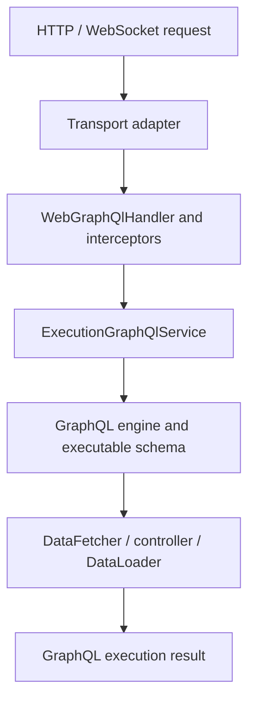
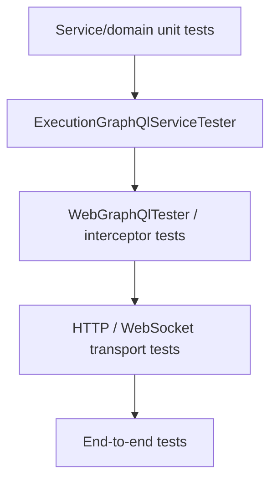

# ExecutionGraphQlServiceTester in Spring for GraphQL

When testing a GraphQL server, not every test needs to start an HTTP server or open a WebSocket connection. Many bugs live directly in the GraphQL execution layer: schema and runtime wiring, annotated controllers, argument binding, resolvers, DataLoaders, or exception handling. `ExecutionGraphQlServiceTester` lets you invoke `ExecutionGraphQlService` directly to test these parts without going through HTTP or another transport.

This tester implements the `GraphQlTester` API, so writing operations and asserting results is the same as with other GraphQL testers: build a document, attach variables, execute, then read fields or inspect errors. The key point to remember is that it tests the execution layer. If your goal is to verify HTTP headers, status codes, content negotiation, security filter chains, or the WebSocket protocol, you need an appropriate transport-layer tester.

After this lesson, you will be able to:

- Understand the place of `ExecutionGraphQlServiceTester` among GraphQL testing layers.
- Create a tester from `ExecutionGraphQlService`.
- Execute queries and mutations using GraphQL documents.
- Pass variables and use named documents.
- Verify scalars, objects, lists, nested fields, and aliases.
- Verify GraphQL errors, paths, and partial data.
- Test argument binding, validation, and resolver behavior.
- Choose appropriately between the execution tester and HTTP/WebSocket testers.

## 1. Which Layer Does ExecutionGraphQlServiceTester Test?

A GraphQL request in a Spring application typically passes through multiple layers:



`ExecutionGraphQlServiceTester` starts at `ExecutionGraphQlService`. It calls the GraphQL execution layer directly, so tests can verify that operations are validated, resolvers are invoked, data is mapped, and errors are produced as expected.

It does not send HTTP requests through a server connector and does not test steps that happen before the execution service, such as:

- Whether the `/graphql` HTTP route is registered properly.
- Whether request `Content-Type` and response `Accept` are negotiated properly.
- Whether HTTP status codes and response headers are accurate.
- Whether CORS, HTTP authentication filters, or WebSocket handshakes work.
- Whether proxies, TLS, network timeouts, or transport disconnects are handled properly.

Therefore, it is a great choice for tests focused on GraphQL execution. It does not replace integration tests over HTTP or WebSocket when transport contracts need to be verified.

## 2. GraphQlTester as the Common Testing API

Spring for GraphQL provides `GraphQlTester` as a unified testing API. Different implementations change how operations are sent, while most document building and assertions stay the same.

| Tester | Integration Point | Best Target |
| --- | --- | --- |
| `ExecutionGraphQlServiceTester` | `ExecutionGraphQlService` | Testing GraphQL execution directly |
| `WebGraphQlTester` | `WebGraphQlHandler` | Testing the WebGraphQL handler and interceptors at the web abstraction layer |
| `HttpGraphQlTester` | HTTP endpoint | Testing real HTTP or test HTTP client requests/responses |
| `WebSocketGraphQlTester` | WebSocket GraphQL transport | Testing subscriptions and protocol over WebSocket |
| `RSocketGraphQlTester` | RSocket transport | Testing applications using RSocket |

`ExecutionGraphQlServiceTester` fits well when you want fast, direct resolver tests without creating a server socket. If a test needs to verify interceptors at `WebGraphQlHandler`, choose `WebGraphQlTester`. If you need to inspect HTTP status/headers or transport configuration, use `HttpGraphQlTester`.

## 3. Adding Testing Dependencies

In a Maven project, add the Spring for GraphQL test module with test scope:

```xml
<dependency>
    <groupId>org.springframework.graphql</groupId>
    <artifactId>spring-graphql-test</artifactId>
    <scope>test</scope>
</dependency>
```

With Gradle:

```groovy
testImplementation("org.springframework.graphql:spring-graphql-test")
```

If the project uses Spring Boot dependency management, let the BOM manage versions compatible with your Spring for GraphQL version. Do not manually add a version different from the runtime dependency, as that can cause API or dependency graph mismatches.

The examples below assume `spring-graphql-test` is on the test classpath and the application has configured `ExecutionGraphQlService` from the schema and runtime wiring.

## 4. Creating ExecutionGraphQlServiceTester

The tester is created from the `ExecutionGraphQlService` bean:

```java
import org.springframework.beans.factory.annotation.Autowired;
import org.springframework.graphql.ExecutionGraphQlService;
import org.springframework.graphql.test.tester.ExecutionGraphQlServiceTester;
import org.junit.jupiter.api.BeforeEach;

class BookGraphQlExecutionTests {

    @Autowired
    ExecutionGraphQlService graphQlService;

    ExecutionGraphQlServiceTester graphQlTester;

    @BeforeEach
    void setUp() {
        graphQlTester = ExecutionGraphQlServiceTester
                .create(graphQlService)
                .build();
    }
}
```

`ExecutionGraphQlServiceTester.create(graphQlService)` accepts the execution service configured by Spring. Call `build()` to create a tester reusable across the test class.

In integration tests, Spring can inject the service from the application context. If you want to test a smaller configuration, you can create an `ExecutionGraphQlService` from a `GraphQlSource` built for the test. Either way, the tested schema and runtime wiring must match the configuration the test intends to verify.

## 5. Starting the Spring Application Context

A straightforward approach is using `@SpringBootTest` to obtain the execution service from the application:

```java
@SpringBootTest
class BookGraphQlExecutionTests {

    @Autowired
    ExecutionGraphQlService graphQlService;

    private ExecutionGraphQlServiceTester graphQlTester;

    @BeforeEach
    void setUp() {
        this.graphQlTester = ExecutionGraphQlServiceTester
                .create(graphQlService)
                .build();
    }
}
```

This test initializes the full Spring context. If SDL is invalid, runtime wiring cannot be built, or controller dependencies fail to initialize, the test fails during startup before executing any operation.

`@SpringBootTest` can be slower than a test slice, but it is appropriate when you want to verify schema resources, controller beans, services, repositories, and real configuration together. If only part of the configuration is needed, you can use a dedicated test configuration to assemble only the relevant components.

## 6. Executing a Query

`ExecutionGraphQlServiceTester`'s API uses the same request builder style as `GraphQlTester`:

```java
@Test
void retrievesBookTitle() {
    graphQlTester.document("""
            query {
                book(id: "book-42") {
                    title
                }
            }
            """)
        .execute()
        .path("book.title")
        .entity(String.class)
        .isEqualTo("Spring GraphQL in Practice");
}
```

Steps:

1. `document(...)` provides the GraphQL operation.
2. `execute()` runs the operation through the execution service.
3. `path("book.title")` selects the field in the response data.
4. `entity(String.class)` converts the field to a Java type.
5. `isEqualTo(...)` verifies the expected value.

Paths are response paths, so if a query uses an alias, assertions must use the alias. For example, for `featured: book { title }`, the path is `featured.title`.

## 7. Passing Variables to an Operation

You do not need to concatenate test values directly into the query. Using variables keeps operations close to how real clients send requests:

```java
@Test
void retrievesBookById() {
    graphQlTester.document("""
            query BookById($id: ID!) {
                book(id: $id) {
                    id
                    title
                }
            }
            """)
        .variable("id", "book-42")
        .execute()
        .path("book.id")
        .entity(String.class)
        .isEqualTo("book-42");
}
```

`variable("id", "book-42")` binds the value to `$id` declared in the document. The value type must be compatible with the GraphQL `ID!` type.

You can pass input objects or lists as variables using a Java `Map`, record/DTO, or collection compatible with JSON/GraphQL input mapping. Keep variable names and input structures consistent with the schema.

## 8. Testing Nested Objects and Lists

You can read a deeply nested field inside an object:

```java
graphQlTester.document("""
        query {
            book(id: "book-42") {
                author {
                    name
                }
            }
        }
        """)
    .execute()
    .path("book.author.name")
    .entity(String.class)
    .isEqualTo("Nguyen An");
```

For lists, use an index in the path:

```java
graphQlTester.document("""
        query {
            books {
                id
                title
            }
        }
        """)
    .execute()
    .path("books[0].title")
    .entity(String.class)
    .isEqualTo("Spring GraphQL in Practice");
```

You can verify the entire list:

```java
graphQlTester.document("""
        query {
            books {
                id
            }
        }
        """)
    .execute()
    .path("books[*].id")
    .entityList(String.class)
    .contains("book-42", "book-43");
```

When testing lists, use fixtures with multiple elements and also verify ordering if ordering is part of the API contract. Do not just check that the list has at least one element if business rules require deterministic sorting.

## 9. Testing Mutations

The execution tester can also test mutations. Example schema:

```graphql
input CreateBookInput {
    title: String!
}

type Mutation {
    createBook(input: CreateBookInput!): Book!
}
```

Test passing an input object:

```java
@Test
void createsBook() {
    graphQlTester.document("""
            mutation CreateBook($input: CreateBookInput!) {
                createBook(input: $input) {
                    id
                    title
                }
            }
            """)
        .variable("input", Map.of("title", "GraphQL Testing"))
        .execute()
        .path("createBook.title")
        .entity(String.class)
        .isEqualTo("GraphQL Testing");
}
```

This test verifies argument binding and mutation execution. Because mutations have side effects, database fixtures or external dependencies must be prepared and cleaned up explicitly. If tests run inside a transaction, check the service's actual transaction boundaries and how the test context rolls back; do not assume all async work participates in the test thread's transaction.

## 10. Using documentName for Reusable Operations

When queries are stored in resources, you can test by document name:

```java
graphQlTester.documentName("book-by-id")
        .variable("id", "book-42")
        .execute()
        .path("book.title")
        .entity(String.class)
        .isEqualTo("Spring GraphQL in Practice");
```

The document name must match an operation resource discovered by the GraphQL test configuration. This is useful when an application manages GraphQL documents separately from Java source code or shares the same operations across multiple clients.

If a test cannot find the document, check the resource path and document naming conventions in the configuration. Do not work around it by copying the query into the test if the goal is to verify the actual document resource used by the application.

## 11. Verifying GraphQL Errors

When a resolver throws an exception or an operation is invalid, the response may contain GraphQL errors. Use `errors()` to inspect them:

```java
@Test
void reportsUnknownBook() {
    graphQlTester.document("""
            query {
                book(id: "missing") {
                    title
                }
            }
            """)
        .execute()
        .errors()
        .satisfy(errors -> {
            assertThat(errors).isNotEmpty();
            assertThat(errors.get(0).getMessage())
                    .contains("Book not found");
        });
}
```

`errors().satisfy(...)` lets you use an assertion library like AssertJ to inspect the error list. You can check error classification, `extensions`, and paths if those are part of the API contract.

Example checking the path:

```java
graphQlTester.document("""
        query {
            book(id: "book-42") {
                author {
                    name
                }
            }
        }
        """)
    .execute()
    .errors()
    .satisfy(errors -> {
        assertThat(errors).anySatisfy(error ->
                assertThat(error.getPath())
                        .containsExactly("book", "author", "name"));
    });
```

Do not assert only the message if clients rely on `extensions.code`. Messages may change by language or phrasing; error codes and paths are usually more suitable as a machine-readable contract.

## 12. Verifying Partial Data

GraphQL execution can return partial data when one field fails while other fields succeed. Save the response to inspect both errors and data:

```java
@Test
void keepsBookTitleWhenAuthorFieldFails() {
    GraphQlTester.Response response = graphQlTester.document("""
            query {
                book(id: "book-42") {
                    title
                    author {
                        name
                    }
                }
            }
            """)
        .execute();

    response.errors().satisfy(errors ->
            assertThat(errors).isNotEmpty());

    response.path("book.title")
            .entity(String.class)
            .isEqualTo("Spring GraphQL in Practice");

    response.path("book.author")
            .valueIsNull();
}
```

This test assumes `Book.author` is nullable in SDL and the fixture causes the `author` resolver to error. If the field or its parent is declared non-null, null propagation can turn an ancestor into null; assertions must match the schema's actual nullability.

Partial data is a core GraphQL behavior. Do not write tests that only verify errors are present while ignoring other fields that can still be returned successfully.

## 13. Testing Operation Validation and Variable Coercion

The execution tester can verify that the GraphQL engine rejects documents that do not match the schema:

```java
@Test
void rejectsUnknownField() {
    graphQlTester.document("""
            query {
                book(id: "book-42") {
                    titel
                }
            }
            """)
        .execute()
        .errors()
        .satisfy(errors -> {
            assertThat(errors).anySatisfy(error ->
                    assertThat(error.getMessage())
                            .contains("Cannot query field"));
        });
}
```

You can also test variables with wrong types or missing non-null variables. These errors occur before resolvers execute, so you should verify that the service is not called when that is an important requirement of the test.

To verify accurately that the resolver did not run, use a mock/spy service and assert zero invocations. A correct error response alone does not automatically prove that dependencies were never invoked.

## 14. Testing Argument Binding

Spring for GraphQL maps GraphQL arguments to controller parameters. The execution tester can verify argument binding:

```java
@QueryMapping
BookView book(@Argument("id") String bookId) {
    return bookService.findById(bookId);
}
```

Test operation:

```java
graphQlTester.document("""
        query Book($id: ID!) {
            book(id: $id) {
                id
            }
        }
        """)
    .variable("id", "book-42")
    .execute()
    .path("book.id")
    .entity(String.class)
    .isEqualTo("book-42");
```

For input objects, tests should cover missing required fields, omitted nullable fields, explicit nulls, and default values. These cases can have different semantics when Spring binds inputs to a Java object or record.

## 15. Testing Resolvers, DataLoaders, and Batch Mapping

Because the tester executes the GraphQL engine with its runtime wiring, you can use it to test nested resolvers and DataLoaders through a realistic operation:

```java
graphQlTester.document("""
        query {
            books {
                id
                author {
                    id
                    name
                }
            }
        }
        """)
    .execute()
    .path("books[0].author.name")
    .entity(String.class)
    .isEqualTo("Nguyen An");
```

To verify that batching truly reduces backend calls, use a spy/mock repository or appropriate instrumentation/metrics and assert the invocation count. Merely checking that the response is right does not prove DataLoader batched keys together; a resolver could still call the repository once per parent and produce the same response.

For `@BatchMapping`, verify:

- Multiple source objects are processed in the same batch invocation.
- Each source receives the correct target.
- Result ordering is preserved if the loader returns a positional list.
- Sources without a target are handled according to schema nullability.
- Authorization/tenant filtering applies to every resource in the batch.

## 16. Testing GraphQL Context at the Execution Layer

Some resolvers read data from `GraphQLContext`, such as an actor snapshot, tenant ID, or correlation ID. Because `ExecutionGraphQlServiceTester` calls the execution service directly, it is suitable for verifying that resolvers use the context properly once the context has been supplied on execution input.

However, this tester does not test whether a `WebGraphQlInterceptor` extracts an HTTP principal and copies data into the context, since that step belongs to the web handler/transport layer. If the goal is to verify the entire path from HTTP authentication to GraphQL context, test through `WebGraphQlTester` or `HttpGraphQlTester` with the real interceptor and security configuration.

Separating the two goals keeps tests clear:

- Execution test: the resolver reads actor/tenant properly once context has a value.
- Web/HTTP integration test: the interceptor receives the request context and populates data into GraphQL execution.

Do not mock the context in an execution test and then conclude that HTTP security integration works as well.

## 17. Testing Method Security

If a controller/service uses `@PreAuthorize`, the test needs Spring Security method security configuration and an appropriate authentication. You can use `@WithMockUser` to create a test principal:

```java
@Test
@WithMockUser(authorities = "BOOK_READ")
void allowsBookReadAuthority() {
    graphQlTester.document("""
            query {
                books {
                    id
                }
            }
            """)
        .execute()
        .path("books")
        .entityList(BookView.class);
}
```

And a test lacking the authority:

```java
@Test
@WithMockUser(authorities = "PROFILE_READ")
void deniesCallerWithoutBookReadAuthority() {
    graphQlTester.document("""
            query {
                books {
                    id
                }
            }
            """)
        .execute()
        .errors()
        .satisfy(errors -> assertThat(errors).isNotEmpty());
}
```

This test verifies method security on the execution path when test authentication is set up on the right thread. For reactive method security, async execution, or HTTP security filter chains, test using the corresponding stack and verify context propagation. `@WithMockUser` does not replace testing JWT converters, bearer tokens, or CORS.

## 18. What ExecutionGraphQlServiceTester Does Not Test

Because the tester calls the execution service directly, additional tests are needed for components outside this layer:

| Component | Better-Suited Tester |
| --- | --- |
| HTTP path, method, headers, status | `HttpGraphQlTester` |
| Request/response content negotiation | `HttpGraphQlTester` |
| JSON codecs and request body parsing | `HttpGraphQlTester` |
| CORS and security filter chain | HTTP integration test |
| `WebGraphQlInterceptor` | `WebGraphQlTester` or HTTP integration test |
| WebSocket handshake/protocol/subscription lifecycle | `WebSocketGraphQlTester` |
| RSocket routing and metadata | `RSocketGraphQlTester` |
| TLS, proxy, timeouts, and network disconnects | Appropriate transport/integration test |

For example, if you need to verify that a response has `Content-Type: application/graphql-response+json`, the execution tester is not enough because it does not produce an HTTP response. If you need to verify that `@SubscriptionMapping` emits events over WebSocket and stops when the client cancels the operation, test over WebSocket transport.

## 19. Organizing Test Fixtures and Data

Execution tests still invoke real controllers, services, and repositories if the application context uses real beans. Choose fixtures suited to your goal:

- Mock services to focus on controller argument binding and mapping.
- Use repository/database tests to verify queries and persistence mapping.
- Use stable fixture data to test resolvers and DataLoaders.
- Clean up data created by mutations so tests can run independently and repeatably.
- Avoid depending on test order or database state left behind by previous tests.

If mocking a service, also verify the arguments the resolver passes to the service. If using the real service, tests cover more logic but can be slower and require managing database/external dependencies.

Do not mock `ExecutionGraphQlService` when the goal is to test GraphQL execution. The tester needs to call the real implementation configured with the schema and runtime wiring.

## 20. Layered Testing Strategy

An effective GraphQL test suite typically combines multiple layers:



- Service unit tests verify business rules without GraphQL.
- `ExecutionGraphQlServiceTester` verifies schema execution, resolvers, binding, and GraphQL errors.
- `WebGraphQlTester` verifies the web handler and interceptors.
- HTTP/WebSocket testers verify transport, headers, status codes, connections, and protocols.
- End-to-end tests verify critical flows across production-like components.

You do not need to turn every resolver test into an end-to-end test. Choose the lowest layer that can verify the required behavior, then supplement it with a few higher-layer integration tests at risky boundaries.

## 21. Common Errors

- **Using the execution tester to check HTTP headers:** the tester does not produce an HTTP response.
- **Confusing the tester with GraphQlTester:** `GraphQlTester` is the common API; `ExecutionGraphQlServiceTester` is one implementation.
- **Mocking ExecutionGraphQlService itself:** the test no longer verifies real GraphQL execution.
- **Forgetting `spring-graphql-test`:** tester classes are missing from the test classpath.
- **Using inline queries when intending to test resource documents:** the test no longer verifies that operation resources are loaded properly.
- **Checking only data and ignoring errors:** partial execution failures can go unnoticed.
- **Checking only the response to conclude DataLoader batching works:** you must check backend call counts or batch invocations.
- **Assuming HTTP interceptor context ran:** the execution tester does not pass through the web interceptor chain.
- **Assuming `@WithMockUser` verifies the full JWT/HTTP flow:** it is only authentication test support for the test context.
- **Not cleaning up mutation data:** tests become order-dependent or pollute the database.
- **Not checking null propagation:** assertions may not match SDL when fields are non-null.
- **Using the wrong transport tester for subscriptions:** the execution tester does not verify WebSocket protocol/lifecycle.

## 22. Workflow for Using ExecutionGraphQlServiceTester

When testing a GraphQL operation at the execution layer, follow these steps:

1. Add `spring-graphql-test` to the test classpath with a compatible version.
2. Obtain the configured `ExecutionGraphQlService` from the Spring context.
3. Create the tester with `ExecutionGraphQlServiceTester.create(graphQlService).build()`.
4. Write the operation with an explicit selection set and variables if arguments exist.
5. Call `execute()` to run the operation.
6. Use `path(...).entity(...)` or `entityList(...)` to verify data.
7. Use `errors()` to verify exception mapping, error paths, and extensions.
8. Verify partial data and null propagation when fields can fail.
9. Use mocks/spies or metrics to verify batching and dependency invocation counts.
10. Add Web/HTTP/WebSocket tests if interceptors or transport must be verified.

`ExecutionGraphQlServiceTester` enables testing GraphQL execution directly through `ExecutionGraphQlService`, using the same document and assertion API of `GraphQlTester`. It is ideal for verifying that the schema loads, resolvers run properly, arguments bind, DataLoaders work, and GraphQL errors are produced according to contract. Because this tester bypasses HTTP and transport, combine it with web- or transport-layer tests when verifying headers, status codes, security filters, interceptors, or subscription protocols.

## References

- [Spring for GraphQL — Testing](https://docs.spring.io/spring-graphql/reference/testing.html)
- [Spring for GraphQL — ExecutionGraphQlServiceTester API](https://docs.spring.io/spring-graphql/docs/current/api/org/springframework/graphql/test/tester/ExecutionGraphQlServiceTester.html)
- [Spring for GraphQL — GraphQlTester API](https://docs.spring.io/spring-graphql/docs/current/api/org/springframework/graphql/test/tester/GraphQlTester.html)
- [Spring for GraphQL — GraphQL Execution](https://docs.spring.io/spring-graphql/reference/request-execution.html)
- [Spring Boot — Testing](https://docs.spring.io/spring-boot/reference/testing/index.html)
