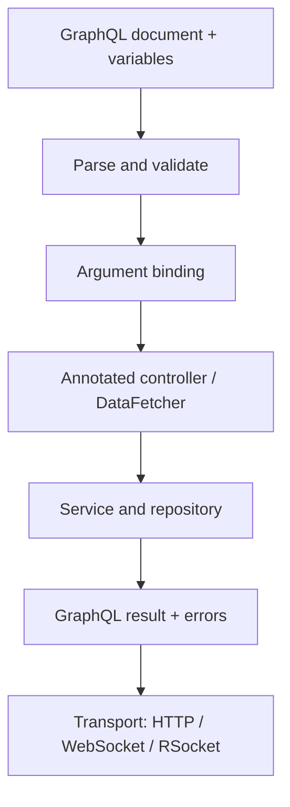

# Testing without a live server

Testing GraphQL does not always require starting an HTTP server or opening a network port. Many critical bugs live in the schema, argument binding, controller mappings, runtime wiring, DataFetchers, error resolvers, and how the GraphQL engine shapes responses. All of those components can be tested directly inside a Spring test context.

Spring for GraphQL provides `GraphQlTester` with a single testing workflow across multiple connection modes. When you do not need to test the actual HTTP protocol, you can use `ExecutionGraphQlServiceTester` to invoke the GraphQL execution service directly. When you need to verify the interceptor chain and web request metadata, use `WebGraphQlTester`. If you want to test both the HTTP handler and routing without opening a socket, use `WebTestClient` bound to the application context.

Spring Boot adds `@GraphQlTest` to create a focused test slice for GraphQL request execution without loading the full application or starting a web server. This lesson helps you choose the right test scope, write GraphQL assertions, verify errors, test context, mutations, subscriptions, and handle the boundaries of non-live-server testing.

## 1. Why test without a live server?

A GraphQL request passes through several layers:



Not every test needs to traverse the entire path:

- When checking schema, resolver mappings, and GraphQL responses, testing the execution service directly is enough.
- When checking `WebGraphQlInterceptor`, request headers, and `GraphQLContext`, execution must go through `WebGraphQlHandler`.
- When checking URLs, HTTP methods, content types, JSON codecs, and security web filters, you need to test the web layer; a mock/in-process web client works without a live server.
- Only when checking sockets, TLS, reverse proxies, load balancers, or live-port server behavior do you need a live server.

Tests without a live server are typically fast, deterministic, and less environment-dependent. They are ideal for frequent runs during unit testing and CI.

## 2. Levels of testing without a live server

Spring for GraphQL offers two server-side testers and an option for testing HTTP in a mock environment:

| Test approach | Request path | Components verified |
| --- | --- | --- |
| `ExecutionGraphQlServiceTester` | Directly into `ExecutionGraphQlService` | GraphQL engine, schema, DataFetchers, controller mappings, and execution errors |
| `WebGraphQlTester` | Through `WebGraphQlHandler` and interceptor chain | Execution service, `WebGraphQlInterceptor`, request headers, and `GraphQLContext` |
| `HttpGraphQlTester` + mock `WebTestClient` | Through HTTP handler/route in the application context | HTTP mapping, request/response codecs, and web filters in a mock environment |
| `@GraphQlTest` | GraphQL test slice, without the web layer | Controllers, schema, runtime wiring, and GraphQL execution with mocked collaborators |

The first three options do not require an embedded server listening on a port. However, their scopes differ. `ExecutionGraphQlServiceTester` bypasses the web layer; `WebGraphQlTester` includes web GraphQL interceptors but does not run HTTP codecs/routes; mock `HttpGraphQlTester` additionally exercises HTTP integration.

### When to choose each option?

- Choose `@GraphQlTest` for everyday controller slice tests.
- Choose `ExecutionGraphQlServiceTester` when you already have an `ExecutionGraphQlService` and want to test execution directly.
- Choose `WebGraphQlTester` when logic lives in an interceptor or depends on HTTP headers transferred into `GraphQLContext`.
- Choose `HttpGraphQlTester` when you need to verify the GraphQL HTTP endpoint in a mock web environment.
- Choose `@SpringBootTest(webEnvironment = MOCK)` when you need broad application configuration without starting a live server.

Do not use non-live-server tests to draw conclusions about TLS, TCP connections, proxy timeouts, or WebSocket handshakes in real environments.

## 3. Adding test dependencies

Spring for GraphQL provides a dedicated test module:

```kotlin
dependencies {
    testImplementation("org.springframework.graphql:spring-graphql-test")
    testImplementation("org.springframework.boot:spring-boot-starter-test")
}
```

Or Maven:

```xml
<dependency>
    <groupId>org.springframework.graphql</groupId>
    <artifactId>spring-graphql-test</artifactId>
    <scope>test</scope>
</dependency>

<dependency>
    <groupId>org.springframework.boot</groupId>
    <artifactId>spring-boot-starter-test</artifactId>
    <scope>test</scope>
</dependency>
```

To test WebFlux mock HTTP, add `spring-boot-starter-webflux` or Spring WebFlux test dependencies if the application does not already have them. For Spring MVC, use the corresponding MockMvc integration.

To avoid version mismatches, let Spring Boot dependency management or your version catalog manage the Spring for GraphQL version. Do not arbitrarily mix a `spring-graphql-test` version that differs from `spring-graphql`.

`spring-graphql-test` provides `GraphQlTester` and the server-side testers. In Spring Boot 3, `@GraphQlTest` usually comes from test auto-configuration brought in by Boot test dependencies. In Spring Boot 4, the annotation is separated into the `spring-boot-graphql-test` module; add that module if using the test slice. Check the dependency tree for your major version to see which module supplies the annotation.

With Spring Boot 4, the test slice dependency can be declared separately:

```kotlin
dependencies {
    testImplementation("org.springframework.boot:spring-boot-graphql-test")
}
```

The artifact above provides Boot's test annotation/auto-configuration; `spring-graphql-test` remains the module supplying Spring for GraphQL's `GraphQlTester`.

## 4. Using ExecutionGraphQlServiceTester

`ExecutionGraphQlServiceTester` executes GraphQL requests directly against `ExecutionGraphQlService`. It requires no HTTP client, WebSocket client, or transport server.

When a Spring context already supplies the execution service, you can create the tester as follows:

```java
@SpringBootTest(webEnvironment = SpringBootTest.WebEnvironment.NONE)
class BookExecutionTests {

    @Autowired
    ExecutionGraphQlService graphQlService;

    GraphQlTester graphQlTester;

    @BeforeEach
    void setUp() {
        graphQlTester = ExecutionGraphQlServiceTester.create(graphQlService);
    }
}
```

`WebEnvironment.NONE` creates an application context without a web environment. If a test needs Boot's web-related GraphQL handlers, use one of the mock web environment options covered later.

You can instantiate the tester once if the test class does not alter execution configuration:

```java
ExecutionGraphQlServiceTester tester =
        ExecutionGraphQlServiceTester.create(graphQlService);
```

The builder lets you customize `ExecutionInput` before the GraphQL engine executes:

```java
ExecutionGraphQlServiceTester tester =
        ExecutionGraphQlServiceTester.builder(graphQlService)
                .configureExecutionInput((input, builder) ->
                        builder.graphQLContext(context ->
                                context.put("tenantId", "tenant-42"))
                                .build())
                .build();
```

This is useful when resolvers read a tenant, principal, locale, or metadata from `GraphQLContext`. Each tester can use dedicated configuration per test case without sending HTTP headers.

## 5. Writing assertions with GraphQlTester

All testers share the `GraphQlTester` API. A test can send a document inline:

```java
graphQlTester.document("""
        query BookById($id: ID!) {
            bookById(id: $id) {
                id
                title
            }
        }
        """)
        .variable("id", "book-1")
        .execute()
        .path("bookById.id")
        .entity(String.class)
        .isEqualTo("book-1");
```

`path(...)` uses JsonPath relative to the `data` section of the GraphQL response, so you do not need to write `data.bookById.id`. After selecting a path:

- `entity(Class<T>)` decodes a single value into a Java type.
- `entityList(Class<T>)` decodes a list.
- `path(...)` can be chained further to inspect nested fields.
- Entity or list assertions can verify response structure as needed.

Example checking multiple fields on the same object:

```java
graphQlTester.document("""
        query {
            bookById(id: "book-1") {
                id
                title
                status
            }
        }
        """)
        .execute()
        .path("bookById", book -> book
                .path("id").entity(String.class).isEqualTo("book-1")
                .path("title").entity(String.class).isEqualTo("Spring GraphQL")
                .path("status").entity(String.class).isEqualTo("AVAILABLE"));
```

For Mutations where you only need to confirm there are no GraphQL errors, use `executeAndVerify()`:

```java
graphQlTester.document("""
        mutation {
            deleteBook(id: "book-1")
        }
        """)
        .executeAndVerify();
```

`executeAndVerify()` is convenient when you do not need to read response data. If you need to assert values returned by the mutation, use `execute()` and check paths just like a Query.

## 6. Checking GraphQL errors

GraphQL can return partial data alongside errors. Tests should verify expected errors instead of relying only on HTTP status codes.

Checking a specific error:

```java
graphQlTester.document("""
        query {
            bookById(id: "missing") {
                id
            }
        }
        """)
        .execute()
        .errors()
        .expect(error -> error.getMessage().contains("Book not found"))
        .verify();
```

`expect(...)` fails if no matching error is found. You can assert multiple properties such as message, path, or extensions:

```java
graphQlTester.document(document)
        .execute()
        .errors()
        .expect(error -> error.getPath().equals(List.of("bookById")))
        .expect(error -> "NOT_FOUND".equals(
                error.getExtensions().get("code")))
        .verify();
```

If a test intentionally asserts an error while still reading partial data, `satisfy(...)` receives the full error list and marks them as handled:

```java
graphQlTester.document(document)
        .execute()
        .errors()
        .satisfy(errors -> assertThat(errors)
                .anyMatch(error -> error.getMessage().contains("Book not found")));
```

Filter only known and expected errors. Do not set an overly broad error filter that ignores every error; that can cause tests to pass even when resolvers or schemas are broken.

The builder also supports a shared `errorFilter` across tests:

```java
GraphQlTester tester = ExecutionGraphQlServiceTester.builder(graphQlService)
        .errorFilter(error -> error.getMessage().contains("expected warning"))
        .build();
```

When a test needs to confirm there are no errors, call `verify()` or `executeAndVerify()` rather than only reading a data path. A test that asserts data alone can overlook errors in the response.

## 7. Creating a GraphQL slice test with @GraphQlTest

With Spring Boot, `@GraphQlTest` creates an application context scoped to GraphQL request execution:

```java
import static org.mockito.BDDMockito.given;
import static org.mockito.BDDMockito.then;

@GraphQlTest(BookController.class)
class BookControllerGraphQlTests {

    @Autowired
    GraphQlTester graphQlTester;

    @MockitoBean
    BookService bookService;

    @Test
    void returnsBookById() {
        given(bookService.findById("book-1"))
                .willReturn(new Book("book-1", "Spring GraphQL"));

        graphQlTester.document("""
                query {
                    bookById(id: "book-1") {
                        id
                        title
                    }
                }
                """)
                .execute()
                .path("bookById.id")
                .entity(String.class)
                .isEqualTo("book-1");

        then(bookService).should().findById("book-1");
    }
}
```

`@GraphQlTest(BookController.class)` loads the GraphQL infrastructure and the specified controller, without starting a web server or setting up HTTP transport. Spring Boot auto-configures `GraphQlTester` so tests send operations directly into GraphQL execution.

### Beans scanned in the test slice

`@GraphQlTest` focuses on GraphQL-related components, typically including:

- `@Controller` and `@ControllerAdvice`.
- `RuntimeWiringConfigurer`.
- `Converter` and `GenericConverter`.
- `DataFetcherExceptionResolver`.
- `Instrumentation`.
- `GraphQlSourceBuilderCustomizer`.
- Jackson components supported by Spring Boot.

Regular `@Service` and `@Repository` beans are not automatically scanned. Mock collaborators with `@MockitoBean` or import the necessary configuration. If tests rely on custom scalars, exception resolvers, or DataFetcher configs, verify those beans are present in the test context.

With older Spring Boot versions before `@MockitoBean`, you can use `@MockBean` as appropriate for that version. The `@GraphQlTest` package name and test module can also change between Boot major versions; use imports managed by your active dependencies.

Common package examples:

- Spring Boot 3.x: `org.springframework.boot.test.autoconfigure.graphql.GraphQlTest`.
- Spring Boot 4.x: `org.springframework.boot.graphql.test.autoconfigure.GraphQlTest`.

The list of scanned components also varies by version. For instance, Boot 4 documentation lists `@ControllerAdvice` and `@JacksonComponent`, whereas older Boot 3 releases had a shorter list. When a test cannot find a bean, check the Javadoc for your exact version rather than assuming every Boot release shares identical slice filters.

### Testing @BatchMapping and DataLoader

Tests without a live server can still verify that nested fields are batched:

1. Send a query fetching multiple parent objects along with child fields, such as a list of books and each book's author.
2. Have the batch loader return data for all parent keys in a single execution.
3. Assert that the response preserves the right mapping between each book and its author.
4. Verify that the batch loader receives the expected set of keys in a single dispatch, rather than calling the service individually per parent.

The `DataLoaderRegistry` is created per GraphQL execution, so `ExecutionGraphQlServiceTester` and `@GraphQlTest` can verify batch mappings alongside the request lifecycle without HTTP transport. Simply import the `RuntimeWiringConfigurer` or corresponding loader configuration into the test context.

### Importing additional configuration

If you need a converter, runtime wiring config, or exception resolver:

```java
@GraphQlTest(BookController.class)
@Import(BookGraphQlTestConfiguration.class)
class BookControllerGraphQlTests {
    // ...
}
```

You can use a nested `@TestConfiguration` to declare test-only beans. Avoid importing the full application configuration when your goal is to keep the test slice small and easy to understand.

## 8. Testing documents from files and fragments

Long documents should be stored in separate files on the classpath:

```text
src/test/resources/graphql-test/bookById.graphql
```

Contents:

```graphql
query BookById($id: ID!) {
  bookById(id: $id) {
    id
    title
  }
}
```

Invoke the document by filename without the extension:

```java
graphQlTester.documentName("bookById")
        .variable("id", "book-1")
        .execute()
        .path("bookById.title")
        .entity(String.class)
        .isEqualTo("Spring GraphQL");
```

You can store fragments separately and add them to operations using `fragmentName(...)`. This promotes selection set reuse and keeps test documents close to the queries real clients send.

When documents change, tests continue exercising the same GraphQL files. IDEs with a GraphQL plugin can provide syntax highlighting, validation, and autocomplete for these files.

## 9. Using WebGraphQlTester to test interceptors

`ExecutionGraphQlServiceTester` calls the execution service directly, so it does not run `WebGraphQlInterceptor`. If a resolver depends on headers or metadata injected into `GraphQLContext` by an interceptor, use `WebGraphQlTester`.

Create the handler with the execution service and interceptor:

```java
WebGraphQlHandler handler = WebGraphQlHandler.builder(graphQlService)
        .interceptor(tenantHeaderInterceptor)
        .build();

WebGraphQlTester tester = WebGraphQlTester.builder(handler)
        .headers(headers -> headers.set("X-Tenant-Id", "tenant-42"))
        .build();
```

Example interceptor:

```java
public class TenantHeaderInterceptor implements WebGraphQlInterceptor {

    @Override
    public Mono<WebGraphQlResponse> intercept(
            WebGraphQlRequest request,
            Chain chain) {

        String tenantId = request.getHeaders().getFirst("X-Tenant-Id");
        request.configureExecutionInput((input, builder) ->
                builder.graphQLContext(context ->
                        context.put("tenantId", tenantId)).build());
        return chain.next(request);
    }
}
```

The controller can read the value placed into the context:

```java
@QueryMapping
public List<Book> books(@ContextValue("tenantId") String tenantId) {
    return bookService.findVisibleBooks(tenantId);
}
```

Test:

```java
tester.document("{ books { id } }")
        .execute()
        .path("books[*].id")
        .entityList(String.class)
        .hasSize(1);
```

This verifies all three parts: the header is present on the simulated request, the interceptor reads the header and stores the tenant in `GraphQLContext`, and the resolver receives the expected context value.

`WebGraphQlTester` tests web GraphQL handling, not HTTP routes or JSON codecs. If you need to verify `POST /graphql`, content types, route mappings, or web filters, use the mock HTTP tester covered next.

## 10. Testing the HTTP handler without opening a port

You can test the GraphQL HTTP endpoint inside the application context using `WebTestClient.bindToApplicationContext(...)`. This is a mock/in-process web client that opens no sockets and needs no embedded server.

Example with WebFlux:

```java
@SpringBootTest(webEnvironment = SpringBootTest.WebEnvironment.MOCK)
class GraphQlHttpMockTests {

    @Autowired
    ApplicationContext applicationContext;

    HttpGraphQlTester graphQlTester;

    @BeforeEach
    void setUp() {
        WebTestClient webTestClient =
                WebTestClient.bindToApplicationContext(applicationContext)
                        .configureClient()
                        .baseUrl("/graphql")
                        .build();

        graphQlTester = HttpGraphQlTester.create(webTestClient);
    }

    @Test
    void handlesHttpGraphQlRequest() {
        graphQlTester.document("{ greeting }")
                .execute()
                .path("greeting")
                .entity(String.class)
                .isEqualTo("Hello");
    }
}
```

This example assumes the application exposes a GraphQL HTTP endpoint at `/graphql` and the `Query.greeting` field returns `Hello`. `WebEnvironment.MOCK` does not start an embedded server. `WebTestClient.bindToApplicationContext` attaches the client to the web infrastructure inside the context.

With Spring MVC, you can use `MockMvcWebTestClient.bindToApplicationContext(applicationContext)` to build a `WebTestClient` backed by MockMvc. You then still use `HttpGraphQlTester.create(webTestClient)` and the same `GraphQlTester` DSL.

### Scope of mock HTTP tests

Mock HTTP tests can verify:

- The GraphQL endpoint route and URL.
- HTTP method, headers, and content type.
- Request/response JSON mapping.
- Web filters or security configuration attached to the mock web context.
- Integration between the HTTP handler, `WebGraphQlHandler`, and GraphQL execution.

They do not test real sockets, TLS handshakes, network latency, proxy buffering, or load balancer behavior. If you need those guarantees, write tests against a live server.

## 11. Testing Subscriptions without a WebSocket server

Subscriptions can be tested directly on the server side with `ExecutionGraphQlServiceTester` or `WebGraphQlTester`. No WebSocket client or open port is required.

Example:

```java
Flux<String> greetings = graphQlTester.document("""
        subscription {
            greetings
        }
        """)
        .executeSubscription()
        .toFlux("greetings", String.class);

StepVerifier.create(greetings)
        .expectNext("Hi")
        .expectNext("Bonjour")
        .expectNext("Hola")
        .verifyComplete();
```

`executeSubscription()` starts a workflow for stream responses. `toFlux(path, type)` decodes the field from each response event. `StepVerifier` verifies event ordering and completion signals.

You can also test cancellation:

```java
StepVerifier.create(graphQlTester.document("subscription { greetings }")
                .executeSubscription()
                .toFlux("greetings", String.class))
        .expectNext("Hi")
        .thenCancel()
        .verify(Duration.ofSeconds(5));
```

Notes:

- `ExecutionGraphQlServiceTester` tests Subscription execution without passing through web interceptors.
- `WebGraphQlTester` tests Subscription execution after the web interceptor chain.
- `WebSocketGraphQlTester` tests GraphQL over a real WebSocket connection; it is not a server-side non-live-server option.
- `HttpGraphQlTester` over single request/response HTTP does not replace Subscription stream testing.

If the goal is to verify the GraphQL publisher and event ordering, use a server-side tester. If the goal is handshakes, WebSocket protocol, reconnects, or connection lifecycles, write dedicated transport tests.

## 12. Customizing timeouts and document sources

A GraphQL test should not wait indefinitely if a resolver hangs or a publisher never emits. `GraphQlTester.Builder` allows configuring a response timeout:

```java
ExecutionGraphQlServiceTester tester =
        ExecutionGraphQlServiceTester.builder(graphQlService)
                .responseTimeout(Duration.ofSeconds(5))
                .build();
```

To load GraphQL documents from the classpath, configure a `DocumentSource`:

```java
ResourceDocumentSource documentSource =
        new ResourceDocumentSource(
                new ClassPathResource("graphql-test/"));

ExecutionGraphQlServiceTester tester =
        ExecutionGraphQlServiceTester.builder(graphQlService)
                .documentSource(documentSource)
                .responseTimeout(Duration.ofSeconds(5))
                .build();
```

Then call `documentName("bookById")` to load `bookById.graphql`. You can store fragments separately and include them with `fragmentName("bookFields")`.

The tester timeout limits how long to wait for a response. For Subscription streams that do not complete naturally, use `StepVerifier` with an explicit timeout or cancellation so the test does not hang.

## 13. Understanding the exact scope of each tester

Each tester omits or includes certain architectural layers. Choosing the wrong test type can make a test pass even though the component you meant to verify never ran:

| Component | ExecutionGraphQlServiceTester | WebGraphQlTester | Mock HttpGraphQlTester |
| --- | --- | --- | --- |
| GraphQL parse/validation | Yes | Yes | Yes |
| Schema and runtime wiring | Yes | Yes | Yes |
| Controller/DataFetcher | Yes | Yes | Yes |
| `WebGraphQlInterceptor` | No | Yes | Yes |
| HTTP route and method | No | No | Yes |
| JSON HTTP codec | No | No | Yes |
| WebFlux/Servlet security filter | No | No | Yes, if filters are in the mock web context |
| WebSocket handshake/protocol | No | No | No |
| Subscription execution stream | Yes | Yes | Not over standard HTTP request/response |
| Network socket/TLS/proxy | No | No | No |

### Note on Spring Security

`WebGraphQlTester` invokes `WebGraphQlHandler` directly. It runs `WebGraphQlInterceptor` instances, but it does not automatically run the full Spring Security `WebFilter` chain or Servlet Filter chain. If your application obtains the principal from security filters, test the filters via mock HTTP tests or dedicated security configuration tests.

Do not confuse adding an `Authorization` header to `WebGraphQlTester` with having an authenticated token. A header is just request data; authentication only happens when Spring Security infrastructure or an application interceptor actually validates it.

## 14. Common pitfalls

| Symptom | Cause | Resolution |
| --- | --- | --- |
| Cannot inject `GraphQlTester` | Missing `spring-graphql-test` or test auto-configuration not enabled | Add the test dependency and use `@GraphQlTest` or configure a tester |
| Controller not found | Controller is outside the test slice or schema mapping is misconfigured | Specify the controller in `@GraphQlTest` and check the schema |
| Service bean missing from context | `@GraphQlTest` does not scan regular services/repositories | Use `@MockitoBean` or `@Import` |
| Custom scalar does not work | `RuntimeWiringConfigurer` or converter not loaded | Import the scalar/runtime wiring configuration |
| Interceptor does not run | Using `ExecutionGraphQlServiceTester` directly | Switch to `WebGraphQlTester` |
| HTTP route is not checked | Using `ExecutionGraphQlServiceTester` or `WebGraphQlTester` | Use `HttpGraphQlTester` with a mock `WebTestClient` |
| Security filter does not run | Tester invokes the GraphQL handler directly | Use a mock HTTP test wired with the web filter chain |
| Assertion path not found | Path is relative to root instead of `data`, or field is aliased | Inspect the response and use paths relative to `data` |
| Test still passes when errors exist | Only asserting data without verifying errors | Use `errors().expect(...).verify()` or `executeAndVerify()` |
| Expected error fails the test | Intentional error not asserted or filtered | Use `errors().expect(...)` or `satisfy(...)` |
| Subscription test hangs | Stream never completes or cancels | Use `StepVerifier` with timeout and cancellation |
| Test depends on a running port | Using `WebTestClient.bindToServer()` | Bind to the application context or mock web context |
| Test suite is slow | Using the full application context for every controller case | Use `@GraphQlTest` for slice tests and reserve full context tests for select integration cases |

## 15. Design principles for tests without a live server

- Test service/domain logic independently with plain unit tests without initializing GraphQL.
- Use `@GraphQlTest` to test annotated controllers and the GraphQL schema in a test slice.
- Use `ExecutionGraphQlServiceTester` when you need to test GraphQL execution directly.
- Use `WebGraphQlTester` when you need to test interceptors and web request metadata.
- Use `HttpGraphQlTester` with a mock `WebTestClient` when you need to test HTTP handlers/routes without opening a port.
- Use the shared `GraphQlTester` DSL to verify data, nested paths, and errors.
- Use `documentName` and fragments for long or reused operations.
- Assert both response data and errors; never ignore unexpected errors.
- Use `StepVerifier` for Subscription streams, cancellation, and completion.
- Set a response timeout to prevent hanging tests.
- Mock service boundaries so controller tests do not depend on databases or external services.
- Explicitly import custom scalars, converters, exception resolvers, and runtime wiring needed for tests.
- Do not draw conclusions about sockets, TLS, proxies, or WebSocket handshakes from non-live-server tests.
- Complement with a few live-server integration tests where transport/network behavior must be verified.

## 16. Practice exercise

Build a test suite for a library GraphQL API:

1. Add the `spring-graphql-test` dependency.
2. Write a `BookController` with a `bookById` Query and a `createBook` Mutation.
3. Use `@GraphQlTest(BookController.class)` and mock `BookService`.
4. Send a query via `GraphQlTester.document(...)` and assert nested response paths.
5. Verify a mutation succeeds with no errors using `executeAndVerify()`.
6. Have the service throw `BookNotFoundException` and verify the GraphQL error path and error code.
7. Create an `ExecutionGraphQlServiceTester` and verify that the execution context contains a tenant ID.
8. Create a `WebGraphQlHandler` with a `WebGraphQlInterceptor`, send simulated headers via `WebGraphQlTester`, and verify the resolver receives the tenant.
9. Create a mock `WebTestClient` bound to the application context and test HTTP `POST /graphql`.
10. Write a Subscription returning three greeting events and verify ordering with `StepVerifier`.
11. Test Subscription cancellation and timeout.
12. Explain which components are skipped in each type of tester.

After this exercise, you should know how to test GraphQL execution without a live server, pick the right tester for the layer you want to verify, and recognize when to switch to transport integration tests.

## 17. References

- [Spring for GraphQL — Testing](https://docs.spring.io/spring-graphql/reference/testing.html)
- [Spring Boot — Testing Spring Boot Applications](https://docs.spring.io/spring-boot/reference/testing/spring-boot-applications.html)
- [Spring for GraphQL — ExecutionGraphQlServiceTester API](https://docs.spring.io/spring-graphql/docs/current/api/org/springframework/graphql/test/tester/ExecutionGraphQlServiceTester.html)
- [Spring for GraphQL — WebGraphQlTester API](https://docs.spring.io/spring-graphql/docs/current/api/org/springframework/graphql/test/tester/WebGraphQlTester.html)
- [Spring for GraphQL — GraphQlTester API](https://docs.spring.io/spring-graphql/docs/current/api/org/springframework/graphql/test/tester/GraphQlTester.html)
- [Spring Boot 3 — GraphQlTest API](https://docs.spring.io/spring-boot/3.4/api/java/org/springframework/boot/test/autoconfigure/graphql/GraphQlTest.html)
- [Spring Boot 4 — GraphQlTest API](https://docs.spring.io/spring-boot/4.2/api/java/org/springframework/boot/graphql/test/autoconfigure/GraphQlTest.html)
- [Project Reactor — StepVerifier](https://projectreactor.io/docs/test/release/api/reactor/test/StepVerifier.html)

`@GraphQlTest` packages and test modules can vary across Spring Boot major versions. Use annotations, starters, and Javadocs matching the dependencies managed by your project.
