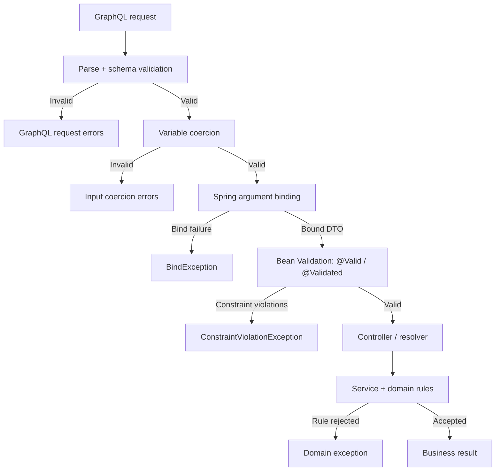

# Testing validation in Spring for GraphQL

Testing GraphQL validation requires verifying that invalid input is rejected at the right stage, errors adhere to the API contract, and business logic does not execute when a request is invalid. Simply asserting that `errors` appear is not enough: errors can originate from schema validation, coercion, argument binding, Bean Validation, or service/domain rules, and each layer executes at a different point.

With Spring for GraphQL, you can use `GraphQlTester` to send operations like a real client and assert `data`, `errors`, error codes, and paths. Combine the tester with mocked services or repositories to prove that resolvers are never invoked when the GraphQL document or input is invalid.

## Validation layers to test

An input passes through multiple layers before being processed:

1. **Parse and schema validation:** GraphQL checks syntax, fields, arguments, and types against the SDL.
2. **Variable coercion:** GraphQL coerces variables into declared types; wrong types or missing Non-Null variables are rejected before calling resolvers.
3. **Argument binding:** Spring for GraphQL binds arguments onto Java/DTO parameters. Unbindable structures can trigger `BindException`.
4. **Bean Validation:** `@Valid` or `@Validated` triggers constraints on DTOs and nested objects. Violations produce `ConstraintViolationException` in annotated controllers.
5. **Domain/service validation:** Enforces rules requiring system state, databases, or business context—for instance, whether an ISBN already exists or whether the user has permission to edit a record.



These layers do not replace one another. The SDL guards API shape and types; Bean Validation validates bound data; the service/domain layer guards invariants dependent on system state. Tests should include at least one representative case for every layer your application uses.

## Preparing the schema and input DTO

Example book creation API:

```graphql
input CreateBookInput {
  title: String!
  isbn: String!
  authorId: ID!
}

type Book {
  id: ID!
  title: String!
  isbn: String!
}

type Query {
  health: Boolean
}

type Mutation {
  createBook(input: CreateBookInput!): Book!
}
```

The SDLs in subsequent sections illustrate standalone test fixtures. If you combine multiple input types into one schema, declare `type Query`/`type Mutation` once and add fields via `extend type Query` or `extend type Mutation`.

The SDL requires all three input fields to be non-`null`, yet `title: "   "` is still a valid string in GraphQL. Bean Validation adds tighter constraints:

```java
import jakarta.validation.constraints.NotBlank;
import jakarta.validation.constraints.Pattern;
import jakarta.validation.constraints.Size;

public record CreateBookInput(
        @NotBlank(message = "Title must not be blank")
        @Size(max = 200, message = "Title must be at most 200 characters")
        String title,

        @NotBlank(message = "ISBN must not be blank")
        @Pattern(
                regexp = "^[0-9Xx-]{10,17}$",
                message = "Invalid ISBN format")
        String isbn,

        @NotBlank(message = "Author must be selected")
        String authorId) {
}
```

The annotated controller triggers validation before calling the handler:

```java
import jakarta.validation.Valid;
import org.springframework.graphql.data.method.annotation.Argument;
import org.springframework.graphql.data.method.annotation.MutationMapping;
import org.springframework.stereotype.Controller;

@Controller
public class BookMutationController {

    private final BookService bookService;

    public BookMutationController(BookService bookService) {
        this.bookService = bookService;
    }

    @MutationMapping
    public Book createBook(
            @Argument("input") @Valid CreateBookInput input) {
        return bookService.create(input);
    }
}
```

In Spring Boot, add `spring-boot-starter-validation` to include a Bean Validation implementation. Spring for GraphQL uses the `Validator` bean in `AnnotatedControllerConfigurer`; if a test slice does not auto-load a validator, import a configuration providing `LocalValidatorFactoryBean` into the test.

```java
import org.springframework.context.annotation.Bean;
import org.springframework.context.annotation.Configuration;
import org.springframework.validation.beanvalidation.LocalValidatorFactoryBean;

@Configuration(proxyBeanMethods = false)
public class ValidationConfiguration {

    @Bean
    LocalValidatorFactoryBean validator() {
        return new LocalValidatorFactoryBean();
    }
}
```

With Spring Boot 3 and later, use `jakarta.validation.*`. If your project already has validator auto-configuration, do not register an extra manual bean; tests must use the application's actual validation configuration to avoid testing a setup different from production.

## Setting up GraphQlTester for the test slice

`@GraphQlTest` creates a test slice focused on GraphQL controllers and GraphQL infrastructure. You can mock services to test the controller and confirm services are never called when validation fails.

The example below assumes the schema resides at `src/main/resources/graphql/schema.graphqls`. Import the validator and exception advice if the test slice does not auto-load those beans:

```java
// Spring Boot 4.x:
import org.springframework.boot.graphql.test.autoconfigure.GraphQlTest;
// Spring Boot 3.x:
// import org.springframework.boot.test.autoconfigure.graphql.GraphQlTest;

import static org.mockito.ArgumentMatchers.any;
import static org.mockito.Mockito.times;
import static org.mockito.BDDMockito.given;
import static org.mockito.BDDMockito.then;
import static org.assertj.core.api.Assertions.assertThat;

import java.util.List;
import java.util.Map;
import org.junit.jupiter.api.Test;
import org.springframework.beans.factory.annotation.Autowired;
import org.springframework.context.annotation.Import;
import org.springframework.graphql.test.tester.GraphQlTester;
import org.springframework.test.context.bean.override.mockito.MockitoBean;

@GraphQlTest(BookMutationController.class)
@Import({ValidationConfiguration.class, GraphQlValidationExceptionHandler.class})
class BookValidationTests {

    @Autowired
    GraphQlTester graphQlTester;

    @MockitoBean
    BookService bookService;
}
```

On older Spring Boot/Spring Framework versions, replace `@MockitoBean` with that version's mock bean mechanism, typically `@MockBean`. `@GraphQlTest` does not load all services and repositories; required collaborators must be mocked or imported.

In the tests below, assume `GraphQlValidationExceptionHandler` maps `ConstraintViolationException` to a GraphQL error with `extensions.code = "VALIDATION_ERROR"` and `BindException` to `ARGUMENT_BINDING_ERROR`. Using stable error codes prevents clients and tests from depending on framework default message wording.

A minimal exception advice can produce that response contract:

```java
import graphql.GraphQLError;
import graphql.GraphqlErrorBuilder;
import jakarta.validation.ConstraintViolationException;
import java.util.List;
import java.util.Map;
import org.springframework.graphql.data.method.annotation.GraphQlExceptionHandler;
import org.springframework.graphql.execution.ErrorType;
import org.springframework.validation.BindException;
import org.springframework.web.bind.annotation.ControllerAdvice;

@ControllerAdvice
public class GraphQlValidationExceptionHandler {

    @GraphQlExceptionHandler
    public GraphQLError handle(
            GraphqlErrorBuilder<?> builder,
            ConstraintViolationException ex) {
        List<Map<String, String>> violations = ex.getConstraintViolations().stream()
                .map(violation -> Map.of(
                        "field", violation.getPropertyPath().toString(),
                        "message", violation.getMessage()))
                .toList();

        return builder
                .errorType(ErrorType.BAD_REQUEST)
                .message("Invalid input data")
                .extensions(Map.of(
                        "code", "VALIDATION_ERROR",
                        "violations", violations))
                .build();
    }

    @GraphQlExceptionHandler
    public GraphQLError handle(
            GraphqlErrorBuilder<?> builder,
            BindException ex) {
        return builder
                .errorType(ErrorType.BAD_REQUEST)
                .message("Unable to read input data")
                .extensions(Map.of("code", "ARGUMENT_BINDING_ERROR"))
                .build();
    }

    @GraphQlExceptionHandler
    public GraphQLError handle(
            GraphqlErrorBuilder<?> builder,
            DuplicateIsbnException ex) {
        return builder
                .errorType(ErrorType.BAD_REQUEST)
                .message("ISBN already exists")
                .extensions(Map.of("code", "DUPLICATE_ISBN"))
                .build();
    }
}
```

This is a sample policy; in production, map property paths to public field names and avoid exposing internal object-binding details.

## Testing GraphQL schema validation

Schema validation happens before the controller is invoked. For example, a client omits `isbn` in the input object while the SDL declares `isbn: String!`:

```java
@Test
void rejectsMissingRequiredInputField() {
    graphQlTester.document("""
            mutation {
              createBook(input: {
                title: "Spring GraphQL",
                authorId: "author-10"
              }) {
                id
              }
            }
            """)
            .execute()
            .errors()
            .expect(error -> error.getMessage().contains("isbn"))
            .verify();

    then(bookService).shouldHaveNoInteractions();
}
```

Because the GraphQL document is invalid, execution stops before the resolver runs. Verifying `bookService` had no interactions confirms the test is enforcing the right boundary. In real projects, prefer checking error classification or message fragments that are stable across your GraphQL Java version; avoid asserting the entire message if wording may change.

You can test nonexistent fields or arguments the same way. Errors such as misspelled field names, wrong argument types, missing selection sets on object fields, or undeclared arguments all belong to schema validation.

## Testing variable coercion

Variable coercion checks whether supplied JSON values conform to the declared GraphQL types. For example, `isbn` is declared `String!` but the client passes a number:

```java
@Test
void rejectsVariableWithWrongScalarType() {
    Map<String, Object> input = Map.of(
            "title", "Spring GraphQL",
            "isbn", 1234567890,
            "authorId", "author-10");

    graphQlTester.document("""
            mutation CreateBook($input: CreateBookInput!) {
              createBook(input: $input) {
                id
              }
            }
            """)
            .variable("input", input)
            .execute()
            .errors()
            .expect(error -> error.getMessage().contains("String"))
            .verify();

    then(bookService).shouldHaveNoInteractions();
}
```

This is a GraphQL coercion error, not Bean Validation. The resolver has not received a DTO yet, so the `@Pattern` constraint on `isbn` never runs. Tests should confirm the error occurs during input coercion and the service is not invoked.

Cases to include in coercion tests:

- Missing variables declared as `ID!`, `String!`, or Non-Null input objects.
- Passing scalars of the wrong type, such as a number for `String` or an object for `Int`.
- Passing nonexistent enum values.
- Passing list items of the wrong type.
- Passing `null` for a Non-Null variable or field.

Do not use `Map.of(...)` when testing null values because Java's `Map.of` forbids nulls. For those cases, use a mutable map or a DTO/fixture that supports null.

## Testing argument binding

Even when the GraphQL document and variables are valid, Spring must still bind arguments into the Java types expected by the controller. For instance, an input DTO with an incompatible Java type or unconvertible nested structure can throw `BindException`.

When your application uses custom scalars, enum mappings, or custom DTO binding, test boundary values and nested structures through `GraphQlTester` rather than only calling DTO constructors directly.

For example, the SDL declares `id` as GraphQL `ID`, while the Java DTO requires `UUID`:

```graphql
input BookLookupInput {
  id: ID!
}

type Book {
  id: ID!
}

type Query {
  lookupBook(input: BookLookupInput!): Book
}
```

```java
import java.util.UUID;
import org.springframework.graphql.data.method.annotation.Argument;
import org.springframework.graphql.data.method.annotation.QueryMapping;

public record BookLookupInput(UUID id) {
}

@QueryMapping
public Book lookupBook(@Argument("input") BookLookupInput input) {
    return bookService.findById(input.id());
}
```

GraphQL `ID` accepts `"not-a-uuid"`, but Spring cannot convert that string into a `UUID`. This is an ideal binding case for testing `BindException`.

Example asserting the normalized binding error code:

This is a separate slice test for `BookLookupController`, configured with `@GraphQlTest(BookLookupController.class)` and a mocked `BookService` as set up earlier.

```java
@Test
void reportsArgumentBindingFailureSeparately() {
    graphQlTester.document("""
            query LookupBook($input: BookLookupInput!) {
              lookupBook(input: $input) {
                id
              }
            }
            """)
            .variable("input", Map.of(
                    "id", "not-a-uuid"))
            .execute()
            .errors()
            .expect(error -> "ARGUMENT_BINDING_ERROR".equals(
                    error.getExtensions().get("code")))
            .verify();

    then(bookService).shouldHaveNoInteractions();
}
```

GraphQL accepted the value because `ID` is a valid scalar; the failure happened when the binder converted the value to `UUID`. Do not try to trigger a binding error using an input that GraphQL already rejects during coercion.

## Testing Bean Validation through GraphQL

Bean Validation runs after input has been coerced and bound. Use input with valid GraphQL types that violates Java constraints—for instance, a whitespace-only `title` and an invalid ISBN pattern:

```java
@Test
void rejectsBlankTitleAndInvalidIsbn() {
    graphQlTester.document("""
            mutation CreateBook($input: CreateBookInput!) {
              createBook(input: $input) {
                id
              }
            }
            """)
            .variable("input", Map.of(
                    "title", "   ",
                    "isbn", "not-an-isbn",
                    "authorId", "author-10"))
            .execute()
            .errors()
            .expect(error -> "VALIDATION_ERROR".equals(
                    error.getExtensions().get("code")))
            .verify();

    then(bookService).shouldHaveNoInteractions();
}
```

`String!` accepts whitespace strings and `String` accepts `not-an-isbn`, so GraphQL coercion succeeds. Then `@Valid` triggers `@NotBlank` and `@Pattern`; the exception handler maps the violations to the `VALIDATION_ERROR` code.

If you need to assert the violation list, expose violations under `extensions.violations` with normalized field paths and messages, then assert via `ResponseError.getExtensions()`:

```java
graphQlTester.document(invalidCreateBookMutation)
        .variable("input", invalidInput)
        .execute()
        .errors()
        .satisfy(errors -> assertThat(errors).anySatisfy(error -> {
            assertThat(error.getExtensions().get("code"))
                    .isEqualTo("VALIDATION_ERROR");
            @SuppressWarnings("unchecked")
            List<Map<String, String>> violations =
                    (List<Map<String, String>>) error.getExtensions().get("violations");
            assertThat(violations)
                    .anySatisfy(violation -> {
                        assertThat(violation.get("field")).contains("title");
                        assertThat(violation.get("message")).contains("must not be blank");
                    });
        }));
```

The assertion above assumes the handler publishes `violations` in the map structure shown in the example. Avoid coupling tests to internal Java property paths if the API maps them to public GraphQL field names.

## Verifying the controller and service do not execute

When an error occurs before the controller is invoked, the service must have no interactions. This is an essential assertion to prevent unintended side effects:

```java
then(bookService).shouldHaveNoInteractions();
```

You can also use Mockito's `verifyNoInteractions(bookService)`. If a controller calls a helper service to populate context before validation, assert specifically that the write method was never invoked instead of demanding zero interactions on the entire mock.

For Mutations, also test a valid case to prove the service is invoked exactly once:

```java
@Test
void invokesServiceForValidInput() {
    Book saved = new Book("book-10", "Spring GraphQL", "9780132350884");
    given(bookService.create(any(CreateBookInput.class))).willReturn(saved);

    graphQlTester.document("""
            mutation CreateBook($input: CreateBookInput!) {
              createBook(input: $input) {
                id
                title
              }
            }
            """)
            .variable("input", Map.of(
                    "title", "Spring GraphQL",
                    "isbn", "9780132350884",
                    "authorId", "author-10"))
            .execute()
            .path("createBook.id")
            .entity(String.class)
            .isEqualTo("book-10");

    then(bookService).should(times(1)).create(any(CreateBookInput.class));
}
```

Valid-input tests catch misconfigured validation that rejects every request or controllers not properly wired to the schema.

## Testing nested validation

When input contains nested objects, inner constraints are checked only when cascade validation is enabled with `@Valid` on those properties:

Corresponding SDL:

```graphql
input AddressInput {
  city: String!
  postalCode: String!
}

input ContactInput {
  type: String!
  value: String!
}

input PublisherInput {
  name: String!
  address: AddressInput!
  contacts: [ContactInput!]
}

type Publisher {
  id: ID!
}

type Query {
  publisher(id: ID!): Publisher
}

type Mutation {
  createPublisher(input: PublisherInput!): Publisher!
}
```

```java
import jakarta.validation.Valid;
import jakarta.validation.constraints.NotBlank;
import jakarta.validation.constraints.NotNull;
import jakarta.validation.constraints.Size;
import java.util.List;

public record AddressInput(
        @NotBlank String city,
        @NotBlank String postalCode) {
}

public record ContactInput(
        @NotBlank String type,
        @NotBlank String value) {
}

public record PublisherInput(
        @NotBlank String name,
        @NotNull @Valid AddressInput address,
        @Size(max = 5) List<@NotNull @Valid ContactInput> contacts) {
}
```

Tests should create a publisher with a valid `address.city` but blank `address.postalCode`, or a nested contact with a blank `value`. Then send the mutation through `GraphQlTester` and assert `VALIDATION_ERROR` and the corresponding violation.

Example document:

```graphql
mutation CreatePublisher($input: PublisherInput!) {
  createPublisher(input: $input) {
    id
  }
}
```

Variables for the nested validation case:

```java
Map<String, Object> input = Map.of(
        "name", "Northwind Press",
        "address", Map.of("city", "Hanoi", "postalCode", " "),
        "contacts", List.of(Map.of("type", "email", "value", "editor@example.com")));
```

```java
graphQlTester.document(createPublisherMutation)
        .variable("input", input)
        .execute()
        .errors()
        .expect(error -> "VALIDATION_ERROR".equals(
                error.getExtensions().get("code")))
        .verify();

then(publisherService).shouldHaveNoInteractions();
```

In the publisher test, mock `PublisherService` and load the corresponding publisher controller; the variable name here illustrates that controller's collaborator.

Testing nested validation catches a common mistake: the DTO has constraints, and the controller puts `@Valid` on the root parameter, but nested properties lack `@Valid` for cascading.

## Testing validation groups

When the same DTO is reused for create and update, `@Validated(Group.class)` selects which constraint set runs. Tests should verify both branches, because misconfigured groups can silently skip constraints on one operation.

Example model:

```java
import jakarta.validation.constraints.NotBlank;
import jakarta.validation.constraints.NotNull;
import jakarta.validation.constraints.Null;
import jakarta.validation.groups.Default;

public interface Create extends Default {
}

public interface Update extends Default {
}

public record SaveBookInput(
        @Null(groups = Create.class)
        @NotNull(groups = Update.class)
        String id,
        @NotBlank String title) {
}
```

Controller:

```java
import org.springframework.graphql.data.method.annotation.Argument;
import org.springframework.graphql.data.method.annotation.MutationMapping;
import org.springframework.validation.annotation.Validated;

@MutationMapping
public Book createBook(
        @Argument("input") @Validated(Create.class) SaveBookInput input) {
    return bookService.create(input);
}

@MutationMapping
public Book updateBook(
        @Argument("input") @Validated(Update.class) SaveBookInput input) {
    return bookService.update(input);
}
```

A create test with a non-null `id` must receive `VALIDATION_ERROR`; an update test missing `id` must receive the same error code. Valid tests for each operation should confirm the service is called with the expected DTO/command.

Have `Create` and `Update` extend `Default` so constraints without an explicit group, such as `@NotBlank`, still execute. If `Default` is not inherited or included, tests can catch silently skipped default constraints.

## Testing class-level and cross-field constraints

Rules spanning multiple fields—such as a start date having to precede an end date—should be tested with custom class-level constraints. Maintain two test layers:

- Validator unit tests with `jakarta.validation.Validator` to verify constraint logic quickly.
- GraphQL controller tests to confirm `@Valid` triggers the constraint and errors map cleanly to the GraphQL response.

Example unit test:

```java
import static org.assertj.core.api.Assertions.assertThat;

import jakarta.validation.ConstraintViolation;
import jakarta.validation.Validation;
import jakarta.validation.ValidatorFactory;
import java.time.LocalDate;
import java.util.Set;
import org.junit.jupiter.api.Test;

@ValidDateRange
record BookingInput(LocalDate startDate, LocalDate endDate) {
}

class BookingInputValidationTests {

    @Test
    void rejectsEndDateBeforeStartDate() {
        BookingInput input = new BookingInput(
                LocalDate.of(2026, 5, 10),
                LocalDate.of(2026, 5, 1));

        try (ValidatorFactory factory = Validation.buildDefaultValidatorFactory()) {
            Set<ConstraintViolation<BookingInput>> violations =
                    factory.getValidator().validate(input);

            assertThat(violations)
                    .anySatisfy(violation -> assertThat(violation.getMessage())
                            .contains("end date must be after start date"));
        }
    }
}
```

A Validator unit test does not prove the GraphQL controller has `@Valid` applied; therefore, always include at least one integration test through `GraphQlTester` with violating input.

## Testing domain validation that requires a database

Bean Validation should not replace rules requiring database queries, such as checking whether an ISBN already exists. Those rules belong in the service/domain layer and are typically expressed as business exceptions:

```java
@Service
public class BookService {

    public Book create(CreateBookInput input) {
        if (repository.existsByIsbn(input.isbn())) {
            throw new DuplicateIsbnException(input.isbn());
        }
        return repository.save(Book.create(input));
    }
}
```

Service tests can use a mocked repository or database test to verify the invariant. GraphQL tests should verify the exception maps to a public error code, such as `DUPLICATE_ISBN`, without leaking internal details:

```java
@Test
void mapsDuplicateIsbnToConflictError() {
    given(bookService.create(any(CreateBookInput.class)))
            .willThrow(new DuplicateIsbnException("9780132350884"));

    graphQlTester.document("""
            mutation CreateBook($input: CreateBookInput!) {
              createBook(input: $input) {
                id
              }
            }
            """)
            .variable("input", Map.of(
                    "title", "Spring GraphQL",
                    "isbn", "9780132350884",
                    "authorId", "author-10"))
            .execute()
            .errors()
            .expect(error -> "DUPLICATE_ISBN".equals(
                    error.getExtensions().get("code")))
            .verify();
}
```

This tests the GraphQL-layer mapping with a mocked service. A separate service/repository test must verify the existence check and transaction/unique constraint behavior. Never rely solely on `existsByIsbn` to enforce uniqueness under concurrent requests; a database unique constraint is still necessary to prevent race conditions.

## Testing custom scalar and enum inputs

Custom scalars can reject values during coercion before argument binding or Bean Validation runs. For example, a `Date` scalar accepting only ISO dates `yyyy-MM-dd`: tests should send both valid and malformed values through `GraphQlTester`.

Enums also require testing valid and nonexistent values. In GraphQL, enum values are supplied as enum literals in documents or strings in JSON variables according to coercion rules. An invalid enum value is a GraphQL input error, not a `@Pattern` violation on a DTO.

Cases to cover:

- Valid dates and malformed date strings.
- Valid UUIDs and non-UUID strings.
- Decimals exceeding precision/scale if the scalar enforces limits.
- Valid enum values and values undeclared in the schema.

If a custom scalar has its own parser and serializer, unit-test scalar coercing for detailed edge cases; `GraphQlTester` integration tests confirm the scalar is properly registered in runtime wiring and errors surface over GraphQL.

## Checking error paths and null propagation

GraphQL errors include a `path` identifying the failed field. If a Mutation returns `Book!` and the `createBook` field errors, null propagation can turn `data.createBook` into null or make root `data` null depending on the schema's Non-Null structure.

When testing validation, do not assume every response shares the exact same `data` shape. Assert error codes and paths per contract, then check `data` where the schema allows partial data:

```java
graphQlTester.document(invalidMutation)
        .execute()
        .errors()
        .expect(error -> "VALIDATION_ERROR".equals(
                error.getExtensions().get("code"))
                && error.getPath().contains("createBook"))
        .verify();
```

`ResponseError.getPath()` in Spring GraphQL returns a string representation of the path; if you need to inspect structured path segments, use `getParsedPath()`. Avoid asserting specific `data` shapes if schema null propagation changes when a field moves between nullable and Non-Null.

## Checking HTTP status and GraphQL errors

For schema validation, coercion, or execution errors, GraphQL errors typically appear in the response body. HTTP status also depends on media type and request stage per GraphQL over HTTP. Therefore:

- Use `GraphQlTester` to assert GraphQL `errors`, `extensions`, and `data`.
- Use `WebTestClient` or `MockMvc` to assert HTTP status, headers, and content type.
- Do not turn every validation error into HTTP 500; GraphQL errors are generally client/request errors and should use status codes matching the media type/protocol.
- Test both `application/graphql-response+json` and `application/json` if the API supports both current and legacy media types.

With `@GraphQlTest` slice tests, there is no real servlet filter or HTTP transport. To verify status codes and headers, add integration tests with `HttpGraphQlTester` and `WebTestClient`/`MockMvcWebTestClient`.

## Recommended validation test matrix

| Layer | Test input | Primary assertion | Expected side effect |
| --- | --- | --- | --- |
| Schema validation | Missing `String!` field, nonexistent field. | GraphQL request error present. | Controller/service never runs. |
| Variable coercion | Number for `String`, null for `ID!`. | Input coercion error present. | Controller/service never runs. |
| Argument binding | DTO/field unbindable to Java structure. | Normalized binding error code. | Handler does not run business logic. |
| Bean Validation | Blank, bad pattern, exceeded size. | `VALIDATION_ERROR`, matching violation. | Write service never runs. |
| Nested validation | Violating nested field or list element. | Nested property violation. | Service never runs. |
| Validation groups | Create with ID, update missing ID. | Corresponding group branch rejected. | Service runs only on valid input. |
| Domain validation | Duplicate ISBN, disallowed state. | Stable business error code. | No unintended data changes. |
| Custom scalar/enum | Invalid Date/UUID/enum. | Coercion error. | Resolver never runs. |

## Common pitfalls when testing validation

| Symptom | Cause | Resolution |
| --- | --- | --- |
| `@NotBlank` does not run | Missing `Validator` bean or parameter lacks `@Valid`/`@Validated`. | Check validation starter, `Validator` bean, and method parameter. |
| Test expects `ConstraintViolationException` but gets a binding error | Input fails to bind into the DTO. | Fix fixture so GraphQL coercion and binding succeed before violating constraints. |
| Cannot tell whether service was called | Asserting only message without tracking collaborator. | Use mock/spy and verify zero interactions. |
| Schema validation test invokes resolver | Document is actually valid or test loads a different schema. | Check the schema loaded in the test context and ensure the operation is truly invalid. |
| Nested constraints do not run | Missing `@Valid` on nested objects or list elements. | Enable cascade validation and test each nesting level. |
| Validation group skips `@NotBlank` | Group does not include `Default`. | Extend `Default` on the group or assign constraints explicitly to the group. |
| Test depends on overly specific messages | Messages vary across locales/framework versions. | Assert error codes, paths, and contract-defined message fragments. |
| GraphQL slice test lacks validator/advice | `@GraphQlTest` does not load required configuration. | `@Import` the validator and exception handler or use an integration context. |
| Domain uniqueness test passes despite race | Only checked `existsBy...`, not database unique constraint. | Test database constraints and handle duplicate errors on insert. |

## Key takeaways

Validation tests must target the exact layer responsible for catching the error. GraphQL schema validation and variable coercion run before resolvers; argument binding converts inputs into DTOs; Bean Validation runs when annotated controllers enable `@Valid` or `@Validated`; domain validation runs in services when databases or business state are required.

Use `GraphQlTester` to send operations and assert error codes/paths, paired with mocked services to verify zero side effects on invalid input. Also test valid inputs to confirm handlers still execute, as well as nested objects, validation groups, custom scalars, and domain rules. When HTTP status codes or filter chains need verification, add transport integration tests. A strong test suite clearly separates schema, coercion, binding, constraint, and business errors instead of lumping everything into a single validation bucket.

## References

- [Spring for GraphQL — Testing](https://docs.spring.io/spring-graphql/reference/testing.html)
- [Spring for GraphQL — Annotated Controllers: Validation](https://docs.spring.io/spring-graphql/reference/controllers.html#controllers.validation)
- [Spring for GraphQL — Exception Handling](https://docs.spring.io/spring-graphql/reference/controllers.html#controllers.exceptions)
- [Jakarta Bean Validation](https://jakarta.ee/specifications/bean-validation/)
