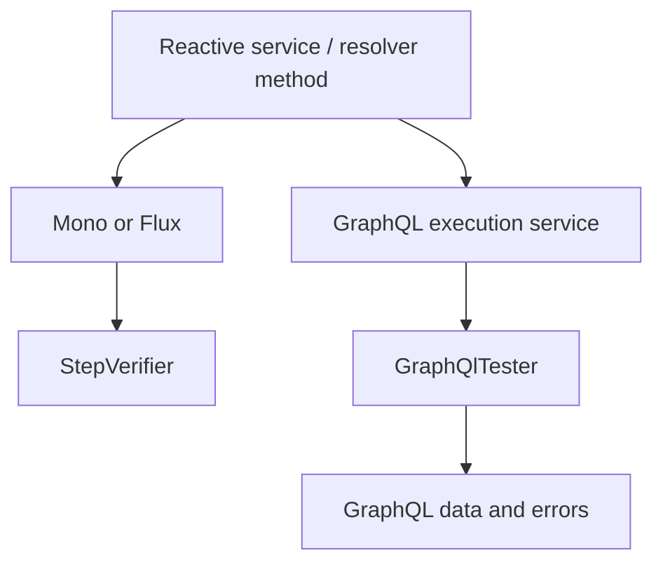

# Testing reactive resolvers in Spring for GraphQL

Resolvers in Spring for GraphQL can return `Mono<T>` or `Flux<T>` to process data asynchronously with Project Reactor. The right testing approach depends on what you need to verify: testing the publisher in isolation with `StepVerifier`, or running a GraphQL operation to verify that the schema, argument binding, resolver, and response work together properly.

`StepVerifier` excels at verifying reactive signals such as `onNext`, `onComplete`, `onError`, demand, and cancellation. `GraphQlTester` excels at asserting GraphQL results after the execution engine invokes a resolver. For subscriptions, the `executeSubscription()` API yields a response stream verifiable with Reactor Test. Combining these layers catches both publisher bugs and integration bugs when wiring publishers into GraphQL execution.

After this lesson, you will be able to:

- Distinguish direct publisher tests from GraphQL execution resolver tests.
- Test `Mono` with `StepVerifier`.
- Test `Flux`, element ordering, and completion flows.
- Test empty publishers, reactive errors, and timeouts.
- Verify cancellation and cleanup.
- Test reactive resolvers through `GraphQlTester`.
- Test subscription streams with `executeSubscription()`.
- Test context propagation and choose the right test boundary.

## 1. What is a reactive resolver?

In annotated controllers, resolvers can return either synchronous Java types or reactive types. `Mono<T>` represents at most one asynchronous result; `Flux<T>` represents a stream capable of emitting multiple elements.

Example query returning a single book:

```java
@Controller
public class BookController {

    private final BookService bookService;

    public BookController(BookService bookService) {
        this.bookService = bookService;
    }

    @QueryMapping
    public Mono<BookView> book(@Argument String id) {
        return bookService.findById(id);
    }
}
```

The resolver returns `Mono<BookView>` so Spring for GraphQL executes it asynchronously. You do not need to call `.block()` to unwrap `BookView` before returning.

Example query returning a list:

```java
@QueryMapping
public Flux<BookView> books() {
    return bookService.findAll();
}
```

For nested field mappings, resolvers can likewise return `Mono` or `Flux` depending on field and schema semantics. Reactive return types let downstream pipelines compose with reactive data sources without blocking request-handling threads.

## 2. Two layers for testing reactive resolvers

A reactive resolver can be tested at two primary layers:



| Layer | Tool | What is verified |
| --- | --- | --- |
| Publisher | `StepVerifier` | Values, ordering, completion, errors, cancellation, demand, and timing |
| GraphQL execution | `GraphQlTester` | SDL, resolver mapping, argument binding, field paths, null propagation, and GraphQL errors |
| Subscription | `executeSubscription()` + `StepVerifier` | GraphQL response stream, event flow, errors, and subscription termination |
| Web/transport | `WebGraphQlTester`, `HttpGraphQlTester`, or WebSocket tester | Interceptors, security context, HTTP/WebSocket protocol, and transport lifecycle |

Ensure the test classpath includes `reactor-test` for `StepVerifier` and `spring-graphql-test` for the GraphQL testers. If the project uses Spring Boot dependency management, let the BOM align compatible versions instead of pinning independent versions manually.

No single tool replaces every layer. Testing a publisher directly does not prove GraphQL mapping works; testing GraphQL execution does not necessarily verify publisher cancellation or backpressure behavior.

## 3. Testing Mono with StepVerifier

`StepVerifier` subscribes to a publisher, requests data, and verifies signals in sequence.

Example service returning a single book:

```java
Mono<BookView> findById(String id) {
    return repository.findById(id)
            .map(BookView::from);
}
```

Test:

```java
@Test
void emitsBookAndCompletes() {
    BookView expected = new BookView("book-42", "Reactive GraphQL");

    StepVerifier.create(bookService.findById("book-42"))
            .expectNext(expected)
            .verifyComplete();
}
```

`expectNext(...)` checks the emitted element. `verifyComplete()` confirms the publisher emits `onComplete` afterward without emitting extra items.

If a DTO lacks appropriate equality semantics, assert with a predicate:

```java
StepVerifier.create(bookService.findById("book-42"))
        .assertNext(book -> {
            assertThat(book.id()).isEqualTo("book-42");
            assertThat(book.title()).isEqualTo("Reactive GraphQL");
        })
        .verifyComplete();
```

Never call `.block()` just to extract a value for assertions when your goal is verifying reactive signals. `StepVerifier` verifies both the data and how the publisher terminates.

## 4. Testing Mono.empty()

A `Mono` can complete without emitting any item. This state differs from emitting an object with null properties.

```java
@Test
void completesEmptyWhenBookDoesNotExist() {
    StepVerifier.create(bookService.findById("missing"))
            .verifyComplete();
}
```

This test confirms no `onNext` occurs and the publisher completes normally. If the service is designed to emit `BookNotFoundException`, use `expectError(...)` instead of `verifyComplete()`.

When integrated with GraphQL, `Mono.empty()` can resolve to `null` for the field resolver. The final response depends on SDL nullability: a nullable field returns null; a non-null field triggers a GraphQL execution error and null propagation. Therefore, maintain both unit tests for `Mono.empty()` and GraphQL execution tests for the schema contract.

## 5. Testing Mono errors

Reactive errors travel via `onError`, not `onNext`:

```java
@Test
void emitsBookNotFoundError() {
    StepVerifier.create(bookService.findById("missing"))
            .expectError(BookNotFoundException.class)
            .verify();
}
```

When you need to inspect the exception message or properties:

```java
StepVerifier.create(bookService.findById("missing"))
        .expectErrorSatisfies(error -> {
            assertThat(error)
                    .isInstanceOf(BookNotFoundException.class)
                    .hasMessageContaining("missing");
        })
        .verify();
```

`expectErrorSatisfies(...)` is helpful when exceptions carry error codes or resource IDs. Avoid asserting stack traces or environment-dependent strings.

## 6. Testing Flux and element ordering

With `Flux`, you can verify multiple elements in sequence:

```java
@Test
void emitsBooksInRepositoryOrder() {
    StepVerifier.create(bookService.findAll())
            .expectNext(
                    new BookView("book-1", "First"),
                    new BookView("book-2", "Second"),
                    new BookView("book-3", "Third"))
            .verifyComplete();
}
```

Assert ordering only when the service contract guarantees it, such as a repository query with `ORDER BY`. When order is nondeterministic, collect elements and assert as a set or sort before comparing.

You can assert elements individually using `assertNext(...)`:

```java
StepVerifier.create(bookService.findAll(), 0)
        .thenRequest(2)
        .assertNext(book -> assertThat(book.id()).isEqualTo("book-1"))
        .assertNext(book -> assertThat(book.id()).isEqualTo("book-2"))
        .thenCancel()
        .verify();
```

This example cancels the stream after two elements. Use `thenCancel()` only when cancellation is the behavior under test; if a finite stream must emit all elements, use `verifyComplete()`.

## 7. Testing Flux.empty() and empty lists

`Flux.empty()` emits `onComplete` with zero items:

```java
StepVerifier.create(bookService.findAll())
        .verifyComplete();
```

When a GraphQL resolver returns `Flux` for a list field, an empty stream typically materializes as an empty list in the response, provided the schema and resolver mapping define list semantics. Test through GraphQL:

```java
graphQlTester.document("""
        query {
            books {
                id
            }
        }
        """)
    .execute()
    .errors()
    .verify();
```

Then confirm `books` is an empty list with the appropriate assertion, such as `entityList(BookView.class).isEmpty()`. A `Flux.empty()` unit test and an empty-list integration test verify two distinct contracts.

## 8. Testing reactive resolvers directly

To verify that a controller forwards arguments and returns the exact publisher from a service, you can call the method directly with a mocked service:

```java
@Test
void resolverDelegatesBookIdToService() {
    BookView expected = new BookView("book-42", "Reactive GraphQL");
    when(bookService.findById("book-42")).thenReturn(Mono.just(expected));

    StepVerifier.create(controller.book("book-42"))
            .expectNext(expected)
            .verifyComplete();

    verify(bookService).findById("book-42");
}
```

This test focuses on the Java method and delegation. It does not confirm that `@QueryMapping` maps to the right SDL field or that GraphQL arguments bind properly. Those require a test running through GraphQL execution.

## 9. Testing reactive resolvers through GraphQlTester

`GraphQlTester` executes queries to confirm that `Mono`/`Flux`-returning resolvers integrate cleanly with the GraphQL engine:

For tests at the server execution layer, build an `ExecutionGraphQlServiceTester` from the configured service:

```java
ExecutionGraphQlServiceTester graphQlTester =
        ExecutionGraphQlServiceTester.create(executionGraphQlService);
```

If execution must pass through `WebGraphQlHandler`'s interceptor chain, use `WebGraphQlTester`. Both testers expose the unified `GraphQlTester` workflow.

```java
@Test
void executesReactiveBookResolver() {
    graphQlTester.document("""
            query Book($id: ID!) {
                book(id: $id) {
                    id
                    title
                }
            }
            """)
        .variable("id", "book-42")
        .execute()
        .errors()
        .verify()
        .path("book.title")
        .entity(String.class)
        .isEqualTo("Reactive GraphQL");
}
```

This test verifies the operation, schema field, variable binding, and resolver output. `GraphQlTester.execute()` provides GraphQL response assertions; it does not replace `StepVerifier` for publisher behaviors such as demand, cancellation, or virtual time.

If a test must verify `WebGraphQlInterceptor` or context added at the web layer, use `WebGraphQlTester`. If HTTP headers, status codes, or content negotiation matter, use an HTTP tester.

## 10. Testing reactive errors through GraphQL

A service can emit reactive errors:

```java
@QueryMapping
public Mono<BookView> book(@Argument String id) {
    return bookService.findById(id);
}
```

When the service returns `Mono.error(new BookNotFoundException(id))`, GraphQL execution translates the failure into a GraphQL error via the configured exception resolvers and error handlers.

Test:

```java
GraphQlTester.Response response = graphQlTester.document("""
        query {
            book(id: "missing") {
                title
            }
        }
        """)
    .execute();

response.errors().satisfy(errors -> {
    assertThat(errors).singleElement().satisfies(error -> {
        assertThat(error.getExtensions())
                .containsEntry("code", "BOOK_NOT_FOUND");
        assertThat(error.getParsedPath())
                .containsExactly("book");
    });
});
```

Because this is an execution error, the path points to the failing field. If an exception occurs in a nested field resolver, the path contains the corresponding response keys.

Do not assert Java exceptions directly from `GraphQlTester.execute()` for normal resolver failures; inspect GraphQL `errors`. Transport failures or failures that prevent producing a GraphQL response are a separate category.

## 11. Testing onErrorResume and fallbacks

Reactive services can turn specific failures into fallbacks:

```java
public Mono<BookView> findBook(String id) {
    return remoteBookClient.findById(id)
            .onErrorResume(RemoteServiceException.class,
                    error -> cache.findById(id));
}
```

Test the publisher to confirm the fallback is used:

```java
@Test
void usesCacheWhenRemoteServiceFails() {
    when(remoteBookClient.findById("book-42"))
            .thenReturn(Mono.error(new RemoteServiceException("offline")));
    when(cache.findById("book-42"))
            .thenReturn(Mono.just(new BookView("book-42", "Cached title")));

    StepVerifier.create(bookService.findBook("book-42"))
            .assertNext(book ->
                    assertThat(book.title()).isEqualTo("Cached title"))
            .verifyComplete();

    verify(cache).findById("book-42");
}
```

If the fallback is part of the API contract, add a GraphQL execution test to confirm clients receive fallback data with no unexpected errors. If the fallback is purely an internal detail, a service test may suffice.

Do not use `onErrorResume(error -> Mono.empty())` to swallow all errors when turning an error into `null` could mask outages or violate a non-null schema.

## 12. Testing reactive timeouts

`timeout(...)` converts a publisher that fails to emit within a window into a timeout error:

```java
public Mono<BookView> findBook(String id) {
    return remoteBookClient.findById(id)
            .timeout(Duration.ofSeconds(2));
}
```

Tests can use virtual time to avoid waiting in real time:

```java
@Test
void timesOutWhenSourceDoesNotRespond() {
    StepVerifier.withVirtualTime(() ->
            Mono.<BookView>never()
                    .timeout(Duration.ofSeconds(2)))
        .thenAwait(Duration.ofSeconds(2))
        .expectError(TimeoutException.class)
        .verify();
}
```

`withVirtualTime` installs a virtual scheduler for operators using default schedulers. Construct the publisher inside the supplier so operators pick up `StepVerifier`'s virtual scheduler. If the code injects a custom scheduler, inject `VirtualTimeScheduler` or a scheduler abstraction so tests control time.

Never use `Thread.sleep()` to test timeouts; it makes tests slow and flaky.

## 13. Testing cancellation and cleanup

A resolver might register listeners, open cursors, or start consumers. When a client cancels the operation, the publisher should observe cancellation and release resources.

Example publisher with cleanup:

```java
Flux<OrderEvent> eventsFor(String orderId) {
    return eventSource.listen(orderId)
            .doFinally(signal -> {
                if (signal == SignalType.CANCEL) {
                    metrics.increment("order.subscription.cancelled");
                }
            });
}
```

Cancellation test:

```java
@Test
void releasesListenerWhenCancelled() {
    AtomicReference<SignalType> terminalSignal = new AtomicReference<>();

    Flux<Integer> source = Flux.<Integer>never()
            .doFinally(terminalSignal::set);

    StepVerifier.create(source)
            .thenCancel()
            .verify();

    assertThat(terminalSignal.get()).isEqualTo(SignalType.CANCEL);
}
```

In real tests, verify that the listener or resource registry is released exactly once. `doFinally` runs on complete, error, or cancel; cleanup must be safe across all terminal signals.

## 14. Testing subscriptions with executeSubscription

A GraphQL subscription produces a stream of multiple execution results. With `GraphQlTester`, use `executeSubscription()` and convert a response field into a `Flux`:

```java
@Test
void streamsOrderEvents() {
    StepVerifier.create(
            graphQlTester.document("""
                    subscription {
                        orderEvents(orderId: "order-42") {
                            status
                        }
                    }
                    """)
                .executeSubscription()
                .toFlux("orderEvents.status", String.class))
        .expectNext("CREATED", "PAID", "SHIPPED")
        .verifyComplete();
}
```

This example assumes the tester connects to an execution service whose subscription publisher emits those statuses in order. `toFlux(path, String.class)` yields a stream of values decoded from the response field in each event.

If the publisher completes naturally after several events, use `verifyComplete()` instead of `thenCancel()`. For infinite streams, `thenCancel()` cleanly ends the test while also verifying cancellation.

`executeSubscription()` supports subscription tests with `WebSocketGraphQlTester` or server-side testers such as `ExecutionGraphQlServiceTester` and `WebGraphQlTester`. When you need to verify WebSocket handshakes, subprotocols, reconnects, or connection close, write dedicated WebSocket transport tests.

## 15. Testing errors in subscription streams

A subscription can emit several events and then error. Tests should assert both the emitted events and the terminal error:

```java
StepVerifier.create(
        graphQlTester.document("""
                subscription {
                    orderEvents(orderId: "order-42") {
                        status
                    }
                }
                """)
            .executeSubscription()
            .toFlux("orderEvents.status", String.class))
    .expectNext("CREATED", "PAID")
    .expectError()
    .verify();
```

Depending on how the transport/tester represents subscription errors, an error may appear in the final event response or terminate the publisher with an error. Check the contract and implementation in use. When errors are represented as GraphQL responses, inspect `response.errors()` on the corresponding event rather than relying only on `expectError()`.

Do not assume an error on one event always terminates the subscription; some sources recover or keep emitting. Tests should reflect your publisher's actual policy.

## 16. Testing backpressure and demand

`StepVerifier` can control initial demand and subsequent item requests:

```java
@Test
void emitsOnlyWhenDemandIsRequested() {
    StepVerifier.create(Flux.range(1, 3), 0)
            .thenRequest(1)
            .expectNext(1)
            .thenRequest(2)
            .expectNext(2, 3)
            .verifyComplete();
}
```

This test confirms the subscriber starts with `0` demand and requests batches of items. This verifies the publisher at the Reactor layer.

With hot sources or `TestPublisher`, you can simulate events arriving while downstream has zero demand. In those cases, assert clearly whether the operator buffers, drops, keeps latest, or signals overflow. Never infer end-to-end backpressure merely because a resolver returns `Flux`; the transport and event source must also support matching semantics.

## 17. Testing context propagation

Reactive pipelines can read metadata from Reactor Context, such as a tenant or correlation ID:

```java
Mono<String> currentTenant() {
    return Mono.deferContextual(context ->
            Mono.just(context.get("tenantId")));
}
```

Test:

```java
@Test
void readsTenantFromReactorContext() {
    StepVerifier.create(
            service.currentTenant()
                    .contextWrite(context ->
                            context.put("tenantId", "tenant-a")))
        .expectNext("tenant-a")
        .verifyComplete();
}
```

`contextWrite(...)` populates data in the Reactor Context for that subscription. Do not confuse Reactor Context with `ThreadLocal`; pipelines can hop threads while retaining context as long as operators and integrations adhere to Reactor semantics.

If a resolver reads an actor/tenant from `GraphQLContext` populated by a `WebGraphQlInterceptor`, testing the publisher directly will not prove the interceptor ran. Use `WebGraphQlTester` or HTTP integration tests to verify the full path from request to context.

## 18. Reactive Security Context

In WebFlux, Spring Security stores the security context in Reactor Context. When a service uses `ReactiveSecurityContextHolder`, tests can supply authentication using the context helper:

```java
Authentication authentication =
        new UsernamePasswordAuthenticationToken(
                "user-42", "N/A", List.of(new SimpleGrantedAuthority("BOOK_READ")));

StepVerifier.create(
        securedBookService.findVisibleBooks()
                .contextWrite(ReactiveSecurityContextHolder
                        .withAuthentication(authentication)))
    .expectNextCount(1)
    .verifyComplete();
```

This test confirms the service reads authentication within the reactive chain. To test JWT decoders, bearer tokens, or the security web filter chain, test through the HTTP layer with real Spring Security configuration.

Never pass a user ID from GraphQL variables into a policy as if it were the authenticated principal. Identity must come from a trusted security context.

## 19. Testing schedulers and blocking work

Reactive resolvers must not block event-loop threads with blocking I/O. When calling a blocking API is unavoidable, isolate it on an appropriate scheduler:

```java
Mono<BookView> findLegacyBook(String id) {
    return Mono.fromCallable(() -> blockingClient.findById(id))
            .subscribeOn(Schedulers.boundedElastic());
}
```

Unit tests can verify that the publisher emits the result and completes, but avoid asserting thread names unless thread placement is an explicit design requirement. Asserting thread names couples tests to scheduler implementation details.

Prefer injecting an executor/scheduler abstraction when concurrency requires control. Use tests to ensure no unexpected blocking calls occur or measure latency in integration/performance tests rather than relying on `Thread.sleep()`.

## 20. Testing concurrency and ordering

The `flatMap` operator runs multiple inner publishers concurrently; output order may differ from input order. `concatMap` processes sequentially and preserves order:

```java
Flux<BookView> enriched = ids
        .flatMap(bookService::findById, 8);
```

When order is part of the contract:

```java
Flux<BookView> enrichedInOrder = ids
        .concatMap(bookService::findById);
```

Concurrency tests must not depend on accidental timing. Use controllable publishers such as `Sinks.One`, `TestPublisher`, or `Mono.delay` with virtual time to complete inner publishers in a controlled sequence. Then assert output according to contract: order preserved or reordering permitted.

When you only need to bound concurrent requests, verify the maximum active operations using a thread-safe counter and controllable sources; never use `sleep` to manufacture race conditions.

### Testing reactive @BatchMapping

`@BatchMapping` can also return `Mono<Map<K, V>>` or `Flux<V>`. With the map variant, direct publisher tests can confirm each source object is paired with the right target:

```java
@BatchMapping(typeName = "Book", field = "author")
public Mono<Map<Book, Author>> author(List<Book> books) {
    return authorService.findForBooks(books);
}
```

```java
StepVerifier.create(controller.author(List.of(bookOne, bookTwo)))
        .assertNext(result -> {
            assertThat(result).containsEntry(bookOne, authorOne);
            assertThat(result).containsEntry(bookTwo, authorTwo);
        })
        .verifyComplete();
```

If a batch method returns `Flux<V>`, emitted elements must follow the exact order of the input source list. Write tests with multiple sources completing asynchronously out of order to confirm order is preserved. Then use `GraphQlTester` to verify the `author` field appears under each `Book`; testing the method directly does not prove the batch mapping is registered in the schema.

## 21. Testing reactive resolvers with GraphQlTester and fixtures

A complete execution test requires the real schema and controllers in the GraphQL source. You can initialize `GraphQlTester` from `ExecutionGraphQlService` or use the test slice suited to your application.

Example verifying a reactive list:

```java
@Test
void mapsReactiveBooksToGraphQlList() {
    graphQlTester.document("""
            query {
                books {
                    id
                    title
                }
            }
            """)
        .execute()
        .errors()
        .verify()
        .path("books[*].id")
        .entityList(String.class)
        .contains("book-1", "book-2");
}
```

This test verifies the list response produced by the reactive resolver. To confirm the publisher is subscribed once or dependencies are invoked the expected number of times, use mocks/spies and corresponding verifications; a matching response alone does not prove subscription counts or batching behavior.

Keep fixtures deterministic and independent of other tests. For `Flux`, clarify whether the test requires order or only element membership. For `Mono`, define both empty and error semantics clearly.

## 22. Common mistakes

- **Using only `block()` in tests:** ignores reactive signals and skips cancellation/demand checks.
- **Using `StepVerifier` to verify SDL mapping:** standalone publisher tests do not run GraphQL operations.
- **Using `GraphQlTester` to verify backpressure:** execution assertions do not replace Reactor demand tests.
- **Confusing `Mono.empty()` with `Mono.just(null)`:** Reactor forbids null values; empty means zero elements.
- **Skipping nullability checks:** `Mono.empty()` can resolve to null and violate non-null fields.
- **Swallowing all errors with `onErrorResume`:** hides failures and turns outages into empty data.
- **Skipping completion checks:** a test seeing the first item can miss a subsequent error from the publisher.
- **Using `Thread.sleep()` for timeouts:** makes tests slow and flaky; prefer virtual time.
- **Skipping cancellation tests:** listeners or resources may leak after clients disconnect.
- **Assuming every `Flux` is a subscription:** query lists and GraphQL subscriptions have different semantics.
- **Ignoring context propagation:** principals/tenants can be lost when switching executors or leaving the reactive chain.
- **Asserting order when the contract does not guarantee it:** `flatMap` may reorder results.
- **Testing only the resolver method directly:** misses argument binding, field paths, and exception mapping.
- **Using an execution tester to test WebSocket:** handshakes and connection lifecycles require transport tests.

## 23. Workflow for testing reactive resolvers

When testing resolvers returning `Mono` or `Flux`, follow these steps:

1. Identify whether the behavior under test belongs to the publisher, GraphQL execution, or transport.
2. Use `StepVerifier` for values, completion, errors, timeouts, demand, and cancellation.
3. Test `Mono.empty()`/`Flux.empty()` according to service semantics.
4. Test reactive errors and fallbacks separately.
5. Use `GraphQlTester` to verify resolver mappings, argument binding, data, and GraphQL errors.
6. Verify null propagation per SDL when a publisher emits nothing or a field errors.
7. For subscriptions, use `executeSubscription()` and `StepVerifier` to assert the event sequence.
8. Test cleanup when streams are canceled.
9. Verify Reactor Context/Security Context at the exact layer that populates context.
10. Add web/transport tests for interceptors, HTTP/WebSocket, and protocol behavior.

Reactive resolvers must be tested at both the publisher level and the GraphQL execution level. `StepVerifier` verifies how `Mono`/`Flux` emits data, completes, errors, or cancels; `GraphQlTester` verifies that the GraphQL engine maps the publisher into a schema-compliant response. For subscriptions and transport-dependent context, add tests at the corresponding transport layer. Choosing the right boundary keeps tests focused while catching real bugs in the reactive pipeline.

## References

- [Spring for GraphQL — Annotated Controllers](https://docs.spring.io/spring-graphql/reference/controllers.html)
- [Spring for GraphQL — Testing](https://docs.spring.io/spring-graphql/reference/testing.html)
- [Project Reactor — Testing](https://projectreactor.io/docs/core/release/reference/testing.html)
- [Reactor Test — StepVerifier API](https://projectreactor.io/docs/test/release/api/reactor/test/StepVerifier.html)
- [Project Reactor — Context](https://projectreactor.io/docs/core/release/reference/advancedFeatures/context.html)
