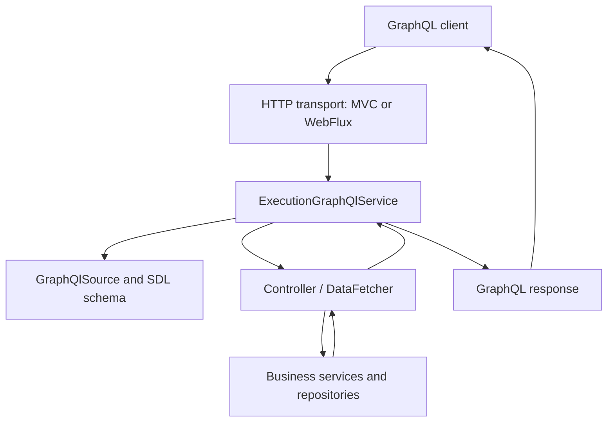

# spring-boot-starter-graphql

`spring-boot-starter-graphql` is the starter dependency for integrating Spring for GraphQL into a Spring Boot application. The starter brings the required libraries onto the classpath and enables Spring Boot to auto-configure foundational components such as the schema source, GraphQL execution service, and transport integrations when the corresponding dependencies are present in the application.

Adding the starter alone is not enough to have a complete HTTP API. The application still needs a GraphQL schema, controllers or resolvers to handle fields, and a transport such as Spring MVC or WebFlux to receive client requests. Understanding the role of each part helps avoid redundant configuration and makes startup issues easier to troubleshoot.

## 1. What Does the Starter Provide?

Spring for GraphQL connects GraphQL Java with the Spring programming model. Instead of manually building a `GraphQL` instance, parsing requests, and wiring each resolver by hand, the application declares an SDL schema and uses Spring components to handle fields.

When `spring-boot-starter-graphql` is added, Spring Boot can auto-configure the following core components, depending on the classpath and application configuration:

- Create a `GraphQlSource` from SDL schema files on the classpath.
- Create an `ExecutionGraphQlService` to execute GraphQL documents against the schema.
- Register controllers annotated with Spring for GraphQL annotations and bind methods to schema fields.
- Integrate the HTTP transport when the application has a matching Spring MVC or Spring WebFlux stack.
- Provide extension points for interceptors, exception resolvers, runtime wiring, and custom components.

The starter does not generate your domain schema, build database queries, or decide authorization rules. Those belong to the application's design and code.

At a high level, the processing flow can be visualized as follows:



The schema describes the API that clients are allowed to call. Controllers or `DataFetcher`s provide the execution logic for fields. Services and repositories handle business logic and data access. The transport is responsible for receiving and returning data over a specific protocol.

## 2. Adding the Dependency to Your Project

### 2.1. Maven

If the project uses `spring-boot-starter-parent` or imports Spring Boot dependency management, there is no need to declare a separate version for the starter:

```xml
<dependencies>
    <dependency>
        <groupId>org.springframework.boot</groupId>
        <artifactId>spring-boot-starter-graphql</artifactId>
    </dependency>

    <!-- Choose Spring MVC as the HTTP transport -->
    <dependency>
        <groupId>org.springframework.boot</groupId>
        <artifactId>spring-boot-starter-web</artifactId>
    </dependency>
</dependencies>
```

If the project already uses Spring WebFlux, you can use `spring-boot-starter-webflux` instead of `spring-boot-starter-web`:

```xml
<dependency>
    <groupId>org.springframework.boot</groupId>
    <artifactId>spring-boot-starter-webflux</artifactId>
</dependency>
```

Typically, choose one primary HTTP stack for the application. Adding both MVC and WebFlux at the same time forces Spring Boot to resolve multiple options on the classpath; only do so when your architecture truly requires it and you understand how Boot selects the application type.

### 2.2. Gradle

With Gradle and Spring Boot dependency management:

```groovy
dependencies {
    implementation 'org.springframework.boot:spring-boot-starter-graphql'
    implementation 'org.springframework.boot:spring-boot-starter-web'
}
```

If using the Kotlin DSL:

```kotlin
dependencies {
    implementation("org.springframework.boot:spring-boot-starter-graphql")
    implementation("org.springframework.boot:spring-boot-starter-web")
}
```

When using WebFlux, replace the Web MVC dependency with `spring-boot-starter-webflux`.

### 2.3. Letting Spring Boot Manage Versions

Spring Boot dependency management controls the versions of Spring for GraphQL, GraphQL Java, and related libraries that have been tested for compatibility together. In a standard Boot project, let the parent or BOM manage versions rather than upgrading `spring-graphql` or `graphql-java` independently.

If the project does not use the Spring Boot parent, import the corresponding BOM or declare a compatible set of versions according to the documentation for the Spring Boot version in use. Mixing independent versions can cause class-loading errors, missing-method errors, or behavior that differs from what Boot's auto-configuration expects.

## 3. Creating the SDL Schema

Spring Boot locates schemas according to the `spring.graphql.schema.locations` property. The common default location is `classpath:graphql/**/`, meaning the `graphql` directory inside resources and its subdirectories. Schema files typically use the `.graphqls` or `.gqls` extension.

Create the file:

```text
src/main/resources/
└── graphql/
    └── schema.graphqls
```

Contents of `schema.graphqls`:

```graphql
type Query {
    greeting(name: String = "Spring"): String!
}
```

The schema declares a root field named `greeting`, which accepts a `name` argument and returns a non-null string. The default value ensures that a query omitting the argument still produces a result.

The schema is the public contract of the GraphQL API. Field names, arguments, data types, and nullability must remain consistent with what the resolvers can actually return.

## 4. Writing a Controller to Handle Fields

Create a controller in a package scanned by Spring Boot component scanning:

```java
package com.example.graphql;

import org.springframework.graphql.data.method.annotation.Argument;
import org.springframework.graphql.data.method.annotation.QueryMapping;
import org.springframework.stereotype.Controller;

@Controller
public class GreetingController {

    @QueryMapping
    public String greeting(@Argument String name) {
        return "Hello, " + name + "!";
    }
}
```

`@Controller` registers the class as a Spring bean. `@QueryMapping` maps the method to the field with the same name on the root `Query` type; `@Argument` extracts the argument value from the GraphQL environment. Because the method is named `greeting`, the annotation does not need to repeat the field name.

If you want the method name to differ from the field name, you can specify the name explicitly:

```java
@QueryMapping(name = "greeting")
public String buildGreeting(@Argument String name) {
    return "Hello, " + name + "!";
}
```

When the application starts, Spring for GraphQL binds this mapping to the schema. A field declared in SDL without a suitable resolver can lead to execution errors or unexpected results; therefore, the schema and controllers should be developed in sync.

## 5. Running the Application and Sending a Query

With Spring MVC or WebFlux configured, the default GraphQL HTTP endpoint is `/graphql`. It can be changed via the `spring.graphql.path` property.

Example HTTP POST request:

```bash
curl -X POST http://localhost:8080/graphql \
  -H "Content-Type: application/json" \
  -d '{"query":"query { greeting(name: \"Lan\") }"}'
```

The response looks like:

```json
{
  "data": {
    "greeting": "Hello, Lan!"
  }
}
```

You can also send the query without passing the argument:

```graphql
query {
    greeting
}
```

The result uses the default value `Spring` defined in the schema. This is a GraphQL request sent over HTTP; GraphQL itself does not require every application to use HTTP, though HTTP is the standard transport for web and mobile APIs.

## 6. Configuring Commonly Used Properties

The properties below let you adjust the endpoint and schema locations without writing full Java configuration manually:

```yaml
spring:
  graphql:
    path: /graphql
    schema:
      locations: classpath:graphql/**/
      file-extensions: .graphqls,.gqls
    graphiql:
      enabled: true
```

Meaning:

| Property | Purpose |
| --- | --- |
| `spring.graphql.path` | Path of the HTTP GraphQL endpoint |
| `spring.graphql.schema.locations` | Locations to search for SDL files on the classpath |
| `spring.graphql.schema.file-extensions` | Schema file extensions to search for |
| `spring.graphql.graphiql.enabled` | Enables the GraphiQL UI when supported by the runtime and UI resources |

`GraphiQL` is a UI tool for testing queries and inspecting responses during development. Only enable this UI in appropriate environments; before enabling it in shared or production environments, evaluate access controls and your system's security policies.

There is no need to redeclare default values if they already suit your needs. When changing schema locations, ensure the SDL files are still packaged onto the classpath of the built artifact that actually runs.

## 7. How Does Auto-configuration Work?

Spring Boot inspects the classpath, existing beans, and configuration properties to decide which components need to be created. Because of this, the same starter can behave differently depending on the application.

At a high level:

1. The GraphQL dependencies provide the Spring for GraphQL and GraphQL Java classes.
2. Schema resources are discovered and used to build `GraphQlSource`.
3. Controllers and resolvers are detected and then wired to fields in the schema.
4. If a suitable web stack is present, the HTTP transport is configured to accept GraphQL requests.
5. Requests are passed to the execution service, executed against the schema, and responses are returned through the transport.

Auto-configuration is designed to be replaceable or extensible. When the application defines certain foundational beans itself, the corresponding auto-configuration can back off according to its conditions. Therefore, before defining your own `GraphQlSource` or transport handler, check which beans Boot already provides and why the default configuration does not yet meet your needs.

Avoid copying entire auto-configuration classes into your application just to change a small behavior. Prefer configuration properties, customizers, or extension points provided by Spring for GraphQL.

## 8. Testing Controllers with GraphQlTester

Spring for GraphQL provides `GraphQlTester` to test operations without manually inspecting the entire JSON response. For slice tests, `@GraphQlTest` focuses on the GraphQL infrastructure and the selected controllers.

Example:

```java
package com.example.graphql;

import org.junit.jupiter.api.Test;
import org.springframework.beans.factory.annotation.Autowired;
import org.springframework.boot.test.autoconfigure.graphql.GraphQlTest;
import org.springframework.graphql.test.tester.GraphQlTester;

@GraphQlTest(GreetingController.class)
class GreetingControllerTest {

    @Autowired
    GraphQlTester graphQlTester;

    @Test
    void greetingReturnsExpectedMessage() {
        graphQlTester.document("""
                query {
                    greeting(name: "Lan")
                }
                """)
            .execute()
            .path("greeting")
            .entity(String.class)
            .isEqualTo("Hello, Lan!");
    }
}
```

`GraphQlTester` focuses on the GraphQL result, so tests do not depend on JSON formatting or field ordering in the response. For testing over actual HTTP, you can use `HttpGraphQlTester` combined with `WebTestClient` to verify the transport, endpoint, and execution together.

When a controller depends on services, provide appropriate mocks or test beans for the slice test. When you need to verify that the database, security filters, serialization, and application configuration all work together, add integration tests with the full application context.

The test classpath needs Spring Boot test support and the `spring-graphql-test` module to provide `GraphQlTester`. In a Maven project, you can declare `spring-boot-starter-test` and `org.springframework.graphql:spring-graphql-test` with `test` scope, letting the Spring Boot BOM manage compatible versions.

## 9. Common Issues When Integrating the Starter

### 9.1. Application Runs but `/graphql` Is Inaccessible

Check whether the application has an HTTP transport. `spring-boot-starter-graphql` provides the GraphQL core; web applications need Spring MVC or WebFlux accordingly. Also verify `spring.graphql.path`, the server port, and any security or reverse proxy configuration.

### 9.2. Schema Not Found or Invalid Schema

Check that the file is located in `src/main/resources/graphql/`, uses a supported extension, and contains valid SDL. If you changed `spring.graphql.schema.locations`, verify that the classpath value points to the right directory after building.

### 9.3. Query Returns an Unresolved Field Error

Compare the root field name in the schema with the method name annotated with `@QueryMapping`, `@MutationMapping`, or `@SchemaMapping`. Check that the controller is component-scanned, the method is registered, and the return data matches the type declared in SDL.

### 9.4. Library Compatibility Errors

If you explicitly declared versions for `spring-graphql` or `graphql-java`, verify that they are compatible with your Spring Boot version. Prefer Boot's dependency management to avoid version mismatches between auto-configuration and runtime libraries.

### 9.5. GraphiQL UI Does Not Appear

Check `spring.graphql.graphiql.enabled`, the active environment, and whether GraphiQL UI resources are available on the classpath. Enabling the property cannot substitute for missing resources or runtime conditions.

## 10. Boundary Between the Starter and Application GraphQL Logic

The starter gives your application the foundation to run Spring for GraphQL. From there, subsequent layers are built according to your API requirements:

- SDL defines Query, Mutation, Subscription, object types, inputs, and scalars.
- `@QueryMapping` and `@MutationMapping` handle fields on root operations.
- `@SchemaMapping` maps fields of object types to Java methods.
- `@BatchMapping` or `DataLoader` batches data fetching to reduce N+1 queries.
- Exception resolvers standardize errors; Spring Security and authorization checks protect data at the field or business level.
- `GraphQlTester` and observability tools support testing, diagnostics, and query optimization.

Not all of these features are enabled automatically just by adding the starter. The starter provides integration and baseline configuration; the application still must declare schemas, write resolvers, wire services, define security policies, and choose the appropriate transport.

When starting a project, add `spring-boot-starter-graphql` with the right HTTP transport, create a small SDL schema, map one query with `@QueryMapping`, and test it using `GraphQlTester`. Once the minimal flow works, expand incrementally based on real requirements such as mutations, field mappings, batch loading, security, and subscriptions. This approach makes it clear which parts are auto-configured by Spring Boot and which belong to your application.
