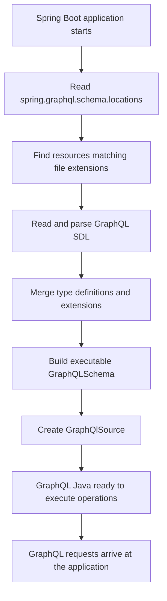

# Classpath Schema Locations

Spring Boot can automatically discover and load GraphQL SDL files during application startup. With this mechanism, you place schema files in your project's resource directory, and Spring for GraphQL combines those definitions to build an executable schema for GraphQL Java. The `spring.graphql.schema.locations` property tells Spring Boot where to search for schemas on the resource path; the `spring.graphql.schema.file-extensions` property determines which file extensions are accepted.

This configuration belongs to the Spring Boot integration layer of Spring for GraphQL. It determines where schema definitions are loaded from, not the endpoint URL, nor does it register resolver methods inside controllers.

## 1. What Is the Classpath in a Spring Boot Application?

The classpath is the collection of directories and JAR files that the JVM uses to locate classes and resources when running an application. In a standard Spring Boot project, the `src/main/resources` directory is copied onto the classpath by the build tool:

| Project Location | Typical Location After Build |
| --- | --- |
| Maven: `src/main/resources/graphql/` | `target/classes/graphql/` |
| Gradle: `src/main/resources/graphql/` | `build/resources/main/graphql/` |
| Inside a Spring Boot executable JAR | `BOOT-INF/classes/graphql/` |

Therefore, when configuring `classpath:graphql/`, you are referring to the `graphql` directory at the root of the resource classpath, not an absolute path on the development machine. When the application runs from a JAR, Spring can still read resources packaged inside that JAR.

Placing schemas in `src/main/resources/graphql` is a common convention:

```text
src/
└── main/
    └── resources/
        └── graphql/
            ├── schema.graphqls
            ├── book.graphqls
            └── author.graphqls
```

Files in this directory contain GraphQL SDL, such as declarations for `type Query`, `type Mutation`, object types, input types, enums, scalars, or interfaces. You can split the schema across multiple files so each part is easier to read and maintain.

## 2. Default Schema Location

With Spring Boot's default configuration for Spring for GraphQL, schemas are searched in the location:

```text
classpath:graphql/**/
```

The `**/` pattern enables searching inside the `graphql` directory and its subdirectories. For example, both of the following structures can be organized under the same resource root:

```text
src/main/resources/graphql/
├── schema.graphqls
├── book.graphqls
└── catalog/
    └── catalog.graphqls
```

```text
src/main/resources/graphql/
├── common/
│   └── scalars.graphqls
└── domain/
    ├── book.graphqls
    └── author.graphqls
```

Spring Boot also recognizes common schema extensions by default:

| Extension | Purpose |
| --- | --- |
| `.graphqls` | Standard extension used for GraphQL SDL schemas |
| `.gqls` | Alternate supported extension for SDL schemas |

For example, both `book.graphqls` and `author.gqls` can be recognized under the default configuration. A file placed in the right directory with an extension not in the configured list will not be treated as a schema resource to load.

## 3. Customizing Schema Locations

When you want to place schemas in another directory or combine schemas from multiple resource roots, configure `spring.graphql.schema.locations`. Example using YAML:

```yaml
spring:
  graphql:
    schema:
      locations:
        - classpath:graphql/**/
        - classpath:shared-graphql/**/
```

Or using `application.properties`:

```properties
spring.graphql.schema.locations=classpath:graphql/**/,classpath:shared-graphql/**/
```

In this example, Spring Boot searches for schemas in both locations. When setting a value for `locations`, list every resource root the application needs; do not assume the default location is automatically appended to the configured list.

Resource paths can use wildcards to search subdirectories. If schemas are deeply organized by domain, the `classpath:graphql/**/` pattern avoids having to list each subdirectory individually. If using a specific location, verify that the pattern covers the directory containing the files.

### Distinguishing `classpath:` and `classpath*:`

`classpath:` references resources on the classpath. When you need to collect resources matching a pattern from multiple classpath locations—such as schemas contributed by multiple dependency JARs—you can consider the `classpath*:` prefix:

```yaml
spring:
  graphql:
    schema:
      locations:
        - classpath*:graphql/**/
```

`classpath*:` is useful when intentionally designing shared modules or libraries that contribute schemas. Type and field names across modules must be managed carefully: all discovered resources are still combined to build one unified GraphQL schema, so conflicting definitions or invalid duplicates can prevent the application from starting.

Only use classpath-wide scanning when there is a specific need for it. For an application whose schemas live in its own resources, `classpath:graphql/**/` is usually simpler and easier to control.

## 4. Customizing File Extensions

The `spring.graphql.schema.file-extensions` property specifies which file suffixes are treated as schema resources. For example, if a project needs to keep an additional custom extension convention, you can declare:

```yaml
spring:
  graphql:
    schema:
      file-extensions:
        - .graphqls
        - .gqls
        - .graphql
```

When modifying this list, declare all extensions that the application should continue using. The example above retains both `.graphqls` and `.gqls` while adding `.graphql`.

The file extension only helps the resource scanner identify files. The file contents must still be valid GraphQL SDL. Renaming a file to `.graphqls` cannot fix syntax errors, undeclared types, or invalid fields in the schema.

## 5. Multiple SDL Files Forming One Schema

Splitting a schema into multiple files is a way to organize source code. When the application starts, Spring Boot locates resources using the configured locations and extensions, and Spring for GraphQL uses them to build a single schema for GraphQL Java. Clients still send operations to the same GraphQL API; clients do not need to know which file defines `Book`.

Example splitting a book schema across three files:

`schema.graphqls` declares the root query:

```graphql
type Query {
    bookById(id: ID!): Book
}
```

`book.graphqls` declares the object type:

```graphql
type Book {
    id: ID!
    title: String!
    author: Author
}
```

`author.graphqls` declares the author type:

```graphql
type Author {
    id: ID!
    name: String!
}
```

Mutually referencing definitions still belong to the same schema. If you need to add fields to a type already declared in another file, use an SDL type extension. For example, `book-search.graphqls` can contain:

```graphql
extend type Query {
    booksByAuthor(authorId: ID!): [Book!]!
}
```

`extend type Query` adds fields to the existing `Query`. This approach works well when each domain manages its own extensions to the root type. Avoid redeclaring standalone `type Query` blocks across multiple files as if each file were a separate schema; the files are combined into one schema, and duplicate type definitions can cause errors when parsing or building the schema.

Splitting files does not change how resolvers are written. For `Query.bookById`, you can still use `@QueryMapping`; for the `Book.author` field, you can use `@SchemaMapping` or `@BatchMapping` depending on how data is fetched:

```java
@Controller
public class BookController {

    private final BookService bookService;

    public BookController(BookService bookService) {
        this.bookService = bookService;
    }

    @QueryMapping
    public Book bookById(@Argument String id) {
        return bookService.findById(id);
    }
}
```

Schema locations determine which SDL files are loaded. Spring's component scanning and mapping mechanisms determine which controller beans are discovered. These are two separate configuration processes.

## 6. From Schema Resources to GraphQlSource

During auto-configuration, Spring Boot uses the schema configuration to find resources, then creates the GraphQL source configuration for Spring for GraphQL. `GraphQlSource` holds the built schema along with related runtime configuration. GraphQL Java uses this schema to validate operations and execute fields when requests arrive.

The startup sequence can be visualized as follows:



Resource discovery errors or SDL errors typically appear during application context initialization. Therefore, if a schema has a syntax error or references a missing type, the application may fail immediately on startup instead of waiting until a client sends a query.

`@QueryMapping`, `@SchemaMapping`, `@MutationMapping` methods, and other runtime configurations are wired into the executable schema build process. If the schema declares `Query.bookById` but the application lacks a corresponding mapping and has no suitable default fetcher, the operation may fail to return the expected data. Conversely, declaring a controller does not automatically create missing types or fields in SDL.

## 7. Verifying Resources After Building

A schema might be readable when running in an IDE yet be missing when running the executable JAR if resources are not placed or packaged properly. When encountering this situation, inspect the built artifact.

With Maven, default resources are usually copied to `target/classes/graphql`. With Gradle, resources are usually located in `build/resources/main/graphql`. Inside a Spring Boot executable JAR, application resources typically reside under `BOOT-INF/classes/graphql/`.

You can list the contents of a JAR using the command:

```bash
jar tf build/libs/application.jar
```

With Maven, substitute the path to the JAR generated in `target/`. Look for entries such as:

```text
BOOT-INF/classes/graphql/schema.graphqls
BOOT-INF/classes/graphql/book.graphqls
```

If the corresponding entries are absent, inspect your build tool's resource configuration and where the files sit in the project. The `src/test/resources` directory is only for the test classpath; schemas placed only there are not packaged into the production artifact.

## 8. Diagnosing Common Issues

| Symptom | Possible Cause | How to Check |
| --- | --- | --- |
| Schema not found at startup | Files lie outside the configured resource root | Check `src/main/resources/graphql` and `spring.graphql.schema.locations` |
| File exists but is not loaded | Extension is not listed in `file-extensions` | Check `.graphqls`, `.gqls`, or custom extension settings |
| Schemas in subdirectories are skipped | Resource pattern does not cover subdirectories | Use a suitable pattern such as `classpath:graphql/**/` |
| Works in IDE but fails from JAR | Resources are not packaged into the artifact | Inspect JAR contents and Maven or Gradle resources config |
| Duplicate type or type extension errors | Multiple files declare the same type or extend a non-existent root type | Search for the related `type` and `extend type` declarations |
| Query reports unknown field error | Field is not declared in SDL or misspelled | Check types and fields in the loaded schema |
| Field exists in SDL but returns no data | Resolver or property fetcher does not supply a matching value | Check `@QueryMapping`, `@SchemaMapping`, `@BatchMapping`, and source objects |

When diagnosing, separate three layers of causes. Resource location errors mean Spring cannot find the files. Parse or validation errors mean the SDL was read, but the schema definition is invalid. Mapping errors mean the schema contains the field, yet field data resolution is not wired correctly. Identifying the right layer avoids editing controllers when the actual issue is the resource path.

## 9. Environment-Specific Configuration Notes

If Spring Boot profiles use different schema directories, you can set `spring.graphql.schema.locations` in each profile's respective configuration file. Ensure every profile lists all required locations, because the configured list becomes the exact set of locations used for that environment.

In multi-module applications, standardize resource root conventions and type naming across modules. If a library contributes schemas via a JAR, explicitly design how the main application collects those resources, consider `classpath*:` only when scanning multiple classpath locations is truly necessary, and check for conflicts before integrating.

Do not confuse `spring.graphql.schema.locations` with `spring.graphql.path`. The former determines where Spring Boot locates SDL files when building the schema; the latter configures the HTTP path of the GraphQL endpoint. Changing one property does not change the other.

For a typical Spring for GraphQL application, keep schemas in `src/main/resources/graphql`, use the `.graphqls` extension, and customize locations only for clear reasons such as splitting schemas by domain or consuming schemas from shared modules. When configuring resource roots, verify both during local development runs and inside the executable JAR contents to ensure schemas are found across all deployment environments.
