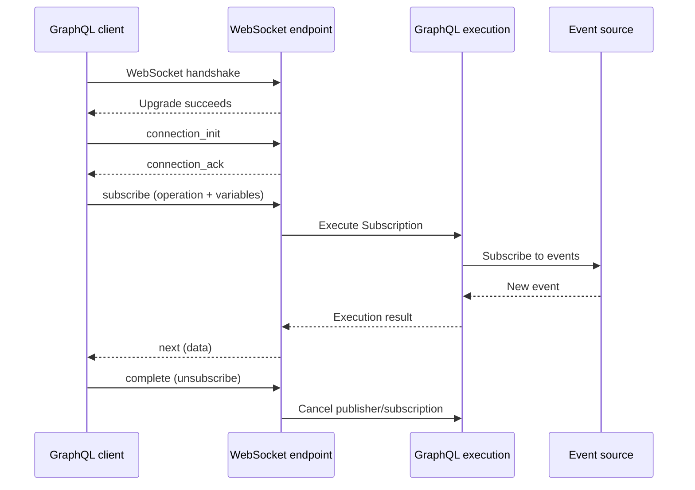

# GraphQL WebSocket Endpoint

In Spring for GraphQL, WebSocket is a transport mechanism that allows clients to maintain a bidirectional connection with the GraphQL server. It is commonly used for **Subscriptions**, when clients need to receive new events such as order statuses, product prices, or notifications without repeatedly sending requests.

Spring Boot can auto-configure a WebSocket endpoint for a Spring for GraphQL application. The application declares the endpoint path, exposes a field under the `Subscription` root type, and returns an event stream. Clients connect using the GraphQL over WebSocket protocol, send a subscription operation, and receive each result emitted by the server.

## What Problem Does the WebSocket Endpoint Solve?

With standard Queries and Mutations, a client sends an HTTP request and receives an HTTP response. This request/response model fits when the client actively asks for data or performs an action and waits for the result.

Subscriptions have a different requirement: the server needs to push data to the client whenever an event occurs. For instance, an order tracking page needs status updates from `CONFIRMED` to `PACKING`, then `SHIPPED`. Using polling alone forces the client to send repeated requests at fixed intervals. This can generate unnecessary requests, and data only updates on the next polling cycle.

WebSocket establishes a bidirectional connection that outlives a single HTTP request. Once connected, client and server can exchange multiple messages over the same connection. The server can emit events as soon as new data arrives, while the client can send messages to start or cancel a subscription.

| Component | Role |
| --- | --- |
| GraphQL Subscription | Describes the data or events the client wants to observe. |
| WebSocket | Provides a bidirectional, long-lived communication channel. |
| GraphQL WebSocket protocol | Defines the messages used to initialize connections, register operations, send results, and terminate operations. |
| Spring for GraphQL | Executes the operation and converts emitted values into GraphQL results. |

Subscription is the semantics of the GraphQL operation; WebSocket is a transport that can carry that operation. The two concepts are closely related but not synonymous. An application can use GraphQL Queries and Mutations over HTTP while using WebSocket for Subscriptions.

## Enabling the WebSocket Endpoint in Spring Boot

Spring Boot configures the GraphQL HTTP endpoint via `spring.graphql.path`. The WebSocket endpoint has its own property, `spring.graphql.websocket.path`. When the WebSocket property is declared and the application includes the corresponding WebSocket infrastructure, Spring Boot can register the handler for that endpoint.

The example below uses Spring MVC:

```kotlin
dependencies {
    implementation("org.springframework.boot:spring-boot-starter-graphql")
    implementation("org.springframework.boot:spring-boot-starter-web")
    implementation("org.springframework.boot:spring-boot-starter-websocket")
}
```

For an application using Spring WebFlux, use `spring-boot-starter-webflux` as the web stack instead of `spring-boot-starter-web`. Do not include both web starters in the same application unless you have a clear intention regarding which web application type should be initialized.

Declare the endpoints in `application.yml`:

```yaml
spring:
  graphql:
    path: /graphql
    websocket:
      path: /graphql-ws
      connection-init-timeout: 60s
```

In this configuration:

- `/graphql` is the HTTP endpoint for operations served over HTTP.
- `/graphql-ws` is the WebSocket endpoint for GraphQL over WebSocket.
- `connection-init-timeout` specifies how long the server waits for the connection initialization message after the WebSocket opens. Clients should send this message shortly after connecting.

The `spring.graphql.websocket.path` property is the switch that enables the endpoint in Spring Boot configuration. Without declaring the path, the WebSocket transport may not be registered even if the application already has a GraphQL HTTP endpoint. The actual path must match the URL used by clients and any reverse proxy configuration if the application runs behind a proxy.

In a local environment, clients can connect to `ws://localhost:8080/graphql-ws`. When deployed over HTTPS, clients must use `wss://` to encrypt the WebSocket connection.

## Declaring a Subscription in the Schema

The GraphQL schema needs a `Subscription` root type and the fields clients want to observe. The following example describes order status change events:

```graphql
type OrderStatusUpdate {
  orderId: ID!
  status: String!
  changedAt: String!
}

type Subscription {
  orderStatusChanged(orderId: ID!): OrderStatusUpdate!
}
```

The `orderStatusChanged` field accepts `orderId` to identify which order to watch. Each emitted event produces an `OrderStatusUpdate` object containing the order ID, new status, and timestamp of the change.

The `Subscription` root type only describes the GraphQL contract. To emit data, the server needs handler logic for this field returning a publisher or equivalent reactive type.

## Mapping a Subscription with Spring for GraphQL

In Spring for GraphQL, `@SubscriptionMapping` binds a controller method to a field on the `Subscription` root type. The method typically returns a `Publisher` or `Flux` representing a sequence of values emitted over time.

The example below assumes the application uses Reactor and the service provides an `eventsFor` method returning `Flux<OrderStatusUpdate>`:

```java
import org.springframework.graphql.data.method.annotation.Argument;
import org.springframework.graphql.data.method.annotation.SubscriptionMapping;
import org.springframework.stereotype.Controller;
import reactor.core.publisher.Flux;

@Controller
public class OrderSubscriptionController {

    private final OrderEventService orderEventService;

    public OrderSubscriptionController(OrderEventService orderEventService) {
        this.orderEventService = orderEventService;
    }

    @SubscriptionMapping
    public Flux<OrderStatusUpdate> orderStatusChanged(@Argument String orderId) {
        return orderEventService.eventsFor(orderId);
    }
}
```

When a client subscribes to the `orderStatusChanged` field, Spring for GraphQL invokes the mapping method and subscribes to the returned publisher to receive subsequent values. Each emitted value is processed as a GraphQL execution result and sent to the client over WebSocket.

`@Argument` extracts the `orderId` value from the operation. `@SubscriptionMapping` applies to the root Subscription field; nested fields inside the emitted object can still be handled with standard mapping mechanisms such as `@SchemaMapping` when needed.

The event-producing service can source data from a message broker, event bus, system change stream, or an internal publisher. Controllers should focus on mapping operations and delegate event-source management to services.

## Connection Lifecycle and the GraphQL over WebSocket Protocol

The initial WebSocket handshake still begins over HTTP. The client sends an upgrade request; if the server accepts, the connection switches to WebSocket and both sides start exchanging messages. Over this connection, GraphQL uses the `graphql-transport-ws` subprotocol to define how operations are exchanged.

The basic flow can be visualized as follows:



The main protocol messages include:

| Message | Direction | Meaning |
| --- | --- | --- |
| `connection_init` | Client → Server | Initializes the GraphQL session on the connection; can carry payloads such as authentication credentials. |
| `connection_ack` | Server → Client | Confirms that the server accepted the connection initialization. |
| `subscribe` | Client → Server | Starts an operation with query, operation name, and variables. |
| `next` | Server → Client | Delivers an execution result for the operation. A subscription may receive many of these messages. |
| `error` | Server → Client | Reports a protocol-level error terminating the operation. |
| `complete` | Bidirectional | Terminates an operation; the client can send it to cancel a subscription. |
| `ping`, `pong` | Bidirectional | Messages for checking or keeping connection liveness. |

When sending `subscribe`, the client supplies an ID to distinguish operations on the same connection. One WebSocket connection can carry multiple concurrent subscriptions; each operation has its own ID and lifecycle. The client can send `complete` for a specific ID to cancel that operation without closing the entire socket.

Abbreviated message examples:

```json
{
  "type": "connection_init",
  "payload": {
    "Authorization": "Bearer <access-token>"
  }
}
```

```json
{
  "id": "order-status-1",
  "type": "subscribe",
  "payload": {
    "query": "subscription WatchOrder($id: ID!) { orderStatusChanged(orderId: $id) { orderId status changedAt } }",
    "variables": {
      "id": "ORD-1001"
    }
  }
}
```

```json
{
  "id": "order-status-1",
  "type": "next",
  "payload": {
    "data": {
      "orderStatusChanged": {
        "orderId": "ORD-1001",
        "status": "SHIPPED",
        "changedAt": "2026-11-20T09:30:00Z"
      }
    }
  }
}
```

These messages illustrate the protocol; in real applications, a client library constructs and handles messages instead of assembling JSON manually.

## Connecting from a JavaScript Client

On the JavaScript side, you can use the `graphql-ws` library to connect to the endpoint. This library implements the modern `graphql-transport-ws` protocol; `graphql-ws` is the package name, while the subprotocol on the wire is `graphql-transport-ws`.

```javascript
import { createClient } from "graphql-ws";

const client = createClient({
  url: "ws://localhost:8080/graphql-ws",
  connectionParams: async () => ({
    Authorization: `Bearer ${accessToken}`
  })
});

const stop = client.subscribe(
  {
    query: `
      subscription WatchOrder($id: ID!) {
        orderStatusChanged(orderId: $id) {
          orderId
          status
          changedAt
        }
      }
    `,
    variables: { id: "ORD-1001" }
  },
  {
    next: (result) => {
      console.log("Order update:", result.data);
    },
    error: (error) => {
      console.error("Subscription error:", error);
    },
    complete: () => {
      console.log("Subscription completed");
    }
  }
);

// When leaving the screen or no longer needing updates:
// stop();
```

`connectionParams` provides the payload for the `connection_init` message; it does not automatically become an HTTP header on the WebSocket handshake. Server and client must agree on payload structure, how tokens are sent, and how tokens are validated.

Clients should stop subscriptions when the user leaves the screen or no longer needs updates. Canceling subscriptions allows the server to release publishers, listeners, and related resources. If a client simply closes the tab or loses network connectivity, the server also needs to handle connection closure and cancel active operations.

## Authentication and Authorization for WebSocket

WebSockets typically stay open far longer than a single HTTP request, so the authentication lifecycle must be designed carefully. You can authenticate during the handshake or handle the `connection_init` payload; in Spring for GraphQL, `WebSocketGraphQlInterceptor` is an extension point for WebSocket connection events, including connection initialization.

A typical workflow includes:

1. The client opens a WebSocket connection to the configured endpoint.
2. The client sends a token or credentials in the `connection_init` payload according to the application's convention.
3. The server verifies the token, expiration, and user identity. If invalid, the server rejects connection initialization or closes the connection per protocol.
4. As the client submits each operation, the server continues enforcing access permissions for the requested resources.
5. When a token expires, user permissions are revoked, or the connection is no longer valid, the application needs a policy to close the connection or require re-authentication.

Authenticating only when opening the socket is not enough to protect all data. For example, a user may view their own orders but must not subscribe to someone else's orders. Resolvers or services must check authorization for each `orderId` before creating the publisher. You can combine Spring Security, method security, and field- or resource-level authorization logic.

Key deployment considerations:

- **Encryption:** use `wss://` in production environments to protect tokens and data in transit.
- **Origin:** restrict which origins are allowed to open WebSockets, especially when clients run in browsers. HTTP CORS settings should not be treated as a substitute for WebSocket handshake origin validation.
- **Tokens:** avoid logging tokens; validate expiration and revocation throughout the connection lifecycle.
- **Authorization:** authenticate users at the connection level while still authorizing every operation and resource individually.
- **Resource limits:** cap connection counts, concurrent subscriptions, operation creation rates, and execution durations where appropriate for your system.
- **Multi-tenancy:** always scope subscriptions to the current principal's tenant or data boundary to prevent cross-tenant event leaks.

## Error Handling, Disconnections, and Resources

Errors when using WebSocket can arise across multiple layers:

| Scenario | Expected Handling |
| --- | --- |
| Handshake fails | Check URL, proxy, TLS, origin, and WebSocket server configuration. |
| `connection_ack` not received | Check the `connection_init` message, timeout, and connection authentication logic. |
| Invalid query or variables | Return an appropriate GraphQL error so the client can fix the operation or input data. |
| Resolver or event source error | Log the error with context, emit an appropriate error result, and terminate the operation if necessary. |
| Client sends `complete` | Cancel the publisher and release the listener for the corresponding subscription. |
| Network disconnects | Clean up operations belonging to the closed connection; the client decides whether to reconnect. |
| Server redeploys | Clients reconnect and re-subscribe to any subscriptions still needed. |

When a Subscription returns a publisher, subscription cancellation at the Reactive Streams layer should propagate upstream to the event source if the source supports cancellation. If the source is a message broker or manually managed listener, the service must unregister the listener when the publisher is canceled or the connection closes. Otherwise, the application can accumulate listeners and keep processing events for departed clients.

For high-throughput event streams, consider backpressure, buffering, and drop or conflation policies. Avoid keeping an unbounded queue per client. If a client cannot keep up with emission rates, the server needs explicit bounds to prevent uncontrolled memory growth.

Reconnection also needs application-level design. WebSocket does not automatically guarantee clients receive events missed while offline. If guaranteed delivery without missed events is required, payloads should include sequence numbers or event IDs, and the service should support resuming from an acknowledged position.

## Testing WebSocket Subscriptions

Testing Subscriptions requires verifying both GraphQL payloads and the connection lifecycle. In addition to testing service and resolver logic, Spring for GraphQL provides `WebSocketGraphQlTester` to test operations over WebSocket in an appropriate environment.

Cases worth testing:

- Connecting to the right WebSocket path and completing the initialization step.
- Valid subscriptions receiving events with expected structure and values.
- Variables being bound accurately to `@Argument`.
- Requests missing tokens or lacking permissions being rejected.
- Users being blocked from subscribing to resources belonging to another user or tenant.
- When the client cancels a subscription, the corresponding publisher and listener are released.
- When the event source errors or the socket closes, the client receives the appropriate terminal state.
- Multiple subscriptions on the same socket functioning and canceling independently.
- Reconnecting without creating duplicate listeners or orphaned subscriptions.

For integration tests, run the server on a random port or in a production-like test environment, create a WebSocket client, register a subscription, emit events from a test source, and assert the received messages. Also test timeouts and connection closures to uncover resource leaks.

## Common Configuration Issues

| Symptom | Causes to Check |
| --- | --- |
| HTTP `/graphql` works, but WebSocket fails to connect | `spring.graphql.websocket.path` is not configured, WebSocket support is missing, or the URL path is wrong. |
| Handshake succeeds, but no events arrive | Schema is missing the Subscription field, mapping is unregistered, or the publisher emits no values. |
| Client reports unsupported protocol | Client and server do not agree on the `graphql-transport-ws` subprotocol. |
| Connection closes before registering an operation | Client failed to send `connection_init` within timeout, or server rejected authentication. |
| Only the first event is received | Upstream publisher completes after the first event, or the service emits only a single value. |
| Events still arrive after user leaves the page | Subscription was not canceled, or the event source does not handle cancellation. |
| One client receives another client's data | Missing resource- or tenant-level authorization checks when creating the subscription. |

When debugging, inspect the URL and handshake, subprotocol, `connection_init`/`connection_ack`, `subscribe` message, and then the resolver and event source in sequence. This helps isolate whether the issue belongs to the connection layer, protocol layer, GraphQL layer, or business logic.

## When Should You Use a GraphQL WebSocket Endpoint?

WebSocket fits when clients need proactive, continuous, low-latency updates, such as:

- Tracking order statuses or processing progress.
- Dashboards that need metrics updated as new events arrive.
- Real-time chat, notifications, or collaborative apps.
- Monitoring prices, inventory, or device states.

For infrequently changing data or screens that only refresh on user action, Queries over HTTP are simpler. Polling can also suffice when latency is acceptable and maintaining long-lived connections is unnecessary. WebSockets increase operational requirements around concurrent connections, authentication, monitoring, and resource cleanup; therefore, enable them only for flows that genuinely need continuous data streams.

## Summary

The GraphQL WebSocket endpoint provides a bidirectional channel for clients to subscribe to Subscriptions and receive multiple results over a single connection. In Spring Boot, configure `spring.graphql.websocket.path` to enable the endpoint; declare fields under `Subscription` in the schema; and use `@SubscriptionMapping` in controllers to return a `Publisher` or `Flux` from an event source.

The `graphql-transport-ws` protocol governs connection initialization, operation registration, result delivery, and subscription cancellation. In production deployments, authenticate connections, authorize per resource, restrict origins, enforce resource limits, and ensure publishers are canceled when clients disconnect. Together, these practices keep real-time update streams reliable and secure in a Spring for GraphQL application.
