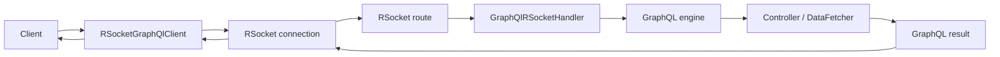

# GraphQL RSocket Transport

## Objectives

After this lesson, you will be able to:

- Explain the RSocket transport and how Spring for GraphQL transmits GraphQL operations over RSocket.
- Configure an RSocket GraphQL endpoint with Spring Boot.
- Distinguish an RSocket route from an HTTP URL path.
- Send Queries and Mutations using `RSocketGraphQlClient`.
- Receive Subscription data as a reactive stream.
- Recognize security, backpressure, connection lifecycle, and observability requirements when operating RSocket.

## 1. What Is the RSocket Transport?

GraphQL defines how clients request data and how the server returns results. To exchange requests and responses, GraphQL needs a transport. Spring for GraphQL supports multiple transports, including HTTP, WebSocket, and RSocket.

RSocket is an application protocol supporting bidirectional, asynchronous communication with built-in backpressure. It can run over underlying transports such as TCP or WebSocket. RSocket defines interaction models such as:

- **Request-response:** the client sends one request and receives one response.
- **Request-stream:** the client sends a request and receives a stream of multiple responses.
- **Fire-and-forget:** the client sends data without waiting for a response.
- **Request-channel:** both sides exchange bidirectional data streams.

In GraphQL, Queries and Mutations generally fit request-response. Subscriptions fit request-stream because the server can emit multiple results over time for the same operation.

The RSocket transport does not change the semantics of the GraphQL schema, Queries, Mutations, or Subscriptions. It changes how requests and responses are transmitted between client and server.

## 2. When Should You Use GraphQL over RSocket?

RSocket can fit well when an application needs persistent communication between services or clients, especially when streaming data and flow-rate control are needed.

Notable characteristics:

- **Bidirectional communication:** either side can proactively send data over an RSocket connection.
- **Multiplexing:** multiple interaction streams can share a single connection.
- **Backpressure:** the consumer can control how much data it wants to receive, preventing the producer from pushing data faster than it can process.
- **Reactive:** the request-stream model pairs naturally with `Mono` and `Flux` in Spring.
- **Multiple underlying transports:** can be deployed over TCP or WebSocket depending on the environment.

RSocket does not automatically make every API faster. For simple requests with small payloads and no streaming needs, HTTP is usually easier to deploy, observe, and integrate. Choose RSocket when your application's interaction model benefits from persistent connections and streaming.

## 3. Related Spring for GraphQL Components

Spring for GraphQL provides the following key components:

| Component | Role |
|---|---|
| `GraphQlRSocketHandler` | Handles GraphQL requests sent over RSocket on the server side |
| `RSocketGraphQlClient` | Sends GraphQL operations over RSocket on the client side |
| `RSocketRequester` | Creates and manages RSocket interactions in Spring Messaging |
| `GraphQlSource` | Provides the GraphQL schema and engine used to execute operations |
| Annotated controllers | Implement Query, Mutation, Subscription, and field mapping logic |

On the server side, GraphQL still uses the configured SDL schema and resolvers. The transport handler receives the payload, forwards it into GraphQL execution, and translates the result into a response suited to the RSocket interaction model.

On the client side, `RSocketGraphQlClient` implements the `GraphQlClient` API, so declaring documents, passing variables, and retrieving results closely mirror other GraphQL clients in Spring.



## 4. Adding Dependencies to a Spring Boot Application

The server application needs Spring for GraphQL and RSocket support. With Maven, declare the starters:

```xml
<dependencies>
    <dependency>
        <groupId>org.springframework.boot</groupId>
        <artifactId>spring-boot-starter-graphql</artifactId>
    </dependency>

    <dependency>
        <groupId>org.springframework.boot</groupId>
        <artifactId>spring-boot-starter-rsocket</artifactId>
    </dependency>
</dependencies>
```

Use Spring Boot's dependency management to manage compatible versions. Avoid pinning independent versions of Spring for GraphQL and Spring Messaging if the project already uses Spring Boot dependency management.

If an application acts only as a client, include the Spring GraphQL client and RSocket libraries appropriate for the target stack. `RSocketGraphQlClient` is the client for GraphQL communication over RSocket.

## 5. Configuring the RSocket Server and GraphQL Route

Spring Boot can configure the RSocket server via `spring.rsocket.server.*` properties. The `spring.graphql.rsocket.mapping` property specifies the RSocket route dedicated to GraphQL.

Example using TCP:

```yaml
spring:
  rsocket:
    server:
      transport: tcp
      port: 7000
  graphql:
    rsocket:
      mapping: graphql
```

In this example:

- `transport: tcp` selects TCP as the underlying transport for the RSocket server.
- `port: 7000` is the port the server listens on.
- `mapping: graphql` is the route clients use to send GraphQL operations.

An RSocket route is routing metadata within the RSocket protocol. It is not an HTTP URL path like `/graphql`. Therefore, client and server must agree on the route, such as `graphql`.

Spring Boot GraphQL auto-configuration combines with RSocket support to wire the RSocket transport to GraphQL execution. Existing GraphQL controllers continue to work. You do not need to write a separate set of resolvers just because the transport changed.

SDL schemas remain in the default location:

```text
src/main/resources/graphql/
```

Minimal schema example:

```graphql
type Query {
  book(id: ID!): Book
}

type Mutation {
  renameBook(id: ID!, title: String!): Book
}

type Subscription {
  bookEvents: BookEvent!
}

type Book {
  id: ID!
  title: String!
}

type BookEvent {
  bookId: ID!
  title: String!
}
```

Controllers still declare GraphQL mappings as usual:

```java
@Controller
public class BookController {

    private final BookService bookService;

    public BookController(BookService bookService) {
        this.bookService = bookService;
    }

    @QueryMapping
    public Mono<Book> book(@Argument String id) {
        return bookService.findById(id);
    }

    @MutationMapping
    public Mono<Book> renameBook(
            @Argument String id,
            @Argument String title) {
        return bookService.rename(id, title);
    }

    @SubscriptionMapping
    public Flux<BookEvent> bookEvents() {
        return bookService.bookEvents();
    }
}
```

These are reactive examples to illustrate the data flow. Concrete return types depend on your service and data-access layer. If using synchronous styles, controllers can still return plain objects for Queries or Mutations; Subscriptions require a publisher to emit multiple events.

## 6. Creating an RSocketGraphQlClient

On the client side, use `RSocketRequester` to establish a connection and pass the requester into `RSocketGraphQlClient`.

Example TCP connection to a server on port 7000:

```java
import org.springframework.graphql.client.RSocketGraphQlClient;
import org.springframework.messaging.rsocket.RSocketRequester;

RSocketRequester requester = RSocketRequester.builder()
        .tcp("localhost", 7000);

RSocketGraphQlClient graphQlClient =
        RSocketGraphQlClient.builder(requester)
                .route("graphql")
                .build();
```

Key points:

- `RSocketRequester.builder().tcp(...)` creates a requester connected to the RSocket server.
- `RSocketGraphQlClient.builder(requester)` creates a GraphQL client built on that connection.
- `route("graphql")` selects the route matching `spring.graphql.rsocket.mapping` on the server.

The client can be registered as a bean for reuse across services. In production applications, manage connection lifecycles alongside the application lifecycle, handle connection errors, and configure appropriate timeouts.

## 7. Sending a Query over RSocket

Once the client is created, sending a GraphQL document mirrors other Spring for GraphQL client APIs.

Example retrieving a single book:

```java
public Mono<Book> findBook(
        RSocketGraphQlClient graphQlClient,
        String id) {

    return graphQlClient.document("""
            query BookById($id: ID!) {
                book(id: $id) {
                    id
                    title
                }
            }
            """)
            .variable("id", id)
            .retrieve("book")
            .toEntity(Book.class);
}
```

Explanation:

1. `document(...)` declares the GraphQL operation.
2. `variable("id", id)` supplies the variable for the operation.
3. `retrieve("book")` selects the `book` field in the `data` section of the GraphQL response.
4. `toEntity(Book.class)` maps the result into a Java type.

The client returns `Mono<Book>`, aligning with the asynchronous and reactive model. If the server returns GraphQL errors or a transport error occurs, the client must handle each error category appropriately.

## 8. Sending a Mutation over RSocket

A Mutation is also a GraphQL operation. The difference lies in business semantics: mutations typically modify system state.

Example renaming a book:

```java
public Mono<Book> renameBook(
        RSocketGraphQlClient graphQlClient,
        String id,
        String title) {

    return graphQlClient.document("""
            mutation RenameBook($id: ID!, $title: String!) {
                renameBook(id: $id, title: $title) {
                    id
                    title
                }
            }
            """)
            .variable("id", id)
            .variable("title", title)
            .retrieve("renameBook")
            .toEntity(Book.class);
}
```

The RSocket transport does not change Mutation business rules. The server still must authenticate, authorize, validate input data, and execute appropriate transactions. Clients must also consider idempotency when retrying mutations, since a retry could execute the operation multiple times if the server already processed the prior request but the response was lost.

## 9. Receiving a Subscription as a Stream

Subscriptions fit scenarios where the server pushes events when data changes, such as order statuses, stock prices, or content updates.

With RSocket, a Subscription is represented as a request-stream. The client sends the operation once and receives multiple results over time.

Example:

```java
public Flux<BookEvent> subscribeBookEvents(
        RSocketGraphQlClient graphQlClient) {

    return graphQlClient.document("""
            subscription BookEvents {
                bookEvents {
                    bookId
                    title
                }
            }
            """)
            .retrieveSubscription("bookEvents")
            .toEntity(BookEvent.class);
}
```

`retrieveSubscription(...)` returns a reactive data stream. The client can handle each event using Reactor operators:

```java
subscribeBookEvents(graphQlClient)
        .doOnNext(event ->
                log.info("Book {} changed: {}",
                        event.bookId(), event.title()))
        .doOnError(error ->
                log.error("Subscription failed", error))
        .subscribe();
```

In real applications, retain and manage the `Disposable` returned by `subscribe()` so you can cancel the subscription when the screen, session, or owning component no longer needs events.

Avoid creating a new subscription on every UI re-render or method invocation without lifecycle management. Doing so can increase active stream counts and cause clients to receive duplicate events.

## 10. GraphQL Operations and RSocket Interaction Models

Selecting the interaction model depends on the GraphQL operation type:

| GraphQL operation | Typical RSocket interaction | Client outcome |
|---|---|---|
| Query | Request-response | Single result |
| Mutation | Request-response | Single result |
| Subscription | Request-stream | Multiple results over time |

Fire-and-forget does not fit normal GraphQL usage because clients need operation results and errors. Request-channel can be useful for specialized bidirectional application protocols, though it is not the default exchange model for GraphQL clients.

RSocket request-stream supports backpressure. Consumers can regulate event demand via the reactive subscription. However, backpressure does not replace business limits: the server still needs to control payload size, event emission rates, buffers, and resources per subscription.

## 11. Handling Errors at Both Layers

When using GraphQL over RSocket, distinguish between GraphQL execution errors and transport errors.

### GraphQL Errors

Examples:

- Query is invalid against the schema.
- User lacks permission to read a field.
- Resolver throws a business error.
- Returned data violates nullability.

GraphQL can return a response containing both `data` and `errors`. Partial data can still be returned if one field errors while other fields succeed.

### RSocket Transport Errors

Examples:

- Unable to connect to the server.
- Connection closed.
- Timeout or data transmission error.
- Route does not exist or is rejected.

These are communication-layer errors that can prevent the client from receiving a complete GraphQL response.

Clients should handle these two error groups separately. For GraphQL errors, inspect the error details and act according to business rules. For transport errors, consider reconnecting or bounded retries. Do not blindly retry every mutation because the operation may have succeeded before the connection dropped.

## 12. Security for RSocket GraphQL

RSocket does not automatically inherit all security mechanisms from HTTP endpoints. If an application exposes GraphQL over both HTTP and RSocket, explicitly define authentication and authorization policies for each transport.

Key aspects to implement:

- **Connection authentication:** identify the client using an authentication mechanism suited to RSocket.
- **Metadata:** pass authentication credentials via metadata using a convention agreed upon by server and client.
- **Route authorization:** restrict which clients can access the GraphQL route.
- **Field authorization:** enforce permissions inside resolvers or services, especially for sensitive data.
- **Transport protection:** use an underlying transport and security configuration appropriate for the deployment environment.
- **Resource limits:** limit connection counts, subscription counts, request rates, and payload sizes.

Spring Security supports securing RSocket. Security configuration should integrate with the application's authentication model, such as payload- or metadata-based authentication. Do not assume that configuring HTTP Security alone protects RSocket requests accordingly.

## 13. Backpressure, Connections, and Resilience

RSocket shines when the server emits streams, but the application must still design lifecycles and resource management carefully.

**Backpressure:** consumers request an amount of data matching their processing capacity. Servers should honor that demand and avoid unbounded buffers.

**Connection lifecycle:** connections can drop due to network issues, server restarts, or client shutdowns. Clients need to handle connection state, timeouts, and reconnections with clear policies.

**Subscription lifecycle:** each subscription consumes server resources. Cancel subscriptions when the client no longer needs them, and clean up publishers and related resources.

**Retries:** only retry operations with appropriate semantics. Queries are generally retryable when side-effect-free; Mutations require idempotency keys or business-level safeguards for safe retries.

**Observability:** monitor connection counts, request counts, active subscription counts, errors by route, latency, and transmitted data volume. For GraphQL, also track operation names and resolver execution durations to diagnose slowdowns.

## 14. Comparing HTTP, WebSocket, and RSocket

| Criterion | HTTP | WebSocket | RSocket |
|---|---|---|---|
| Communication model | Request-response | Persistent bidirectional connection | Request-response, stream, and channel |
| Query / Mutation | Well suited | Can be supported via application protocol | Well suited |
| Subscription | Requires extra mechanism or streaming transport | Well suited for event streams | Well suited for request-stream |
| Backpressure | No native Reactive Streams model in standard HTTP protocol | Application must manage manually | Built-in backpressure mechanism |
| Multiplexing | Typically relies on HTTP connections and protocol version features | Can be built at application layer | Supports multiple streams per connection |
| Browser integration | Very widespread | Directly supported | Depends on transport and client libraries |
| Operational complexity | Usually low | Moderate | Requires understanding routes, connections, and interaction models |

No single transport fits every system. HTTP is usually the most accessible choice for public APIs and browser clients. WebSocket fits applications needing a persistent bidirectional channel. RSocket fits reactive service-to-service communication or clients with streaming and backpressure requirements.

## 15. Deployment Checklist

Before bringing GraphQL RSocket into production, verify:

- [ ] GraphQL and RSocket dependencies compatible with your Spring Boot version are included.
- [ ] The RSocket server uses the transport and port appropriate for the deployment environment.
- [ ] The route in `spring.graphql.rsocket.mapping` matches the client's route.
- [ ] The SDL schema defines the required Query, Mutation, or Subscription types.
- [ ] Controllers and resolvers return types compatible with each operation.
- [ ] Queries and Mutations return accurate results via request-response.
- [ ] Subscriptions emit events and can be canceled cleanly along their lifecycle.
- [ ] Authentication, route authorization, and field authorization have been tested.
- [ ] Reasonable timeouts, retry policies, and resource limits are configured.
- [ ] Metrics and logging exist to observe connections, operations, and subscriptions.

## Conclusion

The GraphQL RSocket transport enables Spring for GraphQL to exchange operations over the RSocket protocol. Queries and Mutations typically use request-response; Subscriptions use request-stream to deliver multiple results over time. Spring Boot configures the RSocket route via `spring.graphql.rsocket.mapping`, while clients use `RSocketGraphQlClient` together with `RSocketRequester`.

Choosing RSocket should be driven by requirements for bidirectional communication, streaming, backpressure, and connection topology. In production, carefully manage routes, security, subscription lifecycles, retries, timeouts, and observability to keep the API reliable.

## References

- [Spring for GraphQL — Transports](https://docs.spring.io/spring-graphql/reference/transports.html)
- [Spring for GraphQL — RSocket](https://docs.spring.io/spring-graphql/reference/transports.html#server.rsocket)
- [Spring Boot — Spring for GraphQL](https://docs.spring.io/spring-boot/reference/web/spring-graphql.html)
- [Spring Framework — RSocket](https://docs.spring.io/spring-framework/reference/rsocket.html)
