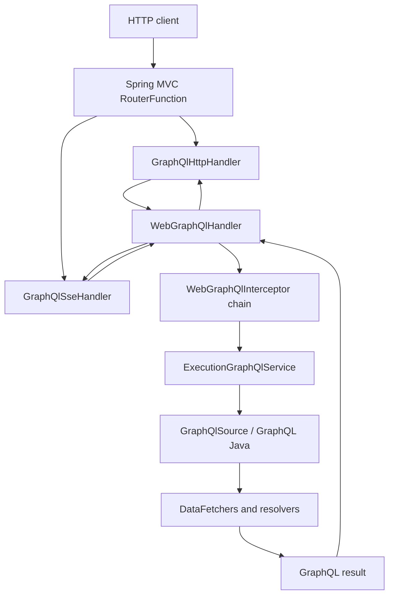

# GraphQlWebMvcAutoConfiguration

When adding Spring for GraphQL to a Spring Boot application using Spring MVC, you typically only need to declare the starter and write schemas along with resolvers. Spring Boot automatically builds the HTTP wiring for GraphQL. The class behind this mechanism is `GraphQlWebMvcAutoConfiguration`.

This auto-configuration class detects a Servlet application with the necessary GraphQL components, connects the GraphQL execution service to HTTP handlers, and registers routes for clients to send requests. It also integrates interceptors, Server-Sent Events (SSE), CORS, and development endpoints depending on the Spring Boot version and configuration.

This lesson focuses on how the auto-configuration is activated, the key beans it creates, the request flow, endpoint configuration, customization options, and how to diagnose why a GraphQL endpoint does not appear.

## 1. Position of GraphQlWebMvcAutoConfiguration

Spring for GraphQL separates GraphQL execution from the transport protocol. The GraphQL engine parses the document, validates against the schema, invokes data fetchers, and produces a result. The transport layer receives requests over HTTP, forwards them to the engine, and writes HTTP responses.

In Spring MVC, `GraphQlWebMvcAutoConfiguration` configures the HTTP transport layer built on Spring MVC. The architecture can be visualized as follows:



Each component has its own responsibility:

| Component | Responsibility |
| --- | --- |
| `RouterFunction` | Matches requests targeting the GraphQL endpoint and routes them to the handler |
| `GraphQlHttpHandler` | Handles GraphQL over standard HTTP request/response |
| `GraphQlSseHandler` | Handles GraphQL over Server-Sent Events, primarily for streaming subscription results |
| `WebGraphQlHandler` | Builds the interceptor chain and forwards requests to the execution service |
| `WebGraphQlInterceptor` | Intercepts before/after the GraphQL engine runs, e.g. copying HTTP headers into the GraphQL context |
| `ExecutionGraphQlService` | Coordinates execution of a GraphQL request |
| `GraphQlSource` | Supplies the schema and GraphQL Java configuration |

`GraphQlWebMvcAutoConfiguration` is not where you write business logic for querying books, users, or orders. Resolvers such as `@QueryMapping` and `@SchemaMapping` still live in application controllers or data fetcher components. Auto-configuration handles delivering requests into the GraphQL pipeline.

## 2. Conditions for Activating the Auto-configuration

In Spring Boot 3.x, this class resides in the package:

```java
org.springframework.boot.autoconfigure.graphql.servlet
```

In Spring Boot 4.x, the package moved to:

```java
org.springframework.boot.graphql.autoconfigure.servlet
```

The class name remains the same while the package changed due to Spring Boot 4's auto-configuration module organization. When reading stack traces, checking `@SpringBootApplication(exclude = ...)`, or searching for the class in an IDE, use the package matching your project's dependency version.

In Spring Boot 3.5, the primary conditions declared on the class look like this:

```java
@AutoConfiguration(after = GraphQlAutoConfiguration.class)
@ConditionalOnWebApplication(type = ConditionalOnWebApplication.Type.SERVLET)
@ConditionalOnClass({ GraphQL.class, GraphQlHttpHandler.class })
@ConditionalOnBean(ExecutionGraphQlService.class)
@EnableConfigurationProperties(GraphQlCorsProperties.class)
public class GraphQlWebMvcAutoConfiguration {
    // @Bean definitions serving GraphQL over Spring MVC
}
```

Meaning of each condition:

| Annotation | Meaning |
| --- | --- |
| `@AutoConfiguration(after = GraphQlAutoConfiguration.class)` | MVC configuration runs after core GraphQL configuration so the execution service has already had a chance to be created |
| `@ConditionalOnWebApplication(type = SERVLET)` | Applies only when the application runs in Servlet mode, typically Spring MVC |
| `@ConditionalOnClass(...)` | GraphQL Java classes and the Spring MVC HTTP handler must be on the classpath |
| `@ConditionalOnBean(ExecutionGraphQlService.class)` | The context must contain a GraphQL execution service |
| `@EnableConfigurationProperties(GraphQlCorsProperties.class)` | Registers CORS configuration properties dedicated to the GraphQL endpoint |

Thus, adding `spring-boot-starter-graphql` alone will not create an MVC endpoint. The application also needs the Web MVC starter and a valid GraphQL execution service. If the project uses WebFlux, Spring Boot selects `GraphQlWebFluxAutoConfiguration` for the reactive application type instead of MVC configuration.

### Why Must It Run After GraphQlAutoConfiguration?

`GraphQlAutoConfiguration` handles core GraphQL setup, including `GraphQlSource`, `ExecutionGraphQlService`, and controller support components. `GraphQlWebMvcAutoConfiguration` requires `ExecutionGraphQlService` to construct `WebGraphQlHandler`.

This ordering reflects the dependency relationship: the application must first have a schema and GraphQL execution service before wrapping that service with an HTTP transport.

## 3. Key Beans Created

In Spring Boot 3.5, this configuration class exposes the core beans below. Some internal details may vary between Spring Boot versions; cross-check the Javadoc/source for your exact project version when inspecting deeply.

### WebGraphQlHandler

This bean connects `ExecutionGraphQlService` with the list of `WebGraphQlInterceptor`s:

```java
@Bean
@ConditionalOnMissingBean
public WebGraphQlHandler webGraphQlHandler(
        ExecutionGraphQlService service,
        ObjectProvider<WebGraphQlInterceptor> interceptorsProvider) {

    return WebGraphQlHandler.builder(service)
            .interceptors(interceptorsProvider.orderedStream().toList())
            .build();
}
```

`ObjectProvider` lets Spring retrieve registered interceptors without requiring the application to declare at least one interceptor. `orderedStream()` retrieves beans in Spring-determined order, so ordering can be controlled via `@Order` or `Ordered`.

`WebGraphQlHandler` is a crucial intermediary layer. It keeps the HTTP handler decoupled from knowing how to execute the schema or invoke resolvers. The handler simply forwards requests to the GraphQL processing chain above.

### GraphQlHttpHandler

This bean handles GraphQL requests over standard HTTP:

```java
@Bean
@ConditionalOnMissingBean
public GraphQlHttpHandler graphQlHttpHandler(
        WebGraphQlHandler webGraphQlHandler) {

    return new GraphQlHttpHandler(webGraphQlHandler);
}
```

The handler reads the GraphQL request from the HTTP payload, forwards it to `WebGraphQlHandler`, and converts the result into an HTTP response. With Spring MVC, JSON reading and writing uses the `HttpMessageConverter` infrastructure configured for MVC.

### GraphQlSseHandler

In newer Spring Boot versions with SSE support, auto-configuration also creates `GraphQlSseHandler`:

```java
@Bean
@ConditionalOnMissingBean
public GraphQlSseHandler graphQlSseHandler(
        WebGraphQlHandler webGraphQlHandler,
        GraphQlProperties properties) {

    return new GraphQlSseHandler(
            webGraphQlHandler,
            properties.getHttp().getSse().getTimeout(),
            properties.getHttp().getSse().getKeepAlive());
}
```

This handler uses the same `WebGraphQlHandler`, but writes results using the Server-Sent Events protocol. It is useful when clients want to receive subscription events over an HTTP stream. Timeout and keep-alive properties control the stream connection lifecycle.

### RouterFunction

The `RouterFunction<ServerResponse>` bean registers routes for GraphQL. This is what makes the handlers reachable via HTTP URLs:

```java
@Bean
@Order(0)
public RouterFunction<ServerResponse> graphQlRouterFunction(
        GraphQlHttpHandler httpHandler,
        GraphQlSseHandler sseHandler,
        ObjectProvider<GraphQlSource> graphQlSourceProvider,
        GraphQlProperties properties) {

    String path = properties.getPath();

    return RouterFunctions.route()
            .route(GraphQlRequestPredicates.graphQlHttp(path),
                    httpHandler::handleRequest)
            .route(GraphQlRequestPredicates.graphQlSse(path),
                    sseHandler::handleRequest)
            .build();
}
```

This is an abbreviated example illustrating the router's role. Depending on the version, the actual implementation may also register routes for unsupported methods, GraphiQL, or the schema printer.

`@Order(0)` matters when an application has multiple `RouterFunction`s. The GraphQL router takes precedence according to this order. If you declare another route matching `/graphql`, check its order and predicate so requests are not intercepted by another route first.

The `WebGraphQlHandler`, `GraphQlHttpHandler`, and `GraphQlSseHandler` beans typically carry `@ConditionalOnMissingBean`. If the application defines a bean of the same type, Spring Boot skips creating the corresponding default bean. This serves as a customization extension point, and is also a common reason default behavior changes.

## 4. Processing Flow of an HTTP GraphQL Request

Suppose a client sends a query fetching a greeting:

```graphql
type Query {
  greeting(name: String!): String!
}
```

Controller handling the field:

```java
@Controller
public class GreetingController {

    @QueryMapping
    public String greeting(@Argument String name) {
        return "Hello, " + name;
    }
}
```

Client sends the request:

```http
POST /graphql
Content-Type: application/json
Accept: application/json

{
  "query": "query Greeting($name: String!) { greeting(name: $name) }",
  "variables": {
    "name": "An"
  }
}
```

The request goes through these steps:

1. Spring MVC receives the HTTP request and finds the `RouterFunction` with a matching predicate.
2. The GraphQL route dispatches the request to `GraphQlHttpHandler`.
3. `GraphQlHttpHandler` forwards the GraphQL request to `WebGraphQlHandler`.
4. `WebGraphQlHandler` runs each registered `WebGraphQlInterceptor` in sequence.
5. `ExecutionGraphQlService` passes the document and variables to the GraphQL engine via `GraphQlSource`.
6. The GraphQL engine validates the document against the schema, then invokes the `greeting` resolver.
7. The result flows back through the handlers and is serialized into an HTTP response.

A successful response looks like:

```json
{
  "data": {
    "greeting": "Hello, An"
  }
}
```

Remember that `GraphQlWebMvcAutoConfiguration` only builds the path from HTTP to GraphQL execution. What `greeting` returns is decided by the controller; the schema defines fields and types; and the GraphQL engine validates and executes the operation.

## 5. Default Endpoint and How to Change It

Under Spring Boot's default configuration, the GraphQL HTTP endpoint is `POST /graphql`. You can change the path with `spring.graphql.path`:

```properties
spring.graphql.path=/api/graphql
```

After this change, clients send requests to `POST /api/graphql`.

Example using `curl`:

```bash
curl -X POST http://localhost:8080/api/graphql \
  -H "Content-Type: application/json" \
  -H "Accept: application/json" \
  -d '{"query":"query Greeting($name: String!) { greeting(name: $name) }","variables":{"name":"An"}}'
```

In practice, rely on valid JSON produced by an HTTP client rather than concatenating query and variable strings manually from user input.

### HTTP Method and Content Type

The HTTP handler accepts `POST` with `Content-Type: application/json` by default; the body contains the GraphQL document and optional properties such as `variables`, `operationName`, or `extensions`.

Do not assume `GET /graphql` will execute queries. GET support is disabled by default in `GraphQlHttpHandler`. Enabling GET requires configuring both the handler and the corresponding request predicate; additionally, GET must not be used to run mutations.

### Distinguishing HTTP Errors from GraphQL Errors

An HTTP request can succeed at the transport layer while the GraphQL operation still contains errors. For example:

- A body that is not valid JSON, missing credentials, or an unavailable server can result in HTTP 4xx/5xx.
- A syntactically or semantically invalid GraphQL document has status mapping that depends on the response media type and protocol version.
- Once a request has been parsed and validated successfully, errors during resolver execution are normally represented in the `errors` array of the GraphQL response; the HTTP status usually remains `200 OK`.

Therefore, when debugging clients, inspect the HTTP status, response body, and `errors`. Never look at status `200` alone and conclude every resolver succeeded.

## 6. Configuring GraphiQL and Schema Printer

GraphiQL is a browser UI for testing queries and inspecting the schema. In Spring Boot, this UI is disabled by default and can be enabled in development environments:

```properties
spring.graphql.graphiql.enabled=true
```

The default path is usually `/graphiql`; it can be customized via `spring.graphql.graphiql.path`.

Schema Printer allows exporting the schema in text form via a supporting endpoint. It can be enabled with:

```properties
spring.graphql.schema.printer.enabled=true
```

With the default `/graphql` endpoint, the schema printer is accessible at `/graphql/schema`. This is a helpful tool during development and schema inspection. Before enabling it in production, weigh the exposure of your API structure and protect the endpoint according to system policies.

Example configuration strictly for a development profile:

```properties
# application-dev.properties
spring.graphql.graphiql.enabled=true
spring.graphql.schema.printer.enabled=true
```

Do not place developer-convenience options into shared configuration if production environments have no need for them.

## 7. CORS for the GraphQL Endpoint

If the frontend runs on a different origin than the backend, browsers may send a CORS preflight before sending GraphQL requests. `GraphQlWebMvcAutoConfiguration` enables CORS property configuration for the GraphQL endpoint through `GraphQlCorsProperties`.

Example:

```yaml
spring:
  graphql:
    cors:
      allowed-origins: "https://app.example.com"
      allowed-methods: POST, OPTIONS
      allowed-headers: Content-Type, Authorization
      max-age: 1800s
```

List only the origins, methods, and headers that clients genuinely need. If the application uses cookies or credentials, configure CORS credentials and explicit origins according to Spring's rules; do not combine `allowCredentials=true` with a wildcard `*` origin.

CORS is only a browser mechanism controlling whether JavaScript may read cross-origin responses. It does not replace authentication, authorization, or CSRF protection. The API must still authenticate and authorize requests on the server.

## 8. Interceptors: Extending the Request Pipeline

Applications often need to read HTTP metadata such as correlation IDs, tenant IDs, or auth headers and place them into the GraphQL context. `WebGraphQlInterceptor` enables doing this before and after the GraphQL engine processes a request.

Spring GraphQL provides `HttpRequestHeaderInterceptor` to copy selected HTTP headers into the GraphQL context. Example registering the `X-Request-Id` header:

```java
@Configuration
public class RequestHeaderInterceptorConfig {

    @Bean
    HttpRequestHeaderInterceptor requestIdHeaderInterceptor() {
        return HttpRequestHeaderInterceptor.builder()
                .mapHeader("X-Request-Id")
                .build();
    }
}
```

Resolvers can read values placed into the context using `@ContextValue`, or access `GraphQLContext` directly when needed. This is useful for correlation IDs and tenant metadata. Avoid logging or returning secret tokens in responses.

Spring Boot automatically discovers `WebGraphQlInterceptor` beans and wires them into the default `WebGraphQlHandler`. You can declare multiple interceptors and control ordering with `@Order`:

```java
@Component
@Order(10)
public class TenantInterceptor implements WebGraphQlInterceptor {
    // Resolve tenant and add info to the GraphQL context
}
```

Interceptors fit cross-cutting request concerns such as tracing, context propagation, header handling, or adjusting execution inputs/results. Field-specific authorization logic still belongs in the appropriate security or resolver layer.

## 9. SSE and WebSocket for Subscriptions

Queries and mutations typically return a single response. Subscriptions need a channel capable of pushing multiple results over time. Spring for GraphQL supports multiple transports for this scenario.

### Server-Sent Events

In Spring Boot versions supporting SSE, `GraphQlWebMvcAutoConfiguration` creates `GraphQlSseHandler` and registers an SSE predicate at the same endpoint path. Clients send requests with `Accept: text/event-stream`; responses are streamed as one or more events.

SSE fits server-to-client data streams. It does not provide a bidirectional channel like WebSocket. Spring for GraphQL uses SSE primarily for subscriptions; regular queries and mutations continue using HTTP JSON.

### WebSocket

The WebSocket endpoint is not enabled by default. For Servlet applications, add `spring-boot-starter-websocket` and set `spring.graphql.websocket.path`. Example:

```gradle
dependencies {
    implementation("org.springframework.boot:spring-boot-starter-graphql")
    implementation("org.springframework.boot:spring-boot-starter-web")
    implementation("org.springframework.boot:spring-boot-starter-websocket")
}
```

```properties
spring.graphql.websocket.path=/graphql
```

Once enabled, clients must use a compatible GraphQL over WebSocket protocol, typically `graphql-transport-ws` from the `graphql-ws` library. Declaring `type Subscription` in the schema alone is not enough to open WebSocket connections; the server needs both the transport and an event-emitting resolver.

WebSockets maintain long-lived connections, so cap resources, connection counts, and concurrent subscriptions according to your deployment scale. With MVC, the WebSocket handler relies on Servlet WebSocket infrastructure; exact configuration details depend on the Spring Boot version and servlet container.

## 10. Customizing Beans and When Auto-configuration Backs Off

Spring Boot uses `@ConditionalOnMissingBean` for default beans such as `WebGraphQlHandler`, `GraphQlHttpHandler`, and `GraphQlSseHandler` in versions supporting SSE. If the application declares a matching bean before auto-configuration evaluates its conditions, the default bean of that type is not created.

For example, when you want to configure the interceptor chain manually, you can provide your own `WebGraphQlHandler`:

```java
@Configuration
public class CustomGraphQlWebConfiguration {

    @Bean
    WebGraphQlHandler webGraphQlHandler(
            ExecutionGraphQlService service,
            List<WebGraphQlInterceptor> interceptors) {

        return WebGraphQlHandler.builder(service)
                .interceptors(interceptors)
                .build();
    }
}
```

When this bean exists, auto-configuration backs off from creating the default `WebGraphQlHandler`. The default `GraphQlHttpHandler` can still be created and receive that customized `WebGraphQlHandler` bean.

Avoid recreating all beans just to tweak one small behavior. If you only need to read headers or populate context, declaring a `WebGraphQlInterceptor` is usually simpler. If you only want to change the URL, use `spring.graphql.path`. If you only want to configure CORS, use `spring.graphql.cors.*`.

The default `RouterFunction` is registered separately with `@Order(0)`. When declaring a custom route on the same path, check route ordering and predicates carefully. Adding another `RouterFunction` does not automatically replace the default route bean; it can result in requests being matched by another route first or conflicting routes.

## 11. Testing the Real MVC Endpoint

`GraphQlTester` is useful for testing GraphQL execution. To test both the Spring MVC transport and the `/graphql` route, you can use `MockMvc` with `@SpringBootTest` and `@AutoConfigureMockMvc`.

```java
@SpringBootTest
@AutoConfigureMockMvc
class GraphQlHttpEndpointTests {

    @Autowired
    MockMvc mockMvc;

    @Test
    void servesGraphQlQueryOverHttp() throws Exception {
        mockMvc.perform(post("/graphql")
                .contentType(MediaType.APPLICATION_JSON)
                .accept(MediaType.APPLICATION_JSON)
                .content("""
                        {
                          "query": "query Greeting($name: String!) { greeting(name: $name) }",
                          "variables": { "name": "An" }
                        }
                        """))
                .andExpect(status().isOk())
                .andExpect(jsonPath("$.data.greeting")
                        .value("Hello, An"));
    }
}
```

This test assumes the schema and `GreetingController` are loaded in the application context. When using `MockMvc`, verify that the test setup actually builds a Spring MVC context with the GraphQL route. If using only `@GraphQlTest`, tests verify controllers and execution but do not necessarily exercise the full HTTP router as `@SpringBootTest` does.

Beyond successful requests, also verify:

- POST with an invalid `Content-Type` is rejected appropriately.
- GET `/graphql` is rejected when GET support is disabled.
- Requests with malformed JSON or missing payloads are handled at the HTTP layer.
- Valid queries encountering resolver errors return GraphQL `errors`.
- CORS preflight responses include headers matching your configuration.
- Endpoints with customized paths work at the new URL and legacy expectations fail/redirect as intended.

## 12. Diagnosing When `/graphql` Does Not Work

When the endpoint does not appear, inspect activation conditions from outside in:

1. Is this a Servlet application? If it uses WebFlux, check `GraphQlWebFluxAutoConfiguration`.
2. Are `spring-boot-starter-graphql` and `spring-boot-starter-web` on the runtime classpath?
3. Are `graphql.GraphQL` and `org.springframework.graphql.server.webmvc.GraphQlHttpHandler` on the classpath?
4. Did `GraphQlAutoConfiguration` create `ExecutionGraphQlService`? Check that schemas were found and parsed cleanly.
5. Did a custom bean or exclude configuration cause auto-configuration to back off?
6. Was `spring.graphql.path` changed to something other than `/graphql`?
7. Is a custom `RouterFunction` matching the same path with higher precedence?

You can enable the condition evaluation report with the `--debug` flag when starting Spring Boot. The logs show which auto-configurations matched or missed and which conditions failed. If Spring Boot Actuator is added and the conditions endpoint is exposed, you can inspect `/actuator/conditions` to view the auto-configuration condition evaluation results.

| Symptom | Possible Cause | How to Check |
| --- | --- | --- |
| No `/graphql` route | MVC auto-configuration did not match conditions | Check condition report, servlet application type, and classpath |
| Missing `ExecutionGraphQlService` bean | Core GraphQL auto-configuration failed to create the service | Check schemas, `GraphQlSource`, and replaced/excluded beans |
| HTTP 404 | Wrong path or unregistered router | Check `spring.graphql.path` and router functions |
| HTTP 405 on GET | GET is disabled by default | Use POST or explicitly enable GET on both handler and predicate |
| HTTP 415 | Unsupported `Content-Type` | Send `application/json` with a GraphQL JSON payload |
| Response has `errors` with HTTP 200 | GraphQL execution ran, but a resolver or field errored | Inspect `errors`, `path`, `locations`, and resolver logs |
| GraphiQL inaccessible | GraphiQL is disabled or wrong path | Check `spring.graphql.graphiql.enabled` and path |
| Subscription does not stream | SSE/WebSocket not enabled or resolver does not return a publisher | Check transport, `Accept` header, and subscription resolver |
| CORS blocked by browser | Origin/method/header not permitted | Check `spring.graphql.cors.*` and preflight responses |

## 13. Common Misconceptions

| Misconception | Accurate Understanding |
| --- | --- |
| Having the GraphQL starter automatically gives an HTTP endpoint | A matching transport is required. For MVC, you need Web MVC and `GraphQlWebMvcAutoConfiguration` conditions met |
| `GraphQlWebMvcAutoConfiguration` creates business resolvers | Resolvers are registered by GraphQL controllers/data fetchers; auto-configuration mainly sets up transport |
| `/graphql` is a `@RestController` | Boot uses a `RouterFunction` to route requests to `GraphQlHttpHandler` |
| HTTP 200 means the query had no errors | GraphQL execution errors can appear in `errors` even when HTTP status is 200 |
| Having `type Subscription` enables WebSocket | You must enable the transport, configure its path, and provide an event-emitting resolver |
| Declaring a `WebGraphQlInterceptor` replaces the default handler | Interceptors are added to the default chain; only customize `WebGraphQlHandler` when you truly need full chain control |
| MVC and WebFlux share the same auto-configuration | They have separate handlers and auto-configurations per application type |

## 14. Practice Exercise

Create a small Spring Boot application exposing a GraphQL endpoint over Spring MVC:

1. Add `spring-boot-starter-graphql` and `spring-boot-starter-web`.
2. Create `src/main/resources/graphql/schema.graphqls` with field `Query.greeting(name: String!): String!`.
3. Create `GreetingController` with a `@QueryMapping` method returning a greeting.
4. Run the application and send a POST request to `/graphql` using `curl` or Postman.
5. Change the endpoint to `/api/graphql` via `spring.graphql.path` and update the client.
6. Register a `WebGraphQlInterceptor` to put `X-Request-Id` into the GraphQL context.
7. Enable GraphiQL in the dev profile and verify it remains disabled in the production profile.
8. Write MockMvc tests verifying successful requests, GET requests, and invalid content types.

After completing the exercise, answer these questions: which conditions prevent `GraphQlWebMvcAutoConfiguration` from activating? How does `WebGraphQlHandler` differ from `GraphQlHttpHandler`? Why is the GraphQL route built with `RouterFunction`? When changing the endpoint path, which components need updating? When adding request info to the GraphQL context, should you start with an interceptor or replace the entire handler?

## 15. References

- [Javadoc GraphQlWebMvcAutoConfiguration – Spring Boot 3.5](https://docs.spring.io/spring-boot/3.5/api/java/org/springframework/boot/autoconfigure/graphql/servlet/GraphQlWebMvcAutoConfiguration.html)
- [Javadoc GraphQlWebMvcAutoConfiguration – Spring Boot 4.x](https://docs.spring.io/spring-boot/4.0-SNAPSHOT/api/java/org/springframework/boot/graphql/autoconfigure/servlet/GraphQlWebMvcAutoConfiguration.html)
- [Spring GraphQL – Server Transports](https://docs.spring.io/spring-graphql/reference/transports.html)
- [Spring Boot – Spring for GraphQL](https://docs.spring.io/spring-boot/3.4/reference/web/spring-graphql.html)

When reading source code or writing auto-configuration exclusions, always check your actual Spring Boot version. Packages, supporting beans, and configured transports may vary across release branches, though the primary role of `GraphQlWebMvcAutoConfiguration` remains enabling Spring GraphQL on Spring MVC.
