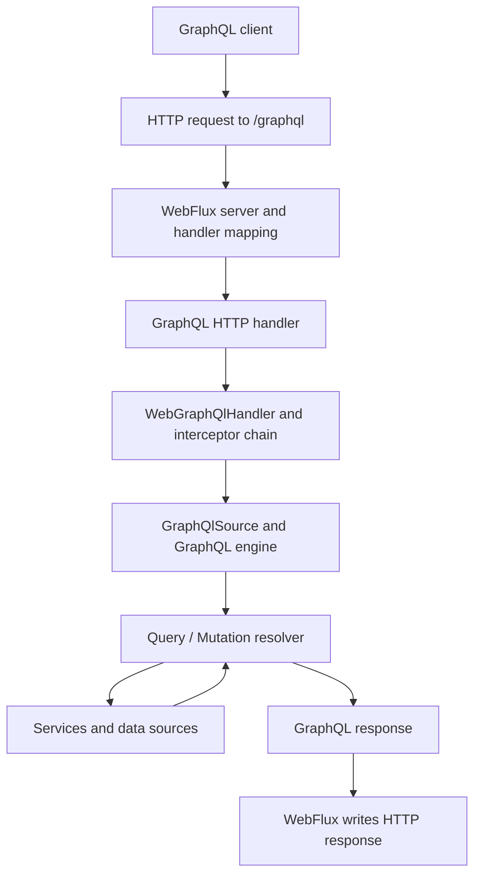

# GraphQlWebFluxAutoConfiguration

## Objectives

After this lesson, you will be able to:

- Explain the role of `GraphQlWebFluxAutoConfiguration` in a Spring Boot application using Spring for GraphQL and Spring WebFlux.
- Distinguish shared GraphQL configuration from WebFlux's reactive HTTP integration.
- Understand how Boot registers the GraphQL endpoint automatically and its common configuration points.
- Recognize the conditions required for WebFlux auto-configuration to apply and how to handle applications having both MVC and WebFlux.
- Customize handlers, interceptors, security, CORS, and test GraphQL endpoints on WebFlux.

## Position of GraphQlWebFluxAutoConfiguration

Spring for GraphQL provides a GraphQL API independent of the web stack. Spring Boot wires these components into the application's runtime environment through auto-configuration. `GraphQlWebFluxAutoConfiguration` is the integration layer for reactive web applications built on Spring WebFlux.

When an application has a GraphQL schema and uses WebFlux, clients send HTTP requests to a GraphQL path. WebFlux auto-configuration connects the WebFlux request to the GraphQL handler so operations execute against the schema and registered resolvers.

The roles of the configuration layers can be grouped into three tiers:

| Tier | Responsibility | Representative Components |
| --- | --- | --- |
| Shared GraphQL | Reads schemas, creates `GraphQlSource`, registers runtime wiring and execution components | `GraphQlAutoConfiguration`, `GraphQlSource` |
| WebFlux Integration | Connects GraphQL handlers to reactive HTTP and configured WebFlux transports | `GraphQlWebFluxAutoConfiguration` |
| Application Business Logic | Supplies data and business rules for each field | `@Controller`, `@QueryMapping`, `@SchemaMapping`, services |

Importantly, `GraphQlWebFluxAutoConfiguration` does not replace schemas or resolvers. It brings GraphQL onto the reactive web stack. The schema still defines the API, while controllers and `DataFetcher`s supply the data.

## Conditions for Activating Auto-configuration

WebFlux auto-configuration only applies when the application genuinely runs under the reactive model and the required libraries are on the classpath. In practice, the following are needed:

- Spring Boot GraphQL starter to integrate Spring for GraphQL with Boot.
- Spring WebFlux to provide the reactive web runtime.
- A GraphQL schema and `GraphQlSource` built by shared GraphQL configuration.
- The application being detected by Boot as a reactive web application.

Both dependencies are commonly declared together in Gradle:

```groovy
dependencies {
    implementation 'org.springframework.boot:spring-boot-starter-graphql'
    implementation 'org.springframework.boot:spring-boot-starter-webflux'
}
```

Or with Maven:

```xml
<dependencies>
    <dependency>
        <groupId>org.springframework.boot</groupId>
        <artifactId>spring-boot-starter-graphql</artifactId>
    </dependency>
    <dependency>
        <groupId>org.springframework.boot</groupId>
        <artifactId>spring-boot-starter-webflux</artifactId>
    </dependency>
</dependencies>
```

Spring Boot manages compatible versions through the dependency management of the Boot version in use. Avoid mixing isolated versions of Spring for GraphQL, Spring Framework, and GraphQL Java when the project already uses Spring Boot dependency management.

### When Both WebFlux and MVC Are Present

A project may accidentally or intentionally pull both `spring-boot-starter-web` and `spring-boot-starter-webflux` onto the classpath. When both are present, Spring Boot typically selects Spring MVC as the web application type under its default detection rules. Merely adding the WebFlux dependency does not guarantee the application runs reactively.

If the application's intent is WebFlux, inspect the dependency tree and remove the MVC starter if unnecessary. When both libraries must be retained, explicitly specify the application type:

```properties
spring.main.web-application-type=reactive
```

Selecting the web application type determines which auto-configuration is applied. A controller returning `Mono` or `Flux` does not by itself turn an MVC application into WebFlux.

## GraphQL Request Processing Flow on WebFlux

For HTTP, the conceptual processing flow looks like this:



WebFlux accepts requests under the reactive model. The GraphQL handler turns the HTTP request into a GraphQL execution call, then passes the response back to WebFlux. The GraphQL engine parses the operation, validates against the schema, and invokes the required resolvers.

These steps distinguish two common failure categories:

- HTTP/WebFlux-layer errors: wrong path, unsupported method, CORS, authentication, or unreadable request body.
- GraphQL-layer errors: operation syntax errors, missing fields, invalid arguments, or exceptions thrown by resolvers.

A request can reach the right endpoint and still fail during GraphQL validation or resolver execution. Hence, when debugging, inspect the HTTP status, the GraphQL response body, and server logs.

## Default Endpoint and Path Configuration

Spring Boot provides configuration to adjust the GraphQL HTTP path. The common default path is `/graphql`:

```properties
spring.graphql.path=/graphql
```

Clients send queries or mutations to this path, typically via HTTP `POST` with `Content-Type: application/json`:

```http
POST /graphql
Content-Type: application/json
```

```json
{
  "query": "query BookById($id: ID!) { bookById(id: $id) { id title } }",
  "operationName": "BookById",
  "variables": {
    "id": "book-101"
  }
}
```

If `spring.graphql.path` is changed to `/api/graphql`, clients must call the new path. Changing the endpoint does not change field names or the GraphQL schema. It is strictly an HTTP-layer setting.

Paths may differ across applications and Boot versions. In operations, verify the effective configuration bound in the running environment instead of assuming the endpoint is always `/graphql`.

## Schemas and Runtime Wiring Remain Managed by Shared GraphQL Configuration

SDL schemas are normally placed in `src/main/resources/graphql/`. Example:

```graphql
type Query {
  bookById(id: ID!): Book
}

type Book {
  id: ID!
  title: String!
}
```

Spring Boot GraphQL auto-configuration finds schemas at the default location, builds `GraphQlSource`, and applies `RuntimeWiringConfigurer`s and customizers registered by the application. `GraphQlWebFluxAutoConfiguration` builds on this GraphQL infrastructure when integrating with WebFlux.

If you need to extend runtime wiring, declare a `RuntimeWiringConfigurer` bean:

```java
@Configuration
public class GraphQlRuntimeConfiguration {

    @Bean
    RuntimeWiringConfigurer runtimeWiringConfigurer() {
        return wiringBuilder -> wiringBuilder.scalar(MyScalars.DATE);
    }
}
```

This example shows where custom scalars are registered; `MyScalars.DATE` is an application-defined scalar. You do not need to rebuild the entire `GraphQlSource` just to add a scalar or a small runtime wiring adjustment. Add customizers or configurers through the extension points provided by Boot and Spring for GraphQL.

## Combining with Reactive Annotated Controllers

GraphQL controllers still use the familiar annotations. The difference lies in return types and how services access data.

Example schema:

```graphql
type Query {
  bookById(id: ID!): Book
}

type Book {
  id: ID!
  title: String!
}
```

Controllers can return `Mono<Book>`:

```java
@Controller
public class BookController {

    private final BookService bookService;

    public BookController(BookService bookService) {
        this.bookService = bookService;
    }

    @QueryMapping
    public Mono<Book> bookById(@Argument("id") String id) {
        return bookService.findById(id);
    }
}
```

In this example, `BookService.findById` returns `Mono<Book>`. When using WebFlux alongside reactive data access such as R2DBC or reactive MongoDB, the pipeline stays asynchronous down to the data source. If the underlying service still uses blocking JDBC, wrapping the result in `Mono` does not turn the blocking call into a non-blocking operation. Use an appropriate scheduler or choose reactive drivers if the goal is to keep execution non-blocking.

For nested fields, you can use `@SchemaMapping` returning `Mono<Author>` or another suitable type. For collections or relationships requiring batch loading, `@BatchMapping` and DataLoader help curb N+1 queries. WebFlux does not solve N+1 on its own; batching is a responsibility of resolver and data-access design.

## WebSocket and Subscriptions

GraphQL Subscriptions need a transport capable of maintaining a connection so the server can push multiple results. With WebFlux, Spring for GraphQL can integrate WebSocket when the application enables and configures the corresponding endpoint.

Configuration example:

```properties
spring.graphql.websocket.path=/graphql
```

When the WebSocket path is configured, subscription clients connect to the specified WebSocket endpoint. The WebSocket path may share the same path as the HTTP GraphQL endpoint if configuration and server support that setup. Do not assume subscriptions work automatically just because `@SubscriptionMapping` is declared; the transport, handshake, and event publisher must all be set up.

A subscription mapping can return a `Flux`:

```java
@Controller
public class BookSubscriptionController {

    private final BookEventService eventService;

    public BookSubscriptionController(BookEventService eventService) {
        this.eventService = eventService;
    }

    @SubscriptionMapping
    public Flux<Book> bookAdded() {
        return eventService.bookAdded();
    }
}
```

`Flux` represents a stream of events. Design subscription cancellation, resource limits, and connection authentication carefully. When a client disconnects, the server-side pipeline should release the corresponding event subscription resources.

## Customizing Handlers and Interceptors

Spring for GraphQL provides `WebGraphQlInterceptor` to intercept requests and responses at the WebGraphQL layer. Interceptors are useful for cross-cutting concerns such as logging, correlation IDs, adding request metadata into context, or standardizing metadata.

Example of a simple interceptor:

```java
@Component
public class RequestIdInterceptor implements WebGraphQlInterceptor {

    @Override
    public Mono<WebGraphQlResponse> intercept(
            WebGraphQlRequest request, Chain chain) {

        String requestId = request.getHeaders().getFirst("X-Request-Id");
        request.configureExecutionInput((input, builder) ->
                builder.graphQLContext(context ->
                        context.put("requestId", requestId)).build());
        return chain.next(request);
    }
}
```

This is a conceptual example; verify the exact interceptor API of your Spring for GraphQL version when implementing. Never trust client-supplied header values as verified identity. A correlation ID may be accepted or generated on the server, whereas user identity must come from an authentication mechanism.

Interceptors can be registered as beans to join the processing chain. When adding resolver-specific logic or per-field permission checks, choose the appropriate extension point rather than stuffing all business logic into an HTTP interceptor.

## CORS and Endpoint Security

GraphQL typically funnels many operations through a single endpoint. Therefore, endpoint-level security configuration must pair with operation- and field-level authorization.

For CORS, permit only the required origins, methods, and headers. Illustrative configuration example:

```properties
spring.graphql.cors.allowed-origins=https://app.example.com
spring.graphql.cors.allowed-methods=GET,POST
spring.graphql.cors.allowed-headers=Authorization,Content-Type,X-Request-Id
```

Available CORS properties and list syntax can vary by Boot version; consult the configuration metadata for your project's version. CORS is a browser policy and does not replace server-side authentication or authorization.

If the application uses Spring Security WebFlux, endpoint protection rules are configured via `SecurityWebFilterChain`. Illustrative example:

```java
@Bean
SecurityWebFilterChain springSecurityFilterChain(ServerHttpSecurity http) {
    return http
        .authorizeExchange(exchanges -> exchanges
            .pathMatchers("/graphql").authenticated()
            .anyExchange().permitAll())
        .build();
}
```

The path in `pathMatchers` must match the effective `spring.graphql.path`. With cookie-based authentication, account for CSRF according to your application's security model. With bearer tokens, configure the resource server and validate tokens properly.

Endpoint authentication only answers who is calling. The application also needs authorization per operation and field. For example, an authenticated user might still be barred from viewing internal book fields or executing administrative mutations. Checks can live in services, method security, or resolvers so every access path is protected.

## Testing GraphQL on WebFlux

GraphQL can be tested at multiple levels:

- `GraphQlTester` tests GraphQL execution without depending on a specific HTTP client.
- `WebGraphQlTester` tests the WebGraphQL layer and interceptors.
- `HttpGraphQlTester` pairs with `WebTestClient` to test the HTTP endpoint.
- WebSocket GraphQL testing utilities are used when verifying subscriptions over a live transport.

Example creating an HTTP tester from `WebTestClient`:

```java
WebTestClient webTestClient = WebTestClient
    .bindToApplicationContext(context)
    .configureClient()
    .baseUrl("/graphql")
    .build();

HttpGraphQlTester graphQlTester = HttpGraphQlTester.create(webTestClient);
```

Then execute an operation:

```java
graphQlTester.document("""
        query BookById($id: ID!) {
            bookById(id: $id) {
                id
                title
            }
        }
        """)
    .variable("id", "book-101")
    .execute()
    .path("bookById.title")
    .entity(String.class)
    .isEqualTo("Spring in Practice");
```

In slice or integration tests, ensure the context loads schemas, controllers, and required beans. Beyond GraphQL results, also verify HTTP status codes, CORS, security filters, and interceptors when they fall within scope.

## Customizing Auto-configuration Properly

Spring Boot auto-configuration is built to be replaced or extended as needed. When an application defines custom beans, `@ConditionalOnMissingBean` on default configurations prevents the corresponding default beans from being created. This is Boot's standard back-off mechanism.

Before overriding handlers or WebFlux configuration, identify exactly which default beans are created and which extension points are supported. Prefer:

1. Using application properties for changes with built-in configuration properties.
2. Registering `WebGraphQlInterceptor` for shared request/response processing.
3. Registering `RuntimeWiringConfigurer` or `GraphQlSourceBuilderCustomizer` for schema and runtime wiring.
4. Configuring handlers or mappings manually only when higher-level extension points cannot achieve the required behavior.

When declaring replacement beans, inspect auto-configuration conditions and make sure two handlers are not bound to the same path. Enable Boot's auto-configuration condition report whenever you need to see why a configuration was applied or skipped.

## Common Issues and Diagnostics

| Symptom | Possible Cause | How to Check |
| --- | --- | --- |
| No `/graphql` endpoint | Missing GraphQL/WebFlux starter, app runs as MVC, or auto-configuration excluded | Check dependencies, web application type, and condition report |
| HTTP 404 at endpoint | Path changed or request targets wrong context path | Check `spring.graphql.path`, context path, and client URL |
| Request reaches endpoint but GraphQL errors | Operation violates schema, invalid arguments, or resolver throws exception | Check GraphQL response, schema, and resolver logs |
| App unexpectedly chooses MVC | Both MVC and WebFlux are on the classpath | Inspect dependency tree and `spring.main.web-application-type` |
| Reactive resolver is still slow | Blocking call inside the pipeline | Check JDBC, blocking HTTP clients, and schedulers |
| Subscription fails to connect | WebSocket path not configured or transport/handshake mismatch | Check WebSocket configuration and handshake logs |
| Browser reports CORS error | Origin, method, or header not permitted | Check CORS policy and preflight request |
| GraphQL denied even when endpoint is reachable | Security filter or field-level authorization rejects request | Check principal, security chain, and permissions in services/resolvers |

When you need to see which auto-configurations were applied, run the application with Spring Boot debug mode or examine the condition evaluation report in startup logs. This report reveals which classpath, web application type, and bean conditions caused a configuration to activate or back off.

## Comprehensive Practice

Create a Spring Boot application using GraphQL and WebFlux with a library API:

1. Add `spring-boot-starter-graphql` and `spring-boot-starter-webflux`.
2. Declare a schema with `Query.bookById(id: ID!): Book`.
3. Write a controller returning `Mono<Book>` and a service backed by a reactive repository.
4. Start the application, send an HTTP POST to the GraphQL path, and verify the response.
5. Change `spring.graphql.path` and verify clients must call the new path.
6. Add a security rule for the endpoint and enforce access permissions on sensitive fields.
7. If subscriptions are needed, enable the WebSocket path, emit a `Flux<Book>`, and test both connection and subscription cancellation.
8. Try adding the MVC starter to observe which web application type Boot selects, then set the application type explicitly and compare results.

During practice, watch startup logs and the condition report to observe when `GraphQlWebFluxAutoConfiguration` activates. This helps build an understanding of auto-configuration from real application behavior.

## Summary

`GraphQlWebFluxAutoConfiguration` integrates Spring for GraphQL with Spring WebFlux's reactive web runtime. It relies on shared GraphQL infrastructure such as schemas and `GraphQlSource`, then connects GraphQL handlers to WebFlux requests/responses and configured transports. For this auto-configuration to activate, the application must have the required dependencies and be detected as a reactive web application. Endpoints, WebSockets, CORS, security, interceptors, and tests must all be configured according to real requirements. WebFlux supports reactive processing, yet it neither converts blocking code to non-blocking automatically nor eliminates N+1 queries by itself.
