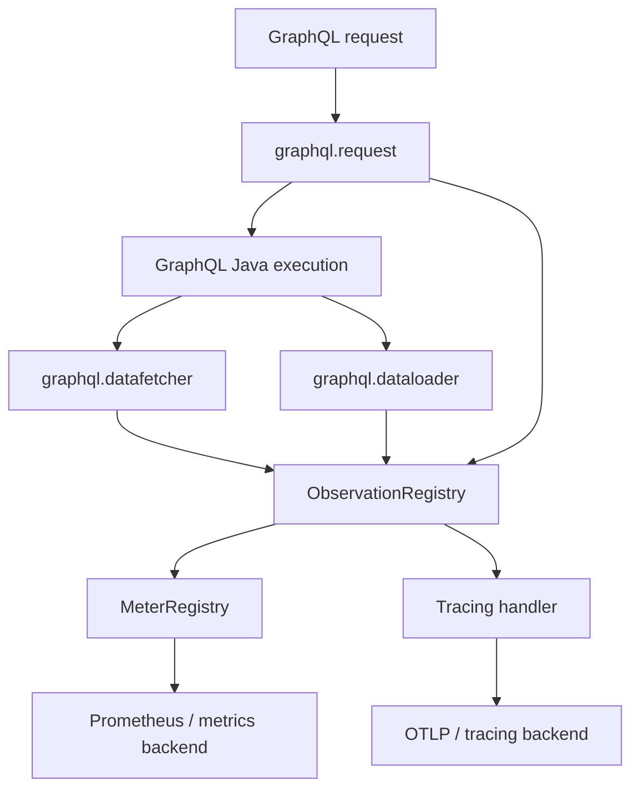

# Micrometer in Spring GraphQL

## 1. Why Does a GraphQL API Need Observability?

A GraphQL request can invoke multiple resolvers within a single operation. The client sends only one request, yet the server may execute multiple database queries, call external services, run DataLoaders, and resolve nested fields. If you only measure total HTTP duration, operations teams have a hard time knowing which part of the GraphQL execution is slow or causing errors.

Observability helps observe the internal state of an application from the data emitted by the system. The three commonly cited pillars are:

- **Metrics:** aggregated measurements over time such as request count, error rate, latency, and P95/P99 percentiles.
- **Traces:** the trace of a request across multiple components, showing child spans and the timing relationships between them.
- **Logs:** events and detailed information used to diagnose a specific situation.

Spring Boot uses Micrometer Observation as a unified abstraction for metrics and traces. Spring for GraphQL integrates Micrometer to measure the entire GraphQL request, non-trivial DataFetchers, and DataLoader activity. As a result, applications can track performance at both the operation level and the field/batch level.

## 2. What Is Micrometer Observation?

Micrometer provides a facade so an application can emit measurements without depending directly on a specific monitoring system. Micrometer Observation is a higher-level abstraction that describes an operation to be observed and provides accompanying metadata.

Main components:

| Component | Role |
| --- | --- |
| `Observation` | Represents a measured operation with start/stop timestamps, error status, and metadata |
| `ObservationRegistry` | Registry managing the lifecycle and handlers of an Observation |
| `ObservationConvention` | Defines the observation name, contextual name, and default KeyValues |
| `ObservationHandler` | Receives start/stop events to create metrics, spans, or logs |
| `MeterRegistry` | Registers and stores meters such as Timer, Counter, and Gauge |
| Tracing bridge/exporter | Converts observations into traces and sends them to a tracing system |

A single Observation can be processed by multiple handlers. For example, the same GraphQL request can create a Timer in `MeterRegistry` and a span in a tracing backend. The application keeps a consistent way of emitting Observations, while the backend is selected via dependencies and configuration.

## 3. Which Observations Does Spring for GraphQL Create?

Spring for GraphQL provides `GraphQlObservationInstrumentation` in the `org.springframework.graphql.observation` package. This instrumentation hooks into GraphQL Java execution to create three groups of Observations:

| Observation name | Measurement scope | When it is created |
| --- | --- | --- |
| `graphql.request` | The entire GraphQL execution request | Every executed Query, Mutation, or Subscription operation |
| `graphql.datafetcher` | A field data fetching operation | For DataFetchers considered non-trivial |
| `graphql.dataloader` | A batch data load invocation | For `@BatchMapping` and manually registered DataLoaders |

One request can create one `graphql.request` Observation, multiple `graphql.datafetcher` Observations, and multiple `graphql.dataloader` Observations. Child Observations are linked to the request so traces can display the execution tree.



Note: a field that simply reads a property directly from a Java object is usually a trivial operation and does not create a `graphql.datafetcher` Observation. The goal is to focus on actual data-fetching work and avoid creating excessive Observations for ordinary property reads.

## 4. `graphql.request`: Tracking the Entire Operation

The `graphql.request` Observation measures the execution time of a GraphQL request. It applies to both imperative and reactive applications, as well as the transports supported by Spring for GraphQL.

By default convention, the low-cardinality KeyValues include:

| Key | Meaning | Example |
| --- | --- | --- |
| `graphql.operation.type` | Operation type | `query`, `mutation`, `subscription`, `operation` |
| `graphql.outcome` | Execution outcome | `SUCCESS`, `REQUEST_ERROR`, `INTERNAL_ERROR` |

`graphql.operation.type` takes the standard name `query`, `mutation`, or `subscription`. If the document cannot be parsed to determine the operation type, the value is `operation`.

Rules for `graphql.outcome`:

- `SUCCESS`: GraphQL produces a valid response and the response has no errors.
- `REQUEST_ERROR`: the document cannot be parsed or the response has errors, but no error of type `INTERNAL_ERROR`.
- `INTERNAL_ERROR`: a valid GraphQL response could not be produced or the response contains at least one error of type `INTERNAL_ERROR`.

Default high-cardinality KeyValues:

| Key | Meaning |
| --- | --- |
| `graphql.execution.id` | The `ExecutionId` of the GraphQL request |
| `graphql.operation.name` | Operation name provided by the client |

Spring for GraphQL also records GraphQL errors as Observation Events. When a tracing handler processes these events, they can appear as span events to aid diagnostics.

## 5. `graphql.datafetcher`: Finding Slow Fields

A GraphQL operation can have multiple DataFetchers. The `graphql.datafetcher` Observation measures the execution time of non-trivial DataFetchers, such as resolvers that call a service or repository to load data.

Default low-cardinality KeyValues:

| Key | Meaning |
| --- | --- |
| `graphql.error.type` | Class name of the error that occurred during data fetching |
| `graphql.field.name` | Name of the field being resolved |
| `graphql.outcome` | Fetch outcome: `SUCCESS` or `ERROR` |

Default high-cardinality KeyValues:

| Key | Meaning |
| --- | --- |
| `graphql.field.path` | Path of the field in the response, e.g. `/bookById` |

Thanks to `graphql.field.path`, a trace can pinpoint which nested field is slow. For example, `bookById.author.organization` may take longer than `bookById.title` because it has to call an additional service or database.

Not every field creates an Observation. A default property fetcher that simply reads `book.title` from a `Book` object is considered trivial. A `@SchemaMapping` resolver that calls a repository or service typically creates an Observation because there is data-fetching work to measure.

## 6. `graphql.dataloader`: Tracking Batch Loading and N+1

Starting from version 1.4, Spring for GraphQL added a DataLoader Observation named `graphql.dataloader`. This Observation tracks calls to `@BatchMapping` methods and manually registered DataLoaders.

Default low-cardinality KeyValues:

| Key | Meaning |
| --- | --- |
| `graphql.error.type` | Class name of the error during batch loading |
| `graphql.loader.name` | Name of the DataLoader being used |
| `graphql.outcome` | Outcome: `SUCCESS` or `ERROR` |

Default high-cardinality KeyValues:

| Key | Meaning |
| --- | --- |
| `graphql.loader.size` | Size of the list of elements being loaded |

The DataLoader Observation helps answer the following questions:

- Which batch loader is called frequently or fails often?
- How many keys does each batch process?
- Is a batch loader receiving too few keys, making batching ineffective?
- Does DataLoader duration increase as the number of items in an operation grows?

For example, a query loads 50 books and each book needs an author. Without batching, the resolver might call the author service 50 times. With `@BatchMapping`, Spring for GraphQL can group the author IDs into a single batch. The `graphql.dataloader` Observation helps track the number of batches and the size of the loaded list.

You should not rely solely on `graphql.dataloader` to conclude that N+1 has been completely eliminated. Combine DataFetcher counts, batch counts, batch sizes, and database/repository metrics.

## 7. Enabling Observability in Spring Boot

For a Spring Boot application, the usual approach is to add Actuator and a Micrometer registry. When an `ObservationRegistry` is present, Spring Boot provides `GraphQlObservationAutoConfiguration` to create `GraphQlObservationInstrumentation` if the application has not declared a corresponding bean.

Gradle Kotlin DSL example using Prometheus:

```kotlin
dependencies {
    implementation("org.springframework.boot:spring-boot-starter-actuator")
    runtimeOnly("io.micrometer:micrometer-registry-prometheus")
}
```

Spring Boot manages dependency versions through its BOM. Do not specify a separate version for the registry if the project already uses Spring Boot dependency management.

Configuration to expose the required endpoints:

```yaml
management:
  endpoints:
    web:
      exposure:
        include: health,metrics,prometheus
```

In the configuration above:

- `spring-boot-starter-actuator` provides Actuator and Spring Boot's Observation/Micrometer infrastructure.
- `micrometer-registry-prometheus` provides the registry that exports metrics in Prometheus format.
- `metrics` allows viewing meters via `/actuator/metrics`.
- `prometheus` allows Prometheus to scrape data via `/actuator/prometheus`.

Endpoints are exposed only when allowed in configuration. In production, protect management endpoints with an internal network or appropriate Spring Security rules; do not expose metrics to the public Internet without an access policy.

## 8. How Does Spring Boot Auto-Configure `GraphQlObservationInstrumentation`?

The Spring GraphQL reference describes registering `GraphQlObservationInstrumentation` into GraphQL execution. When using Spring Boot, auto-configuration handles this if:

- An `ObservationRegistry` is present in the application context.
- GraphQL Java, Spring GraphQL, and Micrometer Observation are on the classpath.
- The application has not provided a replacement instrumentation bean.

Boot 3.x uses auto-configuration in the `org.springframework.boot.actuate.autoconfigure.observation.graphql` package. Boot 4.x moved it to the `org.springframework.boot.graphql.autoconfigure.observation` package.

In a typical Spring Boot application, you do not need to manually create `GraphQlObservationInstrumentation` if Actuator and ObservationRegistry are already configured. You can check for this bean in the ApplicationContext or observe the meters after sending a GraphQL operation.

If not using Spring Boot, the application must create the instrumentation itself and attach it to `GraphQlSource`:

```java
import io.micrometer.observation.ObservationRegistry;
import java.util.List;
import graphql.execution.instrumentation.Instrumentation;
import org.springframework.graphql.execution.GraphQlSource;
import org.springframework.graphql.observation.GraphQlObservationInstrumentation;

ObservationRegistry observationRegistry = ObservationRegistry.create();
Instrumentation instrumentation =
    new GraphQlObservationInstrumentation(observationRegistry);

GraphQlSource graphQlSource = GraphQlSource.schemaResourceBuilder()
    .schemaResources(schemaResource)
    .instrumentation(List.of(instrumentation))
    .build();
```

`schemaResource` is the application's SDL resource. This example illustrates how to attach instrumentation in a non-Boot setup; a real application must use an `ObservationRegistry` configured with the appropriate handler/registry so Observations are exported as metrics or traces.

## 9. Checking Metrics via Actuator

After sending a GraphQL operation, you can inspect the list of meters:

```text
GET /actuator/metrics
```

Then inspect each meter:

```text
GET /actuator/metrics/graphql.request
GET /actuator/metrics/graphql.datafetcher
GET /actuator/metrics/graphql.dataloader
```

Displayed meter names may be normalized according to the registry's naming convention. When using Prometheus, dots are typically converted to underscores in metric names, for example `graphql_request`.

To filter by tags, the Actuator metrics endpoint supports the `tag` parameter:

```text
GET /actuator/metrics/graphql.request?tag=graphql.operation.type:query
GET /actuator/metrics/graphql.request?tag=graphql.outcome:INTERNAL_ERROR
GET /actuator/metrics/graphql.datafetcher?tag=graphql.field.name:author
```

Tag names and values must match the registered meter exactly. If a meter does not appear, check the instrumentation, ObservationRegistry, registry backend, and whether the request actually hit the GraphQL endpoint.

## 10. How Do Metrics and Traces Differ?

Metrics aggregate data across many requests, making them well-suited for tracking trends and alerting. Traces retain information about each individual execution, making them well-suited for investigating a specific request.

| Operational question | Metrics | Traces |
| --- | --- | --- |
| Are GraphQL requests slower than usual? | Very suitable | Can inspect individual requests |
| Error request rate over 5 minutes? | Very suitable | Not suitable for computing overall rates |
| Which field caused the slowdown in a specific request? | Only shows per-field trends | Very suitable |
| How does a request flow through GraphQL, database, and HTTP client? | Cannot show full relationships | Very suitable |
| How many keys did a specific DataLoader batch receive? | Can be aggregated | Can be viewed per span/trace |

Metrics need to keep the number of tag values under control. Traces can contain high-cardinality metadata because data is stored per trace, though sensitive data still must be filtered and storage costs managed.

## 11. Distinguishing Low-Cardinality and High-Cardinality KeyValues

Cardinality is the number of distinct values of a tag. A metric with many tag combinations creates many time series and increases memory usage, storage capacity, and query cost.

**Low-cardinality** values belong to a small, stable, finite set, for example:

- Operation type: `query`, `mutation`, `subscription`.
- Outcome: `SUCCESS`, `REQUEST_ERROR`, `INTERNAL_ERROR`.
- Field names from a fixed schema.
- Loader names defined by the application.

**High-cardinality** values can vary widely, for example:

- Execution ID.
- Client-supplied operation names.
- Field paths containing list indices.
- User ID, request ID, or arbitrary input data.

Spring Boot/Micrometer dictates that low-cardinality KeyValues are included in both metrics and traces; high-cardinality KeyValues are included only in traces. Therefore, do not turn `graphql.execution.id`, `graphql.operation.name`, or user IDs into metric tags.

Do not put raw GraphQL documents, variables, emails, access tokens, or personal content into metric tags. Such data poses both a risk of information leakage and uncontrolled cardinality growth.

## 12. Customizing Metadata with Observation Convention

Spring for GraphQL provides default conventions:

- `DefaultExecutionRequestObservationConvention` for GraphQL requests.
- `DefaultDataFetcherObservationConvention` for DataFetchers.
- `DefaultDataLoaderObservationConvention` for DataLoaders.

When using Spring Boot, the preferred approach is to declare a custom convention as a bean. For example, adding a fixed tag to distinguish API versions:

```java
import io.micrometer.common.KeyValue;
import io.micrometer.common.KeyValues;
import org.springframework.context.annotation.Bean;
import org.springframework.context.annotation.Configuration;
import org.springframework.graphql.observation.DefaultExecutionRequestObservationConvention;
import org.springframework.graphql.observation.ExecutionRequestObservationContext;
import org.springframework.graphql.observation.ExecutionRequestObservationConvention;

@Configuration(proxyBeanMethods = false)
public class GraphQlObservationConfig {

    @Bean
    ExecutionRequestObservationConvention executionRequestObservationConvention() {
        return new DefaultExecutionRequestObservationConvention() {

            @Override
            public KeyValues getLowCardinalityKeyValues(
                    ExecutionRequestObservationContext context) {

                return super.getLowCardinalityKeyValues(context)
                    .and(KeyValue.of("graphql.api.version", "v1"));
            }
        };
    }
}
```

The default convention still provides the standard tags; the custom convention simply appends `graphql.api.version`. The value `v1` is a constant with low cardinality.

If you need to customize DataFetcher or DataLoader metadata, you can provide a bean implementing `DataFetcherObservationConvention` or `DataLoaderObservationConvention`. Keep the required KeyValues provided by the default convention unless there is a clear reason to change the metrics/traces contract.

Do not add `userId`, raw queries, or arbitrary argument values to low-cardinality KeyValues. If you genuinely need to identify a request or user in a trace, use a high-cardinality KeyValue and still comply with sensitive data policies.

## 13. Creating Custom Observations for Business Operations

Spring GraphQL's built-in Observations focus on requests, DataFetchers, and DataLoaders. If you need to measure a specific business operation, you can inject `ObservationRegistry` and create your own Observation.

Example of measuring the duration of an author lookup service call:

```java
import io.micrometer.observation.Observation;
import io.micrometer.observation.ObservationRegistry;
import org.springframework.stereotype.Service;

@Service
public class AuthorQueryService {

    private final ObservationRegistry observationRegistry;
    private final AuthorRepository authorRepository;

    public AuthorQueryService(
            ObservationRegistry observationRegistry,
            AuthorRepository authorRepository) {
        this.observationRegistry = observationRegistry;
        this.authorRepository = authorRepository;
    }

    public Author findById(String id) {
        return Observation.createNotStarted(
                "catalog.author.lookup", observationRegistry)
            .lowCardinalityKeyValue("catalog.operation", "find-by-id")
            .observe(() -> authorRepository.findById(id).orElse(null));
    }
}
```

Custom Observations are useful when you want to separate the time spent calling a downstream system from the total duration of the DataFetcher. For example, a trace can show the `graphql.datafetcher` span wrapping the `catalog.author.lookup` span.

Do not manually create an Observation for every method or getter. If a method is already instrumented by GraphQL, Spring MVC, Spring Data, or an HTTP client, adding another Observation for the same span of time can cause duplication and make traces harder to read.

## 14. Context and Trace Propagation

A GraphQL request typically sits inside a transport observation, such as an HTTP server request. For the GraphQL request to become a child span, Spring for GraphQL requires the current parent Observation to be placed in `GraphQLContext` under the standard key:

```java
"micrometer.observation"
```

`GraphQlObservationInstrumentation` uses this context to link the GraphQL Observation with the parent observation. Propagating traces across network boundaries remains the responsibility of the transport's instrumentation. For HTTP, Spring Framework has its own instrumentation to propagate trace context.

Because GraphQL can run over HTTP, WebSocket, or RSocket, do not assume every transport shares the exact same propagation mechanism. If using streaming or custom transports, check the corresponding instrumentation to ensure trace context is propagated properly.

With Spring MVC and WebFlux, Spring for GraphQL also supports context propagation to DataFetchers. However, `ThreadLocal`, Reactor Context, and Micrometer Observation Context are different mechanisms. Do not assume data in one context will automatically appear in another unless propagation is configured.

## 15. Combining Metrics with Prometheus and Grafana

A common setup is having Spring Boot export metrics for Prometheus, and then having Grafana query the data for dashboards and alerting.

Example histogram configuration for GraphQL meters:

```yaml
management:
  metrics:
    distribution:
      percentiles-histogram:
        graphql.request: true
        graphql.datafetcher: true
        graphql.dataloader: true
```

Histograms allow Prometheus to compute percentiles that can be aggregated across multiple instances. If you only enable client-side/in-process percentiles, the results cannot be accurately aggregated across multiple instances like histogram buckets can.

Some useful charts:

- Request rate by operation type.
- P50, P95, and P99 latency of `graphql.request`.
- Rate of `REQUEST_ERROR` and `INTERNAL_ERROR`.
- Top fields with high latency by `graphql.field.name`.
- DataLoader invocation frequency and batch size.
- Comparing DataFetcher counts with DataLoader counts to spot signs of N+1.

Final metric and tag names may be normalized according to the registry's naming convention. Verify them via `/actuator/metrics` or Prometheus data before writing PromQL queries.

## 16. Combining Tracing with OpenTelemetry

Micrometer Observation is not tightly coupled to any single tracing backend. When distributed tracing is needed, the application can use a Micrometer Tracing bridge and an appropriate exporter, such as OpenTelemetry/OTLP.

A typical GraphQL trace may look like:

```text
HTTP server request
└── graphql.request
    ├── graphql.datafetcher: Query.bookById
    ├── graphql.datafetcher: Book.author
    │   └── catalog.author.lookup
    └── graphql.dataloader: AuthorDataLoader
```

The actual displayed span names depend on the convention, exporter, and tracing backend. The goal is to observe parent/child relationships and the duration of each stage.

When tracing a slow request, start from `graphql.request`, find the DataFetcher consuming the most time, and then inspect child spans such as database or HTTP client calls. If a DataFetcher has many identical invocations, inspect the DataLoader and batch size to determine whether an N+1 issue exists.

Do not record full GraphQL documents or sensitive variables in span attributes. A good trace needs enough diagnostic information without containing tokens, passwords, emails, or personal payloads.

## 17. Reading Measurements to Detect Real-World Issues

Common symptoms and how to interpret metrics/traces:

| Symptom | Possible cause | Investigation approach |
| --- | --- | --- |
| `graphql.request` P95 increases | One or more fields in the operation are slow | Open slow request traces and inspect DataFetcher spans |
| `graphql.datafetcher` error rate increases | Resolver/service/repository is throwing errors | Filter by field name, error type, and trace ID |
| DataFetcher count scales with item count | Possible N+1 issue | Check nested fields and DataLoader batches |
| DataLoader size is always 1 | Batching is not grouping multiple keys or queries only fetch one item | Inspect how DataLoader is called, dispatched, and request scope |
| `graphql.dataloader` errors increase | Batch function or backend batch query is failing | Check loader name, exceptions, and batch function |
| Request `INTERNAL_ERROR` increases | Internal error or failure to produce a valid response | Inspect span events, exception logs, and service dependencies |
| High HTTP latency but short GraphQL execution | Time is spent in transport, filters, serialization, or network | Compare HTTP server observation with `graphql.request` |
| Long GraphQL execution but short DataFetchers | Time may be spent in parsing/validation, orchestration, or async waiting | Inspect the full trace and instrumentation configuration |

Do not jump to conclusions from a single metric alone. For example, a slow request whose DataFetchers are fast could be caused by parsing, validation, scheduling, serialization, or asynchronous waiting. Combine metrics, traces, and logs with a correlation ID.

## 18. Testing and Verifying Observability

After configuring instrumentation, you need to verify that Observations are actually created and reach the registry.

You can test across layers:

1. **Instrumentation is registered:** in Spring Boot, verify that a `GraphQlObservationInstrumentation` bean exists when `ObservationRegistry` is present.
2. **Request observation:** execute a Query and verify that the `graphql.request` Observation is recorded.
3. **DataFetcher observation:** select a field whose resolver calls a service and verify that `graphql.datafetcher` is created.
4. **DataLoader observation:** execute a query routed through `@BatchMapping` or a manually registered DataLoader and verify `graphql.dataloader`.
5. **Error outcome:** issue a request that produces a GraphQL error and verify the expected outcome.
6. **Trace propagation:** verify that the GraphQL span has the appropriate parent matching the transport span.
7. **Export:** verify that metrics appear in Actuator/Prometheus and traces appear in the tracing backend.

In unit tests, you can use `SimpleMeterRegistry` or a test Observation handler to assert meters/Observations. In integration tests, use `@SpringBootTest` with the corresponding Actuator/registry configuration. Do not just test that the application starts up; send real operations to trigger Observations.

## 19. Common Mistakes When Configuring Micrometer

| Symptom | Possible cause | Resolution |
| --- | --- | --- |
| `graphql.request` is missing | Missing `ObservationRegistry` or instrumentation is not registered | Check Actuator, auto-configuration, and `GraphQlObservationInstrumentation` |
| Request metrics exist but DataFetcher metrics do not | Query only reads properties or resolvers are not non-trivial | Check field mappings that actually invoke a service/repository |
| `graphql.dataloader` is missing | Spring GraphQL older than 1.4 or DataLoader instrumentation is not configured | Check the version and active instrumentation |
| Observations exist but no metrics | Missing `MeterRegistry` or meter handler | Check the registry backend and Actuator dependencies |
| Metrics exist but do not appear in Prometheus | Missing Prometheus registry or endpoint not exposed | Add the registry and enable `/actuator/prometheus` |
| Trace has no GraphQL spans | Missing tracing handler/bridge or parent context not propagated | Check Micrometer Tracing and transport propagation |
| GraphQL span is not nested under HTTP span | Parent Observation missing from GraphQLContext or transport not propagating trace | Check the `micrometer.observation` key and transport instrumentation |
| Metrics time series count grows rapidly | High-cardinality tags such as user ID, execution ID, or raw query | Move identifying data to traces or remove the tag |
| Trace contains sensitive information | Convention/logging puts variables or payloads into metadata | Filter data and keep only necessary metadata |
| Duplicate spans measure the same work | Manual Observation overlaps with built-in instrumentation | Review measurement scope and remove duplicate instrumentation |

## 20. Observability Implementation Checklist

- [ ] Add Actuator and the appropriate Micrometer registry.
- [ ] Verify `ObservationRegistry` is present in the ApplicationContext.
- [ ] Verify `GraphQlObservationInstrumentation` is registered.
- [ ] Monitor `graphql.request` for entire operations.
- [ ] Monitor `graphql.datafetcher` for non-trivial resolvers.
- [ ] Monitor `graphql.dataloader` for `@BatchMapping` and DataLoaders.
- [ ] Understand low-cardinality and high-cardinality KeyValues.
- [ ] Do not put raw queries, variables, user IDs, or execution IDs into metric tags.
- [ ] Use Observation Conventions to add low-cardinality metadata.
- [ ] Verify trace propagation across HTTP, WebSocket, or RSocket depending on the transport used.
- [ ] Expose `/actuator/metrics` and `/actuator/prometheus` in a controlled manner.
- [ ] Configure histograms/percentiles based on SLOs and storage costs.
- [ ] Combine metrics, traces, and logs with correlation IDs when investigating incidents.
- [ ] Test requests, DataFetchers, DataLoaders, error outcomes, and exports.

## Conclusion

Micrometer in Spring GraphQL helps measure the performance and health of a GraphQL API at three levels: the entire request, each non-trivial DataFetcher, and each DataLoader batch load. `GraphQlObservationInstrumentation` creates the `graphql.request`, `graphql.datafetcher`, and `graphql.dataloader` Observations; Spring Boot auto-configures the instrumentation when `ObservationRegistry` and the required conditions are met.

To operate effectively, combine Actuator with a registry like Prometheus and an appropriate tracing backend. Use low-cardinality KeyValues for metrics, keep high-cardinality metadata in traces, avoid putting sensitive data into tags, and verify trace propagation per transport. With complete request, field, and DataLoader observations, development teams can pinpoint slow requests, identify failing resolvers, detect N+1 patterns, and monitor batch loading efficiency using data rather than guesswork.

## References

- [Spring for GraphQL — Observability](https://docs.spring.io/spring-graphql/reference/observability.html)
- [Spring for GraphQL — `GraphQlObservationInstrumentation` API](https://docs.spring.io/spring-graphql/docs/current/api/org/springframework/graphql/observation/GraphQlObservationInstrumentation.html)
- [Spring for GraphQL — Observation Package API](https://docs.spring.io/spring-graphql/docs/current/api/org/springframework/graphql/observation/package-summary.html)
- [Spring Boot — Observability](https://docs.spring.io/spring-boot/reference/actuator/observability.html)
- [Spring Boot — Metrics](https://docs.spring.io/spring-boot/reference/actuator/metrics.html)
- [Spring Boot — GraphQL Auto-configuration](https://docs.spring.io/spring-boot/appendix/auto-configuration-classes/spring-boot-graphql.html)
- [Micrometer Observation](https://docs.micrometer.io/micrometer/reference/observation.html)
