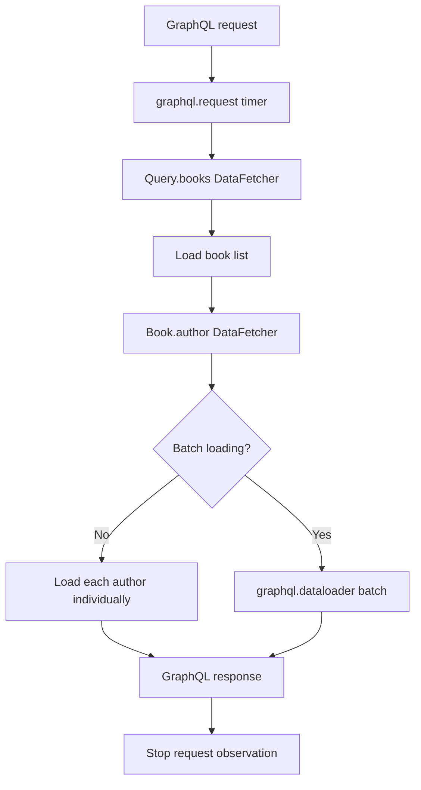

# Metrics for Data Fetching in Spring for GraphQL

GraphQL can return a correct response while still executing too many resolver calls or data queries. To find bottlenecks, you need to measure both the duration of the entire request and the duration of each data-fetching operation. Spring for GraphQL integrates Micrometer Observation to record three activity groups: GraphQL requests, DataFetchers, and DataLoaders.

These metrics help answer practical questions: which requests are slow, which fields consume time, which resolvers fail frequently, whether batch loaders are actually invoked, and whether N+1 optimizations reduced fetch counts. Metrics reveal aggregate trends; when you need to investigate a specific request, combine them with distributed traces.

## Distinguishing Request, DataFetcher, and DataLoader

A GraphQL operation can call multiple DataFetchers. A DataFetcher may query a repository directly or delegate loading relationships to a DataLoader. Therefore, measuring only total HTTP request duration will not reveal which field makes a request slow.

| Observation | Measures | When is it useful? |
| --- | --- | --- |
| `graphql.request` | The entire GraphQL request execution. | Tracking latency and error rates at the operation level. |
| `graphql.datafetcher` | Duration of each non-trivial data-fetching operation. | Finding slow or failing resolvers/fields. |
| `graphql.dataloader` | Duration of batch loader or DataLoader calls. | Monitoring batching behavior and spotting signs of N+1. |



`graphql.request` measures the entire execution. DataFetchers and DataLoaders can run concurrently, so do not sum all field durations to derive request latency. Use the request timer to track overall SLOs and child timers to isolate work.

## How Do Observations and Metrics Work?

Spring for GraphQL uses Micrometer Observation. An Observation describes an operation with start time, end time, and metadata. When an application has an `ObservationRegistry` with a meter handler, completed Observations are turned into meters; if a tracing handler is present, they can also create spans.

Spring for GraphQL provides `GraphQlObservationInstrumentation` to create Observations. Spring Boot auto-configures this instrumentation when suitable Observation infrastructure is available. Observations are only recorded when the application has a configured `ObservationRegistry`.

For a Spring Boot application, the standard setup is adding Actuator:

```kotlin
dependencies {
    implementation("org.springframework.boot:spring-boot-starter-graphql")
    implementation("org.springframework.boot:spring-boot-starter-actuator")
}
```

Spring Boot configures `ObservationRegistry`, `MeterRegistry`, and the meter observation handler based on dependencies on the classpath. You do not need to manually create `GraphQlObservationInstrumentation` if auto-configuration already provides it.

For applications not using Spring Boot or managing `GraphQlSource` manually, register the instrumentation explicitly:

In a standalone application, `ObservationRegistry` must also have a meter observation handler. For example, once a `MeterRegistry` is available:

```java
import io.micrometer.core.instrument.MeterRegistry;
import io.micrometer.core.instrument.observation.DefaultMeterObservationHandler;
import io.micrometer.observation.ObservationRegistry;
import org.springframework.context.annotation.Bean;
import org.springframework.context.annotation.Configuration;

@Configuration(proxyBeanMethods = false)
public class ObservationRegistryConfiguration {

    @Bean
    ObservationRegistry observationRegistry(MeterRegistry meterRegistry) {
        ObservationRegistry registry = ObservationRegistry.create();
        registry.observationConfig().observationHandler(
                new DefaultMeterObservationHandler(meterRegistry));
        return registry;
    }
}
```

Without a meter handler, instrumentation can create Observations without emitting meters. To export traces, you also need an appropriate tracing handler and exporter; a meter handler alone only produces metrics.

```java
import io.micrometer.observation.ObservationRegistry;
import org.springframework.context.annotation.Bean;
import org.springframework.context.annotation.Configuration;
import org.springframework.core.io.ClassPathResource;
import org.springframework.graphql.data.method.annotation.support.AnnotatedControllerConfigurer;
import org.springframework.graphql.execution.GraphQlSource;
import org.springframework.graphql.observation.GraphQlObservationInstrumentation;

@Configuration(proxyBeanMethods = false)
public class GraphQlMetricsConfiguration {

    @Bean
    GraphQlSource graphQlSource(
            ObservationRegistry observationRegistry,
            AnnotatedControllerConfigurer controllerConfigurer) {
        return GraphQlSource.schemaResourceBuilder()
                .schemaResources(new ClassPathResource("graphql/schema.graphqls"))
                .configureRuntimeWiring(controllerConfigurer)
                .configureGraphQl(builder -> builder.instrumentation(
                        new GraphQlObservationInstrumentation(observationRegistry)))
                .build();
    }
}
```

This is a minimal illustrative configuration. Real applications must preserve existing `RuntimeWiringConfigurer` beans, exception resolvers, and schema configuration. If Spring Boot already provides instrumentation, do not register a second copy or duplicate records may occur.

## Default Tags of a GraphQL Request

The `graphql.request` Observation represents a single operation execution. Default low-cardinality keys include:

| Key | Meaning | Typical values |
| --- | --- | --- |
| `graphql.operation.type` | Operation type. | `query`, `mutation`, `subscription`; `operation` if the document cannot be parsed. |
| `graphql.outcome` | Request execution outcome. | `SUCCESS`, `REQUEST_ERROR`, `INTERNAL_ERROR`. |

`SUCCESS` means the GraphQL response is valid and contains no errors. `REQUEST_ERROR` is used when the request cannot be parsed or the response contains non-internal errors. `INTERNAL_ERROR` is used when a valid GraphQL response cannot be produced or the response contains at least one error with `ErrorType.INTERNAL_ERROR`.

These tags help dashboards separate query, mutation, and subscription traffic and monitor request-level error rates. `graphql.execution.id` and `graphql.operation.name` are high-cardinality keys; they fit traces for locating specific runs and should not be used as metric tags.

## Metrics for DataFetcher

The `graphql.datafetcher` Observation measures the execution time of a non-trivial DataFetcher. Default low-cardinality keys:

| Key | Meaning |
| --- | --- |
| `graphql.field.name` | Name of the field being resolved. |
| `graphql.outcome` | `SUCCESS` or `ERROR`. |
| `graphql.error.type` | Class name of the data fetching error when an error occurs. |

`graphql.field.path` is a high-cardinality key kept for traces. Field path shows the full position of the field in the response tree; it can contain aliases and list indices, so it is unsuitable as a metric tag.

### What Is a Non-Trivial DataFetcher?

Spring for GraphQL does not create a `graphql.datafetcher` Observation for every field. Reading a simple property from a Java object, such as `book.getTitle()`, is considered trivial and does not require a dedicated observation. Operations that invoke controller methods, services, or resolvers doing actual work are what typically get measured.

This reduces overhead and avoids creating excessive metrics for fields that simply read data already present on an object. Consequently, the count of `graphql.datafetcher` is neither the total number of fields in the response nor the number of SQL queries.

### Reading DataFetcher Metric Results

Suppose a query returns a list of books and each book must resolve its author. If the `Book.author` resolver queries the repository individually per book, metrics filtered by `graphql.field.name=author` may show fetch counts and total time scaling with the number of books.

When inspecting metrics, focus on:

- **Count:** how many times the DataFetcher executed during the time window.
- **Total time:** total time the resolver consumed during the time window.
- **Mean time:** total time divided by execution count.
- **Max or histogram:** detecting fetch invocations with abnormal latency and p95/p99 percentiles if histograms are configured.
- **Outcome/error type:** identifying which fields fail frequently and which exception groups occur.

Field fetches can execute concurrently. Total time for a field is the sum of recorded execution durations; it does not necessarily equal the sequential time contributed to request latency.

Some older Spring Boot documentation describes a `graphql.request.datafetch.count` metric or a `path` tag for DataFetchers. That was an earlier metrics model. With Spring for GraphQL's modern Observation conventions, rely on `graphql.datafetcher` with the keys `graphql.field.name`, `graphql.outcome`, and `graphql.error.type`; verify your running version before reusing legacy dashboards.

## Metrics for DataLoader and `@BatchMapping`

The `graphql.dataloader` Observation measures calls to `@BatchMapping` methods and manually registered DataLoaders. Default low-cardinality keys:

| Key | Meaning |
| --- | --- |
| `graphql.loader.name` | DataLoader name. |
| `graphql.outcome` | `SUCCESS` or `ERROR`. |
| `graphql.error.type` | Class name of the error when batch loading fails. |

`graphql.loader.size` is a high-cardinality key holding the number of elements loaded in the batch. This value is useful when inspecting traces, though it is not exported as a default metric tag.

Dedicated DataLoader observations were added in Spring for GraphQL 1.4. For resolution work delegated to a DataLoader, modern instrumentation separates batch loading time into `graphql.dataloader`; do not expect them to always show up as regular DataFetcher timers.

### `@BatchMapping` Example

Suppose a query fetches many books, and each book has an author. A batch mapping groups the books into a single call and loads the relationships together:

```java
import org.springframework.graphql.data.method.annotation.BatchMapping;
import org.springframework.stereotype.Controller;
import java.util.List;
import java.util.Map;
import java.util.Set;
import java.util.stream.Collectors;

@Controller
public class BookController {

    private final AuthorService authorService;
    private final AuthorBatchMetrics authorBatchMetrics;

    public BookController(
            AuthorService authorService,
            AuthorBatchMetrics authorBatchMetrics) {
        this.authorService = authorService;
        this.authorBatchMetrics = authorBatchMetrics;
    }

    @BatchMapping(typeName = "Book", field = "author")
    public Map<Book, Author> author(List<Book> books) {
        Set<String> authorIds = books.stream()
                .map(Book::authorId)
                .collect(Collectors.toSet());

        authorBatchMetrics.record(authorIds.size());
        Map<String, Author> authors = authorService.findAllByIds(authorIds);
        return books.stream().collect(Collectors.toMap(
                book -> book,
                book -> authors.get(book.authorId())));
    }
}
```

`@BatchMapping` creates a batch loader for the `Book.author` field. Spring for GraphQL records the batch operation's duration under `graphql.dataloader`. The exact loader name depends on registration and DataLoader configuration; use the `graphql.loader.name` tag to distinguish loaders in dashboards.

## Detecting N+1 Problems Using Metrics

N+1 typically occurs when an application loads a list of N parent objects and then executes a separate query for each object to fetch related data. For example, a query retrieves 30 books and the `author` resolver calls the repository 30 times.

Before batch loading, metrics may show:

- DataFetcher count for the relationship field scales with the number of items in the list.
- Total duration of the relationship DataFetcher accounts for a large share of the request.
- Database queries repeat many times, even if each individual query is fast.

After introducing `@BatchMapping` or DataLoader:

- Batch duration appears under `graphql.dataloader`.
- Batch count is usually smaller than the number of returned parent objects, depending on dispatch cycles and `maxBatchSize`.
- Traces can show `graphql.loader.size` to reveal how many keys were in each batch.

Do not conclude N+1 from a single metric alone. `graphql.datafetcher` measures resolution work, not SQL statement counts. One resolver may run multiple SQL queries; conversely, one resolver may load data via a single join query. To confirm N+1, cross-reference DataFetcher/DataLoader observations with JDBC/Hibernate metrics, query logs, or database tracing.

### Investigation Workflow

1. Find `graphql.request` operations with high latency or rising error rates.
2. Group `graphql.datafetcher` by `graphql.field.name` to identify fields taking excessive time or having high call counts.
3. Check `graphql.dataloader` by `graphql.loader.name` to determine whether batch loaders are actually running and whether they error.
4. Open a trace of a representative request to inspect `graphql.field.path`, operation name, and loader size.
5. Cross-reference database or repository call counts to confirm N+1.
6. Add `@BatchMapping`, DataLoader, join fetches, or suitable projections; then compare metrics before and after.

Do not expect the sum of DataFetcher durations to equal request time because multiple fields can run concurrently. Compare identical request types, page sizes, and workloads for meaningful results.

## Enabling the Actuator Metrics Endpoint

Spring Boot provides `/actuator/metrics` to inspect recorded meters. Expose the endpoint in configuration:

```yaml
management:
  endpoints:
    web:
      exposure:
        include: health,info,metrics
```

After sending at least one GraphQL request with non-trivial resolvers, you can inspect the list of meters:

```text
GET /actuator/metrics
GET /actuator/metrics/graphql.request
GET /actuator/metrics/graphql.datafetcher
GET /actuator/metrics/graphql.dataloader
```

The `metrics` endpoint displays meter names, measurements, and tags. You can filter by tag, for example:

```text
GET /actuator/metrics/graphql.datafetcher?tag=graphql.field.name:author
GET /actuator/metrics/graphql.dataloader?tag=graphql.loader.name:authorLoader
```

Meter names in Actuator use raw Micrometer names. Registries exporting to external systems may normalize meter names and tags according to their own rules. If meters do not appear, check `ObservationRegistry`, instrumentation, the meter registry, and whether the request actually executed the target field.

Actuator endpoints can expose operational details. Expose them only on internal networks or protect them with Spring Security; do not leave `/actuator/metrics` open publicly without a valid reason and access controls.

## Exporting Metrics to Prometheus

To let Prometheus scrape metrics, add the registry dependency:

```kotlin
dependencies {
    runtimeOnly("io.micrometer:micrometer-registry-prometheus")
}
```

Expose the Prometheus endpoint:

```yaml
management:
  endpoints:
    web:
      exposure:
        include: health,info,metrics,prometheus
```

Prometheus scrape config:

```yaml
scrape_configs:
  - job_name: spring-graphql
    metrics_path: /actuator/prometheus
    static_configs:
      - targets: ["localhost:8080"]
```

Prometheus typically represents timers as series such as `_count`, `_sum`, and `_max`; if histograms are enabled, `_bucket` is also included. Dots in meter names and tag keys may be converted to underscores per Prometheus naming conventions.

Example query for DataFetcher invocation rate per field over the last 5 minutes:

```promql
sum by (graphql_field_name) (
  rate(graphql_datafetcher_seconds_count[5m])
)
```

Example calculating average latency per field:

```promql
sum by (graphql_field_name) (
  rate(graphql_datafetcher_seconds_sum[5m])
)
/
sum by (graphql_field_name) (
  rate(graphql_datafetcher_seconds_count[5m])
)
```

Example counting batch loader calls by loader name:

```promql
sum by (graphql_loader_name) (
  rate(graphql_dataloader_seconds_count[5m])
)
```

Example tracking DataFetcher error rate per field:

```promql
sum by (graphql_field_name) (
  rate(graphql_datafetcher_seconds_count{graphql_outcome="ERROR"}[5m])
)
/
sum by (graphql_field_name) (
  rate(graphql_datafetcher_seconds_count[5m])
)
```

Label names are normalized by the registry; verify the actual output at `/actuator/prometheus` before putting queries into dashboards.

## Enabling Histograms to Track p95/p99

Default timers provide count, total time, and max. If you need histograms to compute percentiles in Prometheus, configure percentile histograms for the meters you want to monitor:

```yaml
management:
  metrics:
    distribution:
      percentiles-histogram:
        "graphql.request": true
        "graphql.datafetcher": true
        "graphql.dataloader": true
```

Once histograms are exported, you can use `histogram_quantile` to compute p95:

```promql
histogram_quantile(0.95,
  sum by (le, graphql_field_name) (
    rate(graphql_datafetcher_seconds_bucket[5m])
  )
)
```

Histograms increase series count and storage costs. Enable them only for meters with operational value; choose buckets/SLOs matching your system's target latencies. Client-side in-instance percentiles and aggregated histograms have different semantics, so prefer histograms when aggregating across multiple instances in Prometheus.

## Adding Parent Type to DataFetcher Metrics

By default, `graphql.field.name` contains only the field name. If a schema has multiple object types declaring an `author` field, metrics may group them together. You can add the parent type as a low-cardinality tag via a custom convention:

```java
import io.micrometer.common.KeyValue;
import io.micrometer.common.KeyValues;
import org.springframework.context.annotation.Bean;
import org.springframework.context.annotation.Configuration;
import org.springframework.graphql.observation.DataFetcherObservationContext;
import org.springframework.graphql.observation.DataFetcherObservationConvention;
import org.springframework.graphql.observation.DefaultDataFetcherObservationConvention;

@Configuration(proxyBeanMethods = false)
public class GraphQlObservationConventionConfiguration {

    @Bean
    DataFetcherObservationConvention dataFetcherObservationConvention() {
        return new DefaultDataFetcherObservationConvention() {
            @Override
            public KeyValues getLowCardinalityKeyValues(
                    DataFetcherObservationContext context) {
                return super.getLowCardinalityKeyValues(context)
                        .and(KeyValue.of(
                                "graphql.parent.type",
                                context.getEnvironment().getParentType().getName()));
            }
        };
    }
}
```

The parent type comes from the schema, so it typically has a finite set of values. Do not add `graphql.field.path`, request ID, user ID, or raw arguments to low-cardinality keys. If Spring Boot already has a custom convention bean, merge the logic rather than registering multiple convention beans of the same type.

## Recording Batch Size Distribution with a Dedicated Meter

`graphql.loader.size` is a high-cardinality key by default, so it does not appear as a metric tag. If dashboards need batch size distributions, record sizes as samples of a `DistributionSummary` with a fixed-value loader tag:

```java
import io.micrometer.core.instrument.DistributionSummary;
import io.micrometer.core.instrument.MeterRegistry;
import org.springframework.stereotype.Component;

@Component
public class AuthorBatchMetrics {

    private final DistributionSummary batchSize;

    public AuthorBatchMetrics(MeterRegistry registry) {
        this.batchSize = DistributionSummary.builder("graphql.dataloader.batch.size")
                .description("Number of author IDs in each batch load")
                .baseUnit("keys")
                .tag("loader", "authors")
                .register(registry);
    }

    public void record(int size) {
        batchSize.record(size);
    }
}
```

In the `BookController` example, `AuthorBatchMetrics` is injected into the controller and invoked with `authorBatchMetrics.record(authorIds.size())` inside the batch loader. DistributionSummary stores count, total, max, and histograms/percentiles if configured. Do not turn individual size values into tags, as that creates unnecessary time series.

## Distinguishing GraphQL Metrics from Database Metrics

DataFetcher latency includes resolver processing time and any operations the resolver waits to finish. It does not tell you exactly how long the database took or how many SQL statements a resolver emitted.

For deeper analysis, also monitor:

- JDBC connection pool metrics to detect connection exhaustion or pool contention.
- Hibernate statistics or repository instrumentation to track queries and persistence operations.
- Database slow query logs/APM to find slow SQL statements.
- HTTP client metrics if resolvers call external services.
- Distributed traces to link GraphQL requests with database and downstream spans.

When `graphql.datafetcher` is slow while JDBC is fast, the remaining time may lie in Java processing, executor queuing, or downstream services. When both DataFetcher and database spans are slow, focus on query plans, indexes, connection pools, and DB call counts.

## Common Mistakes

| Symptom | Cause | Resolution |
| --- | --- | --- |
| `graphql.datafetcher` missing | Missing `ObservationRegistry`/instrumentation or field only reads a simple property. | Check Actuator, GraphQL instrumentation, and DataFetcher type. |
| Request timer appears, DataLoader timer missing | Spring for GraphQL older than 1.4 or batch loader was not called. | Check version and `@BatchMapping`/DataLoader registration. |
| Field is slow but metrics merge multiple object types | Default tag has only `graphql.field.name`. | Add parent type via convention if the schema has a finite set of types. |
| Cannot filter by full field path in metrics | `graphql.field.path` is high cardinality. | Use traces to inspect paths; use field name in metrics. |
| No p95 in Prometheus | Timer histograms are not enabled. | Configure `percentiles-histogram` for the required meters. |
| High DataFetcher count does not guarantee N+1 | A resolver may execute many or few SQL statements depending on implementation. | Cross-reference DataLoader observations with JDBC/Hibernate or SQL tracing. |
| `/actuator/metrics` not found | Endpoint not exposed or blocked by security. | Check `management.endpoints.web.exposure.include` and access permissions. |
| Prometheus cannot scrape | Missing Prometheus registry or endpoint not exposed. | Add `micrometer-registry-prometheus`, configure scrape path and networking. |
| Abnormal metrics cardinality growth | Request ID, user ID, or full path added to metric tags. | Use only low-cardinality tags; move detailed data to traces. |

## Key Takeaways

Spring for GraphQL provides three essential Observation groups for tracking data fetching: `graphql.request`, `graphql.datafetcher`, and `graphql.dataloader`. The request timer measures the entire operation; the DataFetcher timer helps locate slow or failing non-trivial resolvers; the DataLoader timer reveals how batch loading behaves. Low-cardinality keys such as operation type, field name, loader name, and outcome fit metrics; execution ID, operation name, field path, and loader size fit traces.

Enable Actuator and a meter registry to inspect or export metrics. Use count, total time, max, and histograms to build dashboards; use `@BatchMapping`/DataLoader to reduce N+1 and compare before and after. Metrics do not replace database query metrics or detailed traces: combine them to isolate the exact slow layer and verify optimization results.

## References

- [Spring for GraphQL — Observability](https://docs.spring.io/spring-graphql/reference/observability.html)
- [Spring for GraphQL — `GraphQlObservationInstrumentation` API](https://docs.spring.io/spring-graphql/docs/current/api/org/springframework/graphql/observation/GraphQlObservationInstrumentation.html)
- [Spring Boot — Metrics](https://docs.spring.io/spring-boot/reference/actuator/metrics.html)
- [Spring Boot — Observability](https://docs.spring.io/spring-boot/reference/actuator/observability.html)
- [Micrometer — Observation](https://docs.micrometer.io/micrometer/reference/observation.html)
