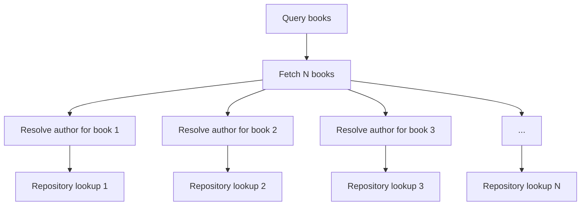

# N+1 and batch loading in Spring for GraphQL

GraphQL allows clients to select nested fields within the same operation. Organizing resolvers per field makes the API flexible, but can generate many small data queries when a child field is resolved separately for each parent object. This is the N+1 problem: one query fetches the list of parent objects, followed by N additional queries fetching related data for each object.

Spring for GraphQL integrates GraphQL Java's DataLoader to batch data loads by key. `BatchLoaderRegistry` is the central registry for declaring batch loaders; concrete DataLoaders are registered per GraphQL request. `@BatchMapping` is a shorthand for the common case of loading a related field from a list of parent objects. Using batching properly reduces database or service calls while preserving the GraphQL structure requested by clients.

After this lesson, you will be able to:

- Recognize N+1 in GraphQL nested fields.
- Measure repository or service call counts instead of looking only at the response.
- Understand how DataLoader batches keys, dispatches, and caches within a request.
- Use `BatchLoaderRegistry` with `DataLoader` inside `@SchemaMapping`.
- Use `@BatchMapping` for common parent-child relationships.
- Choose between mapped batch loaders and positional batch loaders appropriately.
- Handle duplicate keys, missing data, batch size limits, and multiple dispatch waves.
- Preserve tenant, authorization, and GraphQL context during batch loading.
- Test both the returned result and the number of backend calls.

## 1. What is the N+1 problem?

Suppose a schema has books and authors:

```graphql
type Query {
    books: [Book!]!
}

type Book {
    id: ID!
    title: String!
    author: Author
}

type Author {
    id: ID!
    name: String!
}
```

A client requests:

```graphql
query {
    books {
        id
        title
        author {
            name
        }
    }
}
```

Suppose there are 100 books. The `books` resolver runs one query to fetch the list of books. Then the `author` resolver is called for each book, and each invocation calls the repository once to look up the author.

```java
@Controller
public class BookController {

    private final BookRepository bookRepository;
    private final AuthorRepository authorRepository;

    public BookController(
            BookRepository bookRepository,
            AuthorRepository authorRepository) {
        this.bookRepository = bookRepository;
        this.authorRepository = authorRepository;
    }

    @QueryMapping
    public List<Book> books() {
        return bookRepository.findAll();
    }

    @SchemaMapping(typeName = "Book", field = "author")
    public Author author(Book book) {
        return authorRepository.findById(book.authorId()).orElse(null);
    }
}
```

With N books, the number of reads can be roughly:

\[
Q(N) = 1 + N
\]

If N equals 100, the server can execute 101 queries: one query for the book list and 100 queries for authors. When the list grows to 1,000 items, the number of round trips grows accordingly.

This is the N+1 select problem. It does not only appear with SQL; any resolver calling a REST API, microservice, or remote cache individually can produce the same cost pattern.

## 2. Why is GraphQL prone to N+1?

GraphQL execution resolves fields according to the selection set. A nested field can be invoked for each parent object:



GraphQL does not automatically know that 100 calls to `author` should be turned into a single SQL query `WHERE author_id IN (...)`. If a resolver calls the repository individually per parent, the backend receives each request separately.

N+1 is often hard to spot when development datasets are small. A test with one book only runs two queries and may go unnoticed. You need to test with many parent objects, especially when nested fields appear inside lists or across multiple relationship levels.

Not every nested resolver causes N+1. If data has already been fetch-joined, projected, or appropriately cached, the resolver may simply read an existing property. What you need to measure is the number of backend accesses triggered during resolution, not merely the number of Java methods invoked.

## 3. Measuring N+1 by backend call count

A correct response does not prove good performance. A resolver can return the right data even after calling the repository hundreds of times. Measure SQL query counts, repository call counts, or requests to downstream services.

Example test with a spy:

```java
@Test
void currentResolverMakesOneLookupPerBook() {
    graphQlTester.document("""
            query {
                books {
                    id
                    author {
                        name
                    }
                }
            }
            """)
        .execute()
        .errors()
        .verify();

    verify(authorRepository, times(3)).findById(anyLong());
}
```

This example intentionally illustrates how to detect an N+1 resolver when the fixture has three books. After switching to batch loading, the assertion should be updated to verify that the batch service/repository is called according to the expected batch count, while each author is still mapped to the right book.

In integration environments, you can use SQL logging, a datasource proxy, Hibernate statistics, tracing, or repository metrics to count queries. Measure both call count and duration; reducing query count while creating a huge query or loading excessive data can still be slow.

## 4. How does DataLoader solve N+1?

DataLoader defers `load(key)` calls and groups keys requested within the same dispatch into a batch. Instead of running a query immediately for each key, the resolver registers its need to load data; when GraphQL execution dispatches the batch, the loader calls the batch function once with the set of keys.

```mermaid
flowchart TD
    A[Resolve Book 1] --> L[DataLoader.load(authorId)]
    B[Resolve Book 2] --> L
    C[Resolve Book 3] --> L
    D[Resolve Book N] --> L
    L --> Q[Batch load unique author IDs]
    Q --> R[One bulk repository/service call]
    R --> M[Map author back to each Book]
```

With one batch containing all N keys, query count can drop from `1 + N` to `1 + 1`. In practice, the number of batches may be greater than one due to batch size limits, multiple dispatch waves, dependent execution branches, or different loader types.

DataLoader also provides a per-request cache. If the same key is loaded multiple times within the same GraphQL request, the loader can reuse the loaded result instead of calling the backend again. This cache is request-scoped by default, avoiding a global cache shared across users.

DataLoader does not write optimal SQL by itself. The batch function must still call a bulk API such as `findAllById(ids)` or a `WHERE id IN (:ids)` query. If the batch function loops over each key and calls the repository individually, N+1 still exists inside the batch loader.

## 5. Key rules of batch loading

A batch loader receives multiple keys and must return results that can be accurately matched to each key. There are two common styles:

| Loader type | Input | Output | When to use |
| --- | --- | --- | --- |
| Positional batch loader | `List<K>` | `Flux<V>` matching key count and order | Backend returns results in matching order or can reorder them |
| Mapped batch loader | `Set<K>` | `Mono<Map<K,V>>` | Backend returns entities by ID and some keys may be missing |

A mapped batch loader is usually convenient when querying a database with `IN`, because database results do not guarantee the same order as the input key list. A Map associates each entity with its ID.

If using a positional loader, the batch function must return elements matching the exact count and order of the key list. Do not assume `findAllById` order always matches the input list unless the repository contract guarantees it. If missing items must be handled, a mapped loader is usually clearer.

## 6. Registering loaders with BatchLoaderRegistry

Spring for GraphQL provides `BatchLoaderRegistry` for centralized batch loader registration. The Spring Boot starter auto-configures this bean and integrates it with `ExecutionGraphQlService`, registering DataLoaders per GraphQL request.

Example registering a mapped batch loader for authors:

```java
@Configuration
public class GraphQlBatchConfiguration {

    public GraphQlBatchConfiguration(
            BatchLoaderRegistry registry,
            AuthorService authorService) {

        registry.forTypePair(Long.class, Author.class)
                .registerMappedBatchLoader((authorIds, environment) ->
                        authorService.findAllByIds(authorIds)
                                .collectMap(Author::id));
    }
}
```

Suppose `authorService.findAllByIds(...)` returns `Flux<Author>`. `collectMap(Author::id)` converts the result into `Mono<Map<Long, Author>>`, matching `registerMappedBatchLoader`.

`forTypePair(Long.class, Author.class)` specifies the key type and value type. By default, the DataLoader name is derived from the value class, in this example `Author`. You can customize the name via the registration builder if multiple loaders share the same value type for different purposes or keys.

The batch function receives `Set<Long>` to avoid processing duplicate keys. It should invoke a bulk operation and return a map by ID. If an ID is absent from the map, DataLoader returns a missing/null result for that key; the GraphQL resolver/field handles null values according to the schema.

## 7. Using DataLoader in @SchemaMapping

After registering the loader, the nested field resolver accepts `DataLoader` as a parameter:

```java
@Controller
public class BookController {

    @QueryMapping
    public List<Book> books() {
        return bookRepository.findAll();
    }

    @SchemaMapping(typeName = "Book", field = "author")
    public CompletableFuture<Author> author(
            Book book,
            DataLoader<Long, Author> authorLoader) {

        return authorLoader.load(book.authorId());
    }
}
```

`load(...)` returns `CompletableFuture<Author>` immediately without loading data synchronously. GraphQL Java coordinates dispatch so keys are batched together. Avoid calling `.join()` or `.get()` inside the resolver because that blocks the thread and breaks deferred loading.

The generic type `DataLoader<Long, Author>` must match the registered `forTypePair(Long.class, Author.class)`. If key/value types or loader name do not match, GraphQL execution may not find the corresponding DataLoader.

The `@SchemaMapping` resolver is still called for each parent object, but it only registers the key with DataLoader. It is the number of backend calls made by the batch function that needs to be reduced.

## 8. Using @BatchMapping for common relationships

For simple cases, Spring for GraphQL provides `@BatchMapping` to replace most of the boilerplate of `BatchLoaderRegistry` plus `@SchemaMapping` accepting a DataLoader.

```java
@Controller
public class BookController {

    private final BookRepository bookRepository;
    private final AuthorService authorService;

    public BookController(BookRepository bookRepository, AuthorService authorService) {
        this.bookRepository = bookRepository;
        this.authorService = authorService;
    }

    @QueryMapping
    public List<Book> books() {
        return bookRepository.findAll();
    }

    @BatchMapping(typeName = "Book", field = "author")
    public Mono<Map<Book, Author>> author(List<Book> books) {
        Set<Long> authorIds = books.stream()
                .map(Book::authorId)
                .collect(Collectors.toSet());

        return authorService.findAllByIds(authorIds)
                .collectMap(Author::id)
                .map(authorsById -> {
                    Map<Book, Author> result = new HashMap<>();
                    for (Book book : books) {
                        Author author = authorsById.get(book.authorId());
                        if (author != null) {
                            result.put(book, author);
                        }
                    }
                    return result;
                });
    }
}
```

`@BatchMapping` receives the list of source/parent objects (`List<Book>`). The method returns `Mono<Map<Book, Author>>`, where keys are individual `Book` instances and values are the corresponding authors. Spring for GraphQL automatically registers the batch loader and data fetcher for the `Book.author` field.

In this example, the map only contains found authors. If a book references a non-existent author, that key is omitted from the map and the corresponding field result is null. This works when `Book.author` is nullable. If the schema declares `Author!`, missing data causes null propagation and must be handled according to the domain contract.

With `@BatchMapping`, the source class `Book` is used as the key. Therefore, `Book` must implement consistent `equals()` and `hashCode()` to distinguish source objects. Using a record typically provides component-based equality/hash code; with mutable classes, be careful not to mutate fields involved in hashing after an object is used as a key.

## 9. @BatchMapping can return Flux<V>

In addition to `Mono<Map<K,V>>`, `@BatchMapping` can return `Flux<V>`:

```java
@BatchMapping(typeName = "Book", field = "author")
public Flux<Author> author(List<Book> books) {
    List<Long> authorIds = books.stream()
            .map(Book::authorId)
            .toList();

    return authorService.findAllInOrder(authorIds);
}
```

In this case, emitted values must have the same count and the same order as the input list of source objects. If the input is `[bookA, bookB, bookC]`, the output must correspond to `[authorA, authorB, authorC]`.

Do not return a `Flux` from an `IN` query if the repository does not guarantee order. Sort results by the input keys before emitting or use `Mono<Map<K,V>>` to map by key. The mapped form is generally safer when duplicate keys, missing entities, or unordered backend results are possible.

## 10. When to use BatchLoaderRegistry instead of @BatchMapping?

`@BatchMapping` fits when a field value depends only on the list of parent objects and shared context. If batch loading needs field-specific arguments, composite keys, or complex per-call logic, `BatchLoaderRegistry` is more flexible.

Example schema with a filter:

```graphql
type Person {
    id: ID!
    friends(filter: FriendsFilter): [Person!]!
}

input FriendsFilter {
    favoriteBeverage: String
}
```

The `friends` field depends on both the parent `Person` and the `filter` of each call. `@BatchMapping` receives `List<Person>` but does not accept `@Argument` like a regular `@SchemaMapping`. You can create a composite key:

```java
public record FriendFilterKey(Person person, FriendsFilter filter) {
}

public record FriendsResult(List<Person> values) {
}
```

Register the loader:

```java
registry.forTypePair(FriendFilterKey.class, FriendsResult.class)
        .registerMappedBatchLoader((keys, environment) ->
                friendService.loadFriends(keys));
```

The resolver builds a key for each parent and filter:

```java
@SchemaMapping(typeName = "Person", field = "friends")
public CompletableFuture<List<Person>> friends(
        Person person,
        @Argument FriendsFilter filter,
        DataLoader<FriendFilterKey, FriendsResult> loader) {

    return loader.load(new FriendFilterKey(person, filter))
            .thenApply(FriendsResult::values);
}
```

In this example, `friendService.loadFriends(keys)` returns `Mono<Map<FriendFilterKey, FriendsResult>>`. The `FriendsResult` wrapper gives the value type a concrete class for loader registration; the resolver unwraps it back to the `List<Person>` required by the schema. Composite keys need stable equality/hash code.

Cases where `BatchLoaderRegistry` is preferable:

- Batching depends on `@Argument` or filters that vary per parent.
- Composite keys combining multiple values are needed.
- One loader needs to be shared across multiple `@SchemaMapping` methods.
- Custom `DataLoaderOptions`, loader names, or batch sizes are needed.
- Access to `BatchLoaderEnvironment`, local context, or GraphQL context is needed.

## 11. Mapped loader vs positional loader

Registering a mapped loader:

```java
registry.forTypePair(Long.class, Author.class)
        .registerMappedBatchLoader((ids, environment) ->
                authorService.findAllByIds(ids)
                        .collectMap(Author::id));
```

A mapped loader returns a map from key to value. No placeholder is needed for keys that are not found. This is the natural choice for database `IN` queries because return order does not matter.

Positional loader:

```java
registry.forTypePair(Long.class, Author.class)
        .registerBatchLoader((ids, environment) ->
                authorService.findAllInOrder(ids));
```

A positional loader returns `Flux<Author>` matching the count and order of the input list. If a key does not exist, the loader must represent the missing value according to the batch loader contract; with a reactive `Flux`, Java `null` cannot be emitted, so a mapped loader is a clearer choice when results can be missing.

Do not switch between the two styles just for shorter code. Choose based on ordering guarantees and how the backend represents missing values.

## 12. Request-scoped DataLoader caching

By default, DataLoader caches results by key for the lifetime of a single GraphQL request. If two fields both call `load(42L)` in the same request, the loader can share the loaded result.

This has two effects:

- Eliminates duplicate loads for the same key within the same operation.
- Cache is not automatically shared across independent GraphQL requests.

Do not replace a request-scoped DataLoader with a static `Map` or singleton cache if the data depends on user, tenant, permissions, or transaction state. A global cache can leak data between requests if keys do not include the full security scope.

If data changes during a mutation and subsequent fields in the same request need to see the updated state, consider clearing/priming keys in the DataLoader or redesigning the flow to avoid reading stale values from the request cache. Caching behavior must align with mutation semantics.

## 13. Duplicate keys and batch deduplication

DataLoader can cache by key to avoid loading the same entity multiple times in the same request. For example, 20 books may share only 5 authors; the resolver calls `load(authorId)` 20 times, but the loader only needs to load 5 unique keys.

The batch function receives a set of unique keys for mapped loaders. For positional loaders, the loader may retain multiple positions in the list to map each call; rely on the contract of the chosen loader type.

When writing bulk queries, use unique ID sets to avoid `IN` clauses with duplicate values. Do not deduplicate manually if order/position matters for a positional result without a remapping step.

## 14. Limiting batch size

Packing all keys into a single batch is not always ideal. An `IN` query with tens of thousands of IDs can exceed database limits, produce overly large SQL, or spike memory usage.

You can configure `DataLoaderOptions` with `maxBatchSize` when registering a loader. For example:

```java
registry.forTypePair(Long.class, Author.class)
        .withOptions(options -> options.setMaxBatchSize(500))
        .registerMappedBatchLoader((ids, environment) ->
                authorService.findAllByIds(ids)
                        .collectMap(Author::id));
```

The limit of 500 is only illustrative. Choose batch size based on database parameter limits, payload size, latency, connection pool capacity, and downstream service limits.

When `maxBatchSize` is exceeded, a single dispatch can be split into multiple batches. Therefore, do not hardcode tests asserting that a request of any size always triggers exactly one query. Assert batch counts according to the specific test fixture and configuration.

## 15. Multiple dispatch waves in one operation

DataLoader groups `load()` calls registered before a dispatch. However, GraphQL execution may need multiple waves when a child field can only be resolved after its parent field finishes.

Example:

```graphql
query {
    books {
        author {
            organization {
                name
            }
        }
    }
}
```

The first wave can load authors for all books. Once authors arrive, the next wave loads organizations. Two waves are normal because organization keys are only known after authors have been resolved.

Do not expect all relationships across every depth to collapse into a single query. The goal is to batch each group of keys known at the same time and avoid one query per parent.

## 16. Batch loading with reactive services

Spring for GraphQL supports batch loaders returning reactive types. For example, a service querying authors returning `Flux<Author>`:

```java
public Flux<Author> findAllByIds(Set<Long> ids) {
    return authorRepository.findAllById(ids);
}
```

A mapped loader converts it into a map:

```java
registry.forTypePair(Long.class, Author.class)
        .registerMappedBatchLoader((ids, environment) ->
                authorService.findAllByIds(ids)
                        .collectMap(Author::id));
```

Do not call `.block()` inside a batch function. Return `Mono<Map<K,V>>` so GraphQL execution coordinates asynchronously. If a service already returns a `Mono` of a map, register it directly without converting through synchronous types.

For blocking sources, isolate blocking work on an appropriate scheduler or use a reactive API. Do not put blocking JDBC on the event loop just because a method wraps it in a `Mono`.

## 17. Context, tenant, and authorization in batch loaders

Batch loaders can access `BatchLoaderEnvironment` and `GraphQLContext`. Spring's `BatchLoaderRegistry` shares the same context between batch loading functions and data fetchers, and supports context propagation. This is one reason to use the Spring-managed registry rather than registering DataLoaders directly into `DataLoaderRegistry`.

Example batch loader scoping data by tenant:

```java
registry.forTypePair(Long.class, Author.class)
        .registerMappedBatchLoader((authorIds, environment) -> {
            String tenantId = environment.getContext()
                    .get("tenantId");
            return authorService.findVisibleByIds(tenantId, authorIds)
                    .collectMap(Author::id);
        });
```

`tenantId` must be populated into `GraphQLContext` from trusted server-side authentication/request context. Never trust a tenant passed as an arbitrary client GraphQL argument.

If a batch loader uses `@BatchMapping`, the method can accept `Principal`, `@ContextValue`, `GraphQLContext`, or `BatchLoaderEnvironment` as supported by Spring for GraphQL. Enforce authorization across all keys in the batch; having permission to read a parent does not mean every resource in the batch belongs to the same tenant or permission scope.

## 18. DataLoader and mutations in the same request

Request-scoped DataLoader caching avoids duplicate loads, but a mutation can change data while the request is running. For example, a mutation operation creates an author and then queries fields depending on that author.

If a loader already cached a key before the mutation, post-mutation results can be stale. You can:

- Call `clear(key)` to evict the stale cached value.
- Call `prime(key, value)` to populate the new value into the cache.
- Structure the operation so the same key is not read both before and after mutation.

Only clear/prime when a mutation actually modifies the corresponding data. Do not wipe the entire cache out of habit, as that can cause unnecessary queries.

## 19. Batch loading across multiple relationship levels

With schema:

```graphql
type Book {
    author: Author
}

type Author {
    organization: Organization
}

type Organization {
    name: String!
}
```

You can register separate loaders for each relationship:

```java
registry.forTypePair(Long.class, Author.class)
        .registerMappedBatchLoader((ids, env) ->
                authorService.findAllByIds(ids).collectMap(Author::id));

registry.forTypePair(Long.class, Organization.class)
        .registerMappedBatchLoader((ids, env) ->
                organizationService.findAllByIds(ids)
                        .collectMap(Organization::id));
```

Resolvers:

```java
@SchemaMapping(typeName = "Book", field = "author")
public CompletableFuture<Author> author(
        Book book, DataLoader<Long, Author> loader) {
    return loader.load(book.authorId());
}

@SchemaMapping(typeName = "Author", field = "organization")
public CompletableFuture<Organization> organization(
        Author author, DataLoader<Long, Organization> loader) {
    return loader.load(author.organizationId());
}
```

Each relationship level has its own batch. With N books belonging to M authors and K organizations, the backend can load authors in a batch of M keys and organizations in a batch of K keys instead of issuing N queries at each level.

If relationships can be fetched more efficiently with a single projection or join, consider optimizing at the repository layer. DataLoader is not an excuse to ignore proper database query design.

## 20. Testing @BatchMapping and DataLoader

Tests must verify both returned data and backend batch call counts. For example, with `@BatchMapping`, use a GraphQL operation with multiple books:

```java
@Test
void loadsAuthorsForManyBooksInOneBatch() {
    graphQlTester.document("""
            query {
                books {
                    id
                    author {
                        id
                        name
                    }
                }
            }
            """)
        .execute()
        .errors()
        .verify()
        .path("books[*].author.name")
        .entityList(String.class)
        .contains("Author A", "Author B", "Author A");

    verify(authorService, times(1)).findAllByIds(anySet());
}
```

The example assumes three books belonging to two authors, the batch service is called once, and the fixture follows that order. If `maxBatchSize` is configured smaller or the operation produces multiple dispatch waves, the call count may be greater than one; assertions must match the test configuration.

Scenarios to test:

1. Multiple parent objects are batched within the same request.
2. Parents share a foreign key; the backend only loads unique keys.
3. The backend returns results out of order; the map still attaches them to the right parents.
4. Some keys have no corresponding entity; fields return null according to schema.
5. Batch size exceeds the limit; the loader splits into the expected number of batches.
6. Two independent GraphQL requests do not share DataLoader cache.
7. Multiple fields load the same key within one request; the cache prevents duplicate loads.
8. Tenant/authorization is enforced for every key.
9. The batch loader returns a reactive error; GraphQL error paths and partial data are correct.
10. Mutations clear/prime the cache when needed.

Do not only assert that the response contains the expected author names. An N+1 resolver can return the exact same response; verify repository or service call counts.

## 21. Testing BatchLoaderRegistry directly

If you need to test the batch function independently of GraphQL execution, you can create a standalone registry, register the loader, build a `DataLoaderRegistry`, and invoke dispatch:

```java
BatchLoaderRegistry batchLoaderRegistry = new DefaultBatchLoaderRegistry();

batchLoaderRegistry.forTypePair(Long.class, Author.class)
        .registerMappedBatchLoader((ids, environment) ->
                authorService.findAllByIds(ids).collectMap(Author::id));

DataLoaderRegistry dataLoaderRegistry = DataLoaderRegistry.newRegistry().build();
batchLoaderRegistry.registerDataLoaders(
        dataLoaderRegistry, GraphQLContext.newContext().build());

DataLoader<Long, Author> loader =
        dataLoaderRegistry.getDataLoader(Author.class.getName());

CompletableFuture<Author> first = loader.load(10L);
CompletableFuture<Author> second = loader.load(20L);
loader.dispatchAndJoin();

assertThat(first.join().id()).isEqualTo(10L);
assertThat(second.join().id()).isEqualTo(20L);
```

Direct testing is useful for verifying loader registration and mapping. Note that `registerDataLoaders(...)` can use the provided context to create request-scoped loaders; each test/request should create an appropriate registry and never share a dispatched loader across tests.

Testing at this layer does not verify that `@BatchMapping` is registered in the schema or that GraphQL execution dispatches properly. You still need at least one GraphQL operation test for actual wiring.

## 22. Observing N+1 at runtime

To detect regressions, you can monitor:

- Number of database queries per GraphQL request.
- Number of batch invocations and keys per batch.
- Average and p95 batch sizes, plus threshold breaches.
- Backend wait time and batch function processing time.
- DataLoader cache hit rate if provided by instrumentation.
- Number of requests to dependent services per operation.

Metrics should use controlled names and tags. Avoid attaching individual entity IDs or user IDs to metric labels due to high cardinality. Use controlled traces/logs to correlate GraphQL operations with batch calls when investigating issues.

When comparing before and after optimizations, keep the dataset, selection set, cache state, and concurrency constant. Measure p50/p95 latency alongside query counts; a single isolated run is not enough to draw performance conclusions.

## 23. Common pitfalls

- **Only switching resolvers to Mono/Flux:** being asynchronous does not eliminate N+1 if you still call the backend once per parent.
- **Using DataLoader while the batch function still loops calling the repository:** N+1 is merely moved inside the loader.
- **Calling `.join()` or `.block()` in a resolver:** blocks execution and can prevent loads from batching together.
- **Using a positional loader without preserving order:** entities may be attached to the wrong parents.
- **Using `Flux` when values can be missing:** Reactor cannot emit null; a mapped loader is usually better.
- **Forgetting `equals()`/`hashCode()` on `@BatchMapping` source keys:** the map may fail to recognize matching parent objects.
- **Using a global cache:** can leak data across requests or tenants.
- **Not bounding batch size:** overly large queries or exceeding backend limits.
- **Assuming a request only has one dispatch:** nested dependencies can produce multiple dispatch waves.
- **Ignoring tenant/authorization inside a batch:** a batch may contain keys belonging to different permission scopes.
- **Using `@BatchMapping` for fields depending on per-call arguments:** use a composite key with `BatchLoaderRegistry`.
- **Testing only the response:** fails to detect backend calls growing linearly with N.
- **Measuring query count with tiny fixtures:** N+1 can stay hidden.
- **Not handling cache after mutations:** DataLoader may return stale data within the same request.

## 24. Workflow for resolving N+1

When a GraphQL operation is slow due to nested fields, follow these steps:

1. Identify which field resolvers call a database or dependent service.
2. Measure backend call counts relative to parent object count.
3. Identify the keys to load and the appropriate bulk API (`IN`, batch endpoint, or bulk repository method).
4. Choose `@BatchMapping` if the field depends only on the parent list and shared context.
5. Choose `BatchLoaderRegistry` + `DataLoader` if you need arguments, composite keys, or custom options.
6. Use a mapped loader when the backend does not guarantee order or entities may be missing.
7. Keep DataLoaders request-scoped and enforce tenant/authorization inside the batch function.
8. Choose `maxBatchSize` based on backend limits and measure dispatch waves.
9. Test results, parent-child mapping, missing values, and backend call counts.
10. Monitor query count, batch size, and latency to catch regressions.

N+1 occurs when a query fetches a list of parents and each parent triggers a separate load of related data. DataLoader batches keys requested in the same dispatch and caches results per request; `BatchLoaderRegistry` is the registration mechanism managed by Spring for GraphQL, while `@BatchMapping` streamlines common parent-child relationships. For sustainable optimization, batch functions must genuinely call the backend in bulk, map results by the right keys, preserve request security boundaries, and be tested for both data correctness and backend call counts.

## References

- [Spring for GraphQL — Request Execution: Batch Loading](https://docs.spring.io/spring-graphql/reference/request-execution.html#execution.batch-loading)
- [Spring for GraphQL — Annotated Controllers: @BatchMapping](https://docs.spring.io/spring-graphql/reference/controllers.html#controllers.batch-mapping)
- [Spring for GraphQL — BatchMapping API](https://docs.spring.io/spring-graphql/docs/current/api/org/springframework/graphql/data/method/annotation/BatchMapping.html)
- [GraphQL Java — DataLoader](https://github.com/graphql-java/java-dataloader)
