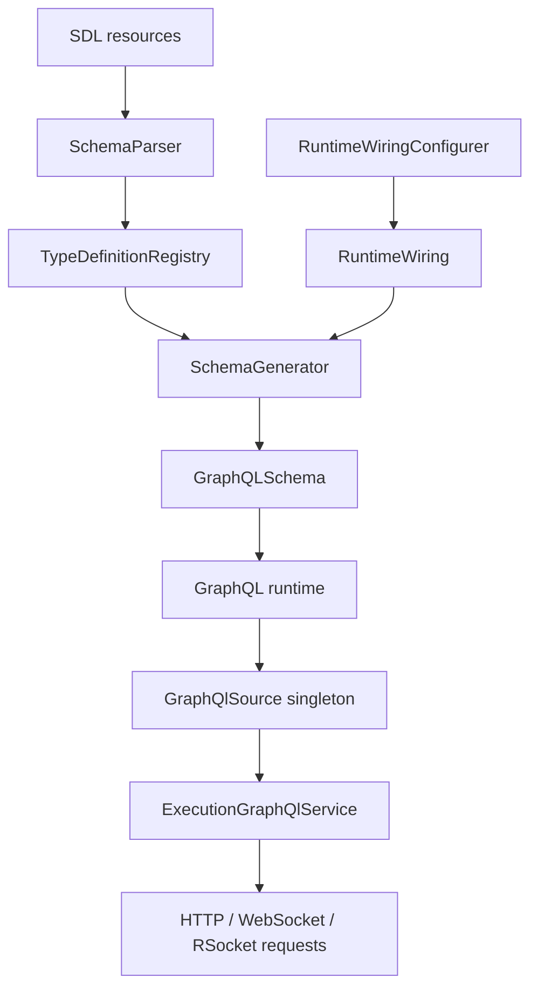

# Schema and metadata caching

## 1. Why cache schema and metadata?

Before executing a GraphQL operation, the server must have an executable schema to know which types, fields, arguments, scalars, directives, and DataFetchers are used. The schema also holds metadata for introspection, validation, and data mapping.

If an application reads SDL, parses the schema, creates `RuntimeWiring`, and builds a `GraphQLSchema` on every request, startup costs are repeated and latency can skyrocket. Spring for GraphQL designs `GraphQlSource` to hold and supply a shared GraphQL runtime. In a standard Spring Boot setup, the schema is loaded and built during application startup, then reused across requests.

Beyond the schema, GraphQL Java must also parse and validate each operation document. When clients submit the same document repeatedly, `PreparsedDocumentProvider` can cache parse/validation results to avoid repeating that work.

These two cache layers address two separate costs:

- **Schema and metadata cache:** retains the executable schema along with the API's shared type/field metadata.
- **Operation cache:** retains parsed and validated documents to reduce per-operation preparation overhead.

Do not confuse either layer with response caching. Response caching stores returned data payloads and carries its own requirements for user identity, authorization, variables, and data freshness.

## 2. Distinguishing what is cached

| Artifact | Contents | When created | Reusable? |
| --- | --- | --- | --- |
| SDL resources | Contents of `.graphqls` or `.gqls` files | When initializing the GraphQL source | Yes, typically loaded once at startup |
| `GraphQLSchema` | Types, fields, arguments, directives, scalars, and code registry | When the schema is built | Yes; schema is immutable |
| `GraphQL` | Runtime executing operations against the schema | When creating `GraphQlSource` | Yes; shared across requests |
| Schema metadata | Type/field/argument info used for introspection and validation | Contained inside `GraphQLSchema` | Yes; no per-request copy needed |
| Preparsed document | AST and parse/validation result of an operation | First time the document is seen | Yes, via `PreparsedDocumentProvider` |
| GraphQL response | Data and errors from a single execution | Per request | Only cache separately if data policy allows |

The key point is that `GraphQLSchema` and its metadata already reside inside the schema object. There is no need to build an extra global cache for individual `GraphQLObjectType` or `GraphQLFieldDefinition` instances if you are simply reading metadata from the active schema.

## 3. Schema lifecycle in Spring Boot

A Spring for GraphQL application needs a schema at startup. With Spring Boot, `.graphqls` and `.gqls` files under `src/main/resources/graphql/**` are discovered by default and merged into one logical schema.

Overall flow:



`GraphQlSource` is the abstraction providing the `graphql.GraphQL` instance and its corresponding schema. `DefaultExecutionGraphQlService` uses `GraphQlSource` to execute operations. Transports such as HTTP or WebSocket delegate to this execution service.

Consequently, individual requests do not re-read SDL or rebuild an executable schema. Schema construction happens once when the application context is created.

## 4. `GraphQlSource` holds the schema and GraphQL runtime

`GraphQlSource` exposes two key methods:

- `graphQl()` returns the `graphql.GraphQL` instance used for execution.
- `schema()` returns the active `graphql.schema.GraphQLSchema`.

Example accessing the schema in a service or component for metadata inspection:

```java
import graphql.schema.GraphQLFieldDefinition;
import graphql.schema.GraphQLObjectType;
import graphql.schema.GraphQLSchema;
import org.springframework.graphql.execution.GraphQlSource;
import org.springframework.stereotype.Component;

@Component
public class SchemaMetadataReader {

    private final GraphQLSchema schema;

    public SchemaMetadataReader(GraphQlSource graphQlSource) {
        this.schema = graphQlSource.schema();
    }

    public boolean hasBookTitleField() {
        GraphQLObjectType bookType = schema.getObjectType("Book");
        if (bookType == null) {
            return false;
        }

        GraphQLFieldDefinition titleField = bookType.getFieldDefinition("title");
        return titleField != null;
    }
}
```

This example keeps a reference to the schema supplied by `GraphQlSource`. `GraphQLSchema` is immutable once built, so it can be shared safely across requests. Never call `GraphQlSource.schemaResourceBuilder()` and rebuild a schema inside a controller or resolver.

## 5. Schemas are immutable and shareable

GraphQL Java models `GraphQLSchema` as an immutable structure with cyclic references between types. Once built, never mutate a type or field directly inside a running schema.

If schema changes are needed, build a new schema via its builder or `SchemaTransformer`, then build a new GraphQL runtime using the new schema. Never mutate a shared schema object like a mutable cache because multiple requests may be reading it concurrently.

Benefits of an immutable schema:

- Multiple requests can read the same metadata without locking for normal read operations.
- No type or field state mutates mid-flight during a request.
- The schema can be inspected and warmed up at startup.
- Components needing metadata can safely retain a stable reference to `GraphQLSchema`.

If an application must reload its schema at runtime, build and validate the complete new schema first before publishing it. Reloading is covered in a later section.

## 6. Loading multiple SDL resources once

A large schema can be split into multiple domain files:

```text
src/main/resources/graphql/
├── common.graphqls
├── book.graphqls
├── author.graphqls
└── review.graphqls
```

Spring Boot searches for `.graphqls` and `.gqls` files under `classpath:graphql/**` by default. If schema files span multiple modules or dependency JARs, use the `classpath*:graphql/**/` pattern to scan across the full classpath.

Schema location configuration:

```yaml
spring:
  graphql:
    schema:
      locations: classpath*:graphql/**/
      file-extensions: .graphqls,.gqls
```

Resources are parsed and merged before creating the executable schema. There is no need to manually cache individual SDL file contents in controllers. If loading SDL from external storage or a remote source, supply matching `Resource` instances to `GraphQlSource.Builder`; loading and building should still occur during startup or a controlled reload workflow.

## 7. Type and field metadata already live in `GraphQLSchema`

The schema holds metadata such as:

- Type names and kinds: object, interface, union, enum, scalar.
- Fields and field output types.
- Arguments, argument types, and default values.
- Declared or applied directives.
- Descriptions of types, fields, and arguments.
- The code registry linking field coordinates to DataFetchers.

You can access metadata directly from the schema:

```java
import graphql.schema.GraphQLFieldDefinition;
import graphql.schema.GraphQLObjectType;
import graphql.schema.GraphQLSchema;
import graphql.schema.GraphQLTypeUtil;
import org.springframework.graphql.execution.GraphQlSource;

import org.springframework.stereotype.Component;

@Component
public class BookSchemaMetadata {

    private final GraphQLSchema schema;

    public BookSchemaMetadata(GraphQlSource graphQlSource) {
        this.schema = graphQlSource.schema();
    }

    public String booksReturnType() {
        GraphQLObjectType queryType = schema.getQueryType();
        GraphQLFieldDefinition booksField = queryType.getFieldDefinition("books");
        return GraphQLTypeUtil.simplePrint(booksField.getType());
    }
}
```

If you need to build a metadata catalog for an admin page or internal tooling, create an immutable snapshot when the schema initializes and tag it with the schema version. Avoid recomputing all metadata on every request and avoid keeping a secondary cache that could drift from the active schema.

## 8. Introspection is how clients read schema metadata

GraphQL provides the `__schema`, `__type`, and `__typename` meta-fields. Introspection queries allow clients to discover types, fields, arguments, enums, and descriptions of the API.

Example:

```graphql
query BookSchemaMetadata {
    __type(name: "Book") {
        name
        kind
        description
        fields {
            name
            description
            type {
                kind
                name
                ofType {
                    kind
                    name
                }
            }
        }
    }
}
```

Metadata is read from the active `GraphQLSchema`. Introspection does not re-read SDL files on each call. However, an introspection operation is still a GraphQL request and still goes through parsing, validation, execution, and response serialization.

If multiple client tools repeatedly fetch the same schema metadata, you can emit a schema snapshot in your build/release pipeline or cache introspection results on the client. When caching, bind the snapshot to a schema version or release ID so clients do not use stale metadata after the API changes.

## 9. Configuring introspection and schema printer

Spring Boot provides dedicated properties:

```yaml
spring:
  graphql:
    schema:
      introspection:
        enabled: true
      printer:
        enabled: false
```

- `spring.graphql.schema.introspection.enabled` controls introspection fields such as `__schema` and `__type`; enabled by default to support GraphiQL and developer tooling.
- `spring.graphql.schema.printer.enabled` controls the endpoint that prints the schema as text, disabled by default.

Disabling introspection is not a caching technique. It is a decision about schema discoverability and API security. If introspection is disabled in production, ensure development workflows still have a schema snapshot or schema registry for clients and code generators.

The schema printer is a standalone endpoint, separate from the GraphiQL UI. Protect this endpoint if enabled in environments with internal schema details.

## 10. Do not build a new schema per request

An anti-pattern is building the schema inside a controller or resolver:

```java
import graphql.schema.GraphQLSchema;
import graphql.schema.idl.RuntimeWiring;
import graphql.schema.idl.SchemaGenerator;
import graphql.schema.idl.SchemaParser;
import graphql.schema.idl.TypeDefinitionRegistry;

// Avoid: repeatedly parsing SDL and building a schema on every request.
public GraphQLSchema loadSchemaForRequest(String schemaText) {
    TypeDefinitionRegistry registry = new SchemaParser().parse(schemaText);
    RuntimeWiring wiring = buildRuntimeWiring();
    return new SchemaGenerator().makeExecutableSchema(registry, wiring);
}

private RuntimeWiring buildRuntimeWiring() {
    return RuntimeWiring.newRuntimeWiring().build();
}
```

This repeats parsing, merging, wiring, and schema generation. It can also produce inconsistent GraphQL runtimes across requests if wiring varies over time.

Let Spring Boot create `GraphQlSource` at startup and inject `GraphQlSource` into components that need it. Without Boot, build `GraphQlSource` once in configuration and register it as a singleton bean.

## 11. Caching parsed and validated operations with `PreparsedDocumentProvider`

Schema caching reduces schema initialization cost. Another cost arises for each GraphQL document: GraphQL Java must parse the document into an AST and validate it against the schema before execution.

`PreparsedDocumentProvider` allows caching and reusing `PreparsedDocumentEntry`. Each entry holds the parsed document along with its validation outcome. GraphQL Java calls the provider before execution; on a cache miss, the provider invokes `parseAndValidateFunction` so the engine performs parsing, validation, and related instrumentation.

This cache **does not store resolver results or response data**. On every request, GraphQL still executes DataFetchers and retrieves fresh data for the current variables/context.

## 12. Integrating a Caffeine operation cache with Spring Boot

Add Caffeine and Spring GraphQL dependencies if the project does not already include them:

```kotlin
dependencies {
    implementation("org.springframework.boot:spring-boot-starter-graphql")
    implementation("com.github.ben-manes.caffeine:caffeine")
}
```

Spring Boot manages dependency versions via its BOM. You do not need to specify the Caffeine version explicitly if your project's dependency management already handles it.

Example caching documents by query text with a bounded capacity:

```java
import graphql.ExecutionInput;
import graphql.execution.preparsed.PreparsedDocumentEntry;
import graphql.execution.preparsed.PreparsedDocumentProvider;
import java.time.Duration;
import java.util.concurrent.CompletableFuture;
import java.util.function.Function;

import com.github.benmanes.caffeine.cache.Cache;
import com.github.benmanes.caffeine.cache.Caffeine;
import org.springframework.context.annotation.Bean;
import org.springframework.context.annotation.Configuration;

@Configuration(proxyBeanMethods = false)
public class GraphQlOperationCacheConfig {

    @Bean
    PreparsedDocumentProvider preparsedDocumentProvider() {
        Cache<String, PreparsedDocumentEntry> cache = Caffeine.newBuilder()
            .maximumSize(10_000)
            .expireAfterAccess(Duration.ofMinutes(30))
            .recordStats()
            .build();

        return new PreparsedDocumentProvider() {

            @Override
            public CompletableFuture<PreparsedDocumentEntry> getDocumentAsync(
                    ExecutionInput executionInput,
                    Function<ExecutionInput, PreparsedDocumentEntry> parseAndValidateFunction) {

                String query = executionInput.getQuery();
                PreparsedDocumentEntry entry = cache.get(
                    query,
                    key -> parseAndValidateFunction.apply(executionInput)
                );

                return CompletableFuture.completedFuture(entry);
            }
        };
    }
}
```

The cache enforces `maximumSize` so diverse queries cannot cause unbounded memory growth. `expireAfterAccess` gradually evicts infrequently used documents. Tune both values based on actual operation counts, AST sizes, and cache hit/miss ratios.

## 13. Wiring the provider into `GraphQlSource` via a customizer

With Spring Boot, registering a `PreparsedDocumentProvider` bean alone is not enough; you must attach the provider to the GraphQL builder when `GraphQlSource` is created.

```java
import org.springframework.context.annotation.Bean;
import org.springframework.context.annotation.Configuration;
import org.springframework.graphql.execution.GraphQlSource;
import graphql.execution.preparsed.PreparsedDocumentProvider;

// Spring Boot 4.x:
import org.springframework.boot.graphql.autoconfigure.GraphQlSourceBuilderCustomizer;

@Configuration(proxyBeanMethods = false)
public class GraphQlSourceCacheConfig {

    @Bean
    GraphQlSourceBuilderCustomizer operationCacheCustomizer(
            PreparsedDocumentProvider preparsedDocumentProvider) {

        return (GraphQlSource.SchemaResourceBuilder builder) ->
            builder.configureGraphQl(graphQlBuilder ->
                graphQlBuilder.preparsedDocumentProvider(preparsedDocumentProvider)
            );
    }
}
```

In Spring Boot 3.x, `GraphQlSourceBuilderCustomizer` resides in package `org.springframework.boot.autoconfigure.graphql`. Starting with Spring Boot 4.x, the package is `org.springframework.boot.graphql.autoconfigure`. The customizer API receives `GraphQlSource.SchemaResourceBuilder` and lets you configure `GraphQL.Builder` before the source is constructed.

Without Spring Boot, configure the same hook directly via `GraphQlSource.Builder.configureGraphQl(...)` when constructing `GraphQlSource`.

## 14. Choosing cache keys and handling schema versions

The Caffeine example above uses query text as the key. This works well when the schema stays fixed for the lifetime of the application instance and validation does not depend on user/request context.

If the schema can reload at runtime, parsed/validated document caches must be invalidated or partitioned by schema version. A document valid under an old schema might become invalid under a new schema; conversely, a previously rejected document might become valid after schema updates.

You can use a composite key:

```text
schemaVersion + ":" + normalizedQuery
```

Or replace the entire cache provider whenever a new schema is published. Do not try to evict only a few guessed entries, because validation can depend on the entire schema.

If custom validation rules depend on tenant, role, feature flags, or request context, do not cache validation results solely by query text. Keep request-specific validation outside the cache or partition the cache across every factor affecting the outcome. Avoid putting personal data into cache keys or logging cache keys.

## 15. Persisted queries and operation caches

`PreparsedDocumentProvider` is also the extension point for persisted queries and query allowlisting. GraphQL Java provides classes such as `PersistedQuerySupport` and `ApolloPersistedQuerySupport`, backed by a `PersistedQueryCache` storing documents by ID/hash.

Persisted queries typically offer two advantages:

- Clients send an ID/hash instead of the full document once a query is registered.
- The server accepts only operations from a curated list, if required by deployment policy.

Persisted queries differ from automatic caching by query text. Query-text caching still lets clients send arbitrary documents; it merely reduces repeated parsing and validation. Persisted queries can pair with caching to reuse parsed documents.

If using Apollo Automatic Persisted Queries, choose `ApolloPersistedQuerySupport` and configure an appropriate `PersistedQueryCache`. An in-memory cache suits single-instance apps or simple setups; multi-instance deployments need consistent persisted query state, such as a shared registry or release-bundled artifacts.

## 16. Where should introspection metadata be cached?

Introspection metadata is generated from `GraphQLSchema`. There are three common ways to reuse metadata:

1. **On the server:** keep a singleton `GraphQlSource`/`GraphQLSchema`; type/field metadata already lives in the schema.
2. **In clients/tooling:** save introspection results or schema SDL snapshots keyed by schema version during build/release pipelines.
3. **At the HTTP/CDN layer:** cache introspection responses only if the endpoint, method, auth, headers, and schema version produce responses safe to share.

Never cache introspection responses at a shared URL if the schema or visibility changes per tenant/user. Likewise, never cache an authorized user's introspection response and serve it to another user.

GraphQL introspection operations are still executed at runtime. `PreparsedDocumentProvider` only caches AST/validation, not the JSON response of `__schema` or `__type`. To cache metadata responses, implement caching on the client or at the HTTP layer with proper keys and invalidation.

## 17. Safely reloading schemas when dynamic schemas are required

By default, classpath schemas do not reload automatically when SDL files change after startup. To update a schema, the simplest and most predictable approach is deploying a new application version.

If business requirements demand runtime schema reloading, the workflow should include these steps:

1. Fetch the new SDL and determine the schema version.
2. Parse all SDL resources and merge them into a new registry.
3. Build the `RuntimeWiring` matching the new schema.
4. Build the new `GraphQLSchema` and `GraphQL` runtime off the request path.
5. Run schema validation, mapping inspection, and checks for custom scalars/directives.
6. Only once every step succeeds, publish the new GraphQL runtime atomically.
7. Invalidate or partition `PreparsedDocumentProvider` for the new schema version.
8. Monitor error rates after the version switch and preserve rollback capability.

`GraphQlSource.graphQl()` is designed to return the current GraphQL instance, including when the schema reloads. `GraphQlSource.schema()` must return the schema matching the active GraphQL runtime. If implementing a dynamic source, ensure both methods stay consistent and runtime swaps are atomic.

Never mutate the old `GraphQLSchema` in place. Schemas are immutable; build a new object and swap the shared reference. Also account for in-flight requests: requests that already acquired the old runtime can finish against the old schema while new requests use the new schema.

## 18. Schema inspection and metadata mapping

`GraphQlSource.Builder.inspectSchemaMappings(...)` generates a report comparing the schema against controller/DataFetcher mappings. The report can highlight:

- Unmapped fields not resolved by property fetchers.
- DataFetchers registered for nonexistent fields.
- Method arguments not present in the schema.
- Nullability mismatches between SDL and Java mappings.
- Types lacking sufficient metadata for automated checks.

Example inspection configuration:

```java
import org.slf4j.Logger;
import org.slf4j.LoggerFactory;
import org.springframework.boot.graphql.autoconfigure.GraphQlSourceBuilderCustomizer;
import org.springframework.context.annotation.Bean;
import org.springframework.context.annotation.Configuration;

@Configuration(proxyBeanMethods = false)
public class GraphQlSchemaInspectionConfig {

    private static final Logger logger = LoggerFactory.getLogger(GraphQlSchemaInspectionConfig.class);

    @Bean
    GraphQlSourceBuilderCustomizer schemaInspectionCustomizer() {
        return builder -> builder.inspectSchemaMappings(report ->
            logger.info("GraphQL schema mapping report:\n{}", report)
        );
    }
}
```

Inspection is helpful at startup or when building a new schema. It is a metadata mapping verification step, not a runtime cache, and should never run per GraphQL request.

## 19. Monitoring cache effectiveness

A cache is only worthwhile if it reduces real cost without inflating memory excessively. Monitor:

| Metric | Meaning |
| --- | --- |
| Cache hit rate | Proportion of operation documents already in cache |
| Cache miss rate | Proportion of documents requiring fresh parse/validation |
| Eviction count | Entries removed due to capacity or expiration limits |
| Cache size | Current number of cached entries |
| Parse/validation duration | Document preparation time on cache misses |
| Schema build duration | Time to build the executable schema at startup/reload |
| Heap usage | Memory consumed by schema, ASTs, and cache entries |

With Caffeine, enable stats and register the cache with Micrometer to observe hits, misses, and evictions. Never place query text or variables into metric tags. Cache keys can contain sensitive queries, so avoid logging keys or dumping caches to telemetry systems.

If hit rate is low because clients constantly generate varying query texts, consider persisted queries or normalizing operations on the client. Never raise `maximumSize` indefinitely to mask an unstable set of queries.

## 20. Common pitfalls

| Symptom | Possible cause | Resolution |
| --- | --- | --- |
| Schema rebuilt frequently | Creating `GraphQlSource` or `SchemaGenerator` on the request path | Register a singleton source and share it |
| SDL updated but running API unchanged | Classpath schema is read only when source initializes | Restart/redeploy or implement controlled schema reload |
| Operation cache returns stale validation errors | Schema changed without invalidating parsed/validated cache | Clear cache or partition by schema version |
| Cache size grows unbounded | Clients send many unique query texts | Use maximum size, expiration, persisted queries, or allowlists |
| Cache hits yet resolvers still run | Provider only caches parsing/validation | This is expected; responses/data are not cached by the provider |
| Cache key contains sensitive data | Literals embedded in query text | Use variables, avoid logging keys, protect memory dumps |
| Validation depends on user yet cached by query alone | Validation results reused in wrong context | Keep request-specific validation uncached or partition by context |
| One instance has new schema while another has old | Schema reload not synchronized across nodes | Distribute identical schema versions and roll out consistently |
| Introspection returns stale metadata to clients | Client snapshot/cache lacks versioning or invalidation | Attach schema version/release ID and refresh per release |
| Disabling introspection breaks GraphiQL/codegen | Tools need `__schema`/`__type` to inspect the API | Supply schema artifacts in pipelines or allow introspection in appropriate environments |
| `GraphQlSourceBuilderCustomizer` not recognized | Package import mismatches Spring Boot major version | Boot 3 uses `org.springframework.boot.autoconfigure.graphql`; Boot 4 uses `org.springframework.boot.graphql.autoconfigure` |

## 21. Schema and metadata caching checklist

- [ ] Let Spring Boot build `GraphQlSource` once in the application context.
- [ ] Never parse SDL or build `GraphQLSchema` in controllers/resolvers.
- [ ] Share the immutable `GraphQLSchema` across requests.
- [ ] Read type/field metadata from `GraphQlSource.schema()` when needed.
- [ ] Load multiple SDL resources via appropriate schema locations.
- [ ] Include schema version in metadata snapshots and client introspection caches.
- [ ] Understand `__schema`, `__type`, and configure introspection separately from schema printer.
- [ ] Use `PreparsedDocumentProvider` only when parsing/validation is a measurable cost.
- [ ] Bound operation caches with maximum size and expiration.
- [ ] Attach the provider to `GraphQlSource` via `GraphQlSourceBuilderCustomizer`.
- [ ] Invalidate operation caches when schema or validation policies change.
- [ ] Never cache user-dependent authorization/validation results solely by query text.
- [ ] Never confuse a parsed-document cache with a response cache.
- [ ] If using persisted queries, keep registries consistent across instances.
- [ ] Monitor hit/miss/eviction rates, heap usage, and schema build duration.
- [ ] If reloading schemas, build, validate, and publish atomically while keeping rollback ready.

## Conclusion

Spring for GraphQL and GraphQL Java already provide the foundation for reusing schemas and metadata. `GraphQlSource` supplies the `GraphQL` runtime alongside `GraphQLSchema`; the schema is built from SDL and runtime wiring at startup and shared afterward. Because `GraphQLSchema` is immutable, type/field metadata can be read directly from the schema without maintaining a separate mutable cache per request.

For operations, `PreparsedDocumentProvider` caches parsed and validated documents to avoid repeating query preparation work. Bound its capacity, choose keys carefully, and invalidate when schema versions or validation policies change. Introspection metadata, parsed documents, and response data are three distinct kinds of data; each has its own lifecycle, security policy, and caching strategy. If a schema must reload, build a complete new schema, validate it, and publish it atomically rather than mutating the schema actively serving requests.

## References

- [Spring for GraphQL — Request Execution and GraphQlSource](https://docs.spring.io/spring-graphql/reference/request-execution.html)
- [Spring for GraphQL — `GraphQlSource` API](https://docs.spring.io/spring-graphql/docs/current/api/org/springframework/graphql/execution/GraphQlSource.html)
- [Spring Boot — Spring for GraphQL](https://docs.spring.io/spring-boot/reference/web/spring-graphql.html)
- [Spring Boot — Common Application Properties](https://docs.spring.io/spring-boot/appendix/application-properties/)
- [GraphQL Java — Schema](https://graphql-java.com/documentation/schema/)
- [GraphQL Java — Execution and Query Caching](https://graphql-java.com/documentation/execution/)
- [GraphQL Java — `PreparsedDocumentProvider` API](https://javadoc.io/doc/com.graphql-java/graphql-java/latest/graphql/execution/preparsed/PreparsedDocumentProvider.html)
- [Caffeine Cache](https://github.com/ben-manes/caffeine/wiki)
