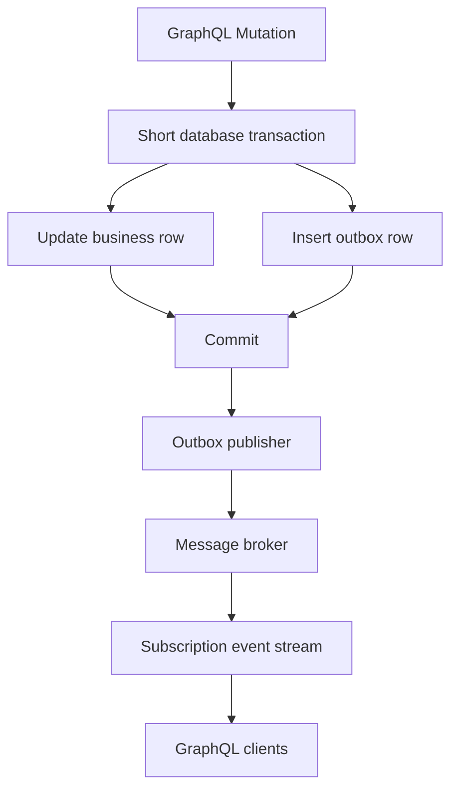

# Subscriptions Must Not Hold Long-Running Transactions

A GraphQL Subscription maintains a response stream for as long as a client stays subscribed to receive events. A subscription can live for seconds, minutes, or hours; during that time, no events may arrive, or events may arrive at highly variable rates. This is the lifecycle of a stream, not a single database unit of work.

If you open a database transaction when the subscription starts and hold it until the stream terminates, the connection and transaction resources can remain tied up for the entire time the client waits for events. A client disconnecting or failing to cancel a subscription cleanly can keep a transaction alive even longer than expected. The proper design is to keep the stream independent of transactions and open only short transactions around concrete business operations, such as writing data in a mutation or reading a snapshot for each event.

Spring for GraphQL allows Subscription handlers to return a `Flux` or a Reactive Streams `Publisher`. GraphQL Java keeps that publisher alive to emit responses per event. Spring recommends managing transactions at controller/service method boundaries with clear units of work; wrapping the entire GraphQL execution in a transaction is an advanced strategy and can hold resources longer than necessary.

This lesson covers how to organize transactions for mutations that emit events, how to read data inside short per-event transactions, differences between imperative and reactive transactions, handling `AFTER_COMMIT`, outbox patterns, cancellation, and testing to prove the stream does not hold transactions while idle.

## 1. A Subscription's Lifecycle Differs from a Transaction's

Consider a library API allowing clients to watch changes to a book:

```graphql
type Subscription {
  bookUpdated(bookId: ID!): BookUpdate!
}

type BookUpdate {
  eventId: ID!
  bookId: ID!
  title: String!
  status: String!
  occurredAt: String!
}
```

The client subscribes once:

```graphql
subscription WatchBook($bookId: ID!) {
  bookUpdated(bookId: $bookId) {
    eventId
    bookId
    title
    status
    occurredAt
  }
}
```

The server can emit multiple events on the same subscription:

```text
Client subscribe
       |
       v
  Flux<BookUpdate> ------------------------------->
       |                |                 |
       v                v                 v
   event #1         event #2          event #3
       |                |                 |
       +----------------+-----------------+
                        |
             Client cancel / disconnect
```

Database transactions have a different lifecycle:

```text
begin -> read/write -> commit or rollback
```

A transaction is designed to wrap a unit of work with a well-defined beginning and end. A subscription is a stream whose termination time may not be known in advance. Do not use a single transaction to wrap the entire lifetime of the stream.

| Component | Lifecycle |
| --- | --- |
| GraphQL Subscription | From when the client subscribes until completion, error, or cancellation |
| Database transaction | A read/write operation requiring consistency and atomicity |
| Event | A business change that has occurred |
| Event processing | Handling a single event, typically completable within a short transaction |

## 2. Why Not Hold a Transaction Across the Entire Subscription?

A long-lived open transaction causes several problems:

- Holds a connection in the connection pool even when no query is running.
- Holds locks longer, forcing other write transactions to wait.
- Retains snapshots/MVCC versions longer, making it harder for the database to reclaim old row versions.
- Increases the risk of timeouts, deadlocks, or connection pool exhaustion.
- Couples transaction state to a client connection that may drop at any time.
- Makes rollback behavior on client cancellation unpredictable.

For instance, if 200 clients open subscriptions simultaneously and each holds one connection, a 50-connection pool can be exhausted even when most clients are simply waiting for events.

A long transaction does not make an event stream more reliable. It merely extends database resource retention. Event reliability must be solved with event IDs, durable brokers, outboxes, retries, and proper resume mechanisms.

## 3. Avoid Placing @Transactional on Subscription Handlers Returning Flux

Spring for GraphQL supports `@SubscriptionMapping` returning `Flux<T>`:

```java
@Controller
public class BookSubscriptionController {

    private final BookEventStream eventStream;

    public BookSubscriptionController(BookEventStream eventStream) {
        this.eventStream = eventStream;
    }

    @SubscriptionMapping
    public Flux<BookUpdate> bookUpdated(@Argument String bookId) {
        return eventStream.forBook(bookId);
    }
}
```

This handler simply exposes an event stream. Do not annotate the subscription method with `@Transactional` just to hold a transaction while waiting for events.

Avoid putting `@Transactional` at the class level on a controller that mixes queries, mutations, and subscriptions. Class-level annotations apply to every handler method; place transactions on services or specific mutation/read methods so scopes remain explicit.

Anti-pattern:

```java
@SubscriptionMapping
@Transactional
public Flux<BookUpdate> bookUpdated(@Argument String bookId) {
    return eventStream.forBook(bookId);
}
```

When using a reactive transaction manager, Spring recognizes methods returning reactive types and manages the transaction across the returned publisher's lifecycle. With a long-lived `Flux` subscription, the transaction can remain alive until the publisher completes or is canceled. That scope is far too broad for a stream waiting on events.

With an imperative `PlatformTransactionManager`, the transaction is bound to the thread and time of method invocation; it does not automatically cover asynchronous work executing after the method returns the `Flux`. Thus, never rely on annotating a subscription handler with `@Transactional` to establish a consistent transaction for emitted events.

Place transactions on the service methods performing concrete database operations. The subscription handler only connects the event stream to those short operations.

## 4. Mutations Write Data in Short Transactions

Mutations are typically the right place to start a transaction because they modify business state. Spring for GraphQL recommends transactions scoped to controller methods or service methods with clear boundaries.

Schema example:

```graphql
type Mutation {
  updateBook(input: UpdateBookInput!): Book!
}

input UpdateBookInput {
  id: ID!
  title: String
  status: String
}
```

Service updating a book and publishing an application event:

```java
public record BookChanged(
        String eventId,
        String bookId,
        String title,
        String status,
        Instant occurredAt) {
}

@Service
public class BookService {

    private final BookRepository repository;
    private final ApplicationEventPublisher eventPublisher;

    public BookService(
            BookRepository repository,
            ApplicationEventPublisher eventPublisher) {
        this.repository = repository;
        this.eventPublisher = eventPublisher;
    }

    @Transactional
    public Book update(UpdateBookInput input) {
        Book book = repository.findById(input.id())
                .orElseThrow(() -> new BookNotFoundException(input.id()));

        book.apply(input);
        Book saved = repository.save(book);

        eventPublisher.publishEvent(
                new BookChanged(
                        UUID.randomUUID().toString(),
                        saved.getId(),
                        saved.getTitle(),
                        saved.getStatus(),
                        Instant.now()));

        return saved;
    }
}
```

Controller simply orchestrating the request:

```java
@Controller
public class BookMutationController {

    private final BookService bookService;

    public BookMutationController(BookService bookService) {
        this.bookService = bookService;
    }

    @MutationMapping
    public Book updateBook(@Argument UpdateBookInput input) {
        return bookService.update(input);
    }
}
```

The transaction starts when `BookService.update` is invoked through the Spring proxy and ends when the method returns successfully or throws an exception. If the operation fails, the transaction can roll back according to rollback rules. The subscription stream does not participate in this transaction.

If the mutation returns an entity and the client selects additional nested fields, those field resolvers may execute after `BookService.update` has committed. They do not automatically belong to the mutation's transaction; each resolver/service needs its own transaction if it must access the database. If the response requires a consistent snapshot, build a DTO containing all needed data inside the service transaction and return that DTO.

If a GraphQL request contains multiple mutation fields, do not assume all of them share a single transaction. When business rules require atomicity across multiple steps, design one mutation orchestrating all steps within the same service transaction.

## 5. Emit Events Only After the Transaction Commits

If an event is emitted immediately after `save()` but before commit, clients may receive notifications about changes that are subsequently rolled back. This happens because JPA can defer flushing until commit, and even after a flush the transaction can still fail.

Use `@TransactionalEventListener` with the `AFTER_COMMIT` phase so events are processed only after the transaction has committed:

```java
@Component
public class BookChangedListener {

    private final BookEventPublisher publisher;

    public BookChangedListener(BookEventPublisher publisher) {
        this.publisher = publisher;
    }

    @TransactionalEventListener(phase = TransactionPhase.AFTER_COMMIT)
    public void afterBookChanged(BookChanged event) {
        publisher.publish(new BookUpdate(
                event.eventId(),
                event.bookId(),
                event.title(),
                event.status(),
                event.occurredAt()));
    }
}
```

`AFTER_COMMIT` is the default phase of `@TransactionalEventListener`. If the transaction rolls back, the listener is not called. If no transaction is active, the listener also does not run unless `fallbackExecution = true` is enabled; do not enable it arbitrarily when an event strictly depends on a commit.

When the `AFTER_COMMIT` phase runs, the transaction has already completed even though some transactional resources may remain bound until cleanup. If the listener must perform additional database writes, do not rely on the just-committed transaction to persist new changes; call a separate service bean with `REQUIRES_NEW` propagation to start a fresh transaction. In the example above, the listener only forwards the event to the publisher, so no second database transaction is needed.

### Event Publisher Without a Transaction

Example of an in-memory publisher using a Reactor sink:

```java
@Component
public class BookEventPublisher {

    private final Sinks.Many<BookUpdate> sink =
            Sinks.many().multicast().onBackpressureBuffer(256, false);

    public Flux<BookUpdate> forBook(String bookId) {
        return sink.asFlux()
                .filter(event -> event.bookId().equals(bookId));
    }

    public void publish(BookUpdate event) {
        Sinks.EmitResult result = sink.tryEmitNext(event);
        if (result.isFailure()) {
            // Record the failure and apply the application's delivery policy.
        }
    }
}
```

The publisher holds an event stream, not a database connection or transaction. Each subscriber receives events via a `Flux`. This example illustrates single-process streaming; it is not a durable message broker and does not guarantee events are retained for late-joining subscribers.

The buffer is capped at 256 elements. The `autoCancel = false` argument keeps the sink ready for new subscribers after the last subscriber cancels; with the default `true`, a multicast sink auto-cancels once no subscribers remain and becomes unusable as a shared publisher. When slow subscribers fill the buffer, `tryEmitNext` can return `FAIL_OVERFLOW`; the publisher must record this and apply a policy such as dropping events, terminating the stream, retrying at a broker layer, or asking the client to resync. The number 256 is merely illustrative—choose a limit based on event rates and application memory.

### Notes When Using Reactive Transactions

Since Spring Framework 6.1, `@TransactionalEventListener` supports both thread-bound imperative transactions and Reactor-Context-bound reactive transactions. For reactive transactions, the transaction context must be carried into the event source via `TransactionalEventPublisher`; simply calling `ApplicationEventPublisher` as in the imperative example above does not propagate the Reactor Context.

If the application uses R2DBC and reactive transactions, use the `TransactionalEventPublisher` API matching your Spring Framework version or choose another event-emission mechanism that preserves commit boundaries. Do not copy an imperative example verbatim and assume it carries identical semantics with reactive transactions.

## 6. Why Does AFTER_COMMIT Not Replace an Outbox?

`@TransactionalEventListener(AFTER_COMMIT)` prevents emitting events before data commits, yet the listener itself remains in-process execution. If the process stops after commit and before the listener publishes the event, the data is persisted while subscribers or brokers never receive the notification.

When high reliability is required, use a Transactional Outbox:

1. Within the same transaction, update the business table and insert a row into an outbox table.
2. Commit both changes together.
3. A separate worker reads unsent outbox records.
4. The worker publishes events to the broker.
5. Once the broker acknowledges delivery, the worker marks the record as sent.
6. Consumers process events idempotently to tolerate redelivery.

Diagram:



An outbox eliminates the gap between committing data and recording the intent to publish an event. Delivery to a broker can often repeat, so events should carry stable IDs and consumers should be idempotent.

For simple internal applications, an in-memory post-commit event publisher may suffice. For critical notifications such as payments, order states, or permission changes, evaluate an outbox and broker rather than relying on an in-memory sink.

## 7. Open a Short Transaction per Event

Sometimes an event carries only an ID, and the subscription must read current data from the database before returning a response. In that case, each event can invoke a dedicated transactional service method.

Processing flow:

```text
Event stream
    |
    +--> event A --> short read transaction --> snapshot A --> emit
    |
    +--> event B --> short read transaction --> snapshot B --> emit
    |
    +--> event C --> short read transaction --> snapshot C --> emit
    |
    +--> wait for next event (no transaction is open)
```

The transaction starts when processing an event and finishes right after reading the snapshot. Waiting for the next event happens outside any transaction.

### With R2DBC and Reactive Transactions

When using Spring Data R2DBC, the service can return `Mono` and use `@Transactional(readOnly = true)`:

```java
@Service
public class BookSnapshotService {

    private final BookRepository repository;

    public BookSnapshotService(BookRepository repository) {
        this.repository = repository;
    }

    @Transactional(readOnly = true)
    public Mono<BookSnapshot> load(String bookId) {
        return repository.findById(bookId)
                .map(BookSnapshot::from);
    }
}
```

The subscription handler calls the service for each event:

```java
@Controller
public class BookSnapshotSubscriptionController {

    private final BookEventStream eventStream;
    private final BookSnapshotService snapshotService;

    public BookSnapshotSubscriptionController(
            BookEventStream eventStream,
            BookSnapshotService snapshotService) {
        this.eventStream = eventStream;
        this.snapshotService = snapshotService;
    }

    @SubscriptionMapping
    public Flux<BookSnapshot> bookUpdated(@Argument String bookId) {
        return eventStream.forBook(bookId)
                .concatMap(event -> snapshotService.load(event.bookId()));
    }
}
```

Each subscribed inner `Mono` opens a reactive transaction for that read. When the `Mono` completes, the transaction commits/cleans up; the `Flux` can then wait for the next event without holding a transaction. The transaction opens when the publisher is subscribed to, not when the method merely constructs the `Mono`.

`concatMap` processes sequentially and preserves event order. If concurrent processing is desired, you can use `flatMap(event -> snapshotService.load(event.bookId()), concurrency)`; each inner publisher still gets its own transaction, though response order may differ from input event order. Only enable concurrency when business rules allow it.

Ensure the service is a separate Spring bean invoked through a proxy. Self-invoking a transactional method from another method on the same object bypasses the proxy in standard AOP proxy setups.

### With Blocking JPA/JDBC

If the subscription runs on WebFlux while the database uses blocking JPA/JDBC, never call blocking repositories directly on an event-loop thread. Isolate each read on the bounded elastic scheduler:

```java
@Service
public class BlockingBookSnapshotService {

    private final BookRepository repository;

    public BlockingBookSnapshotService(BookRepository repository) {
        this.repository = repository;
    }

    @Transactional(readOnly = true)
    public BookSnapshot load(String bookId) {
        Book book = repository.findById(bookId)
                .orElseThrow(() -> new BookNotFoundException(bookId));
        return BookSnapshot.from(book);
    }
}
```

```java
@SubscriptionMapping
public Flux<BookSnapshot> bookUpdated(@Argument String bookId) {
    return eventStream.forBook(bookId)
            .concatMap(event -> Mono.fromCallable(
                            () -> snapshotService.load(event.bookId()))
                    .subscribeOn(Schedulers.boundedElastic()));
}
```

`snapshotService` must be a Spring-proxied bean. The `load` method finishes its transaction before the callable returns the snapshot. `boundedElastic` is meant for blocking work; do not treat `publishOn` or `subscribeOn` as a substitute for transaction management.

If the application uses Spring MVC with synchronous blocking execution, the service can be invoked directly on an appropriate executor. The essential principle remains that the transaction lives inside the data-reading method and finishes before waiting for the next event.

## 8. TransactionalOperator: Wrap Each Operation, Not the Whole Stream

For reactive code without annotations, `TransactionalOperator` can be used. One operator is configured from a `ReactiveTransactionManager` and can be reused:

```java
public class BookEventProcessor {

    private final BookRepository repository;
    private final TransactionalOperator transactionalOperator;

    public BookEventProcessor(
            BookRepository repository,
            ReactiveTransactionManager transactionManager) {
        this.repository = repository;
        this.transactionalOperator =
                TransactionalOperator.create(transactionManager);
    }

    public Flux<BookSnapshot> snapshots(Flux<BookChanged> events) {
        return events.concatMap(event ->
                repository.findById(event.bookId())
                        .map(BookSnapshot::from)
                        .as(transactionalOperator::transactional));
    }
}
```

Here `transactionalOperator` wraps only the data-reading publisher for each event. When the inner `Mono` completes, the transaction ends. The outer `Flux` keeps waiting for events without any open transaction.

Do not do this:

```java
return events
        .concatMap(event -> repository.findById(event.bookId())
                .map(BookSnapshot::from))
        .as(transactionalOperator::transactional);
```

The snippet above wraps the entire `Flux`. If the `Flux` is a long-lived non-completing stream, the transaction stays open for the lifetime of the stream.

### Cancellation and Rollback

Reactive Streams allow subscribers to cancel publishers. Spring Framework treats a cancel signal on a transactional publisher as a rollback; this means a `Flux` transaction can be rolled back when a client disconnects. A multi-element transactional publisher must be consumed completely for the transaction to finish normally.

This is another reason not to bind a transaction to a long-lived subscription stream. When wrapping each inner `Mono`, cancellation only affects the currently processing event's transaction; that transaction is cleaned up, while future events have no open transaction.

## 9. Return Event Snapshots Instead of Re-Querying Many Fields

After a subscription event is emitted, GraphQL still resolves the fields selected by the client. If an event only contains an ID and each nested `@SchemaMapping` hits the database, a single event can trigger multiple transactions or separate queries.

For instance, an event may contain:

```graphql
type BookUpdate {
  eventId: ID!
  book: Book!
}

type Book {
  id: ID!
  title: String!
  status: String!
  author: Author
}
```

If `Book.author` queries the database again after the event was emitted, the response might combine a `title` from the event timestamp with an `author` from a newer timestamp. When business logic requires a consistent snapshot, load all needed data inside one short transaction and emit a complete DTO:

One distinction to keep in mind: a short transaction during event processing creates a consistent snapshot only as of that read. If an event holds only an ID and the database changes again before the subscription reads, querying by ID can return a newer state than the original event. If clients require the exact state at commit time, include the snapshot or aggregate version in the event/outbox and read by that version.

```java
public record BookUpdateSnapshot(
        String eventId,
        String bookId,
        String title,
        String status,
        AuthorSnapshot author,
        Instant occurredAt) {
}
```

Service reading the entire snapshot in a single transaction:

```java
@Transactional(readOnly = true)
public BookUpdateSnapshot loadSnapshot(BookChanged event) {
    Book book = repository.findById(event.bookId())
            .orElseThrow(() -> new BookNotFoundException(event.bookId()));

    Author author = authorRepository.findById(book.getAuthorId())
            .orElseThrow(() -> new AuthorNotFoundException(book.getAuthorId()));

    return new BookUpdateSnapshot(
            event.eventId(),
            book.getId(),
            book.getTitle(),
            book.getStatus(),
            AuthorSnapshot.from(author),
            event.occurredAt());
}
```

The transaction ends once the DTO is constructed. The subscription emits the materialized snapshot; GraphQL does not need to open transactions to resolve individual fields afterward.

If nested data can change independently and the response does not require a consistent snapshot, field resolvers can load data individually on demand. Each resolver should then use its own short transaction if needed, and the application must accept that fields may reflect different read timestamps.

## 10. Per-Event Transactions from a Message Broker

If a Subscription consumes events from Kafka, RabbitMQ, or another broker, the stream consumer likewise must not hold a database transaction open while waiting for messages.

A common pattern:

1. Receive a message from the broker.
2. Open a transaction to update data or read the needed snapshot.
3. Commit the transaction.
4. Acknowledge/ack the message according to the broker's semantics.
5. Forward the processed event to the subscription publisher.
6. Return to waiting for the next message outside any transaction.

Commit and ack ordering depends on the broker and listener framework. Acking before commit risks losing messages if the transaction rolls back. Committing before ack risks redelivery if the process stops before acking; hence consumers must be idempotent.

Never hold a database transaction open while waiting for broker messages. Broker consumers/sessions have their own lifecycles; database transactions should wrap only the message processing requiring atomicity.

## 11. Cancellation, Backpressure, and Resource Limits

A subscription may be canceled by the client, experience a WebSocket disconnect, lose its HTTP SSE connection, or encounter a publisher error. When a stream cancels:

- Stop receiving or processing further events as supported by the source publisher.
- Cancel any in-flight event operation if the operator supports cancellation.
- Ensure any active event transaction is committed/rolled back and cleaned up.
- Release subscription registrations, listeners, or per-client broker consumer resources.
- Never retain database connections while waiting for reconnects.

### Backpressure and Buffering

If producers emit events faster than clients consume them, queues can grow. Choose an appropriate policy:

| Policy | Behavior | Best Suited For |
| --- | --- | --- |
| Bounded buffer | Caps pending events with an overflow strategy | When memory must be bounded |
| Drop latest | Discards newest events on overload | Only when events are replaceable |
| Drop oldest | Discards oldest events to prioritize latest state | Dashboards needing only the most recent state |
| Error | Terminates the stream when limits are exceeded | Signaling clients to reconnect/resync |
| Durable broker | Persists events for consumers to re-read | When replay and high reliability are required |

Never default to unbounded buffers for production subscriptions. A slow or disconnected client can cause unbounded memory growth. Short transactions do not replace queue limits and backpressure handling.

## 12. Key Considerations with @Transactional

Spring manages transactions via proxies under standard proxy configurations:

- Only calls passing through a proxy receive transaction interception.
- Self-invocation on the same object bypasses the proxy.
- Imperative transactions use `PlatformTransactionManager` and are typically thread-bound.
- Reactive transactions use `ReactiveTransactionManager` and are bound to the Reactor Context.
- Operations joining a reactive transaction must stay inside the same reactive pipeline/context.
- Never call blocking JDBC/JPA directly on a WebFlux event-loop thread.

If a method returns `Publisher` or `Flux`, Spring can choose the reactive transaction path when a compatible reactive transaction manager is present. Therefore, check which transaction manager is injected; do not assume `@Transactional` on a method returning `Flux` shares identical semantics with a synchronous method.

`readOnly = true` can be a helpful hint for read transactions, yet it does not make a transaction shorter automatically. Publisher/method boundaries determine how long a transaction lives.

### Do Not Use Request-Wide Transactional Instrumentation for Subscriptions

Spring for GraphQL describes transactional instrumentation to wrap an entire GraphQL request execution in one transaction. This is an advanced strategy; with imperative transactions, it also requires DataFetchers to run sequentially on the same thread so the `ThreadLocal` transaction is properly shared.

Subscriptions return long-lived publishers that can wait indefinitely. Never apply request-wide transaction instrumentation to Subscriptions. If an application already has such custom instrumentation, distinguish operation types and apply the transaction boundary only to finite operations; Subscriptions still require per-mutation or per-event transactions.

## 13. Testing to Prove Streams Do Not Hold Long Transactions

Tests should prove two things:

1. Each mutation/event-processing transaction completes before the stream waits for the next event.
2. When a client cancels or the source errors, any in-flight transaction is cleaned up and subscription resources are released.

### Testing Event Sequencing

`StepVerifier` can be used to test publishers:

```java
StepVerifier.create(subscriptionService.bookUpdates("book-1"))
        .expectNextMatches(event -> event.bookId().equals("book-1"))
        .expectNextMatches(event -> event.bookId().equals("book-1"))
        .thenCancel()
        .verify(Duration.ofSeconds(5));
```

This test checks event emission and cancellation within a bounded duration. Add assertions on the event processor or transaction manager to verify the transaction closes after each event.

### Scenarios to Test

| Scenario | What to Verify |
| --- | --- |
| Successful mutation | Transaction commits; event is emitted only after commit |
| Rolled-back mutation | No `AFTER_COMMIT` event is emitted |
| Two consecutive events | Each event gets its own transaction without sharing a stream-wide waiting transaction |
| Long idle period with no events | No transaction or DB connection is held open while waiting |
| Client cancels while idle | Subscription resources are released |
| Client cancels during event processing | Active transaction is cleaned up |
| Event processing fails | Transaction rolls back per policy; error is recorded |
| Event redelivery | Consumer handles events idempotently |
| Publisher buffer full | Overload policy executes and is observable |

With reactive transactions, a test transaction manager or instrumented repository can count begins/commits/rollbacks. Do not use the imperative path's `TransactionSynchronizationManager.isActualTransactionActive()` to draw conclusions about reactive transactions; reactive contexts must be inspected with appropriate tools.

## 14. Common Errors

| Symptom | Cause | Resolution |
| --- | --- | --- |
| Connection pool exhausted under many subscriptions | Transactions or connections held while waiting for events | Remove transaction from outer `Flux`; open transactions per operation |
| Client receives event before mutation commits | Published directly inside the transaction | Use `AFTER_COMMIT` or an outbox |
| Events lost after data commits | Process stopped an in-memory listener/publisher before publishing | Use a transactional outbox and durable broker |
| Events processed twice | Retries or broker redelivery | Use event IDs and idempotent consumers |
| Reactive transaction never ends | `TransactionalOperator` wraps a long-lived `Flux` | Wrap each per-event inner `Mono`/`Flux` |
| Subscription cancellation triggers unintended rollback | Cancel signal reaches a multi-element transactional publisher | Never wrap the stream in a transaction; scope transactions per event |
| JPA blocks WebFlux event loop | Blocking repository called inside a reactive pipeline | Use `boundedElastic` or migrate to reactive data access |
| Inconsistent event snapshots | Nested field resolvers read across different transactions/timestamps | Materialize DTOs inside one short transaction |
| Reactive `AFTER_COMMIT` listener does not run | Event lacks Reactor transaction context | Use `TransactionalEventPublisher` per your Spring Framework version |
| Unbounded buffer growth | Producer outpaces subscribers without queue limits | Choose bounded buffers, drop/error policies, or a durable broker |

## 15. Design Principles

- Never hold a database transaction across a GraphQL Subscription's lifetime.
- Let `@SubscriptionMapping` construct or return an event stream independent of transactions.
- Use short transactions for individual mutations or event-processing steps requiring atomicity.
- Use `@TransactionalEventListener(AFTER_COMMIT)` when emitting application events after imperative commits.
- For reactive transactions, propagate transaction context using the proper `TransactionalEventPublisher` API.
- Use an outbox when events must be reliably published even if the process stops right after commit.
- Use `concatMap` for sequential ordering; use bounded concurrency when parallel processing is safe.
- Apply `TransactionalOperator` to each event's inner publisher, never to the outer subscription `Flux`.
- Materialize DTO snapshots in a short transaction when multiple fields require the same data state.
- Never block the WebFlux event loop with JPA/JDBC.
- Handle cancellation, backpressure, buffer limits, and subscriber disconnects.
- Use event IDs, retries, and idempotency to handle redelivery.
- Test begin/commit/rollback and confirm no transaction stays open while waiting for events.

## 16. Practice Exercise

Build a book-change tracking feature:

1. Declare Subscription `bookUpdated(bookId: ID!)` returning `BookUpdate`.
2. Write `@SubscriptionMapping` returning `Flux<BookUpdate>` from an event stream.
3. Write an `updateBook` mutation with a `@Transactional` service method.
4. Publish a `BookChanged` application event inside the transaction.
5. Use `@TransactionalEventListener(phase = AFTER_COMMIT)` to emit events to the stream.
6. Force the mutation to roll back and confirm the subscription receives no event.
7. Replace the full event payload with an ID-only event; create a reactive `@Transactional(readOnly = true)` service to load snapshots per event.
8. Use `concatMap` to process each event in its own transaction.
9. Try switching to `flatMap` with bounded concurrency and observe event ordering.
10. Use `TransactionalOperator` to wrap each inner `Mono`; compare with wrapping the outer `Flux`.
11. Cancel the subscription while idle and while processing an event; confirm transactions/resources are cleaned up.
12. Design an outbox for cases where events must never be lost.
13. Write `StepVerifier` tests for events, errors, cancellation, and retries.

After completing this exercise, you should be able to explain why a Subscription is not a transaction boundary, how transactions open and close per event, and how to guarantee events are emitted only after data commits.

## 17. References

- [Spring for GraphQL — Transaction Management](https://docs.spring.io/spring-graphql/reference/data.html#transaction-management)
- [Spring for GraphQL — Annotated Controllers and @SubscriptionMapping](https://docs.spring.io/spring-graphql/reference/controllers.html)
- [Spring for GraphQL — Reactive DataFetcher and Subscription Execution](https://docs.spring.io/spring-graphql/reference/request-execution.html)
- [Spring Framework — Transaction-bound Events](https://docs.spring.io/spring-framework/reference/data-access/transaction/event.html)
- [Spring Framework — TransactionalEventListener Javadoc](https://docs.spring.io/spring-framework/docs/current/javadoc-api/org/springframework/transaction/event/TransactionalEventListener.html)
- [Spring Framework — Programmatic Transaction Management and TransactionalOperator](https://docs.spring.io/spring-framework/reference/data-access/transaction/programmatic.html)
- [Spring Framework — Understanding Declarative Transaction Implementation](https://docs.spring.io/spring-framework/reference/data-access/transaction/declarative/tx-decl-explained.html)
- [Project Reactor — Sinks and Multicast Backpressure](https://projectreactor.io/docs/core/release/reference/coreFeatures/sinks.html)

Transaction semantics depend on the transaction manager and publisher type. In particular, reactive transactions use the Reactor Context, while imperative transactions are typically thread-bound. Check your Spring Framework/Spring for GraphQL versions and data access stack before applying these examples.
