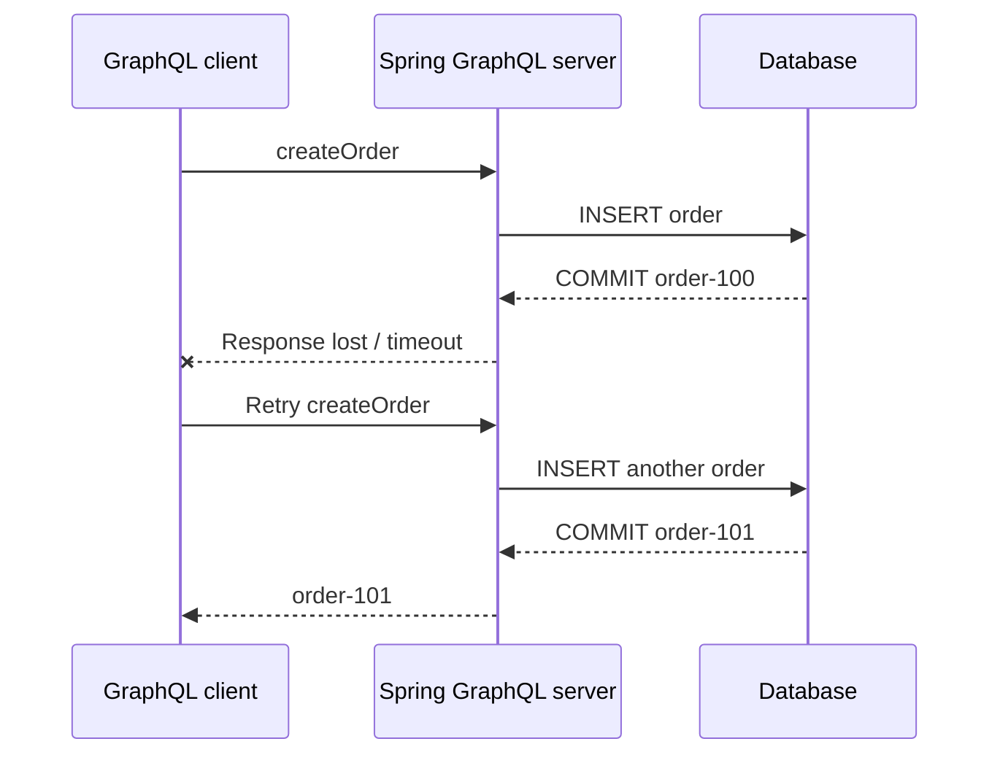
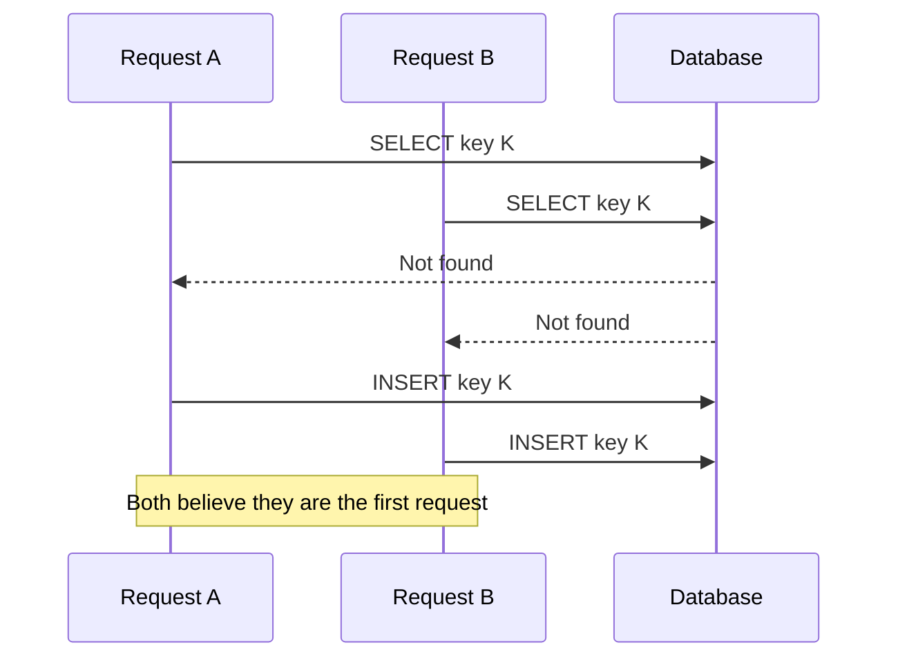
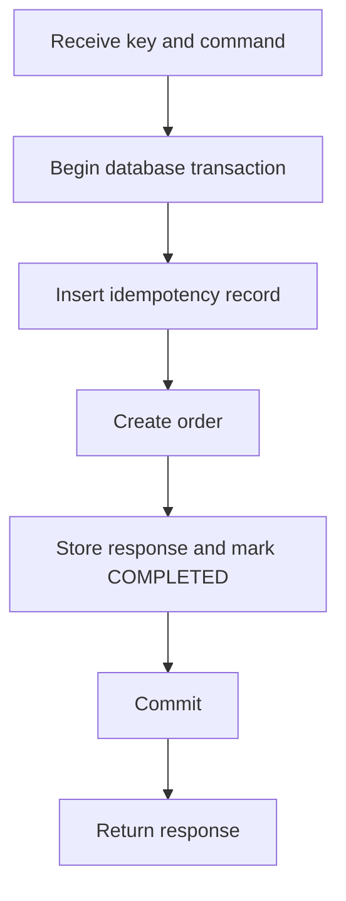
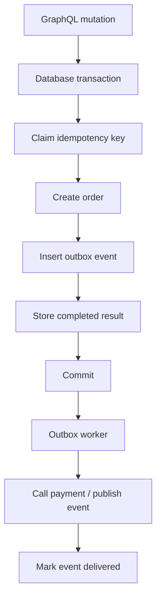

# Idempotent Mutations in Spring for GraphQL

GraphQL mutations typically create or modify data: placing orders, making reservations, processing payments, updating profiles, or starting a business workflow. A client may send a mutation and fail to receive a response due to a timeout, network loss, or closed connection. In that situation, the client does not know whether the server never processed it, is still processing it, or already committed successfully. If the client resends the mutation, the same action may execute twice.

Idempotency solves this problem. The client sends a stable idempotency key for a single business intent; the server stores the result of the first execution and reuses that result for matching retries. This mechanism must be guaranteed at the storage and transaction layers—never rely solely on an in-memory `Map` or a preliminary `SELECT` check.

After this lesson, you will be able to:

- Understand why GraphQL mutations need idempotency on retries.
- Design inputs carrying an idempotency key.
- Distinguish an idempotency key from a GraphQL operation ID and a request ID.
- Compute a request fingerprint to detect key reuse with a mismatched payload.
- Use unique constraints to handle two concurrent requests.
- Save mutation results inside a transaction and replay responses.
- Design `processing`, `completed`, and `failed` states.
- Combine idempotency with outboxes, events, and external side effects.
- Define key scoping, retention, security, and testing.

## 1. Why Do Mutations Need Idempotency?

Suppose a client invokes a mutation to create an order:

```graphql
mutation CreateOrder {
    createOrder(input: {
        productId: "product-42"
        quantity: 2
    }) {
        id
        status
    }
}
```

The server may have already created the order and committed the transaction, yet the response was lost in transit. The client sees only a timeout. If it resends the same mutation, the server may create a second order.



The client sent one business intent, yet the server executed it twice. This scenario is especially dangerous for payments, fund transfers, limited-capacity bookings, or sending emails.

Idempotency lets the client retry the same intent without the server producing duplicate side effects. The server recognizes retries via the key and returns the previously recorded result.

## 2. What Does Idempotent Mean?

An idempotent operation can be executed multiple times with the same input such that the final business state is identical to executing it once.

For example, updating an order status to `CANCELLED` can be idempotent if subsequent calls trigger no extra side effects. Conversely, `incrementBalance(100)` or `createOrder(...)` is not inherently idempotent because each call can mutate state again.

Idempotency does not mean every repeated request returns the exact same HTTP status or metadata. The goal is guaranteeing a single business intent executes only once and retries receive the recorded result.

With GraphQL, operations are typically sent over HTTP POST, yet the HTTP method does not make a mutation idempotent. Idempotency is a business contract implemented by the application.

## 3. What Is an Idempotency Key?

An idempotency key is a unique token representing a single client business intent. The client generates the key before the first submission and reuses that exact key when retrying the same mutation.

Input example:

```graphql
input CreateOrderInput {
    idempotencyKey: ID!
    productId: ID!
    quantity: Int!
    currency: String!
}

type Mutation {
    createOrder(input: CreateOrderInput!): CreateOrderPayload!
}

type CreateOrderPayload {
    order: Order
    replayed: Boolean!
}
```

Client sending the key:

```graphql
mutation CreateOrder($input: CreateOrderInput!) {
    createOrder(input: $input) {
        order {
            id
            status
        }
        replayed
    }
}
```

Variables:

```json
{
  "input": {
    "idempotencyKey": "01J9X6A3F7W8M2K4N5P6Q7R8S9",
    "productId": "product-42",
    "quantity": 2,
    "currency": "VND"
  }
}
```

When retrying the same operation, the client must resend the exact same key. Generating a new key for each retry causes the server to treat them as new intents and create multiple orders.

Keys should have sufficient entropy, be generated with a secure random generator, and have a length limit enforced on the server. Properly generated random UUIDs or ULIDs are common choices. Never embed emails, phone numbers, access tokens, or personal data in the key; the key is a technical identifier and must still undergo separate authorization checks.

## 4. Distinguishing Idempotency Keys from Other IDs

Avoid confusing IDs that serve different purposes:

| Value | Purpose | Stable Across Retries? |
| --- | --- | --- |
| Idempotency key | Identifies a single business intent | Yes, required |
| GraphQL operation name | Name of the operation in the document | Can match across many calls, not unique |
| GraphQL operation ID/hash | Identifies a document or persisted query | Yes, but does not identify a single order-creation attempt |
| Request ID | Tracks a single HTTP/request attempt | Typically changes on every retry |
| Trace ID | Tracks a distributed trace | May change or be linked per tracing policy |
| Order ID | Identifies the created entity | Available only after the entity is created |

An idempotency key must represent the intent to create a specific order, not the query document. Two attempts to create two distinct orders can use the same GraphQL operation, yet they must carry two distinct idempotency keys.

## 5. Clients Must Preserve the Key Across Retries

Clients should generate the key at the moment the user confirms the action, persist the key alongside the pending command, and reuse it for every retry of that command.

```text
User confirms checkout
        |
        v
Create idempotency key K
        |
        v
Send createOrder(K, payload)
        |
        +---- response received ----> Complete client command
        |
        +---- timeout / connection lost
                    |
                    v
             Retry createOrder(K, same payload)
```

If a mobile app closes and reopens, the client may need to store the key and pending status in local durable storage so it does not generate a new key upon resuming the operation. Never generate a new key simply because the first request timed out.

Clients should only retry according to a designed retry policy. Validation or authorization errors usually should not be retried blindly. Timeouts and connection failures with uncertain outcomes are where idempotency is especially valuable.

## 6. Uniqueness Scope of an Idempotency Key

Keys must be unique within a defined scope. In practice, a composite scope is commonly used:

```text
tenant_id + actor_id + operation_type + idempotency_key
```

This scoping prevents collisions if two users or two tenants happen to generate the same key string. In multi-tenant systems, the tenant must come from the authenticated security context—never trust an arbitrary tenant value in input.

Example table schema:

```sql
CREATE TABLE idempotency_record (
    id BIGINT GENERATED ALWAYS AS IDENTITY PRIMARY KEY,
    tenant_id VARCHAR(100) NOT NULL,
    actor_id VARCHAR(100) NOT NULL,
    operation_type VARCHAR(100) NOT NULL,
    idempotency_key VARCHAR(200) NOT NULL,
    request_hash VARCHAR(64) NOT NULL,
    status VARCHAR(20) NOT NULL,
    response_payload JSONB,
    created_at TIMESTAMP WITH TIME ZONE NOT NULL,
    updated_at TIMESTAMP WITH TIME ZONE NOT NULL,
    expires_at TIMESTAMP WITH TIME ZONE,
    CONSTRAINT uq_idempotency_scope UNIQUE
        (tenant_id, actor_id, operation_type, idempotency_key)
);
```

`JSONB`, identity syntax, and timestamp types depend on the database. Use `TEXT`/an equivalent JSON type if the database does not support `JSONB`.

A unique constraint is the ultimate safeguard against two concurrent requests claiming the same key. Checking with a `SELECT` before `INSERT` without a unique constraint still leaves a race condition.

## 7. Request Fingerprinting to Detect Key Reuse with Different Payloads

A client might accidentally or intentionally send the same idempotency key with a different payload:

```text
Request 1: key=K, productId=product-42, quantity=2
Request 2: key=K, productId=product-99, quantity=5
```

If the server inspects only the key and returns the old result, the client may mistakenly think the second request created an order with the new payload. If the server executes the second request, the same key ends up representing two different intents.

The solution is computing a request fingerprint from the semantically meaningful business fields:

```text
fingerprint = SHA-256(canonicalize(operationType, productId, quantity, currency))
```

When the key already exists:

- Hash matches: this is a retry of the same payload; the result can be replayed.
- Hash differs: reject because the client reused a key for a different payload.

Do not hash raw JSON if key ordering or formatting can vary without changing semantics. Canonicalize the payload: sort fields/maps, normalize numbers, enums, null/default values, and include only fields affecting side effects.

Exclude purely tracing or UI fields such as display locale from the fingerprint if they do not change business intent. Conversely, include currency, pricing options, shipping address, or any values capable of altering side effects in the hash.

## 8. Computing Fingerprints in Java

A simple example using an explicitly constructed canonical string:

```java
public record CreateOrderCommand(
        String productId,
        int quantity,
        String currency) {
}

public String fingerprint(CreateOrderCommand command) {
    String canonical = String.join("|",
            command.productId(),
            Integer.toString(command.quantity()),
            command.currency().toUpperCase(Locale.ROOT));

    try {
        MessageDigest digest = MessageDigest.getInstance("SHA-256");
        byte[] hash = digest.digest(canonical.getBytes(StandardCharsets.UTF_8));
        return HexFormat.of().formatHex(hash);
    }
    catch (NoSuchAlgorithmException exception) {
        throw new IllegalStateException("SHA-256 is unavailable", exception);
    }
}
```

This example illustrates the principle. If a field can contain `|`, use an unambiguous encoding such as JSON canonicalization or length-prefix encoding. For complex payloads, use a controlled canonical serializer instead of manual string concatenation.

SHA-256 here compares payloads; it does not authenticate the sender. Authentication and authorization must still be performed independently.

## 9. Storing Idempotency State

An idempotency record typically has the following states:

| State | Meaning | Behavior on Retry |
| --- | --- | --- |
| `PROCESSING` | Key has been claimed and work is in progress | Return processing status or instruct client to retry later |
| `COMPLETED` | Side effects and result have committed | Replay the stored result |
| `FAILED_FINAL` | Terminal failure; do not retry the same command | Replay recorded failure or return a stable error code |
| `RETRYABLE` | Failure that can be retried per policy | Allow continuation according to recovery rules |

Not every system needs all four states. For a short synchronous transaction, you can insert the record, create the entity, and mark `COMPLETED` in the same transaction; the uncommitted `PROCESSING` state is invisible, so other requests normally only observe the record after the transaction finishes.

For long-running or asynchronous work, `PROCESSING` must be committed separately so other workers know the command is running. In that case, include a lease/heartbeat, owner, or fencing token so recovery workers do not execute side effects concurrently with an active worker.

## 10. Why Is SELECT-Then-INSERT Unsafe?

An error-prone implementation:

```java
if (!repository.existsByKey(key)) {
    repository.save(new IdempotencyRecord(key));
    orderService.createOrder(command);
}
```

Two concurrent requests can interleave as follows:



This is a race condition. A unique constraint on scope/key allows at most one transaction to insert successfully. The losing request must handle the conflict, read the created record, and either replay or return the processing status.

Do not rely on Java's `synchronized` keyword to resolve races across multiple instances/pods. In-memory locks apply only within one process and do not coordinate across nodes.

## 11. Short Transactions: Writing Key and Side Effects Together

For fast order-creation mutations, a straightforward design stores the idempotency record, creates the order, and saves the response within the same database transaction:



If creating the order fails, the transaction rolls back both the idempotency record and the order. If the commit succeeds but the response is lost, a retry finds the `COMPLETED` record and replays the response.

Service example:

```java
@Service
public class CreateOrderService {

    private final IdempotencyRepository idempotencyRepository;
    private final OrderRepository orderRepository;

    @Transactional
    public CreateOrderResult create(
            Actor actor,
            String key,
            CreateOrderCommand command) {

        String requestHash = fingerprint(command);

        IdempotencyRecord record = idempotencyRepository.insertNew(
                actor.tenantId(), actor.id(), "CREATE_ORDER", key, requestHash);

        Order order = orderRepository.save(Order.create(actor, command));
        CreateOrderResult result = new CreateOrderResult(order.id(), order.status());

        record.complete(serialize(result));
        idempotencyRepository.save(record);
        return result;
    }
}
```

This illustrates the structure. `insertNew(...)` must rely on the unique constraint and handle duplicate keys explicitly; never implement it with `existsByKey` followed by `save` without concurrency protection. If a duplicate insert throws an exception that marks the transaction rollback-only, reading the existing record must occur in a new transaction or after the failed transaction exits, depending on the database and transaction manager.

## 12. Handling Duplicate Keys and Concurrent Requests

When two requests with the same key arrive nearly simultaneously, the database unique constraint decides which request wins the key. The losing request must:

1. Identify the specific unique constraint/index error.
2. Stop creating the order or executing side effects.
3. Read the committed idempotency record in an appropriate transaction.
4. Compare the request fingerprint.
5. If the record is `COMPLETED`, return the stored result.
6. If the record is `PROCESSING`, return a processing status or retry guidance per contract.

Do not catch every `DataIntegrityViolationException` and assume it is an idempotency duplicate. Violations can come from other constraints such as foreign keys, unique order numbers, or `NOT NULL`. Inspect the specific constraint.

With synchronous transactions, the second request may wait for the first unique insert to finish. If the first transaction commits, the second reads the result; if the first rolls back, the second may succeed with its insert and become the executing request.

## 13. Separating Key Claiming and Execution

Code can be structured into two phases: claiming the key and executing the command. The claim step must be protected by a unique constraint:

```java
public sealed interface ClaimResult {
    record NewClaim(IdempotencyRecord record) implements ClaimResult {}
    record Existing(IdempotencyRecord record) implements ClaimResult {}
}
```

Service orchestration:

```java
public CreateOrderResult handle(
        Actor actor,
        String key,
        CreateOrderCommand command) {

    String hash = fingerprint(command);
    ClaimResult claim = idempotencyService.claim(
            actor.tenantId(), actor.id(), "CREATE_ORDER", key, hash);

    if (claim instanceof ClaimResult.Existing existing) {
        return replayOrReject(existing.record(), hash);
    }

    return executeClaimedOrder((ClaimResult.NewClaim) claim, actor, command);
}
```

This separation clarifies responsibilities, though it does not create atomicity by itself. Define the transaction boundaries across claim, business write, and completion. For short transactions, all three steps should commit together. For long jobs, the claim may commit separately and require a recovery protocol.

## 14. Replaying Stored Results

When a retry matches the scope, key, and fingerprint, the server does not call the business service again. It reads the stored result and returns it to the client.

Two common approaches:

- Store the serialized response payload to replay the exact original outcome.
- Store the resource ID and necessary metadata, then reconstruct the payload from the resource's state.

Storing the payload keeps responses more stable if the entity changes after initial execution. Storing the resource ID avoids duplicating data, though the reconstructed response may reflect newer state.

Choose based on your contract. If the client must receive the exact outcome of the initial command, store an immutable result snapshot. If the API only promises the resource's current state, storing the resource ID and re-querying is viable.

Payload example:

```json
{
  "orderId": "order-100",
  "status": "CREATED"
}
```

Never store access tokens, secrets, or unnecessary sensitive data in response snapshots. Protect idempotency records with the same care as regular business data.

## 15. GraphQL Payloads for Replayed Results

You can expose a `replayed` flag in the payload:

```graphql
type CreateOrderPayload {
    order: Order
    replayed: Boolean!
}
```

First call:

```json
{
  "data": {
    "createOrder": {
      "order": { "id": "order-100", "status": "CREATED" },
      "replayed": false
    }
  }
}
```

Retry call:

```json
{
  "data": {
    "createOrder": {
      "order": { "id": "order-100", "status": "CREATED" },
      "replayed": true
    }
  }
}
```

`replayed` is optional information useful for telemetry or client UIs. If the GraphQL response must be identical between the initial call and retries, omit this flag and return only the stored payload. Whichever you choose, document the idempotency contract clearly.

## 16. Keys in the PROCESSING State

For asynchronous processing, the initial request may claim the key and enqueue a job. Retries arriving before the job finishes need a deterministic response.

Payload example:

```graphql
enum CommandStatus {
    PROCESSING
    COMPLETED
    FAILED
}

type CreateOrderPayload {
    status: CommandStatus!
    order: Order
    retryAfterMillis: Int
}
```

If the key is `PROCESSING`, the server can return that status along with how long the client should wait before querying again. An alternative is returning a GraphQL error with code `IDEMPOTENCY_IN_PROGRESS` and a retry hint in `extensions`.

Never allow a second request to execute the business command merely because the first record lacks a response payload yet. A claimed key must have a clear owner and status.

## 17. Recovery for Stuck PROCESSING Records

A worker may crash after claiming a key and before marking it complete. If the record stays `PROCESSING` forever, the client can never finish the command.

For long-running workflows, also store:

- `owner_id` or worker ID.
- `lease_until` or the latest heartbeat timestamp.
- `attempt`/version to distinguish processing attempts.
- `last_error_code` for diagnostics.

A recovery worker can reclaim expired-lease records using a conditional atomic update. A fencing token/version prevents an old worker from overwriting the result after the lease has transferred to a new worker.

Do not rely solely on `updated_at` and allow two workers to run simultaneously without a locking or compare-and-set mechanism. Recovery must also be idempotent across every side effect.

## 18. FAILED_FINAL and RETRYABLE

Not every failure should be stored as a final result.

`FAILED_FINAL` suits business errors that cannot succeed even if the same payload is repeated, such as an item not permitted for sale or an invalid quantity. Retries with the same key should receive the recorded error.

`RETRYABLE` suits failures occurring before side effects or safe to resume, such as a temporarily unavailable dependency before the order is created. Define clearly who is allowed to retry, when states can transition, and whether a new attempt keeps the same key.

Do not save every runtime error as `FAILED_FINAL` if the system can recover. Conversely, do not automatically retry business or validation errors.

If a transaction rolls back the entire record on failure, the key no longer exists and a retry can execute cleanly from scratch. That is often the right choice for short commands. If you want to record a terminal failure, use a separate transaction after determining the business outcome and avoid letting a failure record contradict committed side effects.

## 19. Transaction Boundaries and @Transactional

To ensure single-database atomicity, the idempotency record, business entity, and response snapshot should commit in the same transaction:

```java
@Transactional
public CreateOrderResult executeOnce(...) {
    IdempotencyRecord record = claimKey(...);
    Order order = createOrder(...);
    CreateOrderResult result = toResult(order);
    record.complete(serialize(result));
    return result;
}
```

If any step fails before commit, the database rolls back all three changes. If the commit succeeds, retries see the completed record.

Notes on Spring transactions:

- `@Transactional` is normally applied via proxy; self-invocation can bypass the interceptor.
- A transaction manager covers only resources participating in the same transaction.
- Calling a remote payment provider does not automatically belong to the database transaction.
- Reactive transactions require a reactive transaction manager and must stay in the same reactive chain.
- Never call `.block()` inside a reactive transaction to switch to imperative flow.

Do not assume `@Transactional` creates a distributed transaction across databases, message brokers, and payment providers.

## 20. Reactive Mutations and Transactions

With WebFlux/R2DBC, services can return `Mono<CreateOrderResult>`:

```java
@Transactional
public Mono<CreateOrderResult> createOrder(
        Actor actor,
        String key,
        CreateOrderCommand command) {

    return idempotencyRepository.insertNew(actor, key, fingerprint(command))
            .flatMap(record -> orderRepository.save(Order.create(actor, command))
                    .flatMap(order -> {
                        CreateOrderResult result = toResult(order);
                        return idempotencyRepository.markCompleted(
                                record.id(), serialize(result))
                                .thenReturn(result);
                    }));
}
```

This illustrates reactive transactions. All repositories must share the same reactive transaction context and database connection factory. Never split part of the work into a separate `subscribe()`, as that work can run outside the transaction and finish after the original transaction ends.

Do not call `subscribe()` inside the service. Return the publisher so Spring GraphQL and the transaction infrastructure manage the subscription.

## 21. External Side Effects and Transactional Outbox

A database transaction cannot automatically roll back a call already sent to a payment provider or email service. If the server calls a payment provider and then the database rolls back, the two systems become inconsistent.

A transactional outbox coordinates database writes and event publishing:



The order, idempotency record, and outbox event commit together. The worker reads the outbox and dispatches the event after commit. If the worker sends successfully but crashes before marking it delivered, the event may be resent; consumers or providers still need their own idempotency.

An outbox guarantees events are not lost between database commit and publishing, usually with at-least-once semantics. It does not by itself guarantee downstream side effects happen only once.

## 22. Idempotency with Payment Providers

If a mutation calls a payment gateway, pass a stable idempotency key to the provider when its API supports one. You can derive the downstream key from an internal command ID rather than passing the client's raw key verbatim.

```java
paymentClient.capture(
        order.paymentReference(),
        paymentIdempotencyKey(order.id()));
```

If the provider does not support idempotency, design reconciliation: store request state and provider references, reconcile outcomes, and handle timeouts where it is unclear whether the provider captured funds.

Never retry a payment merely because the GraphQL client timed out. Before retrying side effects, determine the transaction state or use a provider idempotency key to avoid double-charging.

## 23. Idempotency Does Not Replace Authorization

When an existing key is retried, the server must still authenticate the caller and verify authorization to read the stored result. Never return a response snapshot solely because the caller knows an idempotency key.

Key scoping should bind to the actor and tenant from the security context. If an actor's permissions were revoked after the first mutation, policy may forbid returning sensitive data from the response snapshot. You can return a minimal command status or re-check resource permissions before replaying the payload.

Fingerprints are not a security mechanism. Never put access tokens in keys or fingerprints, and never treat a hard-to-guess key as a capability token granting access to results.

## 24. Retention and Key Expiration

Idempotency records must be retained long enough to cover realistic retry windows across clients, gateways, and business workflows. Deleting keys too early lets a late retry create a duplicate side effect.

Retention depends on command type:

- UI actions may retry within a few minutes.
- Checkout may need keys kept longer than payment and order-processing durations.
- Transfers or payments may require retaining trails for audit and reconciliation rules.

When records expire, define the contract: can a key be reused or is it permanently rejected? For financial transactions, you generally should not permit reusing a key just because the response snapshot expired; keep a minimal tombstone/hash longer to prevent duplicates.

Cleanup jobs should delete records in batches to avoid long table locks. Never delete `PROCESSING` records with an active lease.

## 25. Size Limits and Stored Data

Response snapshots can grow large, especially when mutations return nested objects with many fields. Store only the payload needed to replay the contract. You can persist a small immutable result DTO and construct the GraphQL payload for the retry's selection set.

A GraphQL client might retry the same mutation while requesting a different selection set. Thus, storing the raw JSON response from the first call may fail if the retry requests different fields. Usually it is better to store a stable business result (resource ID, command outcome, version) and let the GraphQL engine resolve the new selection set from that result.

If the exact original response envelope must be replayed, include the document/selection set in the fingerprint or require retries to use the exact same operation. Do not mix the business payload's request hash with the GraphQL document hash when your goal is strictly preventing duplicate side effects.

## 26. GraphQL Selection Sets and Replay

Two mutations can share the same input while selecting different fields:

```graphql
mutation First($input: CreateOrderInput!) {
    createOrder(input: $input) {
        order { id status }
    }
}
```

```graphql
mutation Retry($input: CreateOrderInput!) {
    createOrder(input: $input) {
        order { id status total customer { name } }
    }
}
```

If the idempotency record stores `orderId`, the resolver can return `Order` and let the GraphQL engine resolve the retry's selection set. This is usually more flexible than storing the first call's JSON response.

If results must be immutable as of execution time, store a command result snapshot and define which fields may be re-queried from current state. The contract must state clearly whether replays return a snapshot or current resource state.

## 27. Idempotency for Other Mutation Types

Idempotency is not just for creations:

| Mutation | Retry Risk | Design Approach |
| --- | --- | --- |
| `createOrder` | Creates two orders | Key + unique constraint + stored order ID |
| `capturePayment` | Charges twice | Provider idempotency key + transaction reference |
| `reserveSeat` | Reserves two seats | Key + unique reservation command + lock/inventory constraint |
| `sendInvitation` | Sends multiple emails | Key + outbox event deduplication |
| `incrementBalance` | Credits balance multiple times | Unique ledger entry keyed by command ID |
| `setProfile` | Writes the same values repeatedly | Naturally idempotent if no secondary side effects exist |
| `cancelOrder` | Emits multiple cancel events | Conditional state transition + command key |

For financial ledgers, enforce a unique command ID/transaction ID directly on the ledger entry itself. Do not rely solely on an external idempotency table, because the ledger write path must enforce its own uniqueness invariant.

## 28. Testing Idempotency

Tests must prove that the same key and payload produce only one side effect:

```java
@Test
void retriesReturnSameOrderWithoutCreatingAnother() {
    CreateOrderCommand command =
            new CreateOrderCommand("product-42", 2, "VND");

    CreateOrderResult first = service.create(actor, "key-123", command);
    CreateOrderResult retry = service.create(actor, "key-123", command);

    assertThat(retry.orderId()).isEqualTo(first.orderId());
    assertThat(orderRepository.countByCustomer(actor.id())).isEqualTo(1);
}
```

This test assumes the service returns the stored result when the key exists and database fixtures are isolated between tests.

Required test scenarios:

1. First execution creates the command successfully.
2. Retry with the same key and payload returns the same result.
3. Same key with a different payload is rejected.
4. Identical keys under two different actors or tenants do not collide if scoping allows.
5. Two concurrent requests with the same key produce only one side effect.
6. Transaction rollback leaves no false `COMPLETED` record.
7. Retry while `PROCESSING` receives the status defined by the contract.
8. Worker recovery never lets two workers execute side effects concurrently.
9. Retries after retention behave per policy.
10. Unauthorized callers cannot replay another actor's response snapshot.
11. Varying GraphQL selection sets still resolve properly if supported by the contract.
12. Outbox events or payment providers are not processed twice when workers retry.

## 29. Testing Race Conditions

To test two concurrent requests, launch two threads or two reactive subscriptions sending the same key, synchronized with a latch/barrier to start nearly simultaneously:

```java
CountDownLatch start = new CountDownLatch(1);

CompletableFuture<CreateOrderResult> first = CompletableFuture.supplyAsync(() -> {
    await(start);
    return service.create(actor, "same-key", command);
});

CompletableFuture<CreateOrderResult> second = CompletableFuture.supplyAsync(() -> {
    await(start);
    return service.create(actor, "same-key", command);
});

start.countDown();

CreateOrderResult resultA = first.join();
CreateOrderResult resultB = second.join();

assertThat(resultA.orderId()).isEqualTo(resultB.orderId());
assertThat(orderRepository.countByCommandKey("same-key")).isEqualTo(1);
```

This example needs an `await(...)` helper handling `InterruptedException`, a managed test executor, and a real database supporting unique constraints. For reliable race testing, run integration tests against the same database engine used in production; mocked repositories cannot verify transaction isolation or unique constraints.

Do not assert that the second request always returns `replayed=true`: depending on timing, it might wait for the first transaction to commit and replay, or receive a processing status per architecture. The critical invariant is that only one side effect occurs and every response references the same command result.

## 30. GraphQlTester for Idempotent Mutations

You can test the GraphQL contract with `GraphQlTester`:

```java
String document = """
        mutation CreateOrder($input: CreateOrderInput!) {
            createOrder(input: $input) {
                order { id status }
                replayed
            }
        }
        """;

Map<String, Object> input = Map.of(
        "idempotencyKey", "key-123",
        "productId", "product-42",
        "quantity", 2,
        "currency", "VND");

String firstOrderId = graphQlTester.document(document)
        .variable("input", input)
        .execute()
        .path("createOrder.order.id")
        .entity(String.class)
        .get();

graphQlTester.document(document)
        .variable("input", input)
        .execute()
        .path("createOrder.order.id")
        .entity(String.class)
        .isEqualTo(firstOrderId);
```

Beyond the response, tests must check that the database contains only one order and the outbox/ledger contains only one command entry. If the GraphQL payload exposes `replayed`, check that flag on retries according to contract.

## 31. GraphQL Errors When a Key Is Misused

When a key already exists with a different fingerprint, the server should return a stable error, for example:

```json
{
  "errors": [
    {
      "message": "Idempotency key was already used with a different request",
      "extensions": {
        "code": "IDEMPOTENCY_KEY_REUSED"
      }
    }
  ],
  "data": null
}
```

Business exceptions can be mapped via `@GraphQlExceptionHandler`:

```java
@GraphQlExceptionHandler
public GraphQLError handleKeyReuse(
        IdempotencyKeyReuseException exception,
        DataFetchingEnvironment environment) {

    return GraphqlErrorBuilder.newError(environment)
            .message("Idempotency key was already used with a different request")
            .extensions(Map.of("code", "IDEMPOTENCY_KEY_REUSED"))
            .build();
}
```

Do not leak the previous payload in the error. The client only needs to know the key was used with a different request and that it must generate a new key for a new intent.

## 32. Observability and Auditing

Track the following metrics and logs:

- Counts of new commands, retries, replays, and key-reuse conflicts.
- Rate of prolonged `PROCESSING` records or expired leases.
- Latency from claim to completion.
- Duplicate conflict counts by operation type.
- Outbox delivery retries and provider idempotency outcomes.
- Expired record counts and retention durations.

Logs should include operation type, internal record ID, and trace ID. Do not log full idempotency keys if keys could be used to probe command state; hash or partially redact them. Never use keys, actor IDs, or resource IDs as unbounded-cardinality metric labels.

Audit records should allow investigating who initiated a command, which commands were replayed, and which side effects committed, without storing unnecessary sensitive data.

## 33. Common Mistakes

- **Generating a new key per retry:** the server treats every retry as a new command.
- **Using the operation name as the key:** many distinct intents share the same operation.
- **Using only an in-memory map:** fails across multiple instances or restarts.
- **SELECT-then-INSERT without a unique constraint:** two concurrent requests can both execute.
- **Skipping fingerprint comparison:** the same key gets used for different payloads.
- **Putting the record and business write in separate transactions:** the record can show completed while side effects roll back, or vice versa.
- **Catching every integrity violation as a duplicate:** hides unrelated constraint failures.
- **Replaying responses without checking authorization:** leaks another actor's data.
- **Storing selection-set-dependent JSON responses:** retries with different selection sets fail to resolve properly.
- **PROCESSING without leases/recovery:** records can get stuck forever.
- **Allowing two workers to run when a lease expires:** side effects can repeat without fencing or downstream idempotency.
- **Assuming database transactions cover payments/emails:** external side effects require an outbox and dedicated idempotency.
- **Deleting keys too early:** late retries trigger duplicate side effects.
- **Testing only sequential calls:** fails to catch race conditions across concurrent requests.

## 34. Process for Implementing Idempotent Mutations

When building a retryable mutation, follow these steps:

1. Identify the side effects and input fields that define a single business intent.
2. Add a required `idempotencyKey` to the mutation input.
3. Require clients to generate the key once and preserve it across retries.
4. Scope keys by tenant, actor, and operation type.
5. Canonicalize inputs and compute a request fingerprint.
6. Enforce a database unique constraint on scope and key.
7. Claim keys atomically; never rely on `existsByKey` before inserting.
8. For short transactions, write the idempotency record, business data, and result in the same transaction.
9. For long-running jobs, use processing states, leases, recovery, and fencing.
10. Replay stored results when key and fingerprint match; reject mismatched payloads.
11. Verify authorization before returning stored results.
12. Use an outbox and downstream idempotency for events, payments, and emails.
13. Choose retention matching retry windows and audit requirements.
14. Test retries, payload mismatches, concurrency, rollbacks, recovery, and selection sets.
15. Monitor replays, conflicts, processing timeouts, and side-effect delivery.

Idempotent mutations enable GraphQL clients to retry safely when lost responses or timeouts leave execution outcomes uncertain. Idempotency keys identify a single business intent; fingerprints prevent key reuse with different payloads; unique constraints handle concurrent requests; transactions bind the record to side effects and results. For long-running work or external system calls, add state tracking/recovery, an outbox, and downstream idempotency. Designing both the client contract and storage invariants properly ensures a command is never executed twice.

## References

- [Spring for GraphQL — Mutations and Annotated Controllers](https://docs.spring.io/spring-graphql/reference/controllers.html)
- [Spring Framework — Declarative Transaction Management](https://docs.spring.io/spring-framework/reference/data-access/transaction/declarative.html)
- [Spring Data — Repository Query and Persistence](https://docs.spring.io/spring-data/commons/reference/repositories.html)
- [PostgreSQL — Unique Constraints](https://www.postgresql.org/docs/current/ddl-constraints.html#DDL-CONSTRAINTS-UNIQUE-CONSTRAINTS)
- [PostgreSQL — INSERT ON CONFLICT](https://www.postgresql.org/docs/current/sql-insert.html)
- [AWS Builders' Library — Making retries safe with idempotent APIs](https://aws.amazon.com/builders-library/making-retries-safe-with-idempotent-APIs/)
- [Microservices.io — Idempotent Consumer](https://microservices.io/patterns/communication-style/idempotent-consumer.html)
- [Microservices.io — Transactional Outbox](https://microservices.io/patterns/data/transactional-outbox.html)
