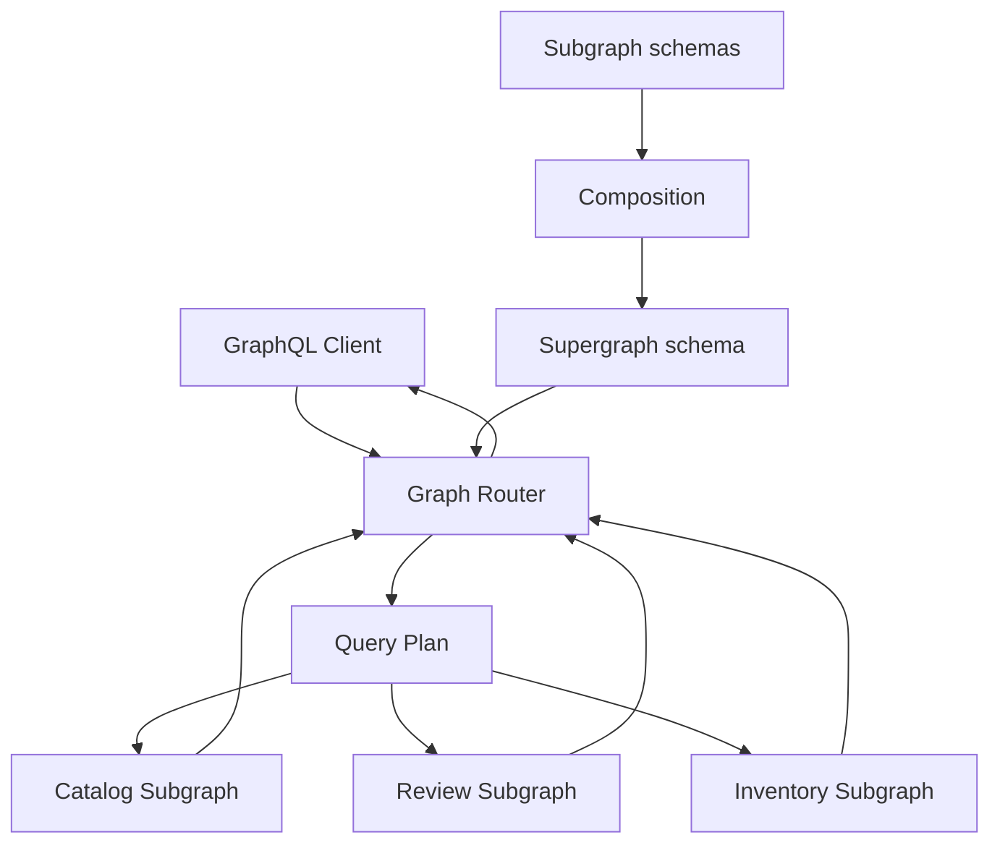
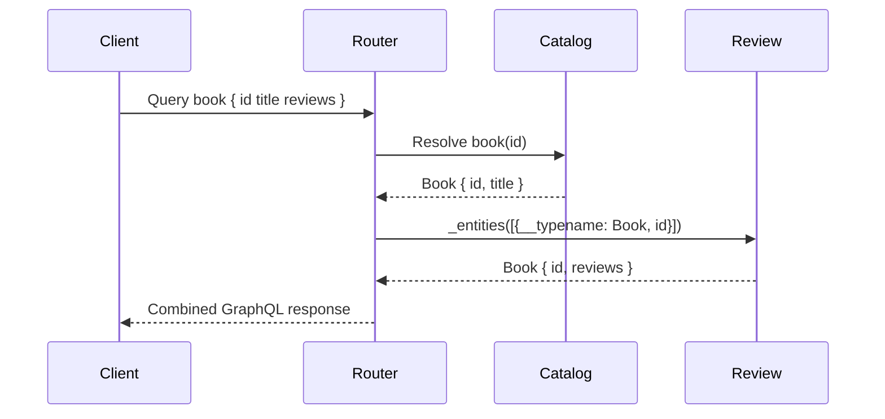

# What is GraphQL Federation?

## 1. The problem when multiple GraphQL services coexist

As a system grows, data is often split across multiple teams and services. For example:

- Catalog manages books, products, and descriptive information.
- Review manages ratings and comments.
- Inventory manages stock levels.
- Account manages users and profiles.

Each team can build its own GraphQL API. However, clients often need data from multiple teams on the same screen. If a client has to call each API separately, it must know the address, schema, data-merging logic, and error handling of every service. This tightly couples the client to the backend architecture.

Another approach is to create a single GraphQL gateway, but the gateway must manually know how to call and merge each service. As the number of services grows, the orchestration logic and aggregated schema can become a centralized bottleneck that is hard to maintain.

GraphQL Federation solves that problem with a convention-based model: each service publishes part of its schema, the schema parts are composed into a Supergraph, and a Graph Router uses Federation metadata to distribute requests.

## 2. What is GraphQL Federation?

GraphQL Federation is an architecture that combines multiple independent GraphQL APIs into a single unified graph. With Apollo Federation, each participating GraphQL service is called a **Subgraph**. Subgraphs publish their schemas and the resolution logic for the data they own. A composition tool combines these schemas into a **Supergraph schema**. The **Graph Router** reads the Supergraph schema to plan and route a GraphQL operation to one or more Subgraphs.

Clients send queries to a single Router endpoint. Clients do not need to know whether a query has to go through Catalog, Review, or Inventory. The Router understands the relationships between types and fields, calls the required Subgraphs, and merges the results into a single GraphQL response.

Federation is not a new syntax replacing GraphQL. It adds schema, entity, and directive conventions so that multiple GraphQL servers can collaborate as one graph.

## 3. Components in a Federation architecture

A Federation system typically includes the following components:

| Component | Responsibility |
| --- | --- |
| Subgraph | An independent GraphQL service that owns a portion of the schema and data |
| Entity | An object with an identifying key so Subgraphs can reference the same entity |
| Federation directives | Declare keys, field ownership, and relationships between Subgraphs |
| Schema composition | Combines Subgraph schemas and validates compatibility |
| Supergraph schema | The combined schema along with metadata for the Router to plan queries |
| Graph Router | Receives requests, builds query plans, calls Subgraphs, and merges responses |
| Client | Calls only a single GraphQL endpoint of the Supergraph |



Composition is typically performed in a development pipeline or through a schema management platform. The Router loads the composed Supergraph schema to serve requests. Schema composition and query execution are two separate activities.

## 4. Example: a graph consisting of Catalog and Review

Suppose a bookstore application has two services:

- Catalog owns book information such as ID and title.
- Review owns book reviews.

The client wants to execute a single query:

```graphql
query BookPage($id: ID!) {
    book(id: $id) {
        id
        title
        reviews {
            id
            rating
            text
        }
    }
}
```

Catalog returns the `Book` information. Review provides the `reviews` field for the same `Book` entity. The Router knows how to join these two parts thanks to entity keys and Federation directives.

The client sees only a single unified graph. It does not need to call Catalog first and then take the ID to call Review.

## 5. How do Subgraph and Supergraph differ?

A Subgraph is a GraphQL service with its own schema and runtime. It can run, be deployed, and scale independently from other Subgraphs.

A Supergraph is the composition result of multiple Subgraph schemas. It contains the types and fields accessible to clients, along with metadata so the Router knows which Subgraph resolves which field and how entities should be passed along.

For example:

```text
Catalog schema             Review schema
----------------           ----------------
Book.id                    Book.id
Book.title                 Book.reviews
Book.price                 Review.rating
                           Review.text
       \                       /
        \                     /
         +-- Supergraph -----+
                 |
             Graph Router
                 |
            Client query
```

A Supergraph is not a database replica or a service holding all the data. It is a unified schema and routing metadata. Data is still fetched from the responsible Subgraphs.

## 6. Entities are the foundation linking Subgraphs

In Federation, an entity is an object that can be identified by one or more key fields. The `@key` directive marks an object type as an entity and indicates the fields used to identify that entity.

For example, Catalog owns the `Book` entity:

```graphql
type Query {
    book(id: ID!): Book
}

type Book @key(fields: "id") {
    id: ID!
    title: String!
    price: Float!
}
```

`@key(fields: "id")` tells the Router that a `Book` can be referenced by `id`. The Router does not need to know how Catalog stores books; Catalog is responsible for finding the entity by that key.

An entity can have multiple keys if the schema needs multiple ways to identify it. Choose keys that are stable, unique, and usable by Subgraphs for lookups.

## 7. Multiple Subgraphs can contribute fields to the same entity

The Review Subgraph can extend the `Book` entity to add the `reviews` field:

```graphql
type Book @key(fields: "id") @extends {
    id: ID! @external
    reviews: [Review!]!
}

type Review {
    id: ID!
    rating: Int!
    text: String
}
```

In this example compatible with Spring for GraphQL's `federation-jvm` integration:

- `@key` declares the key of the `Book` entity.
- `@extends` indicates that this Subgraph contributes additional definitions to a `Book` type that already exists in another Subgraph.
- `@external` marks the `id` field as defined/owned elsewhere but required in the current schema to reference the entity.
- `reviews` is a field provided by the Review Subgraph.

In Federation 2, schemas can use the GraphQL `extend type` keyword when supported by the Subgraph library. Some libraries or legacy-compatible examples use the `@extends` directive. Follow the syntax required by the Federation library being integrated.

## 8. Common Federation directives

Directives describe relationships between Subgraphs and help the Router build query plans:

| Directive | Meaning |
| --- | --- |
| `@key` | Declares a field or group of fields used to identify an entity |
| `@external` | Declares a field defined in another Subgraph but referenced here |
| `@requires` | Indicates that a field's resolver needs additional entity fields from another Subgraph |
| `@provides` | Indicates that a field can supply additional entity fields within the scope of that result |
| `@shareable` | Allows multiple Subgraphs to resolve the same field in Federation 2 |
| `@override` | Transfers field ownership from one Subgraph to another |
| `@link` | Imports directives and features from a Federation specification version |
| `@extends` | Way to declare a type extension in some Subgraph libraries |

Not every directive is needed in a small graph. Start with `@key` and entity resolution; only add `@requires`, `@provides`, `@shareable`, or `@override` when data relationships truly require them.

Example of `@requires`: the Shipping Subgraph needs `size` and `weight` owned by the Catalog Subgraph before computing `shippingEstimate`:

```graphql
extend schema
    @link(
        url: "https://specs.apollo.dev/federation/v2.0",
        import: ["@key", "@external", "@requires"]
    )

type Product @key(fields: "id") {
    id: ID!
    size: Int @external
    weight: Int @external
    shippingEstimate: String @requires(fields: "size weight")
}
```

The Router understands that it must fetch the two dependent fields first before calling the `shippingEstimate` resolver. In a Federation 2 schema, `@requires` can be used with entity extensions and fields marked `@external` according to composition rules.

Example of `@provides`: a field can additionally supply the `name` field of Product within the scope of the returned result:

```graphql
extend schema
    @link(
        url: "https://specs.apollo.dev/federation/v2.0",
        import: ["@key", "@external", "@provides"]
    )

type Product @key(fields: "id") {
    id: ID!
    name: String! @external
    inStock: Boolean!
}

type Query {
    outOfStockProducts: [Product!]! @provides(fields: "name")
}
```

`@provides` does not transfer field ownership across the entire graph; it describes that the `outOfStockProducts` resolver can supply `Product.name` along this specific path. The `name` field is marked `@external` in this Subgraph and must be resolvable by another Subgraph; in Federation 2, that field must be marked `@shareable` in at least one Subgraph that owns the field.

## 9. Federation 1 and Federation 2

Apollo Federation has multiple specification versions. Federation 2 adds the `@link` mechanism so a Subgraph explicitly declares the version and imported directives.

Federation 2 example:

```graphql
extend schema
    @link(
        url: "https://specs.apollo.dev/federation/v2.0",
        import: ["@key"]
    )

type Product @key(fields: "upc") {
    upc: ID!
    name: String!
}
```

With Federation 2, directives are imported from the specification via `@link`. The `extend type` syntax is a standard GraphQL type extension; `@extends` is only needed when the Subgraph library does not support the `extend` keyword or requires compatibility.

When composing schemas, all Subgraphs must use directives and rules compatible with the Federation version used by the Supergraph. Do not mix Federation 1 and Federation 2 syntax without checking compatibility.

## 10. `_service` and `_entities` are two special fields

A Subgraph-compatible server must expose special fields so the Router or Federation tools can work with its schema and entities.

**`_service`** returns the SDL schema of the Subgraph, including Federation directives. Composition tools can read this field to retrieve the schema to compose.

```graphql
query SubgraphSchema {
    _service {
        sdl
    }
}
```

**`_entities`** takes a list of entity representations and returns the corresponding entities. A representation contains `__typename` along with the fields belonging to a `@key`.

```graphql
query ResolveBooks($representations: [_Any!]!) {
    _entities(representations: $representations) {
        ... on Book {
            id
            reviews {
                rating
            }
        }
    }
}
```

Example variables:

```json
{
  "representations": [
    {
      "__typename": "Book",
      "id": "book-42"
    }
  ]
}
```

`_Any` is a Federation scalar used to pass representations with a flexible structure. `_Entity` is a union built from the entities supported by the Subgraph. If a Subgraph does not contribute fields to any entity, `_entities` and `_Entity` are not needed; `_service` remains the field serving enhanced introspection.

## 11. How does the Router execute a Federation query?

When a client sends a query to fetch a book and its reviews, the Router performs these high-level steps:

1. Parse and validate the operation against the Supergraph schema.
2. Create a query plan based on field ownership and entity relationships.
3. Call the Catalog Subgraph to fetch `Book.id` and `Book.title`.
4. Build representations containing `__typename` and the `id` key for each `Book`.
5. Call the Review Subgraph via `_entities` to resolve the `reviews` field.
6. Merge data from the Subgraphs into the corresponding entity positions.
7. Return the unified response to the client.



The Router can execute independent branches in parallel. When a field depends on results from another Subgraph, the Router must wait for the earlier result before invoking the next step. Therefore, the query plan can significantly affect latency.

## 12. How does Spring for GraphQL support Federation?

Spring for GraphQL integrates the `federation-jvm` library, which builds on GraphQL Java to transform a schema into a Federation-compatible schema. This integration provides:

- `FederationSchemaFactory` to create a schema with Federation support.
- `@EntityMapping` to declare how to load an entity from a representation sent by the Router.
- Integration of entity mapping with `@SchemaMapping` and `@BatchMapping`.
- Exception handling for entity mappings using `@GraphQlExceptionHandler`.

Spring for GraphQL does not turn a regular GraphQL endpoint into a Subgraph just by placing it behind a Router. The application needs the Federation schema factory, entity resolvers, and appropriate schema directives to satisfy the Subgraph specification.

## 13. Adding Federation support to Spring Boot

The JVM library supporting Federation has the artifact `federation-graphql-java-support`:

```kotlin
dependencies {
    implementation("org.springframework.boot:spring-boot-starter-graphql")
    implementation("com.apollographql.federation:federation-graphql-java-support:<compatible-version>")
}
```

Choose a Federation library version compatible with the Spring for GraphQL and GraphQL Java versions your project uses. Do not pick the latest standalone version if it pulls in an incompatible GraphQL Java version.

Declare `FederationSchemaFactory` and attach it to `GraphQlSource`:

```java
import org.springframework.boot.graphql.autoconfigure.GraphQlSourceBuilderCustomizer;
import org.springframework.context.annotation.Bean;
import org.springframework.context.annotation.Configuration;
import org.springframework.graphql.data.federation.FederationSchemaFactory;

@Configuration(proxyBeanMethods = false)
public class FederationConfig {

    @Bean
    GraphQlSourceBuilderCustomizer federationCustomizer(
            FederationSchemaFactory factory) {
        return builder -> builder.schemaFactory(factory::createGraphQLSchema);
    }

    @Bean
    FederationSchemaFactory federationSchemaFactory() {
        return new FederationSchemaFactory();
    }
}
```

With Spring Boot 3.x, the package for `GraphQlSourceBuilderCustomizer` is `org.springframework.boot.autoconfigure.graphql`. With Spring Boot 4.x, the package moved to `org.springframework.boot.graphql.autoconfigure`.

`FederationSchemaFactory` belongs to the `org.springframework.graphql.data.federation` package. The factory detects controller methods annotated with `@EntityMapping`, then configures the entity `DataFetcher` and `TypeResolver` when creating the schema.

## 14. Using `@EntityMapping` to resolve entities

In the Review Subgraph, the `Book` entity is identified by `id`. When the Router calls `_entities`, Spring needs to load the `Book` entity matching the representation.

```java
import java.util.List;

import org.springframework.graphql.data.federation.EntityMapping;
import org.springframework.graphql.data.method.annotation.Argument;
import org.springframework.graphql.data.method.annotation.SchemaMapping;
import org.springframework.stereotype.Controller;

@Controller
public class BookFederationController {

    private final ReviewService reviewService;

    public BookFederationController(ReviewService reviewService) {
        this.reviewService = reviewService;
    }

    @EntityMapping
    public Book book(@Argument String id) {
        return new Book(id);
    }

    @SchemaMapping(typeName = "Book", field = "reviews")
    public List<Review> reviews(Book book) {
        return reviewService.findByBookId(book.id());
    }
}

public record Book(String id) {
}
```

`@EntityMapping` is invoked when an entity is requested via `_entities`. `@Argument` extracts `id` from the representation input map and converts it to a Java type. After returning `Book`, standard field mappings such as `@SchemaMapping` can resolve the fields owned by the Subgraph.

In this example, `Book` is only a reference object carrying the `id` key; there is no need to load the full book data if the `reviews` resolver only uses that key to look up reviews.

The method can accept the entire `Map<String, Object>` representation, a list of representations, `GraphQLContext`, `Principal`, `DataLoader`, or other parameters supported by Spring for GraphQL. The method can also return the entity directly, a `Mono`, `CompletableFuture`, or `Callable`.

## 15. Batch entity resolution and DataLoader

The Router can send multiple representations in the same `_entities` request. Spring for GraphQL supports entity mapping by a list of IDs to reduce the number of service calls:

```java
@EntityMapping
public List<Book> book(@Argument List<String> idList) {
    // Must return Books in the exact order of idList.
    return bookService.findAllByIdsInOrder(idList);
}
```

The name `idList` helps Spring recognize the `id` argument as a list; you can also configure the argument name explicitly in the annotation.

For nested fields, you can use `@BatchMapping`:

```java
import java.util.List;
import java.util.Map;

@BatchMapping(typeName = "Book", field = "reviews")
public Map<Book, List<Review>> reviews(List<Book> books) {
    return reviewService.findByBooks(books);
}
```

The batch function must return a mapping corresponding to the source objects. When the backend returns data in a different order from the input list, build a map by key to match them accurately.

`BatchLoaderRegistry` and `DataLoader` can also be used inside `@EntityMapping`. As a result, multiple entity lookups can be batched per request instead of issuing a separate query for each representation.

## 16. Schema composition and validation

A Subgraph schema that is valid on its own is not guaranteed to compose into a Supergraph. Composition must verify whether schemas are compatible, for example:

- The same entity must have compatible keys.
- Fields with the same name but different types can cause composition errors.
- Fields marked `@external` must have valid relationships with fields provided by another Subgraph.
- Fields resolved by multiple Subgraphs must follow `@shareable` rules or the corresponding directive.
- `@requires` must reference fields that can be fetched from the graph.

With Apollo Rover CLI, you can compose Subgraphs from a configuration file:

```bash
rover supergraph compose --config ./supergraph.yaml
```

In CI, run a composition check before publishing schemas or deploying a Subgraph. This helps catch schema conflicts before the Router receives the new Supergraph.

Avoid letting the Router dynamically compose all Subgraphs on every production startup if the pipeline can generate and validate the Supergraph artifact beforehand. Schema composition should have a clear versioning, review, and rollback process.

## 17. Benefits of GraphQL Federation

Federation is useful when multiple teams own data and need to expose a single unified graph:

- **Clear ownership:** each team is responsible for the types/fields it provides.
- **Independent deployment:** Subgraphs can release changes independently within composition rules.
- **Simpler clients:** clients call a single endpoint instead of knowing about multiple backends.
- **Domain-based scaling:** new Subgraphs can be added without moving all data into a single GraphQL server.
- **Explicit schema contract:** directives and composition validate relationships between schema parts.
- **Entity reuse:** multiple Subgraphs can contribute fields to the same logical object.

Federation is especially helpful when ownership boundaries between teams are clear and domains frequently need to combine data.

## 18. Costs and limitations to consider

Federation does not automatically make a system faster or simpler. It adds an orchestration layer and operational constraints:

| Challenge | Consequence | Mitigation |
| --- | --- | --- |
| Network hops between Subgraphs | Higher latency compared to a single internal service | Design query plans, batching, and reasonable timeouts |
| Failing or slow Subgraph | Part of the response may fail or the entire request slows down | Timeouts, circuit breakers, and error policies |
| N+1 via entity resolution | Router calls entity resolvers with many representations | Batch entity mapping, DataLoader, and `@BatchMapping` |
| Schema composition failure | New Supergraph cannot be published | Composition checks in CI and schema reviews |
| Unclear field ownership | Multiple teams modify the same field | Define owners, and use `@shareable` and `@override` appropriately |
| Distributed authorization | Router and Subgraphs may enforce different policies | Define trust boundaries, pass identity securely, and enforce permissions at the data-owning service |
| Request observability complexity | One operation spans multiple services | Correlation IDs, distributed tracing, and per-Subgraph metrics |
| Router dependency | Router becomes critical infrastructure | Run multiple instances, health checks, and controlled rollouts |

Do not split a GraphQL API into too many small Subgraphs if domains do not yet have stable ownership boundaries. A single GraphQL server can be simpler and more efficient for small systems.

## 19. How does Federation differ from schema stitching and API aggregation?

| Approach | How it combines | How relationships between data are managed |
| --- | --- | --- |
| API aggregation | Gateway calls multiple APIs and manually merges responses | Merging logic typically lives in gateway code |
| Schema stitching | Combines schemas from multiple GraphQL services | Uses stitching and delegation mechanisms of the respective tool |
| GraphQL Federation | Composes Subgraph schemas into a Supergraph | Entity keys, directives, and query plans per the Federation specification |
| Single GraphQL server | One schema and one runtime | Resolvers live within the same service |

Federation is not just a request-forwarding proxy. It has an entity model and schema metadata so the Router knows how to fetch fields from multiple Subgraphs. Schema stitching remains a valid technique in some systems, but Federation provides more specialized inter-service conventions for Apollo architectures.

## 20. Security and operations in a Federation environment

The Graph Router should not be the only place checking access permissions. Subgraphs are still services with their own data and business logic, so they must authenticate requests coming from the Router and enforce appropriate authorization at the service that owns the data.

Design points to consider:

- Pass identity, tenant, and scopes from the client through the Router to Subgraphs under a clear contract.
- Do not trust raw headers sent by clients unless the Router has validated and normalized them.
- Protect Subgraph endpoints so external clients cannot bypass the Router if the architecture requires all requests to go through the gateway.
- Enforce authorization in resolvers/entity mappings where the data and business policies reside.
- Limit query depth, complexity, timeouts, and the number of entity representations.
- Monitor latency and error rates per Subgraph.
- Avoid logging raw representations or variables containing personal data unless necessary.

A Federation request can call multiple Subgraphs, so the Router's overall timeout must align with per-step timeouts. One slow Subgraph can increase the completion time of the entire operation.

## 21. When should you use Federation?

Federation is a good fit when:

- Multiple teams own separate data domains.
- Services need to be developed and deployed independently.
- Clients frequently need to combine data from multiple domains.
- There is a need for schema governance, composition checks, and tracking changes at the whole-graph level.
- The system is large enough that ownership benefits outweigh the operational cost of the Router and Subgraphs.

Federation may not yet be necessary when:

- The system has only one or two small domains.
- A single team owns the entire schema and resolvers.
- Clients only need to call a single service without cross-service data merging.
- Versioning, composition checks, and distributed operations processes are not yet in place.

Start from domain boundaries and ownership. The number of microservices is not the sole criterion for deciding whether to use Federation.

## 22. GraphQL Federation implementation checklist

- [ ] Identify domains and ownership of each Subgraph.
- [ ] Choose entities with stable and unique keys.
- [ ] Declare `@key` for entities that need cross-Subgraph references.
- [ ] Use `@external`, `@requires`, `@provides`, and `@shareable` with their intended semantics.
- [ ] Choose a compatible Federation version and syntax across Subgraphs.
- [ ] Integrate `FederationSchemaFactory` into `GraphQlSource`.
- [ ] Implement `@EntityMapping` for entities requested by the Router.
- [ ] Use `@BatchMapping` or DataLoader when entity lookups can be batched.
- [ ] Verify `_service` and `_entities` on each Subgraph.
- [ ] Run schema composition checks in CI.
- [ ] Deploy a Supergraph schema compatible with the Router.
- [ ] Test query plans and responses spanning multiple Subgraphs.
- [ ] Verify authorization at both the Router and Subgraphs.
- [ ] Configure timeouts, tracing, metrics, and error policies.
- [ ] Have a rollback procedure when composition or schema deployment fails.

## Conclusion

GraphQL Federation is an architecture that combines multiple independent GraphQL Subgraphs into a unified Supergraph. Each Subgraph owns part of the schema and data; entity keys and Federation directives describe how parts of the graph connect. Schema composition produces the Supergraph schema, and the Graph Router uses that metadata to build query plans, call Subgraphs, and merge responses for clients.

In Spring for GraphQL, Federation is integrated via `federation-jvm`. `FederationSchemaFactory` configures a Federation-compatible schema, while `@EntityMapping` loads entities by representation from `_entities`. Remaining fields can use `@SchemaMapping`, `@BatchMapping`, and DataLoader just like a standard GraphQL server. Federation provides clear ownership boundaries and a unified API, but also adds network hops, query planning, schema governance, security, and observability requirements. Adopt it only when those benefits fit your system's scale and domain organization.

## References

- [Spring for GraphQL — Federation](https://docs.spring.io/spring-graphql/reference/federation.html)
- [Spring for GraphQL — `FederationSchemaFactory` API](https://docs.spring.io/spring-graphql/docs/current/api/org/springframework/graphql/data/federation/FederationSchemaFactory.html)
- [Apollo Federation — Overview](https://www.apollographql.com/docs/graphos/schema-design/federated-schemas/overview)
- [Apollo Federation — Subgraph Specification](https://www.apollographql.com/docs/graphos/schema-design/federated-schemas/reference/subgraph-spec)
- [Apollo Federation — Entities](https://www.apollographql.com/docs/graphos/schema-design/federated-schemas/entities/intro)
- [Apollo Federation — Schema Composition](https://www.apollographql.com/docs/graphos/schema-design/federated-schemas/composition)
- [Apollo Federation JVM](https://github.com/apollographql/federation-jvm)
- [Apollo Federation JVM Spring Example](https://github.com/apollographql/federation-jvm-spring-example)
