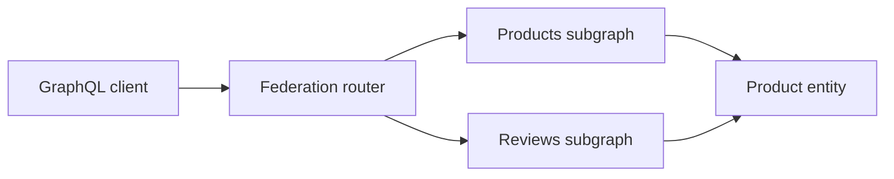

# Federated key in Spring for GraphQL

In a GraphQL Federation architecture, multiple subgraphs can contribute fields to the same entity. The router needs a way to identify the same entity when handing execution from one subgraph to another. `@key` defines the set of fields used to identify that entity. A key can be a single field, multiple combined fields, or a nested field set.

Spring for GraphQL integrates with the federation-jvm library to build a subgraph schema. `FederationSchemaFactory` creates the `_entities` mechanism and type resolver; `@EntityMapping` maps an entity representation sent by the router into a Java object. When designing keys, ensure they are stable, unique, resolvable in the subgraph, and never treated as a substitute for authorization.

After this lesson, you will be able to:

- Understand entities, federated keys, and entity representations.
- Declare `@key` for single keys, compound keys, nested keys, and multiple alternate keys.
- Distinguish entity-identifying keys from ordinary fields or database primary keys.
- Configure `FederationSchemaFactory` in Spring Boot.
- Write `@EntityMapping` to resolve an entity from a representation.
- Handle multiple representations with batch mapping or DataLoader.
- Understand `resolvable: false`, `@external`, and Federation 1/2 differences.
- Handle non-existent entities, mapping errors, authorization, and tenants.
- Test `_entities` and ensure keys work across multiple subgraphs.

## 1. Entities in GraphQL Federation

GraphQL Federation splits a logical graph across multiple subgraphs. Each subgraph owns a domain slice and can contribute fields to the same entity.

For example, an e-commerce system has two subgraphs:

- Products subgraph manages item codes, product names, and prices.
- Reviews subgraph manages product reviews and ratings.

Both work with a `Product` entity, without necessarily storing all product data together.



An entity is an object type that can be identified by one or more keys. The router uses keys to pass an entity representation to the subgraph that needs to resolve the fields it owns.

## 2. What is `@key`?

The `@key` directive marks an object type as an entity and declares the set of fields identifying that entity.

```graphql
type Product @key(fields: "upc") {
    upc: ID!
    name: String!
    price: Int
}
```

In this example, `upc` is the key of `Product`. Each product must have a unique UPC within the entity's scope. The router can send a UPC value to a subgraph to request resolution of the corresponding `Product`.

`fields` has type `FieldSet`, passed as a string using GraphQL selection set syntax. This describes the fields required in a representation, not an independent GraphQL query.

A key is often analogous to a candidate key in data modeling: it must uniquely identify a single entity. An entity can have multiple valid keys, so `@key` does not have to be the database primary key.

The examples in this lesson use object entities. Starting in Federation 2.3, `@key` can also be applied to interfaces; this capability depends on the Federation version and subgraph tooling.

## 3. Single keys

A single key uses one field to identify an entity:

```graphql
type Book @key(fields: "id") {
    id: ID!
    title: String!
    authorId: ID!
}
```

The corresponding representation looks like:

```json
{
  "__typename": "Book",
  "id": "book-42"
}
```

`__typename` tells the router and subgraph which entity type the representation belongs to. `id` is the key value the resolver uses to look up the entity.

A single key is usually the easiest option to operate when the entity has a stable identifier. The key field should have a value on every entity and should generally be declared non-null (`ID!`, `String!`, ...).

## 4. Compound keys

When a single field is not sufficient for unique identification, multiple fields can be combined:

```graphql
type StoreProduct @key(fields: "sku market") {
    sku: String!
    market: String!
    name: String!
    price: Int
}
```

In this example, the same `sku` can exist in multiple markets. Only the pair `(sku, market)` uniquely identifies a product in the catalog.

Representation:

```json
{
  "__typename": "StoreProduct",
  "sku": "SKU-100",
  "market": "VN"
}
```

The resolver must accept both components:

```java
@Controller
public class StoreProductController {

    private final StoreProductService service;

    public StoreProductController(StoreProductService service) {
        this.service = service;
    }

    @EntityMapping
    public StoreProduct storeProduct(
            @Argument String sku,
            @Argument String market) {

        return service.findBySkuAndMarket(sku, market);
    }
}
```

`@Argument` extracts values from the representation map. Argument names must match the key fields in the SDL. You can specify the argument name explicitly if the Java parameter name differs from the GraphQL field name.

## 5. Keys with nested fields

The `fields` set of `@key` can select fields inside an object field:

```graphql
type Product @key(fields: "sku organization { id }") {
    sku: String!
    organization: Organization!
    name: String!
}

type Organization {
    id: ID!
    name: String!
}
```

The key consists of `sku` and `organization.id`. The representation looks like:

```json
{
  "__typename": "Product",
  "sku": "SKU-100",
  "organization": {
    "id": "org-7"
  }
}
```

Spring `@EntityMapping` can accept the full representation as a `Map<String, Object>` to read nested structures:

```java
@EntityMapping
public Product product(Map<String, Object> representation) {
    String sku = (String) representation.get("sku");

    @SuppressWarnings("unchecked")
    Map<String, Object> organization =
            (Map<String, Object>) representation.get("organization");

    String organizationId = (String) organization.get("id");
    return productService.findBySkuAndOrganization(sku, organizationId);
}
```

When using a representation map, verify the type and presence of each field before casting. Do not assume incoming data is always complete or valid simply because the router normally generates representations according to the schema.

A key field set is not an arbitrary query. You cannot include fields with arguments, lists, unions, or interfaces in `@key`; nested selections must traverse valid object fields. With nested keys, consider lookup cost and the stability of the entire field path.

## 6. Multiple alternate keys for the same entity

An entity can have multiple ways to be identified. For example, a product has both a UPC and an SKU/market pair:

```graphql
type Product
    @key(fields: "upc")
    @key(fields: "sku market") {
    upc: ID!
    sku: String!
    market: String!
    name: String!
}
```

In Federation 2, `@key` is a repeatable directive. Confirm that your subgraph implementation supports repeatable directives before declaring multiple keys.

The router can use one of the valid keys depending on the query plan and subgraphs. Every key must truly identify the same entity; never allow a UPC and an SKU/market pair to point to two different products. Subgraphs may declare different keys, but there must be compatible keys so the router can link the same entity during composition and query planning.

When an `@EntityMapping` needs to support multiple representations, it can accept the full representation map and choose the lookup path based on the present keys:

```java
@EntityMapping
public Product product(Map<String, Object> representation) {
    if (representation.containsKey("upc")) {
        return productService.findByUpc((String) representation.get("upc"));
    }

    if (representation.containsKey("sku")
            && representation.containsKey("market")) {
        return productService.findBySkuAndMarket(
                (String) representation.get("sku"),
                (String) representation.get("market"));
    }

    throw new IllegalArgumentException("Unsupported Product key representation");
}
```

In a real system, standardize key parsing into a dedicated component and return a clear representation error. Do not arbitrarily pick a field as a key when the representation does not match the schema.

## 7. A key does not have to be the database primary key

A Federation key is a graph-level identification contract. It can match the database primary key, but it is not required to.

For example, the database has an internal `product_id`, while the API uses `upc`:

```graphql
type Product @key(fields: "upc") {
    upc: ID!
    name: String!
}
```

The subgraph can look up by UPC and retrieve the internal entity. Decoupling the public key from the primary key allows changing the database without breaking the Federation contract.

A good key typically has these traits:

- Unique within the entity's scope.
- Stable throughout the entity's lifecycle.
- Available whenever the router needs to pass the entity between subgraphs.
- Efficiently lookupable using an index.
- Independent of mutable display fields like name or description.
- Does not leak unnecessary personal data or secrets.

If an ID is only unique within a tenant, consider a compound key consisting of the tenant identifier and entity ID. The tenant in the representation must still be verified against the current security context.

## 8. Keys and mutable fields

Avoid choosing fields that change frequently as keys whenever possible. For instance, `displayName`, email, or slug may change for business reasons. If the router holds an old reference in a query plan or event, a changed key can prevent the entity from being resolved.

If you must use a mutable natural key, establish a clear migration process:

1. Introduce the new key and have resolvers support both old and new keys simultaneously.
2. Update subgraphs that need to use the new key.
3. Verify composition and query plans use the new key.
4. Shift traffic following a compatible rollout path.
5. Remove the old key only when no callers or subgraphs still depend on it.

With multiple alternate keys, you can keep the old key during a transition period, but set a removal deadline to avoid creating an unintended permanent contract.

## 9. Keys across multiple subgraphs

The Products subgraph owns product details:

```graphql
type Product @key(fields: "upc") {
    upc: ID!
    name: String!
    price: Int
}
```

The Reviews subgraph contributes review fields for the same entity:

```graphql
type Product @key(fields: "upc") {
    upc: ID!
    reviews: [Review!]!
    averageRating: Float
}

type Review {
    id: ID!
    body: String!
}
```

Both subgraphs declare `Product` with the same key. The router can fetch the product from the Products subgraph, then send a representation containing `__typename` and `upc` to the Reviews subgraph to resolve `reviews`.

In Federation 2, subgraphs can contribute entity fields using the new extension model; key fields are treated as shareable under Federation 2 rules. Do not automatically copy every entity field into every subgraph. Only declare the fields a subgraph genuinely owns or can resolve under the contract.

In Federation 2, fields used in `@key` are automatically considered shareable by composition rules; you do not need to mark them `@shareable` separately just because they are keys. Other fields defined in multiple subgraphs must follow the corresponding ownership/shareability rules.

## 10. Federation 1 and Federation 2 when extending entities

Federation 1 style schemas typically use `extend type`, `@key`, `@external`, and `@extends`:

```graphql
extend type Product @key(fields: "upc") {
    upc: ID! @external
    reviews: [Review!]!
}
```

In Federation 2, subgraphs declare the federation version via `@link` and can use entity definitions with the new syntax:

```graphql
extend schema
    @link(
        url: "https://specs.apollo.dev/federation/v2.3",
        import: ["@key"]
    )

type Product @key(fields: "upc") {
    upc: ID!
    reviews: [Review!]!
}
```

The Federation 2 example above shows `upc` as the entity's key field in the subgraph. In Federation 1, the key field is declared `@external` when a subgraph extends an entity owned by another subgraph. Federation 2 rules differ regarding ownership, `@external`, and composition; use the exact syntax matching the federation version supported by your router/composer.

Do not mix Federation 1 and Federation 2 SDL arbitrarily. When upgrading, check `@link`, directive imports, `@key` rules, `@external`, and composition results across all subgraphs.

## 11. `resolvable: false`

Federation 2 allows declaring a key that is not used to resolve entities in the current subgraph:

```graphql
type Product @key(fields: "upc", resolvable: false) {
    upc: ID!
}
```

`resolvable: false` informs the router that this subgraph does not provide a reference resolver for the router to jump to this subgraph solely to resolve the entity by that key. This directive is useful when a subgraph needs to reference an entity or use it in schema relationships without being responsible for resolving entity references.

If a subgraph actually contributes fields that must be resolved via an entity transition, it must provide a corresponding reference resolver. Do not set `resolvable: false` just to avoid writing `@EntityMapping`; the router may not build a query plan that hops to that subgraph to fetch fields.

This is a Federation 2 feature. Do not use the `resolvable` argument in a Federation 1 schema.

## 12. `@inaccessible` fields as internal keys

Federation 2 provides the `@inaccessible` directive to keep a field in the supergraph for the router to use while hiding it from the API schema visible to clients.

```graphql
type Product @key(fields: "internalId") {
    internalId: ID! @inaccessible
    name: String!
}
```

The `internalId` field can still participate in the key and help the router join entities across subgraphs, while clients cannot query this field directly through the exposed API schema.

Use this approach only when all federation tooling and subgraphs support the corresponding Federation 2 version. `@inaccessible` is not a security mechanism for subgraph endpoints; direct callers to the subgraph can still interact with the subgraph's schema if the endpoint is exposed.

## 13. Entity representations and `_entities`

Federation uses representations to pass entity information from the router to subgraphs. A representation contains `__typename` and the fields of a key.

Example of the router requesting resolution of two products:

```graphql
query ResolveProducts {
    _entities(representations: [
        { __typename: "Product", upc: "UPC-100" }
        { __typename: "Product", upc: "UPC-200" }
    ]) {
        ... on Product {
            upc
            name
        }
    }
}
```

`_entities` is a special Federation field. `FederationSchemaFactory` sets up the `_entities` data fetcher and type resolver when creating the GraphQL schema. You do not need to manually declare `_entities` as a regular business field in the schema.

The router sends representations matching the keys published by the subgraph. The subgraph must return entity instances of the correct type and in the exact order per the entity resolution contract.

## 14. Configuring FederationSchemaFactory in Spring Boot

Spring for GraphQL integrates with federation-jvm. To enable a Federation schema, declare a `FederationSchemaFactory` bean and connect it to `GraphQlSource` using `GraphQlSourceBuilderCustomizer`:

This integration lives in the `org.springframework.graphql.data.federation` package and has been available since Spring for GraphQL 1.3.0. Use a Spring GraphQL version compatible with Spring Boot and the federation-jvm release supported by your project's dependency management.

```java
import org.springframework.boot.autoconfigure.graphql.GraphQlSourceBuilderCustomizer;
import org.springframework.context.annotation.Bean;
import org.springframework.context.annotation.Configuration;
import org.springframework.graphql.data.federation.FederationSchemaFactory;

@Configuration
public class FederationConfig {

    @Bean
    public GraphQlSourceBuilderCustomizer federationCustomizer(
            FederationSchemaFactory factory) {
        return builder -> builder.schemaFactory(factory::createGraphQLSchema);
    }

    @Bean
    public FederationSchemaFactory federationSchemaFactory() {
        return new FederationSchemaFactory();
    }
}
```

When Boot builds the schema, the factory transforms the type definition registry and runtime wiring into a federation-aware `GraphQLSchema`. The factory detects controllers with `@EntityMapping` and configures the `_entities` resolver.

`FederationSchemaFactory` is a subgraph-side integration. It does not replace the router/composer and does not merge multiple subgraphs into a supergraph on its own. Composition and query planning belong to the Federation router or GraphOS/Rover tooling.

## 15. `@EntityMapping` for single keys

`@EntityMapping` maps a Java method to a federated entity type. `@Argument` extracts values from the representation map:

```java
@Controller
public class ProductController {

    private final ProductService productService;

    public ProductController(ProductService productService) {
        this.productService = productService;
    }

    @EntityMapping
    public Product product(@Argument String upc) {
        return productService.findByUpc(upc);
    }
}
```

By default, the entity name is inferred from the method name by capitalizing the first character (`product` maps to `Product`). To specify the entity name explicitly, use the `name` attribute or its alias `value`:

```java
@EntityMapping(name = "Product")
public Product resolveProduct(@Argument String upc) {
    return productService.findByUpc(upc);
}
```

The method can return the entity directly or an asynchronous type such as `Mono`, `CompletableFuture`, or `Callable`. If the entity is not found, handle it according to your application's contract; returning null/empty from a resolver is treated by Federation integration as an unresolved representation.

## 16. `@EntityMapping` for compound keys

With the compound key `sku market`, the resolver accepts each field:

```java
@EntityMapping
public StoreProduct storeProduct(
        @Argument String sku,
        @Argument String market) {

    return storeProductService.findBySkuAndMarket(sku, market);
}
```

Spring binds arguments from the representation by field name. If the method accepts `Map<String, Object>`, it can read the entire representation and select the keys it needs.

When a key contains nested objects, use a representation map or a suitable DTO to handle the structure. Check for missing fields, invalid types, and nulls before calling the repository.

## 17. One `@EntityMapping` handling multiple representations

Spring for GraphQL allows an entity mapping method to accept a list of representation maps to load multiple entities at once:

```java
@EntityMapping
public List<Product> product(List<Map<String, Object>> representations) {
    List<String> upcs = representations.stream()
            .map(representation -> (String) representation.get("upc"))
            .toList();

    return productService.findAllByUpcsInOrder(upcs);
}
```

With a batch method, return a `List` or `Flux` in the exact order of the input representations. If the input is `[UPC-100, UPC-200]`, the output must be `[Product-100, Product-200]` accordingly.

Spring also supports binding a list of keys via `@Argument List<Integer> idList`; the `idList` naming convention infers the representation field `id`. You can specify the argument name explicitly if needed. If the backend does not guarantee ordering, map results by key and reconstruct the input order before returning.

## 18. Batch entity lookup with DataLoader

If entity mapping is called multiple times and each call queries the repository individually, the subgraph can suffer from N+1 queries. You can register a batch loader via `BatchLoaderRegistry`:

```java
@Controller
public class ProductController {

    public ProductController(BatchLoaderRegistry registry,
                             ProductService productService) {
        registry.forTypePair(String.class, Product.class)
                .registerMappedBatchLoader((upcs, environment) ->
                        productService.findAllByUpcs(upcs)
                                .collectMap(Product::upc));
    }

    @EntityMapping
    public CompletableFuture<Product> product(
            @Argument String upc,
            DataLoader<String, Product> productLoader) {

        return productLoader.load(upc);
    }
}
```

DataLoader batches the keys requested within the same dispatch into a single batch. The batch function must actually call a bulk API such as `findAllByUpcs`; if it loops internally and calls the repository once per UPC, N+1 still occurs.

With a mapped loader, the key-value map avoids depending on backend ordering. If using a positional batch loader returning `Flux<Product>`, ensure the element count and order match the key list.

## 19. Coordinating `@EntityMapping` and `@BatchMapping`

Entity mapping retrieves the root entity by key; nested fields are then resolved using `@SchemaMapping` or `@BatchMapping`.

```java
@Controller
public class ProductController {

    @EntityMapping
    public Product product(@Argument String upc) {
        return productService.findByUpc(upc);
    }

    @BatchMapping(typeName = "Product", field = "reviews")
    public Mono<Map<Product, List<Review>>> reviews(List<Product> products) {
        Set<String> upcs = products.stream()
                .map(Product::upc)
                .collect(Collectors.toSet());

        return reviewService.findByProductUpcs(upcs)
                .collectMultimap(Review::productUpc)
                .map(reviewsByUpc -> {
                    Map<Product, List<Review>> result = new HashMap<>();
                    for (Product product : products) {
                        result.put(product, List.copyOf(
                                reviewsByUpc.getOrDefault(product.upc(), List.of())));
                    }
                    return result;
                });
    }
}
```

This example demonstrates batching the `reviews` field after `Product` instances have been resolved. Ensure `Product`'s `equals`/`hashCode` are stable when used as map keys. If the entity class is mutable, consider using a mapped loader by UPC or a stable key wrapper.

## 20. Keys are not authorization

A representation arriving from the router does not mean the caller is permitted to access the entity. The subgraph must still authenticate requests and enforce permissions on the resolved entity.

Important principles:

- Do not return an entity merely because the caller knows its ID or UPC.
- Apply tenant scoping when querying entities.
- Do not treat the tenant from a representation as the sole source of truth.
- Enforce permissions on both entity fields and nested fields.
- Avoid using email, phone number, or secrets as keys unnecessarily.
- Do not log entire representations if they contain sensitive data.

For example:

```java
@EntityMapping
public Product product(@Argument String upc, Principal principal) {
    Actor actor = actorService.requireActor(principal);
    return productService.findVisibleByUpc(actor.tenantId(), upc)
            .orElseThrow(ProductNotFoundException::new);
}
```

Return not found or forbidden depending on your system's anti-enumeration policy. Do not reveal the existence of another tenant's entity through differing error messages if that data must be protected.

## 21. Non-existent entities and representation errors

A representation may fail to resolve because:

- `__typename` is missing.
- A key field is missing or has an invalid type.
- The entity has been deleted.
- The key does not exist in the subgraph.
- The caller lacks permission to access the entity.
- The resolver encounters a database or downstream error.

Spring Federation integration provides `RepresentationException` and `RepresentationNotResolvedException` to represent representation errors. `RepresentationNotResolvedException` is used when a resolver returns null or completes empty. You can use `@GraphQlExceptionHandler` to map errors from `@EntityMapping` into `GraphQLError`; errors appear in the `_entities` response.

Do not turn every technical error into entity not found. Keep internal error codes stable for observability while returning only appropriate details to clients.

## 22. `@EntityMapping` with GraphQL context and principal

Entity mapping methods support several parameter types beyond `@Argument`, including:

| Parameter | Purpose |
| --- | --- |
| `@Argument` | Extracts a field from the representation map |
| `Map<String, Object>` | Full representation of a single entity |
| `List<Map<String, Object>>` | Multiple representations for a batch method |
| `GraphQLContext` | Shared context of the GraphQL execution |
| `@ContextValue` | A value in the GraphQL context |
| `Principal` | Principal from Spring Security if present |
| `@AuthenticationPrincipal` | Authentication principal |
| `DataLoader<I, E>` | Batch-loads entities by key |
| `DataFetchingEnvironment` | Accesses the execution environment |

This lets the resolver combine keys with tenant, principal, locale, or request context. However, the context must be populated server-side from a trusted source; never treat fields inside the representation as authentication credentials.

## 23. Designing keys when entities are multi-tenant

Suppose product IDs are only unique within each tenant:

```graphql
type Product @key(fields: "tenantId id") {
    tenantId: ID!
    id: ID!
    name: String!
}
```

The representation contains both `tenantId` and `id`. The resolver can use both to locate the exact entity:

```java
@EntityMapping
public Product product(
        @Argument String tenantId,
        @Argument String id,
        Principal principal) {

    Actor actor = actorService.requireActor(principal);
    if (!actor.tenantId().equals(tenantId)) {
        throw new AccessDeniedException("Entity is not accessible");
    }
    return productService.findByTenantAndId(tenantId, id);
}
```

In this example, `tenantId` is part of the key for unique identification, yet it is still compared against the tenant in the security context. Keys do not replace authorization.

If you do not want to expose the tenant field to clients in Federation 2, consider making the key field `@inaccessible` and ensure all subgraphs/routers handle it properly. However, the router still needs that field in the supergraph to build representations.

## 24. Keys and missing or nullable data

Key fields should be present and generally non-null. If a key component can be null, the router may fail to construct a valid representation or the resolver may fail to identify the entity.

Example to avoid:

```graphql
type Customer @key(fields: "email") {
    email: String
    name: String!
}
```

If email is null or changes, the customer is no longer stably identified. Use a stable ID instead:

```graphql
type Customer @key(fields: "id") {
    id: ID!
    email: String
    name: String!
}
```

Do not use list fields, unions, or interface fields in a key field set. For nested keys, child fields must form a valid selection path and must not contain arguments.

## 25. Testing keys and entity resolution

Test from the resolver method up to `_entities` execution. Example `_entities` query:

```java
@Test
void resolvesProductByFederatedKey() {
    graphQlTester.document("""
            query {
                _entities(representations: [
                    { __typename: "Product", upc: "UPC-100" }
                ]) {
                    ... on Product {
                        upc
                        name
                    }
                }
            }
            """)
        .execute()
        .errors()
        .verify()
        .path("_entities[0].name")
        .entity(String.class)
        .isEqualTo("Wireless Keyboard");
}
```

Tests must run against a schema configured with `FederationSchemaFactory`; with the default GraphQL schema builder, `_entities` may not exist.

Scenarios to test:

1. Single key resolves the right entity.
2. Compound key resolves properly using all fields.
3. Nested key reads the representation map accurately.
4. Alternate keys resolve the same entity.
5. Non-existent entity returns an error per the contract.
6. Representations missing `__typename` or keys are handled cleanly.
7. Batch entity mapping preserves representation order.
8. DataLoader batches multiple keys and avoids N+1 queries.
9. Tenant/authorization checks are enforced during resolution.
10. Resolver exceptions map into `_entities` errors.
11. Federation composition succeeds across subgraphs.
12. `resolvable: false` does not produce a query plan jumping to the subgraph to resolve the entity.

## 26. Testing batch entity resolution

Spring for GraphQL allows an `@EntityMapping` method to accept a `List` of keys or a `List<Map<String, Object>>` of representations. Tests should verify return order:

```java
@Test
void resolvesRepresentationsInInputOrder() {
    List<Product> products = controller.products(List.of(
            Map.of("__typename", "Product", "upc", "UPC-200"),
            Map.of("__typename", "Product", "upc", "UPC-100")));

    assertThat(products)
            .extracting(Product::upc)
            .containsExactly("UPC-200", "UPC-100");
}
```

This is a unit test for the batch resolver. Add a GraphQL execution test as well to verify `FederationSchemaFactory` invokes the proper method for `_entities`.

If the backend returns results in a different order, index results by key and rebuild the list in the original representation order. Do not rely on arbitrary ordering from SQL `IN (...)`.

## 27. Composition and contracts between subgraphs

Keys are only useful when subgraph schemas can compose into a supergraph. Before deploying, verify:

- Entity type names match across subgraphs.
- Key fields have compatible types.
- At least one suitable key exists for the router to link the entity across subgraphs.
- Key fields are resolvable in subgraphs that receive representations.
- Federation versions and directive imports are consistent.
- No key field is missing, mistyped, or uses an invalid list/union/interface.
- Resolver implementations can actually look up entities by the declared keys.

Successful composition does not prove resolvers return the right data. Test each subgraph individually and run queries through the router/supergraph in an integration environment.

## 28. Common mistakes

- **Choosing a non-unique field as a key:** the router may link the wrong entity.
- **Using a mutable field:** old keys stop resolving once data changes.
- **Forgetting a compound key component:** lookup may return the wrong record.
- **Failing to handle nested representations:** wrong map casts or missing fields cause runtime errors.
- **Assuming the key must be the database primary key:** a Federation key is a graph identity contract and can differ from internal IDs.
- **Treating the key as an authorization token:** anyone knowing an ID could access unauthorized data.
- **Forgetting to enable FederationSchemaFactory:** the schema lacks `_entities` or entity mappings are not registered.
- **Querying each representation individually in the entity resolver:** causes N+1 when the router sends multiple entities.
- **Returning batch resolver results out of order:** data gets attached to the wrong entities.
- **Confusing Federation 1 with Federation 2:** using `@external`, `@extends`, `@link`, or `resolvable` for the wrong version.
- **Setting `resolvable: false` on an entity that needs resolution:** the router cannot hop to the subgraph to fetch fields.
- **Testing only the controller method:** misses federation schema or `_entities` wiring errors.
- **Skipping composition checks:** subgraphs may run independently but fail to compose together.

## 29. Workflow for designing a Federated key

When introducing an entity into Federation, follow these steps:

1. Identify the entity type and the subgraph that owns its source data.
2. Pick a stable, unique key that can be looked up efficiently.
3. Use a single key if one field uniquely identifies it.
4. Use a compound key if uniqueness depends on multiple fields.
5. Use a nested key only when an object field is genuinely required for identification.
6. Declare multiple `@key` directives if multiple candidate keys are supported.
7. Choose the proper Federation 1 or Federation 2 syntax.
8. Configure `FederationSchemaFactory` in Spring Boot.
9. Write `@EntityMapping` to resolve representations.
10. Use batch mapping or DataLoader when the router sends multiple entities.
11. Validate authorization, tenant scope, and representation data.
12. Test `_entities`, batch order, missing entities, and error mapping.
13. Run composition and integration tests through the router.

A federated key is an identification contract that lets the router connect the same entity across multiple subgraphs. `@key` can use a single field, compound field set, nested field set, or multiple alternate keys; keys must be unique and stable. In Spring for GraphQL, `FederationSchemaFactory` configures `_entities`, and `@EntityMapping` resolves representations into Java entities. During implementation, select the right Federation version, batch lookups to avoid N+1, enforce authorization independently, and verify the schema with both composition and execution tests.

## References

- [Spring for GraphQL — Federation](https://docs.spring.io/spring-graphql/reference/federation.html)
- [Spring for GraphQL — FederationSchemaFactory API](https://docs.spring.io/spring-graphql/docs/1.4.3/api/org/springframework/graphql/data/federation/FederationSchemaFactory.html)
- [Apollo Federation — Introduction to Entities](https://www.apollographql.com/docs/graphos/schema-design/federated-schemas/entities/intro)
- [Apollo Federation — Directives Reference (`@key`)](https://www.apollographql.com/docs/graphos/schema-design/federated-schemas/reference/directives#key)
- [Apollo Federation — Composition Rules](https://www.apollographql.com/docs/graphos/schema-design/federated-schemas/reference/composition-rules)
- [Apollo Federation — Federation Versions](https://www.apollographql.com/docs/graphos/schema-design/federated-schemas/reference/versions)
