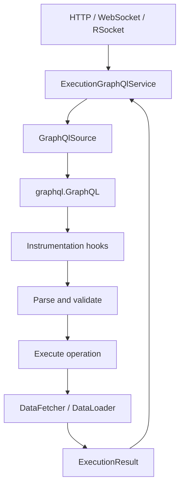
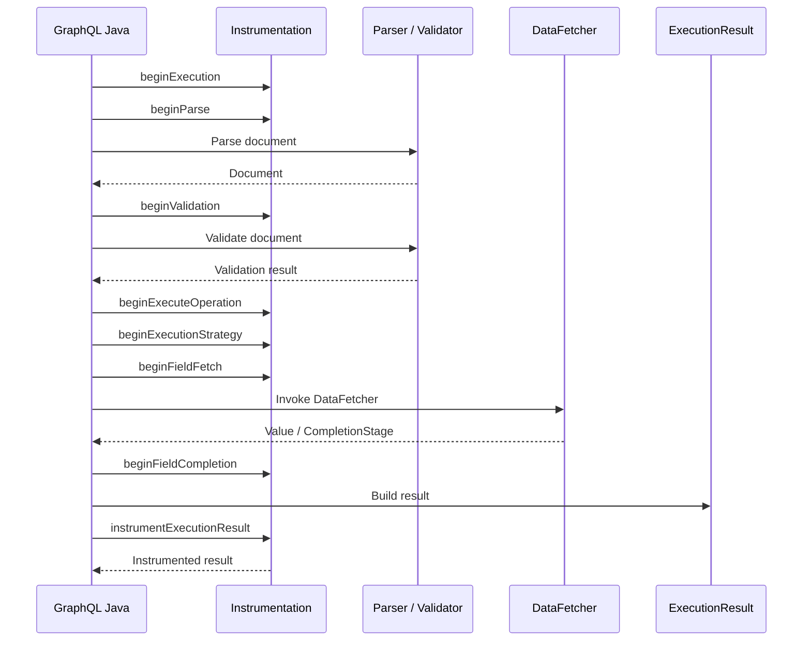

# GraphQL Java Instrumentation

## 1. Why Is GraphQL Java Instrumentation Needed?

A GraphQL request passes through several stages before producing a response: receiving `ExecutionInput`, parsing the document, validating against the schema, selecting the operation, running the execution strategy, invoking DataFetchers, completing fields, and building `ExecutionResult`. A single request may invoke multiple resolvers, await `CompletableFuture`s, run DataLoaders, or emit multiple Subscription events.

If you only measure overall HTTP duration, it is difficult to tell where time is being spent. If you need to record how many times a field is called, measure DataFetcher latency, attach metadata to the response, or enforce behavior at the GraphQL engine level, you need an extension point inside GraphQL Java.

`graphql.execution.instrumentation.Instrumentation` is an SPI that lets you hook logic into the GraphQL execution lifecycle. It can observe execution activity, emit logs/metrics/traces, or modify certain runtime data and behavior.

Instrumentation is not only for logging. Common use cases include:

- Measuring overall request duration and per-DataFetcher latency.
- Tracking how many times fields are resolved and detecting problematic resolvers.
- Attaching trace metadata or correlation information to the execution.
- Limiting query depth or complexity.
- Validating fields and arguments before execution.
- Wrapping DataFetchers to add cross-cutting behavior across multiple resolvers.
- Adjusting `ExecutionInput`, the document, the schema, or `ExecutionResult` when there is a clear requirement.

## 2. Where Does Instrumentation Sit in Spring for GraphQL?

Spring for GraphQL uses GraphQL Java as its execution engine. `ExecutionGraphQlService` is Spring's primary abstraction for invoking GraphQL Java; the `DefaultExecutionGraphQlService` implementation obtains the `graphql.GraphQL` instance from `GraphQlSource`.

With the Spring Boot GraphQL starter, Boot creates `GraphQlSource.Builder`, loads the SDL, configures runtime wiring, and detects `Instrumentation` beans. These instrumentations are attached to the GraphQL runtime. When deeper builder customization is required, you can declare a `GraphQlSourceBuilderCustomizer`.



Instrumentation operates inside GraphQL Java execution. It does not replace Spring's transport handler and does not create a new HTTP endpoint by itself.

## 3. Execution Lifecycle Hooks Observable by Instrumentation

GraphQL Java provides numerous callbacks corresponding to execution steps. Exact names and availability depend on the GraphQL Java version, but key extension points include:

| Hook | Timing | Common Purpose |
| --- | --- | --- |
| `instrumentExecutionInput` | Before processing `ExecutionInput` | Adjust input before the GraphQL engine uses it |
| `beginExecution` | At the start of a GraphQL execution | Measure total time or initialize state |
| `beginParse` | Before parsing the document | Measure or observe parsing |
| `beginValidation` | Before validating the document | Observe validation and schema errors |
| `beginExecuteOperation` | Right before running the operation | Observe Query, Mutation, or Subscription operations |
| `beginExecutionStrategy` | Each time an execution strategy runs | Observe object/field resolution |
| `beginFieldFetch` / `beginFieldFetching` | Before invoking a DataFetcher | Measure or intercept field fetching |
| `instrumentDataFetcher` | When GraphQL Java prepares to use a DataFetcher | Return a wrapped or modified DataFetcher |
| `beginFieldCompletion` | When starting field value completion | Observe conversion of Java values into GraphQL values |
| `instrumentExecutionResult` | When building the execution result | Augment or modify `ExecutionResult` |

A single execution can pass through many hooks and trigger multiple `beginExecutionStrategy` or field-fetch calls. For example, a query fetching a list of books and their authors may invoke the DataFetcher for `Query.books`, and then invoke the `Book.author` DataFetcher for each item.



Not every hook needs to be overridden. An instrumentation typically implements only the steps it needs to observe or modify.

## 4. Key Data Types

The Instrumentation API centers around a few core types:

| Type | Role |
| --- | --- |
| `Instrumentation` | Interface defining GraphQL execution hooks |
| `InstrumentationState` | Per-execution state passed across hooks |
| `InstrumentationContext<T>` | Callback notified when a step is dispatched and completed |
| `InstrumentationExecutionParameters` | Execution info such as query, schema, variables, and execution input |
| `InstrumentationFieldFetchParameters` | Info about the field currently handled by a DataFetcher |
| `DataFetcher<?>` | Function retrieving data for a field |
| `ExecutionResult` | GraphQL result containing data, errors, and extensions |
| `SimplePerformantInstrumentation` | Convenient base class for overriding only needed hooks |

An `Instrumentation` is usually instantiated once and shared across many requests. Therefore, you should not store mutable per-request data directly in fields of the instrumentation instance.

## 5. `InstrumentationContext` and Asynchronous Callbacks

Each `begin...` hook can return an `InstrumentationContext`. This context receives two important callbacks:

- `onDispatched()`: the processing step has been dispatched.
- `onCompleted(result, throwable)`: the processing step has completed; `throwable` is non-null if an exception occurred during that step.

This design fits asynchronous GraphQL execution well. A DataFetcher may return a value immediately or return a `CompletionStage`. The context allows instrumentation to record when the step actually completes rather than only measuring the method invocation time.

Example of creating a callback when a step completes:

```java
// Example inside a class that has already declared a logger.
InstrumentationContext<ExecutionResult> context =
    SimpleInstrumentationContext.whenCompleted((result, throwable) -> {
        if (throwable != null) {
            logger.warn("GraphQL execution step failed", throwable);
        }
    });
```

Do not block threads waiting for a `CompletionStage` to finish. Use the callbacks provided by GraphQL Java to observe completion.

## 6. `InstrumentationState` and Thread Safety

GraphQL Java may execute DataFetchers on multiple threads or complete futures in varying orders. An instrumentation instance shared across requests must not store instance-level variables such as `currentQuery`, `startTime`, or `currentUser`.

`InstrumentationState` holds data belonging solely to a single execution. GraphQL Java creates the state before execution and passes it to the corresponding hooks. For simple initialization you can use synchronous state; with current APIs, `createStateAsync` also allows asynchronous state initialization.

Example of a simple state class:

```java
import graphql.execution.instrumentation.InstrumentationState;

public final class RequestInstrumentationState implements InstrumentationState {

    private final long startedAtNanos = System.nanoTime();

    public long startedAtNanos() {
        return startedAtNanos;
    }
}
```

This state is created per GraphQL execution. If a single execution has multiple callbacks running concurrently and writing to a collection inside the state, that collection must be thread-safe or use an appropriate concurrent data structure.

## 7. Using `SimplePerformantInstrumentation`

GraphQL Java provides `SimplePerformantInstrumentation` as a base class. You can extend this class and override only the hooks you need without implementing the entire `Instrumentation` interface manually.

`SimpleInstrumentation` is a legacy API and has been deprecated; current GraphQL Java documentation recommends `SimplePerformantInstrumentation` for new instrumentations.

```java
import graphql.execution.instrumentation.SimplePerformantInstrumentation;

public class AuditInstrumentation extends SimplePerformantInstrumentation {
    // Override the required hooks.
}
```

You do not need a separate instrumentation for every field. Group behaviors with a shared goal into a well-scoped implementation to avoid unnecessary wrapper layers.

## 8. Timing Total GraphQL Execution

The following example measures the duration from when GraphQL Java starts an execution until `ExecutionResult` completes. The result is recorded into a Micrometer `Timer` with an `outcome` tag having only two fixed values.

```java
import graphql.ExecutionResult;
import graphql.execution.instrumentation.InstrumentationContext;
import graphql.execution.instrumentation.InstrumentationState;
import graphql.execution.instrumentation.SimpleInstrumentationContext;
import graphql.execution.instrumentation.SimplePerformantInstrumentation;
import graphql.execution.instrumentation.parameters.InstrumentationExecutionParameters;
import io.micrometer.core.instrument.MeterRegistry;
import io.micrometer.core.instrument.Timer;

import java.util.concurrent.TimeUnit;

public final class RequestTimingInstrumentation extends SimplePerformantInstrumentation {

    private final MeterRegistry meterRegistry;

    public RequestTimingInstrumentation(MeterRegistry meterRegistry) {
        this.meterRegistry = meterRegistry;
    }

    @Override
    public InstrumentationContext<ExecutionResult> beginExecution(
            InstrumentationExecutionParameters parameters,
            InstrumentationState state) {

        long startedAt = System.nanoTime();

        return SimpleInstrumentationContext.whenCompleted((result, throwable) -> {
            boolean failed = throwable != null
                    || (result != null && !result.getErrors().isEmpty());

            Timer.builder("graphql.custom.execution.duration")
                    .tag("outcome", failed ? "error" : "success")
                    .register(this.meterRegistry)
                    .record(System.nanoTime() - startedAt, TimeUnit.NANOSECONDS);
        });
    }
}
```

`System.nanoTime()` is suitable for measuring elapsed durations because it does not depend on the wall-clock system time. The timer also records requests that return GraphQL errors in `ExecutionResult`, even when the engine does not throw an exception outward.

Do not put raw queries, variables, tokens, email addresses, or user IDs into metric tags. Such values can cause high cardinality and leak sensitive data.

## 9. Wrapping DataFetchers with `instrumentDataFetcher`

`instrumentDataFetcher` receives the original DataFetcher and returns a new DataFetcher. This is a useful extension point when applying cross-cutting behavior across many fields, such as timing resolver calls or adding sanitized logging.

The example below measures the time until the DataFetcher returns a value or its `CompletionStage` completes:

```java
import graphql.execution.instrumentation.InstrumentationState;
import graphql.execution.instrumentation.SimplePerformantInstrumentation;
import graphql.execution.instrumentation.parameters.InstrumentationFieldFetchParameters;
import graphql.schema.DataFetcher;
import io.micrometer.core.instrument.MeterRegistry;
import io.micrometer.core.instrument.Timer;

import java.util.concurrent.CompletionStage;
import java.util.concurrent.TimeUnit;

public final class DataFetcherTimingInstrumentation extends SimplePerformantInstrumentation {

    private final MeterRegistry meterRegistry;

    public DataFetcherTimingInstrumentation(MeterRegistry meterRegistry) {
        this.meterRegistry = meterRegistry;
    }

    @Override
    public DataFetcher<?> instrumentDataFetcher(
            DataFetcher<?> original,
            InstrumentationFieldFetchParameters parameters,
            InstrumentationState state) {

        String fieldName = parameters.getEnvironment().getFieldDefinition().getName();

        return environment -> {
            long startedAt = System.nanoTime();
            try {
                Object value = original.get(environment);
                if (value instanceof CompletionStage<?> stage) {
                    return stage.whenComplete((result, error) -> record(fieldName, startedAt));
                }
                record(fieldName, startedAt);
                return value;
            }
            catch (Exception exception) {
                record(fieldName, startedAt);
                throw exception;
            }
        };
    }

    private void record(String fieldName, long startedAt) {
        Timer.builder("graphql.custom.datafetcher.duration")
                .tag("field", fieldName)
                .register(this.meterRegistry)
                .record(System.nanoTime() - startedAt, TimeUnit.NANOSECONDS);
    }
}
```

The field name comes from the schema, so it usually has a bounded set of values. If you also want to add a parent type tag, use only the type name from the schema; never use a path containing list indices or argument values as a metric tag.

This example measures until the `CompletionStage` completes. For a reactive `Publisher` or Subscription stream, the moment the DataFetcher returns the Publisher is not when the stream ends. To measure stream lifecycle, instrument Reactor/Reactive Streams signals or hooks tailored to subscription events.

## 10. Registering Instrumentation in Spring Boot

The Spring Boot GraphQL starter automatically detects beans of type `Instrumentation` and registers them with the GraphQL runtime. Therefore, the simplest approach is to declare the instrumentation as a bean:

```java
import graphql.execution.instrumentation.Instrumentation;
import io.micrometer.core.instrument.MeterRegistry;
import org.springframework.context.annotation.Bean;
import org.springframework.context.annotation.Configuration;

@Configuration(proxyBeanMethods = false)
public class GraphQlInstrumentationConfig {

    @Bean
    Instrumentation requestTimingInstrumentation(MeterRegistry meterRegistry) {
        return new RequestTimingInstrumentation(meterRegistry);
    }
}
```

When the application context initializes, Boot detects the bean and wires the instrumentation into the GraphQL configuration. There is no need to manually construct a second `GraphQL` instance in a controller or service.

If the application already uses Spring for GraphQL's `GraphQlObservationInstrumentation`, check the built-in metrics/traces before adding duplicate timers. Custom instrumentation is best suited for business-specific metadata or custom measurements.

## 11. Customizing the GraphQL Builder with `GraphQlSourceBuilderCustomizer`

`GraphQlSourceBuilderCustomizer` lets you configure `GraphQlSource.Builder` before `GraphQlSource` is built. You can use `configureGraphQl` to adjust `GraphQL.Builder`.

Example of customizing how execution IDs are generated:

```java
import org.springframework.boot.graphql.autoconfigure.GraphQlSourceBuilderCustomizer;
import org.springframework.context.annotation.Bean;
import org.springframework.context.annotation.Configuration;

@Configuration(proxyBeanMethods = false)
public class GraphQlBuilderConfig {

    @Bean
    GraphQlSourceBuilderCustomizer executionIdCustomizer() {
        return sourceBuilder -> sourceBuilder.configureGraphQl(graphQlBuilder ->
                graphQlBuilder.executionIdProvider(new CustomExecutionIdProvider())
        );
    }
}
```

`CustomExecutionIdProvider` is an application-provided implementation. In Spring Boot 3.x, `GraphQlSourceBuilderCustomizer` resides in package `org.springframework.boot.autoconfigure.graphql`; Spring Boot 4.x uses package `org.springframework.boot.graphql.autoconfigure`.

Normally, registering an `Instrumentation` bean is enough. Only use a customizer to modify other builder options or when you need explicit control over how instrumentations are composed. If calling `GraphQL.Builder.instrumentation(...)` manually, check other instrumentations used by Boot or the application so you do not accidentally replace them.

## 12. Direct Configuration Without Spring Boot

Applications using Spring for GraphQL standalone can configure instrumentation directly when creating `GraphQlSource`:

```java
import graphql.execution.instrumentation.Instrumentation;
import io.micrometer.core.instrument.MeterRegistry;
import org.springframework.core.io.ClassPathResource;
import org.springframework.graphql.execution.GraphQlSource;

public GraphQlSource graphQlSource(MeterRegistry meterRegistry) {
    Instrumentation instrumentation = new RequestTimingInstrumentation(meterRegistry);

    return GraphQlSource.schemaResourceBuilder()
            .schemaResources(new ClassPathResource("graphql/schema.graphqls"))
            .configureGraphQl(graphQlBuilder ->
                    graphQlBuilder.instrumentation(instrumentation))
            .build();
}
```

In a real application, register this `GraphQlSource` as a singleton bean and configure all necessary runtime wiring, exception resolvers, and other Spring GraphQL components.

## 13. Combining Multiple Instrumentations

A GraphQL runtime can use multiple instrumentations. GraphQL Java provides `ChainedInstrumentation` to combine a list of instrumentations in a deterministic order.

```java
import graphql.GraphQL;
import graphql.execution.instrumentation.ChainedInstrumentation;
import graphql.execution.instrumentation.Instrumentation;

import java.util.List;

Instrumentation instrumentation = new ChainedInstrumentation(List.of(
        new RequestTimingInstrumentation(meterRegistry),
        new AuditInstrumentation(),
        new QueryPolicyInstrumentation()
));

GraphQL graphQL = GraphQL.newGraphQL(schema)
        .instrumentation(instrumentation)
        .build();
```

The order in the list is the order in which instrumentations are invoked in the chain. When an instrumentation modifies `ExecutionInput`, `DataFetcher`, or `ExecutionResult`, subsequent instrumentations can observe the modified outcome.

In Spring Boot, the starter can auto-detect multiple `Instrumentation` beans. If you need a specific order or a custom-managed chain, configure it explicitly and verify which default instrumentations the application must preserve.

## 14. Built-in Instrumentations in GraphQL Java

GraphQL Java ships several implementations that can be used out of the box:

| Instrumentation | Purpose |
| --- | --- |
| `MaxQueryDepthInstrumentation` | Limits query depth |
| `MaxQueryComplexityInstrumentation` | Limits query computational complexity |
| `FieldValidationInstrumentation` | Validates fields and arguments prior to execution |
| `DataLoaderDispatcherInstrumentation` | Dispatches DataLoaders across execution levels when needed |
| `TracingInstrumentation` | Produces tracing info in the legacy Apollo Tracing format |
| `ExecutorInstrumentation` | Adjusts the executor/thread used for DataFetchers in applicable cases |

Example of limiting query depth:

```java
import graphql.execution.instrumentation.Instrumentation;
import graphql.analysis.MaxQueryDepthInstrumentation;

Instrumentation depthLimit = new MaxQueryDepthInstrumentation(8);
```

Package names and constructors of these implementations can vary across GraphQL Java versions. Check the Javadoc of the exact dependency version your application uses before copying configurations.

GraphQL Java also provides parser-level limits such as maximum character count, token count, and grammar depth. Query depth/complexity instrumentation adds a post-parse enforcement layer; it does not replace parser limits or transport-level rate limiting.

## 15. Instrumentation vs. Other Spring GraphQL Extension Points

Different extension points have different scopes. Choosing the right one keeps code clean and avoids handling the same concern across multiple layers.

| Extension Point | Scope | When to Use |
| --- | --- | --- |
| GraphQL Java `Instrumentation` | GraphQL engine parse, validation, and execution lifecycle | Timing, tracing, query limits, wrapping DataFetchers |
| Spring `WebGraphQlInterceptor` | Request/response at the Spring GraphQL transport layer | Reading headers, authenticating requests, adding `GraphQLContext`, modifying responses |
| `RuntimeWiringConfigurer` | Schema runtime wiring configuration | Registering scalars, directive wiring, or direct DataFetchers |
| `DataFetcherExceptionResolver` | Exceptions thrown from DataFetchers | Translating exceptions into GraphQL errors |
| `ExecutionStrategy` | How GraphQL Java coordinates fetching and completing fields | Deep changes to execution algorithm or transaction boundaries |
| `GraphQlSourceBuilderCustomizer` | Configuring `GraphQlSource`/GraphQL builder at startup | Registering or altering runtime options |

For example, if you need to extract an access token from HTTP headers, use Spring Security or `WebGraphQlInterceptor` to authenticate and put the principal into context. Do not read HTTP headers inside `Instrumentation`, because GraphQL Java execution should not depend directly on the transport.

If you need to map `BookNotFoundException` to a stable error code, use `DataFetcherExceptionResolver` or `@GraphQlExceptionHandler`. Instrumentation can observe that an error occurred, but it is not the dedicated extension point for mapping business errors.

## 16. Instrumentation with Query, Mutation, and Subscription

Instrumentation operates at the GraphQL execution level, so it can observe Queries, Mutations, and Subscriptions alike.

- Queries may execute multiple independent fields concurrently depending on the execution strategy.
- Mutations typically execute root fields sequentially per GraphQL semantics.
- Subscriptions produce an event stream; after establishing the subscription, each event can trigger resolution of the corresponding field selection.

For Subscriptions, do not equate operation setup duration with the lifetime of the entire WebSocket connection. A subscription can stay open for a long time and emit many events. If you need to measure individual events, use hooks related to subscribed field events or reactive stream instrumentation.

## 17. Ensuring Asynchronous and Reactive Compatibility

GraphQL Java supports DataFetchers returning synchronous values or `CompletionStage`. Spring for GraphQL also supports reactive types such as `Mono` and `Flux` via its integration layer.

When writing instrumentation:

- Do not call `.get()` or `.join()` on futures just to gather measurement results.
- Do not block the WebFlux event loop.
- Do not assume callbacks always run on the same thread that started the execution.
- Use `InstrumentationContext` or `CompletionStage` callbacks to record completion times.
- For `Publisher` and Subscriptions, observe subscribe/complete/cancel signals rather than only measuring when the DataFetcher returns the Publisher.
- Keep state per execution; never store request state in a singleton instrumentation instance.

Instrumentation should add minimal overhead to the hot path. If a callback performs synchronous I/O, excessive logging, or heavy computation, the instrumentation itself can become the bottleneck slowing down GraphQL requests.

## 18. Security and Performance When Writing Instrumentation

Instrumentation can inspect queries, variables, execution context, field arguments, and results. These payloads may contain sensitive information.

Key principles:

- Do not log raw GraphQL documents or variables by default.
- Do not include access tokens, cookies, email addresses, account numbers, or personal data in span/metric tags.
- Use only low-cardinality tags with bounded value sets, such as operation type or schema field name.
- Do not put user IDs, request IDs, or raw field paths containing list indices into metric tags.
- Do not alter `ExecutionInput` or `ExecutionResult` without a clear purpose.
- Do not use instrumentation as a substitute for authorization in resolvers/services.
- Set query depth and complexity limits appropriate for real workloads.
- Measure instrumentation overhead before enabling it for all production traffic.

Instrumentation runs on the execution path of every GraphQL request. Even a small inefficiency in a callback can impact latency for all clients.

## 19. Testing Instrumentation

You should verify both GraphQL behavior and the telemetry/data emitted by the instrumentation.

For request timing instrumentation, an integration test can:

1. Start the Spring context with the instrumentation bean and a `SimpleMeterRegistry`.
2. Send a successful Query via `GraphQlTester`.
3. Assert that the response matches what was returned before adding the instrumentation.
4. Assert that the `graphql.custom.execution.duration` Timer has one sample with outcome `success`.
5. Send an operation that produces a GraphQL error.
6. Assert that the Timer is still recorded with outcome `error`.
7. Send an operation with a DataFetcher returning a `CompletionStage` to confirm the callback records only after the future completes.

For DataFetcher wrappers, test synchronous results, normally completing `CompletionStage`s, and exceptionally completing `CompletionStage`s. If Subscriptions are supported, test subscribe, event emission, error, and cancellation separately.

An instrumentation test should not merely verify that a callback was invoked. Verify that GraphQL responses, error mapping, and DataLoader still work properly when the instrumentation is registered alongside other extension points.

## 20. Common Pitfalls

| Symptom | Possible Cause | Resolution |
| --- | --- | --- |
| Instrumentation is never invoked | Bean is not registered with `GraphQlSource`, or a different GraphQL runtime is used | Check the Boot starter, bean type, and active `GraphQlSource` |
| Timer only measures DataFetcher invocation | Recording right after the method returns a `CompletableFuture` | Attach a `whenComplete` callback or use `InstrumentationContext` |
| Request duration is lower than user-perceived latency | Measures only GraphQL execution, excluding transport, serialization, and network | Compare with HTTP server observations and transport traces |
| Metric cardinality explodes | Tags include queries, variables, user IDs, or dynamic field paths | Use only bounded-cardinality metadata |
| Different requests overwrite each other's state | Storing `startTime` or `currentQuery` in singleton fields | Use local callbacks or per-request `InstrumentationState` |
| Callbacks execute on different threads | Asynchronous GraphQL execution | Design thread-safely and avoid relying on arbitrary `ThreadLocal`s |
| DataLoaders fail to dispatch | Custom instrumentation chain accidentally replaced a required instrumentation | Inspect the chain and DataLoader dispatcher |
| Valid queries get rejected | Query depth/complexity limit is too low or field validation rule is misaligned | Tune thresholds for real workloads and test representative queries |
| Response contains unexpected extensions | `instrumentExecutionResult` modified the result | Add extensions only per an explicit contract and avoid sensitive data |
| Deprecation warnings for `SimpleInstrumentation` | Extending the legacy base class | Migrate to `SimplePerformantInstrumentation` |

## 21. GraphQL Java Instrumentation Implementation Checklist

- [ ] Identify the goal: timing, tracing, query limits, validation, or DataFetcher wrapper.
- [ ] Choose the right hook in the GraphQL execution lifecycle.
- [ ] Use `SimplePerformantInstrumentation` for new implementations.
- [ ] Return an `InstrumentationContext` suited to asynchronous steps.
- [ ] Use `InstrumentationState` for per-execution data.
- [ ] Ensure the singleton instrumentation is thread-safe.
- [ ] Register an `Instrumentation` bean in Spring Boot or configure `GraphQlSource` directly.
- [ ] Use `GraphQlSourceBuilderCustomizer` when deeper builder customization is needed.
- [ ] Verify ordering when combining multiple instrumentations.
- [ ] Avoid accidentally replacing instrumentations required for DataLoader or observability.
- [ ] Do not log queries, variables, or sensitive data.
- [ ] Keep metric tags low-cardinality.
- [ ] Test Queries, Mutations, async DataFetchers, and Subscriptions if applicable.
- [ ] Measure overhead before enabling in production.

## Conclusion

GraphQL Java Instrumentation is an execution-engine-level extension point that lets you observe and customize steps of a GraphQL request. Hooks such as `beginExecution`, `beginParse`, `beginValidation`, `beginFieldFetch`, `instrumentDataFetcher`, and `instrumentExecutionResult` support performance measurement, tracing, query policies, and cross-cutting behavior across DataFetchers.

In Spring for GraphQL, the Spring Boot GraphQL starter auto-detects `Instrumentation` beans and registers them with `GraphQlSource`. For new instrumentations, extend `SimplePerformantInstrumentation`, manage state per execution, and use callbacks to handle asynchronous lifecycles properly. Distinguish Instrumentation from `WebGraphQlInterceptor`, `RuntimeWiringConfigurer`, `DataFetcherExceptionResolver`, and `ExecutionStrategy` to pick the right extension layer. A solid implementation must be thread-safe, have low overhead, avoid leaking sensitive data, and preserve GraphQL response semantics.

## References

- [GraphQL Java — Instrumentation](https://graphql-java.com/documentation/instrumentation/)
- [GraphQL Java — Limits](https://graphql-java.com/documentation/limits/)
- [GraphQL Java — `Instrumentation` API](https://javadoc.io/doc/com.graphql-java/graphql-java/latest/graphql/execution/instrumentation/Instrumentation.html)
- [GraphQL Java — `SimplePerformantInstrumentation` API](https://javadoc.io/doc/com.graphql-java/graphql-java/latest/graphql/execution/instrumentation/SimplePerformantInstrumentation.html)
- [GraphQL Java — `InstrumentationContext` API](https://javadoc.io/doc/com.graphql-java/graphql-java/latest/graphql/execution/instrumentation/InstrumentationContext.html)
- [Spring for GraphQL — Request Execution](https://docs.spring.io/spring-graphql/reference/request-execution.html)
- [Spring for GraphQL — Data Integration](https://docs.spring.io/spring-graphql/reference/data.html)
