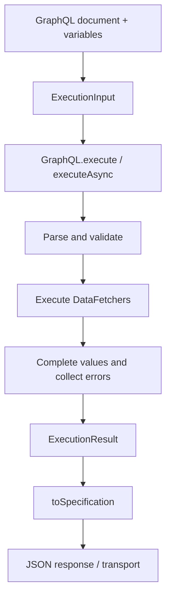

# ExecutionResult

When GraphQL Java executes a query or mutation, the engine produces a `graphql.ExecutionResult` object. This object holds the resolved data, a list of errors that occurred during the request, and any extension metadata. This represents the result at the GraphQL execution layer before Spring for GraphQL or the transport converts it into an HTTP, WebSocket, or RSocket response.

`ExecutionResult` matters because GraphQL permits returning partial data alongside errors. One field may fail while other fields succeed. Furthermore, a request may fail before execution even starts; in that case, the response has errors without a `data` entry. Thus, simply calling `getData()` and checking for null is not enough to interpret the result.

This lesson covers the structure and lifecycle of `ExecutionResult`, how to read `data`, `errors`, and `extensions`, how to distinguish request errors from execution errors, how to build and transform results, how to serialize the GraphQL response format properly, and how Spring for GraphQL wraps this result.

## 1. Where Does ExecutionResult Fit in the Execution Flow?

GraphQL Java accepts an `ExecutionInput`, executes against the schema, and returns an `ExecutionResult`:



In Spring for GraphQL, the flow is wrapped by these abstractions:

```text
HTTP / WebSocket / RSocket request
              |
              v
       ExecutionGraphQlService
              |
              v
          GraphQL Java
              |
              v
        ExecutionResult
              |
              v
      ExecutionGraphQlResponse
              |
              v
         GraphQlResponse
              |
              v
       Transport serialization
```

| Type | Role |
| --- | --- |
| `ExecutionInput` | Input GraphQL Java needs to execute: document, operation name, variables, context, and options |
| `ExecutionResult` | Final result of a GraphQL execution |
| `DataFetcherResult<T>` | Intermediate value a DataFetcher can return, including data, errors, local context, and extensions |
| `ExecutionGraphQlResponse` | Spring server-side wrapper for `ExecutionResult`, also retaining `ExecutionInput` |
| `GraphQlResponse` | High-level Spring response API providing data, errors, extensions, and field navigation |

Do not confuse `ExecutionResult` with an HTTP response. It contains no HTTP status code, cookies, or response headers. Those transport details belong to the Spring web/transport layer.

## 2. Components of ExecutionResult

Core API of `ExecutionResult`:

| Method | Meaning |
| --- | --- |
| `getData()` | Retrieve resolved GraphQL data; generic return type, may be null |
| `isDataPresent()` | Indicates whether the response has a `data` entry |
| `getErrors()` | List of `GraphQLError`; returns an empty list if there are no errors |
| `getExtensions()` | Response-level extension metadata; may be null if absent |
| `toSpecification()` | Converts the result into a Map conforming to the GraphQL response specification |
| `transform(...)` | Creates a new `ExecutionResult` based on the current result and a builder |
| `newExecutionResult()` | Creates a builder to construct a new result |
| `fromSpecification(...)` | Constructs an `ExecutionResult` from a specification-compliant response Map |

`ExecutionResult` is an interface. When creating a new result, prefer the static builder on the interface rather than depending directly on the `ExecutionResultImpl` implementation.

## 3. Reading Data and Understanding isDataPresent

`getData()` returns the operation's data. For queries or mutations, the data is usually a Map corresponding to the root operation type:

```java
ExecutionResult result = graphQL.execute(executionInput);

Map<String, Object> data = result.getData();
List<GraphQLError> errors = result.getErrors();
```

Key point: `getData()` returns null in multiple distinct situations. For example:

- The request fails before execution begins: the response has no `data` entry.
- Execution encounters an error that triggers null propagation all the way to root: the response has a `data` entry whose value is null.
- A result is deliberately constructed with null data.

`isDataPresent()` distinguishes between a missing `data` entry and an existing entry whose value is null.

| Scenario | `isDataPresent()` | `getData()` | `getErrors()` |
| --- | --- | --- | --- |
| Successful query | `true` | Object containing data | Empty |
| Execution error on one field, partial data present | `true` | Object with null field | Contains errors |
| Error propagated up to root | `true` | `null` | Contains errors |
| Parse/validation/variable coercion error before execution | `false` | `null` | Contains errors |

Example of proper checking:

```java
if (!result.isDataPresent()) {
    // Request failed before execution produced a data entry.
    log.warn("GraphQL request errors: {}", result.getErrors());
} else if (result.getData() == null) {
    // Execution produced a data entry whose value is null.
    log.warn("GraphQL execution returned null data");
} else if (!result.getErrors().isEmpty()) {
    // Partial data is available together with field errors.
    log.warn("GraphQL completed with partial data");
}
```

Do not write logic like `if (result.getData() == null) return 400`. Inspect `isDataPresent()`, errors, API policy, and transport HTTP rules. A GraphQL execution error does not automatically mean the entire HTTP request must fail.

## 4. Request Errors vs. Execution Errors

GraphQL distinguishes between errors occurring before operation execution and errors occurring during field resolution.

### Request error

A request error prevents GraphQL from starting execution. Examples:

- Malformed GraphQL document syntax.
- Field or argument does not exist in the schema.
- Unable to determine the operation name.
- Variable has an incompatible type or cannot be coerced.

The response has no `data` entry:

```json
{
  "errors": [
    {
      "message": "Cannot query field \"unknownField\" on type \"Query\".",
      "locations": [
        { "line": 2, "column": 3 }
      ]
    }
  ]
}
```

In this case, no DataFetcher has run for the operation. Consequently, the error typically has no `path` pointing to a response field.

### Execution error

An execution error happens while GraphQL is resolving or completing a field's value. GraphQL can continue executing independent fields and return partial data:

```graphql
query {
  book(id: "book-1") {
    id
    title
    author {
      name
    }
  }
  featuredBook {
    id
    title
  }
}
```

If fetching the author fails while the other fields succeed:

```json
{
  "data": {
    "book": {
      "id": "book-1",
      "title": "Spring GraphQL",
      "author": null
    },
    "featuredBook": {
      "id": "book-2",
      "title": "GraphQL in Practice"
    }
  },
  "errors": [
    {
      "message": "Author service is unavailable",
      "path": ["book", "author"],
      "extensions": {
        "code": "AUTHOR_UNAVAILABLE"
      }
    }
  ]
}
```

The client can still use `book.id`, `book.title`, and `featuredBook`. The failed field is represented as `null` per GraphQL value-completion rules.

### Non-null propagation

If the failed field has a Non-Null type, `null` cannot remain at that field. The null bubbles up to the nearest nullable parent:

```graphql
type Book {
  id: ID!
  author: Author!
}

type Author {
  name: String!
}
```

If `Book.author` is `Author!` and fails to resolve, GraphQL cannot return `author: null`. The null propagates up to the `Book` object; if the root field `book` is also Non-Null, the null continues bubbling higher. The error `path` still points to the original failing field, even though that field does not appear in the final data.

This explains why schema nullability directly shapes the `ExecutionResult` when errors occur.

## 5. Reading GraphQLError

`ExecutionResult.getErrors()` returns a list of `GraphQLError`. Each error can provide:

| Method | Content |
| --- | --- |
| `getMessage()` | Error description intended for developers |
| `getLocations()` | Line/column positions in the GraphQL document when determinable |
| `getPath()` | Path to the failing response position |
| `getErrorType()` | Error classification in GraphQL Java |
| `getExtensions()` | Custom extension metadata for this error |
| `toSpecification()` | Converts the error to a Map per the GraphQL error format |

Example:

```java
for (GraphQLError error : result.getErrors()) {
    log.warn(
            "GraphQL error: message={}, path={}, type={}",
            error.getMessage(),
            error.getPath(),
            error.getErrorType());
}
```

### Path uses response names and aliases

The path is not merely the schema field name. It identifies a position in the response, so it uses aliases when present and 0-based indices for lists:

```graphql
query {
  primary: book(id: "book-1") {
    author {
      name
    }
  }
}
```

If an error occurs on the author's name, the path may be:

```json
["primary", "author", "name"]
```

With lists:

```json
["books", 2, "author", "name"]
```

Thanks to `path`, the client knows the exact affected response field without guessing from the message.

### Error extensions

GraphQL allows each error to carry an `extensions` map. Applications commonly use it to supply stable error codes:

```json
{
  "message": "Book is not available",
  "path": ["book"],
  "extensions": {
    "code": "BOOK_UNAVAILABLE",
    "retryable": false
  }
}
```

Clients should rely on `extensions.code` instead of parsing message strings. Never include SQL, stack traces, access tokens, personal information, or internal exception details in extensions sent to clients.

## 6. Response-Level Extensions

`ExecutionResult.getExtensions()` returns metadata added by the implementation for the entire response. It differs from `GraphQLError.getExtensions()`:

| Location | Scope | Example |
| --- | --- | --- |
| `ExecutionResult.extensions` | Entire operation result | API version, tracing metadata, query cost |
| `GraphQLError.extensions` | One specific error | Error code, retryable flag, business error code |
| `DataFetcherResult.extensions` | Metadata contributed by one DataFetcher to the result | Data source, cache metadata |

Example of response-level extensions:

```json
{
  "data": {
    "book": {
      "id": "book-1",
      "title": "Spring GraphQL"
    }
  },
  "extensions": {
    "queryCost": 12,
    "apiVersion": "2026.11"
  }
}
```

The GraphQL specification reserves the `extensions` key for implementation-specific metadata. Do not add arbitrary top-level keys such as `traceId` or `debug` outside `extensions`; top-level response keys are restricted to `data`, `errors`, and `extensions`.

`getExtensions()` can return `null` when no extensions exist. Handle null safely when reading it:

```java
Map<Object, Object> extensions = result.getExtensions();
if (extensions != null) {
    Object queryCost = extensions.get("queryCost");
}
```

Extensions are protocol and operational metadata. Do not use them instead of schema fields to carry business data that clients need to query, validate, or type-check.

## 7. Building ExecutionResult with the Builder

GraphQL Java provides `ExecutionResult.newExecutionResult()`. The builder lets you set data, errors, and extensions:

```java
GraphQLError error = GraphqlErrorBuilder.newError()
        .message("Author service is unavailable")
        .path(List.of("book", "author"))
        .errorType(ErrorType.DataFetchingException)
        .extensions(Map.of("code", "AUTHOR_UNAVAILABLE"))
        .build();

Map<String, Object> book = new LinkedHashMap<>();
book.put("id", "book-1");
book.put("title", "Spring GraphQL");
book.put("author", null);

Map<String, Object> data = Map.of("book", book);

ExecutionResult result = ExecutionResult.newExecutionResult()
        .data(data)
        .addError(error)
        .addExtension("apiVersion", "2026.11")
        .build();
```

The result contains both data and an error. This is a partial execution result: the `author` field is null due to an error, while the other fields remain usable.

Builder methods include:

- `data(Object)` sets the data.
- `errors(List<GraphQLError>)` replaces the entire current error list.
- `addError(GraphQLError)` appends a single error.
- `addErrors(List<GraphQLError>)` appends multiple errors.
- `extensions(Map<Object, Object>)` sets the extensions map.
- `addExtension(String, Object)` adds a single extension entry.
- `build()` constructs the `ExecutionResult`.
- `from(ExecutionResult)` initializes a builder from an existing result.

### Building a result containing only request errors

Request errors happen before execution, so the response has no `data` key. You can construct such a result from a specification map:

```java
Map<String, Object> requestErrorMap = Map.of(
        "errors",
        List.of(Map.of("message", "Invalid GraphQL document")));

ExecutionResult requestError =
        ExecutionResult.fromSpecification(requestErrorMap);

assert !requestError.isDataPresent();
assert requestError.getData() == null;
assert !requestError.getErrors().isEmpty();
```

`fromSpecification` is useful when converting a Map already structured as a GraphQL response into a GraphQL Java object. For normal operation handling, let the GraphQL engine produce the result rather than constructing it manually.

## 8. Transforming ExecutionResult with transform

`ExecutionResult.transform(...)` creates a new result by initializing a builder from the current result and applying changes:

```java
ExecutionResult enriched = result.transform(builder ->
        builder.addExtension("service", "catalog-api"));
```

The original result is not mutated. This is a clean way to attach metadata after execution while preserving existing data and errors.

You can use `transform` to add an error or update errors:

```java
ExecutionResult updated = result.transform(builder ->
        builder.addError(additionalError));
```

When replacing all errors:

```java
ExecutionResult updated = result.transform(builder ->
        builder.errors(sanitizedErrors));
```

`errors(...)` replaces the current list, whereas `addError(...)` appends an error. Pick the right method to avoid accidentally wiping out errors produced by DataFetchers or the execution engine.

### Do not transform results in ways that break the response contract

When transforming, preserve these rules:

- If execution ran, the response must contain a `data` entry, even when its value is null.
- If errors exist, `errors` must be a non-empty list.
- If there are no errors, do not emit an empty `errors` list in the response specification.
- Do not strip error `path` or `locations` needed for client diagnostics.
- Do not place sensitive metadata into `extensions`.

If you modify data or errors post-execution, keep them mutually consistent. For example, do not remove a field from `data` while leaving an error path pointing to a renamed field if that prevents clients from locating the error.

## 9. How DataFetcherResult Differs from ExecutionResult

`DataFetcherResult<T>` is not the final result of the entire GraphQL operation. It is an object a DataFetcher can return to contribute data, errors, local context, and extensions for the current field.

Example of a DataFetcher loading an author from an external service:

```java
DataFetcher<DataFetcherResult<Author>> authorFetcher = environment -> {
    Author author = authorService.findById(environment.getArgument("id"));

    if (author == null) {
        GraphQLError error = GraphqlErrorBuilder.newError(environment)
                .message("Author was not found")
                .errorType(ErrorType.DataFetchingException)
                .extensions(Map.of("code", "AUTHOR_NOT_FOUND"))
                .build();

        return DataFetcherResult.<Author>newResult()
                .data(null)
                .error(error)
                .build();
    }

    return DataFetcherResult.<Author>newResult()
            .data(author)
            .extensions(Map.of("source", "author-service"))
            .build();
};
```

GraphQL Java extracts data and errors from `DataFetcherResult`, continues completing remaining fields, and aggregates everything into the final `ExecutionResult`.

| Property | `DataFetcherResult` | `ExecutionResult` |
| --- | --- | --- |
| Scope | One field/DataFetcher | Entire operation execution |
| Data | Field value | Root operation data structure |
| Errors | Errors contributed by the field | Aggregated error list |
| Extensions | Merged into the result via `ExtensionsMerger` | Final operation extensions |
| Local context | Yes, passed down to child DataFetchers | Not response metadata |
| Serialization | Not serialized directly as a GraphQL response | Uses `toSpecification()` to build response map |

### Local context is only for child DataFetchers

`DataFetcherResult.localContext` passes an object down to child fields via `DataFetchingEnvironment.getLocalContext()`. It does not appear in the JSON response:

```java
return DataFetcherResult.<Book>newResult()
        .data(book)
        .localContext(new BookAccessContext(currentUser, permissions))
        .build();
```

Child field resolver:

```java
DataFetcher<Author> authorFetcher = environment -> {
    BookAccessContext context = environment.getLocalContext();
    Book book = environment.getSource();

    return authorService.findVisibleAuthor(book, context.permissions());
};
```

Local context is helpful when a parent DataFetcher has already computed metadata needed by child fields. Never put secrets or unnecessary internal data into response extensions just to pass data between DataFetchers; use local context or `GraphQLContext` according to scope.

### Extensions from multiple DataFetchers

`DataFetcherResult` can contribute extensions. GraphQL Java uses `ExtensionsBuilder` and `ExtensionsMerger` to merge these maps into `ExecutionResult.getExtensions()`. Merge semantics depend on the configured merger; the default merger can deep-merge maps, concatenate lists, and favor the right-hand value on key collisions.

Do not assume extension keys contributed by two independent DataFetchers will always be preserved as expected if they share the same key. Use clear namespaces such as `catalog.source` and `pricing.cache`, or configure an appropriate merger.

## 10. Serializing Properly with toSpecification()

`ExecutionResult` is a Java object, not a JSON response map. When serializing the result into a GraphQL response, use `toSpecification()`:

```java
ExecutionResult result = graphQL.execute(executionInput);

Map<String, Object> responseMap = result.toSpecification();
String json = objectMapper.writeValueAsString(responseMap);
```

GraphQL Java provides this method to produce a Map compliant with the GraphQL specification's response format. It is safer than passing the `ExecutionResult` object directly to Jackson or Gson for standard bean serialization.

### Why not serialize ExecutionResult directly?

A generic Java serializer may:

- Serialize property names using custom naming conventions.
- Omit null values.
- Expose internal implementation properties that do not belong to the GraphQL response format.
- Mishandle the distinction between absent `data` and `data: null`.

GraphQL responses follow strict rules regarding the presence of `data`, `errors`, and `extensions`. `toSpecification()` preserves those rules:

| State | Produced Map |
| --- | --- |
| Success | Has `data`; omits `errors` when no errors exist |
| Partial data | Has `data` and `errors` |
| Pre-execution request error | Has `errors`; omits `data` |
| Extension metadata present | Adds `extensions` when present |

### fromSpecification()

In the reverse direction, `ExecutionResult.fromSpecification(map)` converts a specification-compliant response Map back into an object:

```java
Map<String, Object> responseMap = result.toSpecification();
ExecutionResult restored = ExecutionResult.fromSpecification(responseMap);
```

This API helps adapters or integrations converting between Map structures and GraphQL Java results. The input Map must conform to the response format; do not use it to validate arbitrary payloads.

## 11. Synchronous and Asynchronous Execution

GraphQL Java offers two ways to invoke execution:

```java
ExecutionResult result = graphQL.execute(executionInput);
```

and:

```java
CompletableFuture<ExecutionResult> future =
        graphQL.executeAsync(executionInput);

future.thenAccept(result -> {
    Map<String, Object> response = result.toSpecification();
    // Serialize or pass the response to the transport.
});
```

`executeAsync()` returns `CompletableFuture<ExecutionResult>`. `execute()` exposes a synchronous external API; internally GraphQL Java still uses async execution and waits for completion.

If a DataFetcher returns `CompletionStage` or `CompletableFuture`, GraphQL Java composes those futures into the overall execution and produces `ExecutionResult` once all required fields complete. For example:

```java
DataFetcher<CompletableFuture<Book>> bookFetcher = environment ->
        CompletableFuture.supplyAsync(
                () -> bookService.findById(environment.getArgument("id")),
                bookExecutor);
```

Do not call `join()` or `get()` on a future inside a DataFetcher when aiming for asynchronous execution; blocking waits stall threads and defeat the execution strategy. Pick an executor appropriate for the workload, and never run arbitrary blocking work on an event loop.

## 12. ExecutionResult with Subscriptions

Standard queries and mutations produce a single execution result per operation. A subscription produces a response stream; each event in the source stream yields a corresponding execution result.

```text
Subscription operation
        |
        v
Source Publisher<BookEvent>
        |
        +---- event A ----> ExecutionResult A
        |
        +---- event B ----> ExecutionResult B
        |
        +---- event C ----> ExecutionResult C
        |
        +---- complete / error / cancel
```

Therefore, do not think of a Subscription as a single `ExecutionResult` containing all emitted events. Each response event carries its own data and errors. The source publisher may keep running long after GraphQL produces the initial response stream.

In GraphQL Java, subscription execution uses `SubscriptionExecutionStrategy` and Reactive Streams APIs. In Spring for GraphQL, transports such as WebSocket or SSE handle the response stream according to their protocol.

## 13. How Spring for GraphQL Wraps ExecutionResult

`ExecutionGraphQlResponse` is the server-side wrapper around the `ExecutionResult` returned by GraphQL Java. It also exposes the prepared `ExecutionInput` sent to the GraphQL engine:

```java
ExecutionGraphQlResponse response =
        executionGraphQlService.execute(request).block();

ExecutionResult executionResult = response.getExecutionResult();
ExecutionInput executionInput = response.getExecutionInput();
```

This snippet illustrates reading the result at the server layer. In reactive applications, do not call `block()` on the WebFlux event loop; compose `Mono<ExecutionGraphQlResponse>` within the reactive pipeline.

`GraphQlResponse` is the general API for reading responses:

| Method | Meaning |
| --- | --- |
| `getData()` | Read data; may be null when response is invalid |
| `getErrors()` | List of response errors |
| `getExtensions()` | Response-level extensions |
| `isValid()` | Checks whether the response has a non-null `data` entry |
| `toMap()` | Maps the response per the GraphQL specification |
| `field(path)` | Navigates to a field inside `data` |

### isValid() does not mean zero errors

In Spring's `GraphQlResponse`, `isValid()` checks whether the response has a `data` entry with a non-null value. A response with partial data and several field errors can still be valid:

```json
{
  "data": {
    "book": {
      "id": "book-1",
      "author": null
    }
  },
  "errors": [
    {
      "message": "Author service unavailable",
      "path": ["book", "author"]
    }
  ]
}
```

Here the response has non-null data so `isValid()` can return `true`, even though `getErrors()` is non-empty. Do not use `isValid()` as a shortcut for "no errors".

This also differs from `ExecutionResult.isDataPresent()`:

- `isDataPresent()` only checks whether the `data` entry was included in the result.
- `GraphQlResponse.isValid()` checks whether `data` is present and non-null.
- `getErrors().isEmpty()` checks whether the response has no errors.

These three checks answer three different questions.

If you need to know specifically whether the response map contains a `data` key, do not rely solely on `GraphQlResponse.isValid()`. That method returns `false` both when the `data` key is absent and when `data` is null. Check `response.getExecutionResult().isDataPresent()` on the server side or `response.toMap().containsKey("data")` when working with the response map.

## 14. Transforming ExecutionResult via WebGraphQlInterceptor

Spring for GraphQL allows interceptors to process responses after GraphQL Java executes. `WebGraphQlResponse.transform(...)` creates a new response and provides a builder to modify the underlying `ExecutionResult`.

Example adding a correlation ID to response extensions:

```java
public class ResponseMetadataInterceptor implements WebGraphQlInterceptor {

    private final CorrelationIdProvider correlationIdProvider;

    public ResponseMetadataInterceptor(
            CorrelationIdProvider correlationIdProvider) {
        this.correlationIdProvider = correlationIdProvider;
    }

    @Override
    public Mono<WebGraphQlResponse> intercept(
            WebGraphQlRequest request,
            Chain chain) {

        return chain.next(request).map(response -> {
            Map<Object, Object> extensions = new LinkedHashMap<>();
            Map<Object, Object> current = response.getExtensions();
            if (current != null) {
                extensions.putAll(current);
            }
            extensions.put("correlationId", correlationIdProvider.currentId());

            return response.transform(builder ->
                    builder.extensions(extensions).build());
        });
    }
}
```

If the response already has extensions, merge them into the new map before calling `builder.extensions(...)`. Passing a fresh map without merging replaces the existing extensions map.

Interceptors can also modify request-level errors generated before DataFetchers run. `DataFetcherExceptionResolver` only handles exceptions raised inside DataFetchers; parse or validation errors occurring prior to execution must be handled in a request/transport interceptor if further normalization is needed.

Do not use an interceptor to mechanically turn every GraphQL error into an HTTP error. GraphQL can return partial data alongside errors; deciding HTTP status codes and response framing belongs to transport policy, while `ExecutionResult` must retain GraphQL semantics.

## 15. How Exception Handling Produces GraphQLError

When a DataFetcher throws an exception, GraphQL Java wraps it into `ExceptionWhileDataFetching` by default and adds a `GraphQLError` to `ExecutionResult.getErrors()`. The execution strategy can continue resolving other fields to produce partial data.

In plain GraphQL Java, `DataFetcherExceptionHandler` determines how exceptions become errors:

```java
DataFetcherExceptionHandler handler = parameters -> {
    GraphQLError error = GraphqlErrorBuilder.newError()
            .message("Unable to load the requested book")
            .location(parameters.getSourceLocation())
            .path(parameters.getPath().toList())
            .errorType(ErrorType.DataFetchingException)
            .extensions(Map.of("code", "BOOK_LOOKUP_FAILED"))
            .build();

    return CompletableFuture.completedFuture(
            DataFetcherExceptionHandlerResult.newResult()
                    .error(error)
                    .build());
};
```

The handler receives information about the exception, source location, and response path. The application can log the internal exception while returning a controlled message to the client.

### Spring for GraphQL uses DataFetcherExceptionResolver

In Spring for GraphQL, you usually do not need to configure `DataFetcherExceptionHandler` directly. Spring registers a default handler and supports multiple `DataFetcherExceptionResolver` beans evaluated in order.

Example:

```java
@ControllerAdvice
public class BookExceptionHandler {

    @GraphQlExceptionHandler
    public GraphQLError handle(BookNotFoundException exception) {
        return GraphqlErrorBuilder.newError()
                .message("Book was not found")
                .errorType(org.springframework.graphql.execution.ErrorType.NOT_FOUND)
                .extensions(Map.of("code", "BOOK_NOT_FOUND"))
                .build();
    }
}
```

Or implement `DataFetcherExceptionResolver`/`DataFetcherExceptionResolverAdapter` when a shared resolver is needed. The resolver returns a `GraphQLError` for Spring to include in the execution result.

Distinguish three handling locations:

| Error Type | Appropriate Handler |
| --- | --- |
| Exception from DataFetcher or controller | `DataFetcherExceptionResolver` or `@GraphQlExceptionHandler` |
| Parse, validation, or variable coercion error before DataFetcher | `WebGraphQlInterceptor` or request/transport layer |
| Subscription publisher emitting an error signal after source creation | `SubscriptionExceptionResolver` |

`DataFetcherExceptionResolver` does not handle request errors occurring before a DataFetcher is called. Likewise, exceptions emitted after a subscription publisher starts streaming require `SubscriptionExceptionResolver`.

## 16. ExecutionResult and Extensions: Safety Rules

Extensions are a convenient place for metadata, yet any serialized value can reach clients. Treat them as public data:

- Include only stable error codes, approved public correlation IDs, or suitable operational metadata.
- Never include stack traces, SQL statements, internal hostnames, credentials, tokens, or PII.
- Avoid arbitrary Java objects with unpredictable serializers; stick to primitives, simple Maps, and Lists.
- Namespace metadata contributed by multiple modules.
- Avoid overwriting existing extensions when transforming a response.
- Never use extensions instead of strongly typed GraphQL schema fields.

Safer metadata example:

```json
{
  "extensions": {
    "correlationId": "req-7f82",
    "queryCost": 12
  }
}
```

Example of what NOT to send:

```json
{
  "extensions": {
    "databaseUrl": "jdbc:postgresql://db.internal:5432/catalog",
    "sql": "select * from users where email = ...",
    "accessToken": "secret-value"
  }
}
```

If clients need a business status such as payment status or access permissions, model it as a typed schema field instead of hiding it inside extensions.

## 17. Testing ExecutionResult

You can test directly with GraphQL Java without starting an HTTP server:

```java
class ExecutionResultTests {

    @Test
    void keepsPartialDataAndFieldError() {
        GraphQLError error = GraphqlErrorBuilder.newError()
                .message("Author service unavailable")
                .path(List.of("book", "author"))
                .extensions(Map.of("code", "AUTHOR_UNAVAILABLE"))
                .build();

        Map<String, Object> book = new LinkedHashMap<>();
        book.put("id", "book-1");
        book.put("author", null);

        ExecutionResult result = ExecutionResult.newExecutionResult()
                .data(Map.of("book", book))
                .addError(error)
                .build();

        assertThat(result.isDataPresent()).isTrue();
        assertThat(result.getErrors()).hasSize(1);
        assertThat(result.toSpecification())
                .containsKeys("data", "errors");
    }
}
```

### Testing a request error without data

```java
@Test
void requestErrorHasNoDataEntry() {
    ExecutionResult result = ExecutionResult.fromSpecification(
            Map.of("errors", List.of(
                    Map.of("message", "Invalid document"))));

    assertThat(result.isDataPresent()).isFalse();
    assertThat(result.getData()).isNull();
    assertThat(result.getErrors()).hasSize(1);
    assertThat(result.toSpecification()).doesNotContainKey("data");
}
```

### Testing transform preserves data and errors

```java
@Test
void transformAddsExtensionWithoutDroppingErrors() {
    GraphQLError error = GraphqlErrorBuilder.newError()
            .message("Field unavailable")
            .build();

    ExecutionResult original = ExecutionResult.newExecutionResult()
            .data(Map.of("book", Map.of("id", "book-1")))
            .addError(error)
            .build();

    ExecutionResult transformed = original.transform(builder ->
            builder.addExtension("correlationId", "req-123"));

    assertThat(transformed.getErrors()).hasSize(1);
    assertThat(transformed.getExtensions())
            .containsEntry("correlationId", "req-123");
    assertThat(original.getExtensions()).isNull();
}
```

The final test demonstrates that `transform` produces a new result without mutating the original object.

### Testing with Spring GraphQlTester

When testing full Spring GraphQL execution, use `GraphQlTester` to assert both data and errors:

```java
graphQlTester.document("""
        query {
            book(id: "missing") {
                id
            }
        }
        """)
        .execute()
        .errors()
        .expect(error -> "BOOK_NOT_FOUND".equals(
                error.getExtensions().get("code")))
        .verify();
```

When a query returns partial data with an error, verify both usable fields and the error path. Do not assert only HTTP status or only `data`.

## 18. Common Pitfalls

| Symptom | Cause | Resolution |
| --- | --- | --- |
| `getData()` is null and code treats all cases identically | Failing to distinguish absent `data` from `data: null` | Check `isDataPresent()` alongside `errors` |
| Response lacks partial data | Non-Null propagation bubbled null up to a parent | Review schema nullability and error path |
| Client cannot tell which field failed | Ignoring `GraphQLError.getPath()` | Return standard paths preserving aliases and list indices |
| Error message leaks stack traces | Returning raw exception messages or unsafe handler config | Use resolvers for public messages and log details on the server |
| Extensions lost after interceptor | Calling `builder.extensions(newMap)` without merging existing map | Copy existing extensions first, then add new keys |
| Metadata appears in the wrong place | Confusing error extensions with result extensions | Decide whether metadata belongs to one error or the full response |
| JSON serializer drops `data: null` | Serializing `ExecutionResult` directly or wrong null-inclusion config | Serialize `result.toSpecification()` |
| Request validation error skips resolver | Error happens before DataFetchers run | Handle in a request/transport interceptor |
| Subscription stream error misses resolver | Error emitted after publisher was already returned | Use `SubscriptionExceptionResolver` |
| Tests check only data and miss errors | GraphQL permits partial data | Assert both errors and data together |
| `DataFetcherResult.localContext` appears in JSON | Confusing local context with extensions | Local context is passed only to child DataFetchers |
| Extension key gets overwritten | Multiple DataFetchers or interceptors share a key | Use namespaces and check `ExtensionsMerger` |
| Calling `join()` inside a DataFetcher | Blocking the async execution thread | Return `CompletionStage` and compose futures |

## 19. Principles for Working with ExecutionResult

- Treat `ExecutionResult` as the aggregate result of one GraphQL execution.
- Distinguish `getData()`, `isDataPresent()`, and `getErrors()`.
- Understand how request errors and execution errors produce different responses.
- Use `GraphQLError` `message`, `locations`, `path`, `errorType`, and `extensions` appropriately.
- Leverage partial data; do not treat every GraphQL error as a total operation failure.
- Account for Non-Null propagation when designing schemas and inspecting results.
- Use `ExecutionResult.newExecutionResult()` to build results; prefer the interface over concrete implementations.
- Use `transform()` to produce a new result while keeping unchanged parts intact.
- Use `DataFetcherResult` for field-level data, errors, and local context.
- Use `toSpecification()` before serializing a GraphQL response.
- Use `ExecutionGraphQlResponse` and `GraphQlResponse` when integrating with Spring for GraphQL.
- Do not confuse `GraphQlResponse.isValid()` with having zero errors.
- Use `DataFetcherExceptionResolver` for DataFetcher errors and interceptors for request-level errors.
- Never place secrets or internal details into extensions.
- Test data, errors, data presence, and response maps thoroughly.

## 20. Hands-on Exercise

Build a library API and inspect execution results:

1. Create a schema with Queries `book(id: ID!)`, `books`, and a nested `author` field.
2. Create a GraphQL Java `GraphQL` instance and call `executeAsync()`.
3. Read `ExecutionResult.getData()` and `getErrors()`.
4. Build a DataFetcher returning partial data alongside a `GraphQLError`.
5. Change the `author` field from nullable to Non-Null and observe null propagation.
6. Compare `isDataPresent()` between a request validation error and an execution error that nulls root data.
7. Use `ExecutionResult.newExecutionResult()` to create a result containing data, an error, and extensions.
8. Use `transform()` to add a correlation ID while preserving existing errors.
9. Use `DataFetcherResult` to pass local context to a child resolver.
10. Serialize with `toSpecification()` and verify the `data`, `errors`, and `extensions` keys.
11. Integrate `ExecutionGraphQlResponse` to read `getExecutionResult()`.
12. Write a `WebGraphQlInterceptor` that normalizes request errors without dropping existing extensions.
13. Write tests for request errors, partial data, Non-Null propagation, and response serialization.

After completing this exercise, you should be able to explain how an `ExecutionResult` can hold both data and errors simultaneously, how to distinguish absent data from null data, and how to convert the GraphQL Java object into a specification-compliant response map.

## 21. References

- [GraphQL Java — Execution](https://graphql-java.com/documentation/execution/)
- [GraphQL Java — ExecutionResult API](https://javadoc.io/static/com.graphql-java/graphql-java/24.3/graphql/ExecutionResult.html)
- [GraphQL Java — ExecutionResult.Builder API](https://javadoc.io/static/com.graphql-java/graphql-java/24.3/graphql/ExecutionResult.Builder.html)
- [GraphQL Java — GraphQLError API](https://javadoc.io/static/com.graphql-java/graphql-java/24.3/graphql/GraphQLError.html)
- [GraphQL Java — DataFetcherResult API](https://javadoc.io/static/com.graphql-java/graphql-java/24.3/graphql/execution/DataFetcherResult.html)
- [Spring for GraphQL — Request Execution](https://docs.spring.io/spring-graphql/reference/request-execution.html)
- [Spring for GraphQL — Server Transports and Interception](https://docs.spring.io/spring-graphql/reference/transports.html)
- [Spring for GraphQL — ExecutionGraphQlResponse API](https://docs.spring.io/spring-graphql/docs/current/api/org/springframework/graphql/ExecutionGraphQlResponse.html)
- [GraphQL Specification — Response](https://spec.graphql.org/September2026/#sec-Response)

GraphQL Java and Spring for GraphQL are released independently; API signatures or packages may vary depending on the dependency version managed by Spring Boot. Check the Javadoc for the exact version in your application's dependency tree before upgrading or deeply customizing.
