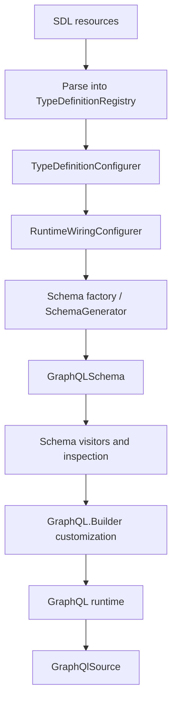

# Configurer and Builder Customization

## 1. Why Are Configurers and Builder Customizations Needed?

Spring for GraphQL uses GraphQL Java to build an executable schema and execute operations. In a typical Spring Boot application, the starter already creates `GraphQlSource`, loads SDL files, wires controller methods to DataFetchers, configures exception resolvers, and attaches instrumentation. However, some applications need to extend or modify how the runtime is constructed:

- Registering custom scalars such as `DateTime`, `UUID`, or `Money`.
- Registering `SchemaDirectiveWiring` to process directives in SDL.
- Registering a `TypeResolver` for GraphQL interfaces and unions.
- Adding a `WiringFactory` to register DataFetchers based on schema structure.
- Modifying `TypeDefinitionRegistry` before building the executable schema.
- Using a custom schema factory, such as building a Federation-compatible schema.
- Configuring GraphQL Java builder options such as `ExecutionIdProvider`, `PreparsedDocumentProvider`, or execution strategies.
- Traversing the schema, inspecting mappings, and modifying the code registry.

Spring provides well-scoped callbacks for these tasks. `RuntimeWiringConfigurer` focuses on runtime wiring; `GraphQlSourceBuilderCustomizer` lets you customize the overall builder created by Spring Boot; `GraphQlSource.Builder` is the foundational API when you need to assemble `GraphQlSource` yourself.

## 2. Distinguishing the Configuration Layers

These APIs have similar names yet act on different stages:

| API | Targets | When to Use |
| --- | --- | --- |
| `RuntimeWiringConfigurer` | `RuntimeWiring.Builder` | Registering scalars, DataFetchers, directive wirings, type resolvers, or wiring factories |
| `TypeDefinitionConfigurer` | `TypeDefinitionRegistry` after parsing SDL | Adding or adjusting type definitions before schema creation |
| `GraphQlSourceBuilderCustomizer` | `GraphQlSource.SchemaResourceBuilder` | Customizing the overall `GraphQlSource` build process in Spring Boot |
| `GraphQlSource.Builder` | GraphQL source and `GraphQL.Builder` | Manually configuring schemas, instrumentation, exception resolvers, and execution options |
| `GraphQlSource` | Built GraphQL runtime and schema | Supplying the runtime to `ExecutionGraphQlService` |

You can picture the build steps in sequence:



The diagram depicts the major phases. The exact placement of certain visitors and inspections depends on builder APIs, but the key is picking the callback matching the object you need to customize.

## 3. How Does Spring Boot Auto-Configure GraphQlSource?

When using `spring-boot-starter-graphql`, Spring Boot creates a `GraphQlSource.SchemaResourceBuilder` and configures it from properties and beans in the `ApplicationContext`.

The current auto-configuration flow can be summarized as:

1. Locate schema resources according to `spring.graphql.schema.locations` and `file-extensions`.
2. Add any additionally configured schema resources.
3. Register `DataFetcherExceptionResolver`, `SubscriptionExceptionResolver`, and `Instrumentation` beans in Spring-managed order.
4. Apply schema inspection and configure introspection if requested.
5. Apply Boot's default `TypeDefinitionConfigurer`s.
6. Retrieve `RuntimeWiringConfigurer` beans in order and add them to the builder.
7. Retrieve `GraphQlSourceBuilderCustomizer` beans in order and invoke each customizer.
8. Call `build()` to construct `GraphQlSource`.

This means most applications only need to declare configurer/customizer beans. There is no need to create `GraphQlSource` or `GraphQL` instances manually inside controllers.

## 4. What Is `RuntimeWiringConfigurer`?

`RuntimeWiringConfigurer` is a Spring for GraphQL callback for configuring `graphql.schema.idl.RuntimeWiring.Builder`. It is where you register components that connect SDL to the Java runtime:

- Custom scalar types.
- Directly registered DataFetchers.
- `TypeResolver`s for interfaces and unions.
- `SchemaDirectiveWiring`.
- `WiringFactory` and other wiring rules.

Spring Boot automatically detects `RuntimeWiringConfigurer` beans and adds them to `GraphQlSource.Builder`.

Example registering a custom scalar declared as a bean by the application:

```java
import graphql.schema.GraphQLScalarType;
import org.springframework.context.annotation.Bean;
import org.springframework.context.annotation.Configuration;
import org.springframework.graphql.execution.RuntimeWiringConfigurer;

@Configuration(proxyBeanMethods = false)
public class GraphQlRuntimeWiringConfig {

    @Bean
    RuntimeWiringConfigurer scalarConfigurer(GraphQLScalarType dateTimeScalar) {
        return builder -> builder.scalar(dateTimeScalar);
    }
}
```

`dateTimeScalar` is a separately declared `GraphQLScalarType`. The scalar is responsible for parsing client input and serializing output to the appropriate GraphQL representation.

## 5. Registering Multiple RuntimeWiringConfigurers

You can split configuration by responsibility instead of packing everything into one large bean:

```java
import graphql.schema.GraphQLScalarType;
import graphql.schema.TypeResolver;
import org.springframework.context.annotation.Bean;
import org.springframework.context.annotation.Configuration;
import org.springframework.graphql.execution.RuntimeWiringConfigurer;

@Configuration(proxyBeanMethods = false)
public class GraphQlWiringConfig {

    @Bean
    RuntimeWiringConfigurer scalarConfigurer(GraphQLScalarType dateTimeScalar) {
        return builder -> builder.scalar(dateTimeScalar);
    }

    @Bean
    RuntimeWiringConfigurer directiveConfigurer() {
        return builder -> builder.directiveWiring(new MaskDirectiveWiring());
    }

    @Bean
    RuntimeWiringConfigurer typeResolverConfigurer(TypeResolver searchResultResolver) {
        return builder -> builder.type("SearchResult", typeWiring ->
                typeWiring.typeResolver(searchResultResolver));
    }
}
```

`MaskDirectiveWiring` and `searchResultResolver` are components implemented by the application. Splitting beans makes each configuration easier to test and maintain independently. If multiple configurers register a scalar, DataFetcher, or type resolver for the same schema coordinate, clarify which bean owns that configuration.

## 6. Registering DataFetchers Directly When Genuinely Needed

GraphQL Java lets you register DataFetchers directly via `RuntimeWiring.Builder`:

```java
import org.springframework.context.annotation.Bean;
import org.springframework.context.annotation.Configuration;
import org.springframework.graphql.execution.RuntimeWiringConfigurer;

@Configuration(proxyBeanMethods = false)
public class BookDataFetcherConfig {

    @Bean
    RuntimeWiringConfigurer bookDataFetcher(BookRepository repository) {
        return wiring -> wiring.type("Query", type -> type
                .dataFetcher("book", environment -> {
                    String id = environment.getArgument("id");
                    return repository.findById(id).orElse(null);
                }));
    }
}
```

This snippet assumes the SDL declares `Query.book(id: ID!): Book` and the repository has a matching method.

In Spring for GraphQL, most applications should use `@Controller`, `@QueryMapping`, `@SchemaMapping`, and other controller annotations. `AnnotatedControllerConfigurer` is a `RuntimeWiringConfigurer` registered automatically by Boot that discovers controller methods and builds corresponding DataFetchers. Register DataFetchers directly only when integrating low-level libraries, adapters, or dynamic wiring.

## 7. Using WiringFactory When Wiring Depends on Schema

Some configurations need to inspect type definitions before deciding whether to register a DataFetcher. `RuntimeWiringConfigurer` provides an overload receiving `List<WiringFactory>` so factories can be combined and evaluated in order.

```java
import graphql.schema.idl.RuntimeWiring;
import graphql.schema.idl.WiringFactory;
import java.util.List;
import org.springframework.graphql.execution.RuntimeWiringConfigurer;

public final class SchemaAwareWiringConfigurer implements RuntimeWiringConfigurer {

    @Override
    public void configure(RuntimeWiring.Builder builder, List<WiringFactory> factories) {
        factories.add(new BookWiringFactory());
    }
}
```

`BookWiringFactory` is an application-provided implementation. This works well when wiring depends on schema definitions, such as choosing a DataFetcher based on directives or field metadata. If you only need to register a scalar or a fixed DataFetcher, the simpler overload accepting `RuntimeWiring.Builder` is enough.

## 8. Customizing TypeResolver for Interfaces and Unions

GraphQL interfaces and unions return a Java object that may belong to one of several concrete types. GraphQL Java needs a `TypeResolver` to determine the matching GraphQL object type.

Example SDL:

```graphql
union SearchResult = Book | Author

type Book {
    id: ID!
    title: String!
}

type Author {
    id: ID!
    name: String!
}
```

When Java class names do not match or cannot be inferred from the class hierarchy, register an explicit `TypeResolver`:

```java
import graphql.schema.TypeResolver;
import org.springframework.context.annotation.Bean;
import org.springframework.context.annotation.Configuration;
import org.springframework.graphql.execution.RuntimeWiringConfigurer;

@Configuration(proxyBeanMethods = false)
public class SearchResultWiringConfig {

    @Bean
    TypeResolver searchResultTypeResolver() {
        return environment -> {
            Object value = environment.getObject();
            if (value instanceof BookView) {
                return environment.getSchema().getObjectType("Book");
            }
            if (value instanceof AuthorView) {
                return environment.getSchema().getObjectType("Author");
            }
            throw new IllegalArgumentException("Unsupported SearchResult value");
        };
    }

    @Bean
    RuntimeWiringConfigurer searchResultConfigurer(TypeResolver searchResultTypeResolver) {
        return builder -> builder.type("SearchResult", type ->
                type.typeResolver(searchResultTypeResolver));
    }
}
```

`BookView` and `AuthorView` are application Java types. `GraphQlSource.Builder` also provides `defaultTypeResolver(...)`; by default Spring uses `ClassNameTypeResolver`, which attempts to match class names and supertypes to GraphQL object types. Configuring a default resolver is useful when changing the global inference rule, whereas `RuntimeWiringConfigurer` fits configuring a specific interface or union.

## 9. `TypeDefinitionConfigurer` Modifies SDL Before Schema Creation

`TypeDefinitionConfigurer` receives `TypeDefinitionRegistry` after the SDL is parsed and before `GraphQLSchema` is built. You can use it to add or adjust type definitions in a controlled manner.

`GraphQlSource.SchemaResourceBuilder` exposes:

```java
builder.configureTypeDefinitions(typeDefinitionConfigurer);
```

A built-in example is `ConnectionTypeDefinitionConfigurer`, which adds connection/edge/page-info types following Spring for GraphQL's pagination conventions. The Spring Boot GraphQL starter already registers this configurer during normal auto-configuration.

Do not use `TypeDefinitionConfigurer` to mutate schemas per request. It runs during schema construction, typically at application startup. When schemas must change at deployment time, update the SDL or rebuild the schema via an explicit build/reload pipeline.

## 10. What Is `GraphQlSourceBuilderCustomizer`?

`GraphQlSourceBuilderCustomizer` is a Spring Boot callback. Beans implementing this interface receive the `GraphQlSource.SchemaResourceBuilder` being configured by Boot, allowing customizations beyond runtime wiring.

Example customizing `ExecutionIdProvider`:

```java
import graphql.execution.ExecutionIdProvider;
import org.springframework.context.annotation.Bean;
import org.springframework.context.annotation.Configuration;
import org.springframework.boot.graphql.autoconfigure.GraphQlSourceBuilderCustomizer;

@Configuration(proxyBeanMethods = false)
public class GraphQlSourceCustomizationConfig {

    @Bean
    GraphQlSourceBuilderCustomizer executionIdCustomizer(
            ExecutionIdProvider executionIdProvider) {

        return builder -> builder.configureGraphQl(graphQlBuilder ->
                graphQlBuilder.executionIdProvider(executionIdProvider));
    }
}
```

`executionIdProvider` is an application-provided bean. This example demonstrates how a customizer can reach into `GraphQL.Builder` via `configureGraphQl`.

The interface's package differs by Spring Boot major version:

| Version | Import |
| --- | --- |
| Spring Boot 3.x | `org.springframework.boot.autoconfigure.graphql.GraphQlSourceBuilderCustomizer` |
| Spring Boot 4.x | `org.springframework.boot.graphql.autoconfigure.GraphQlSourceBuilderCustomizer` |

`RuntimeWiringConfigurer` belongs to Spring for GraphQL, so its package `org.springframework.graphql.execution` does not change across those Boot versions.

## 11. Key API Groups on GraphQlSource.Builder

`GraphQlSource.schemaResourceBuilder()` returns `GraphQlSource.SchemaResourceBuilder`, a builder dedicated to reading SDL resources and applying `RuntimeWiring` to create a schema. It inherits common methods from `GraphQlSource.Builder`.

| Method | Purpose |
| --- | --- |
| `schemaResources(Resource...)` | Adds one or more SDL resources to parse and merge |
| `configureTypeDefinitions(...)` | Modifies `TypeDefinitionRegistry` before schema creation |
| `configureRuntimeWiring(...)` | Configures DataFetchers, scalars, type resolvers, and directive wiring |
| `defaultTypeResolver(...)` | Sets the default resolver for interfaces/unions without a dedicated resolver |
| `schemaFactory(...)` | Supplies a function to create `GraphQLSchema` from registry and runtime wiring |
| `inspectSchemaMappings(...)` | Inspects mappings between schema, Java types, and DataFetchers |
| `typeVisitors(...)` | Traverses the schema and can modify `GraphQLCodeRegistry` |
| `typeVisitorsToTransformSchema(...)` | Traverses and transforms the schema itself |
| `configureGraphQl(...)` | Configures `graphql.GraphQL.Builder` |
| `instrumentation(...)` | Registers GraphQL Java instrumentation |
| `exceptionResolvers(...)` | Registers DataFetcher exception resolvers |
| `subscriptionExceptionResolvers(...)` | Registers subscription exception resolvers |
| `build()` | Builds `GraphQlSource` |

Methods can be chained to form a fluent configuration. You do not need to call every method; configure only what your application needs.

## 12. Customizing GraphQL.Builder with configureGraphQl

`configureGraphQl` accepts a `Consumer<graphql.GraphQL.Builder>`. This is the place to configure options belonging to the GraphQL Java runtime rather than schema wiring.

Example configuring operation caching:

```java
import graphql.execution.preparsed.PreparsedDocumentProvider;
import org.springframework.boot.graphql.autoconfigure.GraphQlSourceBuilderCustomizer;
import org.springframework.context.annotation.Bean;
import org.springframework.context.annotation.Configuration;

@Configuration(proxyBeanMethods = false)
public class OperationCacheCustomizationConfig {

    @Bean
    GraphQlSourceBuilderCustomizer operationCacheCustomizer(
            PreparsedDocumentProvider documentProvider) {

        return builder -> builder.configureGraphQl(graphQlBuilder ->
                graphQlBuilder.preparsedDocumentProvider(documentProvider));
    }
}
```

`PreparsedDocumentProvider` is an application-provided bean. It lets GraphQL Java reuse parsed/validated documents; cache keys, invalidation, and memory bounds should be designed specifically for the workload.

Other options configurable here include execution ID providers, execution strategies, instrumentations, and any other GraphQL Java options supported by the builder. Do not instantiate a second GraphQL runtime merely to set an option configurable through this callback.

## 13. Replacing schemaFactory When a Special Generator Is Needed

By default `GraphQlSource.SchemaResourceBuilder` uses GraphQL Java's `SchemaGenerator` to build `GraphQLSchema` from `TypeDefinitionRegistry` and `RuntimeWiring`.

If a specialized schema creation process is required, you can use `schemaFactory`:

```java
builder.schemaFactory((typeDefinitionRegistry, runtimeWiring) ->
        customSchemaFactory.create(typeDefinitionRegistry, runtimeWiring));
```

`customSchemaFactory` is an application component that must return a valid `GraphQLSchema`. This extension point is commonly used when integrating Federation or another schema generator.

Only replace `schemaFactory` when you need to change how the executable schema is built. If you only need to add scalars, directives, DataFetchers, or `TypeResolver`s, `RuntimeWiringConfigurer` is simpler and easier to control.

## 14. Distinguishing Schema Traversal from Schema Transformation

The builder provides two visitor hooks with different effects:

| API | Mechanism | What Can Change? | Cost |
| --- | --- | --- | --- |
| `typeVisitors(...)` | `SchemaTraverser` | Can modify `GraphQLCodeRegistry`, such as DataFetchers | Lighter |
| `typeVisitorsToTransformSchema(...)` | `SchemaTransformer` | Can alter the structure of `GraphQLSchema` itself | Heavier |

If you only need to walk fields and swap DataFetchers, use `typeVisitors`. Only use `typeVisitorsToTransformSchema` when you need to add, remove, or alter GraphQL types/fields after the schema is built.

Never use schema transformation for something achievable via `RuntimeWiringConfigurer` or `TypeDefinitionConfigurer`. Modifying the schema later in the pipeline is harder to verify and can cause drift between the original SDL and the executable schema.

## 15. Checking Mappings with inspectSchemaMappings

A common mistake is declaring a field in SDL without a DataFetcher or a matching Java property. GraphQL Java may silently resolve it to `null` without reporting a clear wiring error at startup.

`inspectSchemaMappings` lets Spring for GraphQL verify the schema against DataFetchers capable of describing metadata. The report can highlight:

- Schema fields without a matching DataFetcher or Java property.
- DataFetchers registered for non-existent fields.
- Arguments expected by a DataFetcher/controller that are not declared in the schema.
- Nullability mismatches between SDL and Java properties/return types when sufficient metadata exists.
- Types skipped due to insufficient inspection information.

Example:

```java
import org.slf4j.Logger;
import org.slf4j.LoggerFactory;
import org.springframework.boot.graphql.autoconfigure.GraphQlSourceBuilderCustomizer;
import org.springframework.context.annotation.Bean;
import org.springframework.context.annotation.Configuration;

@Configuration(proxyBeanMethods = false)
public class SchemaInspectionConfig {

    private static final Logger logger = LoggerFactory.getLogger(SchemaInspectionConfig.class);

@Bean
GraphQlSourceBuilderCustomizer schemaInspectionCustomizer() {
    return builder -> builder.inspectSchemaMappings(report ->
            logger.info("GraphQL schema inspection:\n{}", report));
}
}
```

For interfaces/unions whose Java classes cannot be inferred automatically, you can supply additional mappings:

```java
builder.inspectSchemaMappings(
        initializer -> initializer.classMapping("Book", BookView.class),
        report -> logger.info("GraphQL schema inspection:\n{}", report));
```

Inspection is helpful during startup or in CI. It does not replace integration tests, but it catches wiring mistakes early before clients encounter unexpected `null` fields or non-null propagation errors.

## 16. Properties vs. Programmatic Customization

Spring Boot provides configuration properties for common settings such as schema locations, file extensions, introspection, schema printer, and schema inspection. Use properties when you only need to adjust simple configuration values.

Example:

```yaml
spring:
  graphql:
    schema:
      locations: classpath*:graphql/**/
      file-extensions: .graphqls,.gqls
      inspection:
        enabled: true
      introspection:
        enabled: true
```

Programmatic customization fits scenarios requiring Java objects, callbacks, or conditional logic, such as:

- Registering custom scalar beans.
- Attaching `SchemaDirectiveWiring`.
- Supplying a `TypeResolver` or `WiringFactory`.
- Replacing `ExecutionIdProvider` or `PreparsedDocumentProvider`.
- Using a specialized schema factory.
- Registering visitors or custom execution strategies.

Do not write a customizer just to change an existing property. Declarative configuration in `application.yml` is usually easier to read, override per profile, and operate.

## 17. Execution Order of Multiple Configurers and Customizers

When multiple beans of the same type exist, configuration order can affect the final outcome. Spring Boot retrieves beans via `orderedStream()`, so you can use `@Order` or implement `Ordered` to declare ordering.

```java
import graphql.schema.GraphQLScalarType;
import org.slf4j.Logger;
import org.slf4j.LoggerFactory;
import org.springframework.boot.graphql.autoconfigure.GraphQlSourceBuilderCustomizer;
import org.springframework.context.annotation.Bean;
import org.springframework.context.annotation.Configuration;
import org.springframework.core.annotation.Order;
import org.springframework.graphql.execution.RuntimeWiringConfigurer;

@Configuration(proxyBeanMethods = false)
public class OrderedGraphQlConfig {

    private static final Logger logger = LoggerFactory.getLogger(OrderedGraphQlConfig.class);

@Bean
@Order(10)
RuntimeWiringConfigurer scalarConfigurer(GraphQLScalarType dateTimeScalar) {
    return builder -> builder.scalar(dateTimeScalar);
}

@Bean
@Order(20)
RuntimeWiringConfigurer directiveConfigurer() {
    return builder -> builder.directiveWiring(new MaskDirectiveWiring());
}

@Bean
@Order(10)
GraphQlSourceBuilderCustomizer sourceCustomizer() {
    return builder -> builder.inspectSchemaMappings(report -> logger.info("{}", report));
}
}
```

In current auto-configuration, Boot applies `RuntimeWiringConfigurer` beans in order first, and then invokes `GraphQlSourceBuilderCustomizer` beans in order. `@Order` sorts within each group; do not use it expecting a customizer to run interleaved between two `RuntimeWiringConfigurer`s.

If two beans modify the same field, scalar, or builder option, establish clear ownership of that configuration. Never rely on arbitrary bean initialization order or method declaration order in a class.

## 18. Building GraphQlSource Manually Without Spring Boot

`GraphQlSourceBuilderCustomizer` is a Spring Boot API. If an application uses Spring for GraphQL standalone without Boot auto-configuration, it can build `GraphQlSource` directly:

```java
import graphql.execution.ExecutionIdProvider;
import graphql.schema.GraphQLScalarType;
import org.slf4j.Logger;
import org.slf4j.LoggerFactory;
import org.springframework.context.annotation.Bean;
import org.springframework.context.annotation.Configuration;
import org.springframework.core.io.ClassPathResource;
import org.springframework.graphql.data.method.annotation.support.AnnotatedControllerConfigurer;
import org.springframework.graphql.execution.GraphQlSource;

@Configuration(proxyBeanMethods = false)
public class StandaloneGraphQlConfig {

    private static final Logger logger = LoggerFactory.getLogger(StandaloneGraphQlConfig.class);

    @Bean
    AnnotatedControllerConfigurer controllerConfigurer() {
        return new AnnotatedControllerConfigurer();
    }

@Bean
GraphQlSource graphQlSource(
        GraphQLScalarType dateTimeScalar,
        ExecutionIdProvider executionIdProvider,
        AnnotatedControllerConfigurer controllerConfigurer) {

    return GraphQlSource.schemaResourceBuilder()
            .schemaResources(new ClassPathResource("graphql/schema.graphqls"))
            .configureRuntimeWiring(builder -> builder.scalar(dateTimeScalar))
            .configureRuntimeWiring(controllerConfigurer)
            .configureGraphQl(graphQlBuilder ->
                    graphQlBuilder.executionIdProvider(executionIdProvider))
            .inspectSchemaMappings(report -> logger.info("GraphQL schema inspection:\n{}", report))
            .build();
}
}
```

In a standalone configuration, you must explicitly register configurers, instrumentation, exception resolvers, controller configurer, and the components Boot normally wires automatically. If the schema was constructed elsewhere, you can use `GraphQlSource.builder(graphQLSchema)` to create a source around the existing schema.

## 19. When Should You Declare Your Own GraphQlSource Bean?

In Spring Boot, the default `GraphQlSource` bean is created conditionally when the application has a schema and no other `GraphQlSource` bean is defined. Declaring your own `GraphQlSource` bean causes default auto-configuration to back off.

At that point, the application becomes responsible for assembling all required configuration. Simply building a source with `GraphQlSource.schemaResourceBuilder().build()` may prevent declared `RuntimeWiringConfigurer`, `GraphQlSourceBuilderCustomizer`, instrumentation, or exception resolver beans from being applied as they would under auto-configuration.

Before replacing the `GraphQlSource` bean, evaluate whether a `GraphQlSourceBuilderCustomizer` satisfies your requirement. Only replace the entire source when you need deep control over schema/runtime construction or have a custom `GraphQlSource` implementation.

## 20. Common Pitfalls and Troubleshooting

| Symptom | Possible Cause | Resolution |
| --- | --- | --- |
| Custom scalar does not work | `RuntimeWiringConfigurer` bean not detected or scalar not registered | Verify bean, package imports, and SDL scalar declaration |
| Directive appears in SDL but has no effect | `SchemaDirectiveWiring` not registered | Register via `RuntimeWiringConfigurer.directiveWiring(...)` |
| Interface/union fails type resolution | No `TypeResolver` matches the Java object | Register a specific resolver or configure `ClassNameTypeResolver` |
| `@SchemaMapping` is never invoked | Controller configurer missing from `RuntimeWiring` on a manual source | Ensure `AnnotatedControllerConfigurer` is added to the builder |
| `GraphQlSourceBuilderCustomizer` is never invoked | Custom `GraphQlSource` bean caused Boot auto-configuration to back off | Apply customizers manually or return to the Boot-managed source |
| Customizer import fails to compile | Package differs between Boot 3 and Boot 4 | Use the package matching your Boot major version |
| Customizer overwrites earlier configuration | Multiple customizers modify the same `GraphQL.Builder` option | Consolidate related configs or define order with `@Order` |
| Schema mapping report lists unmapped fields | Missing DataFetcher or property mismatch | Fix SDL/controller mapping and check field/argument names |
| Type skipped during inspection | DataFetcher lacks return type metadata or uses an overly generic type | Use a concrete return type or supply a class mapping |
| Modifying schema with visitor causes runtime errors | Confusing traversal with transformation | Pick `typeVisitors` vs. `typeVisitorsToTransformSchema` according to goal |
| Exception mapping breaks after custom `ExecutionStrategy` | Custom strategy omits Spring's `DataFetcherExceptionResolver`s | Build `DataFetcherExceptionHandler` from resolver beans and pass it to the strategy |

## 21. Security, Performance, and Maintainability

Configurers and builder customizers usually run at application startup, yet their output affects every GraphQL request. Keep these guidelines in mind:

- Avoid querying databases or remote services inside schema build callbacks when startup data can be loaded more cleanly elsewhere.
- Never build a `DataFetcher` sharing mutable, non-thread-safe state.
- Do not log entire SDL schemas, queries, or input variables if they may contain sensitive data.
- Keep `TypeResolver`s and directive wirings lightweight and deterministic.
- Do not transform the schema with visitors when modifying the code registry suffices.
- Never replace `ExecutionStrategy` just to time requests; use instrumentation for observability.
- Preserve default exception resolvers and instrumentations when customizing builders or sources.
- Use `@Order` when multiple beans modify the same configuration, and test the resulting order.
- Run schema inspection and integration tests after wiring changes.

Each customizer should express a single clear responsibility. When one bean simultaneously replaces the schema factory, execution strategy, instrumentation, resolvers, and scalars, diagnosing startup issues becomes much harder.

## 22. Testing Configurer and Builder Customization

Do not merely check that `ApplicationContext` starts. Verify GraphQL behavior after the configurers are applied:

1. Boot `@SpringBootTest` with the schema and required configurer beans.
2. Verify `GraphQlSource` exists in the `ApplicationContext`.
3. Send a Query using custom scalars and assert input/output serialization works.
4. Send a query across interfaces/unions to confirm `TypeResolver` resolves the right concrete type.
5. Send a query exercising directives to verify `SchemaDirectiveWiring` takes effect.
6. Verify schema inspection reports no unexpected unmapped fields or arguments.
7. Test execution ID, instrumentation, exception mapping, and query caching if customized.
8. When multiple configurers exist, verify ordering and the resulting wiring.

`GraphQlTester` is suitable for verifying responses at the GraphQL layer. Use `ApplicationContextRunner` when testing auto-configuration and bean creation conditions in isolation without starting a full web server.

## 23. Implementation Checklist

- [ ] Use `RuntimeWiringConfigurer` for scalars, directives, DataFetchers, `TypeResolver`s, and `WiringFactory`.
- [ ] Prefer annotated controllers for standard DataFetchers.
- [ ] Use `TypeDefinitionConfigurer` when modifying the registry prior to schema creation is needed.
- [ ] Use `GraphQlSourceBuilderCustomizer` for builder customization in Spring Boot.
- [ ] Verify the customizer package for Spring Boot 3.x vs. 4.x.
- [ ] Use `configureGraphQl` for `GraphQL.Builder` options.
- [ ] Use `schemaFactory` only when a custom generator/schema factory is genuinely needed.
- [ ] Distinguish `typeVisitors` from `typeVisitorsToTransformSchema`.
- [ ] Enable `inspectSchemaMappings` to catch wiring errors early.
- [ ] Use `@Order` when multiple order-dependent configurers/customizers exist.
- [ ] Avoid declaring a custom `GraphQlSource` bean if a small customizer suffices.
- [ ] If building the source manually, wire all required configurers, resolvers, and instrumentations yourself.
- [ ] Test Queries, scalars, directives, unions/interfaces, error handling, and execution options.

## Conclusion

Configurers and builder customization let you tailor how Spring for GraphQL bridges SDL to the GraphQL Java runtime. `RuntimeWiringConfigurer` focuses on scalars, directives, DataFetchers, `TypeResolver`s, and `WiringFactory`. `TypeDefinitionConfigurer` modifies the registry prior to schema creation. `GraphQlSourceBuilderCustomizer` lets Spring Boot refine `GraphQlSource.SchemaResourceBuilder`, while `GraphQlSource.Builder` supplies the foundational API for configuring schemas, the GraphQL runtime, instrumentation, and exception handling.

In typical Boot applications, keep auto-configuration active and add narrowly scoped configurer/customizer beans. Only construct `GraphQlSource` manually when you need end-to-end control. Understand the order in which Boot applies wiring configurers and source customizers, pick the right visitor for schema traversal versus transformation, and combine schema mapping inspection with integration tests to catch wiring mistakes at startup or in CI.

## References

- [Spring for GraphQL — Request Execution](https://docs.spring.io/spring-graphql/reference/request-execution.html)
- [Spring for GraphQL — `RuntimeWiringConfigurer` API](https://docs.spring.io/spring-graphql/docs/current/api/org/springframework/graphql/execution/RuntimeWiringConfigurer.html)
- [Spring for GraphQL — `GraphQlSource` API](https://docs.spring.io/spring-graphql/docs/current/api/org/springframework/graphql/execution/GraphQlSource.html)
- [Spring for GraphQL — `GraphQlSource.SchemaResourceBuilder` API](https://docs.spring.io/spring-graphql/docs/current/api/org/springframework/graphql/execution/GraphQlSource.SchemaResourceBuilder.html)
- [Spring Boot 3.5 — `GraphQlSourceBuilderCustomizer` API](https://docs.spring.io/spring-boot/3.5/api/java/org/springframework/boot/autoconfigure/graphql/GraphQlSourceBuilderCustomizer.html)
- [Spring Boot 4.1 — `GraphQlSourceBuilderCustomizer` API](https://docs.spring.io/spring-boot/api/java/org/springframework/boot/graphql/autoconfigure/GraphQlSourceBuilderCustomizer.html)
- [Spring Boot — GraphQL Auto-configuration](https://docs.spring.io/spring-boot/reference/web/spring-graphql.html)
- [GraphQL Java — Schema Directives](https://graphql-java.com/documentation/schema/#schema-directives)
