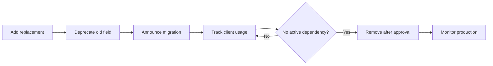

# Deprecating Fields

GraphQL APIs typically serve multiple clients upgrading at different speeds. When a field is no longer appropriate, gets renamed, or is replaced by a better structure, removing the old field immediately can break live queries. GraphQL provides the built-in `@deprecated` directive to manage the transition period.

`@deprecated` marks part of a schema as discouraged for future use and publishes the reason via `reason`. A deprecated element still exists, can still be queried, and must still return valid data during the transition window. Clients can switch to the new field on their own schedule while the server maintains backward compatibility.

In Spring for GraphQL, the SDL schema is where deprecations are declared. Java resolvers continue serving the old field; `@SchemaMapping` or `@QueryMapping` does not automatically mark a field as deprecated. Removing a field safely requires combining schema metadata, migration guides, usage telemetry, breaking change checks, and an announced removal milestone.

## 1. What problem does deprecation solve?

Suppose a library API previously exposed `User.name`:

```graphql
type User {
  id: ID!
  name: String!
}
```

Client A is using:

```graphql
query CurrentUser {
  me {
    id
    name
  }
}
```

Over time, the product needs to split the display name into `firstName` and `lastName`. If `name` is removed as soon as the two new fields are added, Client A's query becomes invalid and GraphQL validation will reject the request.

A safer change:

```graphql
type User {
  id: ID!
  name: String! @deprecated(reason: "Use firstName and lastName instead.")
  firstName: String!
  lastName: String!
}
```

New clients can use the two new fields. Older clients keep querying `name` and receive the same result as before. The schema communicates that this field is being replaced, giving the development team time to monitor usage and support client migrations.

### Deprecate does not mean remove

| State | Present in schema? | Old queries still valid? | Resolver still executes? |
| --- | --- | --- | --- |
| Normal field | Yes | Yes | Yes |
| Deprecated field | Yes | Yes | Yes |
| Removed field | No | No | No |

`@deprecated` is metadata for the schema, tooling, and client developers. It does not automatically:

- Remove the field from the schema.
- Block clients from sending the field in operations.
- Skip the resolver or return null instead of data.
- Generate runtime logs, metrics, or warnings.
- Schedule automatic field removal.
- Rewrite old queries to use the new field.

Those responsibilities belong to the server, schema governance tooling, and coordination processes with clients.

## 2. The @deprecated directive in GraphQL SDL

`@deprecated` is a built-in GraphQL schema directive. In implementations supporting SDL, you do not need to declare this directive yourself in the schema.

Directive definition in the current GraphQL Specification:

```graphql
directive @deprecated(
  reason: String! = "No longer supported"
) on FIELD_DEFINITION
  | ARGUMENT_DEFINITION
  | INPUT_FIELD_DEFINITION
  | ENUM_VALUE
  | DIRECTIVE_DEFINITION
```

`reason` explains why the element is no longer recommended and what clients should use instead. The reason content is Markdown-formatted, so it can include field names, links, or short explanations.

If `reason` is omitted, the default value is `No longer supported`. In production APIs, write a specific reason and replacement rather than leaving a generic message.

### Marking a field

```graphql
type User {
  id: ID!
  displayName: String!
  name: String! @deprecated(reason: "Use displayName instead.")
}
```

The `name` field remains a valid field on type `User`. Clients can continue querying it:

```graphql
query {
  user(id: "user-42") {
    id
    name
  }
}
```

Schema introspection will report that `name` has `isDeprecated = true` and provide `deprecationReason`.

### Writing useful reasons

A good reason answers at least two questions:

1. Which element should clients switch to?
2. Why is the old element no longer recommended?

Example:

```graphql
type Product {
  price: String @deprecated(
    reason: "Use priceMinorUnits and priceCurrency. The old field combines amount and currency in a string that clients must parse."
  )
  priceMinorUnits: Int!
  priceCurrency: Currency!
}
```

Weak reason:

```graphql
price: String @deprecated(reason: "Old field.")
```

A weak reason gives no migration path. Client developers still have to hunt through external documentation to find out which field replaces it.

### Do not turn reason into the entire timeline tracker

You can include an expected removal milestone in `reason`, though schedules can shift. Manage announcement dates, migration deadlines, and removal dates in a changelog or deprecation registry with an assigned owner. If a date in SDL becomes stale, that information erodes client trust in the schema.

## 3. Places where @deprecated can be applied

The current GraphQL Specification allows `@deprecated` in the following locations:

| Location | Example | Meaning |
| --- | --- | --- |
| Field definition | `User.name` | Output field should no longer be used |
| Argument definition | `Query.users(oldFilter:)` | Old argument is replaced by another argument |
| Input field definition | `UserFilter.legacyStatus` | Field in an input object should no longer be sent |
| Enum value | `SortOrder.OLDEST_FIRST` | Old enum value has been replaced |
| Directive definition | Legacy custom directive | Directive is no longer recommended |

Locations beyond fields and enum values depend on the GraphQL Specification and GraphQL Java version your application uses. When upgrading GraphQL Java, verify parser/schema validation and actual introspection before relying on newer locations.

### Deprecating an argument

```graphql
type Query {
  users(
    first: Int = 20
    oldLimit: Int @deprecated(reason: "Use first instead.")
  ): [User!]!
}
```

During the transition window, the resolver must handle both the new and old arguments. If a client sends both, define an explicit rule—for example, prioritizing the new argument and recording that the client is still sending the old argument.

Do not let two arguments control the same behavior while producing different outcomes depending on read order or null values. Define clear semantics for omitted, null, and both-provided cases.

### Deprecating an input object field

```graphql
input UserFilter {
  status: UserStatus
  legacyName: String @deprecated(
    reason: "Use nameContains for case-insensitive partial matching."
  )
  nameContains: String
}
```

Clients can gradually transition from `legacyName` to `nameContains`. The server still needs to support the old input during migration and define how to handle requests that include both.

### Deprecating an enum value

```graphql
enum OrderSort {
  CREATED_AT_DESC
  CREATED_AT_ASC
  OLD_NEWEST @deprecated(
    reason: "Use CREATED_AT_DESC instead."
  )
}
```

A deprecated enum value remains a declared enum value. Older clients can continue sending or receiving that value during the transition period. The server should maintain equivalent behavioral mapping until removal.

### Do not deprecate a required argument/input field directly

Under the current GraphQL Specification, a required argument or input object field (Non-Null without a default value) cannot be marked deprecated. You must first make it optional by changing it to nullable or adding a default value:

```graphql
input SearchInput {
  # Invalid if still String! without a default
  # oldQuery: String! @deprecated(reason: "Use query.")

  oldQuery: String @deprecated(reason: "Use query.")
  query: String
}
```

That is a separate contract change requiring compatibility evaluation. Do not convert a required input to optional merely to attach the directive without verifying validation logic and existing behavior.

## 4. Java @Deprecated and GraphQL @deprecated are different

Java has the `java.lang.Deprecated` annotation:

```java
@Deprecated
public String getName() {
    return displayName;
}
```

GraphQL has the `@deprecated` schema directive:

```graphql
type User {
  name: String @deprecated(reason: "Use displayName.")
}
```

These two mechanisms serve different contracts:

| Mechanism | Applies to | Audience |
| --- | --- | --- |
| Java `@Deprecated` | Classes, methods, constructors, fields in Java source | Developers compiling Java code |
| GraphQL `@deprecated` | Elements in the GraphQL schema | GraphQL clients, schema registries, IDEs, GraphiQL, and introspection tooling |

Marking a Java method deprecated does not automatically give the GraphQL schema `isDeprecated = true`. Likewise, adding `@deprecated` to SDL does not automatically make the Java compiler warn when server code calls that method.

If both the Java API and the GraphQL API need deprecation, manage the two annotations separately and inspect the built schema output.

## 5. Discovering deprecated fields via introspection

GraphQL introspection exposes two properties:

- `isDeprecated: Boolean!` indicates whether the element is deprecated.
- `deprecationReason: String` explains why.

Introspection collections such as `__Type.fields` and `__Type.enumValues` accept an `includeDeprecated` argument. Its default value is `false`, so standard introspection queries may omit deprecated fields.

### Fetching both normal and deprecated fields

```graphql
query UserFields {
  __type(name: "User") {
    name
    fields(includeDeprecated: true) {
      name
      isDeprecated
      deprecationReason
    }
  }
}
```

Illustrative response:

```json
{
  "data": {
    "__type": {
      "name": "User",
      "fields": [
        {
          "name": "id",
          "isDeprecated": false,
          "deprecationReason": null
        },
        {
          "name": "displayName",
          "isDeprecated": false,
          "deprecationReason": null
        },
        {
          "name": "name",
          "isDeprecated": true,
          "deprecationReason": "Use displayName instead."
        }
      ]
    }
  }
}
```

### Fetching deprecated arguments

```graphql
query UserQueryArguments {
  __type(name: "Query") {
    fields {
      name
      args(includeDeprecated: true) {
        name
        isDeprecated
        deprecationReason
      }
    }
  }
}
```

### Fetching deprecated enum values

```graphql
query OrderSortValues {
  __type(name: "OrderSort") {
    enumValues(includeDeprecated: true) {
      name
      isDeprecated
      deprecationReason
    }
  }
}
```

### Fetching deprecated input object fields

```graphql
query UserFilterFields {
  __type(name: "UserFilter") {
    inputFields(includeDeprecated: true) {
      name
      isDeprecated
      deprecationReason
    }
  }
}
```

Introspection is useful for IDEs, code generators, schema documentation, and governance scripts. However, introspection may be restricted or disabled in production per security policy. In that case, clients need published schema artifacts or schema documentation generated in CI.

`@deprecated` is a schema directive, not an executable directive. Do not place it on field selections in operations to ask the server to skip fields or emit warnings; deprecation is declared on schema definitions.

## 6. Spring for GraphQL: declaring SDL and keeping the legacy resolver

Spring for GraphQL reads SDL to build the GraphQL schema. Declare deprecations in the schema file:

`src/main/resources/graphql/schema.graphqls`

```graphql
type Query {
  user(id: ID!): User
}

type User {
  id: ID!
  displayName: String!
  name: String! @deprecated(
    reason: "Use displayName instead. The name field will be removed after client migration."
  )
}
```

The resolver can serve both the new field and the old field:

```java
@Controller
public class UserController {

    private final DeprecatedUsageRecorder usageRecorder;

    public UserController(DeprecatedUsageRecorder usageRecorder) {
        this.usageRecorder = usageRecorder;
    }

    @SchemaMapping(typeName = "User", field = "displayName")
    public String displayName(User user) {
        return user.displayName();
    }

    @SchemaMapping(typeName = "User", field = "name")
    public String legacyName(
            User user,
            DataFetchingEnvironment environment) {

        String clientId = environment.getGraphQlContext().get("clientId");
        usageRecorder.record("User.name", clientId);

        return user.displayName();
    }
}
```

In this example, the `name` field still returns the same value as `displayName`. The legacy resolver records usage before returning the result so the API team knows which clients still depend on this field.

`clientId` should be placed into `GraphQLContext` from a trusted server-side source, such as an authenticated client identity verified in an interceptor or security layer. Never treat an arbitrary client-supplied header as a verified identity.

Even if the model already has a `name` property that Spring GraphQL could resolve with the default property data fetcher, adding an explicit `@SchemaMapping` for the deprecated field makes telemetry and behavior clear.

### Legacy resolvers should delegate to shared business logic

Do not maintain two separate logic branches for the new and old fields if they have the same meaning:

```java
@Service
public class UserPresentationService {

    public String displayName(User user) {
        return user.firstName() + " " + user.lastName();
    }
}
```

```java
@Controller
public class UserController {

    private final UserPresentationService presentationService;

    public UserController(UserPresentationService presentationService) {
        this.presentationService = presentationService;
    }

    @SchemaMapping(typeName = "User", field = "displayName")
    public String displayName(User user) {
        return presentationService.displayName(user);
    }

    @SchemaMapping(typeName = "User", field = "name")
    public String deprecatedName(User user) {
        return presentationService.displayName(user);
    }
}
```

Both resolvers use the same business rule. This reduces the risk of the old and new fields diverging in their returned results during the transition window.

### Testing that the legacy field still works

Deprecation must not alter responses for older clients. You can verify this with `GraphQlTester`:

```java
GraphQlTester.Response response = graphQlTester.document("""
        query {
            user(id: "u-1") {
                name
                displayName
            }
        }
        """)
        .execute();

response.path("user.name")
        .entity(String.class)
        .isEqualTo("Ada Lovelace");

response.path("user.displayName")
        .entity(String.class)
        .isEqualTo("Ada Lovelace");
```

In addition to checking the response, the test can verify that `DeprecatedUsageRecorder` recorded the schema coordinate `User.name`. This test proves the legacy field both remains compatible and has telemetry for managing migration.

## 7. Tracking usage of deprecated fields

Do not remove a field merely because it has been marked deprecated for a while. You need to know which clients are still calling it and how often it is used.

Data worth collecting:

| Data | Purpose |
| --- | --- |
| Schema coordinate, e.g., `User.name` | Pinpoints the exact deprecated field |
| Client/application ID | Identifies consumers needing migration |
| Operation name | Finds queries or mutations still using the field |
| Timestamp | Observes usage trends and time windows |
| Environment | Distinguishes dev, staging, and production |
| Request count | Estimates degree of dependency |

### Schema coordinate and response path are different

The schema coordinate `User.name` is the stable identifier of the field in the schema. Response paths can contain aliases and list indices:

```graphql
query {
  primary: user(id: "u-1") {
    name
  }
  users {
    name
  }
}
```

A usage record might contain:

```text
schemaCoordinate = User.name
operationName = CurrentUser
responsePath = primary.name
clientId = mobile-ios
```

Use schema coordinates to aggregate field usage; use response paths when investigating a specific location inside an operation.

### Use counters with bounded cardinality

A suitable metric:

```text
graphql.deprecated.field.usage
  schema_coordinate = User.name
```

Do not put unbounded raw user IDs, request IDs, session IDs, or operation hashes into metric labels. Those values cause rapid cardinality explosion. If you need per-client breakdowns, emit controlled structured logs or trace events; keep metric tags to a finite set of values.

### Recording usage in resolvers

For a few specific fields, recording directly in the resolver is straightforward:

```java
@SchemaMapping(typeName = "User", field = "name")
public String deprecatedName(
        User user,
        DataFetchingEnvironment environment) {

    String clientId = environment.getGraphQlContext().get("clientId");
    usageRecorder.record("User.name", clientId);

    return user.displayName();
}
```

With many deprecated fields, avoid duplicating telemetry code across every resolver. You can build a wrapper mechanism or GraphQL Java instrumentation to observe `DataFetcher` executions by schema coordinate. Whichever approach you choose, ensure instrumentation does not alter return values, error behavior, or async completion.

### Do not count requests alone

A single request can query the same field multiple times via aliases or across multiple nodes. Clearly define what your metric counts:

- Number of requests using the field at least once.
- Number of times the field's `DataFetcher` is invoked.
- Number of unique clients still using the field.
- Number of distinct operation names containing that field.

These numbers answer different questions. For deciding removal, the number of dependent clients and operations is usually more important than total invocation counts.

## 8. Safe deprecation workflow

A manageable lifecycle consists of five stages:



### Stage 1: Add the replacement

Before marking the old field, the new field must exist, work, and be tested:

- The new field has complete data.
- Type, nullability, and semantics are clear.
- Authorization is identical to or stricter than the old field.
- Pagination, sorting, filtering, and error behavior are defined.
- Documentation includes example queries using the new field.

Do not mark a field deprecated if no replacement exists or if the replacement does not yet support the business case clients rely on.

### Stage 2: Mark the old field

Add `@deprecated(reason: ...)` to the SDL. The reason should clearly state the replacement and migration path.

Keep the legacy resolver running and returning compatible data. If needed, have the legacy resolver delegate to a shared service or mapper.

### Stage 3: Announce the deprecation

Notify client owners:

- Which schema coordinate is deprecated.
- The reason and replacement field/argument.
- Corresponding old and new queries.
- Differences in behavior or response shape.
- Announcement date, migration deadline, and planned removal date.
- Contact channel if issues arise.

Include the change in the schema changelog and API documentation. Clients may see warnings in their IDE, but do not assume every client uses introspection tooling.

### Stage 4: Monitor migration

Track usage per client and operation. Check across:

- Supported web/mobile applications.
- Older application versions still actively used.
- Batch jobs, integrations, and service-to-service clients.
- Infrequently running consumers that are business-critical.
- Real production environments, not just staging.

A field having zero usage for a single day does not prove all clients have migrated. Choose an observation window long enough to cover consumer execution cycles.

### Stage 5: Controlled removal

Remove only once your organization's migration policy is satisfied:

- No supported production clients depend on the field.
- Client owners confirm migration or the support window has expired.
- Schema diff and breaking change review are approved.
- Changelog explicitly calls out the removed field.
- A plan is in place to monitor validation errors after release.
- A rollback or field-restoration plan exists if an overlooked consumer is discovered.

After removal, queries still referencing the field will fail at the validation step. The legacy Java resolver can also be removed once no mappings require it.

## 9. Migration example from name to displayName

### Before migration

```graphql
type User {
  id: ID!
  name: String!
}
```

```graphql
query UserCard {
  user(id: "u-1") {
    id
    name
  }
}
```

### Release A: add the new field

```graphql
type User {
  id: ID!
  name: String!
  displayName: String!
}
```

Older clients still work. New clients can start using `displayName`.

### Release B: deprecate the old field

```graphql
type User {
  id: ID!
  name: String! @deprecated(
    reason: "Use displayName instead. This field will be removed after client migration."
  )
  displayName: String!
}
```

The legacy resolver continues returning the same content:

```java
@SchemaMapping(typeName = "User", field = "name")
public String name(User user) {
    return user.displayName();
}
```

### Client migration

New query:

```graphql
query UserCard {
  user(id: "u-1") {
    id
    displayName
  }
}
```

Clients run tests, release updated versions, and verify responses. The server records `User.name` usage to identify any consumers that have not yet migrated.

### Release C: remove the field

Once migration criteria are met:

```graphql
type User {
  id: ID!
  displayName: String!
}
```

This is a breaking change for any client still querying `name`. The fact that the field was previously deprecated does not make its removal non-breaking.

## 10. Schema review and CI

Deprecation should be reviewed as an API lifecycle change, not merely an SDL directive.

In schema pull requests, reviewers should verify:

- Does the replacement already exist with equivalent behavior?
- Does the reason clearly specify the replacement?
- Does the legacy resolver still run and have test coverage?
- Can clients send both old and new arguments/inputs?
- Can telemetry identify clients still using the field?
- Have the changelog and migration guide been updated?
- Are an owner and target review/removal date assigned?

### Comparing schemas

Schema diffs help detect removals or type changes that cause breaking changes:

```text
Production schema
        |
        v
Proposed schema
        |
        v
Schema diff
        |
        +--> Safe changes
        |
        +--> Dangerous changes
        |
        +--> Breaking changes
                 |
                 v
          Owner approval
```

For example, CI can:

1. Build the schema from the branch's SDL.
2. Compare against the production schema or previous release schema.
3. Fail on unapproved breaking changes.
4. Flag dangerous changes for reviewer evaluation.
5. Archive schema artifacts and changelogs.

The deprecation directive itself does not usually invalidate old queries; removing the field is the breaking change. CI should still detect removal of deprecated fields when migration has not been approved.

### Schema registries and usage analytics

With multiple teams or many clients, a schema registry can store schema history, diff versions, and analyze operation usage. In smaller systems, storing SDL in Git and running schema diffs in CI works well.

Using a specific registry service is not mandatory. What matters is having a reliable source of truth for the production schema, change history, and usage data to decide when removal is safe.

## 11. Common pitfalls

| Symptom | Cause | How to address |
| --- | --- | --- |
| Clients can still query a deprecated field | This is expected deprecation behavior | Keep the resolver working until removal |
| IDE shows no warning | Tooling does not read introspection or uses a stale schema artifact | Refresh the schema and check `isDeprecated` |
| Introspection hides deprecated fields | `includeDeprecated` defaults to false | Pass `includeDeprecated: true` |
| Old field returns different data from new field | Two resolvers contain separate logic | Delegate to a shared service/mapper |
| Unknown which clients still use the field | Added the directive without telemetry | Record usage by schema coordinate and client |
| Usage metrics explode in cardinality | Unbounded user/request/operation IDs in labels | Use bounded metric tags; keep details in logs/traces |
| Field removal breaks production | Missed legacy clients, scheduled jobs, or integrations | Observe long enough and confirm with client owners |
| `@deprecated` rejected by parser on input fields | GraphQL Java/runtime does not yet support that spec location | Check runtime version and directive support |
| Deprecated required input rejected by schema validation | Required arguments/input fields cannot be deprecated directly | Make optional in a controlled step first |
| Only annotated Java method with `@Deprecated` | Java annotation does not replace the GraphQL schema directive | Mark `@deprecated` in SDL |
| Reason only says "old" | Missing replacement and migration guidance | Write a specific reason |
| New field behaves differently from old field | Migration changed semantics simultaneously | Split migration into steps and document differences |
| Schema diff allows removal, but clients still use it | Schema diff lacks full production usage visibility | Combine schema checks with telemetry |

## 12. Field deprecation checklist

- [ ] Replacement exists in the schema and works.
- [ ] Replacement preserves semantics or clearly documents new behavior.
- [ ] Old field is marked with `@deprecated(reason: ...)`.
- [ ] Reason clearly states the replacement field and rationale.
- [ ] Legacy resolver still works.
- [ ] New and old fields share business logic where possible.
- [ ] Authorization and data visibility of both fields have been verified.
- [ ] Introspection returns accurate `isDeprecated` and `deprecationReason`.
- [ ] Client owners have received the migration guide and timeline.
- [ ] Runtime usage is measured by schema coordinate.
- [ ] Metric labels contain no high-cardinality values.
- [ ] Changelog and deprecation registry are updated.
- [ ] CI runs schema diffs and breaking change reviews.
- [ ] Observation window is long enough to catch infrequent clients.
- [ ] Removal occurs only after formal approval.
- [ ] Production is monitored after removal.

## 13. Hands-on exercise

Implement deprecation for `User.name` in Spring for GraphQL:

1. Create SDL with `User.name` and a resolver returning the display name.
2. Add `User.displayName` with equivalent behavior.
3. Mark `User.name` with `@deprecated` and write a clear reason.
4. Use `@SchemaMapping` to serve both fields.
5. Add telemetry recording each time `User.name` is resolved.
6. Pass the verified client identity into `GraphQLContext`.
7. Write an introspection query using `fields(includeDeprecated: true)`.
8. Verify `isDeprecated` and `deprecationReason` in the response.
9. Write a `GraphQlTester` test proving the legacy query still runs.
10. Write a new query using only `displayName`.
11. Generate a usage report grouped by client and operation name.
12. Simulate a schema diff when removing `name` and explain why it is a breaking change.
13. Plan the announcement, migration deadline, and removal criteria.

After this exercise, you should be able to explain the difference between deprecating and removing, how clients discover deprecations through introspection, and why schema metadata must be combined with usage telemetry before removing a field.

## 14. References

- [GraphQL Specification — @deprecated](https://spec.graphql.org/September2026/#sec--deprecated)
- [GraphQL Specification — Schema Introspection](https://spec.graphql.org/September2026/#sec-Schema-Introspection)
- [GraphQL.org — Schema Change Management](https://www.graphql.org/learn/governance-versioning/)
- [GraphQL.org — Tooling and Automation for Governance](https://www.graphql.org/learn/governance-tooling/)
- [GraphQL Java — SDL Directives](https://graphql-java.com/documentation/directives/)
- [Spring for GraphQL — Annotated Controllers](https://docs.spring.io/spring-graphql/reference/controllers.html)
- [Spring for GraphQL — Request Execution](https://docs.spring.io/spring-graphql/reference/request-execution.html)

Deprecation is a compatibility phase in schema evolution. Only remove a field once the replacement is adopted, dependent clients have been addressed, and the schema owner approves the breaking change.
