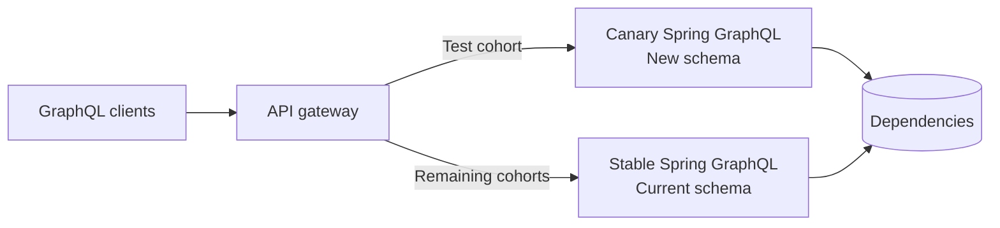

# Canary schema changes

## Objectives

A GraphQL change can break clients even when the server application starts up normally. As soon as a client queries a field that does not yet exist on an older instance, GraphQL rejects the operation at the validation step. Therefore, schema releases must be coordinated with resolver versions, request routing, and when clients begin querying new fields.

After this lesson, you will be able to:

- Distinguish compatible schema changes from changes that risk breaking clients.
- Design a canary workflow to test a new schema on a subset of requests or clients.
- Implement new fields in Spring for GraphQL with `@SchemaMapping` or `@BatchMapping`.
- Monitor GraphQL errors, latency, and field usage while ramping traffic.
- Plan rollbacks, deprecation, and legacy field removal following an expand-contract process.

## 1. What is a canary schema change?

A canary schema change is a phased rollout of a GraphQL change. Before serving all traffic, the development team deploys the server version carrying the new schema to a subset of instances or a small group of clients. That cohort receives test traffic, while remaining requests continue running on the stable version. Once observed metrics and behavior meet defined criteria, traffic scope is gradually increased.

GraphQL exposes a shared endpoint, yet each operation can select different fields. The server must validate operations against the schema of the instance receiving the request. For example, the new schema adds `availability`, while the old schema lacks that field. A query requesting `availability` will succeed on a new instance and fail with a validation error on an old instance. Randomly distributing requests across instances via a load balancer can therefore cause intermittent errors if clients already request the new field while traffic still hits both versions.

A canary rollout must solve two problems simultaneously:

1. **Controlled exposure:** only the selected client group or requests use the new schema during the trial phase.
2. **Consistency:** every request from the test cohort—including introspection requests or follow-up steps in a business flow—must see the same corresponding schema contract.

Spring for GraphQL provides mechanisms for declaring SDL schemas, mapping fields to Java, and executing GraphQL. Canary traffic splitting is typically handled by an ingress, API gateway, service mesh, or deployment platform. `@SchemaMapping` and `@BatchMapping` themselves do not provide weighted routing or canary release orchestration.

## 2. Understanding schema compatibility boundaries

GraphQL lets clients pick the exact fields to read. Thus, changes affect the contract visible to clients even when the database structure does not change. Before releasing, classify changes and consider clients with code generated from the schema.

| Change | Typical impact | How to handle |
|---|---|---|
| Adding a new output field | Usually compatible with older clients because they do not request it | Can release additively; verify resolvers and access permissions |
| Adding an optional input field | Usually compatible if older clients do not need to send the new field | Make it nullable or provide an appropriate default |
| Adding an optional argument to a field | Usually compatible if clients are not forced to pass the argument | Provide a default or handle omitted values |
| Removing or renaming a field | Clients selecting the old field fail validation | Deprecate, migrate clients, then remove later |
| Changing an output from nullable to non-null | May alter how clients handle null and null propagation | Treat as risky; verify data and clients |
| Adding a required input field or required argument | Older clients may become invalid | Avoid direct changes; use a multi-step migration |
| Changing a field's type or enum | May break generated code or client handling logic | Evaluate as a breaking change |
| Adding an output enum value | New schema is valid, yet clients with exhaustive switches may not recognize the new value | Verify how clients handle unknown values |

"Compatible" here does not merely mean the GraphQL parser accepts the schema. A client may compile cleanly yet still fail when receiving a new enum value, altered data semantics, or a significantly slower field. Evaluate technical contracts, business behavior, and performance together.

### The additive-first rule

When replacing a field, add the new field first, migrate clients to the new field, and only then remove the old field. For example, instead of immediately renaming `name` to `displayName`, keep both fields for a transition period:

```graphql
type Product {
    id: ID!
    name: String!
    displayName: String
}
```

Once clients have migrated and telemetry shows `name` is no longer used, mark the old field as deprecated:

```graphql
type Product {
    id: ID!
    name: String! @deprecated(reason: "Use displayName instead")
    displayName: String
}
```

The `@deprecated` directive is part of GraphQL SDL. It signals the intent to retire support to tooling and developers, but does not block old queries or delete the field automatically. The server must keep the resolver active until deprecation policy allows removal.

## 3. Example: adding an availability field to Product

Suppose the API currently has the schema:

```graphql
type Query {
    product(id: ID!): Product
}

type Product {
    id: ID!
    name: String!
}
```

A new requirement allows clients to view stock availability. We add `availability` as nullable in the initial phase:

```graphql
type Query {
    product(id: ID!): Product
}

type Product {
    id: ID!
    name: String!
    availability: Availability
}

type Availability {
    status: AvailabilityStatus!
    estimatedRestockAt: String
}

enum AvailabilityStatus {
    IN_STOCK
    LOW_STOCK
    OUT_OF_STOCK
    UNKNOWN
}
```

Making `availability` nullable allows the server to return `null` when inventory data is not yet available or yields no result. This does not mean errors may be swallowed arbitrarily: distinguish "no data" from service access failures or system errors, and record those failures in observability. If the business guarantees an `Availability` object is always present, non-null can be considered once data and resolvers stabilize; tightening nullability must be evaluated as a separate contract change.

New clients can query the field:

```graphql
query ProductAvailability($id: ID!) {
    product(id: $id) {
        id
        name
        availability {
            status
            estimatedRestockAt
        }
    }
}
```

Example response when data exists:

```json
{
  "data": {
    "product": {
      "id": "p-42",
      "name": "Mechanical Keyboard",
      "availability": {
        "status": "IN_STOCK",
        "estimatedRestockAt": null
      }
    }
  }
}
```

Legacy clients still send queries selecting only `id` and `name`, so they do not depend on the new field. This property makes additive changes easier to roll out, provided every instance serving the new query has the corresponding schema and resolver.

## 4. Field mapping in Spring for GraphQL

In Spring for GraphQL, SDL defines the contract while controllers supply data for each field. For a simple resolver, you can use `@SchemaMapping`:

```java
@Controller
public class ProductAvailabilityController {

    private final InventoryService inventoryService;

    public ProductAvailabilityController(InventoryService inventoryService) {
        this.inventoryService = inventoryService;
    }

    @SchemaMapping(typeName = "Product", field = "availability")
    public Availability availability(Product product) {
        return inventoryService.findAvailability(product.id()).orElse(null);
    }
}
```

Spring for GraphQL binds this method to `Product.availability`. The `Product` argument passed in is the parent field's source object. If the service has no stock information, the example returns `null`, matching the nullable `availability: Availability` declaration in SDL.

If a query returns a list of many products, calling the service once per product can introduce an N+1 problem. Use `@BatchMapping` to group source objects into a batch lookup:

```java
@Controller
public class ProductAvailabilityController {

    private final InventoryService inventoryService;

    public ProductAvailabilityController(InventoryService inventoryService) {
        this.inventoryService = inventoryService;
    }

    @BatchMapping(typeName = "Product", field = "availability")
    public Map<Product, Availability> availability(List<Product> products) {
        List<String> productIds = products.stream()
                .map(Product::id)
                .toList();

        Map<String, Availability> availabilityById =
                inventoryService.findAvailabilityByProductIds(productIds);

        Map<Product, Availability> result = new LinkedHashMap<>();
        for (Product product : products) {
            Availability availability = availabilityById.get(product.id());
            if (availability != null) {
                result.put(product, availability);
            }
        }
        return result;
    }
}
```

The example assumes `Product` has an `id()` accessor and `InventoryService` returns a map keyed by product ID. Required imports include `java.util.List`, `java.util.Map`, `java.util.LinkedHashMap`, and Spring for GraphQL annotations. `@BatchMapping` registers batch loading for the specified field; map keys are source objects corresponding to values. When a product has no entry, its field resolves to `null`, matching the example schema.

In a canary release, the schema and resolver must ship together. If SDL declares the new field yet the resolver is missing or accesses an unready dependency, queries pass validation but fail during execution. If the resolver is deployed yet the instance's schema lacks the field, queries are rejected at validation. Verify both aspects inside the canary artifact.

## 5. Choosing a canary routing strategy

Because each Spring GraphQL instance typically builds its schema from application configuration at startup, a rolling deployment can temporarily create two coexisting schemas in the cluster. The routing strategy must align with how clients use new fields.

### Strategy A: deploy the additive schema across all servers first

This is usually the simplest and safest approach for backward-compatible new fields:

1. Deploy the server with the new SDL and resolver to all instances.
2. Wait until no old instances receive traffic; verify health and schemas across instances.
3. Only then release clients that start querying the new field.
4. If feature experimentation is needed, use a business-layer or client feature flag so only a subset of users interacts with the new data.

With this approach, every instance understands the new field before any client sends a query requesting it. You can canary the server deployment itself by gradually increasing new instances, yet during the mixed-version window clients must not request fields that exist only on the newer version.

### Strategy B: separate canary server pool and pin a client cohort

When you need to test a new schema or resolver with a group of users, deploy a dedicated canary pool. The gateway routes the test client cohort to that pool and remaining clients to the stable pool.



The selected client cohort must be routed consistently. You can use cookies, client IDs, tenant IDs, or a header authenticated and controlled by the gateway. Do not trust an arbitrary client-supplied header if that header lets users switch themselves onto an unauthorized pool.

Ensure both queries and introspection for a cohort go to the same pool. If tooling fetches the schema from the stable pool while queries go to the canary pool, clients may generate operations against a different contract than the receiving server. For persisted queries, registries, or schema caches, tag environment/pool and schema version explicitly to avoid mismatched artifacts.

### Strategy C: weighted per-request routing

The gateway can route a small percentage of requests to the canary. This works well for testing the new server's stability with operations compatible across both schemas. However, if clients already send a new field and requests can land on the stable pool, validation errors will appear proportionally to traffic weight. Enable queries with the new field only when one of the following holds:

- Every instance that can receive the query already supports the new field; or
- The request belongs to a client cohort pinned to the pool carrying the new schema.

Do not use weighted routing percentage as proof that a new schema is safe for all clients. Canary percentage only describes traffic distribution; compatibility still depends on operation contents and each destination's schema.

## 6. Phased release workflow

A practical workflow can be divided into the following control gates.

### Phase 1 — Prepare the change

- Save a snapshot of the current schema and generate the candidate schema from the exact commit being released.
- Run a schema diff to spot removed/renamed fields or changes to nullability, arguments, or input types.
- Check operations actively used by clients, especially persisted queries and queries from mobile apps with long update cycles.
- Identify client owners, test user cohorts, routing rules, halt thresholds, and rollback owners.
- Verify database migrations follow expand-contract. The new schema must not depend on columns or tables that exist only after a migration not yet applied across all environments.

Automated schema diffs are valuable but do not replace business reviews. A change may not be flagged as SDL-breaking while still altering field semantics, access permissions, or performance characteristics.

### Phase 2 — Deploy the canary server

Deploy the exact artifact containing the SDL, controllers, services, and required configuration. Admit instances to the canary pool after health checks pass. Run smoke tests directly against this pool, including:

- Legacy queries not requesting the new field.
- Test queries requesting the new field.
- Missing-data scenarios and dependency-failure scenarios.
- Authorized and unauthorized user access checks.
- List queries large enough to verify batch loading and resource limits.

Do not treat HTTP 200 as the sole criterion for success. GraphQL routinely returns HTTP success responses containing an `errors` array; inspect `data`, `errors`, extension error codes if present, and returned data values.

### Phase 3 — Send trial traffic

Choose a small cohort you can observe and contact if errors occur. If clients start querying the new field, pin that cohort's requests to the canary pool. Start with internal or synthetic traffic, then expand to a controlled group of real users.

Compare canary against stable over the same time window and across the same operation types. Monitor at least:

- Rates of GraphQL errors, validation errors, and resolver exceptions.
- p50, p95, and p99 latencies for requests and the new resolver.
- Timeouts, connection errors, and error rates of the inventory dependency.
- Database query counts, batch sizes, and signs of N+1 queries.
- Rates of `null` returns, `UNKNOWN` values, and business accuracy of stock data.
- Rates of requests rejected due to authentication or authorization.

Set thresholds before starting. For example, if error rate or p95 exceeds thresholds over consecutive measurement windows, halt traffic increases and switch to investigation. Specific thresholds must be grounded in your system's baseline and SLOs; do not copy a fixed number across every service.

### Phase 4 — Expand scope and release clients

Increase traffic only when the canary is stable and dependencies have sufficient capacity. You can ramp in small steps such as 1%, 5%, 10%, 25%, 50%, and 100%, choosing step sizes and observation windows based on real traffic. At each step, re-verify error rates, latency, data quality, and system load.

If the server has rolled out to all instances with an additive schema, new clients can begin using the field after confirming no old instances remain. If the canary server remains separate, keep the client cohort pinned to that pool until rollout completes or a clear pool-merging plan is executed.

### Phase 5 — Deprecate and remove the old field

Once clients have moved to the new field, mark the old field with `@deprecated` and announce a support sunset date. Track usage by field and by known clients/operations. Remove the field only after:

- No supported clients call the old field over the agreed observation window.
- Slow-releasing clients, scheduled jobs, and partner integrations have been checked.
- Schema diff confirms the removal occurs in an announced breaking-change release.
- A recovery plan or compatibility patch exists in case an overlooked consumer surfaces.

Do not conclude a field is unused from just a few days of low traffic. Cover full business cycles, batch jobs, peak seasons, and all still-supported app versions.

## 7. Testing schema and resolvers

Canary testing must verify schema and behavior together. A test using `GraphQlTester` can verify operations using the new field:

```java
@SpringBootTest
class ProductAvailabilityGraphQlTests {

    @Autowired
    GraphQlTester graphQlTester;

    @Test
    void exposesAvailabilityForProduct() {
        graphQlTester.document("""
                query ProductAvailability {
                    product(id: "p-42") {
                        id
                        availability {
                            status
                        }
                    }
                }
                """)
                .execute()
                .path("product.availability.status")
                .entity(String.class)
                .isEqualTo("IN_STOCK");
    }
}
```

This example assumes the test context has data or fixtures so `product(id: "p-42")` returns a product with inventory. In real tests, configure service mocks or a test database following your project's patterns and also test the case where availability is absent.

Add the following test layers:

1. **Schema validation:** the candidate schema initializes and has the expected fields, types, and nullability.
2. **Compatibility:** legacy operations still run on the new schema; new operations go only to pools supporting the new schema.
3. **Resolvers:** test normal data, missing data, dependency errors, and null handling.
4. **Security:** test sensitive fields with principals holding and lacking authority; verify errors do not leak data through other fields.
5. **Performance:** list queries confirm batch loading, element limits, and response times.
6. **Deployment smoke tests:** call the canary endpoint after deployment to confirm the expected artifact and configuration are running.

For clients using persisted queries, include the supported operation set in contract tests. Any operation failing to validate on the candidate schema must be investigated before rollout, even if it currently sees little traffic.

## 8. Observing usage and errors at the field level

A GraphQL request can succeed at the HTTP layer while one or more fields fail. Thus, dashboards must separate request-level success from field-level outcomes. With Spring for GraphQL, leverage the observability and Micrometer instrumentation configured in your application to record operations, data fetchers, durations, and errors. Verify the actual conventions/tags of your Spring GraphQL version and metrics backend before building dashboards.

To decide whether an old field can be removed, collect sufficiently granular usage statistics. Capture operation type, field name, normalized client or tenant tier, and processing outcome. Avoid placing full queries, user IDs, tokens, variables containing personal data, or very high-cardinality values into metric labels. When investigating specific queries, use access-controlled logs with appropriate retention and redaction policies.

Signals to correlate:

| Signal | What to detect |
|---|---|
| Validation error | Client sent a field or argument missing from the receiving pool's schema |
| Resolver error | New code failed, dependency failed, or data violated assumptions |
| Null rate | Nullable field returns `null` more often than baseline or unexpectedly |
| Per-field latency | New resolver slows down operations or calls dependencies too often |
| Batch size and DB calls | Batching is not working as expected or N+1 queries persist |
| Usage by client | Which clients still depend on the old field or already use the new field |
| Authorization failure | New access rules wrongly deny or improperly grant access |

Never attach raw query strings or user IDs to metric labels. Doing so causes high cardinality, drives up monitoring costs, and risks exposing sensitive data inside observability systems.

## 9. Security and data consistency

New fields can expose data that clients could not access previously. Review authorization at the exact field boundary, especially when an object mixes public information with role-restricted data. Spring Security method security can be applied to resolver methods, for example:

```java
@PreAuthorize("hasAuthority('inventory:read')")
@SchemaMapping(typeName = "Product", field = "availability")
public Availability availability(Product product) {
    return inventoryService.findAvailability(product.id()).orElse(null);
}
```

This snippet requires method security to be enabled and authorities to be defined consistently across the application. Also test users lacking permission. GraphQL can return partial `data` alongside `errors`; clients must handle rejected field states properly. Never rely on hiding fields in the UI as a security measure in place of server-side permission checks.

Verify these additional points:

- Resolvers never trust client-sent IDs or tenants while bypassing the principal's access scope.
- Batch loaders apply the same authorization rules across every key in the batch; never let one tenant's data appear in another tenant's results.
- Caches are partitioned by security context when data depends on the user or tenant.
- New fields do not leak information through error messages, logs, or tracing attributes.
- Candidate and stable schemas enforce the same protection policies on existing fields.

## 10. Rollback and recovery

Canary rollback usually starts by stopping new traffic to the canary pool or shifting the cohort back to the stable pool. However, if clients already send a field existing only in the new schema, routing those clients back to stable causes validation errors. Therefore, rollback must account for both server and client together.

Before releasing, define clearly:

- How the gateway stops routing the new cohort to canary.
- How to disable feature flags or stop clients from querying the new field.
- Which stable server version remains compatible with active operations.
- How to handle data written by the new version and related database migrations.
- Dashboards, rollback thresholds, and personnel authorized to trigger rollback.

Prefer additive changes so rolling back the server does not drop a field older clients rely on. If the new resolver fails while the new schema remains compatible, you can disable the business logic behind a feature flag or return a well-designed fallback state. Never return fake data like `IN_STOCK` solely to avoid errors; fallback values must accurately represent an undetermined state.

For database migrations, apply expand-contract: add new structures first, ship code capable of compatible reads/writes, shift traffic and data, and remove old structures in a separate release. Never roll back the application to an older version if a migration has already dropped a column that the older version still requires.

## 11. Common deployment pitfalls

**Clients hit validation errors proportional to traffic weight.** A portion of requests containing the new field is landing on instances with the old schema. Check routing, rollout status of every instance, and which schema source clients used to generate operations. Fix by completing the additive deployment first or pinning the cohort to the canary pool.

**Introspection shows the new schema, yet queries report the field does not exist.** Introspection requests and business queries may be hitting two different pools, or schema/persisted-query caches are not properly partitioned. Verify consistent routing and per-environment caching.

**Queries pass validation, yet fields return errors.** SDL declares the field, yet the resolver or dependency is not ready. Inspect `@SchemaMapping`/`@BatchMapping`, bean wiring, permissions, timeouts, and returned data.

**Latency spikes on list queries.** The resolver may be calling a service once per object. Inspect database call counts, use `@BatchMapping` or an appropriate DataLoader, bound query size, and re-measure with representative traffic.

**Old field still gets traffic after deprecation.** The directive is only advisory. Identify clients/operations still querying the field, contact owners through the agreed release process, and keep the resolver active until consumers migrate.

**Canary looks healthy with internal traffic, yet fails on expansion.** Trial traffic may not represent large tenants, varied permissions, complex queries, or edge-case data. Expand intentionally by cohort and check operation distributions, data sizes, and access permissions.

## 12. Example release plan

Suppose the team needs to add `Product.availability` for a web application. One plan could be:

| Milestone | Server/schema | Client | Gate to advance |
|---|---|---|---|
| R0 | Check schema diff, add nullable field and resolver | Not sending new field yet | Candidate schema and legacy operations pass tests |
| R1 | Deploy canary pool | Internal cohort sends new query | Smoke tests, permissions, and metrics meet thresholds |
| R2 | Expand canary pool or deploy additively cluster-wide | Trial cohort uses new field | Zero validation errors; latency and data within bounds |
| R3 | Complete server rollout | Expand client rollout by cohort | All destinations have new schema and resolver |
| R4 | Keep old field, mark deprecated once replaced | Clients migrate to new field | Old field usage drops on schedule |
| R5 | Remove old field in an announced breaking release | Supported clients no longer use old field | Contract tests and consumer inventory confirm safety |

Milestones R0–R5 illustrate task ordering, not fixed durations. Extend the canary phase if traffic is low, dependencies are unstable, or insufficient business cycles have been observed.

## 13. Pre-ramp checklist

- [ ] Schema diff has been reviewed and classified for compatibility.
- [ ] Canary SDL, resolvers, services, and configuration belong to the same artifact.
- [ ] Legacy operations still execute on the new schema.
- [ ] New operations route only to servers supporting the new field.
- [ ] Introspection, persisted queries, and schema caches are routed/partitioned consistently.
- [ ] Resolvers handle missing data, dependency failures, and nulls per contract.
- [ ] Authorization is verified at the field level and inside batch loaders.
- [ ] List queries are verified for N+1, batch sizes, and resource limits.
- [ ] Dashboards track GraphQL errors, validation errors, latency, dependencies, and field usage.
- [ ] Halt thresholds, traffic reduction steps, and rollback procedures are agreed upon.
- [ ] Deprecation plan specifies consumers, deadlines, and removal criteria.

## Conclusion

Canary schema changes coordinate GraphQL contracts, Spring resolvers, clients, and traffic routing. For additive changes, roll out server support before clients query the new field. When testing on a subset of clients, keep that cohort consistently routed to the canary schema pool. Monitor GraphQL field-level errors, performance, access controls, and real usage; deprecate and remove legacy fields only after confirming supported consumers have migrated. This approach enables incremental schema delivery while preserving recovery paths if the canary misses its criteria.
