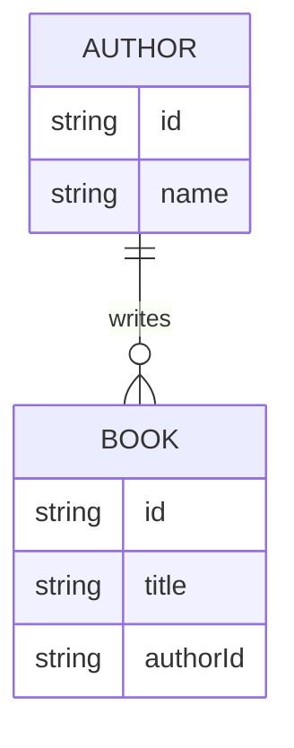
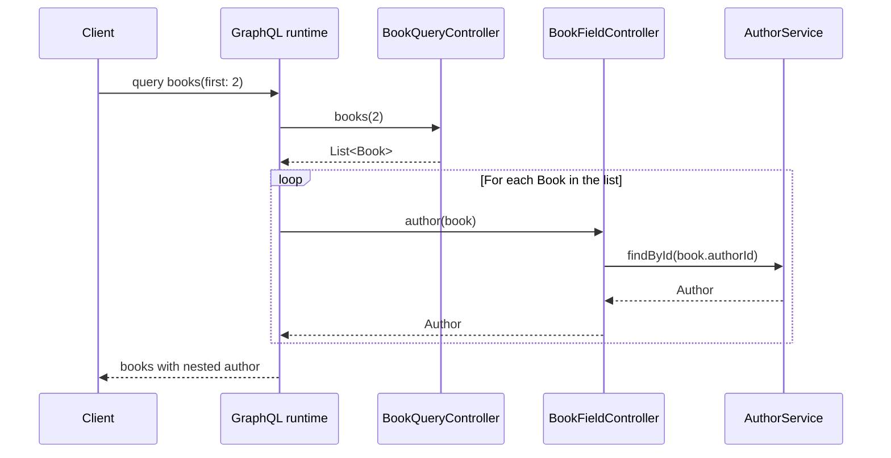

# Building Nested Fields with `@SchemaMapping`

In GraphQL, an object often contains fields that reference other objects. For example, `Book` has `author`, and `Author` has a list of `books`. Spring for GraphQL uses `@SchemaMapping` to bind a Java method to a field on a GraphQL type. The method receives the parent object as its source, fetches the related data from a service, and returns the value for the child field.

This hands-on practice builds the chain `Query.books → Book.author → Author.books`. You will declare the SDL, create the models/services, write root queries with `@QueryMapping`, resolve nested fields with `@SchemaMapping`, and then test the entire data tree with `GraphQlTester`. At the end, you will replace the per-item service-calling resolver with a DataLoader to avoid the N+1 problem.

## Learning Outcomes

- Distinguish between root fields and nested fields in GraphQL.
- Understand how the source object is passed into a `@SchemaMapping` method.
- Accurately map the GraphQL parent type and field name.
- Read nested field arguments with `@Argument`.
- Test queries with multiple levels of nested fields.
- Identify N+1 issues and switch repeated lookups to DataLoader.

## 1. Defining the Data Structure

We use a book library example. A book has one author; an author can write many books:



The Java model keeps `authorId` in `Book` so the service can look up the author. `authorId` is an internal model detail; clients access the author via the nested `author` field.

Place each record in a separate file (`Book.java` and `Author.java`) in the same example package:

```java
public record Book(
        String id,
        String title,
        String authorId) {
}

public record Author(
        String id,
        String name) {
}
```

Assume the application has the following services. You can implement them using a repository, database, or in-memory data in this practice:

Place `BookService` and `AuthorService` in two separate interface files:

```java
import java.util.List;
import java.util.Map;
import java.util.Optional;
import java.util.Set;

public interface BookService {
    List<Book> findAll(int first);
    Optional<Book> findById(String id);
    List<Book> findByAuthorId(String authorId, int first);
}

public interface AuthorService {
    Optional<Author> findById(String id);
    Map<String, Author> findAllByIds(Set<String> ids);
}
```

`BookService` is responsible for querying books; `AuthorService` is responsible for querying authors. GraphQL controllers only coordinate service calls and map results to the schema.

## 2. Declaring the SDL Schema

Create `src/main/resources/graphql/schema.graphqls`:

```graphql
type Query {
  books(first: Int = 20): [Book!]!
  book(id: ID!): Book
}

type Book {
  id: ID!
  title: String!
  author: Author
}

type Author {
  id: ID!
  name: String!
  books(first: Int = 10): [Book!]!
}
```

`Query.books` and `Query.book` are root fields. `Book.author` and `Author.books` are nested fields because they are declared inside object types rather than the root `Query` type.

`Book.author` is nullable in this example because book data might reference an author that no longer exists. If business rules guarantee every book always has an author and the resolver can always resolve it, you can declare `author: Author!`; in that case, you must handle missing-author cases so you do not violate Non-Null constraints.

`first` is a field argument. A default value lets the client omit the argument; the service still needs to enforce a maximum limit to avoid loading too much data.

Because `Author.books` is declared as `[Book!]!`, the service must return a non-null list. When an author has no books yet, return `List.of()` or an empty collection; do not return null.

## 3. Writing Root Resolvers with `@QueryMapping`

`@QueryMapping` maps a method to a field on the root `Query` type. Example:

```java
import java.util.List;
import java.util.Optional;
import org.springframework.graphql.data.method.annotation.Argument;
import org.springframework.graphql.data.method.annotation.QueryMapping;
import org.springframework.stereotype.Controller;

@Controller
public class BookQueryController {

    private final BookService bookService;

    public BookQueryController(BookService bookService) {
        this.bookService = bookService;
    }

    @QueryMapping
    public List<Book> books(@Argument("first") Integer first) {
        return bookService.findAll(limit(first, 20));
    }

    @QueryMapping
    public Book book(@Argument("id") String id) {
        return bookService.findById(id).orElse(null);
    }

    private int limit(Integer requested, int defaultValue) {
        int value = requested == null ? defaultValue : requested;
        if (value < 1 || value > 100) {
            throw new IllegalArgumentException("first must be between 1 and 100");
        }
        return value;
    }
}
```

The `books` method receives the `first` argument from GraphQL and returns a list of `Book`. The `book` method returns `null` when not found because the schema declares `Book` as nullable. In a real application, map page-size limit errors to a GraphQL error with a stable code using an exception handler.

## 4. Resolving `Book.author` with `@SchemaMapping`

A nested field needs to know which parent object is being resolved. For the `books` query, GraphQL calls the root resolver to get the list of `Book`. When the client requests `author`, GraphQL calls the corresponding data fetcher for each `Book`.

```java
import org.springframework.graphql.data.method.annotation.SchemaMapping;
import org.springframework.stereotype.Controller;

@Controller
public class BookFieldController {

    private final AuthorService authorService;

    public BookFieldController(AuthorService authorService) {
        this.authorService = authorService;
    }

    @SchemaMapping(typeName = "Book", field = "author")
    public Author author(Book book) {
        return authorService.findById(book.authorId()).orElse(null);
    }
}
```

In the method above:

- `typeName = "Book"` specifies the parent GraphQL type.
- `field = "author"` specifies the field being resolved.
- The `Book book` parameter is the current source object. Spring for GraphQL passes the object to which the `author` field belongs into this parameter.
- The return value `Author` becomes the result of `Book.author`.

The method is invoked separately for each source `Book` that needs the `author` field. If the list has 10 books, the resolver may call `authorService.findById(...)` 10 times. This is an important point to watch out for when handling nested fields.

If the source object already has a property/getter matching the GraphQL field name, GraphQL Java can read that property using the default property data fetcher without needing a `@SchemaMapping` method. Use `@SchemaMapping` when you need to query relationships, compute values, apply logic, or explicitly control how a field is resolved. In this example, `Book` only has `authorId` and no `author` property, so a resolver is needed to load `Author`.

### Name Inference Rules

You can write this more concisely when the method name matches the field and the source parameter is sufficient to infer the parent type:

```java
@SchemaMapping
public Author author(Book book) {
    return authorService.findById(book.authorId()).orElse(null);
}
```

Spring infers the field name `author` from the method name and the parent type from the source parameter type `Book`. When you want to avoid ambiguity or when the method does not follow the naming convention, explicitly declare `typeName` and `field` as in the main example.

You can also place `@SchemaMapping(typeName = "Book")` at the class level to share the parent type across nested field methods in a controller; each method only needs `@SchemaMapping(field = "...")`.

## 5. Resolving `Author.books` Next

Nested fields can continue to form a deeper data tree. Add a method to a controller:

```java
import java.util.List;
import org.springframework.graphql.data.method.annotation.Argument;
import org.springframework.graphql.data.method.annotation.SchemaMapping;
import org.springframework.stereotype.Controller;

@SchemaMapping(typeName = "Author")
@Controller
public class AuthorFieldController {

    private final BookService bookService;

    public AuthorFieldController(BookService bookService) {
        this.bookService = bookService;
    }

    @SchemaMapping(field = "books")
    public List<Book> books(
            Author author,
            @Argument("first") Integer first) {
        int limit = first == null ? 10 : first;
        if (limit < 1 || limit > 100) {
            throw new IllegalArgumentException("first must be between 1 and 100");
        }
        return bookService.findByAuthorId(author.id(), limit);
    }
}
```

`Author` is the source object for the nested `books` field. `@Argument("first")` retrieves the argument declared on `Author.books(first: Int)` in the SDL. The two parameter types serve different roles: `Author author` is the parent source, whereas `first` is client-supplied data for the field.

A query can request multiple levels:

```graphql
query AuthorBooks {
  books(first: 5) {
    id
    title
    author {
      id
      name
      books(first: 2) {
        id
        title
      }
    }
  }
}
```

GraphQL only resolves the fields selected by the client. If the client only requests `books { id title }`, the `Book.author` and `Author.books` methods do not need to be called.

An abbreviated response looks like:

```json
{
  "data": {
    "books": [
      {
        "id": "book-1",
        "title": "Spring GraphQL",
        "author": {
          "id": "author-1",
          "name": "Lan Nguyen",
          "books": [
            { "id": "book-1", "title": "Spring GraphQL" }
          ]
        }
      }
    ]
  }
}
```

## 6. Tracing the Resolution Flow

Given the query:

```graphql
query {
  books(first: 2) {
    title
    author {
      name
    }
  }
}
```

High-level execution flow:



The GraphQL runtime combines the results of root fields and nested fields into a single JSON response. Controllers do not need to manually build nested JSON objects; each resolver is only responsible for the field it maps.

## 7. Testing Nested Fields with `GraphQlTester`

Tests should send a complete operation through the GraphQL runtime to verify both root mappings and nested mappings. With Spring Boot, `@GraphQlTest` creates a test slice for the selected controllers.

```java
// Spring Boot 4.x:
import org.springframework.boot.graphql.test.autoconfigure.GraphQlTest;
// Spring Boot 3.x:
// import org.springframework.boot.test.autoconfigure.graphql.GraphQlTest;

import static org.mockito.BDDMockito.given;
import static org.mockito.BDDMockito.then;
import static org.mockito.Mockito.times;

import java.util.List;
import java.util.Optional;
import org.junit.jupiter.api.Test;
import org.springframework.beans.factory.annotation.Autowired;
import org.springframework.graphql.test.tester.GraphQlTester;
import org.springframework.test.context.bean.override.mockito.MockitoBean;

@GraphQlTest({BookQueryController.class, BookFieldController.class, AuthorFieldController.class})
class NestedFieldTests {

    @Autowired
    GraphQlTester graphQlTester;

    @MockitoBean
    BookService bookService;

    @MockitoBean
    AuthorService authorService;

    @Test
    void resolvesBookAndNestedAuthor() {
        Book book = new Book("book-1", "Spring GraphQL", "author-1");
        Author author = new Author("author-1", "Lan Nguyen");

        given(bookService.findAll(2)).willReturn(List.of(book));
        given(bookService.findByAuthorId("author-1", 2)).willReturn(List.of(book));
        given(authorService.findById("author-1")).willReturn(Optional.of(author));

        var response = graphQlTester.document("""
                query {
                  books(first: 2) {
                    id
                    title
                    author {
                      id
                      name
                      books(first: 2) {
                        title
                      }
                    }
                  }
                }
                """)
                .execute();

        response.path("books[0].title")
                .entity(String.class)
                .isEqualTo("Spring GraphQL");
        response.path("books[0].author.name")
                .entity(String.class)
                .isEqualTo("Lan Nguyen");
        response.path("books[0].author.books[0].title")
                .entity(String.class)
                .isEqualTo("Spring GraphQL");

        then(authorService).should(times(1)).findById("author-1");
        then(bookService).should(times(1)).findByAuthorId("author-1", 2);
    }
}
```

The test assumes the SDL schema from the previous section is loaded in the test context and the two services are replaced by mocks. If using Spring Boot prior to 3.4, you can use `@MockBean` instead of `@MockitoBean`; the package of `@GraphQlTest` also differs between Spring Boot 3 and 4 as noted in the import comments.

To further test the `Author.books` level, configure `bookService.findByAuthorId("author-1", 2)` to return a list of books and expand the selection set:

```graphql
query {
  books(first: 2) {
    author {
      name
      books(first: 2) {
        title
      }
    }
  }
}
```

In the test, assert the path `books[0].author.books[0].title` and verify that the service receives the correct `authorId` and page size. This proves the nested field argument is bound properly and the parent source is the author being resolved.

## 8. Identifying and Fixing N+1

The `BookFieldController.author(...)` example calls `authorService.findById(...)` once per `Book`. If a query fetches N books, the number of lookups can grow linearly with N. This is a common N+1 pattern in nested fields:

| Number of Books | List Loads | Author Lookups with Naive Resolver |
| ---: | ---: | ---: |
| 5 | 1 | 5 |
| 20 | 1 | 20 |
| 100 | 1 | 100 |

The solution is to batch keys together using DataLoader. Spring for GraphQL provides `BatchLoaderRegistry` to register a batch loader scoped to the GraphQL request.

Register a mapped batch loader:

```java
import java.util.Map;
import org.springframework.graphql.execution.BatchLoaderRegistry;
import org.springframework.stereotype.Component;
import reactor.core.publisher.Mono;

@Component
public class AuthorDataLoaderConfiguration {

    public AuthorDataLoaderConfiguration(
            BatchLoaderRegistry registry,
            AuthorService authorService) {
        registry.forTypePair(String.class, Author.class)
                .registerMappedBatchLoader((authorIds, environment) ->
                        Mono.fromSupplier(() -> authorService.findAllByIds(authorIds)));
    }
}
```

`findAllByIds` returns a `Map<String, Author>` keyed by author ID. A mapped batch loader allows DataLoader to match the right `Author` by key, independent of the order in which the repository returns map entries.

Replace the single-lookup resolver with a resolver that uses DataLoader:

```java
import java.util.concurrent.CompletableFuture;
import org.dataloader.DataLoader;
import org.springframework.graphql.data.method.annotation.SchemaMapping;

@SchemaMapping(typeName = "Book", field = "author")
public CompletableFuture<Author> author(
        Book book,
        DataLoader<String, Author> authorDataLoader) {
    return authorDataLoader.load(book.authorId());
}
```

Each `Book` still calls `load(authorId)`, but DataLoader collects the keys within the same execution and dispatches the batch loader. DataLoader's per-request cache also avoids loading the same key repeatedly within that request. This cache is not shared across requests.

Do not register both `@SchemaMapping` and `@BatchMapping` for the same field. If you choose `@BatchMapping(typeName = "Book", field = "author")`, Spring creates a batch resolver for that field; use a single mapping approach for a given field.

## 9. When to Use `@SchemaMapping` vs. `@BatchMapping`

| Mapping Approach | Best Suited When |
| --- | --- |
| `@SchemaMapping` | The field needs per-parent processing, computes a value, or calls a service with custom logic. |
| `@SchemaMapping` + DataLoader | The resolver still returns a result per parent, but key-based lookups can be batched. |
| `@BatchMapping` | You can accept many parents at once and return results for the whole group. |

Example of `@BatchMapping` replacing the single `Book.author` resolver:

```java
import java.util.LinkedHashMap;
import java.util.List;
import java.util.Map;
import java.util.Set;
import java.util.stream.Collectors;
import org.springframework.graphql.data.method.annotation.BatchMapping;
import org.springframework.stereotype.Controller;

@Controller
public class BookBatchFieldController {

    private final AuthorService authorService;

    public BookBatchFieldController(AuthorService authorService) {
        this.authorService = authorService;
    }

    @BatchMapping(typeName = "Book", field = "author")
    public Map<Book, Author> author(List<Book> books) {
        Set<String> authorIds = books.stream()
                .map(Book::authorId)
                .collect(Collectors.toSet());

        Map<String, Author> authors = authorService.findAllByIds(authorIds);
        Map<Book, Author> result = new LinkedHashMap<>();
        for (Book book : books) {
            result.put(book, authors.get(book.authorId()));
        }
        return result;
    }
}
```

This example is an alternative controller replacing `BookFieldController` from the single `@SchemaMapping` section. Do not register both resolvers for `Book.author`. `LinkedHashMap` preserves the mapping per source object; `null` values are kept if an `Author` is not found, matching the nullable `Book.author` in the SDL.

Choose the simplest approach that fits your workload. `@SchemaMapping` keeps field logic cleanly separated; DataLoader or `@BatchMapping` solves batching multiple lookups. Do not mechanically batch every field if the field only returns a cheaply computed value.

## 10. Common Errors

| Symptom | Cause | Resolution |
| --- | --- | --- |
| Nested field is always null | Field has no matching resolver, source property does not exist, or service finds no data. | Check SDL, `typeName`, `field`, source object, and service result. |
| `@SchemaMapping` method is not invoked | Wrong parent type/field name or controller is not component-scanned. | Use explicit names and verify the controller bean in the context. |
| `@Argument` receives null | Argument name does not match SDL or client did not pass a value. | Declare `@Argument("first")` and check operation variables. |
| Wrong parent object received | Method signature uses the wrong source parameter type. | Use the exact Java type representing the parent GraphQL object. |
| Resolver calls service too many times | Nested resolver performs a lookup for each parent. | Use DataLoader or `@BatchMapping`. |
| Non-Null field wipes out parent object | Resolver returns null while SDL declares `!`. | Fix data/resolver or design the field as nullable if null is a valid result. |
| Test slice cannot find service | `@GraphQlTest` does not load real services. | Mock collaborators with `@MockitoBean` or import the needed configuration. |
| Batch mapping returns mismatched parents | Batch result does not match keys/sources properly. | Return a map keyed by parent or ensure result order matches the contract. |

## Practice Exercises

Complete the following requirements in a Spring for GraphQL application:

1. Create the SDL containing `Query.books`, `Book.author`, and `Author.books` as shown in the example.
2. Create the `Book` and `Author` records; write services to query the corresponding data.
3. Write `BookQueryController` with `@QueryMapping` for `books`.
4. Write `BookFieldController` to resolve `Book.author` using `@SchemaMapping`.
5. Write `AuthorFieldController` to resolve `Author.books` and bind the `first` argument.
6. Send a three-level nested query using `GraphQlTester` and assert the title, author name, and author's list of books.
7. Record the number of `AuthorService.findById` calls when fetching multiple books; then replace it with DataLoader or `@BatchMapping` and compare the number of batch lookups.
8. Test the case where a `Book` has no `Author` and ensure the response adheres to the nullability in the SDL.

### Completion Criteria

- The root query returns the expected list of `Book`.
- `Book.author` resolves the `Author` matching each `Book`'s `authorId`.
- `Author.books(first: ...)` returns books for that author respecting the limit.
- The nested selection set is verified through `GraphQlTester`.
- No resolver manually builds JSON responses; the GraphQL runtime assembles the fields.
- If optimized with DataLoader/`@BatchMapping`, batch results match the right parent/key and do not depend on arbitrary ordering from the repository.

## Key Takeaways

`@SchemaMapping` maps a Java method to a field of a GraphQL object type. The source parameter is the parent object currently being resolved; `typeName` identifies the parent type, `field` identifies the child field, and `@Argument` reads arguments declared directly on that field. Root fields typically use `@QueryMapping` or `@MutationMapping`; nested fields use `@SchemaMapping`.

When a client selects a nested field, the GraphQL runtime invokes the corresponding resolver and merges the result into the response. Writing one service lookup per parent easily leads to N+1 queries when the field is inside a list. Use DataLoader or `@BatchMapping` to batch lookups per request while maintaining proper nullability, authorization, and parent-to-result relationships.

## References

- [Spring for GraphQL — Annotated Controllers](https://docs.spring.io/spring-graphql/reference/controllers.html)
- [Spring for GraphQL — `@SchemaMapping` API](https://docs.spring.io/spring-graphql/docs/current/api/org/springframework/graphql/data/method/annotation/SchemaMapping.html)
- [Spring for GraphQL — Batch Loading](https://docs.spring.io/spring-graphql/reference/request-execution.html#execution.batch-loading)
- [Spring for GraphQL — Testing](https://docs.spring.io/spring-graphql/reference/testing.html)
