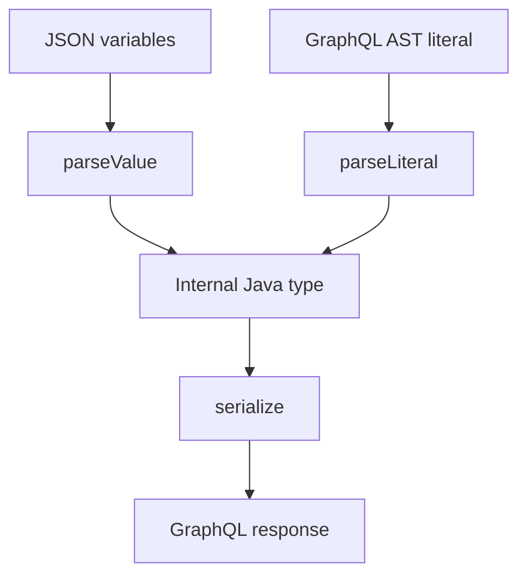

# Adding a Custom Scalar

## Objectives

GraphQL has five built-in scalars: `Int`, `Float`, `String`, `Boolean`, and `ID`. They cover common data types, but real-world APIs often need to represent values with dedicated rules such as phone numbers, dates/times, currency, UUIDs, or email addresses. A custom scalar lets you define a new atomic data type in the schema while controlling how GraphQL reads input data and converts output data.

In this hands-on practice, we build a `PhoneNumber` scalar in E.164 format using Spring for GraphQL and GraphQL Java. You will:

- Declare a scalar in GraphQL SDL and understand the role of `Coercing`.
- Implement the three conversion directions: `parseValue`, `parseLiteral`, and `serialize`.
- Register a `GraphQLScalarType` with Spring for GraphQL runtime wiring.
- Use the scalar in Query, Mutation, and Java resolvers.
- Test valid inputs, invalid inputs, and resolver outputs with `GraphQlTester`.
- Distinguish scalar format validation from business logic, security, and authorization checks.

## 1. When Is a Custom Scalar Needed?

A scalar is a GraphQL data type that has no subfields. Clients receive a single value such as a string, number, or boolean. `String`, `Int`, and `ID` cannot fully express the semantics of all business data. For example, if you use `String` for a phone number, clients can send `abc`, `123`, or strings with spaces and the schema still accepts them. Resolvers end up checking them in multiple places, easily leading to inconsistent rules.

A custom scalar centralizes conversion and formatting rules in one place. Common examples include:

| Scalar | Common Representation | Rules to Agree On |
|---|---|---|
| `Date` | `YYYY-MM-DD` string | Valid calendar date, without time or time zone |
| `DateTime` | ISO-8601/RFC 3339 string | Offset, time zone, and precision rules |
| `UUID` | Standard UUID string | Syntax and uppercase/lowercase normalization |
| `EmailAddress` | Email string | Syntax rules accepted by the system |
| `PhoneNumber` | E.164 string | `+` prefix, country code, and length limits |
| `Money` | Decimal string or internal object | Precision, scale, and currency unit |

A custom scalar is appropriate when the value is treated as an atomic unit in the API contract. If clients need to query independent attributes—for example, amount and currency—an object type like `Money { amount, currency }` may fit better. Do not pack a complex structure into a JSON string just to call it a scalar; doing so loses GraphQL's field selection and type checking.

## 2. Three Coercion Directions of a Scalar

GraphQL Java uses the `Coercing` interface to convert between Java values and their representation on the GraphQL wire protocol. A complete scalar must handle three flows:



| Method | Data Direction | When Invoked |
|---|---|---|
| `parseValue` | JSON variables → Java type | Client passes variables in the JSON part of the request |
| `parseLiteral` | GraphQL AST literal → Java type | Client writes the value inline in the document |
| `serialize` | Java type → response value | Resolver returns data for a scalar field |

The two parse methods do not replace each other. An operation can use variables or literals; an implementation that supports `parseValue` but skips `parseLiteral` creates inconsistent behavior between the two ways of passing inputs. `serialize` is also required because internal data could be invalid or unable to be represented accurately on the wire format.

GraphQL handles nullability according to the SDL. If an argument or field is declared nullable and the value is `null`, scalar coercing is generally not invoked for that null value. Use `!` in the SDL when business rules require a value; do not try to handle null by turning it into an empty string inside the scalar.

## 3. Designing the PhoneNumber Scalar

We choose `PhoneNumber` as our example. The value is stored and passed as a Java `String`, but must follow E.164: starts with `+`, followed by 1 to 15 digits; the first digit must not be `0`. For example, `+84912345678` is valid under this syntax rule, whereas `0912345678`, `+84 912 345 678`, and `abc` are invalid.

This is a formatting rule—it does not prove the phone number is active, allocated, or owned by the user. Those require separate business workflows such as sending an OTP or verifying with a provider.

In SDL, declare a scalar with the `scalar` keyword:

```graphql
scalar PhoneNumber

type Customer {
    id: ID!
    phone: PhoneNumber
}

type Query {
    customer(id: ID!): Customer
}

type Mutation {
    updateCustomerPhone(customerId: ID!, phone: PhoneNumber!): Customer!
}
```

`PhoneNumber!` on the mutation argument requires the client to pass a non-null value. The `Customer.phone` field remains nullable because a customer may not have provided a phone number yet. Declaring a scalar in SDL only defines the type name; the application must also register an implementation so GraphQL Java knows how to coerce it.

If the project already declares `type Query` or `type Mutation` in another SDL file, add the field to the existing type or use `extend type Query`/`extend type Mutation`. Do not redeclare the same root type across multiple schema files.

## 4. Implementing GraphQLScalarType

Create a class responsible for defining the scalar. The example below uses GraphQL Java's modern `Coercing` API with `GraphQLContext` and `Locale` in the coercion methods:

```java
package com.example.graphql.scalar;

import graphql.GraphQLContext;
import graphql.execution.CoercedVariables;
import graphql.language.StringValue;
import graphql.language.Value;
import graphql.schema.Coercing;
import graphql.schema.CoercingParseLiteralException;
import graphql.schema.CoercingParseValueException;
import graphql.schema.CoercingSerializeException;
import graphql.schema.GraphQLScalarType;

import java.util.Locale;
import java.util.regex.Pattern;

public final class PhoneNumberScalar {

    private static final Pattern E164_PATTERN =
            Pattern.compile("\\+[1-9][0-9]{0,14}");

    private PhoneNumberScalar() {
    }

    public static final GraphQLScalarType PHONE_NUMBER =
            GraphQLScalarType.newScalar()
                    .name("PhoneNumber")
                    .description("Phone number in E.164 format")
                    .coercing(new Coercing<String, String>() {

                        @Override
                        public String serialize(
                                Object dataFetcherResult,
                                GraphQLContext graphQLContext,
                                Locale locale) {
                            if (!(dataFetcherResult instanceof String value)) {
                                throw new CoercingSerializeException(
                                        "PhoneNumber must be represented by a String.");
                            }

                            try {
                                return validate(value);
                            } catch (IllegalArgumentException exception) {
                                throw new CoercingSerializeException(
                                        "Cannot serialize an invalid PhoneNumber.");
                            }
                        }

                        @Override
                        public String parseValue(
                                Object input,
                                GraphQLContext graphQLContext,
                                Locale locale) {
                            if (!(input instanceof String value)) {
                                throw new CoercingParseValueException(
                                        "PhoneNumber variable must be a String.");
                            }

                            try {
                                return validate(value);
                            } catch (IllegalArgumentException exception) {
                                throw new CoercingParseValueException(
                                        "PhoneNumber must use E.164 format.");
                            }
                        }

                        @Override
                        public String parseLiteral(
                                Value<?> input,
                                CoercedVariables variables,
                                GraphQLContext graphQLContext,
                                Locale locale) {
                            if (!(input instanceof StringValue stringValue)) {
                                throw new CoercingParseLiteralException(
                                        "PhoneNumber literal must be a string.");
                            }

                            try {
                                return validate(stringValue.getValue());
                            } catch (IllegalArgumentException exception) {
                                throw new CoercingParseLiteralException(
                                        "PhoneNumber must use E.164 format.");
                            }
                        }
                    })
                    .build();

    private static String validate(String value) {
        String normalized = value.trim();
        if (!E164_PATTERN.matcher(normalized).matches()) {
            throw new IllegalArgumentException("Invalid E.164 phone number.");
        }
        return normalized;
    }
}
```

This implementation reflects several important decisions:

1. **Choosing the internal Java type:** `Coercing<String, String>` means both the parsed value and serialized value are `String`. If the application has a `PhoneNumber` value object, you can substitute that class as the internal type to avoid passing arbitrary strings deep into the domain.
2. **Checking the input kind:** JSON numbers, booleans, objects, or lists are not automatically coerced into strings. Literals must also be `StringValue`; an `IntValue` is invalid even if its digits look like a phone number.
3. **Sharing formatting rules:** `validate` is invoked on both input and output. Data stored in the database or returned by external services must also conform to the contract when serialized.
4. **Throwing the right exception type:** invalid input variables use `CoercingParseValueException`; invalid literals use `CoercingParseLiteralException`; resolver data that cannot be converted for the response uses `CoercingSerializeException`.
5. **Not returning bad data as a fallback:** the scalar does not silently fix an invalid phone number into a plausible-looking value. Invalid inputs must be rejected so the client fixes the request; invalid outputs must be observed and handled as server-side data errors.

The example above normalizes with `trim()` before validating. If the contract prefers rejecting any whitespace rather than trimming leading/trailing spaces, remove the trim step and explicitly test that behavior. A scalar should have a single canonical policy so client and server do not interpret values differently.

### Why Does parseLiteral Need to Check the AST Node?

A GraphQL document is parsed into an Abstract Syntax Tree (AST). String literals are represented by `StringValue`, numeric literals by `IntValue` or `FloatValue`, and booleans by `BooleanValue`. Therefore, `parseLiteral` must inspect the node type before extracting its content. Do not call `toString()` on the AST node and parse the string yourself; that depends on parser representation details and easily accepts the wrong type.

For variables, data has already been decoded from JSON, so `parseValue` receives Java objects such as `String`, `Integer`, `Boolean`, `Map`, or `List`. Checking `instanceof String` properly restricts the input type.

## 5. Registering the Scalar in Spring for GraphQL

Spring for GraphQL uses `RuntimeWiringConfigurer` to add scalars, data fetchers, and other runtime components. Create a configuration bean:

```java
package com.example.graphql.config;

import com.example.graphql.scalar.PhoneNumberScalar;
import org.springframework.context.annotation.Bean;
import org.springframework.context.annotation.Configuration;
import org.springframework.graphql.execution.RuntimeWiringConfigurer;

@Configuration
public class GraphQlScalarConfiguration {

    @Bean
    RuntimeWiringConfigurer phoneNumberRuntimeWiringConfigurer() {
        return wiringBuilder ->
                wiringBuilder.scalar(PhoneNumberScalar.PHONE_NUMBER);
    }
}
```

When Spring initializes the GraphQL runtime, `RuntimeWiringConfigurer` beans are applied to `RuntimeWiring.Builder`. The registered scalar must have the exact same name as in the SDL: `PhoneNumber`. If the SDL declares `PhoneNumber` while runtime registers `Phone`, the schema will fail to find the matching implementation.

With default Spring Boot configuration, SDL schemas are typically placed under `src/main/resources/graphql/` and can be split into multiple `.graphqls` or `.gqls` files. For example:

```text
src/main/resources/
└── graphql/
    ├── customer.graphqls
    └── common-scalars.graphqls
```

Put `scalar PhoneNumber` in a schema file loaded by Spring GraphQL alongside the rest of the types. Avoid declaring the same scalar multiple times across SDL files. If the project customizes `spring.graphql.schema.locations`, ensure the directory containing the schema file is actually included in the location list.

When starting the application, check schema initialization logs. A common mistake is declaring a custom scalar in the schema without scalar wiring. This is usually caught when building `GraphQLSchema`, before any business requests are processed.

## 6. Using the Scalar in Resolvers

Because `PhoneNumberScalar` uses `String` as its internal Java type, resolvers can accept `String` via `@Argument` and return `String` in result objects. Example model record:

```java
package com.example.customer;

public record Customer(String id, String phone) {
}
```

A controller can map Query and Mutation as follows:

```java
package com.example.customer;

import org.springframework.graphql.data.method.annotation.Argument;
import org.springframework.graphql.data.method.annotation.MutationMapping;
import org.springframework.graphql.data.method.annotation.QueryMapping;
import org.springframework.stereotype.Controller;

@Controller
public class CustomerGraphQlController {

    private final CustomerService customerService;

    public CustomerGraphQlController(CustomerService customerService) {
        this.customerService = customerService;
    }

    @QueryMapping
    public Customer customer(@Argument("id") String id) {
        return customerService.findById(id);
    }

    @MutationMapping
    public Customer updateCustomerPhone(
            @Argument("customerId") String customerId,
            @Argument("phone") String phone) {
        return customerService.updatePhone(customerId, phone);
    }
}
```

Here `CustomerService` represents the application's business and repository layer. The GraphQL runtime performs scalar coercion before calling the mutation resolver. If `phone` is malformed, `parseValue` or `parseLiteral` throws an error and the resolver is not called. When the service returns `Customer`, `serialize` validates the `phone` value before writing it to the response.

Query example:

```graphql
query FindCustomer($id: ID!) {
    customer(id: $id) {
        id
        phone
    }
}
```

Mutation example using variables:

```graphql
mutation UpdatePhone($customerId: ID!, $phone: PhoneNumber!) {
    updateCustomerPhone(customerId: $customerId, phone: $phone) {
        id
        phone
    }
}
```

Corresponding request variables:

```json
{
  "customerId": "customer-17",
  "phone": "+84912345678"
}
```

Clients can also pass literals inline:

```graphql
mutation {
    updateCustomerPhone(
        customerId: "customer-17",
        phone: "+84912345678"
    ) {
        id
        phone
    }
}
```

Mutations using variables go through `parseValue`; mutations using literals go through `parseLiteral`. Both produce the same internal Java type for the service to process.

## 7. Testing with GraphQlTester

Do not test only the scalar class in isolation. You need to verify that the scalar is registered in the runtime, the schema recognizes the type, the resolver receives parsed data, and the response is serialized properly. `GraphQlTester` lets you send operations to the GraphQL execution engine inside the test context.

### Testing Valid Input Variables

```java
@SpringBootTest
class CustomerPhoneGraphQlTests {

    @Autowired
    GraphQlTester graphQlTester;

    @Test
    void acceptsPhoneNumberVariable() {
        graphQlTester.document("""
                mutation UpdatePhone($customerId: ID!, $phone: PhoneNumber!) {
                    updateCustomerPhone(
                        customerId: $customerId,
                        phone: $phone
                    ) {
                        id
                        phone
                    }
                }
                """)
                .variable("customerId", "customer-17")
                .variable("phone", "+84912345678")
                .execute()
                .path("updateCustomerPhone.phone")
                .entity(String.class)
                .isEqualTo("+84912345678");
    }
}
```

This test assumes the test context already has data or mocks `CustomerService` so the mutation returns the customer with the updated phone number. If the service returns another value, adjust the fixture so the test stays focused on the scalar contract.

### Testing Literals

```java
@Test
void acceptsPhoneNumberLiteral() {
    graphQlTester.document("""
            mutation {
                updateCustomerPhone(
                    customerId: "customer-17",
                    phone: "+84912345678"
                ) {
                    phone
                }
            }
            """)
            .execute()
            .path("updateCustomerPhone.phone")
            .entity(String.class)
            .isEqualTo("+84912345678");
}
```

This test goes through `parseLiteral`. Keep variable and literal tests separate so if one of the two paths lacks an implementation, the failure is clearly surfaced.

### Testing Invalid Inputs

```java
@Test
void rejectsInvalidPhoneNumberVariable() {
    var response = graphQlTester.document("""
            mutation UpdatePhone($customerId: ID!, $phone: PhoneNumber!) {
                updateCustomerPhone(
                    customerId: $customerId,
                    phone: $phone
                ) {
                    id
                }
            }
            """)
            .variable("customerId", "customer-17")
            .variable("phone", "0912345678")
            .execute();

    response.errors().satisfy(errors ->
            assertThat(errors).isNotEmpty());
}
```

The test snippet needs the corresponding assertion import, such as `org.assertj.core.api.Assertions.assertThat`. You can add tests for non-string input, empty strings, numbers with internal spaces, numbers with more than 15 digits, and numbers starting with `+0`. For literals, also test wrong-type literals such as `phone: 12345`; GraphQL must reject them because the AST node is not `StringValue`.

### Testing Serialization

`serialize` is invoked when a resolver returns a value for a scalar field. To test this direction, configure the test service to return a `Customer` with a valid phone number and assert that the response contains the E.164 string. An additional test can intentionally return an invalid value from a fixture to verify that GraphQL records a field error rather than emitting invalid data.

If tests only call `PhoneNumberScalar.validate` or `Coercing` directly, they do not prove the scalar is registered in the Spring GraphQL runtime. Have at least one integration test going through `GraphQlTester` as shown above.

## 8. Error Handling and Returned Messages

The three coercion exception groups reflect three distinct data sources:

| Exception | Cause | Expected Behavior |
|---|---|---|
| `CoercingParseValueException` | JSON variable has wrong type or format | GraphQL rejects the operation before invoking the resolver |
| `CoercingParseLiteralException` | Literal has wrong AST node or format | GraphQL rejects the operation during literal coercion |
| `CoercingSerializeException` | Resolver returns a Java type or value that cannot be serialized | GraphQL records an error on the corresponding field per error-handling and nullability rules |

Do not include the full input value in exception messages. Phone numbers, emails, tokens, and identifiers can be personal data. A message like "PhoneNumber must use E.164 format" is enough for the client to understand the contract without leaking sensitive values in logs or responses.

For nullable output fields, a serialization error can turn that field into `null` and appear in `errors`. If the field sits inside a non-null branch, the error can propagate up to the nearest nullable parent. This is GraphQL's null propagation rule; design nullability deliberately and verify the actual response in integration tests.

Do not catch every exception and return `null` just to make the response look successful. Doing so hides data errors and makes it hard for clients to distinguish "no phone number on file" from "server failed to serialize phone number". Let technical errors be recorded properly while standardizing public messages through the application's error-handling mechanism.

## 9. Extending to a Value Object in Java

In the initial example, the internal Java type is `String` to focus on the scalar mechanism. For larger domains, consider creating a value object to prevent unvalidated strings from entering the business layer:

```java
public record PhoneNumber(String value) {

    public PhoneNumber {
        value = value == null ? null : value.trim();
        if (value == null || !value.matches("\\+[1-9][0-9]{0,14}")) {
            throw new IllegalArgumentException("Invalid E.164 phone number.");
        }
    }
}
```

Then the scalar can declare `Coercing<PhoneNumber, String>`:

```java
GraphQLScalarType phoneNumberScalar = GraphQLScalarType.newScalar()
        .name("PhoneNumber")
        .coercing(new Coercing<PhoneNumber, String>() {
            // parseValue and parseLiteral construct PhoneNumber after validating input.
            // serialize reads PhoneNumber.value() and returns String.
        })
        .build();
```

The second snippet only illustrates the generic types and conversion boundary; when implementing, provide all three coercion methods as shown earlier. The advantage of a value object is that services and domain models receive an already validated value. However, do not duplicate differing rules between the value object's constructor and the scalar. Keep validation logic in one shared place, or have the scalar construct the value object and let the constructor serve as the final safeguard.

## 10. Built-in Library Scalars vs. Writing Your Own

Not every scalar needs to be implemented from scratch. For common types such as `Date`, `DateTime`, `UUID`, `Long`, or `BigDecimal`, you can use a community-maintained extended scalar library. GraphQL Java Extended Scalars provides ready-made implementations, such as `ExtendedScalars.Date`, `ExtendedScalars.DateTime`, `ExtendedScalars.UUID`, and others depending on the library version.

Example of registering scalars from the library:

```java
import graphql.scalars.ExtendedScalars;
import org.springframework.context.annotation.Bean;
import org.springframework.context.annotation.Configuration;
import org.springframework.graphql.execution.RuntimeWiringConfigurer;

@Configuration
public class ExtendedScalarConfiguration {

    @Bean
    RuntimeWiringConfigurer extendedScalarConfigurer() {
        return wiringBuilder -> wiringBuilder
                .scalar(ExtendedScalars.Date)
                .scalar(ExtendedScalars.DateTime)
                .scalar(ExtendedScalars.UUID);
    }
}
```

Add the `com.graphql-java:graphql-java-extended-scalars` dependency with a version compatible with the GraphQL Java version used by Spring Boot. Do not pick the latest version independently if it requires a different GraphQL Java version than the current runtime. Check the dependency tree and matching library documentation before upgrading.

Choose an existing library when the format is a common standard and the implementation satisfies your system's contract. Write your own scalar when you need custom domain rules, specific canonicalization, or a custom internal Java type. Either way, keep the format consistent across SDL, clients, API docs, and storage systems.

## 11. Design and Security Considerations

**Scalars only validate data representation.** `PhoneNumber` checks E.164 syntax—it does not verify phone ownership, check tenancy, or authenticate the caller. Those checks belong in the service or security layer.

**Do not turn scalars into a home for business logic.** A scalar should have clear parsing, serialization, and canonicalization rules. Do not call databases, send OTPs, or invoke services from `Coercing`; such operations have side effects and make parsing/validation unpredictable.

**Keep input and output consistent.** If input accepts one format while output returns another, clients will struggle to reuse received values. Define a single canonical wire format and enforce it in both parse and serialize.

**Be careful with normalization.** Automatically stripping spaces, changing case, or converting time zones can alter data meaning. Only normalize when it is part of the published contract and covered by tests.

**Do not use regex as a substitute for full verification.** Regex can check basic syntax but cannot prove data is real. For email or phone numbers, ownership verification requires sending confirmation codes or verifying via a provider.

**Do not put sensitive data into metrics.** Avoid attaching actual scalar values to metric labels, tracing tags, or exception messages. Record only error types, normalized operation/field names, and metadata required by your data protection policy.

**Define nullability intentionally.** Make `PhoneNumber` nullable when a customer might not have a number yet. Use `PhoneNumber!` when business rules require it. Do not use a custom scalar to bypass GraphQL's null propagation rules.

**Document scalars for clients.** The name `PhoneNumber` alone does not specify the wire format. Document the format in schema documentation and API guides. GraphQL supports the `@specifiedBy` directive to link to a stable specification document if the project has one. For example: `scalar PhoneNumber @specifiedBy(url: "<E.164 specification URL>")`; replace the placeholder with the official document URL chosen by the project.

## 12. Common Mistakes When Adding a Custom Scalar

| Symptom | Common Cause | How to Check |
|---|---|---|
| Schema fails to initialize | SDL declares scalar but runtime has not registered a scalar with the same name | Check `RuntimeWiringConfigurer` and the name in SDL |
| Variables succeed but literals fail | Only `parseValue` was implemented; `parseLiteral` is missing or checks the wrong AST node | Send an operation using an inline literal |
| Literals succeed but variables fail | `parseValue` does not support the Java type produced by the JSON decoder | Check the object type received in `parseValue` |
| Query runs but response field errors | `serialize` rejects the value returned by the resolver | Check Java types and data from service/database |
| Resolver is not called on bad input | This is the expected behavior of scalar coercion | Inspect GraphQL errors before debugging the resolver |
| Client receives confusing errors | Exception message is too generic or wire format is undocumented | Standardize errors and publish the scalar format |
| Scalar works in unit tests but fails in app | Tests do not load Spring GraphQL runtime or wiring bean is missing | Add tests via `GraphQlTester` |
| Dependency upgrade breaks at runtime | Extended Scalars version is incompatible with GraphQL Java | Check transitive versions and dependency alignment |

## 13. Completion Checklist

- [ ] SDL declares `scalar PhoneNumber` and uses the scalar in the right places.
- [ ] Java defines a `GraphQLScalarType` whose name matches the SDL.
- [ ] `parseValue` validates variables from JSON.
- [ ] `parseLiteral` checks the right AST node and literal content.
- [ ] `serialize` validates data returned by resolvers.
- [ ] Coercion errors throw exceptions matching the conversion direction.
- [ ] The scalar is registered via a `RuntimeWiringConfigurer` bean.
- [ ] Query/Mutation resolvers accept the Java type matching the chosen scalar.
- [ ] Valid tests cover variables, literals, and response serialization.
- [ ] Invalid format tests verify that the resolver is not invoked.
- [ ] Sensitive data is not placed in exceptions, logs, or metric labels.
- [ ] API documentation describes wire format, nullability, and canonicalization rules.

## Conclusion

Custom scalars extend GraphQL's type system by encapsulating conversion rules in a reusable implementation. In Spring for GraphQL, the process consists of declaring the scalar in SDL, implementing `Coercing`, registering `GraphQLScalarType` via `RuntimeWiringConfigurer`, and then using that type in resolvers and testing with `GraphQlTester`. Always implement all three methods—`parseValue`, `parseLiteral`, and `serialize`—validate both inputs and outputs, and keep business validation and security in the appropriate application layers.
