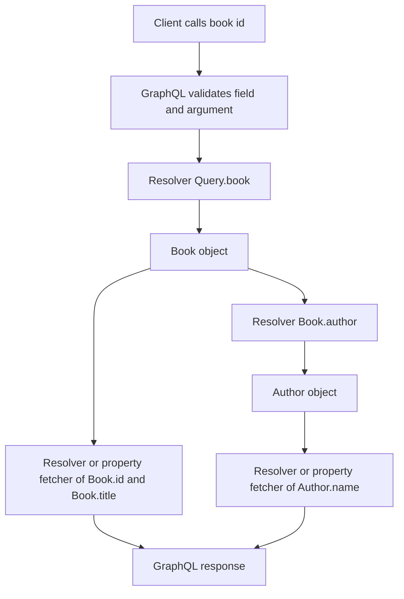

# Field definition

In GraphQL SDL, a **field definition** describes a field that clients can query on an object type or interface. Each definition specifies the field name, the arguments clients can pass, the return data type, and any directives applied to the field. This is the contract visible to GraphQL clients; actual data retrieval is wired to the field via a resolver, such as a GraphQL Java `DataFetcher` or Spring for GraphQL mapping methods.

For example, the following schema defines a `book` field on the root `Query` type. Clients must pass `id` and receive a `Book` if found:

```graphql
type Query {
    book(id: ID!): Book
}

type Book {
    id: ID!
    title: String!
    author: Author
}

type Author {
    id: ID!
    name: String!
}
```

`book` has an `id` argument of type `ID!`, and a nullable return type `Book`. `Book.author` is another field, taking no arguments and returning a nullable `Author`. When a client requests `book`, GraphQL continues resolving the selected child fields such as `id`, `title`, and `author`.

## 1. Syntax of a field definition

Inside an object type or interface, the general structure of a field definition is:

```graphql
"""Field description (optional)."""
fieldName(argumentName: ArgumentType = defaultValue): ReturnType @directive
```

The parts have the following meanings:

| Component | Meaning |
| --- | --- |
| Description | Describes the field for schema readers and documentation tools |
| `fieldName` | Field name used by clients in operations |
| `argumentName: ArgumentType` | Argument with a defined name and type; there may be zero or multiple arguments |
| `= defaultValue` | Default value used when the client omits the argument |
| `ReturnType` | Data type returned by the field, which may be a single type, list, or non-null |
| `@directive` | Metadata or behavior attached to the field according to the directive definition |

Example of a type with zero-argument, single-argument, and multi-argument fields:

```graphql
type Query {
    health: String!
    book(id: ID!): Book
    searchBooks(keyword: String!, limit: Int = 10): [Book!]!
}
```

`health` takes no arguments. `book` takes one required argument named `id`. `searchBooks` takes a required `keyword` and an optional `limit` with a default value of `10`. Argument names are significant in GraphQL documents; argument order when calling a field does not determine their meaning.

Field and argument names follow GraphQL naming rules: starting with a letter or underscore, followed by letters, digits, or underscores. Names starting with `__` are reserved for GraphQL's introspection system, so do not use this prefix for domain fields.

## 2. Return types: scalars, objects, enums, and output types

A field on an object type or interface must return an **output type**. Output types include scalars, enums, objects, interfaces, unions, and list/non-null wrappers around those valid types. An `input object` cannot be used as a return type.

Example:

```graphql
scalar DateTime

enum BookStatus {
    DRAFT
    PUBLISHED
    ARCHIVED
}

type Query {
    currentTime: DateTime!
    bookStatus(id: ID!): BookStatus
    book(id: ID!): Book
    searchBooks(keyword: String!): [Book!]!
}
```

GraphQL has built-in scalars `Int`, `Float`, `String`, `Boolean`, and `ID`. Applications can declare custom scalars like `DateTime` to model domain types. Declaring `scalar DateTime` in SDL only creates the type name in the schema; the application still needs to configure input parsing and output serialization for that scalar at runtime.

An enum represents a finite set of values. Clients send the enum name such as `PUBLISHED`, not an arbitrary object. Enums can be used as return types or input types, but cannot be replaced by an `input object` in an output position.

### Lists and non-null

GraphQL uses square brackets to represent lists and `!` to represent non-null. These two wrappers can be combined:

| Type | Meaning |
| --- | --- |
| `Book` | A `Book` or `null` |
| `Book!` | A `Book` is required, cannot be `null` |
| `[Book]` | List may be `null`; individual elements may also be `null` |
| `[Book]!` | List cannot be `null`; individual elements may be `null` |
| `[Book!]` | List may be `null`; individual elements cannot be `null` |
| `[Book!]!` | List cannot be `null` and no element may be `null` |

Example:

```graphql
type Query {
    optionalBook: Book
    requiredBook: Book!
    books: [Book!]!
}
```

With `books: [Book!]!`, the resolver must supply a non-`null` list and every element in the list must also be non-`null`. If an element violates non-nullability, GraphQL applies null propagation up to the nearest nullable position in the response. If no suitable nullable position exists, `data` can become `null` and an error is added to the `errors` list.

Choosing nullability is an API contract decision. Use `!` when the application guarantees a value always exists in all valid cases. If data may be missing, deleted, or restricted from view, a nullable type usually expresses the contract more honestly. Non-null does not synthesize data; it imposes a requirement that the resolver and returned data must satisfy.

## 3. Argument definitions and default values

Arguments allow clients to control how a field retrieves data. A field can declare multiple arguments, each with a name, input type, and optional default value.

```graphql
type Query {
    books(
        authorId: ID
        status: BookStatus = PUBLISHED
        limit: Int = 20
        offset: Int = 0
    ): [Book!]!
}
```

In this example, clients can filter by `authorId`, choose `status`, and paginate using `limit` and `offset`. If `status` is omitted, GraphQL uses `PUBLISHED`; if `limit` or `offset` is omitted, it uses `20` and `0` respectively.

Clients pass arguments by name:

```graphql
query {
    books(status: ARCHIVED, limit: 5, offset: 10) {
        id
        title
    }
}
```

Argument values must match the declared input type. GraphQL validates and coerces values against the schema before invoking the resolver. For example, an invalid string cannot be passed into a `limit: Int` argument just because a Java resolver happens to accept an `Object`.

### When is an argument required?

An argument with a non-null type and no default value is a required argument:

```graphql
type Query {
    book(id: ID!): Book
    books(limit: Int! = 20): [Book!]!
}
```

`id: ID!` must be supplied by the client. `limit: Int! = 20` is non-null but has a default value, so the client may omit the argument and GraphQL uses `20`. If the client explicitly passes `null` for a non-null argument, the request is invalid.

A default value must be a literal compatible with the input type, such as a number, string, boolean, enum, list, object, or `null` when the type allows it. You cannot use a Java method call or database query as a default value in SDL.

### Input objects to group arguments

When a field needs multiple filter conditions, you can group them into an input object:

```graphql
input BookFilter {
    keyword: String
    authorId: ID
    status: BookStatus = PUBLISHED
}

type Query {
    searchBooks(filter: BookFilter, limit: Int = 20): [Book!]!
}
```

Clients can pass the input object inline or via a variable:

```graphql
query SearchBooks($filter: BookFilter, $limit: Int = 20) {
    searchBooks(filter: $filter, limit: $limit) {
        id
        title
    }
}
```

Input objects are strictly for incoming data. Fields inside `input BookFilter` are not output fields and have no separate resolvers. They form a data structure validated by GraphQL before being passed to the `searchBooks` resolver.

## 4. Field definitions vs. input value definitions

GraphQL SDL has two easily confused constructs:

- **Field definition** lives inside a `type` or `interface` and describes data clients can read. It can take arguments and has an output type.
- **Input value definition** declares an argument on a field or a field inside an `input object`. It only accepts input types and may have a default value.

Comparison:

```graphql
type Book {
    title: String!
    author: Author
    relatedBooks(limit: Int = 5): [Book!]!
}

input BookInput {
    title: String!
    authorId: ID
}
```

`Book.author` is an output field returning `Author`. `Book.relatedBooks` is an output field accepting a `limit` argument and returning a list of `Book`. By contrast, `BookInput.authorId` is an input value, not a field clients can query independently.

Type rules differ as well: output fields can return objects, interfaces, or unions; arguments and input object fields can only use input types such as scalars, enums, or input objects. Thus, you cannot declare `author: Author` inside `input BookInput` if `Author` is an object type.

## 5. Descriptions and directives on fields

Descriptions make schemas easier to read in code reviews, API documentation, and GraphQL IDE tools. You can write single-line or multi-line descriptions with triple double-quoted strings:

```graphql
type Query {
    """Find a book by identifier."""
    book(id: ID!): Book
}
```

Directives attach metadata or instructions to a location in the schema. A common directive on field definitions is `@deprecated`, used to mark an old field and guide clients toward another field:

```graphql
type Book {
    """Current display title of the book."""
    title: String!

    """Legacy field; use title instead."""
    oldTitle: String @deprecated(reason: "Use title instead.")
}
```

A deprecated field remains in the schema and can still be called by clients during the migration window. Deprecation metadata helps clients and tools discover which APIs should be replaced; it does not remove the field or block requests on its own.

### Declaring custom directives

A schema can define custom directives and restrict where they may be applied:

```graphql
enum Role {
    READER
    EDITOR
}

directive @requiresRole(role: Role!) on FIELD_DEFINITION

type Query {
    publicCatalog: [Book!]!
    editorialNotes: [String!]! @requiresRole(role: EDITOR)
}
```

`on FIELD_DEFINITION` indicates the directive can be attached to field definitions. The declaration line and `@requiresRole` usage alone only describe the directive in the schema; the application must implement a mechanism to interpret it, such as runtime configuration, instrumentation, or Spring Security integration. Without a corresponding execution component, custom directives do not enforce access control by themselves.

## 6. Connecting field definitions to resolvers in Spring for GraphQL

SDL describes fields and types; resolvers supply values for fields during each operation. In GraphQL Java, the component doing that work is a `DataFetcher`. Spring for GraphQL lets you declare resolvers with annotations on Spring beans.

With the schema:

```graphql
type Query {
    book(id: ID!): Book
}

type Book {
    id: ID!
    title: String!
    author: Author
}
```

The controller can be written as:

```java
@Controller
public class BookController {

    private final BookService bookService;
    private final AuthorService authorService;

    public BookController(
            BookService bookService,
            AuthorService authorService) {
        this.bookService = bookService;
        this.authorService = authorService;
    }

    @QueryMapping
    public Book book(@Argument("id") String bookId) {
        return bookService.findById(bookId);
    }

    @SchemaMapping(typeName = "Book", field = "author")
    public Author author(Book book) {
        return authorService.findById(book.authorId());
    }
}
```

`@QueryMapping` maps the method to the `Query.book` field. `@Argument("id")` extracts the argument named `id` from the GraphQL request and converts it into a Java parameter. `@SchemaMapping` maps the `author` method to the `Book.author` field; the `Book` parameter is the source object returned by the parent field.

You do not need to write an explicit resolver for every field. If `Book` already has matching `id` and `title` properties, GraphQL Java can use the default `PropertyDataFetcher` to read them from the source object. You only need explicit mappings when a field must call a service, apply business rules, transform data, or fetch from another source.

The flow of resolving a nested query proceeds as follows:



Clients can choose which fields to fetch:

```graphql
query {
    featured: book(id: "book-01") {
        title
        author {
            name
        }
    }
}
```

The `featured` alias renames the response key for this operation; it does not rename the `book` field in the schema or change how the resolver is mapped. The selection set determines which child fields execute for that request.

## 7. Fields on Query, Mutation, and Subscription

Field definitions appear on both ordinary object types and the three root operation types. Each root type has its own execution semantics:

```graphql
type Query {
    book(id: ID!): Book
}

type Mutation {
    renameBook(id: ID!, title: String!): Book!
}

type Subscription {
    bookUpdated(id: ID!): Book!
}
```

- `Query` describes read fields. Top-level fields in a query may execute in parallel depending on the execution strategy.
- `Mutation` describes state-modifying fields. Top-level fields in a mutation are executed sequentially by GraphQL to preserve operation ordering.
- `Subscription` describes fields producing event streams. A subscription resolver must supply an appropriate publisher or reactive stream; each emitted event is then processed against the client's selection set.

In Spring for GraphQL, the corresponding methods typically use `@QueryMapping`, `@MutationMapping`, and `@SubscriptionMapping`. Return type declarations in SDL must still accurately reflect the data resolvers can emit.

## 8. Common errors when defining fields

| Error | Why it is invalid or unintended | How to fix |
| --- | --- | --- |
| Using an object type as an argument | Arguments only accept input types | Switch to `ID`, scalar, enum, or declare an `input object` |
| Using an input object as a return type | Output fields must return output types | Use object, scalar, enum, interface, or union |
| Omitting a required argument from an operation | Non-null arguments without defaults must be provided | Pass the argument or relax the contract if business logic allows |
| Resolver returns `null` for a non-null field | Violates the field contract and triggers null propagation | Fix data/resolver or declare nullable if `null` is a valid result |
| Returning a `null` element in `[Book!]!` | Every list element is declared non-null | Filter out missing elements or adjust the list type appropriately |
| Declaring a field without providing data | Schema defines a contract, but resolver/property fetcher returns nothing | Check mappings, source objects, and services |
| Attaching a custom directive without handling it | SDL only declares metadata; it does not implement custom behavior | Configure a runtime component to interpret the directive |

When reading schema errors, identify which phase failed. Parse/validation errors indicate invalid SDL or types. Argument validation errors occur when an operation sends missing or wrongly typed inputs. Execution errors happen while resolvers run, such as a service throwing an exception or violating non-nullability. Distinguishing these three phases helps pinpoint where to fix the issue.

## 9. Designing usable and maintainable field definitions

Field names should describe data or actions in domain terms. Argument names should be clear, such as `authorId`, `status`, `limit`, and `offset`; avoid generic names like `value` or `param` when a schema has many fields.

Choose return types and nullability based on actual data guarantees. Use lists to represent collections and mark lists or elements non-null only when the application can enforce those invariants. Use input objects when grouping related filters or parameters; when arguments are few, inline declarations are often easier to read.

Write descriptions for important fields and arguments, supply default values when stable default behavior exists, and use `@deprecated` when migrating clients off older APIs. For custom directives, always implement corresponding runtime handling and test that behavior. Finally, test both the schema and resolvers using `GraphQlTester` to verify that fields exposed by SDL actually work end to end through Spring for GraphQL.

Field definitions form the boundary between the GraphQL contract and application logic: SDL specifies what clients can call, what data they pass, and what result types they receive; GraphQL Java executes fields through data fetchers; Spring for GraphQL connects those fields to controllers, services, and Spring infrastructure. Mastering these elements helps you design consistent schemas, avoid type errors, and build extensible APIs.
