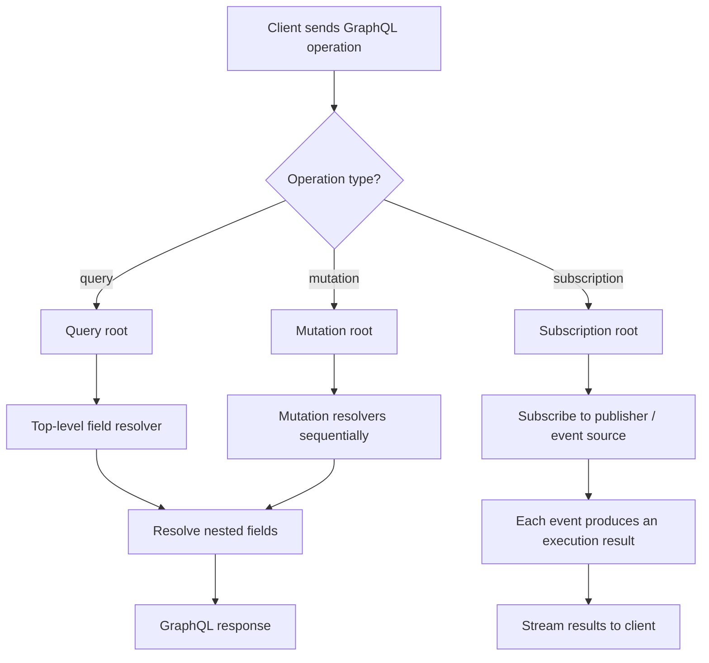

# Schema root operations

In GraphQL, a **root operation type** is an object type that serves as the entry point for executing a kind of operation. The schema specifies which root type handles `query`, which root type handles `mutation`, and which root type handles `subscription`. The fields declared on these object types are the top-level operations clients can invoke.

Three operation kinds correspond to three root types:

- **Query root** provides fields for reading or looking up data.
- **Mutation root** provides fields for creating, updating, or deleting data.
- **Subscription root** provides fields for subscribing to an event stream.

Understanding root operations helps you design schemas with clear boundaries and helps Spring for GraphQL map top-level fields to the right controllers.

## Distinguishing operation, operation type, and operation name

GraphQL has three concepts that are easily confused:

| Concept | Example | Meaning |
| --- | --- | --- |
| Operation type | `query`, `mutation`, `subscription` | Chooses which kind of root operation will execute. |
| Root operation type in schema | `Query`, `Mutation`, `Subscription` | Object type defining top-level fields for each operation kind. |
| Operation name | `ProductDetail`, `CreateProduct` | Optional name of an operation in a document, mainly for identification and tracing. |

Example:

```graphql
query ProductDetail($id: ID!) {
  product(id: $id) {
    id
    name
  }
}
```

In this example, `query` is the operation type; `Query` (by default convention) is the schema's root operation type; `ProductDetail` is the operation name; `product` is the field invoked on the Query root.

The operation name is not the root type name and does not determine which resolver runs. Resolvers are determined from the fields requested by the operation.

## The three root operation types

### Query root

The Query root is the entry point for read operations. A schema commonly declares fields such as `product`, `products`, `customer`, or `orders` on this object type.

```graphql
type Query {
  product(id: ID!): Product
  products(category: String, first: Int = 20): [Product!]!
  currentUser: User
}
```

Clients can request multiple top-level fields in a single query:

```graphql
query Dashboard {
  currentUser {
    id
    displayName
  }
  products(category: "BOOK", first: 5) {
    id
    name
  }
}
```

The server executes Query fields using standard query execution semantics; top-level fields may run in parallel. Therefore, never rely on field ordering in a query to enforce data-update order or coordinate side effects.

Queries should be designed for reading data. If an operation needs to modify business state, model it as a mutation so both client and server have appropriate execution semantics.

### Mutation root

The Mutation root contains fields that perform state changes, such as `createProduct`, `updateProduct`, `deleteProduct`, or `placeOrder`.

```graphql
input CreateProductInput {
  name: String!
  price: Float!
}

type Mutation {
  createProduct(input: CreateProductInput!): Product!
  deleteProduct(id: ID!): Boolean!
}
```

Clients call a mutation using the `mutation` operation type and can select what data to receive after the operation completes:

```graphql
mutation AddProduct($input: CreateProductInput!) {
  createProduct(input: $input) {
    id
    name
    price
  }
}
```

Top-level fields within a single mutation operation execute sequentially in document order. This rule is useful when an operation runs multiple writes that require a deterministic sequence. However, it **does not automatically create a transaction**: if the second field fails, the server does not automatically roll back changes made by the first field. For atomicity, implement transactions and business rules in the service or persistence layer.

The Mutation root is optional. If an API is read-only and exposes no writes via GraphQL, the schema may omit the mutation root.

### Subscription root

The Subscription root declares fields allowing clients to subscribe to events over time. Example:

```graphql
type Subscription {
  productChanged(productId: ID!): Product!
  orderStatusChanged(orderId: ID!): OrderStatusUpdate!
}
```

A client subscribes to a field using a `subscription` operation:

```graphql
subscription WatchProduct($id: ID!) {
  productChanged(productId: $id) {
    id
    name
    price
  }
}
```

Unlike ordinary queries and mutations, a subscription operation must select exactly **one top-level field**. Each event emitted by the data source produces an execution result for that operation. Thus, if you need to track multiple event kinds, design a combined field or open separate subscriptions.

The Subscription root is also optional. An API does not need to declare subscriptions if it provides no event streams.

## Declaring root operations in SDL

GraphQL SDL lets you declare root operation types via the `schema` definition. There are two common ways to organize them.

### Using default root type names

When a schema has no explicit `schema` definition, GraphQL uses default naming conventions:

- `Query` is the query root.
- `Mutation` is the mutation root if that type exists.
- `Subscription` is the subscription root if that type exists.

Example:

```graphql
type Query {
  product(id: ID!): Product
}

type Mutation {
  createProduct(input: CreateProductInput!): Product!
}

type Product {
  id: ID!
  name: String!
}

input CreateProductInput {
  name: String!
}
```

In this schema, GraphQL recognizes `Query` as the query root and `Mutation` as the mutation root. No `schema` block is needed because the root type names follow the default convention.

If `Mutation` is not declared, clients cannot execute mutation operations against that schema. Likewise, omitting `Subscription` means the schema exposes no subscription root.

### Using custom root type names

When you want to use different names, explicitly declare the mapping between operations and object types in a `schema` block:

```graphql
schema {
  query: CatalogQuery
  mutation: CatalogCommand
  subscription: CatalogEvents
}

type CatalogQuery {
  product(id: ID!): Product
  products(first: Int = 20): [Product!]!
}

type CatalogCommand {
  createProduct(input: CreateProductInput!): Product!
}

type CatalogEvents {
  productChanged(productId: ID!): Product!
}
```

This declaration tells GraphQL that `query` operations start at `CatalogQuery`, `mutation` operations start at `CatalogCommand`, and `subscription` operations start at `CatalogEvents`. Type names can reflect the system's domain language as long as the schema maps them explicitly.

Inside the `schema` block, the query root is required. Mutation and subscription roots only need to be declared when the API supports those operation types.

## Design and validation rules for root types

Root operation types must be object types. They cannot be scalars, enums, input objects, interfaces, or unions. Each operation kind has a single defined entry point in the schema.

Important rules to remember:

1. **The Query root is required.** A GraphQL schema must have a query root so clients can execute queries and introspection queries.
2. **Mutation and Subscription are optional.** Declare them only when the API actually supports write operations or event streams.
3. **Root types must be object types.** Fields of root types are defined just like ordinary object type fields, with explicit return types and arguments.
4. **Root types must be distinct object types.** Do not reuse the same object type as query root, mutation root, and subscription root.
5. **Top-level fields must match operation intent.** Queries read data, mutations modify data, and subscriptions emit events.
6. **Subscription operations select only one top-level field.** Design fields and payloads so a single stream carries all the data the client needs.

Root types can reference the same domain object types. For instance, `Product` can be returned from the `product` query, the `createProduct` mutation, and the `productChanged` subscription. Reusing return types keeps the schema consistent while the three root types keep their separate roles.

## How Spring for GraphQL maps root operations

Spring for GraphQL reads the SDL schema and binds top-level fields to handler methods in controllers. Dedicated annotations clearly express each operation kind:

| Annotation | Default root operation | Purpose |
| --- | --- | --- |
| `@QueryMapping` | `Query` | Handles fields on the query root. |
| `@MutationMapping` | `Mutation` | Handles fields on the mutation root. |
| `@SubscriptionMapping` | `Subscription` | Handles fields on the subscription root and returns a data stream. |

Schema example using default root names:

```graphql
type Query {
  product(id: ID!): Product
}

type Mutation {
  renameProduct(id: ID!, name: String!): Product!
}

type Subscription {
  productChanged(id: ID!): Product!
}
```

Controller methods can be written as:

```java
@Controller
public class ProductGraphQlController {

    private final ProductService productService;
    private final ProductEventService productEventService;

    public ProductGraphQlController(
            ProductService productService,
            ProductEventService productEventService) {
        this.productService = productService;
        this.productEventService = productEventService;
    }

    @QueryMapping
    public Product product(@Argument String id) {
        return productService.findById(id);
    }

    @MutationMapping
    public Product renameProduct(
            @Argument String id,
            @Argument String name) {
        return productService.rename(id, name);
    }

    @SubscriptionMapping
    public Flux<Product> productChanged(@Argument String id) {
        return productEventService.watch(id);
    }
}
```

Here, `@QueryMapping`, `@MutationMapping`, and `@SubscriptionMapping` are shortcuts for root types using default names. `@Argument` binds arguments from the SDL field. The subscription method returns `Flux<Product>` to emit multiple results over time.

### When the schema uses custom root names

With a schema declaring `CatalogQuery`, `CatalogCommand`, and `CatalogEvents`, the default shortcuts bound to `Query`, `Mutation`, and `Subscription` no longer match the custom type names. Use `@SchemaMapping` and specify `typeName` and `field` explicitly:

```java
@Controller
public class CatalogGraphQlController {

    @SchemaMapping(typeName = "CatalogQuery", field = "product")
    public Product product(@Argument String id) {
        return productService.findById(id);
    }

    @SchemaMapping(typeName = "CatalogCommand", field = "createProduct")
    public Product createProduct(@Argument CreateProductInput input) {
        return productService.create(input);
    }

    @SchemaMapping(typeName = "CatalogEvents", field = "productChanged")
    public Flux<Product> productChanged(@Argument String productId) {
        return productEventService.watch(productId);
    }
}
```

The example above focuses on mapping declarations; the `productService`, `productEventService` dependencies and `CreateProductInput` type are assumed to exist in the application. Using explicit `@SchemaMapping` makes the code accurately reflect the custom root types declared in the schema.

## How a request flows from root operation to resolver

When receiving an operation, the GraphQL engine identifies the operation type, locates the corresponding root type, and executes the top-level field. From that field's return value, the engine proceeds to resolve nested fields selected by the client.



Query example:

```graphql
query ProductPage($id: ID!) {
  product(id: $id) {
    id
    name
    seller {
      id
      displayName
    }
  }
}
```

The engine starts at the Query root and invokes the resolver for `product`. Once it receives a `Product` object, it continues resolving `id`, `name`, and `seller`. The `seller` resolver can obtain data from the parent object, a repository, or a service depending on the implementation.

The root operation only determines the entry point and execution semantics. Nested fields still follow GraphQL's standard type system and mapping mechanisms.

## Common errors when declaring root operations

| Symptom | Cause | How to fix |
| --- | --- | --- |
| Schema validation reports missing query root | Missing `Query` under default conventions or missing `query` mapping in `schema` block. | Add a query root object type with at least one valid field. |
| Client calls mutation but operation is unsupported | Schema lacks a mutation root or `schema` block does not map mutation. | Declare a mutation root and required write fields. |
| Client calls subscription but server does not handle it | Schema lacks a subscription root or compatible transport is not configured. | Declare a subscription root, mapping, and transport such as WebSocket when needed. |
| Resolver is not invoked | Field name in operation does not match schema field, or wrong type/field mapping. | Check SDL and mapping annotations. |
| Custom root names used but shortcuts do not match | `@QueryMapping`/`@MutationMapping`/`@SubscriptionMapping` point to default names. | Use `@SchemaMapping(typeName = "...", field = "...")` for custom root types. |
| Second mutation runs even though first mutation failed | Mistaking sequential execution for a transaction. | Organize transactions and error handling in the business layer when atomicity is needed. |
| Subscription has multiple top-level fields | Operation violates the single root field rule for subscriptions. | Split into separate subscription operations or design a combined field. |

When debugging, check in order: operation type in the request, `schema` block or default naming convention, the object type chosen as root, the field in SDL, and the corresponding controller mapping.

## Key takeaways

Root operation types are the object types GraphQL uses as entry points for each operation kind. The Query root is required; Mutation and Subscription roots are only needed when the API provides those capabilities. Without a `schema` block, GraphQL uses the default names `Query`, `Mutation`, and `Subscription`; when using custom names, map them explicitly in SDL.

In Spring for GraphQL, the shortcuts `@QueryMapping`, `@MutationMapping`, and `@SubscriptionMapping` fit default root types. When using custom names, declare `@SchemaMapping` with explicit `typeName` and `field`. Designing root operations properly keeps the API contract clear and ensures the server executes each request type with the right semantics.
