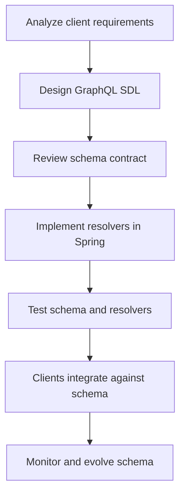

# Schema-first development

## Objectives

After this lesson, you will be able to:

- Explain the schema-first approach and the role of SDL in a Spring for GraphQL project.
- Design types, fields, arguments, inputs, enums, and nullability rules for an API.
- Organize schemas across multiple files and extend types using `extend`.
- Map schemas to Query, Mutation, and field resolvers using Spring for GraphQL annotations.
- Test schema contracts and resolvers with `GraphQlTester`.
- Evolve schemas while maintaining compatibility with active clients.

## 1. What is schema-first development?

Schema-first development is a way of building GraphQL APIs that starts from the schema contract. The development team describes the API using GraphQL SDL (Schema Definition Language), agrees on the types, fields, arguments, and operations clients are allowed to use, and then implements server resolvers to fulfill that contract.

For example, before writing any Java code, the team agrees that clients can look up a book by ID and receive an object containing an ID, title, and author:

```graphql
type Query {
  book(id: ID!): Book
}

type Book {
  id: ID!
  title: String!
  author: String
}
```

The schema answers these questions:

- What operations can clients call?
- What arguments do operations accept and what are their types?
- What shape do the results have?
- Which fields can be null, and which are guaranteed to have a value?
- Which objects link to each other?

SDL does not contain database access logic or business rules. Implementation logic is wired into the schema via `DataFetcher`s, annotated controllers, and runtime wiring components.

The workflow can be visualized as follows:



In Spring for GraphQL, schemas are typically placed in `src/main/resources/graphql/`. Spring Boot loads the SDL files, builds a `GraphQLSchema`, and connects fields to application resolvers.

## 2. Why design the schema first?

Schema-first helps teams align on the API before becoming coupled to Java organization or database layout. This is especially valuable when backend and frontend are developed in parallel.

For instance, frontend engineers can start writing queries and mocking responses from SDL while backend engineers implement repositories and services. Because both teams work from a single contract, there is less guesswork around field names or response shapes.

Specific benefits include:

- **Clear contract:** types and fields are published in SDL and can be reviewed independently of source code.
- **Parallel development:** client and server teams can work against the agreed schema.
- **Validation:** GraphQL validates operations against the schema before invoking resolvers.
- **Documentation and tooling:** SDL powers documentation, autocomplete, introspection, and client type generation.
- **Change management:** adding, deprecating, or removing fields can be evaluated as explicit API changes.

Schema-first also carries costs. The team must maintain SDL files and keep resolvers aligned with the contract. An overly complex or haphazardly changed schema makes the API hard for clients to use. Therefore, start from use-case needs rather than mirroring the entire database structure.

## 3. How do schema-first and code-first differ?

The two approaches differ in where API definition begins:

| Criterion | Schema-first | Code-first |
|---|---|---|
| Source of API description | GraphQL SDL files | Source code and language metadata |
| Workflow order | Design schema then implement resolvers | Write code then generate or infer schema |
| Contract review | Can review SDL independently | Usually requires reading code or generated schema |
| Parallel client development | Smooth once SDL is agreed early | Requires generating and sharing schema |
| Common risk | Drift between SDL and resolvers | API shaped too closely by code structure |
| Best suited when | You want the API contract as the single source of truth | Ecosystem has strong code-first tooling |

Spring for GraphQL focuses on the schema-first model: you define SDL and implement field handler methods. Annotations like `@QueryMapping` and `@SchemaMapping` bind Java methods to fields declared in the schema.

Schema-first does not require manually creating a Java class for every type. You can use records, DTOs, domain objects, or appropriate scalar types. What matters is that the Java types used during resolution supply the values published by the schema.

## 4. Starting with root operation design

A GraphQL schema requires a root query type. By convention, this type is named `Query`. `Mutation` and `Subscription` are optional and only needed when the API exposes state-modifying operations or event streams.

Example schema for a book management system:

```graphql
type Query {
  book(id: ID!): Book
  books(limit: Int = 20): [Book!]!
}

type Mutation {
  createBook(input: CreateBookInput!): Book!
  renameBook(id: ID!, title: String!): Book
}

type Book {
  id: ID!
  title: String!
  author: Author!
}

type Author {
  id: ID!
  name: String!
  books: [Book!]!
}

input CreateBookInput {
  title: String!
  authorId: ID!
}
```

In the example:

- `Query.book` finds a book by ID.
- `Query.books` returns a list of books, defaulting to a limit of 20.
- `Mutation.createBook` creates a book from an input object.
- `Mutation.renameBook` renames a book's title.
- `Book.author` and `Author.books` describe a bidirectional relationship between books and authors.

Root types can use different names if declared explicitly:

```graphql
schema {
  query: RootQuery
  mutation: RootMutation
}

type RootQuery {
  status: String!
}

type RootMutation {
  resetCatalog: Boolean!
}
```

If you use the default names `Query`, `Mutation`, and `Subscription`, a `schema` block is usually unnecessary.

## 5. Choosing the right data types for fields

GraphQL provides built-in scalars:

| Scalar | Meaning |
|---|---|
| `String` | Character string |
| `Int` | Signed 32-bit integer |
| `Float` | Floating-point number |
| `Boolean` | True or false value |
| `ID` | Object identifier |

GraphQL does not build in types such as `Date`, `DateTime`, `Long`, or `BigDecimal`. If your API needs these types, declare custom scalars in SDL—such as `scalar Date`—and register parsing and serialization logic via runtime wiring in Spring for GraphQL. Declaring a scalar in SDL alone does not tell the server how to convert values.

You can declare object types, enums, interfaces, unions, and input objects to model your domain data.

### Object types

Object types describe data clients can read:

```graphql
type Book {
  id: ID!
  title: String!
  publishedYear: Int
  author: Author
}
```

Each field has a name and a return type. A field can be a scalar, enum, object type, or a list of those types.

### Enums

Enums restrict a field's value to a defined set:

```graphql
enum BookStatus {
  DRAFT
  PUBLISHED
  ARCHIVED
}

type Book {
  id: ID!
  status: BookStatus!
}
```

Enums tell clients the valid values and avoid passing arbitrary strings for fields with a fixed set of choices.

### Input objects

Input objects group related arguments into a single input structure:

```graphql
input CreateBookInput {
  title: String!
  authorId: ID!
  publishedYear: Int
}
```

Using input objects for mutations with multiple parameters makes operations easier to read and extend. GraphQL separates input types from output object types: an input object cannot contain a field whose type is an output object like `Author`; instead, pass an ID or an appropriate nested input object.

### Interfaces and unions

Interfaces describe a shared set of fields across multiple object types:

```graphql
interface SearchResult {
  id: ID!
  label: String!
}

type Book implements SearchResult {
  id: ID!
  label: String!
  title: String!
}

type Author implements SearchResult {
  id: ID!
  label: String!
  name: String!
}
```

Unions allow a field to return one of several object types without requiring them to share fields:

```graphql
union CatalogItem = Book | Author
```

When using interfaces or unions, the server must resolve the concrete object type at runtime. GraphQL Java can use default type resolution when Java class names clearly match GraphQL type names; for complex cases, configure a `TypeResolver` via runtime wiring.

## 6. Understanding nullability and lists

The `!` symbol in SDL marks a value as non-null. Without it, a field may return null.

For lists, distinguish between list nullability and element nullability:

| Type | Can list be null? | Can elements be null? |
|---|---:|---:|
| `[Book]` | Yes | Yes |
| `[Book!]` | Yes | No |
| `[Book]!` | No | Yes |
| `[Book!]!` | No | No |

Example:

```graphql
type Query {
  books: [Book!]!
  featuredBook: Book
}
```

`books` must always return a list, possibly empty, with no null elements. `featuredBook` might not exist and is allowed to return null.

Nullability directly affects responses. If a resolver returns null for a non-null field or an error occurs while resolving it, GraphQL records an execution error and propagates null up to the nearest nullable parent field. This can turn a larger section of the response into null.

Do not attach `!` to every field just to make the schema look strict. Choose nullability based on business guarantees the server can uphold.

## 7. Designing arguments and pagination

Arguments let clients pass parameters to fields. Example:

```graphql
type Query {
  books(
    authorId: ID
    status: BookStatus
    limit: Int = 20
  ): [Book!]!
}
```

When designing arguments:

- Use names that convey business meaning.
- Pick explicit types and use non-null when a value is genuinely required.
- Provide default values for options with sensible defaults.
- Validate input bounds on the server, such as capping `limit` at a maximum value.
- Never use arguments to let clients directly specify database column names or query statements.

For large lists, design pagination instead of returning all records. A cursor-based schema might look like:

```graphql
type Query {
  books(first: Int = 20, after: String): BookConnection!
}

type BookConnection {
  edges: [BookEdge!]!
  pageInfo: PageInfo!
}

type BookEdge {
  cursor: String!
  node: Book!
}

type PageInfo {
  hasNextPage: Boolean!
  endCursor: String
}
```

Cursor pagination works well for lists that may change while a client pages through them. The server must define how stable cursors are generated and enforce a maximum cap on `first`. GraphQL does not implement pagination automatically; resolvers and services must execute the corresponding queries.

## 8. Organizing schemas across multiple files

A schema can be split into multiple files by business domain or type group. Spring Boot defaults to searching for `.graphqls` and `.gqls` files in:

```text
src/main/resources/graphql/
```

Example layout:

```text
src/main/resources/graphql/
├── book.graphqls
├── author.graphqls
└── common.graphqls
```

The `book.graphqls` file can declare root types and core types:

```graphql
type Query {
  book(id: ID!): Book
  books(limit: Int = 20): [Book!]!
}

type Mutation {
  createBook(input: CreateBookInput!): Book!
}

type Book {
  id: ID!
  title: String!
  author: Author!
}

input CreateBookInput {
  title: String!
  authorId: ID!
}
```

The `author.graphqls` file defines the `Author` type and adds a field to the root `Query` type:

```graphql
extend type Query {
  author(id: ID!): Author
}

type Author {
  id: ID!
  name: String!
  books: [Book!]!
}
```

GraphQL Java merges definitions from schema resources into a single executable schema. When extending a type, use `extend type` to add fields to an existing type. Do not repeat a base type across multiple files in ways that create conflicting definitions.

You can configure non-default schema locations:

```yaml
spring:
  graphql:
    schema:
      locations: classpath:graphql/**/
      file-extensions: .graphqls,.gqls
```

When splitting schemas into multiple files, establish naming conventions and domain ownership. Changes in a shared file can affect multiple operations.

## 9. Mapping SDL to Spring for GraphQL controllers

Once the schema is agreed upon, the server must supply data for its fields. Spring for GraphQL provides annotations to bind Java methods to fields in SDL.

Example using the schema declared above:

```graphql
type Query {
  book(id: ID!): Book
  books(limit: Int = 20): [Book!]!
}

type Mutation {
  createBook(input: CreateBookInput!): Book!
  renameBook(id: ID!, title: String!): Book
}
```

Input objects can map to Java records or DTOs:

```java
public record CreateBookInput(String title, String authorId) {
}
```

Controller:

```java
@Controller
public class BookController {

    private final BookService bookService;

    public BookController(BookService bookService) {
        this.bookService = bookService;
    }

    @QueryMapping
    public Book book(@Argument String id) {
        return bookService.findById(id);
    }

    @QueryMapping
    public List<Book> books(@Argument Integer limit) {
        return bookService.findBooks(limit);
    }

    @MutationMapping
    public Book createBook(@Argument("input") CreateBookInput input) {
        return bookService.create(input);
    }

    @MutationMapping
    public Book renameBook(
            @Argument String id,
            @Argument String title) {
        return bookService.rename(id, title);
    }
}
```

The annotations mean:

- `@QueryMapping` maps the method to a field on the root `Query` type.
- `@MutationMapping` maps the method to a field on the root `Mutation` type.
- `@SubscriptionMapping` maps the method to a field on the root `Subscription` type.
- `@Argument` extracts an argument from the client operation.

By default, Spring derives the field name from the method name. You can specify a name explicitly, such as `@QueryMapping(name = "bookById")`, if the Java method name differs from the SDL field name.

Java return types must supply data compatible with the GraphQL type. Resolvers can return synchronous objects or reactive types such as `Mono` and `Flux`, depending on the operation and application architecture.

## 10. Mapping nested fields with @SchemaMapping

Not every field is a root operation. In the schema:

```graphql
type Book {
  id: ID!
  title: String!
  author: Author!
}
```

The `Book.author` field needs to be resolved from a `Book` object. If the Java object already has a matching property or getter, GraphQL Java can use the default `PropertyDataFetcher`. When you need to query a service or apply custom logic, declare `@SchemaMapping`.

Example Java record:

```java
public record Book(
        String id,
        String title,
        String authorId) {
}
```

The record has `authorId` but no `author` property, so you can write a resolver:

```java
@Controller
public class BookFieldController {

    private final AuthorService authorService;

    public BookFieldController(AuthorService authorService) {
        this.authorService = authorService;
    }

    @SchemaMapping(typeName = "Book", field = "author")
    public Author author(Book book) {
        return authorService.findById(book.authorId());
    }
}
```

The `Book book` parameter is the parent field's source object. Spring passes that object into the method so the resolver can read `authorId` and fetch the corresponding author.

You can use `@SchemaMapping` for other nested fields, such as `Author.books`. If a query returns many authors and each resolver fetches a book list individually, the N+1 problem can occur. In that case, consider `@BatchMapping` or `DataLoader` to batch data loading.

## 11. The schema is an API contract, not a database mirror

A common mistake is designing GraphQL types by copying entities or database tables verbatim. This couples the API to storage structures and can accidentally expose internal fields.

For example, an entity might contain:

- Hashed passwords or internal tokens.
- Backend-only processing states.
- Lazy-loading relationships or persistence structures.
- Audit and operational fields.

Such fields should not automatically appear in the GraphQL schema. The schema should reflect the data and actions clients are allowed to use.

Consider separating:

- **GraphQL output types:** the shape of data clients can read.
- **GraphQL input types:** the data clients are allowed to send.
- **Domain models/entities:** server-side business and persistence models.
- **DTOs:** intermediate structures if data transformation is needed.

This separation lets you change the database without forcing API changes, while letting you enforce validation and authorization at the right boundaries.

## 12. Validating the schema contract

Schema-first only pays off when the contract is verified regularly. Verification falls into three groups.

### Validating SDL

At startup, Spring for GraphQL loads schema resources and builds the `GraphQLSchema`. SDL syntax errors, invalid types, or references to nonexistent types can cause schema creation to fail.

Check that:

- The root `Query` is declared.
- All referenced types and fields exist.
- Input types contain only valid input types.
- No conflicting type or field definitions exist.
- Nullability and default values reflect the intended contract.

### Validating mappings

Valid SDL does not mean every field has a working resolver. A field may rely on the default property fetcher or require an explicit mapping.

You can enable schema mapping inspection on the `GraphQlSource` builder to detect certain unmapped fields, redundant mappings, or mismatches that Spring can infer. Inspection does not replace execution tests; it cannot verify every business branch or runtime outcome.

### Testing operations with GraphQlTester

Spring for GraphQL provides `GraphQlTester` to send GraphQL documents and assert responses without depending on a specific transport.

Example controller slice test:

```java
@GraphQlTest(BookController.class)
class BookControllerTests {

    @Autowired
    GraphQlTester graphQlTester;

    @MockitoBean
    BookService bookService;

    @Test
    void bookQueryReturnsTitle() {
        given(bookService.findById("b-1"))
                .willReturn(new Book("b-1", "Spring GraphQL", "a-1"));

        graphQlTester.document("""
                query {
                    book(id: "b-1") {
                        id
                        title
                    }
                }
                """)
                .execute()
                .path("book.title")
                .entity(String.class)
                .isEqualTo("Spring GraphQL");
    }
}
```

In the example, `@GraphQlTest` loads the GraphQL slice configuration and the specified controller. `@MockitoBean` replaces the service with a mock so the test focuses on operation mapping and response creation. On older Spring Boot versions without `@MockitoBean`, projects can use `@MockBean` corresponding to their version.

Include tests for both happy paths and critical edge cases such as nonexistent IDs, invalid arguments, denied access, and resolver errors. When SDL changes, existing operation tests help catch changes that break clients.

## 13. Evolving schemas without breaking clients

The schema is a contract shared by many clients. Schema changes should be evaluated for compatibility.

### Generally compatible changes

Adding a new nullable field usually does not break existing operations:

```graphql
type Book {
  id: ID!
  title: String!
  subtitle: String
}
```

Older clients do not request `subtitle` and keep working. Newer clients can select that field when needed.

### Marking old fields as deprecated

When replacing a field, use the `@deprecated` directive:

```graphql
type Book {
  id: ID!
  oldTitle: String @deprecated(reason: "Use title instead")
  title: String!
}
```

Clients get time to migrate to the new field. The backend should monitor usage of the old field and coordinate removal timing with client teams.

### Changes with breaking risk

Some changes can render existing operations invalid or alter data semantics:

- Removing a field currently used by clients.
- Renaming a field or argument.
- Changing a return type or argument type incompatibly.
- Changing a nullable field to non-null when the server cannot yet guarantee a value.
- Adding a required argument without a default to an existing field.
- Removing an enum value that clients currently handle.

Adding a new enum value can also affect clients using code generation or exhaustive switches. Therefore, evaluate both GraphQL operation compatibility and how clients process data.

## 14. Schema-first workflow in a team

A practical workflow can include:

1. **Gather use cases:** determine which queries, mutations, and subscriptions screens or workflows need.
2. **Design SDL:** name types, fields, arguments, inputs, and nullability.
3. **Review the contract:** check usability, security, pagination, and evolvability.
4. **Share the schema:** give the SDL to both client and backend teams for joint development.
5. **Implement resolvers:** use controllers, services, and repositories to provide data.
6. **Verify mappings and operations:** run schema tests, resolver tests, and key GraphQL documents.
7. **Release and monitor:** track field errors, operation usage, and usage of deprecated fields.

During reviews, prioritize the question: “What use case does the client need to accomplish, and how does the schema help the client do it?” This keeps the schema focused on the API contract rather than implementation details.

## Conclusion

Schema-first development places GraphQL SDL as the central contract of the API. Teams design types, fields, arguments, and nullability first, then use Spring for GraphQL to map the schema to `Query`, `Mutation`, `Subscription`, and field resolvers.

A well-designed schema reflects client use cases, stays decoupled from database structure, defines clear pagination and nullability rules, and is verified via schema mapping inspection and `GraphQlTester`. When the API changes, favor compatible changes and use deprecation to give clients time to migrate.

## References

- [Spring for GraphQL — Request Execution](https://docs.spring.io/spring-graphql/reference/request-execution.html)
- [Spring for GraphQL — Annotated Controllers](https://docs.spring.io/spring-graphql/reference/controllers.html)
- [Spring for GraphQL — Testing](https://docs.spring.io/spring-graphql/reference/testing.html)
- [GraphQL Specification — Type System](https://spec.graphql.org/)
