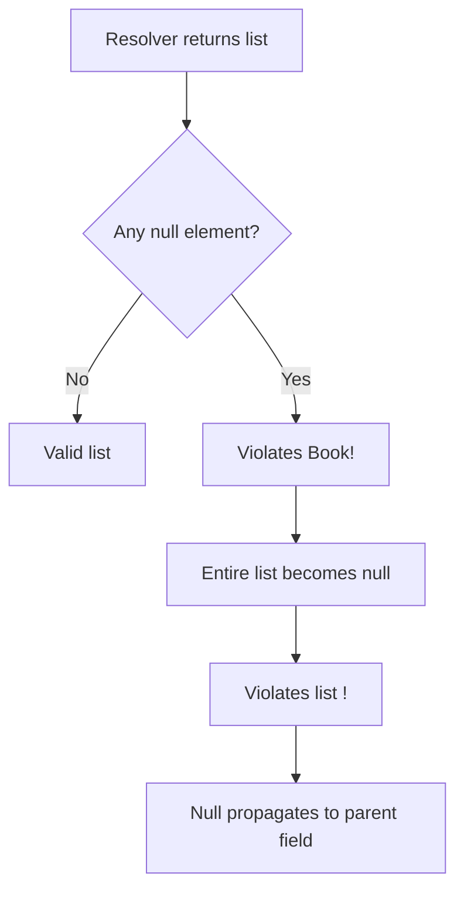

# Nullable and non-null in GraphQL

In GraphQL, a data type allows `null` values by default. To require a field or an argument to have a value, you append `!` after the type—for example, `String!` or `Book!`. This rule is called nullability and is a vital part of the API contract: clients know when they might receive `null`, and the server must ensure returned data conforms to the schema.

With Spring for GraphQL, nullability is declared in the GraphQL SDL. Java resolvers supply values for fields, yet Java types such as `String`, `Book`, or `List<Book>` do not by themselves replace the schema's nullability contract. Therefore, when designing an API, consider the SDL, the actual data, and how resolvers handle missing values.

## 1. Nullable is the default

Without `!`, GraphQL treats a type as nullable. Example:

```graphql
type Query {
    book(id: ID!): Book
    greeting: String
}

type Book {
    id: ID!
    title: String!
    subtitle: String
}
```

In the schema above:

- `book(id: ID!): Book` requires the client to pass a non-null `id`, but the `book` result can be null.
- `greeting: String` can return a string or null.
- `Book.id` and `Book.title` must always have values.
- `Book.subtitle` can be null.

An important point to remember is that an argument's type and a field's return type are two independent contracts. An argument can be required while the lookup result may still not exist. For instance, `book(id: ID!): Book` fits a scenario where the client must always provide an ID, yet the book might not be found.

If a nullable field returns null, that is a valid result according to the schema. Clients need to check for null before using the value. For an object field, the client can still receive the other fields of the parent object normally.

## 2. The Non-Null `!` modifier

Place `!` after a type to declare that the value cannot be null:

```graphql
type Query {
    requiredGreeting: String!
    optionalGreeting: String
}
```

`requiredGreeting` must return a non-null string. `optionalGreeting` can return a string or null. If the resolver returns null for `requiredGreeting`, GraphQL cannot produce a schema-valid response and raises an execution error.

Non-Null does not mean a string must be non-empty. For `String!`, values like `""` or `"   "` are still valid strings in GraphQL. If the business logic requires non-empty content, the application must validate that at the validation or domain layer.

Similarly, `Int!` only requires a non-null integer value; it does not enforce min/max bounds on its own. `ID!` requires a non-null ID value, but does not verify whether that ID exists in the database or whether the caller has permission to access it.

## 3. Nullable and Non-Null in lists

For List types, `!` can be applied independently to the list and its elements. There are four basic forms:

| SDL type | Can the list be null? | Can elements be null? |
| --- | --- | --- |
| `[Book]` | Yes | Yes |
| `[Book]!` | No | Yes |
| `[Book!]` | Yes | No |
| `[Book!]!` | No | No |

Example:

```graphql
type Query {
    optionalBooks: [Book]
    books: [Book!]!
    featuredBooks: [Book!]
    booksWithPlaceholders: [Book]!
}
```

`books: [Book!]!` guarantees the resolver always returns a non-null list and every element is a non-null `Book`. When there are no books, an empty list `[]` is a valid result. `featuredBooks: [Book!]` allows the list itself to be null, but if a list is present, every element must be non-null.

Do not confuse `null` with an empty list. `null` means the field has no value according to the contract; `[]` means the list exists but currently has no elements. If the API needs to distinguish these two states, choose appropriate nullability and document the business meaning clearly.

## 4. Non-Null rules for inputs

Non-Null on inputs specifies what data clients are required to provide. Example:

```graphql
type Query {
    book(id: ID!): Book
    searchBooks(keyword: String, pageSize: Int!): [Book!]!
}
```

Clients must pass `id` to `book` and `pageSize` to `searchBooks`. `keyword` is nullable, so it can receive null or be omitted. `pageSize: Int!` must receive a non-null integer.

With an input object:

```graphql
input BookFilter {
    keyword: String
    authorId: ID!
    page: Int = 1
    pageSize: Int! = 20
}

type Query {
    searchBooks(filter: BookFilter!): [Book!]!
}
```

`filter` is a required argument. Inside the input object, `authorId` is also required. `page` is nullable and has a default value of `1`; `pageSize` is Non-Null but has a default value of `20`, so clients can omit this field, yet if they pass it they cannot pass null.

A Non-Null input field without a default value must be supplied. If the client omits the field or passes null, GraphQL rejects the request during input validation/coercion and the corresponding resolver is not executed.

## 5. Distinguishing omitted fields, explicit null, and default values

For nullable inputs, the following three situations can carry different meanings:

1. Omitted field: the client does not include that field in the input object or does not send the argument.
2. Passing `null`: the client explicitly sends the field with a value of null.
3. Passing a value: the client supplies a concrete value.

Example:

```graphql
type Query {
    booksByPage(page: Int = 1): [Book!]!
}
```

If the client omits `page`, GraphQL uses the default value `1`. If the client passes `page: null`, the value is null; the default is not applied in place of an explicit null. If the client passes `page: 3`, the resolver receives `3`.

The same rule applies to fields in an input object that have defaults. The default is used when the field is omitted, not when the client actively sends null. For a Non-Null input field with a default, omitting the field is valid because GraphQL can use the default; passing null is still invalid.

The distinction between omitting a field and passing null is especially useful for partial update mutations. For instance, when updating a profile, omitting `nickname` might mean keeping the existing nickname, whereas passing `nickname: null` might mean clearing the nickname. If the application needs to distinguish these two states in Java, do not rely solely on a simple nullable variable; use a binding mechanism that preserves whether the field was provided.

Spring for GraphQL provides `ArgumentValue<T>` to represent an argument value and distinguish the omitted case from the explicitly passed null case. Example schema and resolver:

```graphql
type Mutation {
    updateProfile(nickname: String): Profile!
}

type Profile {
    nickname: String
}
```

```java
import org.springframework.graphql.data.ArgumentValue;
import org.springframework.graphql.data.method.annotation.Argument;
import org.springframework.graphql.data.method.annotation.MutationMapping;
import org.springframework.stereotype.Controller;

@Controller
public class ProfileController {

    private final ProfileService profileService;

    public ProfileController(ProfileService profileService) {
        this.profileService = profileService;
    }

    @MutationMapping
    public Profile updateProfile(
            @Argument("nickname") ArgumentValue<String> nickname) {

        if (!nickname.isOmitted()) {
            // Field was sent: the value can be null or a string.
            return profileService.updateNickname(nickname.value());
        }

        // Field was omitted: keep the current nickname unchanged.
        return profileService.currentProfile();
    }
}
```

In this example, omitting `nickname` preserves the old value, while passing `nickname: null` requests clearing the nickname. `ProfileService` is an application service injected via the constructor. For real mutations, define clear rules for omitted fields, explicit nulls, and concrete values, then test every case.

## 6. Null propagation when a resolver violates Non-Null

When a resolver returns null for a nullable field, GraphQL can place null in the response without generating an execution error solely for that null value. However, if a resolver returns null for a Non-Null field, GraphQL creates an execution error and propagates null up to the nearest nullable parent field. This mechanism is commonly called null bubbling or null propagation.

Consider the schema:

```graphql
type Query {
    book: Book!
    status: String!
}

type Book {
    id: ID!
    title: String!
    subtitle: String
}
```

If the `Book.subtitle` resolver returns null, the response can contain `"subtitle": null`; other fields can still be returned. If the `Book.title` resolver returns null, the `title` field violates Non-Null. GraphQL must turn the `Book` object into null. Because `Query.book` is also Non-Null, null continues propagating up to the root operation. When there is no nullable parent field left to stop it, the `data` section of the response can become null.

Example response when the error propagates to the root:

```json
{
  "data": null,
  "errors": [
    {
      "message": "Cannot return null for non-nullable field Book.title.",
      "path": ["book", "title"]
    }
  ]
}
```

The message above illustrates the error structure; the actual text depends on GraphQL Java and application configuration. The `path` field indicates the location of the failing field in the response, even when null has propagated up to a parent field.

## 7. Null propagation with List types

Null propagation follows clear rules for lists. Suppose a resolver returns a null element:

- `[Book]`: both the list and elements can be null, so the null element is accepted.
- `[Book]!`: the list cannot be null, but elements can be null; the null element is accepted.
- `[Book!]`: a null element turns the entire list into null; because the list is nullable, the error stops at the list field.
- `[Book!]!`: a null element turns the list into null, and because the list is also Non-Null, the error continues propagating to the parent field.

The diagram below illustrates the `[Book!]!` case:



Example:

```graphql
type Query {
    books: [Book!]!
    optionalBooks: [Book!]
    booksWithNullableItems: [Book]!
}
```

If an element in `booksWithNullableItems` is null, the list remains valid. If an element in `optionalBooks` is null, the entire `optionalBooks` field becomes null while other fields on the root Query can still be returned. If an element in `books` is null, the error propagates past the `books` field because the list is also Non-Null.

When a list contains objects, a Non-Null error on a child field of an object can also cause that object element to become null. If the element type is `Book!`, that error then turns the entire list into null. Thus, null propagation can start from a deeply nested field inside an object, not just from the element value returned directly by the list resolver.

## 8. Applying nullability in Spring for GraphQL resolvers

Example schema:

```graphql
type Query {
    book(id: ID!): Book
    allBooks: [Book!]!
}

type Book {
    id: ID!
    title: String!
    subtitle: String
}
```

Resolvers can be implemented as follows:

```java
import java.util.List;
import org.springframework.graphql.data.method.annotation.Argument;
import org.springframework.graphql.data.method.annotation.QueryMapping;
import org.springframework.stereotype.Controller;

@Controller
public class BookController {

    private final BookService bookService;

    public BookController(BookService bookService) {
        this.bookService = bookService;
    }

    @QueryMapping
    public Book book(@Argument("id") String id) {
        return bookService.findById(id).orElse(null);
    }

    @QueryMapping
    public List<Book> allBooks() {
        return bookService.findAll();
    }
}
```

`book` has a nullable return type (`Book`), so returning null when a record is not found is valid. `allBooks` has type `[Book!]!`, so `bookService.findAll()` must return a non-null list containing no null elements. If there are no books, the service should return an empty list.

A nested field example:

```graphql
type Book {
    id: ID!
    author: Author!
    subtitle: String
}
```

The resolver for `author` must always return a non-null `Author`. If the domain allows a book without an author yet, the schema should consider declaring `author: Author` to reflect the data accurately. If business rules require every book to have an author, keep `Author!` and handle missing data in the domain or service layer.

Spring for GraphQL uses the schema to validate and complete results. Java annotations such as `@Nullable` can help IDEs, static analysis, or human readers understand intent, but they do not automatically alter the GraphQL type declared in the schema. Ensure that SDL types and resolver return values align.

## 9. Exception handling and Non-Null errors

Missing data and errors while fetching data are two different situations. For a nullable field, returning null can express "not found". If the database is down, a service times out, or a business error occurs, throw an appropriate exception and map the error to a GraphQL error according to application policy.

Spring for GraphQL supports `DataFetcherExceptionResolver` for handling exceptions thrown inside data fetchers. An exception resolver can translate exceptions into `GraphQLError` instances with suitable messages, error classifications, or extensions. However, mapping an exception does not alter nullability rules: if a field is declared Non-Null and has no completed value, null must still propagate according to the schema.

When designing error handling, consider:

- Use null for the absent-value state if the field is nullable and that matches the intended business semantics.
- Use GraphQL errors for execution failures that clients need to recognize.
- Avoid exposing stack traces, SQL, tokens, or internal data in messages returned to clients.
- Choose Non-Null at an appropriate level so one field's failure does not wipe out unrelated data.
- Use `path` and `extensions` so clients can pinpoint the location and category of errors without relying on message text.

## 10. How to choose between Nullable and Non-Null

Do not mark every field Non-Null just to make the schema look strict. Base the decision on data semantics and what the system can guarantee.

| Design question | Recommendation |
| --- | --- |
| Can the field be absent according to business rules? | If yes, consider a nullable type. |
| Can the service always guarantee a value? | Use Non-Null only when that guarantee can be upheld. |
| Is a list with zero items a normal state? | Use a Non-Null list and return `[]` when there are no results. |
| Can one item fail while other items remain useful? | Consider a list allowing nullable elements or design a dedicated result object. |
| Should a child field failure break the entire object/list? | Review nullable boundaries to determine where null propagation stops. |
| Does input need to distinguish omitting from clearing with null? | Use a nullable input and binding that preserves omitted/null state. |

Some helpful conventions:

- Use Non-Null for IDs and required object fields when data and creation flows guarantee they always have values.
- Use nullable for fields that can legitimately be absent, such as profile pictures, optional subtitles, or an undetermined end date.
- For query lists, commonly use `[Item!]!` and return `[]` when no items exist, unless the domain needs a null state for the whole list.
- For partial update inputs, consider nullable fields to represent clearing a value, while distinguishing omitted fields from explicit nulls.
- Do not use Non-Null as a substitute for business validation, permission checks, or verifying data existence.

## 11. Testing nullability

Tests should verify both normal outcomes and boundary cases. With Spring GraphQL, you can use `GraphQlTester` to execute documents and inspect responses.

Example test for a nullable field when a book is not found:

```java
@Test
void missingBookReturnsNull() {
    graphQlTester.document("""
            query {
                book(id: "missing-id") {
                    id
                    title
                }
            }
            """)
        .execute()
        .path("book")
        .valueIsNull();
}
```

Example test for an empty list on a `[Book!]!` field:

```java
@Test
void noBooksReturnsAnEmptyList() {
    graphQlTester.document("""
            query {
                allBooks { id title }
            }
            """)
        .execute()
        .path("allBooks")
        .entityList(BookView.class)
        .hasSize(0);
}
```

Additionally, include tests confirming that:

1. Requests missing a Non-Null argument are rejected before calling the resolver.
2. Requests passing null for a Non-Null argument are rejected.
3. An omitted input field receives its default value if one exists.
4. A nullable input field explicitly passed as null stays null rather than using the default.
5. A resolver returning null for a Non-Null field produces an execution error and propagates null to the expected level.
6. A null element in `[Item!]` turns the entire list into null.
7. A null element in `[Item]` is accepted.
8. Clients receive appropriate `data`, `errors`, and `path` when execution errors occur.

These test examples assume `graphQlTester` and test data are configured in the test context. When testing null propagation, create resolvers or fixtures that can intentionally return null or throw exceptions to confirm the schema's exact behavior.

## 12. Common mistakes

| Symptom | Cause | How to fix |
| --- | --- | --- |
| Client cannot omit an argument | Argument is declared Non-Null with no default | Pass the required value or update the schema if business rules allow omitting it. |
| Request is rejected when passing null | Input has a Non-Null type | Send a valid value or change the input contract if null is a permitted state. |
| Resolver returns null and response has an error | Output field is declared Non-Null | Ensure the resolver returns a value or adjust nullability to match the domain. |
| One failing field turns `data` into null | Null propagated through Non-Null parent fields to root | Review nullable boundaries and the desired blast radius. |
| Default is not applied when client sends null | Defaults apply only when input is omitted | Distinguish omitted from explicit null in client/server logic. |
| Java field is nullable yet GraphQL reports a Non-Null violation | SDL is the GraphQL contract; Java types do not alter SDL automatically | Align the schema with what resolvers can return. |

## 13. Checklist before publishing a schema

1. Identify which fields are required and which can be absent according to business rules.
2. Check nullability separately for arguments, input fields, output fields, lists, and elements.
3. Set defaults on inputs only when a clear business default value exists.
4. Define distinct handling for omitted, explicit null, and concrete values.
5. Ensure resolvers do not return null for Non-Null fields or Non-Null list elements.
6. Review null propagation stopping points so one failure does not discard unrelated data.
7. Distinguish "data not found" from errors during resolver execution.
8. Write tests for nulls, empty lists, missing inputs, null inputs, and Non-Null errors.

Nullable and Non-Null are commitments between the GraphQL server and clients. The more closely the schema reflects real data, the easier it is for clients to handle responses and the better the server avoids unexpected error propagation. In Spring for GraphQL, start from the SDL, then ensure resolvers, services, and tests all adhere to that contract.
