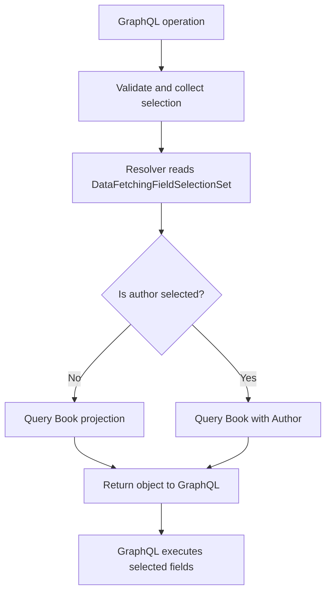

# Field Selection in GraphQL

Field selection is how a client specifies which fields it wants to receive in a GraphQL operation. Instead of the server returning an object with a fixed set of all properties, the client describes a selection set containing fields at each level of the data structure. GraphQL validates the selection set against the schema, executes the corresponding fields, and builds a response whose shape follows that selection.

In Spring for GraphQL, SDL defines which fields can be selected, while resolvers supply data for fields when an operation executes. GraphQL Java also provides `DataFetchingFieldSelectionSet` so a resolver knows which child fields were requested; this information can help optimize server-side queries when used properly.

After this lesson, you will be able to:

- Read selection sets on root fields and nested fields.
- Distinguish leaf fields from composite fields.
- Understand response keys, aliases, and selecting the same field multiple times.
- Reuse field selections with named fragments and inline fragments.
- Use `@include`, `@skip`, and `__typename` in operations.
- Understand selection set validation rules and inspect selection sets in Spring for GraphQL.
- Optimize queries based on requested fields while preserving the API contract and security.

## 1. What is a selection set?

A GraphQL operation can contain one or more fields. Fields enclosed in curly braces form a **selection set**. The root selection set starts from the root operation type, such as `Query`; a field returning an object can have a nested selection set.

Schema example:

```graphql
type Query {
    book(id: ID!): Book
}

type Book {
    id: ID!
    title: String!
    publishedYear: Int
    author: Author
}

type Author {
    id: ID!
    name: String!
}
```

The client can select only two fields on the book and the author's name:

```graphql
query {
    book(id: "book-42") {
        title
        author {
            name
        }
    }
}
```

The root selection set contains the `book` field. The selection set of `book` contains `title` and `author`; the selection set of `author` contains `name`. The server returns the exact structure selected:

```json
{
  "data": {
    "book": {
      "title": "GraphQL in Practice",
      "author": {
        "name": "Nguyen An"
      }
    }
  }
}
```

The `id` and `publishedYear` fields do not appear in the response because the client did not select them. This does not guarantee that the database only read two columns; the selection set controls the shape of the GraphQL data returned. To reduce the columns read, the server must actively use projections, optimized queries, or appropriate fetch plans.

## 2. Leaf fields and composite fields

A fundamental rule of GraphQL is distinguishing leaf fields from composite fields:

- **Leaf fields** have scalar or enum types. The client selects the field directly without a child selection set.
- **Composite fields** have object, interface, or union types. The client must specify a child selection set to indicate what data to retrieve from that type.

Valid example:

```graphql
query {
    book(id: "book-42") {
        id
        title
        status
        author {
            name
        }
    }
}
```

Two invalid cases:

```graphql
# Invalid: title is a scalar, it has no child fields
query {
    book(id: "book-42") {
        title {
            length
        }
    }
}

# Invalid: author is an object, it must have a selection set
query {
    book(id: "book-42") {
        author
    }
}
```

This rule also applies to lists. If a field has type `[Book!]!`, each element is a `Book` object, so the client must select child fields. Lists containing scalars or enums do not need a child selection set—for example, `tags: [String!]!` can be selected directly as `tags`.

## 3. Selection sets determine the response shape

A GraphQL response mirrors the selection set structure. Nested fields produce nested objects; lists produce arrays; aliases rename keys in the response. Example:

```graphql
query {
    book(id: "book-42") {
        id
        title
        author {
            id
            name
        }
    }
}
```

The response has a `book` object containing `id`, `title`, and the `author` object. If `book` is not found and the field is declared nullable, the response can contain `"book": null`. If a child field throws an error, GraphQL can return partial data alongside the `errors` array; nullability determines whether the error propagates up to the parent field.

A selection set is not a list of Java properties to serialize automatically. GraphQL executes each field according to the schema: fields with custom resolvers invoke those resolvers; simple fields can be read through the default property data fetcher. As a result, two clients can select two different subsets of fields from the same domain object without needing two separate endpoints.

## 4. Aliases: selecting the same field multiple times

An alias sets the response key name for a field selection. The syntax is `aliasName: fieldName`:

```graphql
query CompareBooks {
    firstBook: book(id: "book-42") {
        id
        title
    }
    secondBook: book(id: "book-99") {
        id
        title
    }
}
```

The response uses the aliases as keys:

```json
{
  "data": {
    "firstBook": {
      "id": "book-42",
      "title": "GraphQL in Practice"
    },
    "secondBook": {
      "id": "book-99",
      "title": "Spring APIs"
    }
  }
}
```

An alias does not rename the field in the schema and does not change the resolver method name. Both selections still invoke `Query.book`; the alias only determines the response key and lets you distinguish calls with different arguments.

If you select the same field with different arguments without using aliases, the fields share the same response key and conflict, making the operation invalid:

```graphql
# Invalid: two selections of book have the same response key but different arguments
query {
    book(id: "book-42") { title }
    book(id: "book-99") { title }
}
```

Use aliases when you need multiple results from the same field:

```graphql
query {
    first: book(id: "book-42") { title }
    second: book(id: "book-99") { title }
}
```

When reading the response or writing tests, access results by alias, such as `first.title`, instead of `book.title`.

## 5. Combining field arguments with selection

Arguments are attached to a field to change the data that the field returns, while the selection set specifies which child fields to retrieve. These two concepts complement each other:

```graphql
type Query {
    books(status: BookStatus, limit: Int = 20): [Book!]!
}

type Book {
    id: ID!
    title: String!
    status: BookStatus!
}
```

```graphql
query {
    books(status: PUBLISHED, limit: 10) {
        id
        title
    }
}
```

`status` and `limit` determine the set of books queried; `id` and `title` determine which fields of each book are returned. The resolver for `Query.books` receives arguments via `@Argument`, while child fields of `Book` are resolved by GraphQL according to the corresponding selection set.

If you need to fetch the same field under multiple conditions, combine arguments with aliases:

```graphql
query {
    drafts: books(status: DRAFT) {
        id
        title
    }
    published: books(status: PUBLISHED) {
        id
        title
    }
}
```

## 6. Named fragments for reusing selection sets

When multiple operations or multiple locations need the same group of fields, you can declare a named fragment:

```graphql
fragment BookSummary on Book {
    id
    title
    status
}

query BookCatalog {
    books {
        ...BookSummary
    }
}
```

`BookSummary` is a fragment targeting the `Book` type. `...BookSummary` inserts the fragment's fields into the selection set at that location. Fragments avoid repeating long field groups and keep operations using consistent data structures.

A fragment can contain nested fields or spread another fragment:

```graphql
fragment AuthorSummary on Author {
    id
    name
}

fragment BookDetails on Book {
    id
    title
    author {
        ...AuthorSummary
    }
}

query {
    book(id: "book-42") {
        ...BookDetails
    }
}
```

A fragment spread must be compatible with the type at the location where it is used. GraphQL validates type conditions and detects invalid fragment cycles. Never create fragment A spreading B and fragment B spreading A, because such a cycle cannot execute validly.

Fragments are a client-side document organization feature; they do not add types or resolvers to the server schema. When GraphQL executes, fields selected through fragments are resolved like normal fields.

## 7. Inline fragments for interfaces and unions

When a field returns an interface or union, the client can select common fields (if it is an interface) and then use inline fragments to select fields specific to the runtime type:

```graphql
union SearchResult = Book | Author

type Query {
    search(text: String!): [SearchResult!]!
}

type Book {
    id: ID!
    title: String!
}

type Author {
    id: ID!
    name: String!
}
```

```graphql
query Search($text: String!) {
    search(text: $text) {
        __typename
        ... on Book {
            id
            title
        }
        ... on Author {
            id
            name
        }
    }
}
```

`... on Book` applies its inner selection set only when the actual object is a `Book`; `... on Author` applies when the object is an `Author`. `__typename` tells the client the concrete type of each item in the union. This is a common pattern for building search results with multiple object types.

For an interface, you can select shared fields directly and add type-specific fields:

```graphql
interface Node {
    id: ID!
}

type Book implements Node {
    id: ID!
    title: String!
}

type Author implements Node {
    id: ID!
    name: String!
}

type Query {
    node(id: ID!): Node
}
```

```graphql
query {
    node(id: "42") {
        id
        ... on Book {
            title
        }
        ... on Author {
            name
        }
    }
}
```

## 8. The @include and @skip directives

The `@include` and `@skip` directives control whether a field or fragment is included in the execution result:

- `@include(if: Boolean!)`: include the field only when the expression is `true`.
- `@skip(if: Boolean!)`: skip the field when the expression is `true`.

Example:

```graphql
query BookDetails($id: ID!, $withAuthor: Boolean!, $hideYear: Boolean!) {
    book(id: $id) {
        id
        title
        publishedYear @skip(if: $hideYear)
        author @include(if: $withAuthor) {
            id
            name
        }
    }
}
```

The client passes variables:

```json
{
  "id": "book-42",
  "withAuthor": true,
  "hideYear": false
}
```

In this execution, `author` is selected and `publishedYear` is also selected. If `withAuthor` is `false`, the `author` field is skipped and its resolver does not need to run. These directives are useful when a screen has optional data sections or when a client wants to reuse a single operation with different display configurations.

`@include` and `@skip` are standard executable document directives. They do not alter the schema and are not an authorization mechanism. Never rely on client-side directives to protect sensitive data; the server must enforce permissions regardless of whether the client displays a field.

## 9. The __typename meta field

`__typename` is a meta field that returns the concrete object type name at the current execution position:

```graphql
query {
    book(id: "book-42") {
        __typename
        id
        title
    }
}
```

Example response:

```json
{
  "data": {
    "book": {
      "__typename": "Book",
      "id": "book-42",
      "title": "GraphQL in Practice"
    }
  }
}
```

Clients commonly use `__typename` to distinguish runtime types of interfaces/unions, normalize caches, or pick the right UI component. It is a meta field provided by GraphQL; you do not need to declare `__typename` in SDL or write a resolver for it.

GraphQL also provides introspection meta fields such as `__schema` and `__type` on the root query to explore the schema. They serve to inspect the API structure, unlike `__typename` which can be selected on objects in regular operations. The server can configure introspection policies per environment, though that does not replace data field access control.

## 10. Validation rules for field selection

Before invoking resolvers, GraphQL validates the operation against the schema. Important rules include:

- A selected field must exist on the current type or be provided by a matching interface/fragment.
- Leaf fields must be selected without a child selection set.
- Composite fields must have a child selection set.
- Arguments must exist, have compatible types, and satisfy non-null requirements.
- Fragment type conditions must be compatible with the type at the spread position.
- Fields sharing the same response key must be mergeable without conflicts in field name, arguments, or selection structure.
- Variables used in arguments or directives must be declared and have compatible types.

Example invalid operation selecting a non-existent field:

```graphql
query {
    book(id: "book-42") {
        title
        unknownField
    }
}
```

This operation is rejected during validation. The `Query.book` resolver never needs to be called. This is a benefit of a typed schema: misspelled field names, invalid selection structures, or bad arguments are caught early instead of silently returning missing data.

### Field conflicts and response keys

GraphQL groups field selections by response key to assemble the result. Two fields with the same response key must be compatible. If they use different arguments, assign different aliases. If they refer to the same field with the same arguments and compatible selection sets, GraphQL can merge those selections into a single field group during execution.

Fragments do not bypass merging rules. Two fragments may select the same field, but if they create a conflict on the same response key, the operation is still invalid.

## 11. Reading the selection set in Spring for GraphQL

Ordinarily, a resolver does not need to know which child fields the client selected. GraphQL executes the requested child fields on its own. However, in certain cases, the service can optimize data fetching based on the selection set.

GraphQL Java provides `DataFetchingFieldSelectionSet` via `DataFetchingEnvironment.getSelectionSet()`. Spring for GraphQL lets a resolver method accept `DataFetchingEnvironment`:

```java
@Controller
public class BookController {

    private final BookService bookService;

    public BookController(BookService bookService) {
        this.bookService = bookService;
    }

    @QueryMapping
    public Book book(
            @Argument("id") String id,
            DataFetchingEnvironment environment) {

        DataFetchingFieldSelectionSet selectionSet = environment.getSelectionSet();
        boolean loadAuthor = selectionSet.contains("author/*");

        return bookService.findById(id, loadAuthor);
    }
}
```

In this example, `author/*` checks whether the current selection set contains any child fields under `author`. The service can use this result to choose an appropriate projection or fetch plan. Patterns in `DataFetchingFieldSelectionSet.contains(...)` support globs; paths are evaluated relative to the field currently being resolved.

You can also check a specific field:

```java
boolean authorNameSelected = selectionSet.contains("author/name");
boolean reviewsSelected = selectionSet.contains("reviews/*");
```

GraphQL Java's selection set already accounts for fields brought in through fragments and directives in the current operation. Therefore, using this API is much more reliable than manually parsing the query string with text search. If you need finer detail, `selectionSet.getFields()` returns `SelectedField` instances exposing field name, path, object type, and nested selection sets.

## 12. Using field selection to optimize server-side queries

Suppose the client only requests `Book.id` and `Book.title`; the application may only need to query those columns. If the client also requests `author { name }`, the server can add a join or fetch the author. This is one approach to projection optimization:



Optimization should be designed in the service/repository rather than turning resolvers into places full of ad-hoc SQL queries. Some guidelines:

- Use controlled projections, DTOs, or fetch plans to retrieve only needed data.
- Account for nested selections and fragments; do not inspect only first-level fields if deeper query optimization is needed.
- Account for aliases: the schema field name remains the real field name, while the response key may be an alias.
- Do not assume a selection set always maps 1-to-1 to a list of database columns; a field may require internal fields for computation or business checks.
- Keep batch loading in place to avoid N+1 queries when a selection set requests relationships for many parent objects.
- Measure query count, execution time, and rows read before concluding that a projection improves performance.

In particular, never use whether the client selected a field to decide access permissions. Sensitive fields must be protected in the resolver or service. The selection set is a query optimization hint and response shape control, not a security boundary.

## 13. Field selection and resource limits

GraphQL lets clients nest selection sets across many levels. An operation with just a few lines can impose heavy load if each level queries many records or child field resolvers trigger N+1 queries. Thus, a client selecting few fields does not guarantee an inexpensive operation.

The server should consider:

- Limiting query depth to avoid overly deep field trees.
- Computing query complexity or cost based on field counts, arguments, and expected list sizes.
- Requiring pagination on fields returning large lists.
- Setting appropriate timeouts and concurrency limits.
- Using DataLoader or `@BatchMapping` for repeatedly selected relationships.
- Monitoring slow fields and the number of resolver/repository invocations.

Aliases must also be factored into resource limits: a client can invoke the same field many times with different arguments using aliases. Cost-calculation systems should evaluate actual execution count and potential returned data size rather than merely counting distinct field names.

## 14. Testing field selection with GraphQlTester

`GraphQlTester` helps verify that the response matches the exact structure requested by the operation. Example:

```java
graphQlTester.document("""
        query {
            book(id: "book-42") {
                title
                author {
                    name
                }
            }
        }
        """)
    .execute()
    .path("book.title")
    .entity(String.class)
    .isEqualTo("GraphQL in Practice");
```

With aliases, assert using the response key:

```java
graphQlTester.document("""
        query {
            featured: book(id: "book-42") {
                title
            }
        }
        """)
    .execute()
    .path("featured.title")
    .entity(String.class)
    .isEqualTo("GraphQL in Practice");
```

You should also test these cases:

1. Selecting leaf fields without a selection set and composite fields with a selection set.
2. Omitting unnecessary fields and confirming the corresponding field resolver is not called.
3. Selecting the same field with different arguments via aliases.
4. Reusing fragments and selecting concrete types with inline fragments.
5. Toggling `@include` and `@skip` with variables.
6. Verifying `__typename` for interfaces/unions.
7. Sending an invalid operation to confirm GraphQL rejects it before invoking resolvers.
8. Confirming selection-set-based projections still return accurate data and do not bypass permission checks.

## 15. Common mistakes

- **Missing selection set on an object field:** composite fields must have child fields.
- **Adding a selection set to a scalar or enum:** leaf fields do not have child fields.
- **Confusing an alias with the schema field name:** an alias only changes the response key, not the field handled by the resolver.
- **Selecting the same field with different arguments without an alias:** causes a conflict on the same response key.
- **Using a fragment with the wrong type condition:** a fragment incompatible with the type at the spread position is rejected by validation.
- **Parsing queries manually as strings:** easily misses fragments, aliases, directives, and nested structures; use `DataFetchingFieldSelectionSet`.
- **Treating the selection set as an authorization mechanism:** clients can send arbitrary operations; permissions must always be enforced on the server.
- **Assuming selecting fewer fields means querying less data:** resolvers or repositories may still load entire entities; projections/fetch plans and performance measurements are required.
- **Ignoring aliases when calculating query cost:** a single field can be executed many times with different arguments.

## 16. Workflow for designing and handling field selection

When designing operations or resolvers, you can follow this sequence:

1. Determine whether the field's return type is scalar/enum or object/interface/union.
2. Select appropriate child fields for composite types and keep selection sets concise according to client needs.
3. Use arguments for filtering or pagination; use aliases when calling the same field multiple times with different arguments.
4. Use named fragments to reuse field groups and inline fragments for interfaces/unions.
5. Use `@include`/`@skip` for optional fields and `__typename` when runtime type identification is needed.
6. Let GraphQL validation check fields, arguments, fragments, and response keys before execution.
7. Only inspect the selection set on the server when there is a clear optimization benefit; use GraphQL Java's API instead of manually parsing queries.
8. Combine projections, batch loading, pagination, and query cost limits to control load.
9. Test response shape, aliases, fragments, directives, resolver invocation, and access permissions.

Field selection is the mechanism that makes a GraphQL API flexible to client data needs. Once you understand selection sets, aliases, fragments, and directives, you can write clear operations and predict responses accurately. In Spring for GraphQL, combining default field execution with purposeful resolvers and `DataFetchingFieldSelectionSet` when optimization is warranted helps your API avoid over-fetching while preserving its contract and security controls.

## References

- [GraphQL Specification — Executable Definitions and Selection Sets](https://spec.graphql.org/October2021/#sec-Selection-Sets)
- [GraphQL Specification — Field Selection Merging](https://spec.graphql.org/October2021/#sec-Field-Selection-Merging)
- [GraphQL Java — DataFetchingFieldSelectionSet](https://javadoc.io/doc/com.graphql-java/graphql-java/latest/graphql/schema/DataFetchingFieldSelectionSet.html)
- [Spring for GraphQL — Annotated Controllers](https://docs.spring.io/spring-graphql/reference/controllers.html)
- [Spring for GraphQL — GraphQlTester](https://docs.spring.io/spring-graphql/reference/testing.html)
