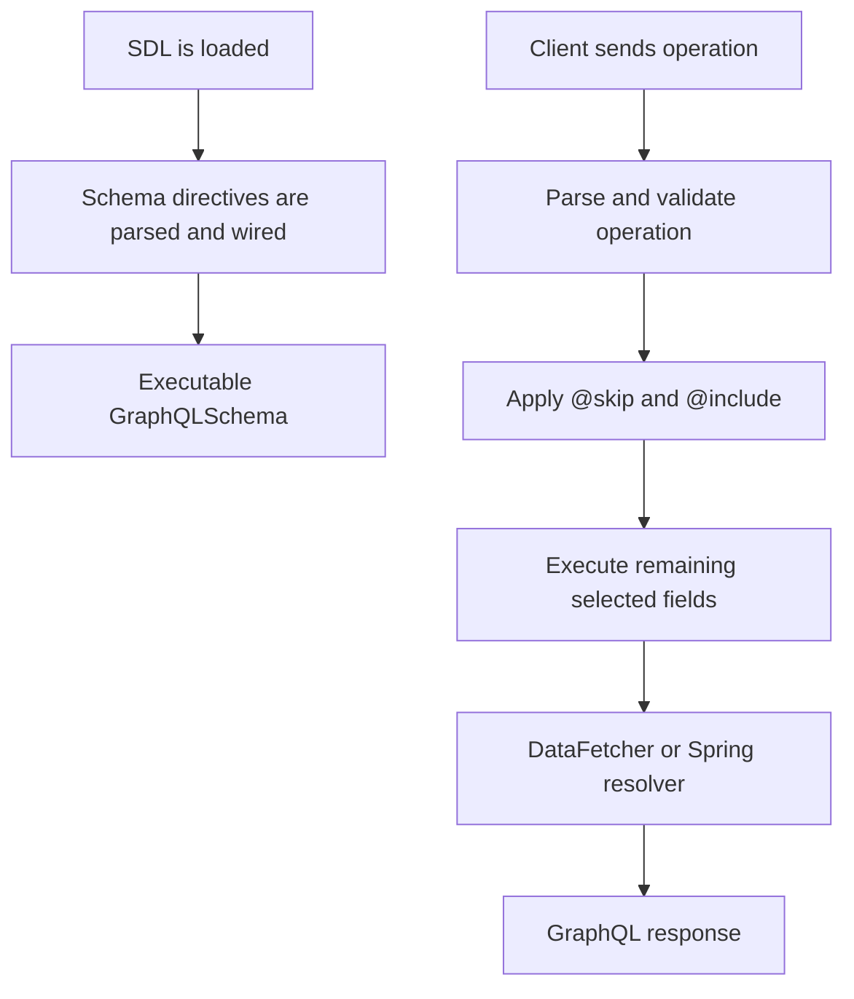

# Directives on Fields

In GraphQL, a **directive** is a named construct that can accept arguments and be attached to a specific location in a schema or operation. Directives add metadata or instructions telling tools and the runtime how to interpret part of the GraphQL document. On fields, directives can mark deprecated APIs, conditionally control which fields are included in a response based on client inputs, or apply custom application-implemented rules.

You must distinguish between the two places directives appear. A **schema directive** is declared in SDL, such as `@deprecated` on a field definition. An **executable directive** is attached by the client to fields in a query, mutation, or fragment, such as `@include` and `@skip`. They have different valid locations and are processed at different times.

## 1. Directive syntax and locations

A directive has the general form:

```graphql
@directiveName(argument: value)
```

When used in an SDL field definition, the directive is placed after the return type:

```graphql
type Book {
    title: String! @deprecated(reason: "Use displayTitle instead.")
}
```

A directive must be defined or provided by the GraphQL specification/runtime, and can only be placed at locations permitted by its declaration. When defining a custom directive, SDL uses the `directive` keyword, declares arguments, optionally specifies `repeatable`, and lists valid locations after `on`:

```graphql
directive @audit(action: String!) on FIELD_DEFINITION
```

`FIELD_DEFINITION` is the location for fields inside an object type or interface. Directives can be declared for other locations such as `OBJECT`, `SCALAR`, `ARGUMENT_DEFINITION`, `INPUT_FIELD_DEFINITION`, `ENUM_VALUE`, `FIELD`, `FRAGMENT_SPREAD`, or `INLINE_FRAGMENT`. Valid locations depend on the directive's purpose.

A directive can accept required or optional arguments, just like field arguments. Values passed to a directive must match the declared types. If you want a directive to appear multiple times at the same location, add the `repeatable` keyword:

```graphql
directive @tag(value: String!) repeatable on FIELD_DEFINITION

type Book {
    title: String! @tag(value: "searchable") @tag(value: "public")
}
```

Without `repeatable`, the same directive cannot be applied multiple times on a single location in a schema or operation.

## 2. `@deprecated`: marking a field as no longer recommended

`@deprecated` is the standard directive used to indicate that part of the schema is no longer recommended for use. It is typically attached to an old field when the API provides a replacement field:

```graphql
type Book {
    id: ID!
    displayTitle: String!

    title: String @deprecated(reason: "Use displayTitle instead.")
}
```

In this example, clients should migrate from `Book.title` to `Book.displayTitle`. The `title` field still exists in the schema and can still be queried during the transition period. `@deprecated` helps GraphQL IDEs, introspection, and API documentation identify the legacy field; it does not remove the field, block requests, or automatically copy data to the new field.

If `reason` is omitted, the GraphQL specification gives the default reason `No longer supported`. In real-world APIs, provide a specific reason so users know the replacement field or migration path.

`@deprecated` can also be used in other schema locations such as argument definitions, input field definitions, and enum values:

```graphql
enum BookFormat {
    HARDCOVER
    PAPERBACK
    EBOOK @deprecated(reason: "Use DIGITAL instead.")
    DIGITAL
}

enum BookStatus {
    DRAFT
    PUBLISHED
}

type Book {
    id: ID!
}

type Query {
    books(
        oldStatus: String @deprecated(reason: "Use status.")
        status: BookStatus
    ): [Book!]!
}

input BookFilter {
    legacyCode: String @deprecated(reason: "Use id.")
    id: ID
}
```

A client can inspect deprecation status via schema introspection, including `isDeprecated` and `deprecationReason` on schema elements that support deprecation. This allows tools to display warnings before the field is removed in a later schema version.

### Process for retiring an old field

A safe process usually includes these steps:

1. Add the new field with well-defined data types and behavior.
2. Keep the old field so existing clients continue to work, while marking it with `@deprecated`.
3. Update documentation and guide clients to migrate to the new field.
4. Monitor usage of the old field if the system has appropriate telemetry.
5. Remove the field only after assessing impact and following the system's versioning or API lifecycle policy.

Do not mark a field deprecated just for a cosmetic rename without clear migration instructions. Directives signal schema consumers, so the reason should be concise, accurate, and actionable.

## 3. `@include` and `@skip`: controlling fields in operations

`@include` and `@skip` are standard executable directives. Clients attach them to fields or fragments in a GraphQL document to control whether part of the selection set is executed.

- `@include(if: Boolean!)` includes the annotated location in the operation only if the expression is `true`.
- `@skip(if: Boolean!)` skips the annotated location if the expression is `true`.

For example, a client wants to fetch a long description only when the UI is in detail mode:

```graphql
query BookDetails($id: ID!, $showDescription: Boolean!) {
    book(id: $id) {
        id
        title
        description @include(if: $showDescription)
    }
}
```

When `$showDescription` is `false`, the `description` field is not included in the operation result. The client can use `@skip` for the inverse case:

```graphql
query BookSummary($id: ID!, $hideAuthor: Boolean!) {
    book(id: $id) {
        id
        title
        author @skip(if: $hideAuthor) {
            name
        }
    }
}
```

These directives do not modify the schema and are not authorization conditions. They only control the selection set of the current operation. If a user lacks permission to read `author`, the server must still enforce security checks in the resolver/service or an appropriate security layer; clients cannot secure data merely by omitting fields from a query.

`@include` and `@skip` can be used on fields, fragment spreads, and inline fragments. Example:

```graphql
query Search($showBooks: Boolean!) {
    search(keyword: "Spring") {
        ... on Book @include(if: $showBooks) {
            title
        }
    }
}
```

Skipping a field does not mean its resolver returns `null`. The field is absent from the selection set after applying the directive, so it does not appear in the response. This differs from a selected field whose resolver returns `null`.

## 4. Differences between schema directives and executable directives

The two groups of directives are often confused because both use `@`, but they attach to different locations:

| Criterion | Schema directive | Executable directive |
| --- | --- | --- |
| Where it appears | SDL defining the schema | Client query, mutation, subscription, or fragment |
| Examples | `@deprecated`, `@specifiedBy`, custom directives on field definitions | `@include`, `@skip` |
| Locations | `FIELD_DEFINITION`, `SCALAR`, `ENUM_VALUE`, etc. | `FIELD`, `FRAGMENT_SPREAD`, `INLINE_FRAGMENT`, etc. |
| Purpose | Describes or augments schema behavior | Controls how an operation is executed |
| When processed | When the schema is parsed/built or when runtime interprets metadata | When the server processes an operation |

The following example is a schema directive because it attaches to a field definition in SDL:

```graphql
type Book {
    title: String! @deprecated(reason: "Use displayTitle.")
}
```

The following example is an executable directive because it appears inside a query sent by the client:

```graphql
query {
    book(id: "book-01") {
        title @include(if: true)
    }
}
```

You cannot place a directive at an arbitrary location. For instance, `@include` is not a directive for annotating fields in SDL; it belongs in executable documents. Conversely, `@deprecated` is schema metadata and not a way to conditionally include a field in a query.

## 5. `@specifiedBy` and custom scalar metadata

GraphQL has a standard `@specifiedBy` directive for scalar definitions. This directive links a custom scalar to documentation describing its format or serialization rules:

```graphql
"""Timestamp in ISO-8601 format."""
scalar DateTime @specifiedBy(
    url: "https://scalars.graphql.org/andimarek/date-time"
)
```

`@specifiedBy` tells clients and tooling the expected scalar format. It does not implement a parser or serializer by itself. In a Spring for GraphQL application, you must register the corresponding runtime scalar—typically with GraphQL Java's `GraphQLScalarType` and `Coercing`—via runtime wiring configuration.

This directive sits on the scalar definition rather than on field definitions. If a field has type `DateTime`, the scalar metadata is declared once on the `DateTime` definition and applies to every field using that type.

## 6. Defining custom directives on fields

When standard directives do not cover a requirement, you can declare custom directives. For example, a schema wants to mark a field whose string value should be normalized before returning:

```graphql
directive @uppercase on FIELD_DEFINITION

type Book {
    title: String! @uppercase
}
```

The declaration above defines only the directive name and valid location. GraphQL does not automatically infer from `uppercase` that strings should be uppercased. The application must implement the runtime logic interpreting the directive.

A custom directive can accept arguments:

```graphql
directive @mask(prefix: Int!, suffix: Int!) on FIELD_DEFINITION

type Customer {
    email: String! @mask(prefix: 2, suffix: 3)
}
```

In this example, the directive describes a rule for partially masking an email. The application must validate the arguments and implement the value transformation. For sensitive data, masking strings in the response does not replace access-control checks on the underlying data; the server must verify the caller is authorized to access the field and data before returning results.

### Directive wiring in GraphQL Java

GraphQL Java provides `SchemaDirectiveWiring` to process custom schema directives while building the executable schema. A wiring implementation can inspect directive arguments, retrieve the existing data fetcher, and wrap it with additional logic.

Illustrative example wrapping a data fetcher to uppercase string values:

```java
public class UppercaseDirective implements SchemaDirectiveWiring {

    @Override
    public GraphQLFieldDefinition onField(
            SchemaDirectiveWiringEnvironment<GraphQLFieldDefinition> environment) {

        GraphQLFieldDefinition field = environment.getElement();
        DataFetcher<?> original = environment.getCodeRegistry()
            .getDataFetcher(environment.getFieldsContainer(), field);

        DataFetcher<?> wrapped = DataFetcherFactories.wrapDataFetcher(
            original,
            (dataEnvironment, value) -> value instanceof String
                ? ((String) value).toUpperCase(Locale.ROOT)
                : value
        );

        environment.getCodeRegistry().dataFetcher(
            environment.getFieldsContainer(), field, wrapped);

        return field;
    }
}
```

Registering the wiring in `RuntimeWiring`:

```java
RuntimeWiring wiring = RuntimeWiring.newRuntimeWiring()
    .directive("uppercase", new UppercaseDirective())
    .build();
```

With Spring for GraphQL, you can provide this configuration via a `RuntimeWiringConfigurer` so Spring manages it while building `GraphQlSource`:

```java
@Bean
RuntimeWiringConfigurer directiveConfigurer() {
    return builder -> builder.directive(
        "uppercase", new UppercaseDirective());
}
```

Classes in the example must be imported from GraphQL Java, including `SchemaDirectiveWiring`, `SchemaDirectiveWiringEnvironment`, `GraphQLFieldDefinition`, `DataFetcher`, `DataFetcherFactories`, and `RuntimeWiring`. Exact API signatures can vary with the GraphQL Java version managed by Spring for GraphQL; when implementing, use the version compatible with your project's dependency management.

## 7. Directives and field-level security

A custom directive such as `@requiresRole` can make the schema easier to read:

```graphql
enum Role {
    READER
    EDITOR
}

directive @requiresRole(role: Role!) on FIELD_DEFINITION

type Query {
    publicBooks: [Book!]!
    editorialNotes: [String!]! @requiresRole(role: EDITOR)
}
```

However, declaring `@requiresRole` does not authenticate users or reject requests by itself. For the directive to take effect, you must implement a runtime mechanism that checks roles and enforces authorization, or use Spring's method security on the resolver/service. Example with Spring Security method security enabled:

```java
@Controller
public class EditorialController {

    private final EditorialService editorialService;

    public EditorialController(EditorialService editorialService) {
        this.editorialService = editorialService;
    }

    @QueryMapping
    @PreAuthorize("hasAuthority('EDITOR')")
    public List<String> editorialNotes() {
        return editorialService.findNotes();
    }
}
```

In this example, `@PreAuthorize` is Spring Security's enforcement mechanism; it checks permissions when the resolver method is invoked. If the application also uses a custom directive to document policy in SDL, ensure the directive and method security reflect the same rules so you do not maintain two conflicting sources of configuration.

Permission checks should run on the server for every request. Never use `@skip` or `@include` as a security mechanism because clients can alter their own operations. Nor should you merely hide a field from documentation or introspection and assume the data is protected.

## 8. How do directives affect resolvers and responses?

With executable directives `@skip` and `@include`, GraphQL evaluates the conditions in the operation before executing unselected fields. Fields excluded from the selection set will not invoke their resolvers in that operation.

With schema directives such as `@deprecated`, the schema preserves metadata for introspection tools and clients to read. The resolver will still be invoked if a client queries the deprecated field.

With custom directives, behavior depends on the runtime implementation. A directive can wrap a `DataFetcher`, alter schema construction, attach instrumentation, or serve as metadata for another component. Without code interpreting the directive, it does not modify data or access control on its own.

The following diagram summarizes the stages:



## 9. Testing directives

You should test both the schema contract and the runtime behavior of directives.

For `@deprecated`, inspect introspection or schema metadata to verify the field is properly marked and the reason is informative. For `@include` and `@skip`, send operations with both `true` and `false` values, confirming the field appears or is omitted according to the condition. For custom directives, test the implemented transformation or policy logic, including invalid arguments or mismatched data types.

Example testing an executable directive with `GraphQlTester`:

```java
graphQlTester.document("""
        query($showTitle: Boolean!) {
            book(id: "book-01") {
                title @include(if: $showTitle)
            }
        }
        """)
    .variable("showTitle", false)
    .execute()
    .path("book.title")
    .pathDoesNotExist();
```

For custom directives using `SchemaDirectiveWiring`, test through the Spring-configured schema to verify the wiring is registered on `GraphQlSource` and the data fetcher is wrapped correctly. A unit test on the directive class alone verifies transformation logic, but does not prove Spring Boot loaded the SDL and wiring inside the application context.

## 10. Common errors and troubleshooting

| Symptom | Cause | How to check or fix |
| --- | --- | --- |
| Invalid directive on field | Directive does not allow the `FIELD_DEFINITION` or `FIELD` location being used | Check the `on ...` declaration and placement |
| Undefined directive | Custom directive lacks a declaration or is not provided by runtime/schema | Declare `directive @name ... on ...` before using it |
| Missing directive argument | Non-null argument without a default was not passed | Supply an argument of the correct type |
| Placing `@include` in SDL | Confusing an executable directive with a schema directive | Use `@include` only in operations/fragments |
| Deprecated field is still called | `@deprecated` only marks metadata | Execute the field retirement plan and update clients |
| Custom directive produces no behavior | Missing `SchemaDirectiveWiring` registration or interpretation logic | Add the wiring or corresponding runtime mechanism |
| Data remains accessible when client uses `@skip` | `@skip` is not a permission check | Protect resolvers/services with Spring Security or server-side policy |
| Scalar has `@specifiedBy` but parsing fails | Metadata does not provide a coercing implementation | Register the runtime custom scalar and test parse/serialize |

When errors occur, first determine whether the directive belongs in SDL or an executable document. Then verify the directive location, name, arguments, and corresponding runtime wiring. If the schema starts cleanly but no behavior takes effect, the cause is usually an uninterpreted custom directive or a resolver bypassing that mechanism.

## 11. Principles for using directives in APIs

Only create a custom directive when it expresses a clear, meaningful rule and has a runtime component responsible for enforcing it. Name it after its intent, declare strongly typed arguments, and restrict the directive to appropriate locations. For directives affecting security, document how the policy is enforced and test both allowed and denied cases.

Use `@deprecated` to support API transitions rather than abruptly deleting fields. Use `@include` and `@skip` to reduce unnecessary data in operations, while always letting the server decide access rights. For custom scalars, use `@specifiedBy` to publish the format and implement corresponding coercion.

Directives enrich the expressiveness of schemas and operations, but real effectiveness depends on valid placement and execution components. Understanding the boundary between SDL metadata, operation conditions, and custom runtime wiring keeps your GraphQL API discoverable, secure, and evolvable without confusing clients.
