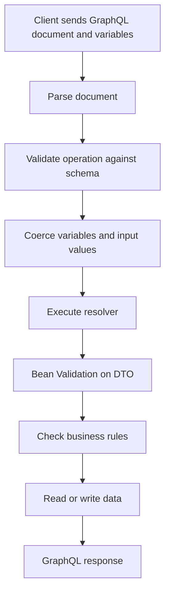

# Input Validation

Input validation is the process of checking data sent by clients to a GraphQL API before and during business execution. A GraphQL schema can check structure, data types, required fields, and scalar coercibility. However, the schema cannot know on its own whether an email is already registered or whether an order is in a state that permits cancellation. Those rules belong to server-side business validation.

With Spring for GraphQL, combine multiple validation layers: the GraphQL engine verifies operations and inputs against the SDL; Bean Validation checks constraints on DTOs; and the service/domain layer protects business rules and data consistency. Each layer has a clear responsibility, ensuring errors are caught in the right place without depending on any single client UI.

## 1. Validation Layers in a GraphQL Request

A GraphQL request typically flows through the following steps:



Parsing, document validation, and coercion occur before the resolver executes. If a document has a syntax error, selects a non-existent field, or passes an incompatibly typed variable, the operation is rejected before running any business logic.

After the resolver receives the GraphQL-coerced data, the application checks conditions the schema cannot express, such as string lengths, email formats, values greater than 0, resource ownership, or current object state.

Responsibilities can be divided as follows:

| Layer | Checks | Examples |
| --- | --- | --- |
| GraphQL document validation | Operation structure and fields against schema | Non-existent field, missing selection set |
| Input coercion | Scalar types, enums, lists, input objects, nullability | Passing a string to `Int!` |
| Bean Validation | Constraints on DTOs | `@NotBlank`, `@Email`, `@Size` |
| Domain validation | Business rules | Email already registered, quantity exceeds stock |
| Authorization | User permissions on action and resource | Only order owner may cancel |
| Persistence constraint | Invariants enforced by the database | Unique constraint, foreign key |

## 2. Validation Declared in the GraphQL Schema

SDL lets you express certain input rules directly in the API contract.

```graphql
input RegisterUserInput {
    name: String!
    email: String!
    age: Int
    roles: [String!]!
}

type Mutation {
    registerUser(input: RegisterUserInput!): User!
}
```

This declaration lets GraphQL enforce:

- The mutation's `input` must be provided and non-null.
- `name` and `email` must have non-null values.
- `age` may be omitted or set to null.
- `roles` must be a non-null list; each element in the list must also be non-null.

However, `String!` does not mean a non-empty string. Clients can still send `""` or a whitespace-only string. Likewise, `Int` cannot on its own express that age must be 18 or older. Those conditions require application-layer validation.

### 2.1. Understanding Nullability and Omitted Fields

In an input object, distinguish required fields, optional fields, and default values.

```graphql
input UpdateProfileInput {
    displayName: String!
    bio: String
    locale: String = "vi"
}
```

- `displayName: String!` must be provided and cannot be null.
- `bio: String` can be omitted or explicitly sent as `null`.
- `locale` uses the default value `vi` if the client does not supply that field.

For partial-update mutations, an omitted field usually means keeping the old value; a field sent with `null` can mean clearing the value. This is a business convention that the API must define clearly.

Variables example:

```json
{
  "input": {
    "displayName": "Lan Nguyen",
    "bio": null
  }
}
```

In this case `bio` is explicitly sent as null, while `locale` is not sent so the schema applies the default value. If the application needs to distinguish an omitted field from a field sent as null, do not simply bind into an ordinary nullable Java property without preserving field presence information. You can inspect the input map, use a tri-state representation type, or use a dedicated mapping layer.

### 2.2. List Inputs and Coercion

GraphQL has input coercion rules for lists. For an input typed `[String!]!`, a client can send a single value and GraphQL can coerce it into a one-element list:

```graphql
input TagInput {
    labels: [String!]!
}
```

Both variables below can coerce validly:

```json
{ "labels": ["java", "graphql"] }
```

```json
{ "labels": "graphql" }
```

After coercion, the resolver receives a list. If the business contract requires clients to send a collection, consider standardizing on the client and validating element counts on the server rather than assuming incoming JSON always arrives as an array.

## 3. Scalars and Input Coercion

GraphQL has built-in scalars with their own conversion rules:

| Scalar | Commonly Accepted Input | Notes |
| --- | --- | --- |
| `Int` | Integer within signed 32-bit range | Does not accept numeric strings like `"12"` |
| `Float` | Numeric value | Do not substitute number-formatted strings |
| `String` | String | Does not auto-convert numbers or booleans to strings |
| `Boolean` | `true` or `false` | Does not accept `"true"` string |
| `ID` | String or integer per ID rules | Typically represented as a string in responses |

Schema example:

```graphql
type Mutation {
    updateStock(productId: ID!, quantity: Int!): Product!
}
```

A request passing `quantity: "5"` has the wrong type; GraphQL does not automatically convert strings into integers. The client should send the JSON number `5`.

For a variable declared `Int!`, GraphQL checks both type and nullability before invoking the resolver. Range checks—such as `quantity` being greater than 0 and within inventory limits—still belong to the application.

## 4. Using Custom Scalars for Formatted Data

When a value has a distinct format or conversion rule, a custom scalar can make the schema more expressive—for example `EmailAddress`, `Date`, or `DateTime`.

```graphql
scalar EmailAddress
scalar LocalDate

input CreateAccountInput {
    email: EmailAddress!
    birthDate: LocalDate
}
```

Custom scalars need an appropriate serializer and parser. In GraphQL Java, scalars are typically built with `GraphQLScalarType` and `Coercing` to define how literals are parsed, variables are parsed, and outputs are serialized.

Custom scalars can check syntactic validity of a value, but they do not replace business validation. An `EmailAddress` scalar can reject malformed strings, yet cannot determine on its own whether that address already exists in the system.

Do not create a custom scalar for every Java type. Use one only when the data type has clear contract semantics, stable parse/serialize rules, and broad reuse. Otherwise, standard scalars paired with DTO validation are often easier to understand.

## 5. DTO Validation with Jakarta Bean Validation

In a Spring Boot application, you can use Jakarta Bean Validation to declare constraints on input DTOs. A validation implementation is required on the runtime classpath, typically via the `spring-boot-starter-validation` dependency.

Maven example:

```xml
<dependency>
    <groupId>org.springframework.boot</groupId>
    <artifactId>spring-boot-starter-validation</artifactId>
</dependency>
```

Define the input record:

```java
package com.example.graphql.user;

import jakarta.validation.constraints.Email;
import jakarta.validation.constraints.NotBlank;
import jakarta.validation.constraints.Size;

public record RegisterUserInput(
    @NotBlank(message = "Name must not be blank")
    @Size(max = 100, message = "Name must be at most 100 characters")
    String name,

    @NotBlank(message = "Email must not be blank")
    @Email(message = "Email format is invalid")
    @Size(max = 254, message = "Email is too long")
    String email
) {}
```

The controller accepts the input and requests validation:

```java
package com.example.graphql.user;

import jakarta.validation.Valid;
import org.springframework.graphql.data.method.annotation.Argument;
import org.springframework.graphql.data.method.annotation.MutationMapping;
import org.springframework.stereotype.Controller;

@Controller
public class UserMutationController {

    private final UserService userService;

    public UserMutationController(UserService userService) {
        this.userService = userService;
    }

    @MutationMapping
    public User registerUser(@Argument @Valid RegisterUserInput input) {
        return userService.register(input);
    }
}
```

Spring for GraphQL supports integrating validation for method arguments depending on your configuration and Spring version. Ensure a Bean Validation provider is on the classpath and annotation validation is enabled for handler methods. When upgrading framework versions, check how validation exceptions are raised and handled during GraphQL execution so clients receive consistent errors.

Commonly used annotations:

| Annotation | Meaning |
| --- | --- |
| `@NotNull` | Value must not be null |
| `@NotBlank` | String must contain at least one non-whitespace character |
| `@NotEmpty` | String or collection must not be empty |
| `@Size(min, max)` | Limits length or element count |
| `@Min`, `@Max` | Bounds integer or compatible numeric types |
| `@Positive`, `@PositiveOrZero` | Value must be positive or non-negative |
| `@Email` | Checks email format according to validator |
| `@Pattern` | Validates string against a regular expression |

Choose annotations matching the exact intent. For example, `@NotEmpty` accepts a whitespace-only string, whereas `@NotBlank` does not.

## 6. Nested Validation and Multi-Field Rules

An input object can contain another input object. To make validation descend into nested properties, place `@Valid` on the property holding the nested object.

```java
public record AddressInput(
    @NotBlank String street,
    @NotBlank String city,
    @Pattern(regexp = "[0-9]{5,6}") String postalCode
) {}

public record CreateCustomerInput(
    @NotBlank String name,
    @Valid AddressInput address
) {}
```

If `address` can be null according to the schema, clarify whether business rules allow a missing address. `@Valid` triggers validation of the child object when that object is present; it does not turn a nullable field into a required one. Use `@NotNull @Valid` if the object must be present.

Some rules compare multiple fields, such as requiring `startDate` to precede `endDate`, or requiring `password` and `confirmPassword` to match. You can create a class-level constraint with a custom Jakarta Validation annotation and validator.

Conceptual example:

```java
@ValidDateRange
public record BookingInput(
    @NotNull LocalDate startDate,
    @NotNull LocalDate endDate
) {}
```

The `@ValidDateRange` validator receives the whole object and checks the relationship between the two dates. Do not scatter multi-field comparison logic across individual resolvers where the same rule could be duplicated across multiple mutations.

## 7. Domain Validation in Services

Bean Validation fits structural data constraints such as length, format, and numeric bounds. Conditions that depend on system state should be checked in the service or domain layer.

User registration example:

```java
@Service
public class UserService {

    private final UserRepository userRepository;

    public UserService(UserRepository userRepository) {
        this.userRepository = userRepository;
    }

    public User register(RegisterUserInput input) {
        if (userRepository.existsByEmail(input.email())) {
            throw new EmailAlreadyRegisteredException(input.email());
        }

        User user = new User(input.name(), input.email());
        return userRepository.save(user);
    }
}
```

Checking whether an email already exists requires querying stored data and therefore cannot be solved with `@Email`. At the same time, calling `existsByEmail` before saving does not completely eliminate race conditions: two concurrent requests can both pass the check. The database should have a unique constraint to protect the invariant, and the service should translate constraint violations into an appropriate business error.

For state-dependent operations, check conditions inside an appropriate transaction. For instance, allow cancelling an order only when it has not yet shipped. If concurrent updates can occur, consider optimistic locking or locking strategies required by the domain.

## 8. Handling Validation Errors in GraphQL

GraphQL has two error categories to distinguish:

- **Request error**: parse, document validation, or input coercion error. No resolver has run; the response typically has `errors` and no execution `data`.
- **Execution error**: error occurring while a resolver or field is executing. The response can contain both partial `data` and `errors`, depending on error location and schema nullability.

Input coercion error example:

```graphql
type Mutation {
    setAge(age: Int!): User!
}
```

A client passing the string `"twenty"` for the `age` argument is rejected before the resolver runs. Do not try to catch this error in the service, because the service never receives an invalid request of that kind.

For DTO or domain validation errors, the server must decide on a consistent representation. Two approaches are common:

1. Use GraphQL errors to indicate that the mutation could not execute, with standardized error codes and messages.
2. Return a payload with `userErrors` when the error is a predictable business outcome that the client needs to display alongside the response.

Payload example:

```graphql
type UserError {
    field: String
    code: String!
    message: String!
}

type RegisterUserPayload {
    user: User
    userErrors: [UserError!]!
}
```

Do not mix both approaches arbitrarily in the same API. Clearly specify which failures are user-displayable input errors, which are authentication/authorization errors, and which are system failures. Messages returned to clients must never expose stack traces, SQL, or sensitive data.

Spring for GraphQL supports handling exceptions with `@GraphQlExceptionHandler` inside controllers or `@ControllerAdvice`, combined with `DataFetcherExceptionResolver` when lower-level configuration is needed. Business exceptions can be mapped to a `GraphQLError` with a safe error code and message. For validation exceptions, inspect the exact exception type raised by your handler-method configuration in the version you use.

## 9. Example: Handling a Business Exception

Suppose the service throws `EmailAlreadyRegisteredException`. You can use an exception handler to normalize the error:

```java
import graphql.GraphQLError;
import graphql.GraphqlErrorBuilder;
import graphql.schema.DataFetchingEnvironment;
import org.springframework.graphql.data.method.annotation.GraphQlExceptionHandler;
import org.springframework.graphql.execution.ErrorType;
import org.springframework.web.bind.annotation.ControllerAdvice;

@ControllerAdvice
public class GraphQlErrorHandler {

    @GraphQlExceptionHandler
    public GraphQLError handleEmailAlreadyRegistered(
            EmailAlreadyRegisteredException exception,
            DataFetchingEnvironment environment) {
        return GraphqlErrorBuilder.newError(environment)
            .errorType(ErrorType.BAD_REQUEST)
            .message("This email address is already registered")
            .build();
    }
}
```

This is an example for a business exception. In production applications, use stable error codes, limit sensitive information, and optionally attach safe metadata in `extensions` so clients can classify errors. Avoid putting full email addresses or personal details in logs or messages unnecessarily.

If you prefer returning errors in the payload, the service can return a stateful business result rather than throwing an exception for expected outcomes. Exception handlers are better suited to failures that travel through the GraphQL error channel.

## 10. Authorization Is Also Part of Input Checking

An input that is valid in type and format may still not be authorized for execution. For example, a client sends an existing `orderId` belonging to another user.

```graphql
type Mutation {
    cancelOrder(orderId: ID!): Order!
}
```

The server must retrieve the principal from the security context, load the order, and verify permissions on that order. Never trust a client-supplied `userId` to establish ownership.

Permissions can be checked in the service/domain layer or via method security according to application architecture. If a field has specific access rules, enforce checks at the appropriate field or data boundary. Hiding fields in the UI, using a different alias, or omitting fields from a query never replaces server-side authorization.

Validation and authorization may return similar-looking errors to the client, yet their purposes differ. Validation states that the data fails the contract; authorization states that the current user is not permitted to perform the action on the resource.

## 11. Testing Input Validation

You should test both errors rejected by the GraphQL engine before the resolver and errors caught by the application after the resolver runs.

Example using `GraphQlTester` to check a mutation result:

```java
import static org.assertj.core.api.Assertions.assertThat;

import org.junit.jupiter.api.Test;
import org.springframework.beans.factory.annotation.Autowired;
import org.springframework.boot.test.autoconfigure.graphql.GraphQlTest;
import org.springframework.graphql.test.tester.GraphQlTester;

@GraphQlTest(UserMutationController.class)
class UserMutationControllerTest {

    @Autowired
    GraphQlTester graphQlTester;

    @Test
    void rejectsBlankName() {
        graphQlTester.document("""
                mutation {
                    registerUser(input: {
                        name: "   "
                        email: "lan@example.com"
                    }) {
                        id
                    }
                }
                """)
            .execute()
            .errors()
            .satisfy(errors -> assertThat(errors).isNotEmpty());
    }
}
```

The test above demonstrates asserting that the operation produces at least one error; in real projects, also assert specific error codes, normalized messages, or `userErrors` payloads per your chosen contract. If the controller test calls a service, provide the corresponding mock or test bean.

Test categories to include:

- Missing required arguments or fields.
- Wrongly typed scalars and invalid enums.
- Input fields not declared by the schema.
- Empty strings, whitespace-only strings, overly long strings, or malformed formats.
- Nested input objects and cross-field constraint violations.
- Business rules depending on existing data.
- Unauthorized users attempting operations on resources.
- Concurrent requests and database constraint violations.

For request errors from GraphQL validation, verify that the resolver is not invoked. For domain validation, verify that no partial data is persisted and the response conforms to the error contract.

## 12. Protecting the Server Against Malicious or Oversized Inputs

Validation is not solely for better error messages. Unbounded input can spike CPU, memory, database, and log costs.

Measures to consider:

- Limit string lengths and list element counts.
- Paginate lists instead of accepting or returning unbounded collections.
- Limit HTTP request body sizes at the gateway and application server.
- Limit query depth and complexity, especially with nested fields or expensive resolvers.
- Apply rate limits per user, client, or operation as appropriate.
- Sanitize and validate data before using it in database queries; use parameter binding rather than SQL string concatenation.
- Avoid logging raw inputs containing personal information, tokens, or secrets.

Never rely solely on client-side validation. Clients can be modified or bypassed by calling the API directly, so the server must always validate data and enforce access control.

## 13. Input Validation Design Checklist

- Does the schema declare the right types, nullability, and default values?
- Are omitted fields distinguished from `null` fields during partial updates?
- Do scalars and custom scalars have clear parse/serialize rules?
- Do DTOs have proper structural constraints and is validation enabled?
- Do state-dependent or data-dependent rules live in the service/domain layer?
- Does the database enforce constraints protecting critical invariants?
- Is authorization checked for the current user and target resource?
- Are error responses consistent and free of leaked internal details?
- Are input sizes, element counts, query cost, and request rates bounded?
- Do tests cover request errors, execution errors, and concurrency scenarios?

Input validation in GraphQL is a collaboration between schema, coercion, Bean Validation, and domain rules. SDL communicates the contract to clients and weeds out structurally invalid requests early; DTO validation checks data shape constraints; services/domains enforce business rules; and the database guards final invariants. In Spring for GraphQL, combining these layers with clean error handling and testing makes your API safe, predictable, and maintainable.
