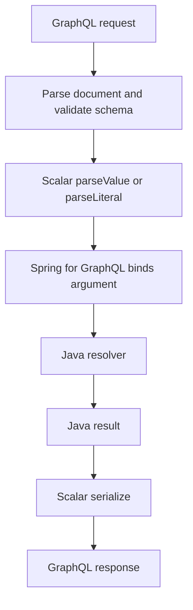

# Converting Scalars to Java Types

## 1. Scalars in GraphQL and Java Types

In GraphQL, a scalar is a single-valued data type at the schema level. The standard scalar types are `Int`, `Float`, `String`, `Boolean`, and `ID`. When an operation sends input data or receives results from a resolver, GraphQL needs to convert values between GraphQL's representation and the data types used by the Java program.

For example, the schema declares a field that accepts a book ID and returns the number of available copies:

```graphql
type Query {
    availableCopies(bookId: ID!): Int!
}
```

On the Java side, the resolver can receive `bookId` as `String` and return `Integer`:

```java
@QueryMapping
public Integer availableCopies(@Argument String bookId) {
    return inventoryService.countAvailableCopies(bookId);
}
```

GraphQL does not automatically understand every Java class. Conversion is handled through scalar coercion in GraphQL Java, combined with how Spring for GraphQL maps arguments and data fetcher results. When you use appropriate Java types, resolvers can focus on business logic instead of manually parsing strings in every method.

## 2. Scalar Conversion Flow

A scalar has three primary conversion responsibilities:

1. **Parse input value:** convert a value from request variables into an appropriate Java value.
2. **Parse literal:** convert a value written directly in the GraphQL document into an internal value.
3. **Serialize output:** convert a Java result returned by a resolver into a value that can be sent in the GraphQL response.

Example of a client sending a variable:

```json
{
  "query": "query($bookId: ID!) { availableCopies(bookId: $bookId) }",
  "variables": {
    "bookId": "book-42"
  }
}
```

GraphQL validates the variable's type against the schema, then the `ID` scalar processes the input value. Spring for GraphQL passes the GraphQL Java-processed value into the resolver. When the resolver returns `Integer`, the `Int` scalar serializes that value into a number in the JSON response.



`parseValue` is used for values passed via `variables`; `parseLiteral` is used when a value appears directly in the document. `serialize` handles data returned from the resolver. A custom scalar must define all three conversion directions consistently so input and output share the same convention.

## 3. Mapping Standard Scalars to Java Types

GraphQL Java represents standard scalars using common Java types. The table below shows appropriate mappings for most Spring for GraphQL applications:

| GraphQL Scalar | Common Java Type | Notes |
| --- | --- | --- |
| `String` | `String` | Unicode string |
| `Boolean` | `Boolean` or `boolean` | Use `Boolean` when the value may be nullable |
| `Int` | `Integer` or `int` | Signed 32-bit integer |
| `Float` | `Double` or `double` | Double-precision floating-point number |
| `ID` | `String` | Used for identifiers; response is serialized as a string |

Schema example:

```graphql
type Query {
    book(id: ID!): Book
    searchBooks(title: String!, available: Boolean): [Book!]!
    totalPages(bookId: ID!): Int!
    averageRating(bookId: ID!): Float
}

type Book {
    id: ID!
    title: String!
    available: Boolean!
    pageCount: Int!
    rating: Float
}
```

Corresponding Java resolver:

```java
@Controller
public class BookController {

    private final BookService bookService;

    public BookController(BookService bookService) {
        this.bookService = bookService;
    }

    @QueryMapping
    public Book book(@Argument String id) {
        return bookService.findById(id).orElse(null);
    }

    @QueryMapping
    public List<Book> searchBooks(
            @Argument String title,
            @Argument Boolean available) {
        return bookService.search(title, available);
    }

    @QueryMapping
    public Integer totalPages(@Argument String bookId) {
        return bookService.totalPages(bookId);
    }

    @QueryMapping
    public Double averageRating(@Argument String bookId) {
        return bookService.averageRating(bookId);
    }
}
```

This concise example focuses on parameter and return types; `Book`, `BookService`, and business methods are application-defined components.

### Specific Notes on `Int`, `Float`, and `ID`

GraphQL `Int` is a signed 32-bit integer. Java `Long` has a wider range, so do not declare a GraphQL field as `Int` and then return a `Long` value that could exceed the 32-bit limit. If business logic requires 64-bit integers, use an appropriate custom scalar or represent them using another convention explicitly published by the schema.

GraphQL `Float` uses double precision. In Java, `Double` is usually the right choice. For currency or calculations requiring exact decimal precision, do not use `Double` because floating-point inaccuracies can affect results. Consider `BigDecimal` with a custom scalar or a registered extended scalar type.

`ID` represents an identifier and carries no arithmetic meaning. Even if values look numeric, use `String` in Java to avoid accidental arithmetic or losing formatting such as leading zeros. If the domain model uses `UUID`, you can declare a dedicated UUID scalar and configure matching coercion.

## 4. Nullable, Non-Null, and Lists When Mapping to Java

GraphQL uses `!` to indicate a non-null value. Without `!`, the value may be `null`. This rule applies both to single scalars and to elements within a list.

| SDL | Common Java Type | Meaning |
| --- | --- | --- |
| `String` | `String` | May return `null` |
| `String!` | `String` | Resolver must return a non-`null` value |
| `[Int!]!` | `List<Integer>` | Non-null list, every element non-null |
| `[Int]` | `List<Integer>` | Both list and elements may be null |
| `[Book!]` | `List<Book>` | List may be null, every element non-null |

Java primitives such as `int` and `boolean` cannot hold `null`. If a GraphQL field is nullable, use wrapper types like `Integer` or `Boolean` to represent the absence of a value. Even for non-null fields, validate data before returning it; if a resolver returns `null` for a non-null field, GraphQL produces an execution error and applies null propagation up to the parent field.

Example:

```graphql
type Query {
    bookRating(bookId: ID!): Float
    bookPageCount(bookId: ID!): Int!
}
```

```java
@QueryMapping
public Double bookRating(@Argument String bookId) {
    return ratingService.findRating(bookId).orElse(null);
}

@QueryMapping
public Integer bookPageCount(@Argument String bookId) {
    return bookService.pageCount(bookId);
}
```

The `bookRating` field may have no rating yet, so it uses nullable `Double`. `bookPageCount` is declared non-null, so the service must guarantee a valid result is always returned.

## 5. Scalar Coercion and `@Argument` in Spring for GraphQL

When using annotation-based controllers, `@Argument` binds a schema field argument to a Java method parameter. You can specify the argument name explicitly to avoid relying on compiled parameter-name metadata:

```graphql
type Query {
    booksByYear(year: Int!): [Book!]!
}
```

```java
@QueryMapping
public List<Book> booksByYear(@Argument("year") Integer publicationYear) {
    return bookService.findByYear(publicationYear);
}
```

The Java parameter name is `publicationYear`, while the argument name in SDL is `year`; `@Argument("year")` creates an explicit binding. For standard scalars, GraphQL Java has already validated and coerced the value according to the scalar before the resolver is invoked. Spring for GraphQL then binds the argument to the method parameter.

If the Java parameter type is incompatible with the value provided by the scalar, adjust the parameter type or define a suitable scalar/converter. Avoid accepting every value as `Object` and manually casting inside each resolver, as that forfeits schema type safety.

For input objects, Spring for GraphQL can bind the input structure to an appropriate DTO or Java type. Scalars inside the input object still have to be properly coerced before data is bound. Therefore, distinguish two responsibilities: scalars convert individual values; argument binding maps the resulting values into Java parameters or objects.

## 6. When Do You Need a Custom Scalar?

Standard scalars do not cover every application data type. Common domain types include:

- Calendar date: `LocalDate`.
- Point in time with timezone: `OffsetDateTime` or `Instant` per system convention.
- UUID identifier: `UUID`.
- Monetary amount: `BigDecimal`.
- Email, URL, or business identifier with a specialized format.

You could represent some types as `String`, but the schema then fails to convey specialized formatting and the server must validate it repeatedly across many places. Custom scalars publish clear type names and centralize parse/serialize rules.

Schema example:

```graphql
scalar Date
scalar DateTime
scalar UUID

type Query {
    booksPublishedOn(date: Date!): [Book!]!
    bookByUuid(id: UUID!): Book
}

type Book {
    id: UUID!
    title: String!
    publishedOn: Date!
    createdAt: DateTime!
}
```

Declaring `scalar Date` or `scalar UUID` in SDL only creates the scalar name in the schema. It does not automatically know how to convert into `LocalDate` or `UUID`. The server must register a `GraphQLScalarType` implementation with the corresponding coercing.

## 7. Using graphql-java-extended-scalars

For common types, you can use the `graphql-java-extended-scalars` library instead of rewriting coercing from scratch. The library provides extended scalars such as `Date`, `DateTime`, `Time`, `UUID`, `Long`, `BigDecimal`, and several others.

Add the `com.graphql-java:graphql-java-extended-scalars` dependency to your project. Choose a version compatible with the GraphQL Java version managed by Spring Boot; do not pin an arbitrary version that could pull in an incompatible GraphQL Java release.

With Gradle Kotlin DSL, declare it as:

```kotlin
dependencies {
    implementation("com.graphql-java:graphql-java-extended-scalars:<compatible-version>")
}
```

Then register the scalars you need using `RuntimeWiringConfigurer`:

```java
import graphql.scalars.ExtendedScalars;
import org.springframework.context.annotation.Bean;
import org.springframework.context.annotation.Configuration;
import org.springframework.graphql.execution.RuntimeWiringConfigurer;

@Configuration
public class GraphQlScalarConfig {

    @Bean
    RuntimeWiringConfigurer scalarConfigurer() {
        return wiringBuilder -> wiringBuilder
            .scalar(ExtendedScalars.Date)
            .scalar(ExtendedScalars.DateTime)
            .scalar(ExtendedScalars.UUID)
            .scalar(ExtendedScalars.BigDecimal);
    }
}
```

When the schema has `scalar Date`, `scalar DateTime`, `scalar UUID`, or a corresponding extended scalar, the scalar name in SDL must match the name provided by the registered implementation. Check the documentation for the library version in use to verify each scalar's input/output Java types and serialization format.

Example resolver using the corresponding domain Java types:

```java
import java.time.LocalDate;
import java.util.UUID;
import org.springframework.graphql.data.method.annotation.Argument;
import org.springframework.graphql.data.method.annotation.QueryMapping;
import org.springframework.stereotype.Controller;

@Controller
public class BookQueryController {

    private final BookService bookService;

    public BookQueryController(BookService bookService) {
        this.bookService = bookService;
    }

    @QueryMapping
    public List<Book> booksPublishedOn(@Argument LocalDate date) {
        return bookService.findPublishedOn(date);
    }

    @QueryMapping
    public Book bookByUuid(@Argument UUID id) {
        return bookService.findByUuid(id).orElse(null);
    }
}
```

In this example, `Date` is used for a calendar date and `UUID` for an identifier. If your chosen scalar serializes to a different Java type, adjust the resolver signature or use a custom scalar whose coercing returns the exact domain type.

## 8. Defining a Custom Scalar with GraphQLScalarType

When the extended scalars library does not provide a suitable type, you can define a custom scalar using `GraphQLScalarType` and `Coercing`. `Coercing` specifies the three conversion paths:

| Coercing Method | Role |
| --- | --- |
| `parseValue` | Handles values from request `variables` |
| `parseLiteral` | Handles literals written directly in the GraphQL document |
| `serialize` | Converts a Java result into a GraphQL output value |

For example, a `Money` scalar might choose `BigDecimal` as its internal Java type and serialize to a decimal string according to API conventions. When implementing it, clearly define:

- Whether inputs are accepted as strings or JSON numbers.
- Whether negative numbers are allowed.
- Maximum number of decimal places.
- How to round or reject values exceeding precision.
- Consistent output formatting across all resolvers.
- How errors are reported when inputs are malformed or out of bounds.

Scalar registration skeleton:

```java
GraphQLScalarType moneyScalar = GraphQLScalarType.newScalar()
    .name("Money")
    .description("Monetary amount represented as a decimal value")
    .coercing(moneyCoercing)
    .build();
```

`moneyCoercing` is the `Coercing` implementation provided by the application. After creating the scalar, register it in `RuntimeWiringConfigurer`:

```java
@Bean
RuntimeWiringConfigurer moneyScalarConfigurer() {
    return wiringBuilder -> wiringBuilder.scalar(moneyScalar);
}
```

Corresponding SDL:

```graphql
scalar Money

type Product {
    id: ID!
    price: Money!
}
```

Do not simply rename `BigDecimal` to `Money` in SDL and expect Spring to convert it automatically. The scalar must have registered coercing so GraphQL Java knows how to parse and serialize that type.

## 9. Custom Scalar Design Rules

A custom scalar is part of the API contract, so its format must be stable and verifiable.

**Input format:** accept one clear format. For example, `Date` accepts `YYYY-MM-DD` strings; `UUID` accepts canonical UUID strings. Avoid accepting too many equivalent formats unless there is a concrete compatibility reason.

**Output format:** serialize consistently, independent of the server's default locale or timezone. For timestamps, explicitly decide whether to preserve offsets or normalize to UTC.

**Value bounds:** enforce valid value ranges, precision, and length limits before passing data into the business layer.

**Error messages:** coercion errors should safely indicate the invalid value and expected format. Never let stack traces, SQL queries, or internal data appear in client-facing errors.

**Compatibility:** changing a scalar's format can break clients even when field names stay the same. If a format change is needed, design a transition period or introduce a new scalar/field.

**Consistency:** the same scalar must apply the same rules across every field. Avoid having individual resolvers manually parse `String` into `LocalDate` in different ways.

## 10. Common Errors When Converting Scalars to Java Types

| Symptom | Possible Cause | Resolution |
| --- | --- | --- |
| Argument fails to bind to Java parameter | Java type is incompatible with coercion result or argument name mismatches | Check the scalar, parameter type, and `@Argument("name")` |
| `Long` value exceeds `Int` range | GraphQL `Int` is only a 32-bit integer | Use a registered `Long` scalar or another appropriate type |
| Precision errors when handling money | Using `Float`/`Double` for exact decimal calculations | Use `BigDecimal` with a supported scalar |
| `LocalDate` fails to parse | SDL declares the scalar without registering matching coercing | Register `ExtendedScalars.Date` or a custom scalar |
| Variables work, but literals fail (or vice versa) | `parseValue` and `parseLiteral` enforce different rules | Test both input paths |
| Resolver returns a serialization error | Java result does not match the type expected by the output scalar | Check `serialize` and the resolver's return type |
| `ID` treated as a number | Using `Integer`/`Long` for identifiers | Use `String` or a custom UUID scalar |
| Nullable field causes primitive error | Java primitives cannot represent `null` | Use wrapper types such as `Integer` or `Boolean` |
| Custom scalar works in one environment and fails in another | Relying on default timezone, locale, or format | Define explicit formats and test environment-independently |

## 11. Testing Scalar Coercion with GraphQlTester

Test inputs via `variables`, inline literals, and output serialization. Schema example:

```graphql
scalar Date

type Query {
    booksPublishedOn(date: Date!): [Book!]!
}

type Book {
    id: ID!
    title: String!
}
```

Operation using a variable:

```graphql
query BooksPublishedOn($date: Date!) {
    booksPublishedOn(date: $date) {
        id
        title
    }
}
```

Testing with GraphQlTester:

```java
graphQlTester.document("""
    query BooksPublishedOn($date: Date!) {
        booksPublishedOn(date: $date) {
            id
            title
        }
    }
    """)
    .variable("date", "2025-05-20")
    .execute()
    .errors()
    .verify();
```

This example verifies that the request produces no GraphQL errors for a valid date. In a full test suite, verify that the resolver receives the expected `LocalDate`, the response serializes in the proper format, and values like `20-05-2025` or `2025-02-30` are rejected if they do not conform to the specified format.

A scalar test suite should include:

- Valid inputs via `variables`.
- Valid inputs as inline literals in the operation.
- Malformed inputs, wrong JSON types, or out-of-range values.
- Valid outputs returned by resolvers.
- Resolvers returning incompatible Java types.
- Null values for nullable and non-null fields.
- Timezone, precision, and locale rules if relevant to the scalar.

## 12. Checklist for Choosing Java Types for Scalars

- [ ] Java type matches the scalar's value range and precision.
- [ ] `Int` is not used for values exceeding the 32-bit range.
- [ ] `Float` is not used for monetary calculations requiring exact decimal precision.
- [ ] `ID` is treated as an identifier, not a number for arithmetic.
- [ ] Nullable fields use Java reference types capable of holding `null`.
- [ ] Custom scalars are declared in SDL and registered in runtime wiring.
- [ ] `parseValue`, `parseLiteral`, and `serialize` follow the same format.
- [ ] Java arguments use types compatible with coerced scalar values.
- [ ] Input variables, literals, and output serialization are all tested.
- [ ] Coercion errors do not leak internal data and provide clear messages to clients.

## Conclusion

Converting scalars to Java types is a coordination between GraphQL scalar coercion and Spring for GraphQL's argument and result binding. Standard scalars typically map directly to `String`, `Boolean`, `Integer`, `Double`, and `String` for `ID`. Pay attention to the 32-bit limit of `Int`, precision characteristics of `Float`, identifier semantics of `ID`, and nullability of Java wrapper types.

For domain types such as dates, UUIDs, or money, choose an appropriate custom scalar or extended scalar library, register it via `RuntimeWiringConfigurer`, and standardize parse/serialize formats. When scalars are designed as an explicit part of the schema contract, Java resolvers receive strongly typed data, clients send consistent values, and conversion errors are caught early during GraphQL coercion.
