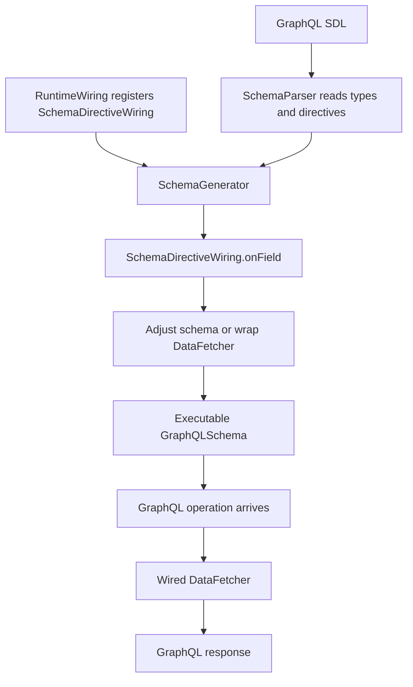

# Directive Wiring

In GraphQL SDL, declaring a new custom directive only describes its name, arguments, and the locations where it is allowed to appear. GraphQL does not automatically infer behavior from a directive's name. For a directive to actually affect data fetching, the application must **wire the directive into the runtime**.

In GraphQL Java, the standard mechanism for this is `SchemaDirectiveWiring`. This component is invoked while building the executable schema. It can inspect directive metadata, modify schema elements, or wrap an existing `DataFetcher` to add behavior when a field executes. In Spring for GraphQL, wiring registration is typically done through `RuntimeWiringConfigurer` so Spring includes the configuration when creating `GraphQlSource`.

## 1. Declaring a Directive Does Not Create Behavior

Suppose an API wants to normalize book titles to uppercase before returning them:

```graphql
directive @uppercase on FIELD_DEFINITION

type Book {
    id: ID!
    title: String! @uppercase
}
```

The SDL above specifies that `@uppercase` is allowed on field definitions and that `Book.title` uses that directive. However, if the application only loads the SDL, GraphQL will not automatically convert `title` to uppercase. The directive remains metadata in the schema until a runtime component interprets it.

We can distinguish three steps:

1. **Declaration:** SDL defines the directive and attaches it to valid locations.
2. **Wiring:** GraphQL Java receives an implementation that knows how to handle the directive during schema creation.
3. **Execution:** the behavior implemented in the wiring runs when the corresponding field is resolved, such as via a wrapped `DataFetcher`.

`@deprecated`, `@specifiedBy`, `@include`, and `@skip` are built-in directives whose semantics are defined by the GraphQL specification and runtime. Applications typically do not need to write `SchemaDirectiveWiring` to make these built-in directives work. This lesson focuses on custom schema directives.

## 2. When Does SchemaDirectiveWiring Run?

GraphQL Java uses SDL and runtime wiring to build an executable `GraphQLSchema`. During this process, `SchemaDirectiveWiring` is invoked for schema elements annotated with the corresponding directive. For a field definition, the `onField` method receives a `SchemaDirectiveWiringEnvironment<GraphQLFieldDefinition>`.

The environment provides the information needed to process the directive, including the current schema element, the applied directive, the fields container, and the code registry being built. For fields, the code registry is where each field is associated with the `DataFetcher` that will be called when an operation runs.

High-level flow:



The key point is that wiring happens when the schema is built, usually during Spring application startup. `onField` is not a resolver called per request. If the wiring wraps a `DataFetcher`, only the wrapper it creates is invoked when the field is actually selected and executed.

## 3. Wrapping a DataFetcher with SchemaDirectiveWiring

GraphQL Java provides `SchemaDirectiveWiring` to customize schema elements. The following example creates an `@uppercase` directive and wraps the field's data fetcher to convert string values to uppercase:

```java
public class UppercaseDirective implements SchemaDirectiveWiring {

    @Override
    public GraphQLFieldDefinition onField(
            SchemaDirectiveWiringEnvironment<GraphQLFieldDefinition> environment) {

        GraphQLFieldDefinition field = environment.getElement();
        DataFetcher<?> originalFetcher = environment.getCodeRegistry()
            .getDataFetcher(environment.getFieldsContainer(), field);

        DataFetcher<?> wrappedFetcher = DataFetcherFactories.wrapDataFetcher(
            originalFetcher,
            (dataEnvironment, value) -> {
                if (value instanceof String) {
                    return ((String) value).toUpperCase(Locale.ROOT);
                }
                return value;
            }
        );

        environment.getCodeRegistry().dataFetcher(
            environment.getFieldsContainer(), field, wrappedFetcher);

        return field;
    }
}
```

Steps inside `onField`:

1. `environment.getElement()` retrieves the `GraphQLFieldDefinition` being processed.
2. `environment.getCodeRegistry()` provides the registry to read the current data fetcher and register the wrapper.
3. `getDataFetcher(...)` retrieves the original resolver, which may be a controller-registered resolver or a default fetcher.
4. `DataFetcherFactories.wrapDataFetcher(...)` creates a new fetcher wrapping the original fetcher.
5. `dataFetcher(...)` registers the new fetcher for the current field.
6. Returns the field definition so schema building continues.

The wrapper preserves the original data fetcher's result and applies the transformation. Thus, data retrieval logic stays in the existing resolver/service; the directive simply adds a processing step to the field's pipeline.

The example uses `Locale.ROOT` for uppercasing so the result does not depend on the server's default locale. In real applications, also decide explicitly how to handle `null`, non-string data types, and errors from the original fetcher. The example above only transforms `String` values; other types are returned unchanged.

Specific imports depend on the GraphQL Java version managed by Spring for GraphQL. The core APIs in this example are `SchemaDirectiveWiring`, `SchemaDirectiveWiringEnvironment`, `GraphQLFieldDefinition`, `DataFetcher`, `DataFetcherFactories`, and `Locale`.

## 4. Registering Wiring via RuntimeWiring

When using GraphQL Java directly, register the implementation with `RuntimeWiring.Builder` using the directive name:

```java
RuntimeWiring runtimeWiring = RuntimeWiring.newRuntimeWiring()
    .directive("uppercase", new UppercaseDirective())
    .build();
```

The name `uppercase` must match the name declared in SDL `directive @uppercase ...`. If the names do not match, the implementation will not be applied to the intended directive.

When using Spring for GraphQL, provide the same configuration as a `RuntimeWiringConfigurer` bean:

```java
@Configuration
public class GraphQlDirectiveConfiguration {

    @Bean
    RuntimeWiringConfigurer directiveConfigurer() {
        return builder -> builder.directive(
            "uppercase", new UppercaseDirective());
    }
}
```

Spring Boot collects `RuntimeWiringConfigurer` beans and applies them when creating `GraphQlSource`. As a result, custom directives are registered alongside other runtime configurations such as scalars, type resolvers, and data fetchers.

If you need access to Spring-managed dependencies, you can declare `UppercaseDirective` as a bean and inject it into the configuration. This is helpful when a directive needs a service, clock, policy, or other component. However, avoid placing heavy business logic in directive wiring; domain rules belong in services so they are easier to test and reuse.

## 5. Reading Directive Arguments

Directives can accept arguments to customize behavior. For example, `@mask` takes the number of characters to preserve at the start and end of a string:

```graphql
directive @mask(prefix: Int!, suffix: Int!) on FIELD_DEFINITION

type Customer {
    email: String! @mask(prefix: 2, suffix: 3)
}
```

Inside `SchemaDirectiveWiringEnvironment`, the implementation can read the directive applied to the current element and retrieve its parsed arguments. GraphQL Java's API provides abstractions such as `GraphQLAppliedDirective` and `GraphQLAppliedDirectiveArgument` for applied directives. Exact value-reading methods may differ across directive API generations; use the applied directive types appropriate for your project's GraphQL Java version.

From a design standpoint, validate arguments before using them: check whether values are within valid bounds, whether they could cause index errors or expose data, and what behavior applies when values are invalid. Non-null types in SDL ensure GraphQL checks that directive arguments are supplied, but they do not replace business validation for constraints like requiring `prefix` to be non-negative.

For example, an email masking algorithm should explicitly handle strings shorter than the total number of characters to preserve. Do not silently produce misleading output or leak the entire value. Extract the transformation function into pure logic so it can be unit tested independently.

## 6. Wiring for Multiple Schema Locations

`SchemaDirectiveWiring` is not only for fields. The interface provides callbacks for many kinds of schema elements, such as objects, arguments, enums, enum values, input objects, input fields, interfaces, unions, and scalars. Override only the callbacks matching the locations declared in SDL.

Example of a directive marking an enum value:

```graphql
directive @legacy on ENUM_VALUE

enum BookFormat {
    HARDCOVER
    PAPERBACK
    EBOOK @legacy
}
```

If you need to process this directive during schema construction, the implementation can override the callback for enum values. Similarly, directives on `ARGUMENT_DEFINITION` or `INPUT_FIELD_DEFINITION` must handle the corresponding schema elements. You cannot use `onField` to handle every directive location because each callback receives a different element type.

For directives declared `repeatable`, an element can carry multiple applications of the same directive. Wiring must inspect all applied directives if the semantics require combining multiple occurrences, rather than assuming only a single configuration.

## 7. When to Use WiringFactory?

`SchemaDirectiveWiring` fits well when you want to apply deterministic handling wherever a directive is attached. In cases where you need dynamic wiring decisions based on schema elements, you can consider GraphQL Java's `WiringFactory`.

`WiringFactory` lets the runtime ask whether custom wiring applies to a specific field or element type. It is useful when an application needs to select data fetchers based on metadata or schema conventions. However, it is a lower-level extension point and must be designed carefully so it does not conflict with mappings registered by Spring for GraphQL.

In Spring applications, starting with `RuntimeWiringConfigurer` to register `SchemaDirectiveWiring` is usually easier to understand and maintain. Only use `WiringFactory` when you genuinely require dynamic wiring selection that fixed directive wiring cannot satisfy.

## 8. Interaction with Spring Resolvers

A field may be backed by `@QueryMapping`, `@SchemaMapping`, `@BatchMapping`, a directly registered `DataFetcher`, or the default property fetcher. Directive wiring can read the data fetcher currently attached to the field and wrap it, so the directive's behavior applies across different resolver sources.

For example, SDL declares:

```graphql
directive @uppercase on FIELD_DEFINITION

type Query {
    greeting: String! @uppercase
}
```

The controller still focuses solely on supplying the value:

```java
@Controller
public class GreetingController {

    @QueryMapping
    public String greeting() {
        return "hello from spring";
    }
}
```

Once wiring is registered, the `greeting` field returns `HELLO FROM SPRING`. The controller does not need to know a directive is wrapping its data fetcher.

When combining multiple components that modify a `DataFetcher`, configuration order can affect the outcome. For example, one wrapper logs before calling the original fetcher while another transforms the value after the fetcher returns. Centralize wiring registration, keep wrappers small, and test the final schema rather than assuming ordering from how beans are written.

## 9. Directive Wiring and Security

Custom directives can describe policies in the schema, such as:

```graphql
directive @requiresRole(role: String!) on FIELD_DEFINITION

type Query {
    publicBooks: [Book!]!
    editorialNotes: [String!]! @requiresRole(role: "EDITOR")
}
```

However, a directive only has security enforcement if runtime wiring actually checks the caller's identity and authorities. Attaching `@requiresRole` does not automatically activate Spring Security. Implement server-side checks, for example via Spring Security method security on resolvers/services or a thoroughly tested wrapper.

Do not treat masking data with a directive as a substitute for authorization. If a user is not allowed to view an email, returning the full email to a wrapper and only partially masking it can still create risks through logs, exceptions, or other code paths. Access checks must happen before sensitive data is exposed, and should sit close to the business or data access layer so other call paths are also protected.

For directives used for authorization, test both allowed and denied cases, unauthenticated identities, multiple roles, nested fields, and errors when resolvers call services. A directive can serve as unified metadata, but policy enforcement needs a single, clear source of truth.

## 10. Testing Directive Wiring

A unit test for the wiring class can verify the wrapper's transformation. However, testing that class alone does not prove SDL was loaded and wiring was registered in the Spring schema. Write integration tests with `GraphQlTester` to go through the real schema and resolvers.

Example testing the `greeting` field:

```java
graphQlTester.document("""
        query {
            greeting
        }
        """)
    .execute()
    .path("greeting")
    .entity(String.class)
    .isEqualTo("HELLO FROM SPRING");
```

Additional checks to perform:

- Fields without the directive retain their original output.
- Fields with non-`String` types are not unintentionally altered by the wrapper.
- `null` values are handled consistently with schema nullability.
- Exceptions from the original data fetcher are still handled by the application's GraphQL error handling.
- If the directive accepts arguments, test valid values, boundary values, and missing arguments.
- If the directive affects security, test both permitted and denied access.

If using multiple wrappers, test the outcome after all wiring is applied together. This catches cases where one wiring inadvertently overwrites a data fetcher registered by another.

## 11. Common Pitfalls

| Symptom | Possible Cause | How to Fix |
| --- | --- | --- |
| Directive is in SDL but has no effect | `SchemaDirectiveWiring` is not registered | Register via `RuntimeWiringConfigurer` or the corresponding runtime wiring |
| Wiring is never invoked | Registered directive name does not match SDL or location is wrong | Check the name and `on FIELD_DEFINITION` |
| Field returns the old value | Wrapper was not registered in the code registry or was overwritten by another wiring | Inspect the final data fetcher and configuration order |
| Error reading directive arguments | Reading applied directive incorrectly or wrong value type | Use the version-appropriate applied directive API and check types |
| Controller resolver does not run | Schema mapping not registered or field/type mismatch | Check SDL and Spring mappings |
| Directive works on one field but not another | Only overrode callback for one location or the other field lacks the directive | Check SDL location and corresponding callback |
| Custom directive applied multiple times | Repeatable directive or wiring wrapper registered twice | Check repeatable declaration and schema build process |
| Authorization bypassed via another call path | Policy placed only in a single resolver | Move checks into the appropriate service/security boundary |

When diagnosing issues, determine whether the failure occurs during schema build or field execution. If the application fails to start, inspect SDL parsing errors, directive locations, and runtime wiring registration. If the application starts but the directive has no effect, inspect `SchemaDirectiveWiring` callbacks, the code registry, and the wrapper. If only a single request fails, inspect the data fetcher, arguments, and runtime data.

## 12. Design Principles for Directive Wiring

Keep directives small and focused on a single clear purpose. Use directives to express metadata or genuinely shared behavior applied at the GraphQL layer. Keep business logic in services; directive wiring should only coordinate or wrap data fetchers to implement cross-cutting behavior.

When wrapping a fetcher, preserve the original fetcher's asynchronous behavior, exceptions, and nullability. Do not block threads or invoke the fetcher multiple times without clear justification. Check data types before transforming and define how malformed values are handled.

In Spring for GraphQL, use `RuntimeWiringConfigurer` to register wiring into `GraphQlSource`, and test end-to-end with `GraphQlTester`. When dynamic directives or complex metadata-driven resolver selection is required, evaluate `WiringFactory` and control configuration ordering. For security, directives can only serve as policy metadata; the server must still enforce authorization at runtime.

Directive wiring bridges SDL metadata and GraphQL Java execution behavior. Understanding when the schema is built, how `SchemaDirectiveWiring` interacts with `DataFetcher`, and how Spring registers runtime wiring helps you build directives that are reusable, testable, and aligned with Spring for GraphQL's architecture.
