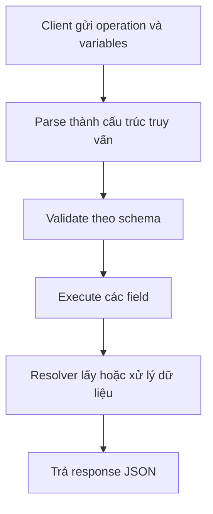

# GraphQL là gì?

GraphQL là một **ngôn ngữ truy vấn dành cho API** và cũng là một **mô hình thực thi** để server xử lý các truy vấn đó. Thay vì yêu cầu server trả về một cấu trúc dữ liệu cố định cho mỗi endpoint, client mô tả những trường dữ liệu mình cần; GraphQL server kiểm tra yêu cầu dựa trên schema rồi trả về kết quả theo cấu trúc đã chọn.

GraphQL biểu diễn dữ liệu như một đồ thị gồm các kiểu và mối quan hệ. Client có thể đi từ một đối tượng sang những đối tượng liên quan trong cùng một operation. Ví dụ, từ một sản phẩm có thể lấy người bán và các đánh giá của sản phẩm đó.

GraphQL không phải là cơ sở dữ liệu, không phải ORM và cũng không phải một framework riêng của Java hay Spring. Nó định nghĩa cách mô tả API, cách client yêu cầu dữ liệu và cách server thực thi yêu cầu. Server có thể lấy dữ liệu từ cơ sở dữ liệu quan hệ, NoSQL, dịch vụ REST khác, hệ thống tìm kiếm hoặc nhiều nguồn cùng lúc.

## Vì sao GraphQL ra đời?

Khi một ứng dụng phát triển, nhiều màn hình và nhiều loại client cùng sử dụng API. Một màn hình chi tiết sản phẩm trên web có thể cần tên, giá, mô tả, người bán và đánh giá. Ứng dụng di động có thể chỉ cần tên, giá và ảnh thu nhỏ. Một trang quản trị lại cần thêm trạng thái kho và thông tin nội bộ.

Với API REST truyền thống, server thường thiết kế endpoint và cấu trúc response trước. Cách làm này dễ hiểu, nhưng có thể phát sinh hai vấn đề khi nhu cầu của client thay đổi.

### Over-fetching: nhận nhiều dữ liệu hơn cần thiết

Giả sử endpoint `GET /products/42` luôn trả về toàn bộ thông tin sản phẩm, lịch sử tồn kho, mô tả dài và các metadata. Màn hình danh sách chỉ cần tên và giá nhưng vẫn phải nhận toàn bộ response. Phần dữ liệu không sử dụng làm tăng kích thước truyền tải và công việc xử lý ở client.

### Under-fetching: một màn hình phải gọi nhiều API

Giả sử endpoint sản phẩm chỉ trả về thông tin cơ bản. Để hiển thị trang chi tiết, client còn phải gọi endpoint người bán, endpoint đánh giá và endpoint tồn kho. Nhiều request làm tăng độ phức tạp của client và có thể khiến màn hình phải chờ nhiều lượt trao đổi với server.

Đây không phải lỗi cố hữu của REST. REST có thể giải quyết bằng endpoint tổng hợp, tham số chọn trường hoặc thiết kế response riêng cho từng màn hình. Tuy nhiên, khi số lượng client và tổ hợp dữ liệu tăng lên, việc duy trì nhiều endpoint chuyên biệt có thể trở nên khó khăn.

GraphQL đưa quyền lựa chọn trường dữ liệu vào operation của client. Client gửi một yêu cầu mô tả cả dữ liệu gốc lẫn các trường liên quan, còn server chịu trách nhiệm thực thi yêu cầu đó theo schema. Nhờ vậy, client có thể lấy một tập dữ liệu phù hợp với màn hình mà không cần server tạo một endpoint mới cho mọi tổ hợp trường.

## GraphQL gồm những thành phần nào?

Một API GraphQL được tổ chức quanh ba thành phần chính:

- **Schema** mô tả những kiểu dữ liệu, trường, đối số và operation mà API cho phép.
- **Operation** là yêu cầu cụ thể do client gửi lên. Các operation phổ biến là Query, Mutation và Subscription.
- **Resolver** là phần logic phía server dùng để lấy hoặc tạo giá trị cho một trường trong kết quả.

Schema là hợp đồng giữa client và server. Client chỉ có thể yêu cầu những trường được khai báo trong schema; server cũng cần cung cấp logic để thực thi các trường đó.

### Schema và hệ thống kiểu dữ liệu

GraphQL thường mô tả schema bằng **Schema Definition Language (SDL)**. Ví dụ dưới đây mô tả một phần API cửa hàng:

```graphql
enum ProductStatus {
  ACTIVE
  OUT_OF_STOCK
  ARCHIVED
}

type Product {
  id: ID!
  name: String!
  price: Float!
  status: ProductStatus!
  seller: Seller!
  reviews(first: Int = 5): [Review!]!
}

type Seller {
  id: ID!
  displayName: String!
}

type User {
  id: ID!
  displayName: String!
}

type Review {
  id: ID!
  rating: Int!
  comment: String
  author: User!
}

type Query {
  product(id: ID!): Product
  products(status: ProductStatus, first: Int = 20): [Product!]!
}

input CreateProductInput {
  name: String!
  price: Float!
}

type Mutation {
  createProduct(input: CreateProductInput!): Product!
}

type Subscription {
  productChanged(productId: ID!): Product!
}
```

Ví dụ này có một số thành phần quan trọng:

- `type` khai báo một object type. `Product` có các trường như `id`, `name`, `price`, `seller` và `reviews`.
- `enum` giới hạn giá trị của một trường vào tập giá trị đã định nghĩa. `ProductStatus` chỉ nhận một trong ba trạng thái được khai báo.
- `input` khai báo cấu trúc dữ liệu đầu vào. Input object thường được dùng làm đối số cho mutation.
- `Query`, `Mutation` và `Subscription` là các root operation type. Chúng xác định những operation client có thể gọi.
- Đối số như `id`, `first` và `input` cho phép client truyền tham số khi yêu cầu một trường.

GraphQL có các scalar type dựng sẵn gồm `Int`, `Float`, `String`, `Boolean` và `ID`. API cũng có thể khai báo enum, object type, input object type, interface và union để mô hình hóa dữ liệu phong phú hơn.

### Danh sách và tính nullable

GraphQL dùng dấu `!` để biểu thị một giá trị không được null. Dấu ngoặc vuông biểu thị một danh sách. Hai yếu tố này có thể kết hợp để mô tả chính xác mức độ nullable:

| Khai báo | Ý nghĩa |
| --- | --- |
| `Product` | Có thể là một Product hoặc `null`. |
| `Product!` | Phải có một Product, không được `null`. |
| `[Product]` | Danh sách có thể `null`; từng phần tử cũng có thể `null`. |
| `[Product!]` | Danh sách có thể `null`; từng phần tử phải là Product. |
| `[Product]!` | Danh sách không được `null`; phần tử có thể `null`. |
| `[Product!]!` | Danh sách và tất cả phần tử đều không được `null`. |

Ví dụ `reviews(first: Int = 5): [Review!]!` có nghĩa trường `reviews` luôn trả về một danh sách; danh sách không được null và mỗi phần tử phải là một Review. Nếu server không có đánh giá, kết quả phù hợp là danh sách rỗng.

Kiểu dữ liệu đầu ra và kiểu dữ liệu đầu vào có quy tắc riêng. Object type như `Product` dùng để mô tả dữ liệu server trả về. Input object như `CreateProductInput` dùng để nhận dữ liệu từ client; không thể dùng một object type thông thường thay cho input object.

## Ba loại operation: Query, Mutation và Subscription

GraphQL phân biệt operation theo mục đích. Tên operation cũng có thể được đặt để log, theo dõi và đọc code dễ hơn.

### Query: đọc dữ liệu

Query dùng để yêu cầu dữ liệu. Client chọn các trường cần lấy và có thể truyền đối số cho từng trường.

```graphql
query ProductDetail($productId: ID!) {
  product(id: $productId) {
    id
    name
    price
    seller {
      id
      displayName
    }
    reviews(first: 3) {
      rating
      comment
    }
  }
}
```

Biến `$productId` được khai báo ở phần đầu operation. Giá trị của biến được gửi riêng trong phần `variables` của request:

```json
{
  "productId": "42"
}
```

Client có thể nhận kết quả với cấu trúc tương ứng:

```json
{
  "data": {
    "product": {
      "id": "42",
      "name": "Bàn phím cơ",
      "price": 1250000,
      "seller": {
        "id": "seller-7",
        "displayName": "Cửa hàng Minh An"
      },
      "reviews": [
        { "rating": 5, "comment": "Gõ tốt" },
        { "rating": 4, "comment": "Đóng gói cẩn thận" }
      ]
    }
  }
}
```

Ví dụ cho thấy client chọn cả trường cấp cao nhất (`product`) lẫn trường lồng nhau (`seller`, `reviews`). Server chỉ trả về những trường được yêu cầu trong selection set, theo cấu trúc operation.

### Mutation: thay đổi dữ liệu

Mutation dùng cho thao tác tạo, cập nhật hoặc xóa dữ liệu. Client gửi dữ liệu đầu vào và chọn những trường muốn nhận lại sau khi thao tác hoàn tất.

```graphql
mutation CreateProduct($input: CreateProductInput!) {
  createProduct(input: $input) {
    id
    name
    price
  }
}
```

Biến đầu vào có thể được gửi như sau:

```json
{
  "input": {
    "name": "Bàn phím cơ",
    "price": 1250000
  }
}
```

Mutation giúp mô tả rõ thao tác ghi và kiểu dữ liệu đầu vào. Theo quy tắc thực thi GraphQL, các field cấp cao nhất trong cùng một mutation operation được thực thi tuần tự. Điều này không tự thay thế transaction hoặc quy tắc nhất quán dữ liệu của hệ thống; server vẫn phải triển khai các bảo đảm đó.

### Subscription: nhận sự kiện cập nhật

Subscription dùng khi client cần nhận dữ liệu mới theo thời gian, chẳng hạn trạng thái đơn hàng, thông báo hoặc giá sản phẩm thay đổi.

```graphql
subscription WatchProduct($productId: ID!) {
  productChanged(productId: $productId) {
    id
    name
    price
    status
  }
}
```

Khác với Query và Mutation thường được gửi theo request/response, Subscription duy trì một luồng để server có thể phát sự kiện tới client. GraphQL định nghĩa ý nghĩa của operation; cơ chế truyền tải cụ thể phụ thuộc vào hệ thống triển khai. Trong ứng dụng thực tế, server có thể dùng WebSocket hoặc một cơ chế streaming được hỗ trợ.

## Một số cú pháp truy vấn thường gặp

Ngoài việc chọn trường và truyền biến, GraphQL còn có một số cú pháp giúp operation dễ đọc và tái sử dụng.

**Alias** đặt tên khác cho một trường trong response. Alias hữu ích khi cần gọi cùng một field nhiều lần với các đối số khác nhau:

```graphql
query CompareProducts {
  keyboard: product(id: "42") {
    id
    name
    price
  }
  mouse: product(id: "57") {
    id
    name
    price
  }
}
```

Response sẽ có hai nhánh `keyboard` và `mouse`, dù cả hai đều được lấy từ field `product`.

**Fragment** gom một nhóm trường để tái sử dụng trong nhiều selection set:

```graphql
fragment ProductSummary on Product {
  id
  name
  price
}

query ProductLists {
  products(first: 10) {
    ...ProductSummary
  }
}
```

Fragment giúp giảm lặp lại trong operation lớn. Nó không tạo thêm endpoint hay kiểu dữ liệu mới; fragment chỉ tái sử dụng một phần selection set.

## Server xử lý một GraphQL request như thế nào?

Một request GraphQL thường đi qua các bước sau:



1. **Nhận request:** server nhận nội dung operation cùng variables và thông tin ngữ cảnh như thông tin xác thực.
2. **Parse:** GraphQL chuyển chuỗi truy vấn thành cấu trúc mà engine có thể phân tích.
3. **Validate:** engine kiểm tra tên field, kiểu đối số, kiểu trả về và các quy tắc của operation dựa trên schema. Truy vấn không hợp lệ sẽ bị từ chối trước khi thực thi.
4. **Execute:** engine duyệt các field được yêu cầu và gọi logic xử lý tương ứng.
5. **Resolve dữ liệu:** resolver có thể truy vấn repository, gọi service khác hoặc tính toán giá trị. Với field lồng nhau, resolver tiếp tục lấy các giá trị liên quan.
6. **Serialize response:** server trả dữ liệu theo cấu trúc selection set, thường dưới dạng JSON.

Resolver thường xử lý ở cấp field. Ví dụ, resolver của `product` tìm sản phẩm theo ID; resolver của `seller` lấy người bán liên quan; resolver của `reviews` lấy danh sách đánh giá. Một field cũng có thể lấy dữ liệu từ object cha đã có mà không cần gọi cơ sở dữ liệu.

Điều này giải thích vì sao schema không tự cung cấp dữ liệu. Schema mô tả API cho phép những gì; resolver và các thành phần phía server quyết định dữ liệu được lấy và xử lý ra sao.

## Cấu trúc response và cách xử lý lỗi

Một response GraphQL thường có trường `data`, `errors` hoặc cả hai. Khi thực thi thành công, `data` chứa kết quả theo operation:

```json
{
  "data": {
    "product": {
      "id": "42",
      "name": "Bàn phím cơ"
    }
  }
}
```

Khi một field gặp lỗi trong lúc thực thi, response có thể chứa cả dữ liệu lấy được và danh sách lỗi:

```json
{
  "data": {
    "product": {
      "id": "42",
      "name": "Bàn phím cơ",
      "seller": null
    }
  },
  "errors": [
    {
      "message": "Không thể tải thông tin người bán",
      "path": ["product", "seller"],
      "extensions": {
        "code": "SELLER_UNAVAILABLE"
      }
    }
  ]
}
```

Các phần thường gặp trong một error:

- `message` mô tả lỗi.
- `locations` có thể chỉ vị trí trong operation gây ra lỗi.
- `path` cho biết field hoặc phần tử nào trong response gặp lỗi.
- `extensions` là nơi server có thể đặt mã lỗi hoặc metadata bổ sung theo quy ước của ứng dụng.

GraphQL có thể trả về dữ liệu một phần khi một field lỗi nhưng các field khác vẫn xử lý được. Tuy nhiên, quy tắc nullable ảnh hưởng đến kết quả: nếu một field không nullable trả về null do lỗi, null có thể lan lên field cha gần nhất cho phép null. Vì vậy, việc chọn `!` trong schema là một quyết định về hợp đồng dữ liệu và cách lỗi được biểu diễn.

Lỗi cú pháp hoặc lỗi validation thường ngăn operation được thực thi. Lỗi phát sinh trong resolver xảy ra trong quá trình thực thi và có thể đi kèm dữ liệu một phần. Client nên đọc cả `data` lẫn `errors`, thay vì chỉ xem request thành công hay thất bại ở tầng HTTP.

## GraphQL khác REST ở điểm nào?

GraphQL và REST đều có thể dùng để xây dựng API cho ứng dụng. Khác biệt chính nằm ở cách mô tả và lấy dữ liệu.

| Khía cạnh | REST | GraphQL |
| --- | --- | --- |
| Cách tổ chức | Thường xoay quanh resource và nhiều endpoint. | Thường xoay quanh schema và một endpoint GraphQL. |
| Chọn trường | Cấu trúc response thường do endpoint quy định. | Client chọn trường trong operation. |
| Dữ liệu liên quan | Có thể cần gọi nhiều endpoint hoặc endpoint tổng hợp. | Có thể yêu cầu các quan hệ trong cùng operation. |
| Hợp đồng | Có thể mô tả bằng OpenAPI hoặc tài liệu khác. | Schema là hợp đồng kiểu dữ liệu có thể introspect. |
| Cache HTTP | Cache theo URL, method và header có thể khá tự nhiên. | Cache theo nội dung operation và variables thường cần chiến lược riêng. |
| Thay đổi API | Có thể tạo phiên bản endpoint hoặc mở rộng response. | Có thể bổ sung field và đánh dấu field cũ deprecated theo quy trình tương thích. |

GraphQL không thay thế REST trong mọi trường hợp. REST thường phù hợp với API resource đơn giản, thao tác HTTP rõ ràng và tận dụng tốt cache của HTTP/CDN. GraphQL hữu ích khi nhiều client cần những tổ hợp dữ liệu khác nhau hoặc khi dữ liệu có nhiều quan hệ cần truy vấn linh hoạt.

Một hệ thống cũng có thể dùng cả hai: REST cho một số tài nguyên hoặc tích hợp bên ngoài, GraphQL làm lớp API phục vụ các màn hình cần tổng hợp dữ liệu. Việc lựa chọn nên dựa trên nhu cầu client, cách tổ chức backend, khả năng vận hành và chi phí phát triển.

## GraphQL được dùng với Spring for GraphQL như thế nào?

Spring for GraphQL đưa GraphQL vào hệ sinh thái Spring. Ứng dụng khai báo schema bằng SDL, sau đó cung cấp các thành phần xử lý để GraphQL engine lấy dữ liệu cho những field tương ứng. Trong ứng dụng Spring Boot, schema thường được đặt trong thư mục tài nguyên của ứng dụng và các controller hoặc thành phần xử lý đảm nhiệm việc thực thi field.

Ví dụ schema khai báo một Query đơn giản:

```graphql
type Query {
  greeting(name: String): String!
}
```

Một controller Java có thể cung cấp logic cho field đó:

```java
@Controller
public class GreetingController {

    @QueryMapping
    public String greeting(@Argument String name) {
        String recipient = name == null ? "bạn" : name;
        return "Xin chào, " + recipient;
    }
}
```

`@QueryMapping` liên kết phương thức với một field thuộc Query root type; `@Argument` lấy giá trị đối số từ operation. Đây là ví dụ minh họa cách schema và logic Java phối hợp với nhau. Các bài tiếp theo sẽ đi sâu vào SDL, Query, Mutation, Subscription, `@SchemaMapping`, `@BatchMapping`, DataLoader, xử lý lỗi, bảo mật và kiểm thử.

Với các quan hệ dữ liệu, một GraphQL operation có thể khiến server phải tải nhiều field lồng nhau. Nếu mỗi resolver tự truy vấn cơ sở dữ liệu cho từng object, hệ thống có thể gặp vấn đề N+1. GraphQL không tự động gộp các truy vấn này. Trong Spring for GraphQL, DataLoader và `@BatchMapping` là những công cụ quan trọng để gom việc tải dữ liệu liên quan.

## GraphQL giải quyết được gì và cần lưu ý điều gì?

GraphQL có thể giúp:

- Cho client chọn đúng trường cần dùng, giảm over-fetching.
- Kết hợp dữ liệu liên quan trong một operation, giảm số request mà client phải tự điều phối.
- Cung cấp schema có kiểu rõ ràng, hỗ trợ kiểm tra operation và tạo tài liệu cho API.
- Phục vụ nhiều loại client với nhu cầu dữ liệu khác nhau trên cùng một hợp đồng API.
- Mở rộng schema bằng cách bổ sung field, đồng thời có thể đánh dấu field cũ là deprecated để hướng client chuyển đổi.

Nhưng GraphQL không tự động giải quyết mọi vấn đề backend:

- **Hiệu năng:** một request duy nhất vẫn có thể tạo ra nhiều truy vấn cơ sở dữ liệu. Cần thiết kế resolver, batching, DataLoader, pagination và giới hạn độ phức tạp của query.
- **Bảo mật:** cần xác thực người dùng, phân quyền theo operation hoặc field, kiểm soát dữ liệu nhạy cảm và giới hạn tài nguyên. Việc client chỉ yêu cầu một field không có nghĩa field đó được phép truy cập.
- **Caching:** cache HTTP/CDN truyền thống không luôn áp dụng trực tiếp vì nhiều operation có thể gửi tới cùng một URL. Cần chọn chiến lược cache phù hợp với query, variables và dữ liệu.
- **Vận hành:** cần theo dõi operation, thời gian thực thi của resolver, lỗi theo field và các truy vấn tốn tài nguyên.
- **Subscription:** cần thêm hạ tầng duy trì kết nối và phát sự kiện, cùng cách xử lý xác thực, ngắt kết nối và khả năng mở rộng.

GraphQL trao cho client khả năng mô tả dữ liệu cần nhận. Đổi lại, server phải quản lý chặt schema, resolver, quyền truy cập và chi phí thực thi để API linh hoạt mà vẫn an toàn, ổn định.

## Khi nào nên cân nhắc GraphQL?

GraphQL thường đáng cân nhắc khi:

- Sản phẩm có web, mobile và các client khác nhau cần những tập trường dữ liệu khác nhau.
- Một màn hình cần kết hợp nhiều loại dữ liệu có quan hệ với nhau.
- Client thay đổi thường xuyên và việc tạo endpoint riêng cho từng màn hình gây tốn công bảo trì.
- Đội ngũ muốn có schema kiểu rõ ràng làm hợp đồng chung giữa frontend và backend.

REST hoặc một API đơn giản có thể phù hợp hơn khi tài nguyên ít quan hệ, nhu cầu đọc dữ liệu ổn định, cache HTTP là yêu cầu quan trọng hoặc nhóm chưa có nhu cầu vận hành thêm GraphQL engine và các công cụ kiểm soát query.

## Ghi nhớ

GraphQL là ngôn ngữ truy vấn và mô hình thực thi cho API. Schema định nghĩa những kiểu và field được phép truy cập; operation mô tả dữ liệu client cần; resolver cung cấp logic để lấy dữ liệu cho từng field. Query dùng để đọc, Mutation dùng để thay đổi dữ liệu và Subscription dùng để nhận sự kiện cập nhật.

GraphQL giúp client lấy dữ liệu phù hợp với nhu cầu và kết hợp các quan hệ trong một operation. Hiệu năng, bảo mật, caching và tính nhất quán vẫn phụ thuộc vào cách server triển khai. Khi dùng Spring for GraphQL, schema SDL kết hợp với các mapping và resolver trong Spring để tạo thành API GraphQL của ứng dụng.
