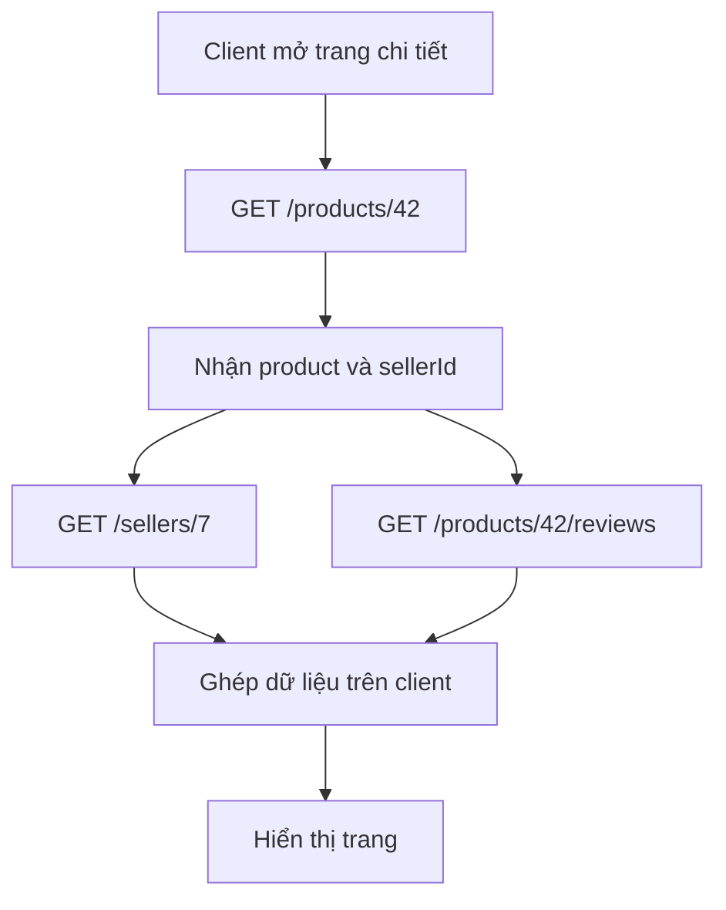
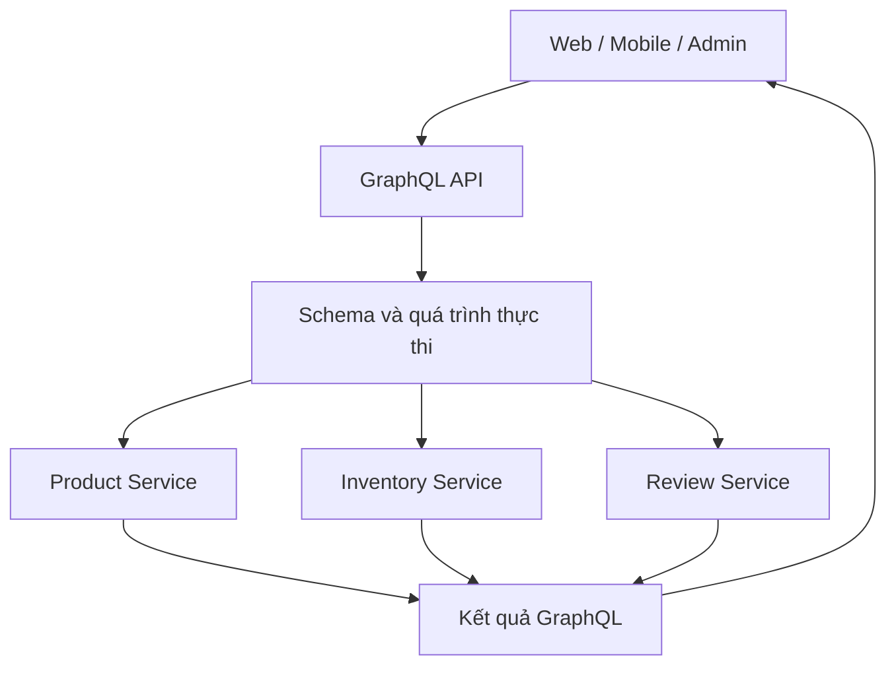

# GraphQL giải quyết vấn đề nào?

## Mục tiêu

Sau bài học này, bạn có thể:

- Giải thích vì sao một API được thiết kế quanh các endpoint cố định đôi khi không đáp ứng tốt nhu cầu của nhiều giao diện.
- Phân biệt hai vấn đề *overfetching* và *underfetching*.
- Mô tả cách GraphQL cho phép client khai báo dữ liệu cần nhận thông qua một schema có kiểu.
- Nhận biết những vấn đề GraphQL hỗ trợ giải quyết và những vấn đề vẫn cần backend xử lý.
- Liên hệ các khái niệm nền tảng đó với Spring for GraphQL.

## Bối cảnh: cùng một hệ thống, nhiều nhu cầu dữ liệu

Một hệ thống thương mại điện tử có thể phục vụ website, ứng dụng di động, trang quản trị và một ứng dụng đối tác. Các ứng dụng này dùng chung dữ liệu sản phẩm, người bán, tồn kho và đánh giá, nhưng mỗi màn hình cần một tập dữ liệu khác nhau.

Ví dụ, trang danh sách sản phẩm chỉ cần tên, ảnh và giá. Trang chi tiết cần thêm mô tả, thông tin người bán và một số đánh giá. Màn hình quản trị có thể cần tồn kho, lịch sử cập nhật và thông tin nội bộ.

Với API REST truyền thống, backend thường công bố các endpoint có cấu trúc phản hồi được thiết kế trước, chẳng hạn:

- `GET /api/products`: lấy danh sách sản phẩm.
- `GET /api/products/42`: lấy thông tin một sản phẩm.
- `GET /api/products/42/reviews`: lấy đánh giá của sản phẩm.
- `GET /api/sellers/7`: lấy thông tin người bán.

Cách thiết kế này phù hợp với nhiều hệ thống. Khó khăn xuất hiện khi nhu cầu của client thay đổi nhanh hoặc có nhiều loại client khác nhau. Client có thể nhận thừa dữ liệu, thiếu dữ liệu, phải gọi nhiều endpoint, hoặc phụ thuộc vào cách backend tổ chức tài nguyên.

GraphQL được tạo ra để giải quyết nhóm vấn đề về cách client yêu cầu và kết hợp dữ liệu từ API. Thay vì chọn một endpoint có phản hồi cố định, client gửi một query mô tả những trường nó cần. Server kiểm tra query theo schema và thực thi các phần tương ứng để trả về dữ liệu có cấu trúc phù hợp.

## 1. Overfetching: API trả về nhiều dữ liệu hơn mức cần thiết

*Overfetching* xảy ra khi client chỉ cần một vài trường nhưng endpoint trả về một đối tượng lớn hơn.

Giả sử màn hình danh sách chỉ hiển thị tên và giá sản phẩm. Endpoint REST `GET /api/products/42` có thể trả về:

```json
{
  "id": 42,
  "name": "Mechanical Keyboard",
  "price": 1250000,
  "description": "A full description...",
  "weight": 850,
  "dimensions": {
    "width": 440,
    "height": 40,
    "depth": 135
  },
  "inventory": {
    "warehouse": "HCM-01",
    "available": 28
  },
  "seller": {
    "id": 7,
    "name": "Example Store",
    "phone": "..."
  }
}
```

Client chỉ dùng `name` và `price`, nhưng vẫn phải nhận và xử lý phần còn lại. Với payload lớn hoặc danh sách nhiều bản ghi, dữ liệu thừa có thể làm tăng lượng truyền qua mạng và chi phí xử lý ở client.

GraphQL cho phép client chỉ định các trường cần thiết:

```graphql
query {
  product(id: "42") {
    name
    price
  }
}
```

Server có thể trả về:

```json
{
  "data": {
    "product": {
      "name": "Mechanical Keyboard",
      "price": 1250000
    }
  }
}
```

Phản hồi có cấu trúc theo query. Client không cần tải các trường mà màn hình hiện tại không sử dụng.

## 2. Underfetching: một endpoint không cung cấp đủ dữ liệu cho màn hình

*Underfetching* xảy ra khi một endpoint trả về một phần dữ liệu cần thiết, khiến client phải gọi thêm endpoint khác để hoàn thành màn hình.

Ví dụ, trang chi tiết sản phẩm cần:

- Tên và giá sản phẩm.
- Tên người bán.
- Ba đánh giá gần nhất.

Nếu API sản phẩm chỉ trả về thông tin sản phẩm, client có thể phải gọi thêm API người bán và API đánh giá. Một màn hình vì vậy tạo ra nhiều request phụ thuộc nhau.



Các request phụ thuộc có thể làm tăng độ trễ tổng thể, đặc biệt khi client phải đợi kết quả của request trước để biết tham số cho request tiếp theo. Client cũng phải tự ghép dữ liệu từ nhiều phản hồi.

GraphQL cho phép biểu diễn dữ liệu liên quan trong cùng một query:

```graphql
query ProductDetail {
  product(id: "42") {
    name
    price
    seller {
      name
    }
    reviews(first: 3) {
      rating
      comment
    }
  }
}
```

Client nhận được một cây dữ liệu tương ứng với cấu trúc query:

```json
{
  "data": {
    "product": {
      "name": "Mechanical Keyboard",
      "price": 1250000,
      "seller": {
        "name": "Example Store"
      },
      "reviews": [
        {
          "rating": 5,
          "comment": "Good quality"
        }
      ]
    }
  }
}
```

Server chịu trách nhiệm phân giải các trường và kết hợp dữ liệu từ những nguồn phù hợp. Client không phải tự điều phối từng endpoint cho cấu trúc dữ liệu này.

Một query GraphQL thường được gửi đến một endpoint, nhưng điều đó không có nghĩa server chỉ thực hiện một thao tác đọc hoặc một câu SQL. Trong quá trình thực thi, các resolver vẫn có thể gọi nhiều service, repository hoặc API phía sau.

## 3. Client cần hình dạng dữ liệu phù hợp với từng màn hình

Một endpoint cố định thường phản ánh một cách nhìn dữ liệu do backend lựa chọn. Khi nhiều client có nhu cầu khác nhau, backend có thể phải tạo thêm endpoint hoặc tham số để đáp ứng từng trường hợp.

GraphQL chuyển một phần quyền lựa chọn hình dạng phản hồi sang client. Client chọn các trường trong giới hạn schema công bố. Website có thể lấy `name`, `price` và `imageUrl`; ứng dụng di động lấy `name` và `price`; trang quản trị lấy thêm `inventory`.

Ví dụ, các query sau cùng sử dụng trường `product` nhưng yêu cầu dữ liệu khác nhau:

```graphql
# Thẻ sản phẩm
query ProductCard {
  product(id: "42") {
    name
    price
    imageUrl
  }
}
```

```graphql
# Màn hình quản trị
query ProductAdmin {
  product(id: "42") {
    name
    price
    inventory {
      available
      warehouse
    }
  }
}
```

Điều này hữu ích khi nhiều ứng dụng cùng dùng một miền dữ liệu nhưng có cách trình bày khác nhau. Backend có thể cung cấp một schema thống nhất, còn mỗi client lấy phần dữ liệu phù hợp với chức năng của nó.

Tuy nhiên, client chỉ được truy vấn những trường schema cho phép. GraphQL không phải cơ chế để client truy cập tùy ý vào database hoặc bỏ qua quy tắc nghiệp vụ.

## 4. Schema có kiểu tạo ra hợp đồng rõ ràng giữa client và server

Một API cần mô tả dữ liệu có thể truy cập, tham số đầu vào và kết quả trả về. Nếu hợp đồng không rõ ràng, client dễ gửi sai kiểu dữ liệu hoặc phụ thuộc vào những trường backend không cam kết hỗ trợ.

GraphQL sử dụng schema có kiểu. Schema mô tả các kiểu dữ liệu, trường, đối số và những điểm bắt đầu như `Query`, `Mutation`, `Subscription`.

Ví dụ SDL (Schema Definition Language):

```graphql
type Query {
  product(id: ID!): Product
}

type Product {
  id: ID!
  name: String!
  price: Int!
  seller: Seller
}

type Seller {
  id: ID!
  name: String!
}
```

Một số ký hiệu quan trọng:

| Cú pháp | Ý nghĩa |
|---|---|
| `ID` | Kiểu định danh |
| `String` | Chuỗi |
| `Int` | Số nguyên |
| `Product` | Kiểu đối tượng do schema định nghĩa |
| `ID!` | Giá trị bắt buộc, không được null |
| `[Product]` | Danh sách Product, bản thân danh sách có thể null |
| `[Product!]!` | Danh sách bắt buộc và từng phần tử cũng không được null |

Trước khi thực thi, GraphQL kiểm tra query theo schema. Chẳng hạn, query yêu cầu trường không tồn tại hoặc truyền đối số sai kiểu sẽ bị từ chối ở bước validation.

Schema cũng giúp công cụ phát triển hỗ trợ autocomplete, tài liệu hóa và sinh kiểu cho client. Với GraphQL, schema là hợp đồng kỹ thuật trung tâm giữa bên cung cấp API và bên sử dụng API.

## 5. Thay đổi API mà giảm nhu cầu tạo phiên bản mới

Trong một API có phản hồi cố định, việc thay đổi cấu trúc có thể ảnh hưởng đến client đang sử dụng. Một hướng xử lý phổ biến là duy trì nhiều phiên bản endpoint, ví dụ `/v1` và `/v2`.

GraphQL hỗ trợ tiến hóa schema bằng cách bổ sung trường mới mà không buộc các client cũ phải sử dụng trường đó. Client chỉ yêu cầu các trường mình cần. Khi cần ngừng hỗ trợ một trường, schema có thể đánh dấu trường đó là deprecated và cung cấp lý do hoặc hướng thay thế.

Ví dụ:

```graphql
type Product {
  id: ID!
  name: String!
  oldPrice: Int @deprecated(reason: "Use price instead")
  price: Int!
}
```

Client cũ có thể tiếp tục dùng `oldPrice` trong thời gian chuyển đổi; client mới chuyển sang `price`. Đội backend theo dõi mức sử dụng trường cũ trước khi loại bỏ nó theo chính sách tương thích của hệ thống.

GraphQL không tự động làm cho mọi thay đổi đều an toàn. Đổi kiểu, đổi ý nghĩa hoặc xóa trường đang được sử dụng vẫn có thể phá vỡ client. Việc quản lý vòng đời schema và kiểm tra mức độ sử dụng vẫn cần được thực hiện.

## 6. Kết hợp dữ liệu từ nhiều nguồn thành một data graph

Dữ liệu của một nghiệp vụ thường nằm ở nhiều thành phần: thông tin sản phẩm trong cơ sở dữ liệu chính, tồn kho từ dịch vụ kho, thông tin giao hàng từ dịch vụ vận chuyển và đánh giá từ một hệ thống khác.

Nếu để client gọi trực tiếp từng nguồn, client phải biết cách tổ chức backend và xử lý nhiều giao thức hoặc cấu trúc phản hồi. GraphQL cho phép server công bố một schema thống nhất, rồi phân giải từng trường từ nguồn dữ liệu tương ứng.



Ví dụ, trường `product.inventory` có thể được phân giải từ Inventory Service, trong khi `product.name` đến từ Product Service. Client vẫn truy vấn chúng qua cùng một schema.

Cách tiếp cận này giúp che giấu chi tiết tích hợp phía sau API và tạo một điểm truy cập dữ liệu thống nhất. Nó cũng đặt thêm trách nhiệm lên GraphQL server: quản lý lỗi từ các nguồn, thời gian chờ, quyền truy cập, tính nhất quán và hiệu năng khi kết hợp dữ liệu.

## 7. GraphQL không tự giải quyết mọi vấn đề của backend

GraphQL cải thiện cách client yêu cầu và kết hợp dữ liệu. Chất lượng thực tế vẫn phụ thuộc vào cách server triển khai resolver, truy cập dữ liệu và bảo vệ API.

### Vấn đề N+1

Giả sử client truy vấn 20 đơn hàng và tên khách hàng của từng đơn:

```graphql
query {
  orders {
    id
    customer {
      name
    }
  }
}
```

Nếu resolver của `customer` chạy một câu truy vấn riêng cho mỗi đơn hàng, backend có thể thực hiện một lần lấy danh sách đơn hàng và thêm 20 lần truy vấn khách hàng. Đây là vấn đề N+1.

GraphQL không tự động gộp các lần truy cập đó. Với Spring for GraphQL, có thể dùng DataLoader hoặc `@BatchMapping` để gom các khóa khách hàng và tải dữ liệu theo lô. Khi đó, thay vì truy vấn từng khách hàng riêng lẻ, backend có thể lấy nhiều khách hàng trong một lần gọi phù hợp.

### Bảo mật theo trường

Một trường xuất hiện trong schema không có nghĩa mọi người dùng đều được phép đọc nó. Server cần xác thực người dùng và kiểm tra quyền ở các điểm thích hợp, kể cả khi client lồng nhiều trường trong một query.

Với Spring for GraphQL, có thể kết hợp Spring Security và các cơ chế kiểm tra quyền trong lớp xử lý tương ứng. Quyền truy cập cần phản ánh quy tắc nghiệp vụ, chẳng hạn người dùng chỉ xem được thông tin đơn hàng của chính họ.

### Query quá sâu hoặc quá tốn kém

Một query có thể lồng nhiều cấp hoặc yêu cầu danh sách lớn. Nếu server thực thi không giới hạn, một request có thể tạo ra lượng công việc rất lớn.

API cần giới hạn kích thước trang, độ sâu hoặc độ phức tạp query khi phù hợp, đặt timeout và theo dõi tài nguyên. Các resolver cũng cần kiểm soát cách truy cập database và service phía sau.

### Cache và hiệu năng

GraphQL không tự cung cấp chiến lược cache phù hợp cho mọi trường hợp. Do nhiều query có thể gửi đến cùng một endpoint nhưng yêu cầu các tập trường khác nhau, hệ thống cần cân nhắc cache ở client, server hoặc tầng dữ liệu theo đặc điểm nghiệp vụ.

Ngoài ra, một query GraphQL ngắn vẫn có thể gây ra nhiều lời gọi backend. Cần đo lường thời gian resolver, số lần truy cập dữ liệu và độ trễ của từng nguồn để tìm đúng điểm nghẽn.

## 8. Khi nào nên cân nhắc GraphQL?

| Nhu cầu | GraphQL có thể phù hợp khi | Cần cân nhắc |
|---|---|---|
| Nhiều loại client | Website, mobile và admin cần các tập trường khác nhau | Thiết kế schema và quyền truy cập đủ rõ |
| Dữ liệu liên kết | Một màn hình cần kết hợp nhiều đối tượng hoặc dịch vụ | Resolver, batching và xử lý lỗi |
| Client thay đổi thường xuyên | Client cần chọn trường mà không phải chờ endpoint riêng | Quản lý thay đổi và vòng đời schema |
| Hợp đồng API có kiểu | Muốn validation, introspection và công cụ hỗ trợ schema | Kỷ luật thiết kế schema |
| API đơn giản, ít biến thể | REST có thể đã đáp ứng tốt | Không cần thêm độ phức tạp vận hành |
| Tải file hoặc cache HTTP theo tài nguyên | REST hoặc endpoint chuyên biệt có thể thuận tiện hơn | Có thể kết hợp nhiều kiểu API trong cùng hệ thống |

GraphQL và REST có thể cùng tồn tại. Một hệ thống có thể dùng GraphQL cho màn hình cần truy vấn dữ liệu linh hoạt, đồng thời giữ REST cho các luồng đơn giản, tải file hoặc tích hợp đã ổn định.

## 9. GraphQL xử lý query như thế nào trong Spring for GraphQL?

Ở mức khái quát, một request GraphQL đi qua các bước sau:

1. Client gửi query, mutation hoặc subscription đến GraphQL endpoint.
2. Server phân tích cú pháp và kiểm tra query theo schema.
3. GraphQL thực thi các trường được yêu cầu.
4. Resolver lấy dữ liệu từ service, repository hoặc nguồn bên ngoài.
5. Server ghép kết quả thành phản hồi có cấu trúc theo query.

Trong Spring for GraphQL, schema SDL định nghĩa hợp đồng API. Các phương thức được đánh dấu bằng những annotation như `@QueryMapping` hoặc `@SchemaMapping` đảm nhiệm việc phân giải trường. Khi cần tải dữ liệu liên quan theo lô, `@BatchMapping` và DataLoader giúp hạn chế N+1.

Các phần tiếp theo của module `SPRING_GRAPHQL` sẽ đi sâu vào schema SDL, Query, Mutation, Subscription, `@SchemaMapping`, `@BatchMapping`, DataLoader, xử lý lỗi, bảo mật theo trường, kiểm thử và tối ưu truy vấn phía server.

## Kết luận

GraphQL giải quyết chủ yếu vấn đề về sự không khớp giữa dữ liệu mà client cần và phản hồi cố định của API: client có thể nhận quá nhiều dữ liệu (*overfetching*), phải gọi nhiều endpoint để lấy đủ dữ liệu (*underfetching*), hoặc phải tự kết hợp thông tin từ nhiều nguồn.

Bằng schema có kiểu và query do client khai báo, GraphQL tạo một hợp đồng rõ ràng và cho phép server cung cấp dữ liệu theo cấu trúc client yêu cầu. Để đạt hiệu quả trong thực tế, backend vẫn phải xử lý tốt batching, N+1, bảo mật, giới hạn truy vấn, cache và hiệu năng.
