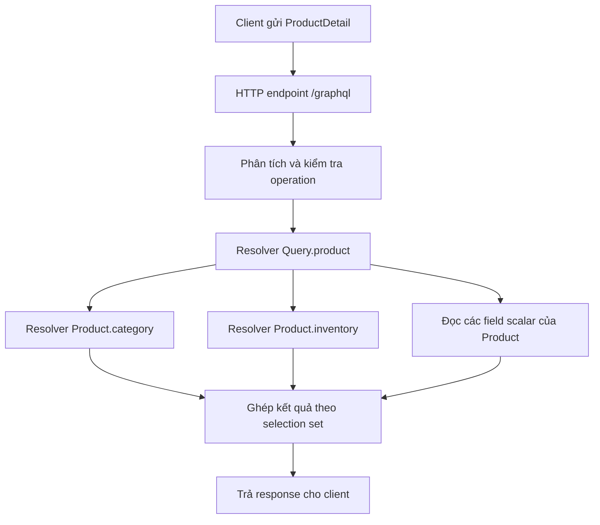

# Một endpoint cho nhiều use case

## Mục tiêu

Sau bài học này, bạn có thể:

- Giải thích vì sao một GraphQL API thường dùng một HTTP endpoint để phục vụ nhiều màn hình và ứng dụng.
- Phân biệt endpoint, operation, field và selection set trong một request GraphQL.
- Thiết kế các query khác nhau trên cùng một schema mà không tạo endpoint riêng cho từng màn hình.
- Nhận biết những trách nhiệm vẫn thuộc về server: phân quyền, hiệu năng, kiểm soát độ phức tạp và tổ chức resolver.
- Liên hệ mô hình này với `@QueryMapping` và `@SchemaMapping` trong Spring for GraphQL.

## Vấn đề: mỗi màn hình một endpoint

Hãy hình dung một cửa hàng trực tuyến có nhiều nơi cần hiển thị thông tin sản phẩm:

- Trang danh sách chỉ cần tên, ảnh và giá để vẽ một thẻ sản phẩm.
- Trang chi tiết cần thêm mô tả, danh mục và tình trạng tồn kho.
- Màn hình quản trị cần mã SKU, giá và số lượng tồn kho để nhân viên kiểm tra.
- Ứng dụng di động có thể chỉ cần tên, giá và một vài thông tin ngắn để tiết kiệm dữ liệu.

Với cách thiết kế REST theo từng màn hình, nhóm phát triển đôi khi tạo các URL như `/api/product-cards`, `/api/product-details/{id}` và `/api/admin/products/{id}`. Những endpoint này có thể hoạt động tốt, nhưng khi số màn hình và ứng dụng tăng lên, server dễ xuất hiện nhiều endpoint có dữ liệu chồng lấn. Mỗi thay đổi về cách hiển thị có thể kéo theo việc thêm endpoint hoặc thay đổi response riêng.

GraphQL giải quyết bài toán này bằng cách công bố một schema mô tả những dữ liệu client có thể truy vấn. Client gửi một operation đến endpoint GraphQL và nêu rõ các field mình cần. Các client khác nhau có thể gửi những operation khác nhau đến cùng endpoint, miễn là operation hợp lệ với schema và người gọi có quyền truy cập dữ liệu đó.

Ý tưởng cốt lõi là **endpoint xác định nơi nhận request; operation và selection set xác định client đang yêu cầu điều gì**.

## Phân biệt endpoint, operation và field

Các khái niệm này có vai trò khác nhau:

| Khái niệm | Ý nghĩa | Ví dụ |
| --- | --- | --- |
| Endpoint | Địa chỉ nhận request GraphQL | `POST /graphql` |
| Operation | Một yêu cầu đọc, ghi hoặc theo dõi dữ liệu | `query ProductDetail { ... }` |
| Root field | Điểm bắt đầu của operation trong schema | `product(id: $id)` |
| Selection set | Danh sách field client muốn nhận | `{ id name price { amount currency } }` |
| Resolver | Logic server dùng để cung cấp giá trị cho field | `@QueryMapping`, `@SchemaMapping` |

Trong một ứng dụng Spring Boot dùng Spring for GraphQL, endpoint HTTP mặc định thường là `/graphql` và có thể được cấu hình lại. Nhiều client có thể gọi địa chỉ này. Server không cần một URL mới cho mỗi loại màn hình; nó đọc operation trong request để biết cần thực thi phần nào của schema.

Một tài liệu GraphQL có thể chứa một hoặc nhiều operation. Nếu tài liệu có nhiều operation, request có thể truyền `operationName` để chọn operation cần chạy. `operationName` không phải tên endpoint và cũng không tự tạo ra một route mới.

## Một schema, nhiều cách lấy dữ liệu

Giả sử API bán hàng công bố schema rút gọn sau:

```graphql
type Query {
  product(id: ID!): Product
  products(categoryId: ID, first: Int = 20): [Product!]!
}

type Product {
  id: ID!
  name: String!
  description: String
  sku: String!
  price: Money!
  category: Category
  inventory: Inventory
}

type Money {
  amount: Float!
  currency: String!
}

type Category {
  id: ID!
  name: String!
}

type Inventory {
  availableQuantity: Int!
  status: String!
}
```

Schema mô tả khả năng của API. Nó không buộc mọi client phải nhận toàn bộ field của `Product`. Client chọn một tập con phù hợp với use case.

### Use case 1: thẻ sản phẩm

Trang danh sách chỉ cần định danh, tên và giá:

```graphql
query ProductCard($id: ID!) {
  product(id: $id) {
    id
    name
    price {
      amount
      currency
    }
  }
}
```

Server trả về những field đã chọn. Client không phải nhận `description`, `sku`, `category` hay `inventory` nếu màn hình không dùng chúng.

### Use case 2: trang chi tiết

Trang chi tiết có thể yêu cầu thêm mô tả, danh mục và tình trạng hàng:

```graphql
query ProductDetail($id: ID!) {
  product(id: $id) {
    id
    name
    description
    price {
      amount
      currency
    }
    category {
      id
      name
    }
    inventory {
      availableQuantity
      status
    }
  }
}
```

Operation này vẫn gọi field gốc `product` trên cùng schema. Điểm khác biệt nằm ở selection set: client yêu cầu thêm các field lồng nhau.

### Use case 3: màn hình quản trị

Nhân viên quản trị có thể cần SKU và số lượng tồn kho:

```graphql
query ProductAdminView($id: ID!) {
  product(id: $id) {
    id
    sku
    name
    price {
      amount
      currency
    }
    inventory {
      availableQuantity
      status
    }
  }
}
```

Ba operation trên cùng truy vấn một loại dữ liệu, nhưng mỗi operation phục vụ một nhu cầu khác nhau. Chúng không cần ba endpoint độc lập. Server vẫn phải kiểm tra quyền của người gọi: việc một field xuất hiện trong schema không có nghĩa mọi tài khoản đều được phép đọc field đó.

## Request thực tế đến endpoint GraphQL

Với HTTP, client thường gửi request `POST` đến `/graphql`. Body có thể chứa `query`, `operationName` và `variables`:

```http
POST /graphql
Content-Type: application/json
```

```json
{
  "operationName": "ProductCard",
  "query": "query ProductCard($id: ID!) { product(id: $id) { id name price { amount currency } } }",
  "variables": {
    "id": "p-101"
  }
}
```

Ba phần trong body có ý nghĩa riêng:

- `query` chứa tài liệu GraphQL, bao gồm operation và các field được chọn.
- `operationName` chỉ rõ operation cần thực thi khi tài liệu có nhiều operation. Khi tài liệu chỉ có một operation, trường này thường có thể bỏ qua.
- `variables` truyền giá trị đầu vào như mã sản phẩm. Dùng biến giúp tách dữ liệu đầu vào khỏi cấu trúc query, thuận tiện cho việc tái sử dụng và kiểm tra kiểu.

Client trang chi tiết có thể gửi một body khác, nhưng vẫn gọi `POST /graphql`. Server phân tích request, chọn operation, kiểm tra operation với schema rồi thực thi các field tương ứng.

## Spring for GraphQL xử lý request như thế nào?

Trong Spring for GraphQL, các method được đánh dấu bằng annotation đóng vai trò cung cấp dữ liệu cho field trong schema. Ví dụ, `@QueryMapping` liên kết một method với root field của `Query`:

```java
@Controller
public class ProductController {

    private final ProductService productService;

    public ProductController(ProductService productService) {
        this.productService = productService;
    }

    @QueryMapping
    public Product product(@Argument String id) {
        return productService.findById(id).orElse(null);
    }
}
```

Method này cung cấp dữ liệu cho field `product(id: ID!): Product` trong schema. Nó không cần biết request đến từ trang danh sách, trang chi tiết hay ứng dụng di động. Các client quyết định field nào cần lấy thông qua selection set.

Các field lồng nhau có thể được xử lý bằng `@SchemaMapping`:

```java
@Controller
public class ProductFieldController {

    private final ProductService productService;

    public ProductFieldController(ProductService productService) {
        this.productService = productService;
    }

    @SchemaMapping(typeName = "Product", field = "category")
    public Category category(Product product) {
        return productService.findCategory(product.categoryId());
    }

    @SchemaMapping(typeName = "Product", field = "inventory")
    public Inventory inventory(Product product) {
        return productService.findInventory(product.id());
    }
}
```

Khi client yêu cầu `product { name }`, server chỉ cần cung cấp các field nằm trên nhánh được chọn. Khi client yêu cầu thêm `category` hoặc `inventory`, các resolver tương ứng có thể được gọi để lấy dữ liệu cho những field đó. Spring for GraphQL kết hợp schema với các mapping này để thực thi operation.

Ví dụ trên được rút gọn để làm rõ cách liên kết field. Trong ứng dụng thực tế, các kiểu `Product`, `Category`, `Inventory` và service cần được định nghĩa phù hợp với mô hình miền; cách xử lý trường hợp không tìm thấy sản phẩm cũng cần nhất quán với quy ước lỗi của API.

## Một endpoint không có nghĩa là một resolver

Một request GraphQL có thể đi qua nhiều resolver. Với query trang chi tiết, luồng xử lý có thể là:



Endpoint là cửa vào của request. Resolver là thành phần cung cấp dữ liệu cho từng field. Một query có thể gọi nhiều resolver, và một resolver có thể được dùng trong nhiều operation. Nhờ đó, logic truy cập dữ liệu có thể được tổ chức theo field hoặc theo miền nghiệp vụ thay vì nhân bản theo từng màn hình.

Điều này cũng có nghĩa server cần chú ý đến chi phí thực thi. Nếu một trang yêu cầu danh sách 100 sản phẩm và mỗi sản phẩm lại truy vấn riêng danh mục hoặc tồn kho, hệ thống có thể gặp vấn đề N+1. Spring for GraphQL hỗ trợ các cơ chế như `@BatchMapping` và tích hợp DataLoader để gom việc tải dữ liệu theo lô. Thiết kế một endpoint không tự động loại bỏ N+1; cách viết resolver vẫn quyết định hiệu năng thực tế.

## Query, Mutation và Subscription thuộc cùng mô hình API

GraphQL định nghĩa các root operation type:

- `Query` dùng để đọc dữ liệu.
- `Mutation` dùng để thực hiện thay đổi dữ liệu.
- `Subscription` dùng để nhận các sự kiện cập nhật theo thời gian.

Query và mutation thường được gửi qua cùng HTTP endpoint GraphQL. Ví dụ, schema có thể khai báo:

```graphql
input AddToCartInput {
  productId: ID!
  quantity: Int!
}

type Cart {
  id: ID!
  itemCount: Int!
}

type Mutation {
  addToCart(input: AddToCartInput!): Cart!
}
```

Client thêm sản phẩm vào giỏ bằng operation:

```graphql
mutation AddProductToCart($input: AddToCartInput!) {
  addToCart(input: $input) {
    id
    itemCount
  }
}
```

Operation này vẫn gửi đến endpoint GraphQL. Server nhận biết đây là mutation dựa trên operation type và thực thi root field `addToCart`.

Subscription có thêm khác biệt về phương thức truyền tải vì cần giữ kết nối để nhận dữ liệu tiếp theo. Spring for GraphQL có thể triển khai subscription qua các transport như WebSocket hoặc Server-Sent Events tùy cấu hình. Vì vậy, khái niệm “một endpoint” nên được hiểu là một điểm truy cập API GraphQL thống nhất cho các operation thông thường; transport dành cho subscription có thể cần cấu hình đường dẫn hoặc kết nối riêng.

## Lợi ích khi nhiều use case dùng chung schema

**Giảm số endpoint phải duy trì.** Thêm một màn hình mới thường chỉ cần thiết kế operation phù hợp với schema hiện có. Nhóm phát triển không nhất thiết phải thêm URL và response model riêng cho màn hình đó.

**Client chủ động chọn dữ liệu.** Một màn hình nhỏ có thể lấy ít field; màn hình chi tiết có thể lấy thêm field lồng nhau. Điều này giúp giảm dữ liệu dư thừa trên đường truyền, đặc biệt hữu ích khi giao diện có nhiều nhu cầu khác nhau.

**Tái sử dụng logic truy cập dữ liệu.** Nhiều operation có thể dùng chung root field và resolver. Logic nghiệp vụ nên được đặt trong service/domain layer để resolver có thể phối hợp mà không phụ thuộc vào một loại giao diện cụ thể.

**Phát triển schema theo hướng tương thích.** Có thể bổ sung field mới mà không buộc mọi client phải sử dụng ngay. Khi cần thay thế field cũ, GraphQL hỗ trợ đánh dấu deprecated để client có thời gian chuyển đổi:

```graphql
type Product {
  oldPrice: Float @deprecated(reason: "Use price instead")
  price: Money!
}
```

Lợi ích này phụ thuộc vào kỷ luật thiết kế schema và quy trình theo dõi client. Một endpoint duy nhất không tự động làm cho API tương thích ngược.

## Những trách nhiệm vẫn thuộc về server

Việc client được chọn field không đồng nghĩa server có thể tin tưởng mọi request. Một GraphQL API dùng chung cho nhiều use case cần xử lý các vấn đề sau.

### Phân quyền theo người dùng và field

Server phải xác thực request và kiểm tra quyền trên dữ liệu, thao tác cũng như field nhạy cảm. Ví dụ, khách hàng có thể xem giá bán công khai nhưng không được xem dữ liệu nội bộ như giá vốn hoặc ghi chú của nhân viên. Ẩn field trên giao diện không phải là biện pháp bảo mật.

Trong Spring, có thể kết hợp Spring Security với kiểm tra quyền ở tầng controller, service hoặc resolver tùy kiến trúc. Cần bảo đảm kiểm tra quyền được áp dụng cho mọi đường truy cập đến dữ liệu, kể cả khi field được gọi lồng nhau từ operation khác.

### Kiểm soát độ phức tạp của query

Một query có thể lồng nhiều cấp và yêu cầu danh sách lớn. Nếu không giới hạn, request hợp lệ về cú pháp vẫn có thể tiêu tốn quá nhiều CPU, bộ nhớ hoặc lượt truy vấn cơ sở dữ liệu. API thực tế nên cân nhắc:

- Giới hạn kích thước trang và yêu cầu phân trang cho collection lớn.
- Đặt giới hạn độ sâu hoặc độ phức tạp query khi phù hợp.
- Áp dụng rate limit và timeout theo chính sách hệ thống.
- Theo dõi operation, thời gian thực thi và resolver có chi phí cao.

### Tránh N+1 và tải dữ liệu không cần thiết

GraphQL giúp client yêu cầu đúng field, nhưng server vẫn phải triển khai resolver hiệu quả. Với quan hệ một-nhiều hoặc nhiều-một, hãy xem xét `@BatchMapping`, DataLoader, truy vấn join phù hợp hoặc các chiến lược tải dữ liệu theo lô. Chỉ nên truy cập nguồn dữ liệu cho những field được yêu cầu và cần thiết để tạo response.

### Thiết kế schema theo ngôn ngữ nghiệp vụ

Không nên biến schema thành bản sao máy móc của từng bảng cơ sở dữ liệu. Field và type nên thể hiện khái niệm mà client cần dùng. Nếu schema chỉ phản chiếu cấu trúc lưu trữ, thay đổi database có thể làm API bị ràng buộc không cần thiết.

## Khi nào nên tạo API hoặc endpoint riêng?

Một endpoint GraphQL chung phù hợp khi nhiều client cần truy cập cùng một miền dữ liệu và có thể chia sẻ schema, quy tắc bảo mật cũng như vòng đời API. Tuy vậy, không nên ép mọi nhu cầu vào một schema duy nhất nếu chúng thuộc các ranh giới nghiệp vụ hoặc yêu cầu vận hành khác nhau.

Một số trường hợp có thể cần API riêng hoặc tiếp tục dùng REST:

- Tải lên hoặc tải xuống tệp lớn với cơ chế truyền tải chuyên biệt.
- Webhook cần một URL nhận callback theo giao thức của bên tích hợp.
- API công khai và API nội bộ có chính sách bảo mật, vận hành hoặc vòng đời tách biệt rõ ràng.
- Một miền nghiệp vụ độc lập có chủ sở hữu và mô hình dữ liệu riêng.
- Tác vụ đơn giản, ổn định, phù hợp hơn với một REST resource thông thường.

GraphQL và REST có thể cùng tồn tại. Mục tiêu là chọn giao diện phù hợp với nhu cầu và ranh giới hệ thống, không phải gom mọi giao tiếp vào một URL bằng mọi giá.

## Thực hành: chọn operation cho từng màn hình

Với schema `Product` ở trên, hãy xác định các field cần thiết cho ba màn hình:

1. Danh sách sản phẩm chỉ hiển thị tên và giá.
2. Trang chi tiết hiển thị tên, mô tả, danh mục và tồn kho.
3. Trang quản trị hiển thị SKU và số lượng tồn kho.

Bạn có thể viết ba operation với các selection set khác nhau. Cả ba đều có thể gọi field `product` hoặc `products` trên cùng endpoint. Sau đó, kiểm tra rằng resolver và service trả dữ liệu đúng, đồng thời người dùng không có quyền quản trị không thể đọc dữ liệu chỉ dành cho quản trị viên.

Có thể kiểm tra operation bằng `GraphQlTester` trong Spring for GraphQL. Ví dụ sau minh họa việc gửi query với biến và xác minh một field trong response:

```java
graphQlTester.document("""
        query ProductCard($id: ID!) {
            product(id: $id) {
                id
                name
            }
        }
        """)
    .variable("id", "p-101")
    .execute()
    .path("product.name")
    .entity(String.class)
    .isEqualTo("Bàn phím cơ");
```

Nên kiểm tra ít nhất các khía cạnh sau:

- Operation hợp lệ với schema và nhận đúng biến đầu vào.
- Các field được yêu cầu xuất hiện với dữ liệu chính xác.
- Field không được yêu cầu không làm phát sinh công việc tải dữ liệu không cần thiết.
- Người dùng thiếu quyền không đọc hoặc thay đổi được dữ liệu bị giới hạn.
- Query có danh sách lớn hoặc lồng sâu được xử lý theo giới hạn đã đặt.

## Ghi nhớ

GraphQL thường dùng một endpoint để nhận nhiều operation. Schema định nghĩa dữ liệu và thao tác có thể truy cập; mỗi operation chọn root field và selection set phù hợp với use case. Trong Spring for GraphQL, `@QueryMapping` xử lý các root field của query, còn `@SchemaMapping` cung cấp dữ liệu cho field trên các object type. Cách tổ chức này giúp nhiều client dùng chung API, nhưng server vẫn phải chịu trách nhiệm về phân quyền, hiệu năng, giới hạn truy vấn và thiết kế schema.
