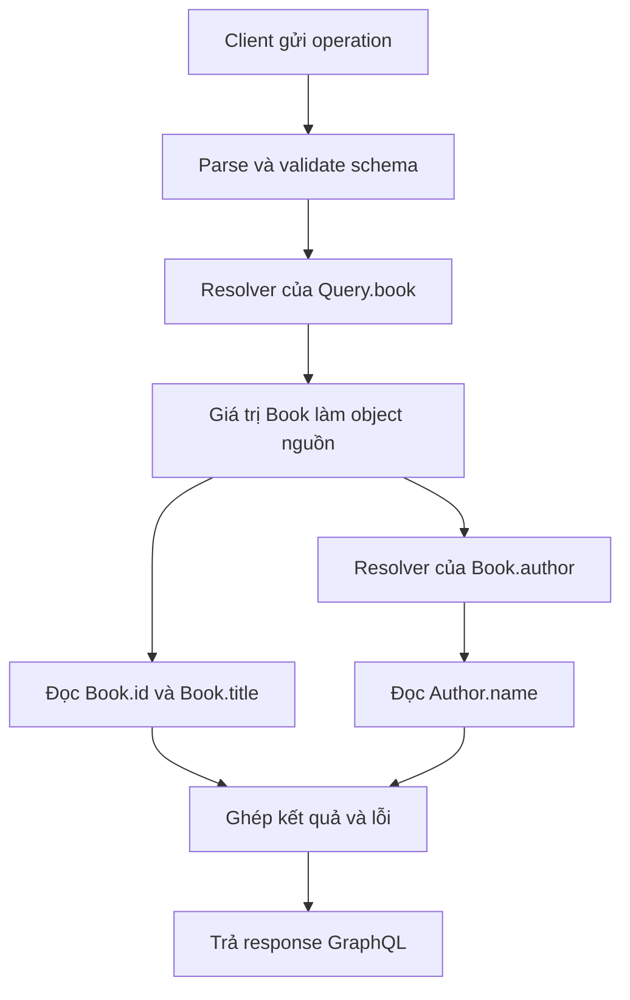

# Resolver và data fetcher trong Spring for GraphQL

Schema GraphQL mô tả những kiểu dữ liệu và thao tác mà client được phép gọi. Để biến hợp đồng đó thành API hoạt động, server cần lấy dữ liệu cho từng field. Thành phần đảm nhiệm công việc này trong GraphQL được gọi là **data fetcher**; trong cách nói phổ biến, ta thường gọi nó là **resolver**.

Spring for GraphQL kết nối các resolver với schema GraphQL Java và cung cấp annotation để khai báo chúng ngay trong các Spring bean. Khi hiểu rõ field nào cần resolver riêng, field nào có thể đọc trực tiếp từ object, và lúc nào cần gom truy vấn theo lô, ta có thể xây dựng API dễ bảo trì mà vẫn kiểm soát được số lần truy cập dữ liệu.

Sau bài này, bạn có thể:

- Phân biệt schema, resolver và data fetcher trong quá trình thực thi một operation.
- Viết resolver cho `Query`, `Mutation`, `Subscription` và các field lồng nhau bằng annotation của Spring for GraphQL.
- Nhận argument, object nguồn và dữ liệu ngữ cảnh trong method resolver.
- Nhận biết vấn đề N+1 và xử lý bằng `@BatchMapping` hoặc `DataLoader`.
- Chọn cách xử lý lỗi, phân quyền và kiểm thử phù hợp với từng field.

## 1. Schema khai báo field, resolver cung cấp giá trị

Xét một API thư viện đơn giản. Một cuốn sách có tác giả; client có thể tìm một cuốn sách, lấy danh sách sách và tạo sách mới.

```graphql
type Query {
    book(id: ID!): Book
    books: [Book!]!
}

type Mutation {
    createBook(input: CreateBookInput!): Book!
}

type Book {
    id: ID!
    title: String!
    author: Author
}

type Author {
    id: ID!
    name: String!
}

input CreateBookInput {
    title: String!
    authorId: ID!
}
```

Schema cho biết `book` nhận một `id` và trả về `Book`; field `author` của `Book` trả về `Author` hoặc `null`. Schema không quy định dữ liệu phải được đọc từ database, REST service hay cache. Đó là trách nhiệm của resolver.

Trong GraphQL Java, một data fetcher là một đối tượng thực thi logic lấy giá trị cho một field. Nó nhận `DataFetchingEnvironment`, từ đó có thể đọc argument, object cha, context, dữ liệu đã được chọn và `DataLoader`. Data fetcher có thể trả về giá trị trực tiếp hoặc kết quả bất đồng bộ như `CompletionStage`; với subscription, field gốc có thể phát ra một `Publisher`.

Spring for GraphQL đăng ký các method được đánh dấu bằng annotation thành data fetcher. Vì vậy, phần lớn ứng dụng Spring không cần tự tạo `DataFetcher` cho từng field. Bạn chỉ cần viết method với tham số và kiểu trả về phù hợp.

## 2. Một operation được phân giải như thế nào?

Khi client gửi một query như sau:

```graphql
query {
    book(id: "book-42") {
        id
        title
        author {
            name
        }
    }
}
```

GraphQL thực thi các field theo cấu trúc của schema và selection set. Trình tự khái quát là:



Resolver của `Query.book` lấy object `Book`. Khi thực thi field con `author`, GraphQL chuyển object `Book` đó cho resolver của `Book.author`. Các field đơn giản như `id` và `title` thường được đọc trực tiếp từ thuộc tính của object mà không cần method resolver riêng.

Đây là điểm quan trọng: resolver không nhất thiết phải tồn tại cho mọi field trong schema. Chỉ cần khai báo resolver khi field cần truy vấn, biến đổi, kiểm tra quyền hoặc áp dụng logic đặc biệt. Với field tương ứng một thuộc tính có sẵn trên object, cơ chế property data fetcher mặc định của GraphQL Java thường đã đủ.

## 3. Resolver cho Query và field lồng nhau

Giả sử mô hình domain lưu `authorId` trong `Book`, thay vì nhúng cả object `Author`:

```java
public record Book(String id, String title, String authorId) {}

public record Author(String id, String name) {}
```

Resolver có thể được khai báo trong một Spring controller như sau:

```java
@Controller
public class BookGraphQlController {

    private final BookService bookService;
    private final AuthorService authorService;

    public BookGraphQlController(
            BookService bookService,
            AuthorService authorService) {
        this.bookService = bookService;
        this.authorService = authorService;
    }

    @QueryMapping
    public Book book(@Argument("id") String id) {
        return bookService.findById(id).orElse(null);
    }

    @QueryMapping
    public List<Book> books() {
        return bookService.findAll();
    }

    @SchemaMapping(typeName = "Book", field = "author")
    public Author author(Book book) {
        return authorService.findById(book.authorId()).orElse(null);
    }
}
```

`@QueryMapping` liên kết method với field cùng tên trên root type `Query`. Method `book` nhận argument `id` nhờ `@Argument`; tên argument được ghi rõ để tránh phụ thuộc vào việc biên dịch có giữ tên tham số hay không.

`@SchemaMapping` liên kết method với một field của một kiểu cụ thể. Ở ví dụ trên, `typeName = "Book"` và `field = "author"` chỉ rõ field cần xử lý. Tham số `Book book` là **object nguồn** (source hoặc parent): object mà GraphQL đang dùng để phân giải field con. Nếu không chỉ định `typeName`, Spring for GraphQL có thể suy ra kiểu nguồn từ tham số source của method; nếu không chỉ định `field`, tên method được dùng làm tên field.

Với field `id` và `title`, GraphQL Java có thể đọc accessor của record hoặc getter tương ứng. Không cần viết thêm hai method `@SchemaMapping` chỉ để trả về `book.id()` và `book.title()`. Hãy dành resolver tường minh cho những field thực sự cần logic.

Nếu ứng dụng dùng Java class thông thường thay vì record, property data fetcher có thể đọc getter như `getId()` hoặc `getTitle()`. Với object là `Map`, nó cũng có thể đọc giá trị theo key. Nếu tên thuộc tính không khớp field schema hoặc cần quy tắc biến đổi riêng, hãy khai báo `@SchemaMapping` rõ ràng.

## 4. Các annotation mapping thường dùng

Spring for GraphQL cung cấp các annotation tương ứng với từng vị trí trong schema:

| Annotation | Field được liên kết | Cách dùng phổ biến |
| --- | --- | --- |
| `@QueryMapping` | Field trên root type `Query` | Đọc dữ liệu, tìm kiếm, lọc danh sách |
| `@MutationMapping` | Field trên root type `Mutation` | Tạo, cập nhật hoặc xóa dữ liệu |
| `@SubscriptionMapping` | Field trên root type `Subscription` | Phát sự kiện theo thời gian thực |
| `@SchemaMapping` | Field của một object type | Phân giải field lồng nhau hoặc field cần logic riêng |
| `@BatchMapping` | Field của một object type theo lô | Lấy dữ liệu liên quan cho nhiều object nguồn |

Các annotation mapping rút gọn có thể xem như những dạng chuyên biệt của `@SchemaMapping` dành cho root type. Ví dụ, `@QueryMapping` tương đương việc đăng ký một field trên type `Query`.

### Nhận argument và input object

Argument trong schema được bind vào tham số có `@Argument`:

```java
public record CreateBookInput(String title, String authorId) {}

@MutationMapping
public Book createBook(@Argument("input") CreateBookInput input) {
    return bookService.create(input.title(), input.authorId());
}
```

GraphQL input object phù hợp với thao tác nhận nhiều trường liên quan. Dùng input type riêng giúp schema diễn đạt rõ dữ liệu đầu vào và tránh tạo mutation có quá nhiều argument rời rạc. Nên xác thực dữ liệu ở tầng phù hợp trước khi ghi xuống hệ thống lưu trữ; kiểu GraphQL chỉ kiểm tra cấu trúc và các ràng buộc scalar được khai báo trong schema.

### Mutation và Subscription

Mutation được dùng cho thao tác làm thay đổi trạng thái:

```java
@MutationMapping
public Book createBook(@Argument("input") CreateBookInput input) {
    return bookService.create(input);
}
```

Method có thể trả về object vừa tạo để client nhận được dữ liệu mới trong cùng response. Quy tắc nghiệp vụ, transaction và kiểm tra quyền vẫn nên được đặt ở tầng service hoặc thành phần chuyên trách.

Subscription biểu diễn một luồng sự kiện. Ví dụ, nếu service phát ra các sách vừa được tạo:

```java
@SubscriptionMapping
public Flux<Book> bookCreated() {
    return bookEventService.bookCreated();
}
```

Field gốc của subscription phải cung cấp luồng dữ liệu (`Publisher`); mỗi sự kiện được chuyển thành một kết quả GraphQL. Ứng dụng còn cần cấu hình transport hỗ trợ subscription, chẳng hạn WebSocket hoặc RSocket. Chỉ khai báo `@SubscriptionMapping` không tự cấu hình kết nối phía client.

## 5. Chọn kiểu trả về phù hợp

Resolver có thể trả về nhiều dạng kết quả, tùy cách ứng dụng truy cập dữ liệu:

- **Giá trị đồng bộ** như `Book`, `List<Book>` hoặc `Optional<Book>` phù hợp với xử lý đồng bộ.
- **`CompletableFuture<T>`** biểu diễn kết quả bất đồng bộ theo API Java.
- **`Mono<T>` và `Flux<T>`** phù hợp khi ứng dụng dùng Spring WebFlux và Reactor.
- **`Publisher<T>`** là abstraction Reactive Streams thường dùng cho luồng subscription.

Ví dụ resolver reactive:

```java
@QueryMapping
public Mono<Book> book(@Argument("id") String id) {
    return bookService.findById(id);
}
```

Hãy giữ cách truy cập dữ liệu nhất quán với runtime của ứng dụng. Trong ứng dụng WebFlux, tránh gọi thao tác I/O blocking trực tiếp trên luồng xử lý reactive. Nếu service vốn trả về `Mono` hoặc `Flux`, hãy truyền tiếp publisher đó thay vì chặn để lấy kết quả. Với ứng dụng Spring MVC dùng service blocking, method đồng bộ có thể là lựa chọn đơn giản và phù hợp.

## 6. N+1 và cách gom truy vấn bằng @BatchMapping

Một resolver field lồng nhau có thể hoạt động đúng nhưng tạo ra quá nhiều truy vấn. Giả sử client yêu cầu 100 sách cùng tác giả:

```graphql
query {
    books {
        id
        title
        author {
            name
        }
    }
}
```

Nếu resolver `Book.author` gọi `authorService.findById(...)` một lần cho mỗi sách, server có thể thực hiện:

1. Một truy vấn lấy danh sách 100 sách.
2. Một trăm truy vấn riêng để lấy tác giả của từng sách.

Đây là vấn đề **N+1**. Thời gian phản hồi và tải database tăng theo số object cha, dù client chỉ gửi một operation.

`@BatchMapping` cho phép Spring for GraphQL gom nhiều object nguồn của cùng một field vào một lần gọi method. Ví dụ:

```java
@BatchMapping(typeName = "Book", field = "author")
public Mono<Map<Book, Author>> authors(List<Book> books) {
    Set<String> authorIds = books.stream()
            .map(Book::authorId)
            .collect(Collectors.toSet());

    return authorService.findAllByIds(authorIds)
            .collectMap(Author::id)
            .map(authorsById -> {
                Map<Book, Author> result = new HashMap<>();
                for (Book book : books) {
                    result.put(book, authorsById.get(book.authorId()));
                }
                return result;
            });
}
```

Method nhận danh sách `Book`, lấy tập `authorId` không trùng nhau và gọi service một lần để truy vấn theo lô. Kết quả trả về là map nối từng object nguồn với giá trị của field `author`. Nếu không tìm thấy tác giả, map có thể chứa giá trị `null`; schema cần cho phép `author` nullable như ví dụ đầu bài. Nếu schema khai báo `author: Author!`, giá trị null sẽ làm phát sinh lỗi thực thi và có thể lan null lên field cha theo quy tắc GraphQL.

`@BatchMapping` tự đăng ký batch loader cho field được khai báo. Không nên đồng thời đăng ký một resolver thông thường khác cho cùng field, trừ khi bạn có chủ đích cấu hình rõ cách mapping. Với trường hợp đơn giản, đây thường là lựa chọn ngắn gọn nhất để xử lý N+1.

## 7. Dùng DataLoader khi cần kiểm soát batch loader

Khi việc tải dữ liệu phức tạp hơn một mapping trực tiếp từ object nguồn sang field, có thể đăng ký `DataLoader` thông qua `BatchLoaderRegistry`. Spring for GraphQL quản lý registry theo từng GraphQL request, giúp các resolver trong cùng request dùng chung cơ chế gom và cache theo key.

Ví dụ đăng ký mapped batch loader để tra tác giả bằng ID:

```java
@Configuration
public class GraphQlBatchConfiguration {

    public GraphQlBatchConfiguration(
            BatchLoaderRegistry registry,
            AuthorService authorService) {

        registry.forTypePair(String.class, Author.class)
                .registerMappedBatchLoader((authorIds, environment) ->
                        authorService.findAllByIds(authorIds)
                                .collectMap(Author::id));
    }
}
```

Resolver dùng loader theo key:

```java
@SchemaMapping(typeName = "Book", field = "author")
public CompletableFuture<Author> author(
        Book book,
        DataLoader<String, Author> authorLoader) {

    return authorLoader.load(book.authorId());
}
```

Các lời gọi `load` phát sinh trong quá trình xử lý request được DataLoader gom lại để batch loader truy vấn nhiều ID cùng lúc. Kết quả được ánh xạ trở lại từng lời gọi theo key. Cơ chế cache mặc định của DataLoader cũng tránh tải lặp cùng một key trong phạm vi loader của request.

`@BatchMapping` và `DataLoader` giải quyết cùng nhóm vấn đề nhưng ở mức trừu tượng khác nhau:

| Tiêu chí | `@BatchMapping` | `DataLoader` với `BatchLoaderRegistry` |
| --- | --- | --- |
| Đầu vào | Danh sách object nguồn của field | Các key do resolver yêu cầu |
| Ánh xạ kết quả | Map từ object nguồn sang giá trị field | Map hoặc danh sách kết quả theo key |
| Khai báo | Một method annotation | Đăng ký batch loader và gọi `load` trong resolver |
| Phù hợp khi | Quan hệ field đơn giản, trực tiếp | Nhiều resolver cần dùng chung dữ liệu theo key hoặc cần kiểm soát batch loader |

Chọn một cách triển khai phù hợp cho từng field. Dù dùng cách nào, batch loader phải thực sự truy vấn dữ liệu theo lô; việc lặp qua danh sách rồi gọi repository từng phần tử chỉ chuyển N+1 sang bên trong method batch.

## 8. DataFetchingEnvironment và data fetcher tùy chỉnh

Annotation mapping đáp ứng phần lớn nhu cầu thường gặp. Khi cần truy cập trực tiếp API của GraphQL Java, bạn có thể dùng `DataFetchingEnvironment` trong tham số resolver:

```java
@QueryMapping
public Book book(DataFetchingEnvironment environment) {
    String id = environment.getArgument("id");
    GraphQLContext context = environment.getGraphQlContext();
    return bookService.findById(id).orElse(null);
}
```

`DataFetchingEnvironment` cung cấp nhiều thông tin của lần phân giải hiện tại, gồm argument, source object, context, selection set và `DataLoader`. Chỉ nên dùng API mức thấp khi method cần thông tin mà các tham số chuyên biệt như `@Argument`, `DataLoader` hoặc context value không diễn đạt đủ rõ.

Bạn cũng có thể đăng ký data fetcher trực tiếp bằng `RuntimeWiringConfigurer`:

```java
@Bean
RuntimeWiringConfigurer customBookFetcher(BookService bookService) {
    return wiringBuilder -> wiringBuilder.type(
            "Query",
            typeBuilder -> typeBuilder.dataFetcher(
                    "book",
                    environment -> bookService.findById(
                            environment.getArgument("id")).orElse(null)));
}
```

Cách này hữu ích khi tích hợp thư viện GraphQL Java hoặc cần cấu hình wiring ở một nơi tập trung. Với controller Spring thông thường, annotation mapping thường dễ đọc và dễ kiểm thử hơn. Không đăng ký hai data fetcher cạnh tranh cho cùng một field nếu chưa xác định rõ cơ chế wiring nào sẽ được sử dụng.

## 9. Xử lý lỗi và bảo mật ở cấp field

Resolver có thể gặp các tình huống như không tìm thấy bản ghi, dữ liệu đầu vào không hợp lệ, người dùng không có quyền hoặc dịch vụ phụ thuộc bị lỗi. Cách biểu diễn lỗi ảnh hưởng trực tiếp đến response GraphQL.

Nếu field nullable trả về `null`, GraphQL có thể trả `null` cho field đó mà không làm hỏng toàn bộ object. Nếu resolver ném exception, GraphQL trả lỗi trong mảng `errors`; phần `data` vẫn có thể chứa kết quả của các field độc lập đã thực thi thành công. Với field non-null, lỗi hoặc giá trị null có thể lan lên field cha gần nhất cho phép null. Vì vậy, cần chọn nullable/non-null trong schema theo đúng hợp đồng nghiệp vụ.

Trong Spring for GraphQL, có thể ánh xạ exception sang lỗi GraphQL bằng `@GraphQlExceptionHandler` trong controller hoặc `@ControllerAdvice`, hoặc triển khai `DataFetcherExceptionResolver` khi cần xử lý tập trung. Nên trả thông điệp an toàn, có ý nghĩa cho client và ghi log chi tiết ở server; tránh đưa stack trace hoặc thông tin nhạy cảm vào response.

Phân quyền cũng cần được cân nhắc ở từng field. Việc bảo vệ endpoint GraphQL chỉ xác thực người gọi chưa đủ nếu một query có thể yêu cầu nhiều field với mức nhạy cảm khác nhau. Có thể áp dụng method security lên resolver hoặc service, chẳng hạn:

```java
@PreAuthorize("hasAuthority('BOOK_READ')")
@SchemaMapping(typeName = "Book", field = "internalNotes")
public String internalNotes(Book book) {
    return bookService.findInternalNotes(book.id());
}
```

Để annotation method security có hiệu lực, ứng dụng phải bật cấu hình method security và bảo đảm method được gọi qua Spring proxy. Với dữ liệu phụ thuộc vào chủ sở hữu, tenant hoặc quyền trên từng bản ghi, service vẫn cần kiểm tra quyền trên chính đối tượng được truy cập. Không dựa vào việc client ẩn field trong giao diện để bảo vệ dữ liệu.

## 10. Kiểm thử resolver bằng GraphQlTester

Nên kiểm thử từ operation GraphQL để xác nhận cả schema, mapping argument và dữ liệu trả về. `GraphQlTester` cho phép gửi document và kiểm tra đường dẫn trong response:

```java
graphQlTester.document("""
        query {
            book(id: "book-42") {
                id
                title
            }
        }
        """)
    .execute()
    .path("book.title")
    .entity(String.class)
    .isEqualTo("Spring GraphQL in Practice");
```

Trong test slice có thể dùng `@GraphQlTest` để nạp phần cấu hình GraphQL cần thiết và thay service bằng test double. Integration test có thể dùng cấu hình ứng dụng đầy đủ cùng database kiểm thử. Với resolver batch, nên kiểm tra thêm rằng nhiều object nguồn tạo ra một lần gọi batch service, đồng thời kết quả vẫn được ghép đúng với từng object. Với field được bảo vệ, kiểm thử cả trường hợp có quyền và không có quyền.

## 11. Những lỗi thiết kế thường gặp

- **Viết resolver cho mọi thuộc tính:** tăng số method và mã lặp dù property data fetcher đã đọc được getter. Chỉ thêm mapping tường minh khi có logic cần thiết.
- **Truy vấn database trong từng resolver field con:** dễ tạo N+1 khi client yêu cầu danh sách lớn. Dùng `@BatchMapping` hoặc DataLoader và đo số truy vấn thực tế.
- **Dùng resolver để chứa toàn bộ nghiệp vụ:** khiến controller GraphQL khó kiểm thử và khó tái sử dụng. Giữ resolver mỏng, chuyển quy tắc nghiệp vụ sang service.
- **Trộn blocking I/O vào luồng reactive:** có thể làm giảm khả năng xử lý đồng thời của WebFlux. Dùng API non-blocking xuyên suốt đường đi dữ liệu.
- **Bỏ qua nullability của schema:** trả null cho field non-null gây lỗi và lan null lên object cha. Thiết kế kiểu trả về và schema cùng nhau.
- **Lưu dữ liệu request trong field của controller singleton:** có nguy cơ rò rỉ dữ liệu giữa các request đồng thời. Dùng tham số method, GraphQL context hoặc cơ chế scope phù hợp.
- **Chỉ kiểm tra quyền ở giao diện:** client có thể tự gửi operation khác để yêu cầu field nhạy cảm. Bảo vệ resolver hoặc service ở server.

## 12. Quy trình chọn và triển khai resolver

Khi thêm một field vào schema, có thể đi theo trình tự sau:

1. Xác định field thuộc root type hay object type, kiểu trả về và khả năng null.
2. Kiểm tra object nguồn đã có thuộc tính tương ứng chưa. Nếu có, property data fetcher có thể đáp ứng.
3. Nếu cần lấy dữ liệu hoặc xử lý argument, tạo method `@QueryMapping`, `@MutationMapping` hoặc `@SchemaMapping` phù hợp.
4. Chuyển nghiệp vụ và truy cập dữ liệu vào service; chọn kiểu trả về đồng bộ hoặc reactive theo stack ứng dụng.
5. Nếu resolver field con được gọi nhiều lần, kiểm tra nguy cơ N+1 và áp dụng batch loading.
6. Bổ sung xử lý lỗi, phân quyền và kiểm thử operation thực tế.

Một resolver tốt có trách nhiệm rõ ràng: nhận dữ liệu đầu vào từ GraphQL, gọi logic ứng dụng cần thiết và trả kết quả đúng với kiểu trong schema. Khi kết hợp mapping tường minh cho field cần logic, property data fetcher cho field đơn giản và batch loading cho quan hệ lặp, API Spring for GraphQL vừa dễ hiểu vừa có khả năng mở rộng.
