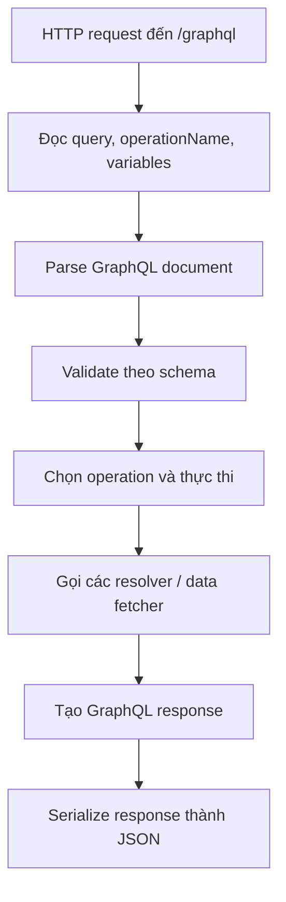

# GraphQL request và response

GraphQL định nghĩa cách client mô tả dữ liệu cần lấy hoặc thay đổi, còn server thực thi mô tả đó dựa trên schema. Một request GraphQL vì vậy có hai phần cần hiểu riêng: **operation document** viết bằng ngôn ngữ GraphQL và **request envelope** mà transport, thường là HTTP, dùng để chuyển document cùng variables đến server. Response cũng có cấu trúc riêng, với `data`, `errors` và đôi khi có `extensions`.

Trong Spring for GraphQL, client gửi request đến endpoint GraphQL. Spring chuyển request thành lời gọi thực thi GraphQL, kết nối các field trong schema với các hàm xử lý như `@QueryMapping`, rồi trả kết quả theo cấu trúc response của GraphQL.

## 1. Một GraphQL request gồm những gì?

Một operation document mô tả operation cần chạy và các field client muốn nhận. GraphQL có ba loại operation chính:

- `query`: đọc dữ liệu.
- `mutation`: tạo, cập nhật hoặc xóa dữ liệu.
- `subscription`: đăng ký nhận các kết quả được phát ra theo thời gian.

Ví dụ schema có field `book`:

```graphql
type Query {
  book(id: ID!): Book
}

type Book {
  id: ID!
  title: String!
  author: Author
}

type Author {
  id: ID!
  name: String!
}
```

Client có thể gửi operation sau:

```graphql
query BookDetail {
  book(id: "book-42") {
    id
    title
    author {
      id
      name
    }
  }
}
```

Tên `BookDetail` là operation name. Phần nằm trong dấu ngoặc nhọn là selection set: client yêu cầu `id`, `title` và hai field của `author`. Vì `author` là object nên request phải chỉ rõ các field con muốn lấy. Với scalar như `id` hoặc `title`, không cần selection set con.

Response có cấu trúc tương ứng với selection set. Nếu client không yêu cầu một field, server không cần trả field đó. Đây là điểm quan trọng: schema mô tả những field có thể được truy vấn, còn selection set mô tả những field được chọn trong một request cụ thể.

### Operation name

Một document có thể chứa nhiều operation:

```graphql
query BookDetail($id: ID!) {
  book(id: $id) {
    id
    title
  }
}

query RecentBooks {
  recentBooks {
    id
    title
  }
}
```

Khi document có nhiều operation, client phải gửi `operationName` để server biết operation nào cần thực thi. Nếu document chỉ có một operation, tên operation vẫn nên được đặt để log, tracing và việc đọc request dễ dàng hơn.

### Variables

Có thể viết giá trị trực tiếp trong document, nhưng với dữ liệu thay đổi theo từng lần gọi, nên khai báo variables. Ví dụ:

```graphql
query BookDetail($id: ID!) {
  book(id: $id) {
    id
    title
    author {
      name
    }
  }
}
```

`$id` là biến. Phần `($id: ID!)` khai báo kiểu của biến; dấu `!` có nghĩa biến bắt buộc phải có giá trị khác `null`. Giá trị cụ thể được truyền riêng trong request envelope:

```json
{
  "id": "book-42"
}
```

Tách variables khỏi document giúp tái sử dụng cùng một operation với nhiều giá trị, tránh nối chuỗi để tạo query và làm cho dữ liệu đầu vào được kiểm tra theo kiểu trong schema.

## 2. Request envelope khi gọi qua HTTP

Với HTTP, request thường được gửi bằng `POST` đến endpoint GraphQL. Spring Boot với Spring for GraphQL thường cấu hình endpoint mặc định là `/graphql`; có thể thay đổi đường dẫn bằng cấu hình `spring.graphql.path`.

Một request JSON hoàn chỉnh có dạng:

```http
POST /graphql HTTP/1.1
Content-Type: application/json
Accept: application/json
```

```json
{
  "query": "query BookDetail($id: ID!) { book(id: $id) { id title author { id name } } }",
  "operationName": "BookDetail",
  "variables": {
    "id": "book-42"
  }
}
```

Các thuộc tính thường gặp trong envelope:

| Thuộc tính | Ý nghĩa |
| --- | --- |
| `query` | Chuỗi chứa GraphQL document, bao gồm operation và có thể cả fragment. |
| `operationName` | Tên operation cần chạy khi document có nhiều operation; có thể bỏ qua nếu chỉ có một operation. |
| `variables` | Object JSON chứa giá trị cho các biến được khai báo trong document. |
| `extensions` | Object dành cho metadata hoặc phần mở rộng theo thỏa thuận giữa client và server. |

`query` trong envelope là một chuỗi JSON, còn nội dung bên trong chuỗi đó là cú pháp GraphQL. Vì vậy cần phân biệt hai lớp: JSON là định dạng vận chuyển request; GraphQL document là ngôn ngữ mô tả operation.

Ví dụ gửi request bằng cURL:

```bash
curl http://localhost:8080/graphql \
  -H "Content-Type: application/json" \
  -H "Accept: application/json" \
  --data '{
    "query": "query BookDetail($id: ID!) { book(id: $id) { id title } }",
    "operationName": "BookDetail",
    "variables": { "id": "book-42" }
  }'
```

Trong môi trường Spring Boot, ví dụ trên giả định ứng dụng đã có Spring for GraphQL và HTTP transport phù hợp, đồng thời endpoint vẫn dùng đường dẫn mặc định.

### GET và POST

Một số GraphQL HTTP endpoint cũng chấp nhận `GET` cho operation đọc dữ liệu. Khi đó document, operation name và variables được truyền qua query parameters của URL. Client cần encode đúng các giá trị JSON và GraphQL.

`GET` chỉ phù hợp với `query`. Không gửi `mutation` bằng `GET`, vì mutation có thể làm thay đổi trạng thái server trong khi GET được kỳ vọng là phương thức an toàn. Với request phức tạp hoặc có variables, `POST` thường dễ sử dụng và dễ quan sát hơn. Việc endpoint hỗ trợ phương thức nào phụ thuộc cấu hình và transport của ứng dụng.

## 3. Spring for GraphQL xử lý request như thế nào?

Ở phía server, Spring for GraphQL nhận envelope từ transport rồi chuyển operation đến GraphQL Java để parse, validate và thực thi theo schema. Các hàm xử lý do ứng dụng cung cấp sẽ được gọi khi execution đi đến field tương ứng.

Luồng khái quát:



Ví dụ schema:

```graphql
type Query {
  book(id: ID!): Book
}
```

Controller có thể ánh xạ field `Query.book` bằng `@QueryMapping`:

```java
import org.springframework.graphql.data.method.annotation.Argument;
import org.springframework.graphql.data.method.annotation.QueryMapping;
import org.springframework.stereotype.Controller;

@Controller
class BookGraphQlController {

    private final BookService bookService;

    BookGraphQlController(BookService bookService) {
        this.bookService = bookService;
    }

    @QueryMapping
    Book book(@Argument String id) {
        return bookService.findById(id);
    }
}
```

Tên method `book` mặc định ánh xạ đến field `book` của root type `Query`. `@Argument` lấy giá trị argument `id` từ GraphQL field. Khi GraphQL Java thực thi field này, Spring gọi method và dùng kết quả trả về để tiếp tục hoàn thành selection set.

Nếu request còn chọn `author`, GraphQL cần phân giải field lồng nhau đó. Spring có thể đọc thuộc tính từ object trả về theo cơ chế property access; khi cần logic riêng, có thể khai báo method với `@SchemaMapping`. Như vậy một request có thể làm phát sinh nhiều lần phân giải field trong quá trình thực thi, dù client chỉ gửi một HTTP request.

## 4. Cấu trúc GraphQL response

Một response thành công thường có dạng:

```json
{
  "data": {
    "book": {
      "id": "book-42",
      "title": "Spring in Action",
      "author": {
        "id": "author-7",
        "name": "Craig"
      }
    }
  }
}
```

### Trường data

`data` chứa kết quả thực thi operation. Cấu trúc bên trong phản ánh selection set của request:

- Field được chọn trở thành key trong object kết quả.
- Object lồng nhau có cấu trúc theo selection set con.
- List được trả về dưới dạng JSON array.
- Giá trị nullable có thể là `null`.
- Scalar được serialize theo quy tắc của scalar tương ứng; ví dụ `ID` thường được biểu diễn dưới dạng chuỗi.

GraphQL không yêu cầu server trả mọi field có trong type. Server trả các field được chọn bởi operation, cùng các giá trị con tương ứng. Nếu dùng alias, key trong response là alias. Ví dụ:

```graphql
query {
  featured: book(id: "book-42") {
    title
  }
}
```

Kết quả sẽ có key `featured`:

```json
{
  "data": {
    "featured": {
      "title": "Spring in Action"
    }
  }
}
```

### Trường errors

Nếu có lỗi, response có thể chứa mảng `errors`. Mỗi phần tử mô tả một lỗi, thường có các thuộc tính:

| Thuộc tính | Ý nghĩa |
| --- | --- |
| `message` | Mô tả ngắn về lỗi. |
| `locations` | Vị trí trong GraphQL document, thường gồm số dòng và cột. |
| `path` | Đường dẫn đến field gây lỗi trong kết quả thực thi. |
| `extensions` | Metadata bổ sung, ví dụ mã lỗi do ứng dụng quy ước. |

Ví dụ:

```json
{
  "data": {
    "book": {
      "id": "book-42",
      "title": "Spring in Action",
      "author": null
    }
  },
  "errors": [
    {
      "message": "Không thể tải thông tin tác giả",
      "locations": [
        { "line": 5, "column": 5 }
      ],
      "path": ["book", "author"],
      "extensions": {
        "code": "AUTHOR_SERVICE_UNAVAILABLE"
      }
    }
  ]
}
```

Trong ví dụ này, server vẫn lấy được sách nhưng không lấy được tác giả. Vì field `author` cho phép `null` trong schema, GraphQL có thể trả phần dữ liệu còn lại và đặt riêng field bị lỗi thành `null`. Client cần kiểm tra cả `data` lẫn `errors`, thay vì chỉ kiểm tra xem response có dữ liệu hay không.

### Trường extensions

Ở cấp response, `extensions` có thể chứa metadata bổ sung do server hoặc công cụ tích hợp cung cấp, chẳng hạn thông tin tracing. Đây không phải nơi chứa dữ liệu nghiệp vụ chính. Cấu trúc và ý nghĩa của nó phụ thuộc vào thỏa thuận giữa server và client.

## 5. Lỗi request và lỗi trong quá trình thực thi

Không phải mọi lỗi đều có cùng kết quả.

**Request error** xảy ra trước khi operation được thực thi, ví dụ GraphQL document sai cú pháp, field không tồn tại trong schema, thiếu variable bắt buộc hoặc operation name không hợp lệ. Trong trường hợp này server không có kết quả thực thi; response chứa `errors` và không có key `data`.

Ví dụ client gọi field không tồn tại:

```graphql
query {
  unknownBookField
}
```

Nếu schema không khai báo field đó, validation thất bại trước khi resolver chạy.

**Execution error** xảy ra khi operation đã bắt đầu thực thi, ví dụ resolver gọi dịch vụ khác và dịch vụ đó thất bại. Response có thể chứa cả `data` và `errors`, bởi một số field khác vẫn hoàn tất thành công.

### Nullability và lan truyền lỗi

Nullability trong schema ảnh hưởng trực tiếp đến response. Với field nullable, lỗi khi phân giải field thường khiến field đó nhận giá trị `null`, trong khi các field độc lập khác vẫn có thể được trả về.

Nếu field được khai báo non-null bằng dấu `!`, GraphQL không thể giữ lỗi tại chính field đó bằng cách trả `null`. Giá trị `null` sẽ lan truyền lên field cha gần nhất có thể nhận `null`. Quá trình này tiếp tục cho đến khi gặp một boundary nullable. Nếu lỗi lan truyền đến root, giá trị `data` có thể là `null`.

Ví dụ:

```graphql
type Book {
  id: ID!
  title: String!
  author: Author!
}

type Author {
  name: String!
}
```

Nếu không thể phân giải `author`, field `author` không thể nhận `null` vì được khai báo `Author!`. Lỗi sẽ lan lên object `Book`; nếu field cha chứa `Book` là nullable thì field cha có thể trở thành `null`. Nếu mọi field trên đường lan truyền đều non-null, lỗi có thể làm `data` ở root trở thành `null`.

Vì vậy, dấu `!` là một cam kết về dữ liệu và cũng là quy tắc ảnh hưởng đến phạm vi lan truyền lỗi. Chỉ khai báo non-null khi ứng dụng thực sự bảo đảm field luôn có giá trị hợp lệ.

## 6. Đọc HTTP status cùng với GraphQL response

HTTP status và GraphQL response trả lời hai câu hỏi khác nhau. HTTP status mô tả kết quả ở tầng vận chuyển và giao thức; `data` và `errors` mô tả kết quả của operation GraphQL.

Một request có thể đến được GraphQL endpoint và nhận được một GraphQL response hợp lệ nhưng trong response vẫn có lỗi thực thi. Vì thế, client không nên chỉ dựa vào HTTP status để kết luận operation thành công. Hãy đọc body và xử lý `errors` theo nhu cầu của ứng dụng.

Cách ánh xạ status code cụ thể còn phụ thuộc GraphQL over HTTP media type, phiên bản thư viện và cấu hình server. Với Spring for GraphQL, cần kiểm tra hành vi của transport đang sử dụng thay vì giả định mọi lỗi GraphQL đều tương ứng với một HTTP status duy nhất.

Ngược lại, lỗi ở tầng HTTP như không tìm thấy endpoint, request không được transport chấp nhận hoặc server không phản hồi có thể không tạo ra một GraphQL response đúng cấu trúc. Client nên phân biệt trường hợp không nhận được GraphQL response với trường hợp nhận được response có `errors`.

## 7. Query, mutation và subscription trong request/response

`query` và `mutation` đều được mô tả trong GraphQL document và thường có thể được gửi qua HTTP POST bằng cùng một request envelope. Khác biệt nằm ở ý nghĩa của operation và cách server thực thi:

```graphql
mutation RenameBook($id: ID!, $title: String!) {
  renameBook(id: $id, title: $title) {
    id
    title
  }
}
```

Variables của mutation được gửi trong envelope giống query. Response cũng có `data` và `errors`, trong đó `data` chứa kết quả của field mutation được chọn.

`subscription` biểu diễn luồng kết quả theo thời gian. Nó thường sử dụng transport hỗ trợ streaming, chẳng hạn WebSocket hoặc RSocket tùy ứng dụng. Vì một subscription có thể phát ra nhiều kết quả, cách nhận dữ liệu và vòng đời kết nối khác với một HTTP request/response thông thường. Không nên giả định subscription luôn trả về đúng một JSON response rồi đóng kết nối.

## 8. Thực hành và lỗi thường gặp

Khi kiểm tra một request GraphQL, hãy lần lượt xác minh các điểm sau:

1. **Đúng endpoint và transport:** ứng dụng Spring for GraphQL đang phục vụ endpoint nào, và endpoint có hỗ trợ HTTP method mà client đang dùng không?
2. **Document hợp lệ:** operation, field, argument và selection set phải khớp schema.
3. **Đúng operation name:** nếu document chứa nhiều operation, phải chọn operation bằng `operationName`.
4. **Variables đúng cấu trúc:** tên biến trong document phải khớp key trong object `variables`; giá trị phải phù hợp kiểu khai báo và các biến non-null phải được cung cấp.
5. **Đọc đủ response:** kiểm tra `data` và `errors`; nếu cần, xem `path`, `locations` và `extensions` để xác định lỗi.
6. **Kiểm tra nullability:** một field thành `null` có thể là kết quả hợp lệ của schema hoặc là điểm bắt đầu của quá trình lan truyền lỗi.

Một số lỗi dễ gặp:

| Hiện tượng | Nguyên nhân thường gặp | Cách kiểm tra |
| --- | --- | --- |
| Báo không tìm thấy field | Field không có trong schema hoặc sai tên/case. | Đối chiếu field trong document với schema SDL. |
| Báo thiếu variable | Không truyền biến bắt buộc hoặc key trong `variables` sai tên. | So sánh khai báo `$variable` với JSON variables. |
| Không chọn được object field | Field có kiểu object nhưng thiếu selection set con. | Thêm các field con cần đọc trong dấu ngoặc nhọn. |
| Có `data` nhưng vẫn có lỗi | Một hoặc nhiều resolver gặp lỗi trong khi field khác vẫn thành công. | Đọc từng phần tử trong `errors` và đối chiếu `path`. |
| Một object cha trở thành `null` | Lỗi xảy ra ở field non-null và lan truyền lên cha. | Kiểm tra dấu `!` trên đường dẫn field. |
| HTTP status thành công nhưng thao tác không hoàn toàn thành công | Response GraphQL có thể chứa `errors` dù transport trả response. | Đọc body GraphQL thay vì chỉ kiểm tra status code. |

Khi debug trong Spring, hãy đối chiếu field trong schema với method được ánh xạ bằng `@QueryMapping`, `@MutationMapping` hoặc `@SchemaMapping`. Nếu document hợp lệ nhưng một field trả `null` hoặc phát sinh lỗi, kiểm tra resolver tương ứng, dữ liệu trả về và exception được tạo trong quá trình xử lý.

## 9. Những nguyên tắc nên ghi nhớ

- GraphQL document xác định operation và selection set; request envelope vận chuyển document, operation name và variables.
- Selection set quyết định hình dạng dữ liệu client yêu cầu, bao gồm cả field lồng nhau.
- Variables giúp tái sử dụng operation và giữ dữ liệu đầu vào tách khỏi cú pháp query.
- Response GraphQL có thể gồm `data`, `errors` và `extensions`; `data` và `errors` có thể cùng xuất hiện.
- Request error thường ngăn operation thực thi; execution error có thể chỉ ảnh hưởng một phần kết quả.
- Nullability trong schema quyết định cách lỗi lan truyền qua response.
- Trong Spring for GraphQL, các mapping như `@QueryMapping` nối field ở schema với logic ứng dụng; GraphQL engine điều phối việc thực thi selection set.

Hiểu rõ cấu trúc request và response giúp thiết kế API dễ dự đoán, xử lý lỗi đúng cách và debug được cả vấn đề ở client, schema, resolver lẫn transport.

