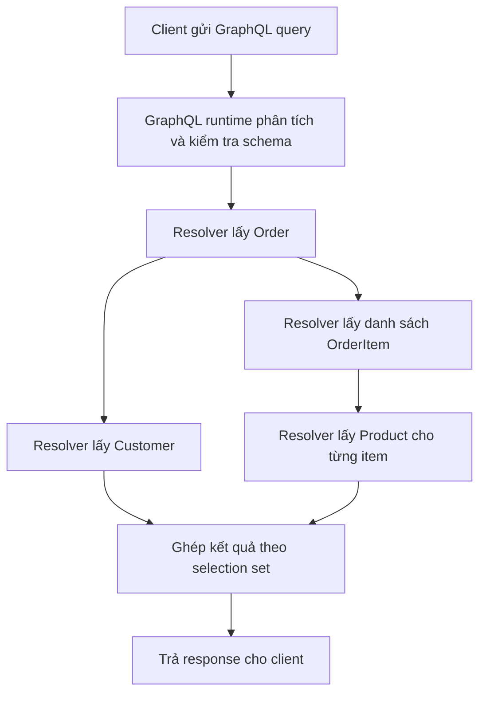

# Khi dùng GraphQL thay cho REST

Khi thiết kế API, câu hỏi quan trọng không phải là GraphQL mới hơn REST hay công nghệ nào có nhiều tính năng hơn. Câu hỏi là cách giao tiếp nào phù hợp với dữ liệu, cách sử dụng và yêu cầu vận hành của hệ thống.

REST thường phù hợp khi API xoay quanh các tài nguyên có cấu trúc ổn định, cách truy cập dễ dự đoán và tận dụng tốt ngữ nghĩa HTTP. GraphQL phát huy thế mạnh khi nhiều loại client cần những góc nhìn dữ liệu khác nhau, đặc biệt khi một màn hình phải ghép dữ liệu từ nhiều quan hệ hoặc nhiều nguồn.

GraphQL không phải lựa chọn thay thế mặc định cho mọi REST API. Hai cách tiếp cận có thể cùng tồn tại trong một hệ thống, mỗi cách phục vụ đúng loại tương tác mà nó làm tốt.

## 1. Bắt đầu từ vấn đề của client

Hãy xét màn hình chi tiết đơn hàng. Màn hình cần mã đơn, trạng thái, tên khách hàng, danh sách sản phẩm, số lượng và tổng tiền. Với một REST API được chia theo tài nguyên, client có thể phải gọi nhiều endpoint:

```http
GET /api/orders/42
GET /api/orders/42/items
GET /api/customers/7
```

Nếu endpoint đơn hàng chỉ trả về mã khách hàng thay vì thông tin khách hàng, client cần gọi thêm endpoint khách hàng. Trên mạng có độ trễ cao, nhiều lần gọi nối tiếp làm màn hình hiển thị chậm. Nếu endpoint trả sẵn toàn bộ thông tin có thể có của đơn hàng, một client khác chỉ cần mã và trạng thái lại phải nhận nhiều dữ liệu không sử dụng.

Hai tình huống này thường được gọi là:

- **Over-fetching**: response chứa nhiều dữ liệu hơn client cần.
- **Under-fetching**: một response không đủ dữ liệu cho một màn hình hoặc thao tác, khiến client phải gọi thêm endpoint.

REST không bắt buộc phải gặp hai vấn đề này. Có thể thiết kế endpoint tổng hợp theo use case, thêm tham số chọn trường hoặc tạo Backend for Frontend (BFF). Tuy nhiên, khi số client và số biến thể màn hình tăng lên, việc duy trì nhiều response chuyên biệt có thể trở nên tốn kém.

GraphQL giải quyết bài toán này bằng cách cho client mô tả cấu trúc dữ liệu mà nó cần trong từng operation. Server công bố một schema có kiểu dữ liệu; client gửi query chọn các field trong schema đó.

## 2. GraphQL thay đổi cách mô tả response

Ví dụ schema rút gọn cho đơn hàng:

```graphql
type Query {
    order(id: ID!): Order
}

type Order {
    id: ID!
    status: String!
    customer: Customer!
    items: [OrderItem!]!
    total: Money!
}

type Customer {
    id: ID!
    name: String!
}

type OrderItem {
    quantity: Int!
    product: Product!
}

type Product {
    id: ID!
    name: String!
}

scalar Money
```

Client có thể yêu cầu đúng các field cần hiển thị:

```graphql
query OrderDetail($id: ID!) {
    order(id: $id) {
        id
        status
        total
        customer {
            name
        }
        items {
            quantity
            product {
                name
            }
        }
    }
}
```

Server trả về cấu trúc tương ứng với selection set của query. Một client khác có thể chỉ yêu cầu `id` và `status` mà không cần một endpoint mới. Schema cũng cho biết field nào tồn tại, kiểu dữ liệu của chúng và quan hệ giữa các kiểu.

Điểm khác biệt cốt lõi nằm ở hợp đồng API:

- Với REST, client truy cập các resource qua URL và nhận representation do endpoint quy định. Server thường quyết định cấu trúc response của endpoint.
- Với GraphQL, client gửi operation tới một GraphQL endpoint và chọn các field hợp lệ trong schema. Server chịu trách nhiệm thực thi operation và trả về cấu trúc đã chọn.

GraphQL không phải ngôn ngữ truy vấn cơ sở dữ liệu. Field trong schema là hợp đồng của API; cách lấy dữ liệu có thể đến từ database, REST service khác, cache hoặc một nguồn bất kỳ. Một query GraphQL cũng không đồng nghĩa với một câu SQL hay một lần truy cập dữ liệu.

## 3. Khi nào GraphQL thường phù hợp hơn?

### 3.1. Có nhiều client với nhu cầu dữ liệu khác nhau

Một sản phẩm có thể có web app, mobile app, màn hình quản trị và ứng dụng đối tác. Cùng một miền nghiệp vụ nhưng mỗi client cần một tập field khác nhau.

Ví dụ:

- Mobile chỉ cần tên sản phẩm, giá và ảnh thu nhỏ để giảm lượng dữ liệu truyền qua mạng.
- Web cần thêm mô tả, biến thể và đánh giá.
- Trang quản trị cần trạng thái kho, thông tin kiểm duyệt và dữ liệu vận hành.

Với GraphQL, các client có thể chọn field từ cùng một schema. Khi thêm một field tương thích ngược, server có thể mở rộng schema mà không cần tạo một endpoint response riêng cho từng client.

Điều này hữu ích khi các nhóm frontend phát triển với nhịp độ khác nhau và server muốn cung cấp một hợp đồng dữ liệu có kiểu rõ ràng.

### 3.2. Một màn hình cần ghép nhiều quan hệ dữ liệu

Các màn hình dashboard, trang hồ sơ hoặc trang chi tiết thường kết hợp dữ liệu từ nhiều thực thể. GraphQL cho phép client mô tả một cây dữ liệu trong một operation thay vì phải tự điều phối nhiều request.

Ví dụ, một trang hồ sơ có thể cần người dùng, nhóm, quyền hiển thị và các hoạt động gần đây. Nếu schema mô hình hóa những quan hệ này hợp lý, client có thể yêu cầu chúng trong cùng một query.

Lợi ích ở đây là giảm số lượt trao đổi giữa client và API. Lợi ích đó chỉ trở thành cải thiện hiệu năng thực sự khi server thực thi query hiệu quả. Một request GraphQL duy nhất vẫn có thể kích hoạt hàng chục truy vấn database hoặc lời gọi tới các service khác.

### 3.3. Client cần linh hoạt chọn field và lồng dữ liệu

Khi giao diện thay đổi thường xuyên, yêu cầu dữ liệu cũng thay đổi theo. Với GraphQL, frontend có thể bổ sung hoặc bỏ một field trong selection set mà không nhất thiết phải yêu cầu backend tạo endpoint mới, miễn là field đó đã có trong schema.

Kiểu dữ liệu, argument, nullability và quan hệ được khai báo trong schema giúp công cụ phát hiện nhiều lỗi ngay trong lúc phát triển. Tài liệu schema cũng có thể được dùng để hỗ trợ autocomplete và sinh kiểu cho client.

### 3.4. Cần một lớp API tổng hợp cho nhiều nguồn dữ liệu

GraphQL có thể đóng vai trò lớp API phía trước một số backend hoặc dịch vụ chuyên biệt. Resolver của GraphQL điều phối việc lấy dữ liệu và chuyển kết quả thành kiểu trong schema. Client không cần biết dữ liệu đến từ service nào.

Mô hình này phù hợp với một BFF hoặc API composition layer khi có nhu cầu tổng hợp thực sự. Cần thiết kế ranh giới rõ ràng để lớp GraphQL không trở thành nơi chứa toàn bộ nghiệp vụ hoặc một gateway phải hiểu quá nhiều chi tiết nội bộ.

## 4. Khi nào REST thường là lựa chọn tốt hơn?

### 4.1. API đơn giản, xoay quanh resource ổn định

Nếu hệ thống chủ yếu cung cấp các thao tác quen thuộc như tạo, đọc, cập nhật và xóa tài nguyên, REST thường đủ rõ ràng và dễ vận hành. Ví dụ API quản lý danh mục, trạng thái tác vụ hoặc cấu hình nội bộ có cấu trúc response ít thay đổi.

Trong trường hợp này, thêm schema GraphQL, bộ thực thi query, resolver, giới hạn độ phức tạp và cơ chế quan sát có thể tạo ra chi phí lớn hơn lợi ích.

### 4.2. Cần tận dụng HTTP caching và semantics

REST có thể sử dụng trực tiếp URL, method, status code, `ETag`, `Last-Modified`, `Cache-Control` và các cơ chế cache HTTP quen thuộc. Một resource có URL ổn định thường dễ được cache ở browser, reverse proxy hoặc CDN.

GraphQL thường dùng một endpoint chung, ví dụ `/graphql`, và query thường được gửi trong request body. Vì vậy, cache HTTP theo URL không tự nhiên như với REST. Có thể xây dựng persisted query, cache theo nội dung operation và variables, hoặc dùng normalized cache ở client, nhưng cần thiết kế và vận hành thêm.

Nếu API chủ yếu phân phối tài nguyên công khai, ít biến thể và cần tận dụng CDN, REST có thể đơn giản hơn.

### 4.3. Tải hoặc phân phối file và dữ liệu dạng luồng

HTTP đã có cơ chế phù hợp cho upload, download, range request và streaming. GraphQL có thể phối hợp với các cơ chế này, nhưng upload file qua GraphQL thường dựa trên quy ước mở rộng thay vì một phần cốt lõi của GraphQL. Với file lớn, cách phổ biến là dùng REST hoặc URL upload/download được ký sẵn, rồi dùng GraphQL để trao đổi metadata và trạng thái.

### 4.4. Hợp đồng service-to-service cố định

Khi hai service nội bộ có một số thao tác rõ ràng và ổn định, REST hoặc RPC có thể dễ hiểu hơn. Một GraphQL endpoint mở cho nhiều dạng query làm tăng yêu cầu kiểm soát quyền, giới hạn tài nguyên và quan sát operation. Không nên đưa GraphQL vào chỉ vì muốn giảm số endpoint.

### 4.5. Đội ngũ cần một giao diện HTTP quen thuộc

REST tận dụng các khái niệm HTTP mà nhiều proxy, gateway, công cụ giám sát và đội vận hành đã hỗ trợ tốt. Với một API công khai có nhiều consumer, các quy ước URL, method, status code và cache có thể giúp tích hợp dễ dự đoán hơn.

## 5. So sánh theo tiêu chí thực tế

| Tiêu chí | GraphQL | REST |
| --- | --- | --- |
| Cấu trúc dữ liệu trả về | Client chọn field trong schema | Endpoint thường định nghĩa representation |
| Nhiều loại client | Thuận tiện khi mỗi client cần field khác nhau | Có thể cần endpoint tổng hợp, tham số hoặc BFF |
| Dữ liệu liên quan | Có thể mô tả thành một cây selection | Client có thể cần nhiều request hoặc endpoint tổng hợp |
| Số request từ client | Có thể giảm khi một operation lấy được nhiều phần dữ liệu | Phụ thuộc cách phân chia và thiết kế endpoint |
| HTTP caching | Cần chiến lược cache riêng hoặc persisted query | Tận dụng URL và cache semantics trực tiếp |
| Upload/download file | Thường phối hợp với HTTP endpoint hoặc URL ký sẵn | Có hỗ trợ HTTP tự nhiên |
| Kiểm soát truy vấn | Phải giới hạn độ sâu, độ phức tạp và chi phí field | Endpoint thường có phạm vi thao tác cố định hơn |
| Tiến hóa hợp đồng | Thường thêm field, đánh dấu field cũ deprecated | Có thể thêm field, endpoint hoặc quản lý phiên bản |
| Công cụ và vận hành | Cần hiểu schema, resolver, operation và query cost | Hệ sinh thái HTTP và quan sát resource phổ biến |

Không có cột nào luôn thắng. Kết quả phụ thuộc vào cách thiết kế endpoint, schema, cache, backend và client.

## 6. Một request GraphQL không đảm bảo backend chỉ làm một lần truy cập

Đây là điểm dễ bị hiểu nhầm khi so sánh số request. Query đơn hàng ở phần trên chỉ là một HTTP request từ client, nhưng server có thể thực thi theo luồng sau:



Nếu có 20 item và resolver tải product riêng cho từng item, server có thể phát sinh một truy vấn lấy order, một truy vấn lấy customer, một truy vấn lấy items và 20 truy vấn lấy product. Đây là vấn đề N+1 ở phía server.

GraphQL không tự loại bỏ N+1. Trong Spring for GraphQL, `@BatchMapping` hoặc `DataLoader` có thể gom các yêu cầu lấy dữ liệu cùng loại thành một lần batch. Thiết kế batch cần giữ đúng thứ tự ánh xạ kết quả, xử lý cache theo phạm vi request và tránh dùng chung dữ liệu nhạy cảm giữa các người dùng.

Do đó, khi đánh giá GraphQL, cần đo cả số request từ client, số resolver được gọi, số truy vấn database, số lời gọi service và độ trễ tổng thể.

## 7. Những chi phí cần tính trước khi chọn GraphQL

### 7.1. Giới hạn độ sâu và độ phức tạp query

Client được chọn field linh hoạt cũng có nghĩa là server phải xử lý nhiều hình dạng query khác nhau. Một query lồng sâu hoặc yêu cầu danh sách lớn trên nhiều cấp có thể tiêu tốn nhiều CPU, bộ nhớ và kết nối database.

Server nên có giới hạn phù hợp cho độ sâu, độ phức tạp, kích thước trang và thời gian thực thi. Với field tốn kém, có thể áp dụng cost riêng, giới hạn tần suất hoặc yêu cầu phân trang. Không nên cho phép một query tùy ý tải toàn bộ dữ liệu chỉ vì schema cho phép truy cập field đó.

### 7.2. Phân quyền ở cấp field và dữ liệu

Một query có thể kết hợp nhiều field trong cùng operation. Vì vậy, kiểm tra quyền ở một endpoint hoặc ở root resolver là chưa đủ nếu các field phía dưới có quy tắc truy cập khác nhau.

Quyền truy cập phải được kiểm tra tại ranh giới nghiệp vụ hoặc data access phù hợp, bao gồm cả trường hợp một người dùng được xem đơn hàng nhưng không được xem một số thông tin riêng tư của khách hàng. Không xem việc ẩn field trong schema hoặc tắt introspection là cơ chế phân quyền.

### 7.3. Cache và tính nhất quán

REST thường có thể cache một resource theo URL. Với GraphQL, cùng một endpoint có thể nhận nhiều query và variables khác nhau. Cache cần nhận diện operation và input liên quan, đồng thời xác định dữ liệu nào được phép dùng chung giữa các user.

Ở phía client, normalized cache có thể lưu entity theo ID và cập nhật các field đã nhận. Tuy nhiên, cache client không thay thế cache server, cũng không tự giải quyết tính nhất quán khi dữ liệu được cập nhật từ nhiều nguồn.

### 7.4. Lỗi và response một phần

GraphQL có thể trả về `data` cùng danh sách `errors`. Một field lỗi không nhất thiết làm toàn bộ operation thất bại; kết quả phụ thuộc vào vị trí lỗi và quy tắc nullability trong schema. Client cần đọc cả dữ liệu và lỗi, còn server cần chuẩn hóa thông tin lỗi để không làm lộ stack trace hoặc chi tiết nội bộ.

REST thường biểu diễn lỗi ở cấp HTTP response với status code và body theo quy ước của API. Cách này quen thuộc với middleware và proxy. Khi chọn GraphQL, đội ngũ cần thống nhất cách biểu diễn lỗi nghiệp vụ, lỗi xác thực, lỗi phân quyền và lỗi hệ thống.

### 7.5. Quan sát và truy vết

Với REST, URL và HTTP method thường giúp phân nhóm request. Với GraphQL, nhiều operation khác nhau đi qua cùng endpoint. Log chỉ ghi `POST /graphql` sẽ không đủ để biết request đang làm gì.

Nên ghi nhận tên operation, thời gian thực thi, lỗi, resolver hoặc field tốn kém và correlation ID. Tránh ghi toàn bộ query hoặc variables chứa thông tin nhạy cảm vào log. Với operation ẩn danh, có thể yêu cầu client đặt tên hoặc sử dụng persisted query để dễ quan sát và kiểm soát.

### 7.6. Tiến hóa schema

GraphQL thường phát triển schema theo hướng bổ sung field và đánh dấu field cũ bằng `@deprecated` trước khi loại bỏ. Điều đó giúp nhiều client nâng cấp theo nhịp riêng, nhưng chỉ hiệu quả khi server biết client nào còn sử dụng field cũ.

REST cũng có thể tiến hóa theo hướng tương thích ngược bằng cách thêm field hoặc endpoint. Cả hai cách đều cần quy trình thông báo, đo mức sử dụng và thời gian chuyển đổi trước khi xóa hợp đồng cũ.

## 8. GraphQL và REST có thể cùng tồn tại

Một hệ thống không cần chọn duy nhất một kiểu API cho mọi tình huống. Ví dụ:

- REST cung cấp endpoint đăng nhập, tải file, webhook và các resource công khai có thể cache.
- GraphQL phục vụ web và mobile cần tổng hợp dữ liệu theo từng màn hình.
- Các service nội bộ tiếp tục dùng REST hoặc RPC cho những thao tác cố định.
- GraphQL resolver gọi các service hiện có, thay vì buộc toàn bộ backend phải chuyển sang GraphQL.

Trong mô hình này, GraphQL là một lớp giao tiếp phù hợp với client, còn các service phía sau vẫn có thể giữ hợp đồng riêng. Cần tránh tạo hai nguồn quy tắc nghiệp vụ độc lập: REST và GraphQL nên dùng chung service/domain logic khi cùng thực hiện một nghiệp vụ.

## 9. Quy trình quyết định

Trước khi chọn GraphQL, hãy trả lời các câu hỏi sau:

1. Có nhiều client cần những tập field khác nhau trên cùng miền dữ liệu không?
2. Các màn hình thường xuyên phải gọi nhiều endpoint nối tiếp để ghép dữ liệu không?
3. Việc tạo và duy trì nhiều endpoint response chuyên biệt đã trở thành gánh nặng chưa?
4. Đội ngũ có thể vận hành schema, resolver, DataLoader, giới hạn query, phân quyền field và quan sát operation không?
5. Lợi ích giảm request hoặc tăng linh hoạt có lớn hơn chi phí cache và vận hành không?

Nếu phần lớn câu trả lời là có, GraphQL đáng để thử nghiệm trên một use case cụ thể. Hãy đo số request, độ trễ đầu cuối, số truy vấn backend, kích thước response và chi phí phát triển trước và sau khi chuyển đổi.

Nếu API có ít client, response ổn định, cache HTTP quan trọng và các thao tác chủ yếu là CRUD resource, REST thường là lựa chọn hợp lý. Nếu chỉ một số màn hình cần tổng hợp dữ liệu, có thể bắt đầu bằng BFF hoặc endpoint tổng hợp trước khi đưa thêm một GraphQL layer.

## 10. Áp dụng với Spring for GraphQL

Spring for GraphQL giúp triển khai GraphQL API trong ứng dụng Spring, nhưng framework không quyết định thay kiến trúc API. Một triển khai cơ bản thường khai báo schema SDL, ánh xạ root query bằng `@QueryMapping`, ánh xạ field bằng `@SchemaMapping` và xử lý quan hệ cần batch bằng `@BatchMapping` hoặc `DataLoader`.

Khi thử nghiệm GraphQL cho một màn hình thực tế, nên bắt đầu từ use case và selection set mà client cần. Sau đó mới thiết kế schema, xác định nguồn dữ liệu của từng field, đặt quy tắc phân quyền, giới hạn query và đo hiệu năng. Cách đi từ nhu cầu client đến schema giúp tránh tạo một schema quá rộng nhưng không phản ánh rõ nhu cầu sử dụng.

Lựa chọn GraphQL thay REST vì nó giải quyết được một vấn đề cụ thể: nhiều client cần nhiều góc nhìn dữ liệu, hoặc client thường xuyên phải tổng hợp dữ liệu từ nhiều quan hệ. Khi vấn đề chính là CRUD đơn giản, cache HTTP, file transfer hoặc giao tiếp service cố định, REST vẫn là lựa chọn rõ ràng và hiệu quả. Thiết kế API tốt bắt đầu từ nhu cầu và chi phí vận hành của hệ thống, không bắt đầu từ độ mới của công nghệ.
