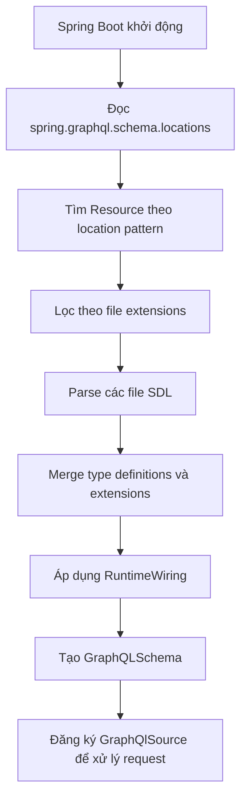

# Schema location pattern trong Spring for GraphQL

Spring for GraphQL cần nạp GraphQL schema trước khi có thể thực thi query, mutation hoặc subscription. Schema thường được viết trong các file SDL `.graphqls` hoặc `.gqls` và đóng gói cùng ứng dụng. Spring Boot tự tìm những file này theo một vị trí mặc định; khi dự án chia schema thành nhiều thư mục, nhiều module hoặc lưu schema bên ngoài JAR, ta có thể cấu hình schema location pattern để chỉ rõ nơi cần quét.

Hiểu đúng schema location giúp ứng dụng khởi động ổn định ở môi trường phát triển lẫn production. Nó cũng giúp tránh tình trạng một file SDL có trên máy lập trình nhưng không được đóng gói, một module chứa schema không được quét, hoặc nhiều file cùng định nghĩa một type gây lỗi khi ghép schema.

Sau bài này, bạn có thể:

- Xác định vị trí mặc định Spring Boot dùng để tìm GraphQL schema.
- Cấu hình `spring.graphql.schema.locations` và `spring.graphql.schema.file-extensions`.
- Phân biệt `classpath:`, `classpath*:` và `file:` trong resource location.
- Dùng wildcard pattern để quét schema trong thư mục lồng nhau hoặc nhiều module.
- Tổ chức nhiều file SDL thành một schema thống nhất bằng `extend type`.
- Hiểu cách schema resources được parse, merge và tạo thành executable schema.
- Xử lý lỗi thường gặp và kiểm thử việc nạp schema.

## 1. Schema location là gì?

Schema location là vị trí tài nguyên mà Spring for GraphQL dùng để tìm các file định nghĩa schema. Đây là cấu hình ở phía server, không phải URL endpoint mà client gửi GraphQL request.

Hai địa chỉ sau có mục đích khác nhau:

| Cấu hình | Ý nghĩa |
| --- | --- |
| `spring.graphql.schema.locations` | Nơi Spring Boot tìm file SDL để tạo GraphQL schema |
| `spring.graphql.http.path` | Đường dẫn HTTP nhận GraphQL request, mặc định thường là `/graphql` |

Ví dụ, ứng dụng có thể nhận request tại `/api/graphql`, trong khi các file SDL vẫn được nạp từ `classpath:graphql/**/`. Đổi endpoint không làm thay đổi vị trí schema và đổi schema location cũng không làm thay đổi endpoint.

Spring for GraphQL dùng `GraphQlSource` để cung cấp instance GraphQL có thể thực thi. Spring Boot tự cấu hình builder này, nạp schema resources từ vị trí được cấu hình, áp dụng runtime wiring và tạo schema khi ứng dụng khởi động.

## 2. Vị trí mặc định

Với Spring Boot, vị trí mặc định là:

```text
classpath:graphql/**/
```

Các file có phần mở rộng mặc định `.graphqls` hoặc `.gqls` được tìm trong `src/main/resources/graphql/**`. Ví dụ:

```text
src/
└── main/
    └── resources/
        └── graphql/
            ├── schema.graphqls
            ├── books/
            │   ├── book-types.graphqls
            │   └── book-queries.graphqls
            └── authors/
                ├── author-types.gqls
                └── author-queries.graphqls
```

Với cấu trúc trên, Spring Boot tự tìm các file schema trong thư mục `graphql` và những thư mục con. Bạn không cần khai báo riêng từng file nếu dùng vị trí và phần mở rộng mặc định.

Trong Maven hoặc Gradle, tài nguyên đặt dưới `src/main/resources` được đưa vào classpath của ứng dụng khi build theo cấu hình mặc định. Khi đóng gói JAR, các file schema sẽ nằm trong JAR dưới đường dẫn tương ứng, ví dụ `BOOT-INF/classes/graphql/books/book-types.graphqls` trong executable JAR của Spring Boot.

Nếu dùng cấu trúc mặc định, có thể không cần khai báo `spring.graphql.schema.locations` trong `application.yml`. Chỉ cấu hình khi muốn thay đổi vị trí, quét nhiều classpath root hoặc dùng tài nguyên ngoài classpath.

## 3. Cấu hình bằng application.yml

Property chính là `spring.graphql.schema.locations`. Có thể cấu hình một hoặc nhiều location:

```yaml
spring:
  graphql:
    schema:
      locations:
        - classpath:graphql/**/
        - classpath:shared-graphql/**/
      file-extensions:
        - .graphqls
        - .gqls
```

Trong ví dụ này, ứng dụng tìm schema ở hai vùng classpath. Property `file-extensions` chỉ định phần mở rộng được xem là file GraphQL schema.

Nếu dùng `application.properties`:

```properties
spring.graphql.schema.locations=classpath:graphql/**/,classpath:shared-graphql/**/
spring.graphql.schema.file-extensions=.graphqls,.gqls
```

Giá trị mặc định của `spring.graphql.schema.file-extensions` là `.graphqls,.gqls`. Nếu dự án muốn dùng phần mở rộng khác, phải cấu hình rõ:

```yaml
spring:
  graphql:
    schema:
      file-extensions:
        - .graphql
        - .gql
```

Sau khi thay phần mở rộng, hãy bảo đảm các file schema trong dự án thực sự dùng một trong những suffix đã khai báo. File `.graphql` sẽ không được phát hiện theo cấu hình mặc định chỉ gồm `.graphqls` và `.gqls`.

## 4. Đọc schema location pattern

Location pattern dùng cú pháp resource pattern của Spring. Các ký tự wildcard thường gặp:

| Pattern | Ý nghĩa khái quát | Ví dụ |
| --- | --- | --- |
| `*` | Khớp một phần tên trong một path segment | `classpath:graphql/*/` |
| `**` | Khớp qua nhiều cấp thư mục | `classpath:graphql/**/` |
| `?` | Khớp một ký tự trong path segment | `classpath:graphql/v?/` |

Ví dụ, `classpath:graphql/books/` chỉ nhắm đến vùng thư mục `books`, còn `classpath:graphql/**/` cho phép tìm sâu trong các thư mục con của `graphql`.

Khi cấu hình schema locations, nên chỉ rõ thư mục hoặc pattern thư mục; danh sách phần mở rộng được kiểm soát riêng bằng `spring.graphql.schema.file-extensions`. Không nhầm hai cấu hình này với nhau: location xác định nơi quét, còn extension xác định loại file được nạp.

Các ví dụ pattern:

```yaml
spring:
  graphql:
    schema:
      locations:
        - classpath:graphql/**/
        - classpath:modules/books/graphql/**/
        - classpath:modules/authors/graphql/**/
```

Pattern càng rộng thì càng có khả năng quét thêm file không liên quan. Nên chọn vùng schema có chủ đích để tránh vô tình nạp file thử nghiệm, schema mẫu hoặc một bản sao được đóng gói từ dependency.

## 5. Phân biệt classpath: và classpath*:

Hai prefix này đặc biệt quan trọng khi schema nằm trong nhiều module hoặc JAR dependency.

### `classpath:`

`classpath:` trỏ đến tài nguyên trên classpath của ứng dụng. Đây là prefix trong cấu hình mặc định:

```yaml
spring:
  graphql:
    schema:
      locations: classpath:graphql/**/
```

Cách này phù hợp khi schema thuộc ứng dụng hiện tại và được đóng gói trong tài nguyên classpath của nó.

### `classpath*:`

`classpath*:` yêu cầu Spring tìm các tài nguyên phù hợp trên nhiều classpath location, bao gồm các module và dependency JAR có cùng đường dẫn tài nguyên:

```yaml
spring:
  graphql:
    schema:
      locations: classpath*:graphql/**/
```

Ví dụ một ứng dụng có các module:

```text
application/
├── app-web/
│   └── src/main/resources/graphql/root.graphqls
├── module-books/
│   └── src/main/resources/graphql/books/book.graphqls
└── module-authors/
    └── src/main/resources/graphql/authors/author.graphqls
```

Nếu các module `module-books` và `module-authors` được đóng gói thành dependency JAR và có mặt trên runtime classpath, `classpath*:graphql/**/` cho phép tìm schema resources từ các vị trí classpath phù hợp đó.

Điều này hữu ích trong kiến trúc modular, nhưng cũng cần quản lý xung đột. Tất cả schema tìm được sẽ được đưa vào cùng một schema GraphQL; nếu hai module định nghĩa trùng type hoặc field không tương thích, quá trình tạo schema có thể thất bại. Dùng `classpath*:` không tự động tạo schema riêng cho từng module.

## 6. Nạp schema từ file system

Spring Resource cũng hỗ trợ vị trí trên file system. Điều này phù hợp khi muốn triển khai schema bên ngoài JAR, chẳng hạn đặt schema ở thư mục cấu hình của container:

```yaml
spring:
  graphql:
    schema:
      locations:
        - file:/opt/app/graphql/**/
```

Có thể dùng đường dẫn tương đối:

```yaml
spring:
  graphql:
    schema:
      locations:
        - file:./config/graphql/**/
```

Đường dẫn tương đối được phân giải theo working directory của tiến trình ứng dụng. Vì working directory có thể khác giữa IDE, Docker, systemd hoặc môi trường triển khai, đường dẫn tuyệt đối thường dễ dự đoán hơn trong production.

Khi dùng file system location, cần bảo đảm:

- File thực sự tồn tại trong container hoặc máy chủ khi ứng dụng khởi động.
- User chạy ứng dụng có quyền đọc thư mục và file.
- Volume mount hoặc bước copy tài nguyên hoàn tất trước khi tiến trình Spring Boot bắt đầu.
- Tất cả file cần thiết được cập nhật đồng bộ khi phát hành schema mới.

Không dùng HTTP URL thông thường như `https://example.org/schema.graphqls` với giả định rằng property tự tải schema từ web. Spring Resource hỗ trợ nhiều loại resource; nếu cần tải schema từ hệ thống từ xa hoặc storage riêng, hãy cung cấp custom resource/loading logic phù hợp.

## 7. Tổ chức schema thành nhiều file

Một GraphQL schema có thể được chia thành nhiều file để nhóm theo domain, type hoặc operation. Spring for GraphQL nạp các resources rồi parse và merge chúng thành một schema tổng hợp.

Ví dụ cấu trúc:

```text
src/main/resources/graphql/
├── root.graphqls
├── books/
│   ├── book-types.graphqls
│   └── book-queries.graphqls
└── authors/
    ├── author-types.graphqls
    └── author-queries.graphqls
```

File `root.graphqls` khai báo root type:

```graphql
type Query {
    health: String!
}
```

File `books/book-types.graphqls` khai báo object type:

```graphql
type Book {
    id: ID!
    title: String!
}
```

File `books/book-queries.graphqls` mở rộng root query:

```graphql
extend type Query {
    book(id: ID!): Book
    books: [Book!]!
}
```

File `authors/author-types.graphqls`:

```graphql
type Author {
    id: ID!
    name: String!
}
```

File `authors/author-queries.graphqls`:

```graphql
extend type Query {
    author(id: ID!): Author
    authors: [Author!]!
}
```

Các file được ghép thành một schema có `Query` gồm `health`, `book`, `books`, `author` và `authors`. File extension `extend type Query` yêu cầu type `Query` gốc tồn tại trong schema tổng hợp.

### Khi nào dùng type và extend type?

Định nghĩa một type gốc bằng `type`:

```graphql
type Query {
    health: String!
}
```

Khi bổ sung field từ file khác, dùng `extend type`:

```graphql
extend type Query {
    books: [Book!]!
}
```

Không tạo nhiều định nghĩa `type Query` độc lập với nội dung khác nhau trong nhiều file. Khi merge, các định nghĩa type trùng tên có thể gây lỗi schema. Dùng một định nghĩa gốc và các extension hợp lệ để mở rộng.

Việc chia file chỉ là cách tổ chức tài nguyên. Sau khi nạp, GraphQL vẫn thực thi một schema thống nhất; các type không tự trở thành module độc lập và không có namespace riêng chỉ vì nằm trong thư mục khác nhau.

## 8. Quy trình nạp và tạo executable schema

Ở mức khái quát, Spring Boot thực hiện các bước sau khi khởi tạo GraphQL:



`GraphQlSource.Builder` nhận một hoặc nhiều `Resource` để parse và merge. Sau đó GraphQL Java `SchemaGenerator` tạo `GraphQLSchema` dựa trên type definitions và runtime wiring. Runtime wiring có thể chứa data fetcher, custom scalar, type resolver, directive wiring và các thành phần khác.

Nếu file không được tìm thấy, schema thiếu root query type, có type trùng hoặc SDL không hợp lệ, ứng dụng có thể thất bại khi khởi động. Đây là lỗi cấu hình/schema cần xử lý trước khi nhận request; không phải lỗi do client gửi một query cụ thể.

## 9. Khi nào cần tùy chỉnh GraphQlSource?

Với phần lớn ứng dụng Spring Boot, cấu hình `spring.graphql.schema.locations` là đủ. Khi cần nạp resource đặc biệt, ví dụ schema từ storage, memory hoặc một nguồn được triển khai riêng, có thể dùng API `GraphQlSource.Builder`.

`GraphQlSource.Builder` hỗ trợ cung cấp một hoặc nhiều Spring `Resource` qua `schemaResources(...)`. Spring Boot cũng cung cấp `GraphQlSourceBuilderCustomizer` để tùy chỉnh builder do auto-configuration quản lý.

Ví dụ khung cấu hình customizer cho những tùy chỉnh builder khác:

```java
@Configuration(proxyBeanMethods = false)
public class GraphQlSourceConfiguration {

    @Bean
    GraphQlSourceBuilderCustomizer graphQlSourceBuilderCustomizer() {
        return builder -> builder.configureGraphQl(graphQlBuilder -> {
            // Cấu hình thêm cho GraphQL.Builder tại đây.
        });
    }
}
```

Khi cần tự kiểm soát danh sách resource, có thể tạo `GraphQlSource` bằng builder riêng và cung cấp các `Resource` phù hợp. Tuy nhiên, việc tự tạo `GraphQlSource` có thể thay thế một phần auto-configuration mặc định; cần bảo đảm runtime wiring, exception resolvers, instrumentation và các tích hợp Spring khác vẫn được đăng ký.

Không nên viết custom loader chỉ để thay đổi một thư mục schema thông thường. Property có sẵn dễ đọc, dễ override theo môi trường và tương thích với cơ chế cấu hình Spring Boot hơn.

## 10. Cấu hình khác nhau theo môi trường

Ứng dụng có thể dùng cùng schema trong JAR ở mọi môi trường, hoặc nạp thêm schema từ thư mục cấu hình bên ngoài. Spring Boot hỗ trợ externalized configuration nên có thể override location bằng profile, environment variable hoặc command-line argument.

Ví dụ cấu hình mặc định:

```yaml
spring:
  graphql:
    schema:
      locations: classpath:graphql/**/
```

Trong profile production:

```yaml
spring:
  graphql:
    schema:
      locations:
        - classpath:graphql/**/
        - file:/etc/my-service/graphql/**/
```

Hoặc dùng environment variable theo relaxed binding:

```text
SPRING_GRAPHQL_SCHEMA_LOCATIONS=classpath:graphql/**/,file:/etc/my-service/graphql/**/
```

Chỉ dùng schema external khi quy trình triển khai quản lý được tính tương thích giữa file SDL và phiên bản code. Nếu schema mới tham chiếu field hoặc resolver mà binary hiện tại chưa hỗ trợ, ứng dụng có thể khởi động thất bại hoặc trả kết quả sai. Schema và code nên được phát hành như một đơn vị tương thích.

## 11. Kiểm tra schema đã được nạp

Có một số cách xác nhận schema location hoạt động:

**Kiểm tra log khởi động:** quan sát lỗi parse SDL, type không tồn tại, type extension không có type gốc hoặc schema thiếu root query. Thông báo cụ thể phụ thuộc phiên bản GraphQL Java.

**Kiểm tra qua GraphQlTester:** gửi một operation chọn field chỉ có trong file schema cần xác nhận. Nếu field không được nạp, GraphQL sẽ báo lỗi validation rằng field không tồn tại trên type tương ứng.

**Kiểm tra schema printer:** Spring for GraphQL có thể expose schema ở dạng văn bản qua endpoint schema printer khi bật `spring.graphql.schema.printer.enabled`. Mặc định endpoint này tắt; chỉ bật khi có lý do phù hợp với môi trường và chính sách truy cập.

**Kiểm tra artifact đóng gói:** mở JAR hoặc kiểm tra nội dung build output để xác nhận file `.graphqls`/`.gqls` thực sự được copy vào classpath. Một file tồn tại trong source tree chưa bảo đảm nó có mặt trong artifact triển khai.

Một integration test có thể khởi tạo application context và gửi operation:

```java
@SpringBootTest
class SchemaLoadingTests {

    @Autowired
    GraphQlTester graphQlTester;

    @Test
    void loadsBookSchema() {
        graphQlTester.document("""
                query {
                    books {
                        id
                        title
                    }
                }
                """)
            .execute()
            .path("books")
            .hasValue();
    }
}
```

Ví dụ giả định ứng dụng test đã cấu hình `GraphQlTester` và resolver `books`. Nếu chỉ muốn xác nhận schema parse được, có thể khởi động application context; nếu muốn xác nhận cả resolver, hãy dùng fixture hoặc mock service phù hợp.

## 12. Lỗi thường gặp khi cấu hình location pattern

| Triệu chứng | Nguyên nhân có thể | Cách kiểm tra |
| --- | --- | --- |
| Ứng dụng báo không có schema hoặc thiếu `Query` | Location không khớp, file không được đóng gói hoặc sai extension | Kiểm tra `locations`, `file-extensions` và nội dung JAR |
| Chạy trong IDE được nhưng JAR không khởi động | Resource không nằm trong output/artifact hoặc cấu hình đường dẫn phụ thuộc working directory | Kiểm tra `build/resources/main`, `target/classes` và JAR |
| Schema trong dependency module không được nạp | Đang dùng `classpath:` trong khi cần quét nhiều classpath root | Thử `classpath*:graphql/**/` và kiểm tra dependency có chứa resource |
| SDL parse được riêng lẻ nhưng merge thất bại | Trùng type/field hoặc extension không có type gốc | Kiểm tra định nghĩa `type` và `extend type` trên toàn bộ schema |
| Một file mới không được nhận | File dùng suffix không nằm trong `file-extensions` hoặc đặt ngoài pattern | Kiểm tra extension và vị trí tương đối |
| Production không tìm thấy schema ngoài JAR | File system path sai, chưa mount hoặc thiếu quyền đọc | Kiểm tra absolute path, container volume và quyền của process |
| Schema được nạp hai lần hoặc có xung đột | Nhiều pattern cùng khớp một vùng resource hoặc dependency đóng gói bản sao | Thu hẹp location và rà soát các JAR trên classpath |

Khi xử lý lỗi, hãy kiểm tra thứ tự: location thực tế, resource có tồn tại, extension có được chấp nhận, file có được đóng gói, rồi mới kiểm tra SDL và type extension. Cách này giúp tách lỗi tìm file khỏi lỗi nội dung schema.

## 13. Nguyên tắc tổ chức schema resources

- Dùng `src/main/resources/graphql` nếu schema thuộc ứng dụng và không cần cấu hình đặc biệt.
- Chia file theo domain hoặc nhóm type để dễ tìm và review.
- Chỉ định nghĩa type gốc một lần; dùng `extend type` khi thêm field từ file khác.
- Dùng `.graphqls` hoặc `.gqls` theo mặc định, tránh tự đổi extension nếu chưa có lý do.
- Dùng `classpath*:` khi thực sự cần quét schema từ nhiều module/dependency.
- Tránh pattern quá rộng có thể nạp file thử nghiệm hoặc schema không thuộc ứng dụng.
- Với schema ngoài JAR, ưu tiên đường dẫn tuyệt đối và quản lý quyền đọc/phiên bản rõ ràng.
- Kiểm thử schema sau khi build artifact, không chỉ kiểm tra trong IDE.
- Quản lý schema và resolver như một hợp đồng đồng bộ trong mỗi lần phát hành.

## 14. Quy trình cấu hình schema location

Khi bắt đầu một ứng dụng Spring for GraphQL hoặc thay đổi cấu trúc schema, hãy thực hiện:

1. Xác định schema thuộc tài nguyên ứng dụng, dependency module hay file system bên ngoài.
2. Nếu dùng cấu trúc mặc định `src/main/resources/graphql/**`, giữ nguyên cấu hình mặc định.
3. Nếu đổi vị trí, khai báo `spring.graphql.schema.locations` bằng resource pattern tương ứng.
4. Nếu đổi phần mở rộng file, khai báo `spring.graphql.schema.file-extensions`.
5. Nếu quét nhiều module hoặc JAR, cân nhắc `classpath*:` và kiểm tra xung đột type.
6. Chia schema thành nhiều file theo domain; dùng `extend type` để bổ sung root fields.
7. Khởi động ứng dụng để xác nhận toàn bộ resources parse và merge thành công.
8. Kiểm thử operation đại diện và kiểm tra artifact đóng gói ở môi trường triển khai.

Schema location pattern quyết định Spring Boot tìm SDL ở đâu và những file nào được đưa vào schema tổng hợp. Khi nắm được `classpath:`, `classpath*:`, `file:`, wildcard pattern và cơ chế merge nhiều resource, bạn có thể tổ chức GraphQL schema theo module mà vẫn giữ quá trình khởi động dễ dự đoán. Với Spring for GraphQL, bắt đầu từ cấu hình mặc định, chỉ mở rộng location khi kiến trúc thực sự cần và luôn kiểm tra schema trong artifact sẽ triển khai.

## Tài liệu tham khảo

- [Spring Boot — Spring for GraphQL, GraphQL Schema](https://docs.spring.io/spring-boot/reference/web/spring-graphql.html)
- [Spring Boot — Common Application Properties](https://docs.spring.io/spring-boot/appendix/application-properties/)
- [Spring for GraphQL — Request Execution, Schema Resources](https://docs.spring.io/spring-graphql/reference/request-execution.html)
