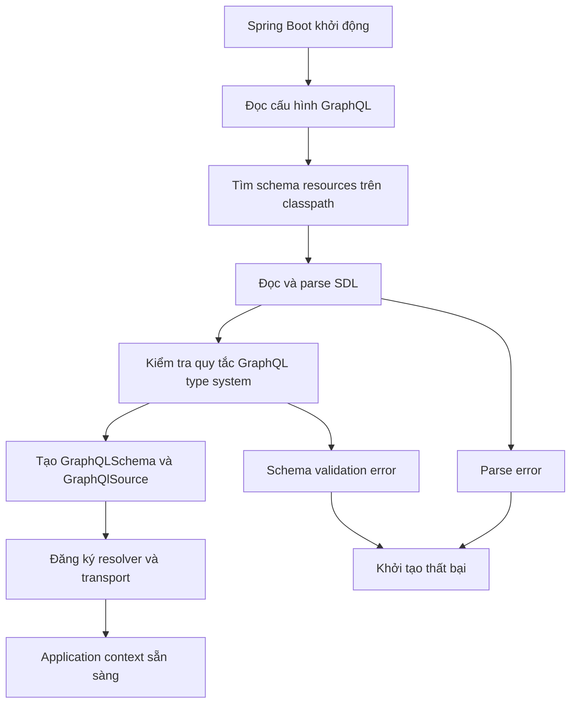

# Schema validation khi startup

Trong một ứng dụng Spring for GraphQL, schema SDL là hợp đồng mô tả các operation, object type, input type, scalar, enum và quan hệ dữ liệu mà client được phép sử dụng. Trước khi ứng dụng có thể thực thi query, Spring cần nạp các file schema, phân tích cú pháp và xây dựng GraphQL schema hợp lệ.

Quá trình này thường diễn ra khi Spring Boot khởi tạo application context. Nếu SDL sai cú pháp hoặc vi phạm quy tắc của GraphQL type system, việc tạo `GraphQlSource` không hoàn tất và ứng dụng thường không khởi động thành công. Cách kiểm tra sớm này giúp phát hiện lỗi hợp đồng ngay lúc triển khai thay vì đợi client gửi request đầu tiên.

## 1. Schema được nạp và kiểm tra khi nào?

Khi thêm `spring-boot-starter-graphql`, Spring Boot auto-configure các thành phần nền tảng của Spring for GraphQL. Với cấu hình schema resource mặc định, ứng dụng đặt các file SDL trong classpath, thường dưới `src/main/resources/graphql/`.

Ví dụ cấu trúc:

```text
src/main/resources/
└── graphql/
    ├── common.graphqls
    ├── query.graphqls
    └── book/
        ├── book.graphqls
        └── author.graphqls
```

Spring Boot tìm các schema resource theo vị trí đã cấu hình, nạp nội dung và dùng GraphQL Java để tạo schema thực thi. Nhiều file SDL có thể được kết hợp thành một schema, giúp chia định nghĩa theo miền nghiệp vụ thay vì đặt mọi type vào một file lớn.

Luồng khởi tạo có thể hình dung như sau:



Parse kiểm tra SDL có đúng cú pháp hay không. Schema validation kiểm tra các định nghĩa có tạo thành một GraphQL schema hợp lệ hay không. Hai bước này khác nhau: một file có thể parse thành công nhưng schema vẫn không hợp lệ vì tham chiếu type không tồn tại hoặc khai báo kiểu không đúng vai trò.

## 2. Cấu hình vị trí schema

Với cấu hình mặc định, các file `.graphqls` hoặc `.gqls` trong `classpath:graphql/**/` được tìm để nạp. Có thể khai báo vị trí riêng trong `application.yml`:

```yaml
spring:
  graphql:
    schema:
      locations: classpath:graphql/**/
      file-extensions: .graphqls,.gqls
```

Các thuộc tính quan trọng:

| Thuộc tính | Mục đích |
| --- | --- |
| `spring.graphql.schema.locations` | Danh sách vị trí tìm schema resource trên classpath |
| `spring.graphql.schema.file-extensions` | Các phần mở rộng file schema được nhận diện |
| `spring.graphql.path` | Đường dẫn HTTP GraphQL endpoint, không phải vị trí SDL |

Khi dự án có nhiều module hoặc nhiều nhóm phụ trách schema, có thể chia file theo feature. Cần bảo đảm mọi file được đóng gói vào artifact và khớp với pattern cấu hình. Một file nằm ngoài thư mục được tìm kiếm sẽ không tham gia vào schema chỉ vì nó có phần mở rộng `.graphqls`.

Không nên khai báo trùng một type hoặc field trong nhiều file nếu định nghĩa không thể hợp nhất hợp lệ. Chia schema thành nhiều file là cách tổ chức source, không có nghĩa mỗi file trở thành một GraphQL endpoint hoặc một schema độc lập.

## 3. Phân biệt parse error và schema validation error

### 3.1. Parse error: SDL sai cú pháp

Parser không thể đọc tài liệu SDL nếu cấu trúc cú pháp sai. Ví dụ thiếu dấu `:` giữa tên field và kiểu dữ liệu:

```graphql
type Book {
    id ID!
    title: String!
}
```

Trong ví dụ này, `id ID!` không phải cú pháp khai báo field hợp lệ. Cần sửa thành:

```graphql
type Book {
    id: ID!
    title: String!
}
```

Lỗi parse thường có thông tin vị trí trong tài liệu như dòng và cột. Hãy bắt đầu sửa tại vị trí parser chỉ ra, sau đó kiểm tra lại các dòng lân cận vì một dấu ngoặc hoặc dấu hai chấm thiếu có thể làm thông báo lỗi xuất hiện ở vị trí phía sau.

### 3.2. Schema validation error: cú pháp đúng nhưng type system không hợp lệ

Ví dụ sau parse được nhưng tham chiếu đến type `Publisher` chưa được định nghĩa:

```graphql
type Book {
    id: ID!
    title: String!
    publisher: Publisher
}
```

Nếu schema không có định nghĩa `Publisher` ở bất kỳ file SDL nào được nạp, quá trình xây dựng schema sẽ thất bại. Cần bổ sung type đó hoặc sửa field về đúng type đã tồn tại.

Vì vậy, khi đọc log startup, hãy xác định lỗi nằm ở parser hay ở quy tắc type system. Sửa cú pháp sẽ không giải quyết được lỗi tham chiếu type; ngược lại, đổi kiểu dữ liệu không giúp nếu parser còn chưa đọc được SDL.

## 4. Các quy tắc type system thường gây lỗi startup

GraphQL kiểm tra nhiều quy tắc trước khi schema có thể được dùng. Một số nhóm lỗi phổ biến:

### 4.1. Query root type phải tồn tại

Một schema thực thi phải có query root type là object type. Mutation và subscription root type là tùy chọn.

```graphql
type Query {
    book(id: ID!): Book
}

type Book {
    id: ID!
    title: String!
}
```

Nếu schema chỉ khai báo `Book` mà không có query root type, schema không đáp ứng yêu cầu tối thiểu để thực thi GraphQL query. Nếu đặt tên root type khác `Query`, cần khai báo rõ trong `schema` definition:

```graphql
schema {
    query: LibraryQuery
}

type LibraryQuery {
    books: [Book!]!
}
```

### 4.2. Phân biệt input type và output type

Field trả về dùng output type như scalar, enum, object, interface hoặc union. Argument và input object field phải dùng input type như scalar, enum hoặc input object.

Khai báo sai:

```graphql
type Book {
    id: ID!
    title: String!
}

type Mutation {
    createBook(book: Book!): Book!
}
```

`Book` là object output type, không thể dùng làm argument input. Hãy tạo input object riêng:

```graphql
input CreateBookInput {
    title: String!
}

type Mutation {
    createBook(input: CreateBookInput!): Book!
}
```

### 4.3. Interface implementation phải tương thích

Object type triển khai interface phải cung cấp các field interface yêu cầu và có kiểu output tương thích. Ví dụ interface khai báo `title: String!` nhưng object type khai báo `title: String` là không hợp lệ vì object có thể trả null trong khi interface cam kết không null.

```graphql
interface Publication {
    id: ID!
    title: String!
}

type Book implements Publication {
    id: ID!
    title: String!
    author: String!
}
```

Khi schema được chia thành nhiều file, hãy kiểm tra cả định nghĩa interface và mọi object type triển khai nó. Một thay đổi nullability trong file interface có thể khiến một implementation ở file khác không còn tương thích.

### 4.4. Union chỉ chứa object type

Union liệt kê các object type có thể xuất hiện. Không thể thêm scalar, interface hoặc input object vào danh sách thành viên.

```graphql
union SearchResult = Book | Author
```

Nếu `Author` chưa được định nghĩa hoặc một thành viên không phải object type, schema validation sẽ báo lỗi.

### 4.5. Input object không được có chu trình bắt buộc không thể kết thúc

Input object có thể tham chiếu lẫn nhau, nhưng chu trình chỉ gồm các field non-null đơn lẻ có thể khiến client không thể tạo giá trị đầu vào hữu hạn.

Ví dụ không hợp lệ:

```graphql
input FirstInput {
    next: SecondInput!
}

input SecondInput {
    previous: FirstInput!
}
```

Mỗi input đều bắt buộc chứa input còn lại, nên không có điểm kết thúc để tạo giá trị. Có thể phá chu trình bằng field nullable hoặc list:

```graphql
input FirstInput {
    next: SecondInput
}

input SecondInput {
    previous: FirstInput!
}
```

Khi thiết kế input lồng nhau, hãy kiểm tra chu trình type và xác định cấu trúc nào thực sự cần thiết cho nghiệp vụ.

### 4.6. Tên field, argument và định nghĩa phải nhất quán

Trong cùng một type, không thể khai báo trùng tên field hoặc trùng tên argument trong cùng field. Các type, directive và enum value cũng phải tuân theo quy tắc định danh và không tạo định nghĩa mâu thuẫn. Khi ghép nhiều schema resource, lỗi trùng tên có thể nằm ở hai file khác nhau nên cần xem đường dẫn resource trong log.

## 5. Schema validation không đồng nghĩa với resolver đã hoạt động

Một điểm quan trọng là schema hợp lệ chưa chứng minh toàn bộ API có thể thực thi đúng nghiệp vụ.

Ví dụ SDL:

```graphql
type Query {
    book(id: ID!): Book
}

type Book {
    id: ID!
    title: String!
}
```

Schema này có thể hợp lệ dù ứng dụng chưa có controller `@QueryMapping` cho field `book`. GraphQL type system xác nhận hợp đồng SDL, còn việc ánh xạ field sang dữ liệu là một phần của runtime wiring và resolver. Với một field không có data fetcher tùy chỉnh, GraphQL Java có thể dùng property/data fetcher mặc định; điều đó không bảo đảm field trả về dữ liệu nghiệp vụ mong muốn.

Vì thế cần phân biệt:

- **SDL parse/schema validation**: cú pháp và quy tắc GraphQL type system.
- **Runtime wiring**: gắn data fetcher, scalar coercing, type resolver và các thành phần thực thi.
- **Spring controller mapping**: ánh xạ method annotation như `@QueryMapping`, `@MutationMapping`, `@SchemaMapping` vào field schema.
- **Nghiệp vụ khi chạy**: database, service, authorization, validation và lỗi phát sinh trong resolver.

Một số lỗi wiring hoặc mapping có thể được phát hiện trong quá trình khởi tạo tùy thành phần và phiên bản; lỗi dữ liệu hoặc logic chỉ xuất hiện khi field thực sự được gọi. Không nên chỉ dựa vào việc application context khởi động thành công để kết luận mọi query đều đúng.

## 6. Kiểm tra cấu hình schema và GraphQlSource

Trong ứng dụng Spring Boot thông thường, nên để auto-configuration tạo `GraphQlSource` từ các schema resource. Chỉ tùy chỉnh khi có nhu cầu thực tế như đăng ký custom scalar, type resolver hoặc wiring đặc biệt.

Ví dụ cấu hình runtime wiring:

```java
import org.springframework.context.annotation.Bean;
import org.springframework.context.annotation.Configuration;
import org.springframework.graphql.execution.RuntimeWiringConfigurer;

@Configuration
public class GraphQlConfiguration {

    @Bean
    RuntimeWiringConfigurer runtimeWiringConfigurer() {
        return builder -> builder.scalar(MyScalars.LOCAL_DATE);
    }
}
```

`RuntimeWiringConfigurer` bổ sung wiring vào quá trình tạo schema. Nó không thay thế bước parse và schema validation của SDL. Nếu custom scalar chưa được đăng ký hoặc tên scalar trong SDL không có coercing tương ứng, việc xây dựng hoặc thực thi schema có thể không đáp ứng hợp đồng mong đợi; hãy kiểm tra log khởi động và test tích hợp.

Nếu tự khai báo bean `GraphQlSource`, cần hiểu rõ điều kiện auto-configuration của phiên bản Spring Boot đang dùng. Một cấu hình thủ công không nạp đủ schema resources hoặc không áp dụng các customizer cần thiết có thể làm thay đổi hành vi mặc định của ứng dụng.

## 7. Kiểm thử để phát hiện lỗi schema trước khi triển khai

Kiểm thử khởi tạo application context là một cách đơn giản để bảo đảm schema resource được tìm thấy và có thể xây dựng thành schema.

```java
import org.junit.jupiter.api.Test;
import org.springframework.boot.test.context.SpringBootTest;

@SpringBootTest
class GraphQlSchemaStartupTest {

    @Test
    void applicationContextStartsWithValidSchema() {
        // Context phải khởi tạo thành công với schema hiện tại.
    }
}
```

Nếu schema sai cú pháp, thiếu root query hoặc vi phạm type system, context thường không khởi tạo thành công và test sẽ thất bại. Test này phù hợp làm smoke test trong pipeline build.

Có thể dùng `@GraphQlTest` để kiểm tra slice GraphQL và các controller liên quan. Tuy nhiên, một slice test không nhất thiết nạp toàn bộ cấu hình và mọi schema resource giống ứng dụng hoàn chỉnh; hãy chọn test theo phạm vi muốn xác minh.

Sau khi context khởi động, nên có test thực thi một số operation tiêu biểu bằng `GraphQlTester`. Việc đó kiểm tra thêm resolver mapping, kiểu dữ liệu trả về và hành vi thực tế, vượt ra ngoài xác nhận schema hợp lệ.

## 8. Quy trình chẩn đoán lỗi startup

Khi ứng dụng dừng trong lúc khởi tạo GraphQL, xử lý theo thứ tự sau:

1. **Xác nhận schema resource được tìm thấy.** Kiểm tra file nằm trong `src/main/resources`, phần mở rộng được hỗ trợ và khớp với `spring.graphql.schema.locations`.
2. **Đọc lỗi parse.** Nếu log chỉ ra dòng/cột, kiểm tra dấu `:`, `{}`, ngoặc, ký tự hoặc tên khai báo tại vị trí đó.
3. **Kiểm tra type reference.** Tìm type chưa được định nghĩa, sai chính tả hoặc file chứa định nghĩa không được nạp.
4. **Kiểm tra input/output position.** Đảm bảo object type không được dùng làm input và input object không được dùng làm output.
5. **Kiểm tra interface, union và root operation.** So sánh mọi implementation với interface, bảo đảm union chỉ chứa object type và có query root hợp lệ.
6. **Kiểm tra nhiều file cùng khai báo.** Tìm định nghĩa trùng, field trùng hoặc thay đổi nullability làm các file không còn tương thích.
7. **Kiểm tra runtime wiring sau khi SDL hợp lệ.** Xác nhận custom scalar, type resolver và controller mapping đã được đăng ký phù hợp.

Đừng chỉ nhìn dòng `Application run failed` ở cuối log. Nguyên nhân thường nằm sâu hơn trong chuỗi exception, tại bước đọc resource, parse SDL hoặc xây dựng GraphQL schema. Hãy tìm exception gốc và tên file schema trước khi thay đổi cấu hình.

## 9. Các nguyên nhân phổ biến và cách khắc phục

| Triệu chứng | Nguyên nhân có thể | Hướng xử lý |
| --- | --- | --- |
| Không tìm thấy Query type | Thiếu query root type hoặc khai báo root type sai | Bổ sung `type Query` hoặc `schema { query: ... }` |
| Unknown type | Type chưa được định nghĩa hoặc file chứa type không được nạp | Kiểm tra chính tả và schema locations |
| Field argument dùng object type | Nhầm output type với input type | Tạo `input` type riêng |
| Interface implementation không hợp lệ | Thiếu field hoặc nullability/argument không tương thích | Đồng bộ interface và object type |
| Union member không hợp lệ | Thành viên không phải object type | Chỉ liệt kê object type |
| Input cycle không hợp lệ | Chu trình chỉ gồm non-null singular fields | Cho phép điểm kết thúc bằng nullable hoặc list |
| SDL parse error | Thiếu dấu phân cách hoặc sai cú pháp | Sửa theo vị trí parser báo |
| Schema không tìm thấy file sau khi build | Resource không được đóng gói hoặc pattern sai | Kiểm tra output artifact và locations |
| Schema hợp lệ nhưng query trả null hoặc lỗi | Resolver/data fetcher hoặc dữ liệu chưa đúng | Kiểm thử operation và kiểm tra runtime mapping |

## 10. Checklist trước khi deploy

- Các file `.graphqls`/`.gqls` cần thiết đã được đóng gói trong artifact?
- `spring.graphql.schema.locations` khớp với cấu trúc resource thực tế?
- SDL parse thành công và schema type system hợp lệ?
- Query root type tồn tại; mutation và subscription được khai báo khi cần?
- Input/output type được dùng đúng vị trí?
- Interface, union và input object cycle tuân thủ quy tắc GraphQL?
- Custom scalar và runtime wiring cần thiết đã được đăng ký?
- Controller mapping và resolver đã được kiểm tra bằng operation thực tế?
- Có test khởi động context và smoke test GraphQL trong pipeline?
- Log lỗi không làm lộ dữ liệu nhạy cảm và đủ thông tin để chẩn đoán schema resource?

Schema validation khi startup giúp phát hiện sớm lỗi trong hợp đồng GraphQL trước khi ứng dụng nhận request. Spring Boot nạp SDL từ classpath và xây dựng `GraphQlSource`; GraphQL Java kiểm tra cú pháp và quy tắc type system trong quá trình đó. Để bảo đảm API hoạt động đúng, cần kiểm tra thêm runtime wiring, controller mapping và các operation tiêu biểu bằng test. Khi tổ chức schema thành nhiều file, hãy giữ vị trí resource rõ ràng và xem toàn bộ SDL như một hợp đồng thống nhất của ứng dụng Spring for GraphQL.
