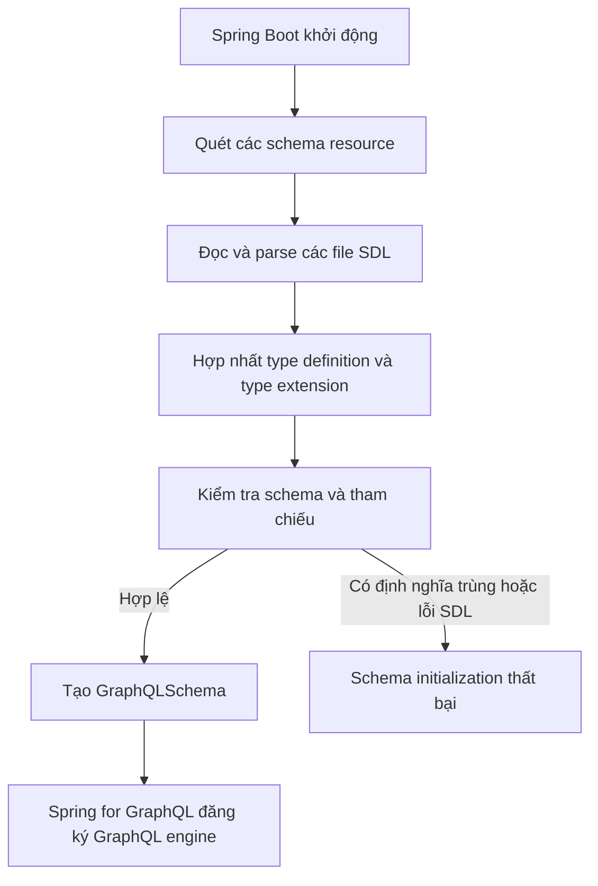

# Schema trùng type

## 1. Vì sao schema có thể bị trùng type?

Khi một ứng dụng Spring for GraphQL phát triển, schema SDL thường được tách thành nhiều file để mỗi nhóm nghiệp vụ quản lý phần dữ liệu của mình. Ví dụ, module sách khai báo `Book`, module tác giả khai báo `Author`, còn các module cùng bổ sung field vào root type `Query`.

Việc chia file giúp tổ chức schema dễ đọc và dễ bảo trì, nhưng tất cả file được nạp vào một GraphQL schema chung. Tên type trong GraphQL thuộc cùng một namespace của schema đó. Nếu hai file cùng định nghĩa một type có cùng tên, GraphQL không hiểu đó là hai type riêng theo package Java; quá trình xây dựng schema sẽ phát hiện định nghĩa trùng và thất bại.

Ví dụ không hợp lệ:

`book.graphqls`:

```graphql
type Book {
    id: ID!
    title: String!
}
```

`catalog.graphqls`:

```graphql
type Book {
    isbn: String!
    publishedYear: Int
}
```

Cả hai file đều khai báo `type Book`. Đây là hai định nghĩa object type cùng tên, không phải hai phần của một type được tự động ghép lại. Khi Spring for GraphQL nạp các tài nguyên schema, GraphQL Java kiểm tra và báo lỗi duplicate type.

Nếu mục tiêu là bổ sung field cho `Book` đã tồn tại, file thứ hai phải dùng `extend type Book`.

## 2. Spring for GraphQL nạp nhiều file SDL như thế nào?

Trong cấu hình Spring Boot thông dụng, schema SDL được đặt trong `src/main/resources/graphql/`. Các file có phần mở rộng `.graphqls` hoặc `.gqls` trong vị trí schema được cấu hình sẽ được tập hợp để xây dựng một schema thực thi.

Ví dụ cấu trúc thư mục:

```text
src/main/resources/graphql/
├── common/
│   ├── scalars.graphqls
│   └── pagination.graphqls
├── book/
│   ├── book.graphqls
│   └── book-query.graphqls
├── author/
│   └── author.graphqls
└── order/
    └── order.graphqls
```

Các file trên không tạo ra những schema độc lập. Chúng được kết hợp thành một schema chung để GraphQL Java kiểm tra tham chiếu type, field, input, enum và các quy tắc của GraphQL.

Luồng tổng quát:



Vì vậy, một file riêng lẻ có thể trông hợp lệ nhưng toàn bộ schema vẫn lỗi khi ghép các file lại. Cần kiểm tra schema ở trạng thái tổng hợp, không chỉ mở từng file để xem cú pháp.

## 3. Quy tắc: định nghĩa type một lần, mở rộng bằng `extend`

Một named type chỉ nên có một định nghĩa gốc trong schema. Khi cần thêm field hoặc thành viên ở file khác, dùng type extension tương ứng.

Ví dụ định nghĩa gốc:

`book.graphqls`:

```graphql
type Book {
    id: ID!
    title: String!
}

type Query {
    book(id: ID!): Book
}
```

Mở rộng type từ file nghiệp vụ khác:

`book-author.graphqls`:

```graphql
type Author {
    id: ID!
    name: String!
}

extend type Book {
    author: Author
}

extend type Query {
    booksByAuthor(authorId: ID!): [Book!]!
}
```

Trong ví dụ này:

- `Book` chỉ được định nghĩa gốc một lần.
- `Query` chỉ được định nghĩa gốc một lần.
- `Author` là type mới nên có định nghĩa `type Author` riêng.
- `extend type Book` bổ sung field `author` vào type đã có.
- `extend type Query` bổ sung field `booksByAuthor` vào root query.

Sau khi hợp nhất, schema có thể được hiểu tương đương với một object type `Book` chứa `id`, `title`, `author` và một root type `Query` chứa cả `book` lẫn `booksByAuthor`.

`extend` là cú pháp của GraphQL SDL. Nó không phải Java inheritance, không sửa class Java và không tự tạo resolver. Nếu field mới cần logic tải dữ liệu, ứng dụng vẫn phải cung cấp data fetcher hoặc mapping phù hợp.

## 4. Chia root `Query` qua nhiều file

Một trường hợp thường gặp là mỗi nhóm nghiệp vụ muốn tự khai báo root query trong file của mình. Không nên lặp lại `type Query` ở mọi file.

Ví dụ sai:

`book-query.graphqls`:

```graphql
type Query {
    book(id: ID!): Book
}
```

`author-query.graphqls`:

```graphql
type Query {
    author(id: ID!): Author
}
```

Ví dụ đúng:

`root.graphqls`:

```graphql
type Query {
    health: String!
}
```

`book-query.graphqls`:

```graphql
extend type Query {
    book(id: ID!): Book
    books(first: Int = 20): [Book!]!
}
```

`author-query.graphqls`:

```graphql
extend type Query {
    author(id: ID!): Author
    authors(first: Int = 20): [Author!]!
}
```

Schema sau khi tổng hợp có một root `Query` với các field `health`, `book`, `books`, `author` và `authors`. Các nhóm có thể quản lý field của mình trong file riêng mà không tạo định nghĩa root type trùng lặp.

Root query type là thành phần bắt buộc của schema thực thi. Với tên root mặc định, cần có một định nghĩa gốc `type Query` trước khi các file khác mở rộng nó. Nếu schema dùng tên root tùy chỉnh, hãy khai báo ánh xạ trong `schema` và mở rộng đúng object type được ánh xạ; ví dụ:

```graphql
schema {
    query: RootQuery
}

type RootQuery {
    health: String!
}

extend type RootQuery {
    book(id: ID!): Book
}
```

Tương tự, nếu API có mutation hoặc subscription, hãy định nghĩa root type tương ứng một lần rồi dùng `extend type Mutation` hoặc `extend type Subscription` để bổ sung field. Khi schema đã khai báo root mapping tường minh và muốn bổ sung operation root ở file khác, dùng `extend schema` để mở rộng schema thay vì khai báo một khối `schema` thứ hai:

```graphql
type Mutation {
    createBook(input: CreateBookInput!): Book!
}

extend schema {
    mutation: Mutation
}
```

## 5. Mở rộng các loại type khác

GraphQL SDL hỗ trợ type extension cho nhiều loại named type, không chỉ object type. Cách dùng vẫn theo cùng nguyên tắc: định nghĩa gốc một lần, file khác chỉ bổ sung thành phần hợp lệ.

### Interface

```graphql
interface Node {
    id: ID!
}
```

File khác có thể bổ sung field vào interface:

```graphql
extend interface Node {
    createdAt: DateTime!
}
```

Các object type triển khai `Node` phải đáp ứng hợp đồng interface sau khi schema được tổng hợp.

### Union

```graphql
union SearchResult = Book | Author
```

Một file khác có thể thêm thành viên:

```graphql
extend union SearchResult = Publisher
```

Các thành viên mới phải là object type tồn tại trong schema. Không thêm trùng thành viên đã được khai báo.

### Enum

```graphql
enum OrderStatus {
    PENDING
    PAID
}
```

Mở rộng enum bằng giá trị mới:

```graphql
extend enum OrderStatus {
    CANCELLED
    REFUNDED
}
```

Không khai báo lại `PENDING` hoặc `PAID` trong extension. Một enum value chỉ xuất hiện một lần trong enum cuối cùng.

### Input object

```graphql
input BookFilter {
    titleContains: String
}
```

File khác có thể thêm input field:

```graphql
extend input BookFilter {
    authorId: ID
    publishedAfter: Date
}
```

Các input field bổ sung phải dùng input type hợp lệ. Không đưa object type hoặc interface vào vị trí kiểu input.

Việc dùng extension cho interface, union, enum và input object cũng cần kiểm tra toàn bộ schema sau khi hợp nhất. `extend` không bỏ qua các quy tắc type system; nó chỉ cung cấp cú pháp để ghép các phần định nghĩa hợp lệ.

## 6. Những trường hợp vẫn bị coi là trùng khi dùng `extend`

`extend` không cho phép khai báo lại thành phần đã có. Ví dụ, type gốc đã có field `title`:

```graphql
type Book {
    id: ID!
    title: String!
}
```

Extension sau đây vẫn không hợp lệ:

```graphql
extend type Book {
    title: String
    author: Author
}
```

Field `title` bị định nghĩa hai lần trong cùng type sau khi hợp nhất. Cần bỏ field trùng và chỉ giữ phần bổ sung:

```graphql
extend type Book {
    author: Author
}
```

Các trường hợp trùng thường gặp khác:

- Hai file cùng định nghĩa `type Author` thay vì một file định nghĩa và file kia mở rộng.
- Hai extension cùng thêm field `author` vào `Book`.
- Hai extension enum cùng thêm giá trị `CANCELLED`.
- Một union khai báo thành viên `Publisher` ở cả định nghĩa gốc và extension.
- Một input object được mở rộng bằng hai input field cùng tên.
- Nhiều file khai báo lại scalar cùng tên như `scalar Date`.
- Nhiều file định nghĩa lại schema root mapping thay vì mở rộng schema phù hợp.

Hãy coi schema sau khi tổng hợp là một cấu trúc duy nhất. Mọi tên field, argument, enum value, union member và named type phải thỏa mãn quy tắc duy nhất của vị trí tương ứng.

## 7. Type extension phải tham chiếu đến type gốc hợp lệ

Extension chỉ có ý nghĩa khi type mục tiêu tồn tại trong schema cuối cùng. Ví dụ:

```graphql
extend type Invoice {
    overdue: Boolean!
}
```

Nếu không có định nghĩa gốc `type Invoice`, schema không thể mở rộng type này. Cần tạo định nghĩa gốc:

```graphql
type Invoice {
    id: ID!
    total: Money!
}
```

Sau đó mới mở rộng:

```graphql
extend type Invoice {
    overdue: Boolean!
}
```

Ngoài ra, mọi type được tham chiếu trong field, argument, input field, interface implementation hoặc union member phải tồn tại và đúng vị trí input/output. Ví dụ `Author` phải được định nghĩa nếu `Book.author` trả về `Author`; `BookFilter` phải là input object nếu được dùng làm argument.

## 8. Tổ chức schema theo module nghiệp vụ

Khi schema lớn, nên chia file theo domain hoặc feature, nhưng vẫn xác định rõ file nào sở hữu định nghĩa gốc của từng type.

Một cấu trúc có thể dùng:

```text
graphql/
├── root/
│   ├── query.graphqls
│   ├── mutation.graphqls
│   └── subscription.graphqls
├── book/
│   ├── book.graphqls
│   ├── book-query.graphqls
│   └── book-input.graphqls
├── author/
│   ├── author.graphqls
│   └── author-query.graphqls
├── order/
│   ├── order.graphqls
│   └── order-query.graphqls
└── common/
    ├── scalars.graphqls
    └── pagination.graphqls
```

Một số quy ước giúp tránh trùng type:

1. Mỗi type có một file hoặc một module chịu trách nhiệm định nghĩa gốc.
2. Module khác muốn bổ sung field thì dùng `extend type` và ghi rõ quyền sở hữu field.
3. Root `Query`, `Mutation` và `Subscription` có một định nghĩa gốc tập trung.
4. Scalar dùng chung như `DateTime`, `Money` hoặc `UUID` chỉ khai báo một lần và được đăng ký runtime một lần.
5. Đặt tên type theo ngữ nghĩa domain để tránh hai nhóm vô tình dùng chung tên quá chung như `Result`, `Status` hoặc `Item`.
6. Tránh để nhiều module cùng sửa một type mà không thống nhất ownership, vì việc thay đổi có thể tạo xung đột field hoặc hợp đồng.

GraphQL type name có phạm vi toàn schema. Package Java khác nhau không tạo namespace riêng cho GraphQL. Nếu hai domain có hai khái niệm `Status` khác nhau, hãy đặt tên rõ nghĩa như `OrderStatus` và `PaymentStatus`.

## 9. Cấu hình vị trí schema trong Spring Boot

Spring Boot tìm schema trong classpath theo vị trí mặc định của cấu hình GraphQL. Nếu cần thay đổi vị trí, có thể cấu hình trong `application.yml`:

```yaml
spring:
  graphql:
    schema:
      locations: classpath:graphql/**/
      file-extensions: .graphqls,.gqls
```

`locations` chỉ định các vị trí tài nguyên schema cần nạp; `file-extensions` chỉ định phần mở rộng được nhận diện. Hãy bảo đảm tất cả file cần thiết đều nằm trong các vị trí này và không vô tình nạp cùng một file hai lần qua các pattern chồng lấn.

Việc thay đổi `locations` không giải quyết lỗi duplicate type. Nếu hai file được nạp và cùng định nghĩa một type, schema vẫn không hợp lệ. Cấu hình chỉ quyết định tài nguyên nào được đưa vào quá trình xây dựng schema.

Khi ứng dụng dùng cấu hình `GraphQlSource` tùy chỉnh thay cho auto-configuration, cần kiểm tra danh sách `schemaResources` được truyền vào builder. Đừng giả định rằng file nằm trong `src/main/resources/graphql/` chắc chắn được nạp nếu cấu hình tùy chỉnh đã thay đổi nguồn schema.

## 10. Mapping resolver sau khi mở rộng schema

Type extension chỉ bổ sung field vào schema. Nếu field cần logic riêng, Spring for GraphQL vẫn cần resolver.

Ví dụ SDL:

`book.graphqls`:

```graphql
type Book {
    id: ID!
    title: String!
}
```

`book-author.graphqls`:

```graphql
type Author {
    id: ID!
    name: String!
}

extend type Book {
    author: Author
}
```

Resolver:

```java
import org.springframework.graphql.data.method.annotation.SchemaMapping;
import org.springframework.stereotype.Controller;

@Controller
public class BookAuthorController {

    private final AuthorService authorService;

    public BookAuthorController(AuthorService authorService) {
        this.authorService = authorService;
    }

    @SchemaMapping(typeName = "Book", field = "author")
    public Author author(Book book) {
        return authorService.findById(book.authorId()).orElse(null);
    }
}
```

Ví dụ giả định đối tượng Java `Book` có `authorId()`. `@SchemaMapping` ánh xạ resolver đến field `author` của GraphQL type `Book`, dù field đó được thêm từ file SDL thông qua `extend type`.

Với root field được bổ sung bằng `extend type Query`, có thể dùng `@QueryMapping`:

```java
@QueryMapping
public Author author(@Argument String id) {
    return authorService.findById(id).orElse(null);
}
```

Tên field trong SDL và tên mapping phải khớp. Nếu schema đã hợp lệ nhưng request báo `Field ... has no data fetcher` hoặc trả về `null`, hãy kiểm tra mapping và cơ chế property access; đây là vấn đề thực thi field, khác với lỗi duplicate type lúc khởi động.

## 11. Nhận biết và xử lý lỗi schema trùng type

Khi schema không hợp lệ, ứng dụng thường thất bại trong quá trình khởi tạo GraphQL schema hoặc context. Thông báo cụ thể có thể khác nhau theo phiên bản Spring Boot và GraphQL Java, nhưng thường chứa tên type, field hoặc enum value bị trùng.

| Thông báo hoặc hiện tượng | Nguyên nhân có thể | Cách xử lý |
| --- | --- | --- |
| `There can be only one type named "Book"` | Nhiều file cùng định nghĩa `type Book` | Giữ một định nghĩa gốc, đổi các định nghĩa bổ sung thành `extend type Book` |
| Field `title` đã được định nghĩa | Base type và extension cùng khai báo `title` | Xóa field trùng khỏi extension |
| Enum value bị định nghĩa nhiều lần | Nhiều file thêm cùng giá trị enum | Giữ một lần xuất hiện trong enum cuối cùng |
| Union member bị lặp | Cùng object type được thêm từ nhiều nơi | Xóa thành viên trùng khỏi extension |
| Type extension không tìm thấy type đích | Thiếu định nghĩa gốc hoặc tên type sai | Thêm type gốc hoặc sửa type condition/target |
| Không tìm thấy type được tham chiếu | SDL dùng type chưa được định nghĩa | Bổ sung định nghĩa đúng hoặc kiểm tra schema resource có được nạp không |
| Không có root Query | Chưa định nghĩa query root hợp lệ | Khai báo `type Query` một lần |
| Schema lỗi sau khi thêm file mới | File mới được nạp và tạo xung đột với file cũ | Kiểm tra toàn bộ định nghĩa cùng tên và resource pattern |
| Schema hợp lệ nhưng field không chạy | Thiếu resolver hoặc mapping sai | Kiểm tra `@QueryMapping`, `@SchemaMapping` và service |

### Quy trình tìm file gây trùng

1. Đọc tên type hoặc field trong lỗi khởi động.
2. Tìm kiếm trong các file `.graphqls` và `.gqls` thuộc schema locations đang dùng.
3. Phân loại từng lần xuất hiện: định nghĩa gốc, extension hay định nghĩa lặp không hợp lệ.
4. Chọn một nơi làm chủ định nghĩa gốc; đổi các phần bổ sung thành extension.
5. Kiểm tra field, enum value, union member và input field có bị trùng sau khi hợp nhất không.
6. Khởi động lại context hoặc chạy kiểm thử schema để xác nhận toàn bộ schema hợp lệ.

Không giải quyết bằng cách đổi tên type một cách máy móc nếu hai file thực sự mô tả cùng một khái niệm nghiệp vụ. Trước tiên xác định chúng là một type cần mở rộng hay hai khái niệm khác nhau cần tên riêng.

## 12. Kiểm thử schema tổng hợp

Kiểm tra từng file riêng lẻ chưa đủ. Cần có kiểm thử khởi tạo schema từ đúng tập resource mà ứng dụng dùng trong môi trường chạy.

Một kiểm thử tích hợp Spring for GraphQL có thể dùng `GraphQlTester` để xác nhận query gọi được field đến từ nhiều file:

```java
@SpringBootTest
@AutoConfigureHttpGraphQlTester
class SchemaCompositionTests {

    @Autowired
    GraphQlTester graphQlTester;

    @Test
    void queryCanUseFieldsDefinedAcrossSchemaFiles() {
        graphQlTester.document("""
            query {
                book(id: "book-42") {
                    id
                    title
                    author {
                        id
                        name
                    }
                }
            }
            """)
            .execute()
            .errors()
            .verify();
    }
}
```

Ví dụ giả định test context có dữ liệu hoặc mock service phù hợp và các resolver tương ứng đã được cấu hình. Mục tiêu ở đây là xác nhận schema tổng hợp được khởi tạo và operation có thể được validation/thực thi. Trong dự án thực tế, nên kiểm tra thêm giá trị trả về và các lỗi nghiệp vụ mong đợi.

Có thể bổ sung kiểm thử introspection để xác nhận field mở rộng đã xuất hiện trên type cuối cùng:

```graphql
query BookFields {
    __type(name: "Book") {
        fields {
            name
        }
    }
}
```

Kết quả cần có cả field gốc như `id`, `title` và field mở rộng như `author`. Introspection hữu ích để kiểm tra schema runtime, nhưng không thay thế kiểm thử resolver hoặc validation của các operation thực tế.

## 13. Checklist tránh schema trùng type

- [ ] Mỗi named type có đúng một định nghĩa gốc trong schema tổng hợp.
- [ ] Các file khác dùng `extend` khi bổ sung field hoặc thành viên.
- [ ] Root `Query`, `Mutation` và `Subscription` chỉ được định nghĩa gốc một lần.
- [ ] Mọi type extension đều tham chiếu đến type gốc tồn tại.
- [ ] Không có field, input field, enum value hoặc union member trùng tên.
- [ ] Các type được tham chiếu đều tồn tại và đúng vị trí input/output.
- [ ] Tên type phản ánh domain và tránh xung đột giữa các module.
- [ ] Schema locations không nạp trùng một resource qua nhiều pattern.
- [ ] Resolver cho field mới được ánh xạ bằng annotation phù hợp.
- [ ] Kiểm thử khởi tạo schema tổng hợp và operation dùng field từ nhiều file.

## Kết luận

Schema trùng type xảy ra khi nhiều file SDL cùng định nghĩa một named type trong khi Spring for GraphQL nạp chúng vào cùng một GraphQL schema. Việc chia schema thành nhiều file không tạo namespace riêng; mỗi type chỉ nên có một định nghĩa gốc. Những module cần bổ sung field nên dùng `extend type`, `extend interface`, `extend input`, `extend enum` hoặc extension phù hợp với loại type.

Trong Spring Boot, cần kiểm soát schema locations, quy ước ownership cho định nghĩa gốc và kiểm thử schema sau khi tổng hợp. `extend` chỉ giải quyết việc tổ chức SDL; field mới vẫn cần resolver khi có logic dữ liệu. Khi phân biệt được lỗi duplicate definition, lỗi extension và lỗi mapping resolver, việc tìm nguyên nhân schema không khởi động hoặc field không thực thi sẽ rõ ràng và nhanh hơn.
