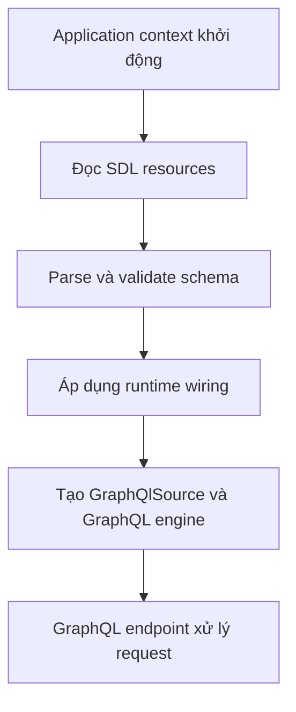
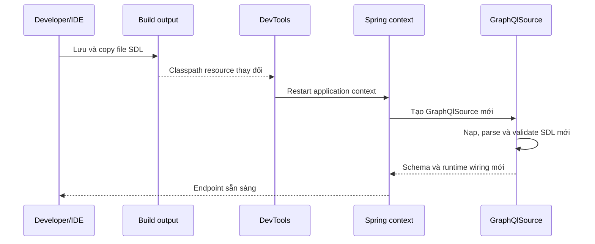

# Reload schema trong development

Khi phát triển GraphQL API, schema SDL thường xuyên thay đổi: thêm field, sửa argument, điều chỉnh nullability hoặc mở rộng type. Sau khi lưu file `.graphqls`, ứng dụng cần nạp lại schema để GraphQL endpoint phản ánh định nghĩa mới. Với Spring for GraphQL, schema được xây dựng trong quá trình khởi tạo ứng dụng và được giữ trong `GraphQlSource`. Vì vậy, cách đơn giản và phù hợp cho development là dùng **Spring Boot DevTools restart** để khởi động lại application context khi resource trên classpath thay đổi.

DevTools restart tạo lại các bean, bao gồm `GraphQlSource`, executable `GraphQLSchema`, runtime wiring và các mapping controller. Đây là cơ chế khởi động lại ứng dụng trong môi trường phát triển, không phải GraphQL tự đọc lại SDL ở mỗi request.

## 1. Schema được nạp khi nào?

Trong cấu hình Spring Boot thông thường, Spring for GraphQL tìm SDL trong resource classpath, mặc định ở `classpath:graphql/**/`. Các file như `schema.graphqls`, `book.graphqls` hoặc `author.gqls` được đọc và kết hợp để tạo schema.

Ở giai đoạn khởi động, Spring Boot auto-configuration tạo `GraphQlSource` từ các resource và cấu hình runtime. `GraphQlSource` cung cấp schema và GraphQL engine được dùng để xử lý operation. Các `RuntimeWiringConfigurer`, controller mapping như `@QueryMapping` và `@SchemaMapping`, scalar và type resolver cũng được kết nối trong quá trình xây dựng runtime.



Sau khi context đã chạy, chỉnh sửa file SDL trên ổ đĩa không tự thay đổi schema đang được sử dụng. Ứng dụng cần tạo lại `GraphQlSource`, thường bằng cách restart context.

## 2. Spring Boot DevTools restart

Spring Boot DevTools cung cấp cơ chế tự restart khi các file trong classpath thay đổi. DevTools theo dõi các thư mục output của build như `build/classes`, `build/resources/main` hoặc `target/classes`. Khi phát hiện thay đổi phù hợp, nó khởi động lại application context bằng restart classloader.

Khi file SDL được build/copy lại vào classpath, quá trình restart tạo lại các bean Spring. Spring for GraphQL nạp SDL mới và xây dựng schema mới. Bạn có thể tiếp tục gửi query đến endpoint sau khi ứng dụng khởi động lại xong.

### Thêm DevTools vào dự án

Với Gradle và Spring Boot plugin:

```groovy
dependencies {
    developmentOnly("org.springframework.boot:spring-boot-devtools")
}
```

Với Maven:

```xml
<dependency>
    <groupId>org.springframework.boot</groupId>
    <artifactId>spring-boot-devtools</artifactId>
    <scope>runtime</scope>
    <optional>true</optional>
</dependency>
```

DevTools chỉ dành cho development. Spring Boot build plugin thường loại DevTools khỏi executable archive được đóng gói, nhưng vẫn nên giữ dependency trong cấu hình phát triển phù hợp và kiểm tra artifact production khi cần.

DevTools restart thường được bật tự động khi dependency có mặt trong môi trường chạy phù hợp. Có thể cấu hình tường minh:

```yaml
spring:
  devtools:
    restart:
      enabled: true
```

Nếu muốn tắt restart trong một lần chạy, đặt `spring.devtools.restart.enabled=false`. Không nên bật DevTools restart trong môi trường production.

## 3. Vì sao lưu file SDL đôi khi không làm ứng dụng restart?

DevTools quan sát classpath output, không theo dõi trực tiếp mọi file trong thư mục source. Với dự án Gradle, file ở `src/main/resources/graphql` cần được sao chép sang `build/resources/main/graphql`. Với Maven, resource thường được sao chép sang `target/classes/graphql`.

Do đó, quy trình có hai bước:

1. IDE hoặc build tool phát hiện file resource đã thay đổi và sao chép nó vào output directory.
2. DevTools phát hiện output directory thay đổi và restart application context.

Ví dụ cấu trúc dự án Gradle:

```text
src/main/resources/graphql/
├── schema.graphqls
└── book.graphqls

build/resources/main/graphql/
├── schema.graphqls
└── book.graphqls
```

Nếu chỉ lưu `src/main/resources/graphql/book.graphqls` nhưng IDE không build/copy resources, DevTools có thể không nhận ra thay đổi vì file classpath vẫn giữ nội dung cũ.

Trong IntelliJ IDEA hoặc IDE tương tự, bật cơ chế build project/resource tự động khi phù hợp với workflow. Nếu dùng Gradle, có thể chạy tác vụ continuous để tự sao chép resource:

```bash
./gradlew -t processResources
```

Trên Windows:

```powershell
gradlew.bat -t processResources
```

Chạy tác vụ này trong một terminal riêng khi ứng dụng đang chạy bằng `bootRun` hoặc IDE. Khi resource thay đổi, Gradle cập nhật output directory; DevTools sẽ phát hiện và restart nếu thư mục đó nằm trong phạm vi theo dõi.

## 4. Cấu hình schema locations

Nếu schema nằm trong vị trí mặc định, không cần khai báo lại `spring.graphql.schema.locations`. Chỉ cấu hình thuộc tính này khi dự án đặt SDL ở resource root khác hoặc cần kết hợp nhiều nguồn:

```yaml
spring:
  graphql:
    schema:
      locations:
        - classpath:graphql/**/
        - classpath:shared-graphql/**/
```

Các vị trí đã cấu hình phải bao gồm đầy đủ nguồn schema cần nạp. Khi thay đổi cấu trúc file hoặc locations, hãy kiểm tra lại resource pattern và bảo đảm các type gốc cùng extension đều được tìm thấy.

Nếu muốn chỉnh sửa schema từ một thư mục bên ngoài classpath, có thể cấu hình resource bằng `file:`. Ví dụ:

```yaml
spring:
  graphql:
    schema:
      locations:
        - file:./config/graphql/**/
  devtools:
    restart:
      additional-paths:
        - ./config/graphql
```

Ở đây, `spring.graphql.schema.locations` cho Spring for GraphQL biết nơi đọc SDL. `spring.devtools.restart.additional-paths` yêu cầu DevTools theo dõi thêm thư mục để phát hiện thay đổi và kích hoạt restart. Hai thuộc tính có nhiệm vụ khác nhau: thêm một thư mục vào danh sách theo dõi không tự làm thư mục đó trở thành schema resource; cần cấu hình `file:` tương ứng để Spring for GraphQL đọc được nội dung.

Đường dẫn tương đối được tính theo working directory của tiến trình. Khi chạy ứng dụng từ IDE, hãy kiểm tra working directory để tránh trường hợp ứng dụng tìm schema ở một vị trí khác dự kiến.

## 5. Dùng trigger file khi muốn chủ động restart

Khi đang sửa nhiều file SDL cùng lúc, restart sau mỗi lần lưu có thể làm gián đoạn workflow. DevTools hỗ trợ trigger file để chỉ thực hiện restart sau khi file kích hoạt được thay đổi.

Ví dụ:

```yaml
spring:
  devtools:
    restart:
      trigger-file: .reloadtrigger
```

Đặt file `.reloadtrigger` ở classpath root, chẳng hạn `src/main/resources/.reloadtrigger`. Sau khi hoàn tất một nhóm thay đổi schema và các resource đã được copy vào classpath, cập nhật trigger file để yêu cầu DevTools restart.

Trigger file chỉ điều khiển thời điểm restart. Nó không thay thế việc build/copy resource và không thay đổi schema location. Nếu file SDL vẫn chưa có trong classpath hoặc đường dẫn `file:` chưa được cấu hình đúng, restart cũng không thể nạp được nội dung mong muốn.

## 6. Điều gì xảy ra trong một lần schema reload?

Với DevTools, một lần reload schema thực chất là một lần restart application context. Trình tự thường diễn ra như sau:



Sau restart:

- Schema SDL mới được parse và validate.
- Runtime wiring được áp dụng lại.
- Các controller mapping được đăng ký lại.
- Các bean Spring được tạo lại trong context mới.
- Endpoint tiếp tục xử lý query theo schema mới sau khi ứng dụng sẵn sàng.

Vì application context được restart, trạng thái trong bộ nhớ của bean cũng có thể được khởi tạo lại. Những request đang xử lý có thể bị gián đoạn. Vì vậy, chỉ dùng cơ chế này trong development, không xem nó là cách cập nhật schema không gián đoạn cho production.

## 7. Kiểm tra schema đã được nạp lại

Sau khi DevTools báo restart hoàn tất, kiểm tra theo thứ tự:

1. Xem log để xác nhận application context đã restart và startup thành công.
2. Kiểm tra file SDL mới đã xuất hiện trong `build/resources/main` hoặc `target/classes`, nếu schema nằm trên classpath.
3. Gửi một query sử dụng field vừa thêm hoặc thay đổi.
4. Nếu introspection được bật, có thể kiểm tra type và field qua `__type`.

Ví dụ kiểm tra field mới trên `Book`:

```graphql
query {
    __type(name: "Book") {
        name
        fields {
            name
            type {
                kind
                name
            }
        }
    }
}
```

Introspection có thể bị tắt hoặc giới hạn theo cấu hình bảo mật của ứng dụng. Khi đó, kiểm tra trực tiếp bằng operation nghiệp vụ hoặc kiểm thử tích hợp với `GraphQlTester`.

Ví dụ kiểm thử sau khi schema được nạp:

```java
graphQlTester.document("""
        query {
            book(id: "book-01") {
                id
                title
            }
        }
        """)
    .execute()
    .path("book.title")
    .entity(String.class)
    .isEqualTo("Spring in Action");
```

Trong development, có thể dùng một query nhỏ cho field vừa thêm để xác nhận cả schema và resolver. Nếu SDL có field mới nhưng không có resolver hoặc property tương ứng, query có thể trả `null` hoặc lỗi non-null. Vì vậy, cần cập nhật schema và mapping/controller cùng nhau.

## 8. Xử lý lỗi khi reload

Schema mới phải hợp lệ trước khi `GraphQlSource` có thể được tạo. Nếu file có lỗi cú pháp, type được tham chiếu không tồn tại, extension bị trùng hoặc interface implementation không thỏa contract, quá trình khởi động lại có thể thất bại.

Khi gặp lỗi, kiểm tra log startup để xác định file và vị trí SDL gây lỗi. Sau đó:

- Kiểm tra resource đã được copy vào đúng output directory chưa.
- Kiểm tra `spring.graphql.schema.locations` có bao phủ file đó không.
- Kiểm tra phần mở rộng file có nằm trong danh sách schema extensions được hỗ trợ không.
- Kiểm tra cú pháp, type reference, field trùng và quan hệ interface/union.
- Kiểm tra controller mapping và runtime wiring có còn khớp schema mới không.

Không nên chỉ dựa vào việc DevTools đã in thông báo restart để kết luận schema hợp lệ. Hãy đợi log startup hoàn tất và gửi query kiểm tra. Khi schema không hợp lệ, sửa SDL rồi để DevTools restart lại hoặc chủ động restart ứng dụng.

## 9. Phân biệt DevTools restart và LiveReload

DevTools có thể tích hợp LiveReload để yêu cầu trình duyệt tải lại trang khi tài nguyên frontend thay đổi. LiveReload và restart là hai cơ chế khác nhau:

| Cơ chế | Tác dụng |
| --- | --- |
| DevTools restart | Restart application context, tạo lại `GraphQlSource` và runtime wiring |
| LiveReload | Làm mới trang trên trình duyệt khi tài nguyên frontend thay đổi |
| Build resource task | Sao chép SDL từ source resource vào classpath output |
| `spring.graphql.schema.locations` | Xác định nơi Spring for GraphQL đọc schema |

LiveReload một trang web không làm schema GraphQL trên server thay đổi. Ngược lại, DevTools restart server không đảm bảo trình duyệt tự tải lại trang frontend. Khi phát triển GraphQL thuần hoặc dùng GraphiQL, hãy gửi lại operation sau khi server restart hoàn tất.

## 10. Có thể reload schema mà không restart ứng dụng không?

Spring for GraphQL không mặc định cung cấp một endpoint hoặc nút `reload schema` để đọc lại SDL và thay thế schema đang chạy sau mỗi lần lưu file. `GraphQlSource` được tạo trong vòng đời application context và phục vụ việc thực thi GraphQL.

Nếu hệ thống thực sự cần thay schema động mà không restart toàn bộ context, phải thiết kế cơ chế riêng: xây dựng schema mới từ resource, validate đầy đủ, tạo GraphQL engine/runtime wiring tương ứng rồi chuyển các request mới sang engine mới một cách an toàn. Cần xử lý đồng thời request đang chạy, DataLoader, instrumentation, controller mappings, cache và các bean phụ thuộc schema. Đây là kiến trúc runtime nâng cao, không phải cấu hình development thông thường.

Không nên sửa trực tiếp một `GraphQLSchema` đang được dùng hoặc thay file SDL trên đĩa rồi giả định các request kế tiếp sẽ tự thấy thay đổi. Với workflow phát triển hàng ngày, DevTools restart đơn giản hơn và bảo đảm toàn bộ context được dựng lại nhất quán.

## 11. Lưu ý khi dùng DevTools

- Chỉ thêm DevTools vào môi trường phát triển và không bật restart trong production.
- Đảm bảo IDE hoặc build tool copy resource sau khi sửa SDL.
- Nếu dùng schema ở ngoài classpath, cấu hình `file:` trong schema locations và thêm thư mục vào `restart.additional-paths`.
- Nếu restart liên tục khi đang chỉnh nhiều file, dùng trigger file để chủ động chọn thời điểm restart.
- Nếu restart gặp lỗi classloader hoặc trạng thái ứng dụng không ổn định, dừng và khởi chạy lại tiến trình development sau khi sửa cấu hình hoặc build output.
- Giữ SDL, controller mapping, scalar, directive wiring và type resolver đồng bộ sau mỗi thay đổi.

Trong Spring for GraphQL, schema được tạo cùng application context. Khi phát triển, hãy để build tool cập nhật resource và dùng DevTools restart để tạo lại context cùng `GraphQlSource`. Hiểu rõ vai trò của resource copying, schema locations và restart trigger giúp bạn xác định đúng nguyên nhân khi schema chưa phản ánh thay đổi, đồng thời giữ quy trình development đơn giản và có thể kiểm tra được.
